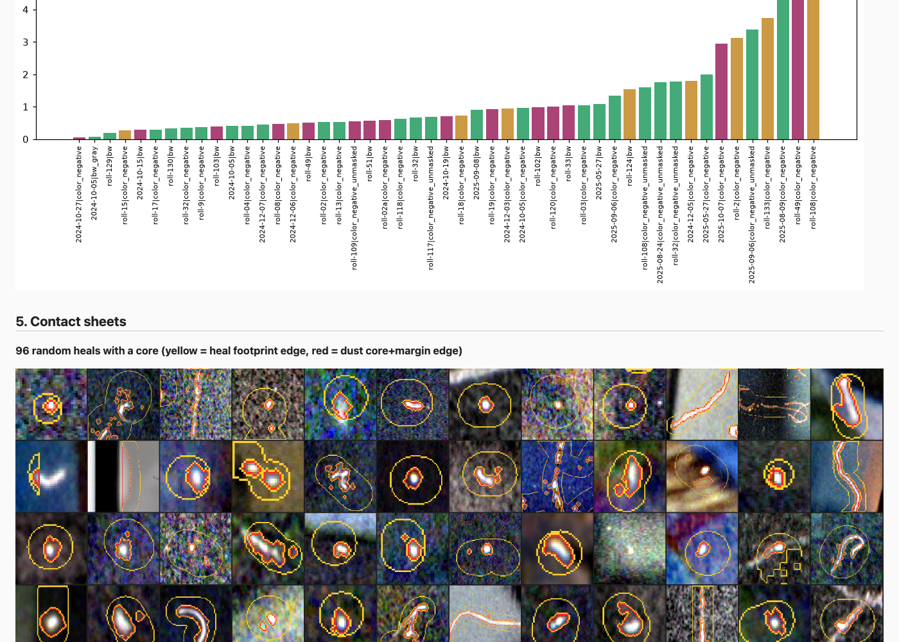
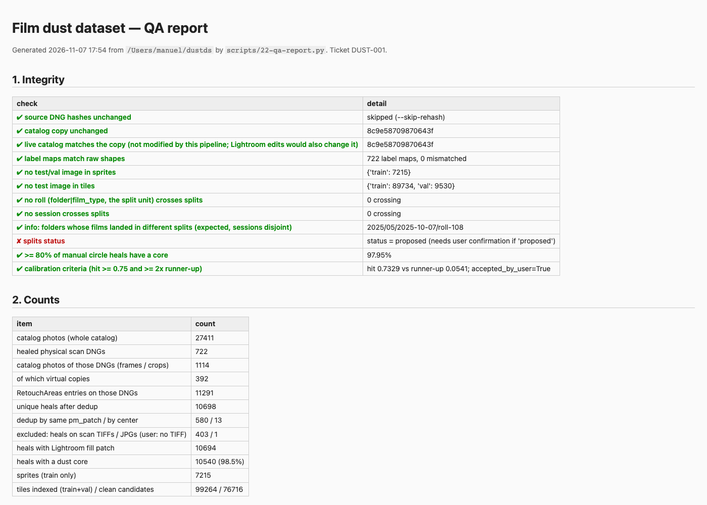
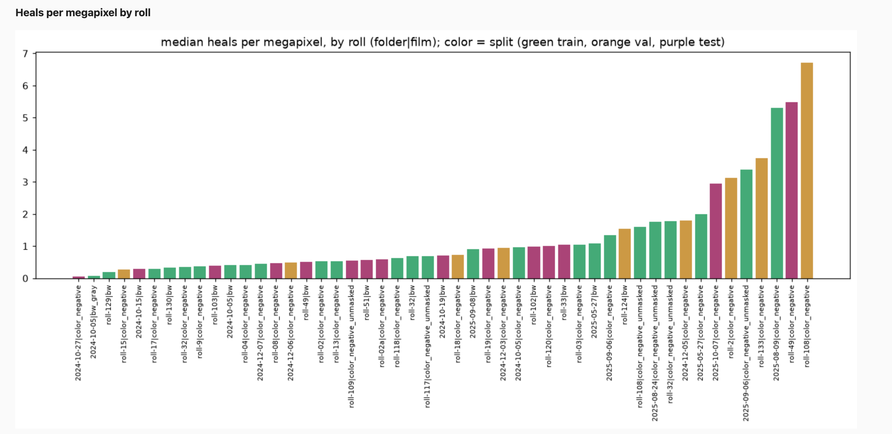
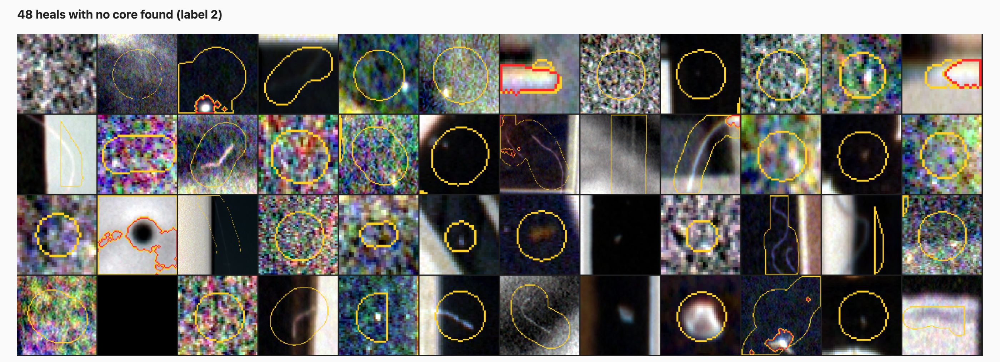
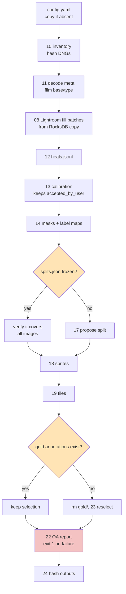

# Film Dust Dataset, Part 7: The QA Report and Reproducible Rebuilds — A Technical Deep Dive

The previous reports built the dataset one phase at a time: an inventory of 722 healed scan DNGs, 10,706 unique heals extracted from a Lightroom catalog, a proven coordinate transform, tightened dust masks, a frozen roll-and-session split, and a sprite library with a clean-tile index (see [[PROJECT REPORT - Film Dust Dataset - Part 6 - Dust Sprites and Clean Tiles - A Technical Deep Dive|Part 6]]). Each phase was checked when it was built. This report is about the two things that turn a sequence of checked phases into a dataset that can be trusted for training: a QA report that re-proves the important invariants on the finished output, and a single script, `make_all.sh`, that rebuilds everything from the catalog copy and the DNGs and produces byte-identical files when run twice.

It also covers the acceptance checklist from the project's specification, item by item, with the evidence for each, and the one review that changed the dataset more than any automated check: the user's look at a contact sheet of heals where no dust core was found.

> [!summary]
> - **The QA report is a test suite with pictures.** `22-qa-report.py` writes one offline HTML file (4.1 MB, all images as data URIs) and `qa/integrity.json`, and exits with status 1 if any of its eleven checks fails. On the final build all eleven pass.
> - **A human looking at a contact sheet is a QA instrument.** The "48 heals with no core found" sheet led to three detector fixes (Part 4b) that cut no-core heals from 158 to 92 without moving existing cores.
> - **The rebuild is reproducible.** Two full `make_all.sh` runs produced 30,181 byte-identical output files; the only difference was the hash file hashing its own previous copy. Eight of nine acceptance items pass; the gold-set labeling is the one item left.

## 1. What a QA report has to prove

The specification asks for a QA report "the user reviews before anything is used for training". That sentence sets the bar. A detector trained on this data will be judged on the test split, and every downstream number depends on assumptions that are easy to break silently: that the source files were never touched, that a label map lines up pixel for pixel with its scan, that no test frame leaked into the training material. None of these failures would raise an exception. A shifted label map trains fine. A leaked roll inflates test scores. The report exists to make such failures visible, and to make them visible on the *final* output rather than on intermediate state that later phases might have changed.

The report therefore has two audiences. The integrity table speaks to a machine: each row is a boolean with a detail string, the rows are written to `qa/integrity.json`, and the script's exit status is non-zero if any row is false. Everything else speaks to a person: counts, distributions and contact sheets that a human can scan in a few minutes and judge with the one instrument that no threshold replaces, which is the eye.

### 1.1 The integrity checks, and why each exists

| Check | What it computes | The failure it guards against |
|---|---|---|
| Source DNG hashes unchanged | SHA-256 of all 722 DNGs, eight threads, compared with `meta/hash_cache.json` | The ground rule "originals are read-only"; any write to a scan by any tool |
| Catalog copy unchanged | SHA-256 of `catalog_copy/*.lrcat` vs `config.yaml: catalog_copy.sha256` | A pipeline step opening the copy writably (SQLite journals, WAL files) |
| Live catalog matches the copy | Same hash on `~/Pictures/Lightroom/<name>.lrcat` | The pipeline touching the user's working catalog |
| Label maps match raw shapes | Width and height from each label PNG's IHDR, vs the DNG raw size | Labels written in a rotated or cropped frame |
| No test/val image in sprites | Split of every sprite's source image | Training material drawn from evaluation frames |
| No test image in tiles | Split of every indexed tile | The same, for clean background tiles |
| No roll crosses splits | Groups `folder|film_type` by split; counts groups in more than one | Dust that repeats across a roll appearing in train and test |
| No session crosses splits | Same, for 3-hour capture-time sessions | Dust on the scanner glass repeating across a scan session |
| Splits status | `splits.json` status is `frozen` | Training on a split the user has not confirmed |
| ≥ 80% of manual circles have a core | Mean of `core_found` on manual circle heals | A broken Phase 4 detector |
| Calibration criteria | Hit rate ≥ 0.75 and ≥ 2× runner-up, *or* `accepted_by_user` | A coordinate transform nobody verified |

*Table 1. The eleven integrity checks of `22-qa-report.py`. A twelfth row is informational and always passes: it lists folders whose films landed in different splits.*

Two rows deserve a comment. The live-catalog check is weaker than it looks: it passes only as long as the user has not opened Lightroom since the copy was made. A future failure there means "Lightroom has edited the catalog, make a fresh copy", not "the pipeline corrupted it". The label-shape check reads only the first 24 bytes of each PNG, because the width and height sit at a fixed offset in the IHDR chunk; checking 722 maps takes no measurable time.

```python
def png_dims(p):
    with open(p, "rb") as f:
        hdr = f.read(24)
    return struct.unpack(">II", hdr[16:24])
```

The calibration row is the one place where a check passes by user decision. The identity transform hits 72.7% at the spec's 0.3r tolerance against a 75% bar, but its runner-up scores 5.6%, and Lightroom's own pixel boxes agree with the transform to a median of 0.25 px (Part 3). The user accepted it ("Alright, 4-8"), and the acceptance is recorded as `calibration.accepted_by_user: true` in `config.yaml`. The check reads that flag and prints it in its detail column, so the deviation is visible in the report instead of hidden by a lowered threshold.

### 1.2 The human-facing sections

Below the integrity table the report has five more sections: counts (catalog photos → DNGs → frames → catalog entries → unique heals → fill patches → cores → sprites → tiles, plus the 403 TIFF and 1 JPG heals excluded by the user), a table of heals by label source and mask type with core rates, the split table, rejected and flagged items with reasons, the calibration scores of all ten candidate transforms, distribution charts, contact sheets, and the film-type and base-confidence tables.

| Section | Contents on the final build |
|---|---|
| Counts | 27,411 catalog photos; 722 DNGs; 1,114 frames (392 virtual copies); 11,291 entries → 10,706 unique heals; 10,702 with a fill patch; 10,614 with a core (99.1%); 7,248 sprites; 101,698 tiles (78,548 clean) |
| Heals by source | manual brush 6,929 (99.4% core), manual circle 3,707 (98.8%), generative brush 69 (97.1%), legacy heal 1 |
| Rejects and flags | 92 heals without a core; sprite rejects: bright polarity 107, no core 60, max α < 0.1 45, no patch 1, quality 1; Phase 4 flags: edge 63, multi-mask 5, zero pm_target 3, no patch 4, ring too small 2 |
| Calibration | identity 0.7269, antitranspose 0.0561, eight others 0.026–0.052 |
| Contact sheets | 96 heals with a core, 48 with no core, 48 sprites as α, 24 clean tiles |

*Table 2. What the human-facing sections show, from `~/dustds/qa/report.html` after the second rebuild.*

## 2. Design choices

**One offline HTML file.** The report embeds every chart and contact sheet as a base64 `data:` URI. It has no server, no JavaScript and no external assets, so `open ~/dustds/qa/report.html` works on any machine, the file can be attached to a message, and the version the user approved is a single artifact. The cost is size, 4.1 MB, which is irrelevant.

**Contact sheets rendered from raw data, not from the viewer.** The project has a viewer (`dustview`, Part 0) that draws heals over scans. The QA report deliberately does not use it. Each contact-sheet tile is rendered directly from the DNG (memory-mapped through `dustds.rawio.open_raw`) and from the label PNG on disk: the crop is converted to density, `D = log10(I_base / raw)`, stretched to its own 1st–99.5th percentiles, and the label edges are painted on top (yellow for label 2, the heal footprint; red for label 1, the dust core plus margin).

```python
def positive(win, I_base):
    D = np.log10(np.asarray(I_base) / np.maximum(win.astype(np.float64), 1.0))
    lo, hi = np.percentile(D, [1, 99.5], axis=(0, 1))
    return np.clip((D - lo) / np.maximum(hi - lo, 1e-3), 0, 1)
```



*Figure 1. Top of the "96 random heals with a core" sheet from the first QA run (Step 19), below the end of the per-roll chart. Each 128-pixel tile is a crop around one heal in inverted density; yellow is the heal footprint edge, red the dust core plus its one-pixel margin. Round specks, hairs and multi-part cores are all visible at a glance.*

The reason is independence. A QA picture made by the viewer would show what the viewer believes; if the viewer and the label writer shared a coordinate bug, the overlay would look perfect and be wrong. Drawing the *stored label map* over the *raw pixels* checks the artifact that training will actually read.

**Seeded samples.** The random heals and sprites are drawn with `random.Random(seed + 7)` and `sample(..., random_state=seed)`, where `seed = 20261107` from `config.yaml`. The same build gives the same sheets, so a tile the user points at in one review can be found again.

**An exit code.** The script ends with `raise SystemExit(1 if fails else 0)`. Inside `make_all.sh`, which runs under `set -euo pipefail`, a failing integrity check therefore aborts the rebuild before the output hashes are written. A broken dataset cannot be mistaken for a finished one.

## 3. Two bugs found while building it

The first run failed with `KeyError: 0` on a line that counted Phase 4 flags with `H.flags`. `H` is a pandas DataFrame, and `DataFrame.flags` is a pandas attribute (it holds properties such as `allows_duplicate_labels`), so attribute access returned that object instead of the column named `flags`. Iterating it failed with an error that pointed nowhere near the cause. The fix is `H['flags']`. The general rule: never use attribute access for a DataFrame column whose name could be a pandas attribute.

The second bug was in a check, not in the data. The first version of the roll-crossing check grouped images by folder and reported "1 crossing". The split unit, however, is not the folder; it is `folder|film_type` (Part 5), because several folders mix films that were scanned in different sessions. Roll-108 holds color frames that went to validation and unmasked-color frames that went to training, in disjoint sessions, which is leak-safe by construction. The check was wrong, not the split. It now groups by the split unit, and folder-level crossings are listed in an informational row (`2025/05/2025-10-07/roll-108`). A check that tests the wrong unit is worse than no check, because it produces false alarms that train the reader to ignore failures.



*Figure 2. The first QA run (Step 19). The only failing row is "splits status = proposed", which was correct: the split was waiting for the user's confirmation. This run used `--skip-rehash`, and the numbers predate the Part 4b fixes (97.95% manual-circle cores, 7,215 sprites, 99,264 tiles).*

The report also contains a per-roll dust density chart (Figure 3). Median heals per megapixel range from 0.06 for one roll to 6.7 for roll-108's color frames, a factor of about a hundred. Dust density is a property of the roll and the scanning session, not of the image, and that is the empirical justification for splitting by roll and session instead of by frame.



*Figure 3. Heals per megapixel by split unit (folder|film type), final build. Green is train, orange validation, purple test. The test split covers both clean and very dusty rolls.*

## 4. The human review as a QA instrument

The user opened the report and looked at the contact sheet labelled "48 heals with no core found", then asked: "is this ok? … I don't know how bad it is because most of these have a reasonably well visible core inside the heal?" The sheet had looked plausible to its author. The question forced a measurement, and the measurement said it was not OK. On the 155 no-core heals with a Lightroom delta, the noise floor `σ_D` relative to the grain was at its 75th percentile 1.90, against 1.41 for heals whose core was found: large or blurry specks inflated their own noise estimate, because the median absolute deviation was taken over the whole footprint, speck included. A second group were faint specks at 3–4 σ.

The fixes are the subject of [[PROJECT REPORT - Film Dust Dataset - Part 4b - What Changed After Review - A Technical Deep Dive|Part 4b]]: the noise floor is now measured only on footprint pixels that are not anomalous in the scan, seeds start at 3.5 σ while growth thresholds stay where they were, and the holder rule requires *all* channels to be saturated or dark, which returned 100 million pixels of clear film base from "outside the film" to "film". The sheet exposed that last bug by showing a speck inside a blocky label-3 region on near-clear film. No-core heals went from 158 to 92, manual-circle core rate from 97.95% to 98.76%, and existing cores changed by a median area ratio of 1.006.



*Figure 4. "48 heals with no core found" on the final build. The remaining cases are mostly heals placed beside the speck (a bright speck just outside the yellow outline), heals with nothing visible inside, and faint marks on very dark or very bright areas. Red outlines inside some tiles belong to neighbouring heals whose cores were found.*

The lesson is about method, not about this detector. Thresholds tuned by the person who wrote them tend to agree with that person's sense of "plausible". A sheet of the hard cases, put in front of someone else, finds what the summary statistics normalized away. After the rebuild the user approved the report with "qa report is good", and that sentence is recorded in `NOTES.md` as the evidence for checklist item 8.

## 5. `make_all.sh`: one command, every phase

The specification requires that `make_all.sh` rebuilds the dataset "from the catalog copy and the DNGs" and that the same inputs give identical outputs. The script is 48 lines of bash that call the phase scripts in dependency order.



*Figure 5. Phase order in `make_all.sh`. The two diamonds are the safeguards that protect user decisions.*

Gold selection runs before the QA report although it is Phase 8, because the report is the last gate and should see the finished tree. The interesting parts of the script are the three places where a rebuild must *not* recompute something.

**A frozen split is never reassigned.** The split was confirmed by the user, and the gold tiles, sprites and tiles all depend on it. If `splits.json` says `"status": "frozen"`, the script does not call `17-make-splits.py`; it runs an inline Python check that the frozen file covers every image in `meta/physical.jsonl` and fails with the missing ids otherwise. A new scan added to the catalog therefore stops the rebuild instead of being silently assigned.

**Gold tiles are never reselected once annotated.** If any `gold/*.p1.json`, `*.p2.json` or `*.final.json` exists, the selection is kept. Otherwise `gold/` is deleted and reselected, which is safe because the selection is deterministic. The corollary, recorded in the diary, is that `make_all.sh` must not run while the user is annotating the first tile.

**User acceptance survives recomputation.** `13-calibrate.py` rewrites the `calibration` block of `config.yaml` on every run. Its first version dropped `accepted_by_user`, which would have turned the calibration check red on the next rebuild. It now carries the flag forward. Likewise, the config step copies the tracked `scripts/config.yaml` into the dataset root only if no `config.yaml` exists there.

### 5.1 The CDPATH bug

The first attempt to run the script failed on line 9:

```text
make_all.sh: line 9: cd: $'/Users/.../scripts\n/Users/.../scripts/../../../../../..': No such file or directory
```

The script computed its own directory with the common idiom `HERE="$(cd "$(dirname "$0")" && pwd)"`. In the user's shell, `CDPATH` is set, and when `CDPATH` is set `cd` prints the directory it changed to on standard output. The command substitution captured both that echo and the output of `pwd`, so `HERE` held two lines, and every path built from it was invalid. The fix silences `cd` and resolves symlinks, and the repository root comes from git instead of a chain of `..`:

```bash
HERE="$(cd "$(dirname "$0")" >/dev/null && pwd -P)"
REPO="$(git -C "$HERE" rev-parse --show-toplevel)"
```

### 5.2 Proving idempotency

"Identical outputs" is a claim that needs a measurement. `24-hash-outputs.py` walks the dataset root, skips inputs (`catalog_copy/`), the zero-copy `cache/`, the development gold folder `gold_dev/`, the DNG hash cache and the timestamped `qa/report.html`, and writes a SHA-256 for every remaining file to `qa/output_hashes.json`.

| Directory | Files hashed |
|---|---:|
| `lr_patches/` | 21,414 |
| `sprites/` (7,248 `.npy` + index + rejects) | 7,250 |
| `labels/` (722 label maps, 722 frame files, 4 heal and count files) | 1,448 |
| `gold/` | 52 |
| `meta/`, `calibration/`, `preview/`, `qa/`, `tiles/`, top-level files | 18 |

*Table 3. The hashed outputs (30,182 entries in the run-2 file, including the run-1 hash file).*

The first run took 14 minutes. The second run's comparison printed `files run1 30181 run2 30182 differing 1 ['qa/output_hashes.json']`. The single difference was the hash file itself: run 2 hashed the copy that run 1 had left behind, which run 1 could not have hashed because it did not yet exist. The file is now in the skip list. Every other output, including the phases that use process pools (masks, sprites, tiles, gold selection), was byte-identical. That result holds only because every random choice draws from the seed in `config.yaml` and no output depends on the order in which parallel workers finish.

## 6. The acceptance checklist

The specification ends with nine items; "the dataset is ready for training when every item is ticked". The checklist in `reference/09-acceptance-checklist.md` records each with its evidence after the two rebuilds.

| # | Item | Status | Evidence |
|---|---|---|---|
| 1 | Discovery answers every Phase 0 question | pass | `reference/03-discovery.md`, scripts 00–04 |
| 2 | DNG hashes unchanged; live catalog untouched | pass | 722 re-hashed, 0 changed; copy and live catalog both `8c9e5870…` |
| 3 | `make_all.sh` rebuilds with identical outputs | pass | 30,181 files byte-identical across two runs |
| 4 | Calibration ≥ 75% and ≥ 2× runner-up; overlay confirmed | pass, accepted deviation | 0.727 vs 0.056 (13×); pm_target median 0.25 px; user: "Alright, 4-8" |
| 5 | ≥ 80% of manual circles have a core | pass | 98.76% |
| 6 | Splits by roll and session, confirmed; no group crosses | pass | frozen (user: "yes"); 0 rolls, 0 sessions crossing |
| 7 | No test frame contributes sprites, tiles or labels | pass | sprites train only (7,248); tiles train 91,726 / val 9,972 |
| 8 | QA report reviewed by the user | pass | "qa report is good." |
| 9 | Gold tiles selected; annotation tool works on 3 tiles | tool pass, labels open | 50 tiles, 14 rolls; Playwright e2e test on 3 fixture tiles, 0 problems |

*Table 4. The acceptance checklist on 2026-11-07.*

The checklist also lists the documented deviations from the specification, each recorded in `NOTES.md` with its evidence: the zero-copy DNG cache instead of `cache/*.npy` (the disk was 94% full); Lightroom's own fill patches instead of Telea inpainting; a develop-history cross-check instead of the XMP one (no XMP exists); the radius normalization chosen by pm-box consistency; the combined Phase 4 core rule; and the split unit `folder|film_type` with sessions from capture-time gaps. One spec request has no entry in either list: the `pair_masks.py` comparison of before/after differences with the Phase 4 footprints was never added to the QA report. The Lightroom fill delta it would compute is already one of the two conditions of the Phase 4 core rule, but that substitution is not recorded as a deviation. One bookkeeping caveat is noted as well: the heal counts in the `summary` block of `splits.json` date from freeze time, before the eight heals recovered by the Part 4b dedup fix, so the split table in the report shows 10,698 heals in total. The image assignment is unaffected.

## 7. What remains

The only open item is the gold set's labels. Fifty 1024-pixel test tiles are selected and their suggestion files are hashed into `gold/manifest.json` with status "selected (not yet annotated)". The user labels them in the annotation tool (a first pass, ideally a blind second pass, a diff, and a final), after which the manifest is frozen with the annotation hashes. Once the first annotation file exists, `make_all.sh` keeps the selection, so the rebuild can be rerun without disturbing the labeling.

The key points from Phase 7 and the rebuild:

- An integrity check is only as good as the unit it tests; the first roll-crossing check tested folders while the split unit was `folder|film_type`, and produced a false alarm.
- QA pictures should be drawn from the stored artifacts (raw pixels and label PNGs), not from the tool that produced or displays them, so that a shared bug cannot hide itself.
- A rebuild script must distinguish what it recomputes from what it protects: a frozen split, an annotated gold set and a user's acceptance are inputs, not outputs.
- Reproducibility is a measured property; two runs and a hash comparison over 30,181 files turned the claim into evidence, and found the one file that could never be identical.
- The most productive QA step was a person looking at the hardest cases and asking whether they were right.

The next report, [[PROJECT REPORT - Film Dust Dataset - Part 8 - The Gold Set and the Annotation Tool - A Technical Deep Dive|Part 8 - The Gold Set and the Annotation Tool]], covers how the fifty gold tiles were selected, how the classical suggestions were tuned, and how the annotation tool works.

## Sources

- Repository: `/Users/manuel/code/wesen/2026-11-07--dust-scanning`
- Ticket: `ttmp/2026/11/07/DUST-001--film-dust-dataset-from-lightroom-heals/` — `reference/01-diary.md` (Steps 19, 21, 22, 23), `reference/09-acceptance-checklist.md`, `reference/02-build-instructions.md` (Phase 7, output layout, acceptance checklist)
- Scripts: `scripts/22-qa-report.py`, `scripts/make_all.sh`, `scripts/24-hash-outputs.py`, `scripts/13-calibrate.py`; figure script `scripts/75-report-p7-qa-screens.py`
- Data (read-only): `~/dustds/qa/report.html`, `~/dustds/qa/integrity.json`, `~/dustds/qa/output_hashes.json`, `~/dustds/config.yaml`, `~/dustds/NOTES.md`, `~/dustds/gold/manifest.json`
- Screenshots: `various/22-qa-report-top.png`, `various/22-qa-report-sheets.png` (Step 19 state)
- Previous: [[PROJECT REPORT - Film Dust Dataset - Part 0 - What Lightroom Knows About Your Dust - A Technical Deep Dive|Part 0]], [[PROJECT REPORT - Film Dust Dataset - Part 4b - What Changed After Review - A Technical Deep Dive|Part 4b]], [[PROJECT REPORT - Film Dust Dataset - Part 6 - Dust Sprites and Clean Tiles - A Technical Deep Dive|Part 6]]
