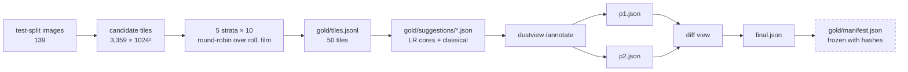
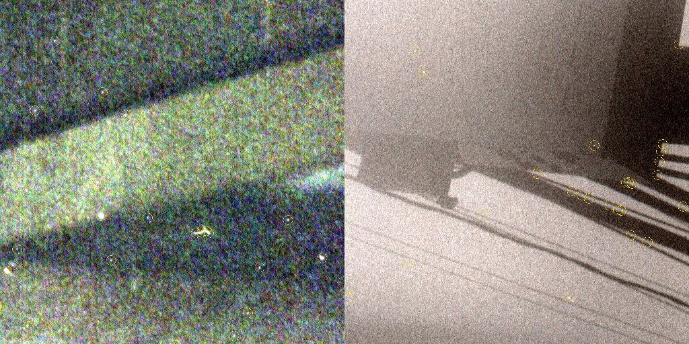
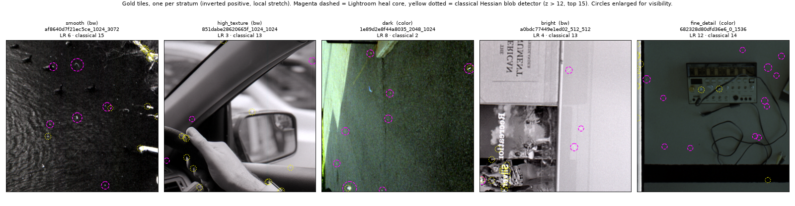
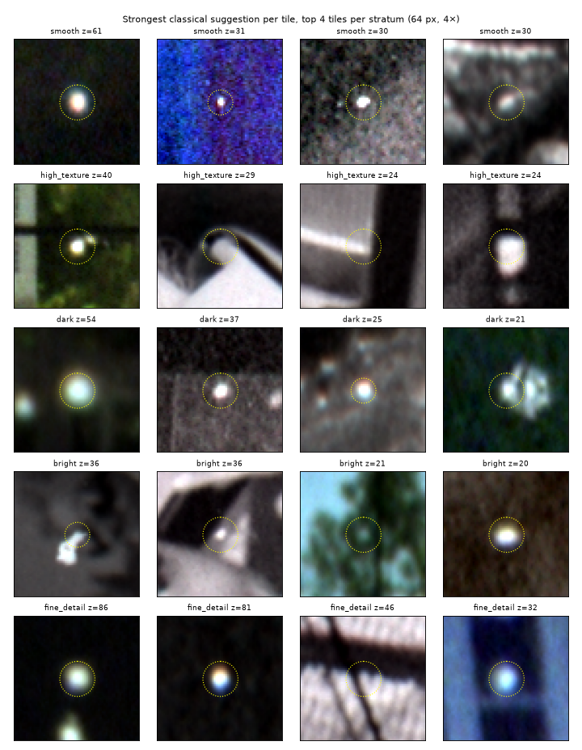
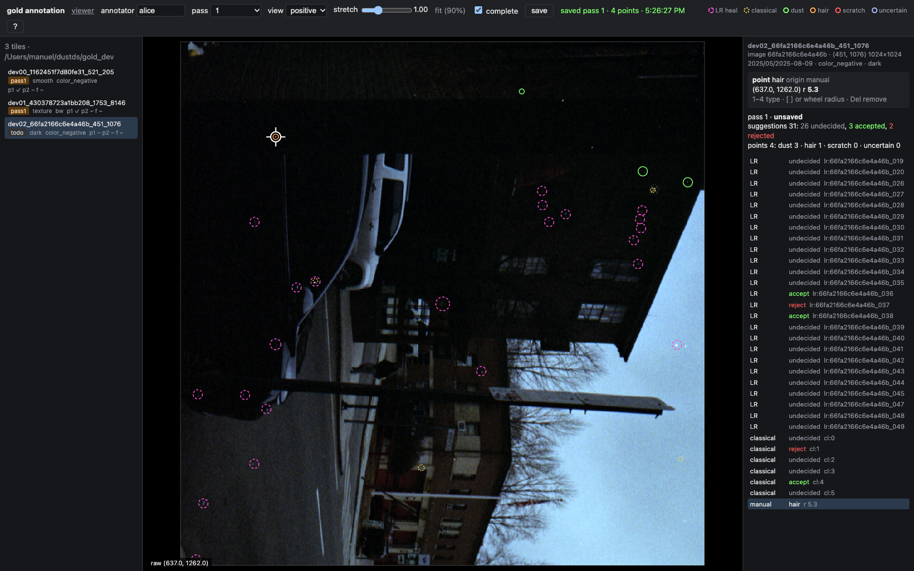
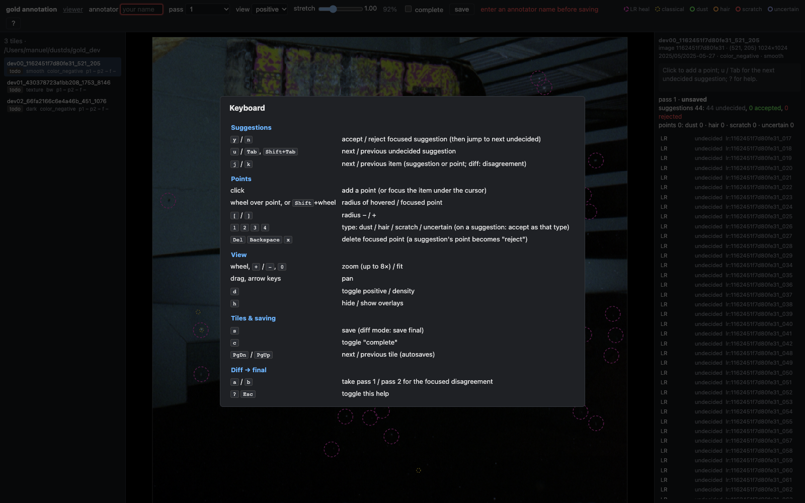
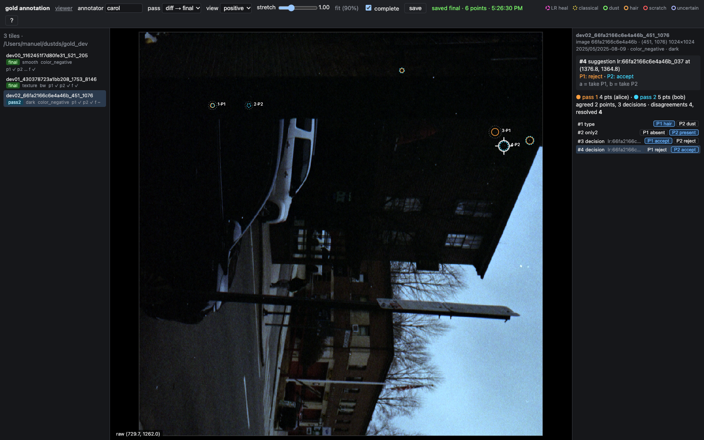
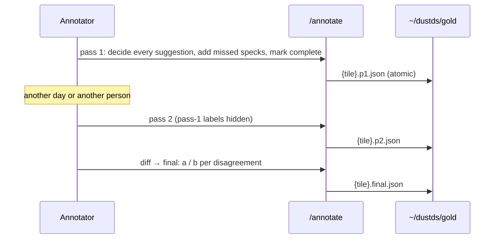

# Film Dust Dataset, Part 8: The Gold Set and the Annotation Tool — A Technical Deep Dive

This is the last report of the series. The earlier parts turned eleven thousand Lightroom heals into labels, split the archive by roll and scan session ([[PROJECT REPORT - Film Dust Dataset - Part 5 - Splitting by Roll and Scan Session - A Technical Deep Dive|Part 5]]), and proved that the whole dataset rebuilds byte for byte ([[PROJECT REPORT - Film Dust Dataset - Part 7 - The QA Report and Reproducible Rebuilds - A Technical Deep Dive|Part 7]]). Phase 8 builds the one thing those labels cannot provide: a small set of test tiles on which *every* speck has been marked by a person, so that a detector's misses and false alarms can be counted against the truth instead of against an incomplete record.

The phase has two halves. A selection script picks 50 tiles from the test split, stratified by content, and pre-fills each with suggestions from Lightroom and from a classical spot detector. An annotation page in the project's viewer, `dustview`, lets the user accept or reject those suggestions, add missed specks, label everything twice without seeing the first pass, and settle the differences into a final file. The tool is finished and tested; the labeling is the user's work and is the only open item of the project's acceptance checklist.

> [!summary]
> - **Lightroom labels are incomplete by construction.** A heal says "there was dust here"; the absence of a heal says nothing. Phase 6 found visible unhealed specks on tiles counted as clean, so evaluation against heals alone would charge a good detector for finding real dust.
> - **50 tiles, 5 strata, 14 rolls.** 1024 px tiles from the 139 test images, 10 each from the smooth, high-texture, dark, bright and fine-detail quintiles, chosen round-robin over (roll, film type), at most two per image. 70 Lightroom suggestions and 395 from a Hessian blob detector are pre-filled; the detector replaced a residual detector whose top hits were scene edges.
> - **Two blind passes and a diff.** `dustview /annotate` writes `{tile_id}.p1.json`, `.p2.json` and `.final.json` through a validating, atomically writing API. Pass 2 never shows pass 1, and the diff view turns every disagreement into an explicit choice.

## 1. Why a gold set

A detector is evaluated by comparing its output with a reference and counting hits, misses and false alarms. The reference in this project is the Lightroom heal record, and that record has a property that matters for training but is fatal for evaluation: it is one-sided. Every heal is a positive judgement. Nothing in the catalog records "I looked at this area and it was clean". The photographer healed what bothered them at the print size they had in mind, skipped what was hidden in texture, and never opened some frames at all.

Phase 6 made this concrete. Its clean-tile index admits a 512 px tile as a background candidate when it contains no heal and lies away from every heal. The contact sheet of those candidates showed unhealed specks on some of them, and the diary drew the conclusion in one line: label 0 means "not marked", not "clean". A detector that finds such a speck would be scored as a false positive. A detector that ignores faint dust the way the photographer did would be scored as perfect. Neither number measures what the user wants to know.

The specification's answer is a gold set: about 50 tiles of 1024 × 1024 at native resolution, taken only from test-split frames, checked by eye in full, with every speck recorded as a point, a radius and a type. The set is small because exhaustive labeling is slow, and it is stratified because a detector's error rate depends on the background far more than on the dust.



*Figure 1. The Phase 8 data flow. The dashed node is the freeze step, which runs after the user's labeling.*

## 2. Choosing the tiles

`scripts/23-select-gold.py` starts from the frozen split. For each of the 139 test images it reads the raw scan at half resolution, converts it to density relative to the film base, $D = \log_{10}(I_{base}/I)$ with the median over the three channels, and slides a 1024 px window with stride 512. A window is a candidate only if it contains no label-3 pixel, which excludes the scanner holder, rebates and other non-film areas that Part 4 marks as "ignore outside". That leaves 3,359 candidates. Each gets three statistics:

| Statistic | Definition | Captures |
|---|---|---|
| `mean_density` | mean of $D$ over the tile | exposure: low is thin negative (dark positive), high is dense negative (bright positive) |
| `texture` | std of $D - \text{gaussian}_{2\,px}(D)$ | grain plus fine scene structure |
| `fine` | p99.9 of $\lvert$high-pass$\rvert$ divided by its std | sparse sharp structure: text, stars, specular highlights |

*Table 1. Per-candidate statistics, computed at half resolution.*

The five strata of the specification map onto these statistics directly. Each stratum takes the top quintile of its ordering (at least 40 tiles): lowest texture for *smooth*, highest texture for *high_texture*, lowest density for *dark*, highest density for *bright*, highest fine score for *fine_detail*. The quintile is shuffled with a fixed seed and then sorted into buckets by `(roll, film_type)`. Tiles are drawn round-robin across buckets, one at a time, so that a stratum cannot fill up from one roll whose content happens to dominate the quintile. Two further constraints apply across strata: a tile may not overlap a tile already chosen, and no image contributes more than two tiles.

```python
buckets = collections.defaultdict(list)
for i in pool:                                   # shuffled top quintile
    buckets[(cands[i]["roll"], cands[i]["film_type"])].append(i)
keys = sorted(buckets, key=lambda k: rnd.random())
while got < args.per and any(buckets.values()):
    for k in keys:                               # one tile per bucket per round
        ...
        if overl or per_img[c["image_id"]] >= 2:
            continue
```

The result after the Step 21 rebuild, read back from `~/dustds/gold/` with `scripts/80-report-p8-gold-stats.py`:

| Stratum | Tiles | Rolls | color / bw / unmasked | Median density | Median texture | Median fine | LR sugg. | Classical sugg. |
|---|---:|---:|---|---:|---:|---:|---:|---:|
| smooth | 10 | 9 | 6 / 3 / 1 | 0.049 | 0.0073 | 4.30 | 16 | 70 |
| high_texture | 10 | 9 | 3 / 6 / 1 | 0.321 | 0.0309 | 6.09 | 5 | 88 |
| dark | 10 | 10 | 5 / 4 / 1 | 0.125 | 0.0137 | 5.48 | 16 | 52 |
| bright | 10 | 9 | 3 / 6 / 1 | 0.642 | 0.0219 | 6.47 | 11 | 75 |
| fine_detail | 10 | 9 | 5 / 4 / 1 | 0.233 | 0.0140 | 7.57 | 22 | 110 |
| **all** | **50** | **14** | **22 / 23 / 5** | | | | **70** | **395** |

*Table 2. The selected gold tiles by stratum, with the suggestions of the final (Hessian) classical detector.* The 50 tiles come from 38 images (26 with one tile, 12 with two) and 14 rolls; the largest roll contributes 8 tiles.

The strata are not disjoint in content. A tile belongs to the first stratum that picks it, and strata are filled in the order smooth, high_texture, dark, bright, fine_detail. This is why the median density of the *smooth* tiles (0.049) is lower than that of the *dark* tiles (0.125): smooth regions on these rolls are mostly thin, dark areas such as night water and shadowed walls, and smooth claimed many of the darkest candidates before dark was filled. For evaluation this is harmless, since the stratum is a label for reporting results, not a claim that the classes are pure.

The selection is deterministic and guarded. `23-select-gold.py` refuses to run once any `*.p1.json`, `*.p2.json` or `*.final.json` exists in `gold/`, and `make_all.sh` skips the step under the same condition. Until the first annotation is saved, a rebuild reselects; after it, the 50 tiles are fixed. Step 21's mask fixes changed label 3 on 148 images, so the gold set was reselected once (and again by each `make_all.sh` run of Step 22, with identical output). The tiles the user labels are the post-fix selection. A separate flag, `--suggestions-only`, regenerates only `gold/suggestions/` and leaves `tiles.jsonl` byte-identical; it was used once, for the detector replacement described next.

## 3. Suggestions: Lightroom cores and a classical detector

Labeling a 1024 px tile from scratch means sweeping a million pixels at high zoom. Suggestions cut the work: the annotator confirms or dismisses candidates with one key and spends attention on what remains. Two sources fill `gold/suggestions/{tile_id}.json`.

**Lightroom heal cores.** Every heal on the image whose Phase 4 core was found and whose core center lies inside the tile becomes an `lr_heal` suggestion at the core's pixel center, with the core radius (at least 2 px) and the core's contrast in σ as score. Test tiles chosen for their content contain few heals: 70 over 50 tiles, and 26 tiles have none.

**The classical detector.** Dust blocks light, so it raises density; in the inverted positive the viewer shows, dust is bright. The specification asks for a "multi-scale dark-spot residual", and the first three versions were exactly that: subtract a median-filtered background at two scales and divide by a noise estimate.

$$
r_k = \frac{D - \text{median}_k(D)}{\sigma}, \quad k \in \{7, 21\}\ \text{px}, \qquad \text{score} = \max_k r_k
$$

Local maxima within 9 px are candidates, and suggestions closer than 6 px to a Lightroom suggestion are dropped. The difficulty is σ, and it took three iterations of the residual, then a different detector, before the output was worth a person's time.

| Iteration | Detector and noise estimate | Threshold, cap | Result |
|---|---|---|---|
| 1 | residual, global σ of the tile | 60 per tile | median score 24σ, p99 2,135σ; every tile hit the cap; every edge and texture fired |
| 2 | residual, local robust σ: 1.4826 · median $\lvert D - \text{median}_5(D)\rvert$ over 31 px | > 6σ, 25 per tile | still saturated at 25 per tile; the top hits (60–69σ) were real unhealed specks, the 7–10σ hits were grain and shadow edges |
| 3 | residual, same local σ | > 10σ, top 15 | 725 suggestions, 39 of 50 tiles at the cap; the strongest hits on structured tiles were scene edges at up to 6,086σ |
| 4 (current) | Hessian blob test on $D$ at $s$ = 1.2 and 2.5 px, z-scored by the tile's MAD | z > 12, top 15 | 395 suggestions, median 9.5 per tile, 14 tiles at the cap, 12 with none; top hits mostly real specks |

*Table 3. The four iterations of the classical detector (diary Step 20 and the revision after this report's first draft).*

Figure 2 is the sheet that decided iteration 3. It shows two tiles with the 6σ suggestions drawn in yellow. The left tile is a grainy color frame: the circled bright specks are real dust that nobody healed, alongside circles on nothing but grain. The right tile is a smooth wall with hard shadows, and almost every circle sits on a shadow edge.



*Figure 2. Iteration 2 at 6σ (`various/23-gold-suggestions-6sigma.png`).* The strongest hits are unhealed dust, which is exactly the population the gold set exists to measure. The weak hits are texture.

### Why the residual failed, and the blob test

Raising the threshold to 10σ removed the grain hits, but the first draft of this report found a second failure when it cropped the strongest suggestion of each tile at 4×. On smooth and dark tiles the top hits were specks. On high-texture, bright and fine-detail tiles they were mostly scene structure: mirror edges, a book's border, bokeh, the knobs of an amplifier, scoring in the thousands of σ (p50 81σ, p90 2,093σ over the 725 suggestions). The cause was the noise estimate. The local σ is a *median* of the absolute high-pass over 31 px; next to an isolated sharp edge in a flat area the median ignores the edge and stays at grain level, so the residual across the edge is divided by a small number. No threshold fixes that, because the scale of the score is wrong exactly where the false hits are.

Since no annotation existed yet, the main agent replaced the detector instead of tuning it, and regenerated only the suggestions. The replacement asks a geometric question rather than a statistical one. At each pixel the Hessian of $D$, the matrix of second derivatives smoothed at scale $s$, has two eigenvalues $\lambda_1 \le \lambda_2$. A compact bump of density, which is what a speck is, curves down in every direction, so both eigenvalues are strongly negative. An edge or a line curves in one direction only, so one eigenvalue is near zero. Scoring by the *larger* eigenvalue therefore rewards bumps and suppresses edges by construction:

$$
b_s = -\lambda_2 \, s^2, \qquad z = \max_{s \in \{1.2,\,2.5\}} \frac{b_s - \text{median}(b_s)}{1.4826 \cdot \text{MAD}(b_s)}
$$

The factor $s^2$ makes the two scales comparable, and the median and MAD are taken over the whole tile, so a tile's own texture sets its noise level. Peaks within 9 px with $z > 12$ are kept, the 15 strongest per tile, with radius $2s$.

```python
for sg in (1.2, 2.5):
    dxx = ndimage.gaussian_filter(D, sg, order=(0, 2))
    dyy = ndimage.gaussian_filter(D, sg, order=(2, 0))
    dxy = ndimage.gaussian_filter(D, sg, order=(1, 1))
    tr, det = dxx + dyy, dxx * dyy - dxy * dxy
    lam_big = tr / 2 + np.sqrt(np.maximum(tr * tr / 4 - det, 0))   # larger eigenvalue
    b = -lam_big * sg * sg
```

Scores are now in a narrow, interpretable range: p10/p50/p90 = 13.2 / 18.8 / 35.7, maximum 86. Including Lightroom suggestions, a tile carries a median of 11 suggestions (maximum 26). Figure 3 shows one tile per stratum with both sources.



*Figure 3. Current gold tiles, one per stratum (the tile with the most Lightroom suggestions in each), rendered by `scripts/81-report-p8-tiles-figure.py` from dustview's crop endpoint.* Lightroom suggestions sit on isolated specks. Classical suggestions sit on compact bright spots; the book border that drew iteration-3 hits is now free of them, while points on the steering wheel, the dashboard, the posters in the bright tile and the water's sparkle remain.



*Figure 4. The strongest Hessian suggestion of each of the top four tiles per stratum, 64 px at 4× (z in the panel titles).* Smooth, dark and fine-detail rows are almost all specks. The high-texture and bright rows still contain a corner, a highlight on a bright edge and a soft blob in foliage.

Two limitations remain and are known. A hair or scratch is a line, so like an edge it has one flat direction and scores low; the annotator must add those by hand. And a specular highlight in the scene is a compact density bump in the positive, indistinguishable from dust by local shape alone. The classical detector is now a usable proposal source and a fair baseline for the modeling work, but its errors are concentrated in the high-texture and bright strata, and its recall on hairs is structurally poor.

The suggestion file is the contract between the selector and the tool. The first entries of a real one (`gold/suggestions/40869f8b460ee8dc_1024_0.json`, a smooth tile):

```json
{"tile_id": "40869f8b460ee8dc_1024_0",
 "suggestions": [
  {"id": "lr_40869f8b460ee8dc_017", "x": 1724.64, "y": 993.09, "r": 6.89, "source": "lr_heal",   "score": 43.6},
  {"id": "cl_000",                  "x": 1336.5,  "y": 130.5,  "r": 5.0,  "source": "classical", "score": 28.39}]}
```

A classical radius is $2s$ (5 px at $s = 2.5$, 2.4 px at $s = 1.2$, at least 2); a Lightroom radius is the equivalent radius of the Phase 4 core.

Coordinates are absolute raw pixels of the stored image, the same grid as the labels and the cache, so a suggestion, a gold point and a heal can be compared without any transform.

## 4. The annotation tool

The tool was built by a subagent in an isolated git worktree while the main agent worked on Phase 4. Isolation shaped the design: the subagent received a fixed file contract, put all new code in new files (`dustview/annotate.go`, `dustview/static/annotate.{html,js,css}`), and touched existing code only with a `--gold-dir` flag and one `registerAnnotate(mux, d, goldDir)` call in `main.go`. Its own diary (`reference/04-diary-annotate-agent.md`) records two steps and three commits.

### 4.1 The file contract and the API

| Route | Purpose |
|---|---|
| `GET /annotate` | the single-page UI |
| `GET /api/gold/tiles` | tile list with per-pass status (annotator, timestamp, complete, point count) |
| `GET /api/gold/{tile_id}` | tile metadata, suggestions and the existing pass files |
| `POST /api/gold/{tile_id}?pass=1\|2\|0` | save pass 1, pass 2, or the final file (pass 0) |
| `GET /api/gold/{tile_id}/crop.png` | crop with a tile-wide stretch, zoom 1–8 |

*Table 4. The annotation API.* An annotation file has exactly these fields (values illustrative):

```json
{"tile_id": "1d955ef4b27d3d88_1536_1536", "annotator": "manuel", "pass": 1, "timestamp": "<server UTC time>",
 "points": [{"x": 1746.16, "y": 2406.61, "r": 30.09, "type": "dust", "origin": "lr_1d955ef4b27d3d88_000"},
            {"x": 2101.0, "y": 1990.5, "r": 4.0, "type": "hair", "origin": "manual"}],
 "suggestion_decisions": {"lr_1d955ef4b27d3d88_000": "accept", "cl_000": "reject"},
 "complete": true}
```

The gold files are the evaluation ground truth, so the server, not the browser, decides what reaches disk. The decoder rejects unknown fields (`DisallowUnknownFields`). `validate` then checks that the body's `tile_id` and `pass` match the URL, that the annotator name has 1–64 characters, that every point is finite with $0 < r \le 512$ and lies at most 64 px outside the tile (a speck on the border still counts), that every type is one of `dust`, `hair`, `scratch`, `uncertain`, that every `origin` is `manual` or an existing suggestion id, and that every decision is `accept` or `reject`. The tile id must match `^[A-Za-z0-9][A-Za-z0-9._-]{0,127}$` and exist in `tiles.jsonl`, so `..%2Ftiles` returns 404. The server overwrites `timestamp` with its own UTC time.

A valid body is written atomically:

```go
f, err := os.CreateTemp(g.dir, ".tmp-"+name+"-*")   // same directory as the target
defer os.Remove(tmp)                                 // no-op after a successful rename
f.Write(b); f.Sync(); f.Close()
return os.Rename(tmp, dst)
```

A rename within one directory is atomic on POSIX file systems, so a reader sees either the old file or the new one, and a crash leaves at most a `.tmp-*` file, never a truncated annotation. `writeAtomic` also refuses any name whose directory is not the gold directory.

### 4.2 Viewing: tiled zoom with one stretch

The specification asks for an inverted positive with adjustable stretch, a toggle to raw density, and zoom up to 8×. At 8× a full tile would be an 8192 × 8192 PNG. The UI instead loads only the visible blocks: 1024 raw px per block at zoom 1, 512 at 2×, 256 at 3–4×, 128 at 5–8×. A 128² block at 8× renders in 19 ms; the full tile at 1× in 0.28 s (1.7 MB).

Blocks expose a problem that a single crop does not. The viewer's ordinary crop endpoint with `local=1` stretches each crop to its own p1–p99.5 window, which is what makes a faint speck visible in a dark scene. Applied per block, every block gets a different window, and the tile shows a checkerboard of seams. The annotation endpoint therefore computes the stretch statistics once over the whole tile (`tileStats`, cached per tile and mode) and renders every block with `local=false` and those statistics. The local stretch is kept at tile scale, where it serves its purpose, and dropped at block scale, where it would only create artefacts.



*Figure 5. Pass 1 on a fixture tile (`various/30-annotate-pass1.png`).* Magenta dashed circles are Lightroom suggestions, yellow dotted ones classical, solid circles are accepted points colored by type. The right panel lists every suggestion with its decision and the focused item; the header shows the save state.

### 4.3 Editing

Every action has a key, because 50 tiles labeled twice is thousands of decisions. `y`/`n` accept or reject the focused suggestion and jump to the next undecided one; `1`–`4` set a type (on a suggestion they accept it as that type); a click adds a point; the wheel over a point or with Shift changes its radius, and anywhere else zooms around the cursor through fit, 1, 2, 3, 4, 6, 8. Deleting the point of an accepted suggestion records a rejection. `PgDn`/`PgUp` move between tiles and autosave.



*Figure 6. The help overlay (`various/32-annotate-help.png`).* Behind it the header shows the refused save: no annotator name has been entered, so the field is outlined in red and focused.

### 4.4 Blind second pass and the diff

Pass 2 loads only `passes["2"]`; pass-1 points and decisions are never sent to the page, and the tile list shows statuses, not counts. The diff mode then compares the two files in three steps:

1. Suggestions whose decisions differ, including decided against undecided, become *decision* disagreements. Their points are excluded from the next step, so one disputed suggestion is not counted twice.
2. The remaining points are matched greedily by distance, with a match when the distance is at most $\max(r_1, r_2) + 2$ px. A match with different types becomes a *type* disagreement.
3. Unmatched points become *only1* or *only2*.

The annotator resolves each disagreement with `a` (take pass 1) or `b` (take pass 2). The final file holds the agreed points, with x, y and r averaged over the two passes, plus the resolved ones, and is marked complete when every disagreement is resolved. Reopening the diff infers the earlier choices from the final file.



*Figure 7. The diff view (`various/31-annotate-diff.png`).* Pass 1 (orange) and pass 2 (cyan) of a fixture tile disagree four times: a hair against a dust label, a point found only in pass 2, and two suggestions accepted in one pass and rejected in the other.

### 4.5 Testing, bugs, and the merge

The tool is tested end to end. `scripts/30-gold-fixtures.py` writes three fixture tiles from different rolls into `~/dustds/gold_dev/` (it refuses any other directory), and `scripts/31-test-annotate.py` drives the page with Playwright. It first checks seven server-side rejections (bad type, unknown suggestion, pass mismatch, pass 3, path traversal, unknown tile, empty annotator) and that none of them writes a file. Then it labels all three tiles through pass 1, a blind pass 2 and the diff, checks the JSON on disk after every save, and compares each final file with an independent Python reimplementation of the merge, so a bug in the JavaScript cannot pass by agreeing with itself. Any console error, page error, failed request, broken image or leftover `.tmp-*` file fails the run. It passed with 0 problems three times in a row.

Writing the test found three bugs in the tool:

| Symptom | Cause | Fix |
|---|---|---|
| `Page.click: Timeout … <div id="help" hidden> intercepts pointer events` | `#help { display: flex }` overrides the `hidden` attribute, so an invisible full-screen overlay swallowed every click | `#help[hidden] { display: none; }` |
| Reopening the open tile discarded unsaved edits | `openTile` reset state without saving | save whenever the state is dirty |
| 1-px dark line between blocks at 8× | fractional `translate()` antialiased block edges | round the stage translation to whole pixels |

*Table 5. Bugs found by the end-to-end test.* Several other failures were test mistakes, for example zooming with the wheel over a just-added point, which by design changes its radius.

The branch merged into main cleanly except for one line. While the subagent worked, the main agent had added a label-overlay parameter to `renderCrop` for the Phase 4 checks, and `go vet` reported `annotate.go:435:116: not enough arguments in call to renderCrop`. The fix was `renderCrop(..., nil)` → `renderCrop(..., nil, nil)`. The end-to-end test passes on the merged build.

## 5. The labeling workflow

The user labels the 50 tiles at `/annotate` against `~/dustds/gold`. Every pass is a separate sweep:



*Figure 8. The labeling workflow.*

### Labeling playbook

These are the rules the user was given for every pass:

- Mark everything on the film that is not the picture: dust, lint, hairs and scratches, including small and faint specks.
- Do not mark film grain, stars, specular highlights or the texture of the subject.
- Use type 4, `uncertain`, instead of skipping a doubtful mark, so that evaluation can exclude ambiguous marks rather than count them either way.
- Set the radius to just cover the speck and its soft edge.
- Do pass 1, then a blind pass 2 later, on another day or by another person, then diff → final.
- Expect about 3–5 minutes per tile, which puts one pass over 50 tiles at roughly 2.5–4 hours.

Within a pass the tool suggests an order: decide the suggestions first with `u`, `y` and `n`, then sweep the tile at 2–4× for specks no source proposed, which is the population the gold set exists to capture. Hairs and scratches need the most attention in the sweep, because the classical detector scores lines low (Section 3). The rule against highlights is the one the suggestions test most often, since a highlight in the positive is the detector's main remaining false positive.

Two constraints protect the work. The first annotation file locks the selection, so the tiles cannot change under the annotator; before that, a concurrent `make_all.sh` run would reselect, which is why labeling started only after the reproducible rebuild was verified. And an autosave on tab close goes through `sendBeacon`, whose failure is not reported, so explicit saves (`s`) before closing the page are the reliable path.

## 6. Open points

The gold set is not frozen yet. `gold/manifest.json` currently has `status: "selected (not yet annotated)"` and SHA-256 hashes of the 51 selection files; the freeze step that adds the annotation hashes is still to be written, either as an extension of `23-select-gold.py` or as a separate script. Three smaller limitations are documented in the subagent's diary and the main diary: the diff matching is greedy rather than an optimal assignment, which could mispair points in dense clusters; a save overwrites the previous version of a pass file, with no history; and the classical detector misses lines (hairs, scratches) and proposes specular highlights (Section 3).

The key points of Phase 8:

- Evaluation needs exhaustive labels. Heals are positive-only, and Phase 6 showed that "no heal" tiles contain real dust.
- The 50 gold tiles come only from the frozen test split and are stratified by texture, density and fine detail, round-robin over roll and film type, so per-stratum error rates can be reported.
- A residual detector with a median-based local σ ranks isolated edges in the thousands of σ; the Hessian blob test suppresses edges by construction because one eigenvalue of an edge is near zero. It is a proposal source and a baseline, not a labeler, and it misses hairs and fires on highlights.
- The annotation server validates every field and writes atomically; the browser cannot put an invalid or half-written file into the ground truth.
- The stretch is computed per tile, not per crop, because a per-crop stretch on tiled zoom creates seams.
- Two blind passes and an explicit diff turn annotator inconsistency into a list of decisions instead of silent noise.

## 7. What comes next

This report closes the series that began with [[PROJECT REPORT - Film Dust Dataset - Part 0 - What Lightroom Knows About Your Dust - A Technical Deep Dive|Part 0]]. The dataset is built, frozen by split, and reproducible; the remaining steps belong to the user and to the modeling work.

1. **Labeling.** Pass 1, a blind pass 2, and diff → final on all 50 tiles.
2. **Freezing.** Hash every annotation file into `gold/manifest.json` and set its status to frozen, closing the last acceptance item.
3. **Training on the DGX Spark**, in the order of the project's modeling advice (`sources/01-modeling-and-lightroom-advice.md`): first score the classical detector on the gold set as a baseline; then a candidate classifier (a loose detector proposes spots, a ConvNeXt-Tiny judges a 64 px crop with 256 px context); then the main detector, a U-Net with a ConvNeXt-Tiny encoder and a full-resolution branch that outputs dust probability and opacity, pretrained on synthetic composites of the Phase 6 sprites and clean tiles and fine-tuned on the tightened heals; then hard-example rounds that review the model's top hits outside the labels. One change per experiment, each scored on the same gold tiles.

## Sources

- Repository: `/Users/manuel/code/wesen/2026-11-07--dust-scanning`
- Ticket: `ttmp/2026/11/07/DUST-001--film-dust-dataset-from-lightroom-heals/` — `reference/02-build-instructions.md` (Phase 8 specification), `reference/01-diary.md` (Steps 11, 14, 18, 20–23), `reference/04-diary-annotate-agent.md` (the tool's build diary), `reference/09-acceptance-checklist.md` (item 9), `sources/01-modeling-and-lightroom-advice.md`
- Selection: `scripts/23-select-gold.py` (`classical()`, `--suggestions-only`); data `~/dustds/gold/tiles.jsonl`, `gold/suggestions/*.json`, `gold/manifest.json`
- Tool: `dustview/annotate.go`, `dustview/static/annotate.{html,js,css}`, `dustview/main.go` (`--gold-dir`); tests `scripts/30-gold-fixtures.py`, `scripts/31-test-annotate.py`
- Report scripts: `scripts/80-report-p8-gold-stats.py` (Table 2 and score percentiles), `scripts/81-report-p8-tiles-figure.py` (Figures 3 and 4)
- Figures: `various/23-gold-suggestions-6sigma.png`, `various/30-annotate-pass1.png`, `various/31-annotate-diff.png`, `various/32-annotate-help.png`
