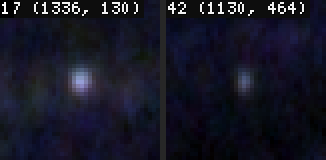
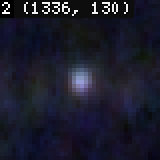

# Deep Dive: goja-cv in Agent Hands — Feedback from 39 Annotator Agents

[[ARTICLE - Deep Dive - Teaching a Cheap Model an Image Eval API - goja-cv, Docs and pi Runs|The previous goja-cv article]] watched one cheap model answer five questions about one image, six times, and changed the API after each run. This note looks at the opposite situation:
- **The agents:** 39 capable agents (Claude Sonnet subagents).
- **The task:** one real job each, pre-annotating dust, hairs and scratches on a 1024 px film-scan tile.
- **The setup:** each agent followed a task playbook and used a small helper library written for that job.

The question is no longer "can the model learn the API" but "what does the API look like after a helper library and a playbook have been put in front of it, and where does it still get in the way". The workflow itself is described in the [[PROJECT REPORT - Film Dust Annotation - Part 4 - Annotator Agents - Playbook, Trials and Pre-Annotation over MCP - A Technical Deep Dive|Film Dust Annotation series, Part 4]]. This note is about the tool.

> [!summary]
> - **374 evals, zero errors.** With a helper library and a playbook, the agents never hit a goja-cv error. They also never opened `cv.docs` or `cv.help`. **For task agents, the helper library is the documentation**, so it should be loadable without pasting it: `--prelude` exists but was undiscovered, and an `eval_file` tool would make libraries and saved pipelines cost no tokens.
> - **Agents read coordinates badly and compute them well.** Positions read off ruler looks were 5–10 px wrong; positions from `components` and a snapping probe were exact. The single most useful new op would be `peaks()`, local maxima with coordinates and a local snr.
> - **The defaults that suit one tile hurt another.** The speck view's p99-based scale is set by scene edges on high-contrast tiles. A noise-based scale was worse on average (87 % vs 91 % gold coverage), so this calls for options and local measures, not a new default.

## 1. How the agents used goja-cv

Each agent received a tile id and the playbook ([[PROJECT REPORT - Film Dust Annotation - Part 4 - Annotator Agents - Playbook, Trials and Pre-Annotation over MCP - A Technical Deep Dive|Part 4]] explains it). It created its own session on the shared `cv` MCP server, pasted the helper file into its first eval, and from then on worked mostly through the helpers:

| helper | what it returns |
|---|---|
| `mem.tile(id, ox, oy)` | opens the tile at its origin, so every coordinate is an absolute raw-scan coordinate |
| `mem.views()` | the scene, speck and speckColor views ([[PROJECT REPORT - Film Dust Annotation - Part 1 - Making Faint Dust Visible - Density Tiles and the Speck View - A Technical Deep Dive\|Part 1]]) |
| `mem.hot(level)` | blobs of the speck view above a level, each probed, sorted by strength |
| `mem.sheet(points)` | a contact sheet of up to 15 points, scene and speck view side by side |
| `mem.zoom(x, y)` | two 8× crops with rulers |
| `mem.probe(x, y)` | core/ring measure, best within 2 px ([[PROJECT REPORT - Film Dust Annotation - Part 2 - Measuring a Speck and Deciding Where to Look - A Technical Deep Dive\|Part 2]]) |

*Table 1. The helper library the agents used (`scripts/84-cv-helpers.js`).*

Script 91 of the project extracts every `mcp__cv__eval` call from the subagent transcripts, which are JSONL files with one record per message; tool calls and results are content blocks keyed by id. The result is one commented JS file per agent run, a JSONL of all evals, and a summary. The numbers:

| quantity | value |
|---|---|
| agents | 39 (8 trial agents on labelled tiles, 31 pre-annotation agents) |
| evals | 374, of which 29 were helper pastes (3.2 KB each) |
| median code per eval | 183 characters |
| errors | 0 |
| warnings | 13 `UNUSED_NODE`, 7 `RANGE`, 1 `OUTSIDE`, 1 cut result |

*Table 2. What the extraction found.*

The distribution of calls is more telling than the totals. Counted as evals that use each name:

| goja-cv op | evals | | never used |
|---|---|---|---|
| `look` | 286 | | `cv.docs`, `cv.help`, `explain()` |
| `crop` | 171 | | `profile`, `sample`, `annotate` |
| `sheet` | 171 | | `compare`, `highpass`, `dog` |
| `view` | 161 | | `localContrast`, `chroma`, `channel`, `toLab` |
| `max` / `min` / `levels` | 67 / 41 / 51 | | `cv.csv`, `cv.json`, `save` |
| `measure` | 19 | | `P.slider` |

*Table 3. goja-cv ops in agent code, outside the helper pastes.*

The agents used about a dozen of goja-cv's operations, and the documentation layer not at all. This is not a failure of the documentation. The previous article showed that docs reachable through the tool are what a model without guidance needs. Here the guidance came from elsewhere: a playbook that says which view answers which question, and helpers that wrap the right calls. Once those exist, the agent has no reason to search the docs. The general rule follows directly: **for a task agent, the helper library is the prompt.** goja-cv should make such libraries easy to load, list and reuse (Section 3).

What the agents wrote themselves is the second signal. Outside the helpers, their code was mostly plain JavaScript over the returned rows:

```js
// 23 agents: keep what stands out, and look at it on sheets
mem.R = mem.hotByLevel[0.3].filter(o => o.sp >= 0.15)
mem.sheet(mem.R.slice(0, 15).map(o => [o.x, o.y]), 40, "0-14")

// 7 agents: drop a region that is all scene (here a car)
mem.hot3.filter(o => o.sp >= 0.15 && !(o.x > 2730 && o.y < 2010))

// 25 agents: probe a list of points found by eye
for (const [x, y] of mem.C) out.push(await mem.probe(x, y))
```

This is exactly the style that goja-cv's v2 design (GCV-004) is moving to: regions as plain arrays, filtered with ordinary JS, instead of a chain of `where`, `sortBy` and `top`. No agent used those Regions methods. The v2 direction is confirmed by usage.

## 2. A session, end to end

```mermaid
sequenceDiagram
  participant A as Agent (Sonnet)
  participant M as cv MCP server
  participant F as ~/dustdet/vlm_gold_v1
  A->>M: create_session
  M-->>A: sessionId
  A->>M: eval(sessionId, helper file, 3.2 KB)
  A->>M: eval: mem.tile(...); views → 3 looks
  A->>M: eval: mem.hot(0.4), mem.hot(0.3) → rows + numbered look
  loop 4–11 sheets
    A->>M: eval: mem.sheet(rows.slice(i, i+15))
  end
  A->>M: eval: quarter sweeps, zooms, probes of points found by eye
  A->>F: Write {tile}.json (points, confidence, path/width for hairs)
```

*Figure 1. One pre-annotation session. 6–14 evals, about 1–2 minutes, 70–110 k tokens.*

The parallel structure worked without incident. Each agent passed its own `sessionId` on every eval, up to eight agents ran against one server at a time, and none saw another's `mem`. The default session, which every MCP client shares, would have been a source of silent corruption: two agents setting `mem.img` to different tiles. One instruction in the playbook avoided it, and goja-cv's session API made that instruction possible.

## 3. Issue: helper libraries should not be pasted

The most frequent complaint, in about 15 of the 39 agent diaries, was the paste. Every agent read a 3.2 KB file and sent it as the body of its first eval. Some trimmed comments to save tokens. One dropped a line it thought unnecessary and lost access to a top-level `const` that its later code needed: `const` and `let` do not survive between evals, but closures created in the same eval keep them alive, so the helpers worked while the agent's own code did not.

goja-cv already had the answer. `goja-cv mcp --prelude helpers.js` runs a script in every new session before any agent code. The setup notes we followed did not mention it, the server was registered without it, and 39 agents paid for that in tokens and trimming errors. The fix on the documentation side is small: put `--prelude` in the setup topic and the README, and list the session's `mem.*` functions with their first comment line in the context block, so an agent knows what was preloaded.

A prelude has one limitation: it loads the same file into every session. An agent that needs a different library, or wants to run a saved pipeline (a calibration script, a pass that another agent invented), still has to paste. The better primitive is a second MCP tool:

```
eval_file({ path: "dust/helpers.js", sessionId, args: { tile: "..." } })
```

`eval_file` runs a file from an allowed directory in the session, with exactly the semantics of `eval` on the file's text, plus an `args` global. The code never passes through the agent's context, so it costs no tokens and cannot be mistyped. Access follows the same rule as `cv.open`: paths resolve under `--scripts DIR` or the `--root` directories, and anything else is `E_ACCESS`. A companion listing (a `list_files` tool or `cv.scripts()`) with each file's first comment line makes the library discoverable. With `eval_file`, the project's mined pipelines become something any agent can call by name.

## 4. Issue: coordinates should come from the engine, not from the eye

The task requires absolute coordinates for every suggestion. Agents had two ways to get them: read them off a look with rulers, or take them from data such as components' centroids, probe results or hot-list rows. The first way failed often enough to matter. Eight diaries report it; one agent wrote down the arithmetic it needed (`x = crop_x + (px − 52)/2`, the 52 being the ruler margin). On one tile, 28 of 32 positions read off a 2× sweep probed at a speck-view step of about zero: they were a few pixels away from the dot the agent had seen.

Vision models localise poorly at this precision, and rulers do not fix that. What worked was the second way. Our probe snaps to the strongest point within 2 px, which corrects small misreadings. A components-based pass gives exact centroids. One agent built the best version of this itself:

```js
const items = (await mem.spots(0.06)).items          // speck-view blobs at a very low level
for (const it of items) {
  const p = await mem.probe(it.cx, it.cy)             // core/ring measure, snaps within 2 px
  if (p.snr >= 1.4 && it.area >= 5 && it.area <= 80) keep.push(p)
}
```

We packaged this as `mem.faint()`. On the hardest tile, a high-contrast scene where the hot list was all scene edges, it returned six candidates in 0.18 s. The first was a clear speck the hot list had missed, and three more were dots the agent had found only by sweeping by eye. The engine-level version of this pass is a `peaks()` op: local maxima with `{ x, y, value, snr }`, where snr is measured against the local noise. It would replace the agents' loop, and it would give a model coordinates instead of asking it to measure pixels.

A labelled grid on looks (`look({ grid: 32, gridLabels: true })`) is the smaller, complementary change. A model can say "cell C7" reliably even when it cannot say "x = 1739".

## 5. Issue: contact sheets carry the review, and two details get in the way

`cv.sheet` was the agents' main instrument: 171 evals. A sheet puts 15 candidates side by side, the stretched tile next to the speck view, and an agent decides each in one look. Two details cost them time.



*Figure 2. Items given as `{ cx, cy, id }` are labelled with their id. Nothing in the docs or examples shows this, so the helper passed `[x, y]` pairs and got list indices.*



*Figure 3. The look-number badge covers the first cell's label. Ten agents reported a hidden or truncated first label.*

The first problem is labels. For a list of points, the label is the position in the list. A hot-list row's identity, its id, is lost, so seven agents kept parallel arrays in `mem` just to map a cell back to its row. Items given as objects with an `id` keep it (Figure 2), but no example shows this. The second problem is the badge: the look number is drawn over the first cell's label (Figure 3). The fixes are a documentation example, a `label` field for free text, and a badge outside the cell area.

A third observation is not a bug but a trade-off worth documenting. `stretch: "cell"` stretches each cell to its own range, which makes a faint speck visible. On a dark, grainy area it also makes the grain look like dust, and three agents learned to distrust sheets there and check probe numbers instead. A `stretch: "sheet"` option, one range for all cells, would give the comparison view.

## 6. Issue: tile-global scales and the shapes a DoG cannot see

The speck view is a difference of Gaussians with white at five times its 99th percentile ([[PROJECT REPORT - Film Dust Annotation - Part 1 - Making Faint Dust Visible - Density Tiles and the Speck View - A Technical Deep Dive|Part 1]]). On an ordinary tile that percentile is set by grain and dust, and the view ranks the user's specks 18th among all bumps on the tile. On tiles with windows, cables, lattices or motion-blur rims, the percentile is set by those edges, so real dust maps to 3–10 % of white and every level-based list misses it. At least six agents hit this. Several worked around it by brightening the view by hand: `.exposure(2.5)`, or `.levels({ white: 0.25 })` on a crop.

The obvious fix is to scale the DoG by its own noise, IQR/1.349 of the signed DoG. We measured that before recommending it, on the user's 197 gold points:

| hot-list scale | spots per tile (median) | spots per tile (mean) | gold covered |
|---|---|---|---|
| 5 × p99, level 0.3 (current) | 71 | 90 | 91 % |
| noise, 5.5σ | 103 | 153 | 87 % |
| noise, 6σ | 50 | 128 | 83 % |

*Table 4. Hot-list coverage of the user's gold points under two scalings (script 88).*

The noise scale is worse. Grain is not white noise, and grainy tiles flood the list. The conclusion for goja-cv is to keep the default and add an option, `view("speck", { white: "p99" | "noise", k })`, plus local measures such as the snr in `peaks()`. Those adapt to each neighbourhood, which no tile-global scale can.

Two shapes fall outside what the DoG shows well. A large saturated speck has a flat top, and the DoG of a flat top is a ring with a dark centre. One agent found its tile's most obvious blob at a speck-view step of 0.21 and snr 0.61, and a capsule-shaped one not in the hot list at all. A thin bright line, a scene edge or a scratch, becomes a few long components (area 100–240, aspect above 10) that crowd the candidate list. Agents filtered `aspect < 3` in JS. A note in the views documentation covers the first. `components({ maxAspect })`, and the morphology operations requested earlier, cover the second.

## 7. Smaller issues

| issue | count | fix |
|---|---|---|
| `RANGE` on zooms near the tile edge: the crop is clipped, so the scene/speck pair is non-square and misaligned | 7 warnings | `crop(box, { fit: "shift" })` moves the box inside the frame and keeps its size |
| `UNUSED_NODE` when a helper returns `{ scene, speck, speckColor }` and the caller uses two | 13 warnings, 10 agents | don't warn for nodes that escape through a returned or `mem`-stored object, or `cv.quiet(node)` |
| row lists cut at 9000 characters | 3 agents | a compact table rendering (`cv.table(rows, { columns })`) that fits more rows than YAML |
| no way to measure a thread's width | agents "eyeballed widths from rulers" | a recipe with `profile` (never used by agents) and possibly `measure.line(path)` |

*Table 5. Smaller issues from the agents' diaries and the eval results.*

## 8. What worked

The negative list should not hide the main result. **Thirty-nine agents ran 374 evals without one error.** They reviewed 50–190 candidates per tile in 6–14 evals, at about 0.4 s for a hot list with 160 probes. Several agreed in parallel without interference, and all produced valid output files. The lazy-node model, the `await` discipline and the literal options never surfaced as problems. The features that carried the work are crop plus `look({ zoom, ruler })`, the two-view contact sheet, and `measure` behind a snapping probe. All three came from the earlier handover requests, which is a fair measure of how well that loop works.

## 9. Rules that generalize

- A task agent uses the API through the task's helper library, so the library is the real interface and deserves the same care as the API: first-class loading, listing and documentation.
- Code that agents run repeatedly should live in files the tool can load by name, not in the agent's context. A file-eval tool turns mined agent passes into shared pipelines.
- Models should get coordinates from the engine. Any step where a model reads a position off an image is a source of error that an op returning positions removes.
- When a default works on average and fails on a class of inputs, measure the alternative before changing the default. Here the alternative was worse, and the right change was an option plus a local measure.
- Mining agent transcripts is cheap and finds both the frictions and the workarounds. The best new helper in this project came from one agent's own code.

## Sources

- Repository: `/Users/manuel/code/wesen/2026-11-07--dust-scanning`, ticket `ttmp/2026/11/07/DUST-002--film-dust-detector-model-exploration/`
- The issue list for the maintainer: `reference/11-goja-cv-agent-feedback.md`; earlier: `reference/07-goja-cv-handover-issues.md`, `reference/09-goja-cv-v1-field-report.md`
- Extraction: `scripts/91-extract-agent-evals.py` → `various/agent-evals/` (`summary.md`, `evals.jsonl`, one `.js` per agent run); the agents' diaries in `various/agent-diaries/`
- Helpers: `scripts/84-cv-helpers.js` (`mem.faint`, `mem.sweep`, `mem.sheet` with ids); playbook `reference/04-goja-cv-dust-playbook.md`; the hot-list scale test `scripts/88-cv-hot-recall.py --sigma`
- goja-cv: `~/code/wesen/go-go-golems/goja-cv` (main b847520; `goja-cv mcp --prelude`); the v2 design ticket GCV-004
