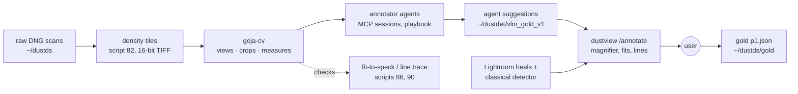
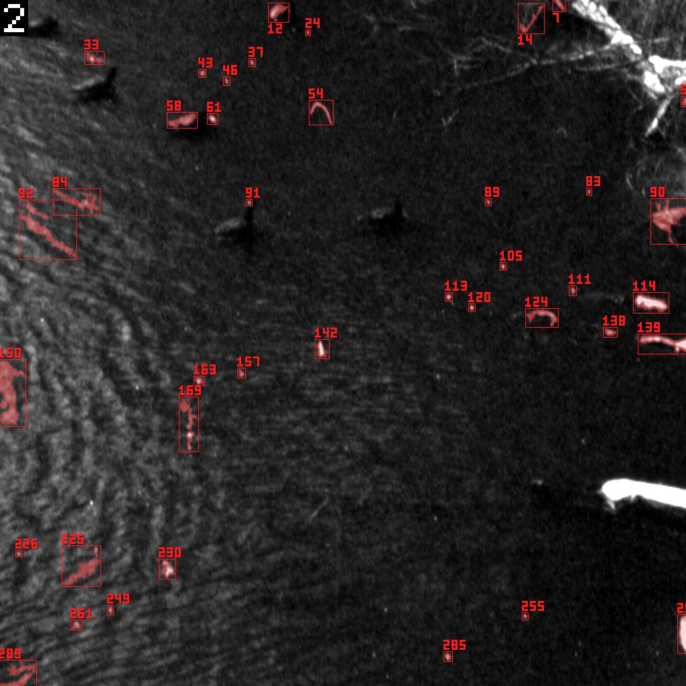
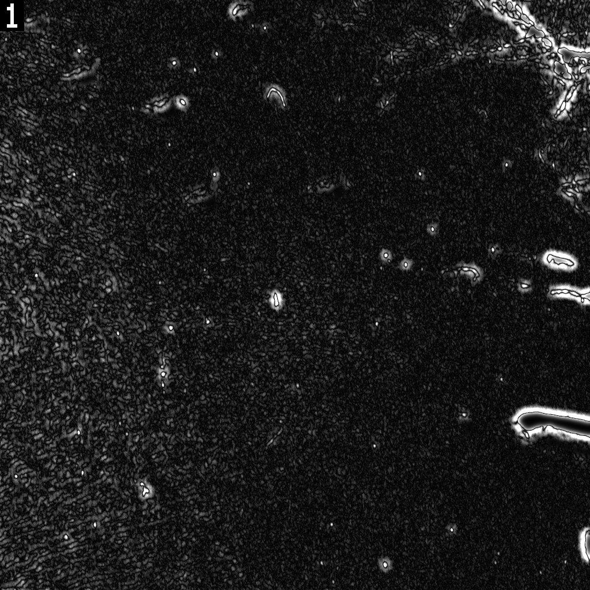
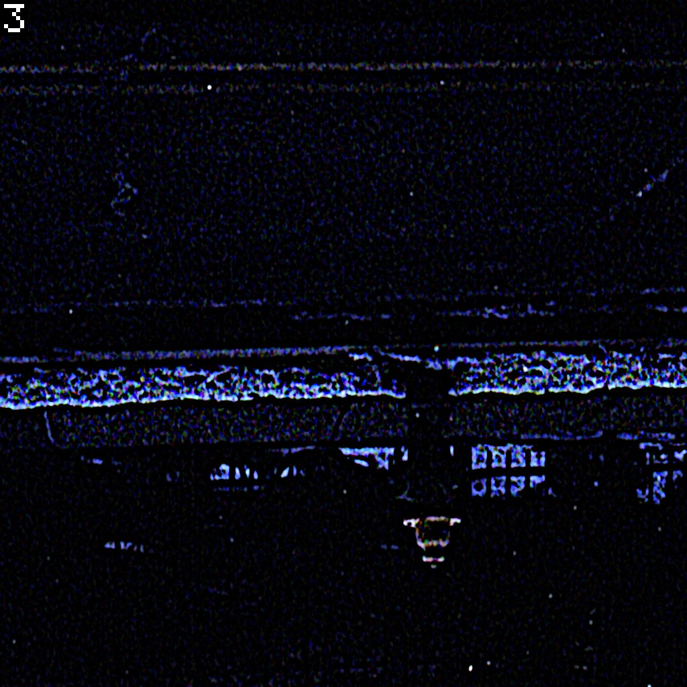
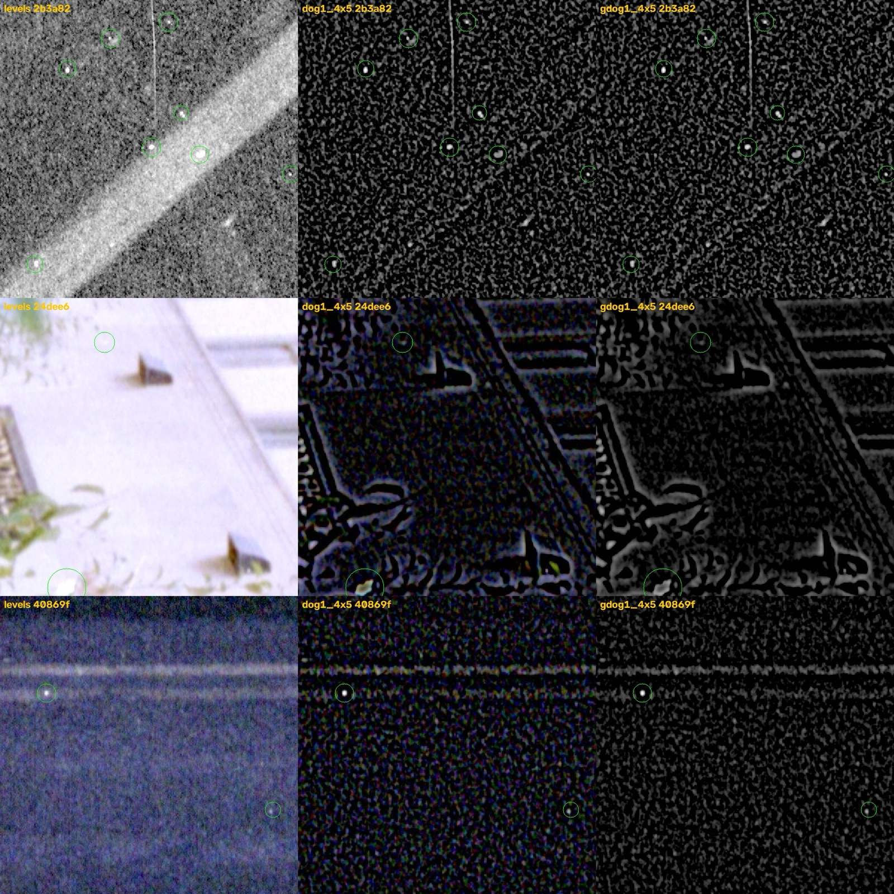
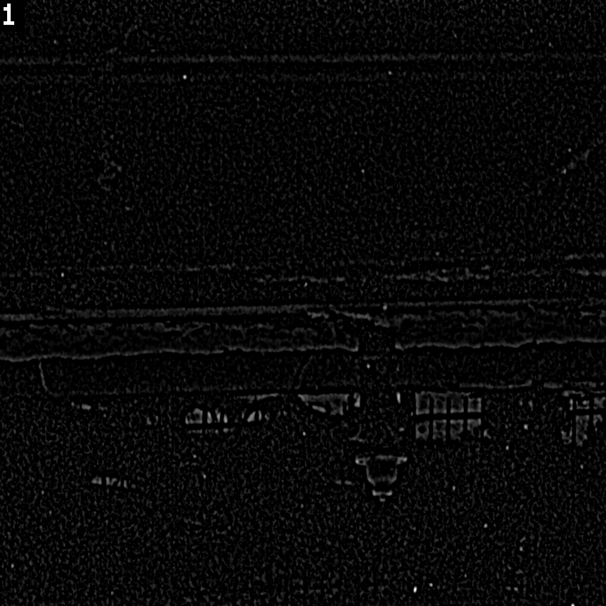
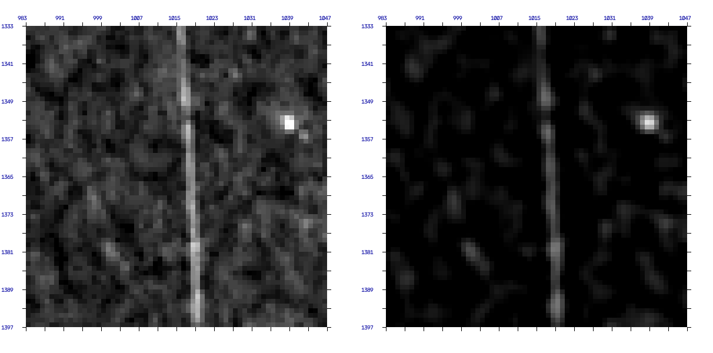
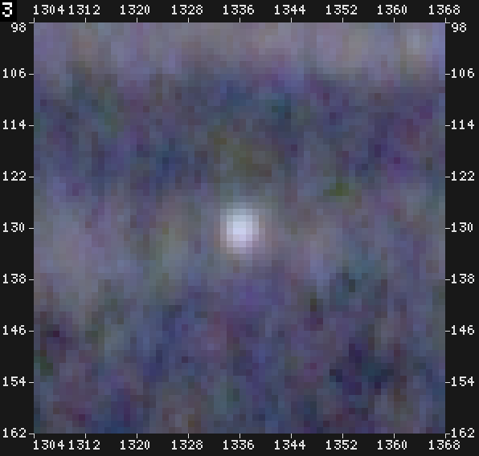
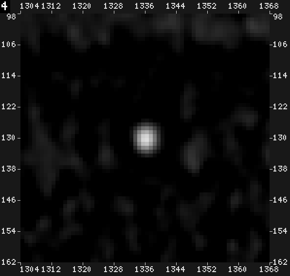

# Film Dust Annotation, Part 1: Making Faint Dust Visible — Density Tiles and the Speck View

The Film Dust Dataset series ended with a tool and an open task. [[PROJECT REPORT - Film Dust Dataset - Part 8 - The Gold Set and the Annotation Tool - A Technical Deep Dive|Part 8]] selected 50 gold tiles of 1024 × 1024 raw pixels and built an annotation page in `dustview`. On each tile a person is supposed to mark *every* dust speck, hair and scratch, so that a detector can later be scored against the truth instead of against an incomplete Lightroom record. Labeling turned out to be the hard part. A person looking at a 1024 px tile finds the obvious specks quickly, misses the faint ones, places circles a few pixels off, and has no good way to mark a hair. This series describes the workflow built around that task in project DUST-002. It covers:
- the image processing that makes faint dust visible;
- the measurements that say whether a dot stands out;
- the annotation tool's magnifier, fits and lines;
- annotator agents that pre-annotate tiles through goja-cv over MCP.

The series has four parts and one companion article:

1. **Part 1 (this note)** turns raw scans into density tiles and finds the view in which faint dust is easiest to see.
2. [[PROJECT REPORT - Film Dust Annotation - Part 2 - Measuring a Speck and Deciding Where to Look - A Technical Deep Dive|Part 2]] turns that view into numbers. It covers a core-versus-ring measure, how well it separates dust from random places, and the candidate lists that tell an annotator where to look.
3. [[PROJECT REPORT - Film Dust Annotation - Part 3 - The Annotation Tool - Magnifier, Fit-to-Speck and Lines - A Technical Deep Dive|Part 3]] covers the browser tool: a magnifier, a fit that snaps a point onto its speck, and polylines for hairs that trace themselves.
4. [[PROJECT REPORT - Film Dust Annotation - Part 4 - Annotator Agents - Playbook, Trials and Pre-Annotation over MCP - A Technical Deep Dive|Part 4]] runs 39 language-model agents with a playbook. They go through three trials and a pre-annotation of the 31 untouched gold tiles.
5. [[ARTICLE - Deep Dive - goja-cv in Agent Hands - Feedback from 39 Annotator Agents|The companion article]] collects what those agents taught us about goja-cv as a tool.

> [!summary]
> - **Stretching does not reveal faint dust; background subtraction does.** In a contrast-stretched tile the median user speck is the ~715th to ~790th brightest bump. In a grey difference-of-Gaussians view (σ 1 vs σ 4, bright part, white at 5 × p99) it is the 18th, and 79 % of specks are among the 50 most visible bumps.
> - **The space you filter in matters as much as the filter.** Filtering density values, not linear light, moved the median rank from about 66 to about 20, because grain becomes equally loud in thin and dense parts of the negative. Getting the file encoding wrong for the tool cost 9 points of the top-50 share in one silent run.
> - **goja-cv is a darkroom, not a detector.** Its built-in speck detector scored soft scanner-blurred dust as stars (score 0). The project uses goja-cv for views, crops, rulers and measures, and leaves the decisions to eyes.



*Figure 1. The annotation workflow of this series. Part 1 covers the left side: density tiles and the views goja-cv computes on them.*

## 1. Why faint dust is hard to see

All the film in this archive is negative film, scanned on an Epson V600 as a raw transmission image. Dust on a negative blocks light that would otherwise reach the sensor. Where there is dust, the scan records less light than the film alone would let through, and the film looks *denser*. The project works in density, $D = \log_{10}(I_{base} / I)$, measured relative to the unexposed film base. In density, dust adds a positive step. The dataset's "positive" rendering inverts density into brightness, so dust appears as **bright** specks, hairs and scratches. Dark specks on that rendering are holes, scratches through the emulsion, or picture content; they are not dust.

Three properties of the scans make the faint end of the population hard to see:

- **Size.** Most specks the user marks are 2–10 px across at native resolution. On a 1024 px tile shown 1:1, a 3 px speck is 3 screen pixels.
- **Blur.** The scanner's optics blur every speck. An edge fit on clear specks gives an edge width of σ ≈ 1.6 px, so a 3 px speck spreads into a soft round bump with no sharp outline. This is why "dust is sharp" heuristics fail here.
- **Grain.** Film grain produces bumps of similar size everywhere. In dense areas of colour negatives the grain is coloured. A faint speck is a bump only slightly brighter and slightly more compact than the brightest grain bumps around it.

The scene adds a fourth problem. A lamp, a window frame, a highlight on water or the edge of a leaf is a bright compact structure, sometimes exactly speck-sized. The question an annotator has to answer is not "is this bright" but "would this bright thing be there if the film were perfectly clean".

The gold labels at the start of this work illustrate the difficulty: 142 user points on 19 of the 50 tiles, marked by hand in [[PROJECT REPORT - Film Dust Dataset - Part 8 - The Gold Set and the Annotation Tool - A Technical Deep Dive|Part 8]]'s tool. Later checks (Part 2 and Part 4) showed that this first pass misses a share of the faint specks. Any method has to help a person, or a model, see those.

## 2. A detector or a darkroom

The project's image tool is **goja-cv**, a lazy JavaScript image API driven through an `eval` call. A model or a script sends a few lines of JavaScript and gets back YAML numbers and rendered images, called *looks*. It runs as a CLI (`goja-cv eval -e '…'`) and as an MCP server, which lets Claude Code subagents call it as a tool. It was installed at commit `3e53443` and registered with:

```bash
claude mcp add -s user cv -- /Users/manuel/go/bin/goja-cv mcp \
  --root /Users/manuel/dustdet/cv_tiles --root /Users/manuel/dustds
```

goja-cv ships a speck detector, `img.detect.specks()`. Its regions carry `contrast`, `localNoise`, `sharpness` and a combined `score` that separates "dust" from "stars and highlights". The first experiment was to calibrate it against the gold points (`scripts/83-cv-specks-vs-gold.py`). On the first tile it reported 229 specks, and `check.dust` called the tile "dusty". Paged through all 19 labelled tiles and matched to the user's points, it gave these numbers:

| setting | user points found (of 142) | at score ≥ 0.5 |
|---|---|---|
| default (`maxArea` 200) | 115 | 102 |
| `maxArea` 2000 | 119 | 111 |
| default, on density-linear tiles (Section 3) | 103 | 80 |

*Table 1. `detect.specks` recall against the 142 user points of pass 1.*

The recall was usable, but the ranking was backwards. The table below gives the fraction of user points among the top K specks per tile, ranked by each field:

| ranking key | K = 10 | K = 20 | K = 40 | K = 80 |
|---|---|---|---|---|
| `contrast` | 0.36 | 0.58 | **0.75** | 0.82 |
| `contrast / localNoise` | 0.35 | 0.52 | 0.70 | 0.79 |
| `score` | 0.24 | 0.41 | 0.60 | 0.74 |

*Table 2. The detector's own `score` ranks the user's dust worse than raw contrast does.*

The reason is in `sharpness`. The `score` treats a soft round blob as a star or a highlight, which is right for a digital photo and wrong for a scan. Across 870 candidates, the dust the user confirmed had *lower* sharpness than the candidates the user did not mark (median 0.60 against 0.71). A single example shows the effect. A clear, isolated 5 px speck at tile coordinates (312, 130) on tile 40869f8b has contrast 0.551 and local noise 0.03, but sharpness 0.204. Its hysteresis region grows into the surrounding grain to 239 px², above the default `maxArea` of 200, so the default run drops it. With `maxArea` raised it appears, with `score: 0`.



*Figure 2. The top 40 `detect.specks` candidates by contrast on B&W tile af8640d7 (pre-v1 goja-cv, perceptual export). Compact dots such as 105, 113 and 142 are candidates for dust, and so are a hook (54), shore twigs (90, 139) and leaf streaks (84, 92). A detector's list mixes them; telling them apart is the annotator's job.*

At this point the user corrected the direction of the work: *"I actually want to use goja-cv as a way to preprocess the image to get a better sense of where to zoom in crop for looking for specs."* That changed the question. The question was no longer which detector settings find the most dust. It became under which rendering a faint speck becomes obvious to the person or model looking at the image. A detector makes decisions and hides its mistakes inside a score; a view leaves the decision to the eye and makes the eye's job easier. The rest of this part is about that second question. Parts 2 and 4 show how far a careful eye, with a view, a measure and a magnified crop, gets.

Three requirements follow from the darkroom framing:

1. A **view** has to put faint dust among the brightest things on the tile, so that an annotator scanning for bright dots finds it early.
2. It has to work on the image as a vision model receives it: an 8-bit rendering, at most 1568 px, possibly JPEG-compressed.
3. It has to be measurable against the gold labels. Otherwise choosing between views is a matter of taste.

## 3. Density tiles

goja-cv opens PNG, JPEG and TIFF files. The scans are 16-bit DNGs, stored by the dataset as raw arrays. The first job was an export: `scripts/82-export-cv-tiles.py` writes each of the 50 gold tiles as a 16-bit RGB TIFF plus a JSON sidecar with the tile's position in the raw scan.

The rendering stored in that TIFF matters more than it seems, so it is worth deriving it. For each channel $c$ the script computes density relative to the film base, and then maps the tile's density range to [0, 1]:

$$
v_c = \operatorname{clip}\!\left(\frac{D_c - lo_c}{range}, 0, 1\right), \quad
lo_c = P_{0.5}(D_c), \quad
range = \max_c \left(P_{99.5}(D_c) - P_{0.5}(D_c)\right)
$$

```python
D = data.density(data.read(iid, X, Y, X + T, Y + T), data.i_base(iid)).astype(np.float32)
if ft.startswith("bw"):
    D = np.repeat(D.mean(-1, keepdims=True), 3, -1)    # B&W: one channel, repeated
flat = D.reshape(-1, 3)
lo = np.percentile(flat, 0.5, 0)                       # per-channel black point
hi = np.percentile(flat, 99.5, 0)
rng = float(max((hi - lo).max(), 1e-3))                 # ONE range for all channels
v = np.clip((D - lo) / rng, 0, 1)
```

Each choice in that snippet has a reason:

- **Density, not transmission.** A speck that blocks a fraction of the light adds the same density step $\delta = -\log_{10}(1 - \alpha)$ whether it lies on a thin or a dense part of the negative. In density the same speck has the same contrast everywhere. In transmission, its absolute contrast scales with how much light the film passes there, so the same speck is loud in the shadows of the positive and nearly invisible in the highlights.
- **One range for all channels.** Dust is neutral: it blocks red, green and blue alike, so its density step is equal in all three channels. A shared scale keeps that step grey in the rendering. Per-channel scaling would tint every speck by the ratio of the channel ranges, and destroy the "dust is grey, colour grain is not" cue that `speckColor` uses later.
- **The channel mean on B&W film.** B&W scans have three near-identical channels. Averaging them reduces noise by about √3, and makes the colour views identical to the grey ones.
- **Percentile black point.** $lo_c$ at 0.5 % keeps a few dark outliers (holes, holder edges) from compressing the range.

The sidecar carries the tile's origin:

```json
{"tile_id": "40869f8b460ee8dc_1024_0", "image_id": "40869f8b460ee8dc", "origin_x": 1024, "origin_y": 0,
 "size": 1024, "film_type": "color_negative", "lo": [-0.0037, -0.0044, -0.0094], "range": 0.284,
 "view": "density, dust bright, code value = v: open with encoding 'linear'"}
```

### 3.1 The encoding: where the numbers are filtered

Every filter that follows works on numbers, and the question is which numbers. goja-cv, like most image libraries, distinguishes the file's *encoded* values from *linear* values, and runs blurs and blends in linear light by default. Pre-v1 goja-cv read every file as sRGB: it decoded the stored code values with the sRGB transfer curve and filtered the decoded values. The export therefore went through three stages, each measured with the rank metric of Section 4:

| stage | stored code value | goja-cv | numbers the filters see | speck rank (median) | specks in top 50 |
|---|---|---|---|---|---|
| first export | $v$ | pre-v1, reads sRGB | $\text{sRGB}^{-1}(v)$, a gamma-expanded density | 66 | 44 % |
| re-export | $\text{sRGB}(v)$ | pre-v1, reads sRGB | $v$, density | 20 | 79 % |
| v1, old files | $\text{sRGB}(v)$ | v1, `encoding: "linear"` | $\text{sRGB}(v)$, a gamma-compressed density | 20 | 70 % |
| v1, re-export | $v$ | v1, `encoding: "linear"` | $v$, density | **18** | **79 %** |

*Table 3. Four combinations of file encoding and reader, measured with the same view (grey DoG, Section 5) and the same rank metric. Only the rows where the filter sees density itself reach 79 %.*

Gamma expansion compresses the dark end and stretches the bright end. A DoG filter on gamma-expanded density therefore sees loud grain in the dense (bright) parts of the positive and quiet grain in the thin parts. The threshold that suits one area is wrong for the other, so specks in the bright areas drown and the median rank triples. Filtering density itself makes grain roughly equally loud everywhere. That is the property the background subtraction of Section 5 needs.

The third row is a cautionary tale from the day goja-cv v1 arrived. v1 added `cv.open(path, { encoding: "linear" })`, meaning "these code values are already linear: do not decode them". The guide written for v1 told the reader to open the tiles that way, and so did I. The files on disk were still the second-row export, which stored $\text{sRGB}(v)$ for the old reader. The run produced a plausible 70 %, no error and no warning; only comparing it with the pre-v1 79 % exposed the problem. The fix was to make the code value the default again: `--srgb-encode` keeps the old export for old readers. The general rule is that an encoding mistake moves the numbers by a plausible amount, so the only defence is a reference number from a known-good configuration.

## 4. Measuring visibility: the rank metric

Choosing a view needs a number. The obvious candidate is a signal-to-noise ratio: how much brighter the speck is than its surroundings, divided by the spread of those surroundings. That number answers the wrong question for an annotator. A person or a vision model looking at a tile does not compute local SNRs. It notices the brightest, most compact things first and works down. A speck with a high local SNR can still be invisible if a hundred scene highlights are brighter.

So `scripts/85-cv-views.py` measures visibility in the terms of that search. For each view and tile:

1. It renders the view **through the goja-cv CLI as a look**: the same 8-bit, possibly JPEG, at most 1024 px image a vision model would receive.
2. It finds every *bump*: a local-maximum plateau of the look's luminance (5 × 5 maximum filter, 8-connected labelling).
3. For each user point it takes the brightest look pixel within the point's radius plus 2 px, and counts the bumps on the whole tile at least as bright as that peak.

That count is the point's **rank**. Rank 1 means the speck is the most visible bump on the tile; rank 700 means a searcher would look at 699 other things first. The summary statistics are the median rank and the share of specks with rank ≤ 50 and ≤ 200.

```python
mx = ndimage.maximum_filter(L, 5)
lab, n = ndimage.label((L >= mx) & (L > 0), structure=np.ones((3, 3)))   # a plateau is ONE bump
peaks = np.asarray(ndimage.maximum(L, lab, np.arange(1, n + 1)))
...
pk = sub[d <= rr].max()                                   # the speck's brightest pixel in the look
ranks.append(max(int((peaks >= pk - 0.5).sum()), 1))     # ties count against the point
```

Both commented lines are fixes of real bugs, and both bugs made the metric too kind:

- **Plateaus.** A view that clips at white turns many bumps into flat saturated areas. Counted per pixel, a saturated speck tied with thousands of white pixels, while nothing outranked it, and the first version reported top-50 shares of 0 for stretched views. Labelling plateaus as one bump each fixed the count.
- **Ties.** The next version counted ties in the point's favour, and the hard-stretched "contrast" view then reported a median rank of 1. Every speck had been clipped to white along with all the brightest grain, and a searcher cannot rank equal bumps. Ties now count against the point. A view that clips dust and grain to the same white is penalised, as it should be.

The metric has two known limits, both important for interpreting its numbers. It rewards only the user's points, which are incomplete, so a view that reveals unlabelled dust gets no credit for it. And it reads luminance, so it cannot rank colour-mapped views, where meaning is in the hue (Section 6).

## 5. From stretch to background subtraction

The baseline is the stretch an annotator would apply first: `levels` from the 1st to the 99th percentile. In that view the median user speck is the **715th** brightest bump on its tile (density export), and 1 % of specks are in the top 50. A stretch raises everything together. Scene structure is the larger and brighter signal, so it stays ahead of the dust.

Removing the scene requires subtracting a local background. Pre-v1 goja-cv had no signed subtraction, but it had blend modes, and a bright residual can be built from two of them:

```js
// max(a − blur(a), 0): what is brighter than its surroundings, built from blend modes
const pos = (src, r) => src.blend(src.blend(src.gaussian(r), { mode: "darken" }), { mode: "difference" })
const dog = pos(img.toGray("average").gaussian(1), 4)       // difference of Gaussians, bright part
const t = await dog.stats()
return dog.levels({ black: 0, white: 5 * t.p99 }).look("speck")
```

`darken` takes the per-pixel minimum of the image and its blur, and `difference` takes the absolute difference with the original. Where the image is brighter than its blur, the result is image − blur; elsewhere it is 0. Applied to a slightly blurred image, this is the positive half of a difference of Gaussians (DoG).

The unsigned difference that goja-cv offered directly, `cv.compare([img, img.gaussian(5)], { mode: "diff", gain: 4 })`, was the first thing tried, and it fails in an instructive way.



*Figure 3. The unsigned difference between a tile and its 5 px blur (tile af8640d7, gain 4). Small specks show as dots, but a large bright object is brighter than its blur at the rim and darker inside, so the absolute value draws contour rings around everything bright. Median speck rank 236; 32 % of specks in the top 50.*

The DoG's two scales each have a job. The first blur, σ = 1 px, suppresses pixel-level grain. A 2–10 px speck blurred by optics with σ ≈ 1.6 px survives a σ = 1 blur almost unchanged, while single-pixel noise does not. The second blur, σ = 4 px, estimates the surroundings: wide enough that a speck contributes little to it, narrow enough to follow scene gradients. The difference keeps structure between those scales, which is where blurred specks live. Keeping only the positive half removes dark structure, which is never dust in this rendering.

The last parameter is the display scale, and it is a trade-off. Mapping white to 5 × the 99th percentile of the DoG leaves room above the grain: the brightest grain bumps sit at about a fifth of the range and a clear speck at half to full. Mapping white to 2 × p99 clips both to white. That view placed only 18 % of specks in the top 50, against 44 % at 5 × p99 on the same export. The clip-at-white failure of Section 4 shows up here as a real effect, not only a metric artefact.



*Figure 4. The blend-built DoG in colour on the night tile 40869f8b (pre-v1 goja-cv). The grain becomes an even field of dim blobs, and isolated dots become the brightest things in dark areas. Two lessons are visible. The foam band and the lit windows below it survive as bright edge texture, which is scene. The long beaded horizontal lines at the top, which an annotator could take for scratches, also turned out to be scene.*

Table 4 is the full pre-v1 comparison over 142 points on 19 tiles, run on both exports.

| view | perceptual export: top 50 (median rank) | density export: top 50 (median rank) |
|---|---|---|
| `levels` p01–p99 | 2 % (792) | 1 % (715) |
| unsigned diff, gain 4 | 32 % (236) | — |
| residual, r = 6 | 28 % (78) | 47 % (58) |
| colour DoG 1–4, white = 5 × p99 | 44 % (66) | **79 % (20)** |
| grey DoG 1–4, white = 5 × p99 | 49 % (54) | 78 % (18) |
| colour DoG 1–4, white = 2 × p99 | 18 % (177) | — |

*Table 4. Speck visibility per view (script 85, pre-v1 goja-cv). Background subtraction gains a factor of about 35 in median rank over a stretch; filtering density instead of gamma-expanded values gains another factor of about 3.*



*Figure 5. Crops of three tiles (rows: 2b3a8276 B&W, 24dee69e colour foliage, 40869f8b night) in the stretched view (left), the colour DoG (middle) and the grey DoG (right), user points in green. On 2b3a8276 the specks stand out of the grain field and a vertical scratch appears. On 40869f8b the two specks are the brightest dots in their region. On 24dee69e the view is full of scene edges: background subtraction does not tell dust from scene, it only puts both in front of the eye.*

The third row of Figure 5 is the main limitation of every view in this part. On a busy scene, the DoG view turns leaf edges, window frames and highlights into bright structures of exactly the speck's scale. The view raises dust from rank 700 to rank 20, but it cannot tell an annotator which of the top 20 bumps are dust. That judgement needs the scene view beside the speck view, a magnified crop, and a measure. Those are the subjects of the rest of this part and of Part 2.

## 6. goja-cv v1: the speck view as one call

The pre-v1 work produced a list of 23 issues for goja-cv's maintainer. They were written as copy-paste issues with evidence: crop and zoom, rulers, contact sheets, signed arithmetic, a high-pass/DoG op, linear inputs, measures, and others. goja-cv v1 (`main` at `b847520`) shipped 17 of them, including named inspection views. The `speck` preset is documented as:

> `speck`: small bright things that differ from their surroundings (grey DoG σ size/3 vs 4·size/3, white = 5 × p99): dust on density tiles, stars, sensor defects

With the default `size` of 3, that is σ 1 vs σ 4 at white 5 × p99: the recipe of Section 5. Script 85 was ported to v1 presets and run on the re-exported tiles opened with `encoding: "linear"`:

```js
img = cv.open(TIF, { encoding: "linear" })
// presets
img.view("speck")                                  // size 3: σ 1 vs σ 4
img.view("speck", { size: 2 })                     // and size 4, 6
img.view("speckColor")
// the pre-v1 recipe, rebuilt with v1's signed ops
const d = img.toGray("average").dog(1, 4, { polarity: "bright" })
const t = await d.stats()
d.levels({ black: 0, white: 5 * t.p99 })
```

| view (v1, 142 points, 19 tiles) | median rank | in top 50 | in top 200 |
|---|---|---|---|
| `levels({ auto: true })` | 793 | 1.4 % | 17.6 % |
| `view("speck")` | **18** | **78.9 %** | 88.7 % |
| `view("speck", { size: 2 })` | 21 | 79.6 % | 93.0 % |
| `view("speck", { size: 4 })` | 19 | 73.2 % | 86.6 % |
| `view("speck", { size: 6 })` | 30 | 60.6 % | 79.6 % |
| `view("speckColor")` | 20 | 79.6 % | 88.7 % |
| `toGray("average").dog(1, 4)`, bright, white 5 × p99 | 18 | 78.9 % | 88.7 % |

*Table 5. The v1 presets against the hand-built recipe. The preset and the manual DoG give identical numbers, so the preset is exactly the recipe.*

The `size` row shows the scale trade-off directly. Size 2 is slightly worse at the median but puts 93 % of specks in the top 200, because it favours the smallest specks. Size 6 is tuned for larger specks and loses the small ones that dominate the population. Size 3 is the default the playbook uses.

`speckColor` runs the same filter on all three channels. Its ranking matches the grey view, but it carries an extra cue on colour film. A neutral density step stays white or grey, while colour grain and coloured scene detail come out tinted. The two other presets, `detail` (local contrast in a diverging colormap) and `signed` (brighter in red, darker in blue), ranked 9086 and 14274. That reflects the metric, not the views: their information is in hue, and a luminance rank cannot read it.



*Figure 6. `img.view("speck")` on tile 40869f8b (v1, density tile opened as linear). This is the full-tile view an annotator agent receives at the start of each tile in Part 4.*

## 7. Looking closer: crops, zooms and rulers

A view tells an annotator where to look. Deciding needs a magnified crop. Before v1, goja-cv looks always showed the whole image at up to 1568 px, with no crop and no zoom. The project filled the gap with its own renderer: `scripts/80-vlm-render.py --zoom TILE X Y --dog` drew a 64 px window at 8×, plain and DoG side by side, with absolute raw-scan coordinates on the ticks.



*Figure 7. The pre-v1 zoom from `80-vlm-render.py`, plain (left) and DoG (right), on tile 2b3a8276 around (1015, 1365). The dashed vertical line at x ≈ 1018 is a scratch; the compact dot at (1039, 1353) is dust. Ticks are absolute raw coordinates, every 4 px.*

v1 made the zoom part of goja-cv: `crop` takes a box in absolute coordinates, and `look` takes `zoom`, `interp` and `ruler`. Combined with `origin` at open time, the box, the rulers, every measure and every annotation share the gold labels' coordinate system. The local-versus-absolute conversion the pre-v1 helpers needed is gone. The first v1 call of the project did everything that took Python before:

```js
const img = cv.open("/Users/manuel/dustdet/cv_tiles/40869f8b460ee8dc_1024_0.tif",
                    { encoding: "linear", origin: [1024, 0], as: "img" })
show(img.crop([1304, 98, 64, 64]).look({ label: "zoom", zoom: 8, ruler: true }))
show(img.view("speck").crop([1304, 98, 64, 64]).look({ label: "zoom speck", zoom: 8, ruler: true }))
return { info: await img, rows: await img.measure([[1336, 130]], { coreRadius: 3, ringRadii: [6, 12] }) }
```

```yaml
info: { frame: [1024, 0, 1024, 1024], encoding: linear, bitDepth: 16, … }
rows:
  - cx: 1336
    cy: 130
    step: 0.31836
    snr: 4.7939
    stepChroma: 0.28992
shown:
  - '[look 3: zoom — open(40869f8b460ee8dc_1024_0.tif) → crop[1304,98,64,64]
     (512×512 + ruler, 1 image px = 0.125 doc px, doc x 1304–1368, y 98–162)]'
```

The whole call ran in 0.35 s. Two details of the output matter for agents. The caption states the operation chain and the exact window in document pixels, so a model can quote what it looked at. And the measure's `snr` of 4.79 gives a number to set beside what the eye sees (Part 2 calibrates it).

 

*Figure 8. The speck at (1336, 130) on tile 40869f8b: a 64 px crop at 8× with rulers, plain (left) and speck view (right). In the plain view it is a soft bright dot in coloured grain. In the speck view it is the only bright structure in the window.*

Two conventions keep crops honest. The crop goes **last** in the chain, `view("speck").crop(box)` rather than `crop(box).view("speck")`, so the filter sees the whole tile and the window has no edge artefacts and no window-specific stretch. Upsampling is **nearest-neighbour**: each document pixel becomes an 8 × 8 block, so the magnified look shows the real pixel values and the real extent of the speck, not an interpolated guess.

## 8. What a view cannot do

The speck view is the right first step. It is not a detector, and three of its limits shaped the rest of the workflow:

- **Scene structure at the speck's scale survives.** Leaf edges, window frames, lamps and text become bright compact structures in the speck view. Deciding which of them are dust needs the scene view and a magnified crop: an annotator's judgement, aided by measures (Part 2) and rules (Part 4).
- **The display scale is set by the tile's strongest features.** White at 5 × p99 means that on a tile full of sharp scene edges, p99 is high and a real speck can sit at a few percent of white: dark in the view and absent from any threshold list. Part 2 measures this effect. Part 4 shows the annotator agents running into it, and how a helper built from their own workarounds handles it.
- **Lines are long, and the view does not know it.** A hair or a scratch appears as a thin bright thread in the speck view, easy to see in the full view and broken into fragments in any blob-based list. Part 3 builds lines into the annotation tool.

## Key points

- Dust on a negative adds a positive density step. Rendered as a positive in density, dust is bright, neutral and of constant contrast across thin and dense areas of the film.
- Exporting tiles as density with one range for all channels keeps dust grey and gives goja-cv numbers that its filters treat uniformly; the B&W channel mean reduces noise.
- The encoding of the file and the reader's interpretation must agree. A mismatch produced a plausible 70 % instead of 79 % with no warning, and only a reference number caught it.
- Visibility is measured as the speck's rank among all bumps of the rendered look, with plateaus counted once and ties counted against the speck, because that is how a searcher, human or model, meets the image.
- A contrast stretch leaves the median speck around rank 700. A grey DoG (σ 1 vs σ 4, bright part, white at 5 × p99) brings it to rank 18, with 79 % of specks in the top 50. goja-cv v1's `view("speck")` is exactly that recipe.
- goja-cv's own speck detector punished the soft, scanner-blurred dust of this archive; the project uses goja-cv for views, crops, rulers and measures, and keeps decisions with the annotator.
- Crop last, magnify nearest-neighbour, and open tiles at their origin, so every number and every ruler is in gold coordinates.

## Closing

A view answers "where should I look"; it does not answer "is this dust". The speck view makes the faint end of the population as visible as the scene allows, and that changes what an annotator can do in the next minute. The next question is quantitative: how much does a dot have to stand out before it is worth a closer look, and how should a list of places to look be built? [[PROJECT REPORT - Film Dust Annotation - Part 2 - Measuring a Speck and Deciding Where to Look - A Technical Deep Dive|Part 2]] answers both. It calibrates a core-versus-ring measure against the gold labels and against thousands of random places, and turns the speck view into the hot-spot and faint-spot lists that the annotation tool and the agents use.

## Sources

- Repository: `/Users/manuel/code/wesen/2026-11-07--dust-scanning`
- Ticket: `ttmp/2026/11/07/DUST-002--film-dust-detector-model-exploration/`
  - `reference/01-diary.md` (steps 8–10);
  - `reference/04-goja-cv-dust-playbook.md`;
  - `reference/05-goja-cv-feature-requests.md`, `reference/06-goja-cv-generic-inspection-features.md`, `reference/07-goja-cv-handover-issues.md` (pre-v1 requests);
  - `reference/08-goja-cv-v1-getting-started-for-gold-point-validation.md` (the v1 guide, with the encoding correction note);
  - `reference/09-goja-cv-v1-field-report.md`;
  - `reference/10-goja-cv-usage-diary.md` (steps 1–7, with all screenshots in `reference/goja-cv-usage/`).
- Scripts in that ticket's `scripts/`:
  - `82-export-cv-tiles.py` (density tiles; `--srgb-encode` for pre-v1 readers);
  - `83-cv-specks-vs-gold.py` (detect.specks calibration);
  - `85-cv-views.py` (rank metric; v1 presets);
  - `80-vlm-render.py --zoom … --dog` (pre-v1 zoom).
- Data: tiles `~/dustdet/cv_tiles/{tile}.tif` + `.json`; view looks `~/dustdet/cv_play/views*/`; gold labels `~/dustds/gold/*.p1.json`.
- goja-cv: `~/code/wesen/go-go-golems/goja-cv`, pre-v1 commit `3e53443`, v1 `main` at `b847520`; `goja-cv help view`, `goja-cv help look`.
- Commits:
  - `5c418a5`, `164c0f2`, `9ecdad4`: pre-v1 calibration, generic features, views;
  - `869dab8`: handover issues;
  - `d54088c`: v1 port, re-export, field report;
  - `bff6be2`: usage diary.
- Related vault notes: [[PROJECT REPORT - Film Dust Dataset - Part 8 - The Gold Set and the Annotation Tool - A Technical Deep Dive|Film Dust Dataset, Part 8]], [[ARTICLE - Deep Dive - Teaching a Cheap Model an Image Eval API - goja-cv, Docs and pi Runs|goja-cv eval API deep dive]].
