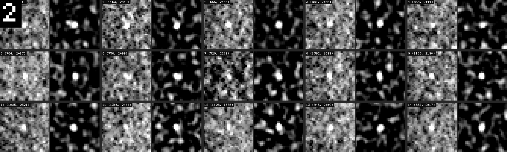
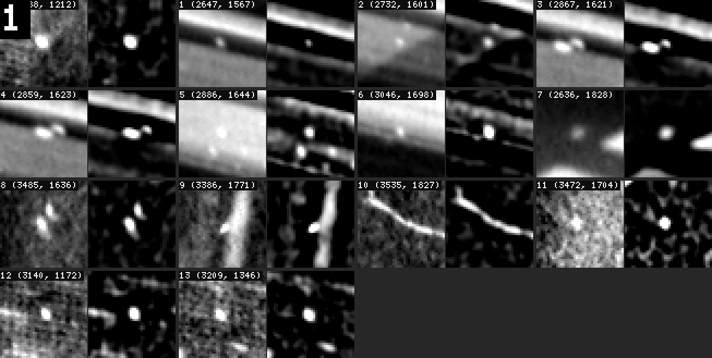
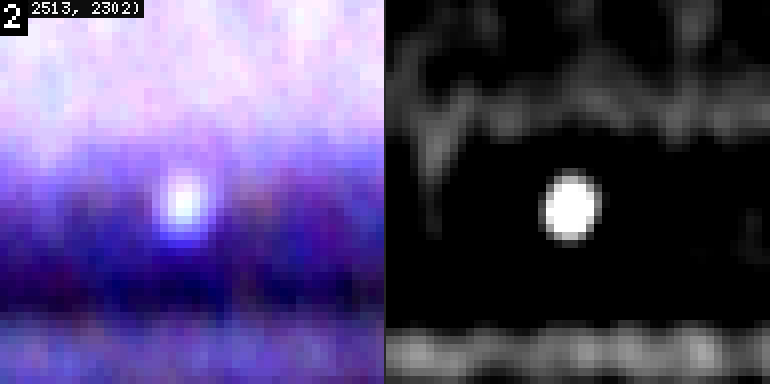
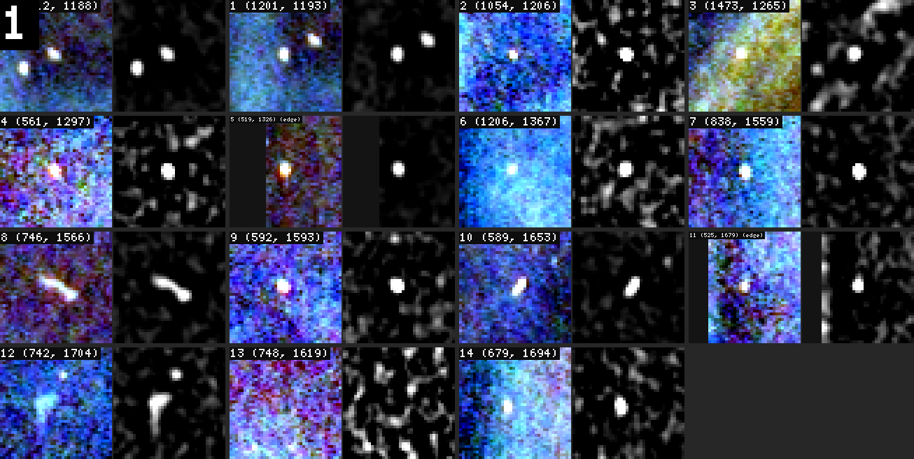
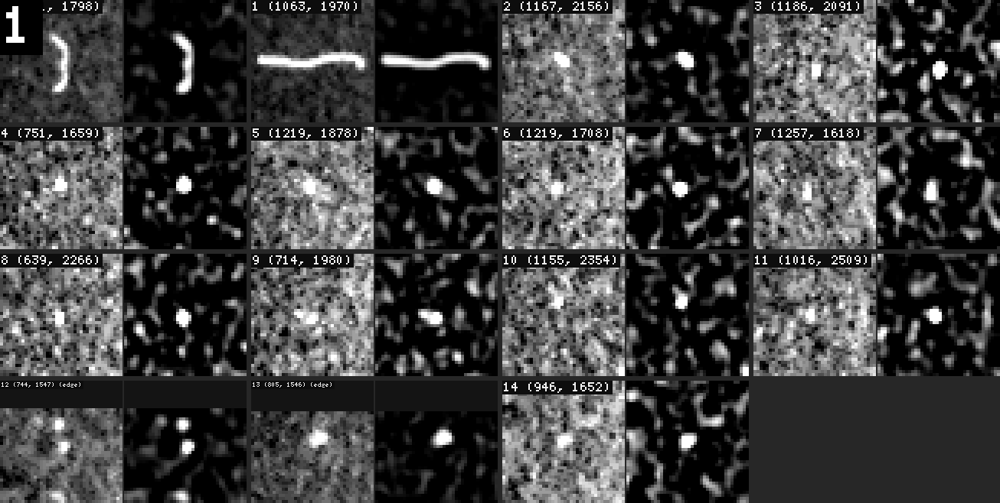
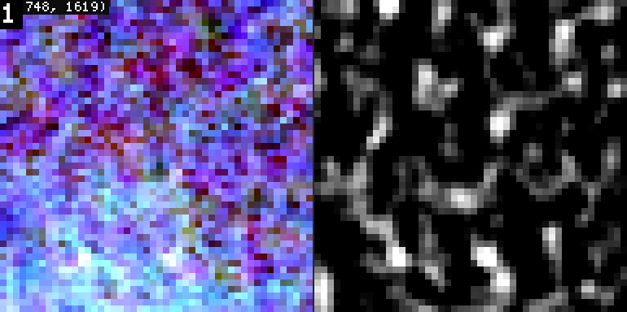
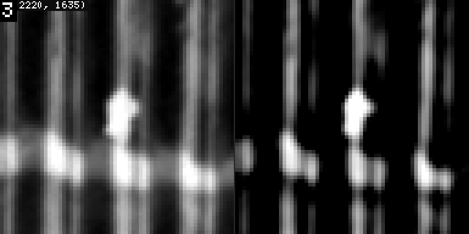
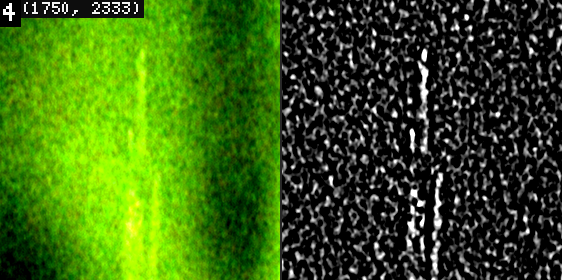
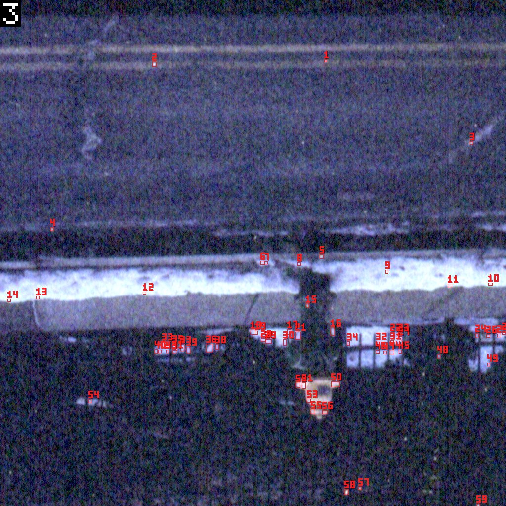
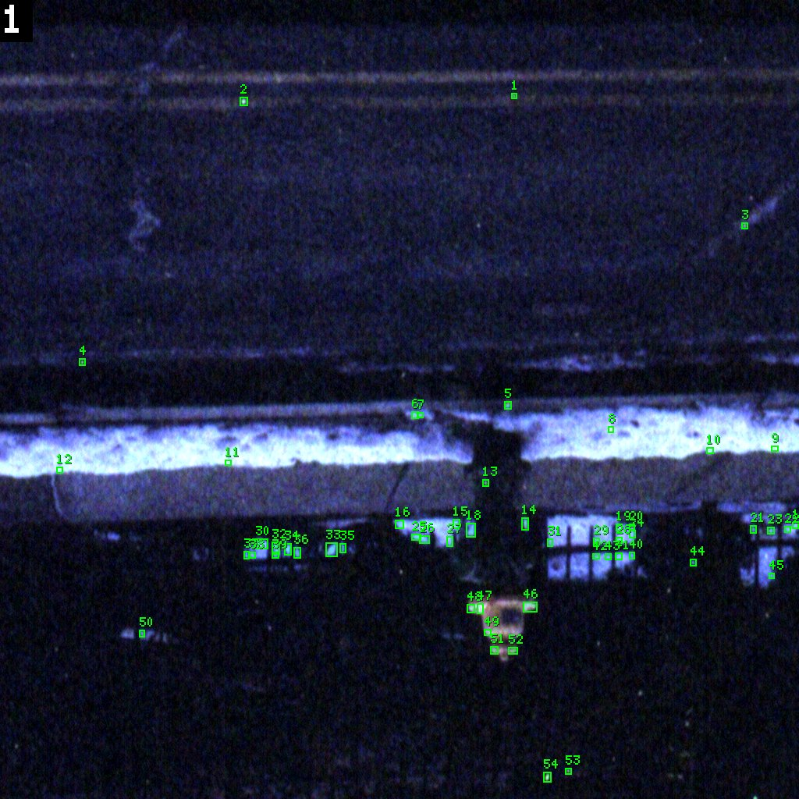

# Film Dust Annotation, Part 2: Measuring a Speck and Deciding Where to Look — A Technical Deep Dive

[[PROJECT REPORT - Film Dust Annotation - Part 1 - Making Faint Dust Visible - Density Tiles and the Speck View - A Technical Deep Dive|Part 1]] built a picture in which faint dust stands out. It exported each gold tile as film density, so a speck adds the same step on a thin and on a dense part of the negative. It then filtered the tile with a difference of Gaussians, the *speck view*, which ranks the user's labelled specks around the 18th most visible bump on a tile instead of the 700th.

A picture is not yet a workflow. An annotator, human or agent, still has to answer two questions for every tile:
- **where to look first**, since nobody inspects a million pixels one by one;
- **whether the thing under the cursor stands out from its surroundings enough to be dust.**

This part is about those two questions. It describes the number we use to answer the second, how well that number separates dust from everything else, where it breaks, and the candidate lists built on top of it for the first. [[PROJECT REPORT - Film Dust Annotation - Part 3 - The Annotation Tool - Magnifier, Fit-to-Speck and Lines - A Technical Deep Dive|Part 3]] then moves into the annotation tool, where the same ideas drive the fit-to-speck key and the line tracer.

> [!summary]
> - **One measure, two scales.** A *core/ring* measure compares the mean of a 3 px disk with a ring 6–12 px around it. On the tile it gives `snr`; on the speck view its `step` gives `sp`. Against 4,200 random places on the same tiles, `snr` separates the user's dust with ROC AUC 0.977 and `sp` with 0.974. Random places stay below snr 0.81 and sp 0.14 at the 99th percentile, which is where the playbook's "stands out" thresholds come from.
> - **The measure has three documented failure modes:** a bright scene edge inside the ring (a clear speck measures step −0.056), a colour index that divides by a step near zero (stepChroma 14.96 on an empty label), and snr on a clipped view (300–700). The helper `mem.probe` works around all three.
> - **The hot list** (speck view above a level, connected components of at least 4 px) covers 77 % of the gold points with a median of 28 spots per tile at level 0.4, and 91 % with 71 spots at level 0.3. A noise-scaled variant lost (87 % with 103 spots). For what the hot list misses, a low-level pass found by the annotator agents themselves, `mem.faint()`, keeps compact dots with snr ≥ 1.4.

## 1. Why a number at all

Dust annotation is a visual judgement, and the annotators, a person in dustview or a vision model in goja-cv, judge by eye on magnified crops. The number does not replace that judgement. It does three jobs the eye does badly.

The first is **calibration across tiles**. Every view in Part 1 is stretched per tile, so the brightness of a speck in a look says little about how strong it is. A dot that looks faint on a dense, grainy tile can be as strong as an obvious speck on a smooth one. A measure in density units, compared with the speck's own surroundings, is the same on both.

The second is **ranking a list**. A hot list of 70 spots per tile is too long to zoom on one by one; sorted by a strength measure, the first 15 cells of a contact sheet hold most of the dust.

The third is **an audit trail**. When an agent writes "dust, confidence 0.8, snr 4.8, chroma 0.29", a reviewer can check the claim against the image. When it writes only "looks like dust", nothing can be checked.

The measure itself has to be local. Film grain is not white noise with a fixed variance: it is louder in some densities, coarser on some film stocks, and riding on scene gradients everywhere. A global threshold on brightness or on a filter response fails for that reason. What the eye actually does when it spots a speck is compare a small region with the region immediately around it. The measure formalises that comparison.

## 2. The core/ring measure

### 2.1 Definition

Take a point $p$ and two radii. The **core** is the disk of radius $r_c$ around $p$. The **ring** is the annulus between $r_1$ and $r_2$. On a grey plane $L$ (the mean of the three density channels on our tiles, or Rec. 709 luminance by default), define:

| Quantity | Definition | Meaning |
|---|---|---|
| `coreMean` | mean of $L$ over the core | the speck's density |
| `ringMean` | mean of $L$ over the ring | the local background |
| `step` | coreMean − ringMean | how much denser the speck is than its surroundings; dust is bright, so step > 0 |
| `spread` | p90 − p10 of $L$ over the ring | how much the background varies: grain plus structure |
| `snr` | step / spread | the step in units of local variation |
| `stepR`, `stepG`, `stepB` | the step per channel | how the step is distributed over the dye layers |
| `stepChroma` | spread of the three channel steps relative to their mean | 0 for a neutral (grey) step; dust is neutral |
| `ringCoverage` | fraction of the ring inside the image | < 1 near a tile edge |

*Table 1. The fields of goja-cv's `img.measure` (v1), which are also the fields of our pre-v1 probe.*

The spread is p90 − p10 rather than a standard deviation because grain distributions have heavy tails and the ring often contains a few outlier pixels. It is a robust scale, which matters for the third failure mode in Section 4.

The neutrality index exists because of what dust is physically. A speck on the film blocks light in all three dye layers at once, so in density it adds roughly the same step to every channel. A coloured scene detail, a dye cloud or colour grain changes one or two layers more than the others. On a colour tile that difference is often the clearest single cue between dust and scene.

### 2.2 Before goja-cv v1: three masked statistics

The first version of the measure was built from goja-cv 3e53443 primitives, because the library had no measure op. A disk mask, a ring mask (a large disk minus a small one) and three calls to `stats` with that mask produced the numbers:

```js
// scripts/84-cv-probe.js (pre-v1), abridged
mem.probe = async (x, y, r) => {
  const core = img.mask.ellipse({ cx: x + 0.5, cy: y + 0.5, rx: r + 0.5, ry: r + 0.5 })
  const ring = img.mask.ellipse({ cx: x + 0.5, cy: y + 0.5, rx: r + 9.5, ry: r + 9.5 })
                  .minus(img.mask.ellipse({ cx: x + 0.5, cy: y + 0.5, rx: r + 3.5, ry: r + 3.5 }))
  const c = await img.stats({ mask: core })
  const g = await img.stats({ mask: ring, percentiles: [0.1, 0.9] })
  // stats are linear light; the tile stored density as the code value, so re-encode to sRGB in JS
  const step = enc(c.meanL) - enc(g.meanL), spread = enc(g.percentiles["0.9"]) - enc(g.percentiles["0.1"])
  return { step, ringSpread: spread, snr: step / spread, chroma: chromaOf(c.perChannel, g.perChannel) }
}
```

Writing it uncovered two small surprises:
- `stats().perChannel` is keyed by `r`, `g` and `b`, not by index;
- the `percentiles` result is keyed by the string `"0.1"`.

The first draft indexed both with numbers and read `undefined`. The probe took 0.83 s for 30 candidates in one eval. It was the most useful number the pre-v1 workflow had, and the first handover document to the goja-cv maintainer asked for it as a built-in op.

On four tiles, comparing the user's dust with the other top-40 candidates of the library's own speck detector, it separated cleanly:

| Tile | User dust, median snr | Other candidates, quartiles |
|---|---|---|
| 7edbfe9c | 2.66 | 0.67 / 1.18 / 1.75 |
| 2b3a8276 | 1.72 | 0.91 / 1.23 / 1.53 |
| af8640d7 | 4.04 | 0.34 / 0.64 / 1.72 |
| 40869f8b | 2.57 | 0.56 / 0.74 / 1.69 |

*Table 2. The pre-v1 probe on four tiles (diary step 8). On the colour tile 40869f8b, chroma was 0.2 for dust against 0.71–0.92 for the rest.*

### 2.3 In v1: `img.measure`

goja-cv v1 added the op, with the same definition and many points per call:

```js
const img = cv.open("/Users/manuel/dustdet/cv_tiles/40869f8b460ee8dc_1024_0.tif",
                    { encoding: "linear", origin: [1024, 0] })
const rows = await img.measure([[1336, 130]], { coreRadius: 3, ringRadii: [6, 12] })
```

```yaml
- cx: 1336
  cy: 130
  coreMean: 0.42999
  ringMean: 0.11163
  step: 0.31836
  spread: 0.06641
  snr: 4.7939
  stepR: 0.30111
  stepG: 0.31592
  stepB: 0.39341
  stepChroma: 0.28992
  ringCoverage: 1
```

Two details of this call carry most of the correctness:
- **`origin` at open.** The tile is opened at its position in the raw scan, so `[1336, 130]` is the gold annotation's absolute coordinate and needs no conversion. Before v1, a local/absolute conversion lived in every helper and was a steady source of off-by-origin mistakes.
- **`encoding: "linear"`.** The tile stores density as the code value, so the op's linear working space is density itself.

Part 1 tells the story of the first v1 run, which used the old sRGB-encoded export by mistake; the speck view then found 70 % instead of 79 % of the specks, until the tiles were re-exported. The measure numbers in this part all come from the corrected tiles.

### 2.4 The best point within 2 px

A label is placed by a hand or an agent, and both are off by a pixel or two. A core of radius 3 that is 2 px off the speck's centre mixes speck and background and loses half its step. The fix is cheap, because `measure` takes many points at once: measure a small grid around the point and keep the best row.

```js
// scripts/84-cv-helpers.js
mem.best = async (node, x, y, opts) => {
  const g = []
  for (let dy = -2; dy <= 2; dy++) for (let dx = -2; dx <= 2; dx++) if (dx * dx + dy * dy <= 4) g.push([x + dx, y + dy])
  const rows = await node.measure(g, opts)          // 13 positions in one call
  let b = rows[0]
  for (const m of rows) if (m.snr > b.snr) b = m
  return b
}
```

Keeping the maximum biases the number upward for every point, including random places. That is acceptable because the same bias applies to the random baseline in Section 3, so the thresholds derived there already include it. The returned row also carries the improved centre `(cx, cy)`, and an annotator who probes an eyeballed position gets the snapped position back. Several agents in Part 4 relied on exactly that, after finding that coordinates read off ruler crops were 5–10 px off.

### 2.5 Measuring at the size of a label

For a gold label with a radius, the measure can also run at that radius: core $r$, ring from $\max(1.5r, r+2)$ to $\max(2.5r, r+6)$. Script 86 uses this form to validate the user's labels (Section 5), with a wider search for the best position (radius $\min(r, 6)$ in 1 px steps, or $r/2$ in steps of $r/6$ for $r > 12$). Over all 142 gold points it took 2.65 s, sheets included. The label-sized measure gave a median snr of 1.14 at the label and 1.47 at the best place nearby.

## 3. How well does it separate dust from everything else?

### 3.1 The study

A threshold is only meaningful against a baseline. Script 87 builds one from the tiles themselves:
- **positives:** every gold point of type dust with $r \le 12$, 132 in all;
- **negatives:** 300 random places per tile, at least 15 px from any label and 12 px from the border, 4,200 in all.

Each place is measured at a fixed small scale (core 3, ring 6–12, best within 2 px), on the tile and on the speck view. The script reports the ROC AUC (the probability that a random dust point scores higher than a random place) and the random places' 90th and 99th percentiles.

| Measure | AUC | Gold median | Random p90 | Random p99 | Gold above random p99 |
|---|---|---|---|---|---|
| snr on the tile | **0.977** | 1.73 | 0.45 | 0.81 | 89 % |
| step on the tile | 0.949 | 0.193 | 0.073 | 0.256 | 41 % |
| snr on the speck view | 0.970 | 5.18 | 0.87 | 2.29 | 84 % |
| step on the speck view (`sp`) | **0.974** | 0.314 | 0.062 | 0.142 | 83 % |

*Table 3. Gold dust (132) against random places (4,200) on the 19 labelled tiles; script 87, 10.8 s.*

The step on the tile is the weakest measure, and the reason is instructive. A step of 0.2 density units is a lot on a smooth sky and nothing on coarse grain; dividing by the local spread is what makes the number comparable across backgrounds. On the speck view the step alone works well, because the DoG has already removed the background and the view's white point (5 × its 99th percentile) normalises it per tile.

Colour neutrality is a weaker but independent cue. On colour film, among places that stand out (snr ≥ 1), gold dust had a median stepChroma of 0.29 against 0.60 for random places, AUC 0.736 with low = dust. Few random places stand out at all (9 of 4,200), so this number rests on small counts. It is a second opinion on colour tiles, never a decision on its own.

### 3.2 From the study to the playbook's thresholds

The annotator playbook (reference/04, section 4) turns Table 3 into three bands:

| Band | Rule | Origin |
|---|---|---|
| stands out | snr ≥ 1 **or** sp ≥ 0.15 | above the random p99 (0.81, 0.14) with a margin |
| a speck next to a bright edge | low snr, high sp | Section 4.1: the edge spoils snr, the speck view removed it |
| nothing distinct | both low | below the random p90 (0.45, 0.06) |

*Table 4. The probe thresholds of the playbook.*

Two caveats belong next to these numbers, and the playbook states both:
- **The random places are an easy negative class.** The real false positives are scene highlights, lamps and texture bumps, which all stand out. The thresholds say "stands out", not "is dust"; scene versus dust is the eye's call.
- **The thresholds have to fit what the user marks.** Trial 2 of the annotator agents (Part 4) missed a third of the user's points, and those misses all sat at snr 0.6–1.2 and sp 0.15–0.23.



*Figure 1. Gold points on c71dd0f2 that trial 2 missed. Each is a compact dot in the speck view, measuring snr 0.6–1.2 and sp 0.15–0.23: above the random p99 in sp, around it in snr. The user marks these, so the recall-first playbook suggests every compact dot with sp ≥ 0.15 that is not scene.*

### 3.3 The same study in goja-cv alone

The user asked whether these statistics could live in goja-cv instead of Python driving the CLI. Script 89 is the answer: the study of Table 3, the hot-list recall of Section 6 and the view-rank metric of Part 1, written as one eval in goja-cv's JavaScript. Two utilities had to be hand-written. A seedable random generator was needed, because `Math.random` cannot be seeded:

```js
let seed = 1
const rand = () => { seed |= 0; seed = (seed + 0x6d2b79f5) | 0; let t = Math.imul(seed ^ (seed >>> 15), 1 | seed)
  t = (t + Math.imul(t ^ (t >>> 7), 61 | t)) ^ t; return ((t ^ (t >>> 14)) >>> 0) / 4294967296 }   // mulberry32
```

The other was an AUC with tied values handled correctly (a Mann–Whitney U with midranks):

```js
const auc = (pos, neg) => {
  const all = pos.map(v => [v, 1]).concat(neg.map(v => [v, 0])).sort((a, b) => a[0] - b[0])
  let rs = 0
  for (let i = 0; i < all.length;) {
    let j = i; while (j < all.length && all[j][0] === all[i][0]) j++
    const r = (i + j + 1) / 2                    // midrank of the tie group
    for (let k = i; k < j; k++) if (all[k][1]) rs += r
    i = j
  }
  return (rs - pos.length * (pos.length + 1) / 2) / (pos.length * neg.length)
}
```

The single eval ran over 15 tiles in 11.5 s and reproduced the Python numbers:

| | goja-cv only (script 89) | Python + CLI (scripts 85, 87, 88) |
|---|---|---|
| hot-list coverage at 0.5 / 0.4 / 0.3 | 69 / 77.5 / 88 % | 69 / 77 / 88 % |
| snr AUC; random p90 / p99 | 0.978; 0.45 / 0.84 | 0.977; 0.45 / 0.81 |
| sp AUC; random p99 | 0.975; 0.15 | 0.974; 0.14 |
| view rank: median, share in top 50 | 17, 80 % (proxy) | 18, 79 % |

*Table 5. The evaluation statistics in pure goja-cv. The small differences come from different random samples and the rank proxy.*

Three gaps decided how the script had to be written. These are the "what is missing" answers recorded in the goja-cv field report:
- **No file reads inside an eval.** The sandbox has no filesystem, so the gold labels came in through a prelude built with `jq` outside goja-cv (`mem.GOLD = [...]`).
- **No local maxima or pixel access.** The rank metric counts local-maximum bumps at least as bright as the speck. Without a `peaks` op it became a proxy: threshold the view at the speck's peak and count connected components, one `components()` call per point, 142 calls in all.
- **No small numeric conveniences:** no seeded random, no quantiles, no plotting of arbitrary arrays. Each was a few lines of JS.

Statistics on image measurements fit in goja-cv. Everything that touches raw scans, training or statistics beyond quantiles and AUC stays in Python.

## 4. Where the measure breaks

A measure is only trustworthy when its failure modes are known. The core/ring measure has three, each found on real gold points and each with a concrete repair.

### 4.1 Structure inside the ring

The ring is assumed to be background. When part of it lies on a bright scene edge, the ring mean rises, the ring spread grows, and both push snr down. On the B&W tile a0cff2a3, several of the user's clearest specks sit right under a bright band:

| Point | snr (tile) | step | ring spread | speck view |
|---|---|---|---|---|
| a0cff2a3 (2646.5, 1566.5), speck under a bright band | −0.099 | **−0.056** | 0.573 | snr −0.11 |
| a0cff2a3 (3045.5, 1697.5) | 0.257 | 0.154 | 0.600 | snr 2.07 |
| 24dee69e (2513.1, 2301.6), speck between two bands | 0.656 | 0.132 | 0.202 | snr 21; step 0.6 |

*Table 6. Clear specks that the core/ring measure scores low or negative.*



*Figure 2. Gold points of a0cff2a3. In cells 1, 3 and 6 the speck sits against a bright band. The ring overlaps the band, so a speck that is plainly brighter than its immediate background measures a negative step.*



*Figure 3. 24dee69e #1. The speck view (right) has removed the bands, so its step is large; the tile's ring still contains them.*

The repair in our helpers is to measure on the speck view as well. The DoG subtracts a 4 px Gaussian background, which removes smooth bands and gradients before the ring sees them. That is why `mem.probe` reports two numbers, `snr` from the tile and `sp` from the speck view, and why the playbook reads "low snr, high sp" as "a speck next to a bright edge". It is not a complete repair. In the first row of Table 6, half the ring is on the band even in the speck view, and both numbers fail.

The proper repair belongs in the library. Issue 1 of the v1 field report asks for robust ring statistics:
- `ring: "median"`: the ring median and a MAD-based spread;
- or `ring: "sectors"`: split the ring into eight sectors, use the median sector mean, and report the sector spread as `ringStructure`.

With that field, a measure could say "the surroundings are not flat" instead of silently reporting a small number.

### 4.2 A ratio that divides by zero

`stepChroma` is the spread of the per-channel steps divided by their mean. When the step is near zero, the denominator is near zero too, and the index is meaningless. On 7edbfe9c, at a label with nothing under it:

```js
img.measure([[747.62, 1619.03]], { coreRadius: 3, ringRadii: [6, 12] })
// step 0.001, snr 0.029, stepChroma 14.961
```

An annotator reading "chroma 15" would conclude "strongly coloured, not dust", when there is nothing there at all. The helper hides the number unless the point stands out:

```js
const chroma = b.snr >= 0.5 ? r3(b.stepChroma) : null   // meaningless when the step is near 0
```

The field report asks the library for `null` below a significance bound, or for normalising by $\max(|step|, spread)$.

### 4.3 snr on a clipped view

The speck view is clipped at zero: it keeps only what is brighter than its surroundings. In a quiet area, nearly every ring pixel is exactly zero, so the ring spread is close to zero and snr explodes. The first version of the hot list sorted by speck-view snr and produced:

```text
top: [161 1725 995 686.36 …, 162 1992 1025 607.084 …, 133 1913 721 338.989 …]
```

These are values of 300 to 700 on a scale where dust has a median of 5. The ordering was dominated by how empty the ring happened to be, not by how strong the speck was. The step on the same view is bounded (1.0 is the view's white) and well behaved, which is why `sp` is a step and not a ratio:

```js
mem.probe = async (x, y) => {
  const o = { coreRadius: 3, ringRadii: [6, 12] }
  const b = await mem.best(mem.img, x, y, o)                                     // on the tile: snr, chroma
  const s = await mem.best(mem.img.view("speck"), x, y, { ...o, channels: false }) // on the speck view
  const chroma = b.snr >= 0.5 ? r3(b.stepChroma) : null
  return { x: b.cx, y: b.cy, snr: r3(b.snr), sp: r3(s.step), step: r3(b.step), chroma, cover: r3(b.ringCoverage) }
}
```

Re-sorted by `sp`, the same tile's top three became 0.669, 0.616 and 0.572: the two specks at the bottom edge and the gold speck at (1336, 130).

The key points of this section:

- The measure assumes the ring is background. A scene edge in the ring makes a clear speck measure low or even negative.
- Measuring on the speck view removes smooth structure before the ring sees it, and its step is bounded; this is the `sp` field.
- Ratios need a guard. The colour index is shown only when snr ≥ 0.5, and snr is never taken on a clipped view.

## 5. Checking the gold labels with the same tools

The gold labels are the reference against which everything else is scored, so they have to be right. Script 86 measures every gold point at its label's size and also searches nearby for the best response, then renders each tile's points as a contact sheet: the tile with a per-cell stretch next to the speck view, 15 points per look.

```js
const speck = img.view("speck")
const pts = G.map(g => ({ cx: g.x, cy: g.y }))
cv.sheet(pts.slice(0, 15), { views: [img, speck], size: 40, zoom: 4, stretch: "cell", labels: "index" })
  .look("gold 0-")
```

The script flags a point when one of these holds:
- **weak:** the best snr nearby is below 0.5;
- **dark:** the step is ≤ 0;
- **off:** the best point is more than $\max(2, r/2)$ px from the label;
- **edge:** the ring leaves the tile.

Over 142 points, 10 were weak, none dark, 45 off and 4 at an edge. "Off" turned out to be mostly harmless one- and two-pixel offsets. The useful output is the sheets, which put every label of a tile into one picture.



*Figure 4. Gold sheet of 7edbfe9c. Cell 13 has nothing under the label: the speck view shows grain only, and the measure agrees (step 0.001, snr 0.03).*



*Figure 5. Gold sheet of c71dd0f2. Cells 0 and 1 are hairs, which a disk measure scores low (snr 0.2–0.6) because most of the disk is background. Cells 12 and 13 cross the tile border; their labels shrink to a tiny font, which is issue 6 of the field report.*

Within minutes the sheets produced a short review list for the user:

| Tile, point | Finding |
|---|---|
| 7edbfe9c #13 (747.6, 1619.0) | nothing under the label |
| 1d955ef4 #0, #1 (r 63, 64) | one long vertical line labelled as two "dust" circles |
| a2d0d98f #0 (2220.2, 1635.2) | a bright blob at a junction of a vertical scene pattern; possibly scene |
| c71dd0f2 #10 (1154.9, 2354.1) | the speck is 3 px above the label |

*Table 7. Gold labels flagged for the user's review.*



*Figure 6. 7edbfe9c #13 at 8×. Grain only.*



*Figure 7. a2d0d98f #0. The blob repeats the scene pattern around it. Rule 2 of the playbook ("would this bright thing be there if the film were clean?") is the right question here, and only the user can answer it.*



*Figure 8. 1d955ef4 #0 and #1. A line about 250 px long, labelled as two dust circles of r ≈ 63. A disk is the wrong shape for it, which is why Part 3 adds polylines for hairs and scratches.*

The last figure points to a limit of the whole measure-and-disk approach. Hairs and scratches are lines, and a disk measure underrates them by design. The four review cases are also why the gold set is checked with tools at all: a reference set with an empty label and a hair recorded as two specks would charge a detector for correct answers.

## 6. Deciding where to look: the hot list

### 6.1 Construction

The candidate list that drives the workflow is the simplest thing that uses Part 1's speck view: threshold it, take connected components, discard components smaller than 4 px.

```js
mem.spots = (level = 0.4) =>
  mem.img.view("speck").mask.luminance({ above: level }).components({ minArea: 4 })
```

`mem.hot(level)` probes each component's centroid (Section 2) and returns rows sorted by `sp`:

```text
id x y sp snr chroma area aspect [EDGE]
54 1726 996 0.669 8.879 0.083 31 1.656
55 1992 1023 0.616 11.23 0.41 10 1.327 EDGE
2 1336 130 0.572 4.894 0.283 24 1.222
33 1449 705 0.555 1.762 1.088 70 2.366
```

The level is in units of the speck view's white point, which is 5 × the 99th percentile of the DoG's bright part. Level 0.4 is therefore 2 × p99, and level 0.3 is 1.5 × p99. These are exactly the `k = 2` and `k = 1.5` thresholds of the pre-v1 hot list, which had to build the same thing from `levels` and `mask.luminance` because goja-cv then had no DoG op.



*Figure 9. The pre-v1 hot list at k = 2 on 40869f8b: 59 spots. Most cluster on the lit windows and the foam band (scene); the gold speck at (1336, 130) is spot 2 near the top left.*



*Figure 10. The v1 hot list at level 0.4 on the same tile: 55 spots, nearly the same set. The gold speck is again spot 2.*

The edge handling came from the agents. A component on the tile border can have its centroid outside the tile (one at y = 1025 on a tile that ends at 1024), so v1 helpers clamp the row inside the tile and mark it `EDGE`. The helpers also keep every level's rows in `mem.hotByLevel[level]`, because the first version overwrote the 0.4 list when an agent ran the 0.3 pass.

### 6.2 How many spots, how much coverage

Script 88 measures the trade-off on the labelled tiles. A gold point counts as covered when it lies inside a component's bounding box grown by $r + 3$.

| Level | Spots per tile (median) | Gold covered (142 points) | Gold covered (197 points, later) |
|---|---|---|---|
| 0.5 | 15 | 69 % | — |
| 0.4 | 28 | 77 % | 78 % |
| 0.3 | 71 | 88 % | 91 % |
| 0.25 | 199 | — | 93 % |
| 0.2 | 534 | 92 % | 94 % |

*Table 8. Hot-list size against gold coverage (script 88). The 197-point column is after the user added faint points on 7edbfe9c and c71dd0f2.*

The table has a knee between 0.3 and 0.25. Going from 0.4 to 0.3 roughly triples the list and adds 13 points of coverage. Going below 0.3 multiplies the list by 3–8 for 2–3 points. The workflow therefore runs level 0.4 first (the strong specks, judged quickly) and then level 0.3 as the main candidate list.

### 6.3 A silent truncation

The first run of script 88 parsed the YAML result of `goja-cv eval --json` and produced these numbers:

```text
level 0.5: spots/tile median 15  gold covered 68 %
level 0.4: spots/tile median 28  gold covered 68 %
level 0.3: spots/tile median 48  gold covered 69 %
level 0.2: spots/tile median 48  gold covered 51 %
```

Coverage that stays flat as the threshold loosens, and then *falls*, is impossible for nested sets, since every component at level 0.3 contains its level-0.4 counterpart. The cause was the eval result's 9,000-character cap. The lists were cut at 48 rows, and longer lists lost their later rows. The `--json` mode still returns the result as a YAML string under the same cap, so a program that parses it gets truncated data that looks plausible.

The fix was to stop using the result as a data channel:

```js
return { f: cv.json(out, { name: "hot" }) }   // a file: the YAML result is capped at 9000 characters
```

The corrected numbers are Table 8. This is issue 3 of the field report. The lesson for anyone scripting goja-cv is general: return data through `cv.csv`/`cv.json` files, and use the YAML result only for what a person reads.

### 6.4 An experiment that lost: a noise-scaled hot list

The annotator agents of Part 4 reported a repeated problem. On tiles with strong scene edges (window frames, lattices, cables), the speck view's white point is set by those edges, so real dust in a dark area reads only sp 0.03–0.09 and never reaches level 0.3. The obvious alternative is to threshold the DoG in units of its own noise, $\sigma = \text{IQR} / 1.349$ of the signed DoG, instead of in units of its 99th percentile. On cf07d270 the gap is large: p99 = 0.112 and σ ≈ 0.0075, so the speck view's white point there is about 75σ and level 0.4 is about 30σ.

```js
const d = img.toGray("average").dog(1, 4)
const t = await d.stats({ percentiles: [0.25, 0.75] })
const sig = (t.percentiles["0.75"] - t.percentiles["0.25"]) / 1.349
sp = d.max(0).levels({ black: 0, white: 20 * sig })        // level L/20 = L sigma
```

Script 88 `--sigma` measured it on the same 197 points:

| Scale | Threshold | Spots per tile, median (mean) | Gold covered |
|---|---|---|---|
| p99 (speck view) | 0.3 | 71 (90) | **91 %** |
| noise | 7σ | 36 (95) | 70 % |
| noise | 6σ | 50 (128) | 83 % |
| noise | 5.5σ | 103 (153) | 87 % |
| noise | 5σ | 136 (188) | 92 % |

*Table 9. The noise-scaled hot list against the p99-scaled one (script 88).*

At comparable list sizes the noise scale covers less, and its mean list size is far above its median. On grainy tiles the grain itself reaches 5–6σ, so the list floods. The p99 scale adapts to texture as well as to edges, and on the average tile that is the better trade. The hot list kept the p99 scale. The edge-heavy tiles needed a different kind of pass, which the agents had already found.

### 6.5 `mem.faint()`: the low-level pass the agents invented

When the 39 annotator agents' code was extracted from their transcripts (Part 4), the most useful idiom came from the agent on 2b3a8276, a tile dominated by a lattice:
1. take the speck view's blobs at a very low level (0.06);
2. keep the compact ones (area 5–80 px, aspect below 3);
3. probe each, and keep those that stand out from their own surroundings (snr ≥ 1.4).

The probe's snr is local, so it does not care what the tile-wide p99 is. It is now a helper:

```js
mem.faint = async ({ level = 0.06, snrMin = 1.4, areaMin = 5, areaMax = 80, aspectMax = 3, max = 200 } = {}) => {
  const items = (await mem.spots(level)).items.filter(it => it.area >= areaMin && it.area <= areaMax && (it.aspect ?? 1) < aspectMax)
  const known = Object.values(mem.hotByLevel || {}).flat()
  const rows = []
  for (const it of items.slice(0, 600)) {
    if (known.some(k => Math.hypot(k.x - it.cx, k.y - it.cy) < 4)) continue      // already in a hot list
    const p = await mem.probe(it.cx, it.cy)
    if (p.snr >= snrMin) rows.push({ x: Math.round(p.x), y: Math.round(p.y), snr: p.snr, sp: p.sp, area: it.area, aspect: r3(it.aspect) })
  }
  rows.sort((a, b) => b.snr - a.snr)
  mem.faintRows = rows
  return { candidates: items.length, kept: rows.length, rows: rows.slice(0, max).map(o => [o.x, o.y, o.snr, o.sp, o.area, o.aspect].join(" ")) }
}
```

On cf07d270, the tile whose agent reported "the obvious dust at (1738, 1289) was in neither hot list", it ran in 0.18 s after `mem.hot(0.3)`:

```text
candidates: 80
kept: 6
top: [1739 1289 2.415 0.089 80 1.336, 2375 1131 2.305 0.063 12 1.186, 2455 1079 1.599 0.048 15 1.902,
      2389 620 1.598 0.103 38 2.521, 1775 1338 1.418 0.047 10 1.327, 1974 1327 1.4 0.038 8 1.229]
has1738: true
```

The first row is the missed speck, at sp 0.089, which is far below any hot level. Rows 2, 5 and 6 are dots that the agent had found only by sweeping the speck view by hand. A second advantage matters as much as the recall: the rows carry exact coordinates. The agents that swept by eye read positions off ruler crops and were often 5–10 px off; on one tile, 28 of 32 guessed positions probed at sp ≈ 0. A list with exact coordinates can go straight into a contact sheet.

`mem.faint()` has so far been checked on one tile, with thresholds taken from one agent's choice. That caveat is in the diary. The next measurement is how many of the user's accepted points on the pre-annotated tiles come from `faint` rather than from the hot list.

### 6.6 The sweep

The last candidate source is the eye, on the speck view one quarter at a time. The playbook used to crop the full speck view, which is nearly black on a dark tile, because its stretch is set by the tile's strongest features. `mem.sweep(q)` stretches each quarter to its own range:

```js
mem.sweep = async (q) => {
  const [bx, by] = mem.box, h = 512, x = bx + (q % 2) * h, y = by + Math.floor(q / 2) * h
  const c = mem.img.view("speck").crop([x, y, h, h])
  const t = await c.stats()
  return c.levels({ black: 0, white: Math.max(t.p99 * 1.5, 0.02) })
          .look({ label: "speck quarter " + q + " (own stretch)", zoom: 2, ruler: 32 })
}
```

The sweep is where hairs are found, since a thin line rarely forms a compact component at any level. It is also where coordinates are least reliable, so the playbook requires every position read off a sweep to go through `mem.probe` or a zoom before it is written down.

### 6.7 The candidate pipeline as a whole

```mermaid
flowchart TD
  T[tile at origin<br/>density, linear] --> V[speck view<br/>DoG 1–4, white 5 × p99]
  V --> H4[hot 0.4<br/>~28 spots]
  V --> H3[hot 0.3<br/>~71 spots]
  V --> F[faint<br/>level 0.06, compact,<br/>snr ≥ 1.4]
  V --> SW[sweep<br/>4 quarters, own stretch]
  H4 --> S[contact sheets<br/>15 per look, tile | speck]
  H3 --> S
  F --> S
  SW --> P[probe guesses<br/>snap within 2 px]
  P --> S
  S --> Z[zoom 8×, rulers<br/>+ probe numbers]
  Z --> D{decision rules<br/>scene? grain? dot? thread?}
  D --> A[suggestion<br/>type, confidence, snr, sp]
```

*Figure 11. The candidate pipeline of the annotator playbook. Every source ends in the same contact sheets and zooms; the numbers travel with each suggestion.*

The order follows the cost of judgement. Level 0.4 holds the strong, quick decisions. Level 0.3 is the main list, where most scene rejections happen (on busy tiles, 50–80 % of its rows are window frames, lamps or foliage, which the agents learned to filter by region in one line of JS). `faint` and the sweep pick up what both lists miss. All four sources feed the same contact sheets, so the eye compares candidates side by side rather than one zoom at a time.

## 7. What the numbers can and cannot do

The measure is good at what it measures. A compact dot that stands out from its own surroundings has high snr and high sp; grain and empty places do not; and the separation from random places is nearly perfect. Three things are outside its reach, and the workflow puts the eye there deliberately:

- **Scene versus dust.** A lamp, a glint on water or a highlight on a car body is a compact bright dot with high snr. Only context separates it from dust, and the decision rules (Part 4) put the scene question before the numbers.
- **Lines.** A disk measure gives hairs snr 0.2–0.6. Hairs and scratches are found by eye in the sweep and recorded as polylines (Part 3).
- **Calibration to the user.** The thresholds come from random places, and the user's own threshold for "faint dust worth marking" sits lower than the agents first assumed. Trial 2 versus trial 3 in Part 4 is the measurement of that gap.

The key points of this part:

- The core/ring measure compares a 3 px disk with a 6–12 px ring. Its snr on the tile and its step on the speck view (`sp`) separate gold dust from random places with AUC 0.977 and 0.974.
- The playbook's thresholds come from the random places' tail: snr ≥ 1 or sp ≥ 0.15 stands out, snr < 0.45 and sp < 0.06 is nothing distinct.
- Bright structure inside the ring, ratios over tiny steps, and snr on a clipped view are the measure's failure modes. Measuring on the speck view, guarding chroma, and using a step instead of a ratio repair them in the helpers.
- The same tools validated the gold set and found four labels for the user to fix, including an empty label and a 250 px line recorded as two dust circles.
- The hot list at level 0.3 covers 91 % of gold with a median of 71 spots per tile. A noise-scaled list did worse, and the agents' low-level `faint` pass covers the dust that strong scene edges hide.
- Data out of goja-cv goes through files. The YAML result is capped, and a capped list can look plausible.

## 8. Next: the annotation tool

Everything in this part runs inside goja-cv, which serves agents and scripts. The user annotates in dustview, a browser tool that reads the raw scans directly. [[PROJECT REPORT - Film Dust Annotation - Part 3 - The Annotation Tool - Magnifier, Fit-to-Speck and Lines - A Technical Deep Dive|Part 3]] takes the ideas of this part into that tool:
- a magnifier with its own contrast stretch;
- a fit-to-speck key that removes a background plane and measures the half-height region;
- a line tracer that follows a hair between the user's clicks.

[[PROJECT REPORT - Film Dust Annotation - Part 4 - Annotator Agents - Playbook, Trials and Pre-Annotation over MCP - A Technical Deep Dive|Part 4]] then follows the candidate pipeline of Figure 11 through 39 agent runs. What goja-cv itself should learn from those runs is collected in [[ARTICLE - Deep Dive - goja-cv in Agent Hands - Feedback from 39 Annotator Agents]].

## Sources

- **Repository:** `/Users/manuel/code/wesen/2026-11-07--dust-scanning`.
- **Ticket:** `ttmp/2026/11/07/DUST-002--film-dust-detector-model-exploration/`.
  - `reference/04-goja-cv-dust-playbook.md`: decision rules, thresholds, candidate pipeline.
  - `reference/09-goja-cv-v1-field-report.md`: issues 1–3, 5, 6 and 8, and the statistics in goja-cv.
  - `reference/10-goja-cv-usage-diary.md`: steps 3 and 7–10.
  - `reference/01-diary.md`: steps 8–10, 14 and 15.
- **Scripts** (ticket `scripts/`):
  - `84-cv-helpers.js`: `mem.best`, `mem.probe`, `mem.spots`, `mem.hot`, `mem.faint`, `mem.sweep`; the pre-v1 version is in git `869dab8`;
  - `83-cv-specks-vs-gold.py`: pre-v1 speck detector against gold;
  - `86-cv-gold-measure.py`: gold-point measures and sheets;
  - `87-cv-measure-auc.py`: Table 3;
  - `88-cv-hot-recall.py`: Tables 8 and 9; `--sigma` for the noise scale;
  - `89-cv-stats.js`: Table 5;
  - `90-gold-fit-check.py`: the fit used in Part 3.
- **Data:** `~/dustdet/cv_tiles/` (density tiles, script 82), `~/dustdet/cv_play/gold_v1/gold_measure.csv`, `~/dustdet/cv_play/gold_v1/measure_auc.json`.
- **goja-cv:** `main` b847520, ops `measure`, `view("speck")`, `mask.luminance`, `components`, `cv.sheet`, `cv.json`.
