# Film Dust Annotation, Part 3: The Annotation Tool — Magnifier, Fit-to-Speck and Lines — A Technical Deep Dive

[[PROJECT REPORT - Film Dust Dataset - Part 8 - The Gold Set and the Annotation Tool - A Technical Deep Dive|Dataset Part 8]] built the annotation page of `dustview`: a browser tool in which a person marks every dust speck, hair and scratch on 50 gold tiles, in two blind passes and a diff. That tool was complete in the sense that it could produce valid files. This part is about what happened when the user actually started labeling with it. Four things turned out to be missing. The user could not find the page. They could not see a 3 px speck well enough to place a circle on it. A circle was the wrong shape for a hair. And they had no fast way to correct thirty circles placed by eye.

The additions answer those four needs with four mechanisms. A guide panel and navigation links make the workflow discoverable. A magnifier follows the cursor and shows the pixels under it at 10× with its own contrast stretch. A fit-to-speck function measures the speck under a point and moves the circle onto it. A line mode stores hairs and scratches as polylines with a width, and a tracer follows the line between the user's rough clicks. Each mechanism is small in code, but each rests on a decision about what a correct annotation is. Those decisions are the subject of this report.

> [!summary]
> - **A fit is a measurement, not a guess.** `fitSpot` removes a plane fitted to a ring around the point, finds the brightest pixel, grows the region above half of that peak, and returns its value-weighted centroid and a radius of k × the half-height radius + 0.5. On the user's 41 points of tile 7edbfe9c it matched an independent Python implementation to 0.16 px and 0.1 px of radius.
> - **The user applies every correction.** The project rule is that the assistant never writes the frozen dataset at `~/dustds`. So the fit is a key (`f`, `F` for the whole tile) whose result the user inspects, can undo (`Z`), and saves.
> - **Hairs are lines.** A point now carries an optional `path` and `width`. The tracer snaps the user's clicks to the ridge, joins them with a minimum-cost path inside an 8 px band, trims the ends where the ridge fades, and measures the width from cross-sections. A 34 px hair that needed a circle of radius 19.5 is now a 5.4 px wide band.

## 1. The starting point: a tool nobody could find

The user opened `http://127.0.0.1:8765/`, the viewer's default page, and sent a screenshot of it. That page is the Images tab: a list of 722 scanned frames, each with its Lightroom heals drawn on an overview and cut out as before/after crops. It is the tool built in the dataset phases to inspect heals, and nothing on it pointed to the annotation page at `/annotate`. The header had two buttons, *Images* and *Docs*. The user's question after the first gold-label review was "so you need me to review things? how can I do that?", and the honest answer was that the tool for it existed but was unreachable except by typing its URL.

The fix has two parts. The Images page gained two header links, *Annotate gold →* and *Review batches →*, and a guide box at the top of its left column. The guide says what the page is for ("browses your Lightroom heals, the training labels … nothing here is edited"), where annotation happens, and which keys work on this page. The annotation page gained a larger guide: a collapsible panel at the top of its right column that stays open until the user presses `g`.

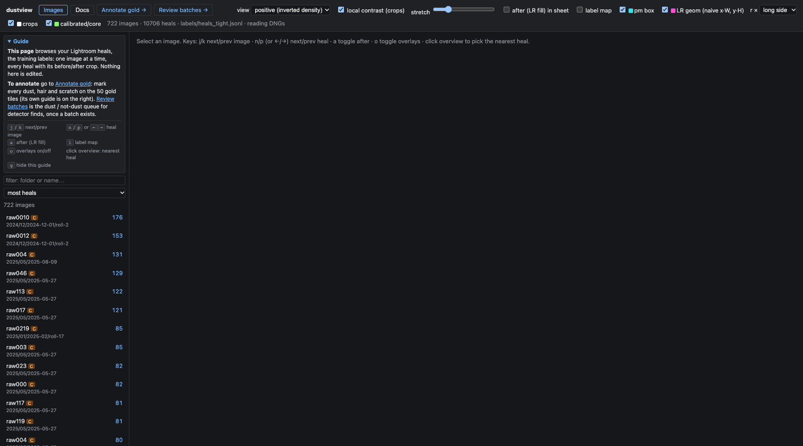

*Figure 1. The Images page after the change. The two links in the header lead to the annotation and review pages; the guide box explains that this page only browses heals.*

The annotation guide does three jobs. First, it shows the workflow for the pass the user is in, because pass 1, the blind pass 2 and the diff → final step have different procedures. The HTML has three ordered lists, each tagged with `data-wf="1"`, `"2"` or `"diff"`. `setupMode()` writes the current mode to `document.body.dataset.wf`, and one CSS rule shows the matching list:

```css
body[data-wf="1"] #guide ol[data-wf="1"],
body[data-wf="2"] #guide ol[data-wf="2"],
body[data-wf="diff"] #guide ol[data-wf="diff"] { display: block; }
```

Second, its summary line reports progress over all 50 tiles. `renderProgress()` counts the tiles whose pass-1 file exists and is marked complete, those that exist but are not complete, and those with no file. At the time of the first screenshot this read "pass 1: 2 done · 17 started · 31 to do (of 50)". Third, it offers a *next unfinished tile* button and the `N` key. `nextUnfinished()` walks the tile list from the current tile and opens the first one whose file for the current pass (or the final file in diff mode) is missing or incomplete.

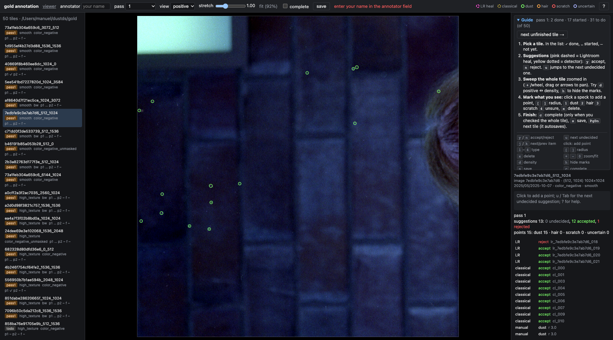

*Figure 2. The annotation page in pass 1. The guide panel at the top right shows the pass-1 workflow, the progress line, the next-unfinished button and a compact key sheet; the tile list is on the left.*

The panel's open or closed state is stored in `localStorage` under `gold.guide`, so a user who knows the workflow can hide it once. The full key reference, which already existed as an overlay on `?`, kept growing as the features below were added. Figure 3 shows its final state.

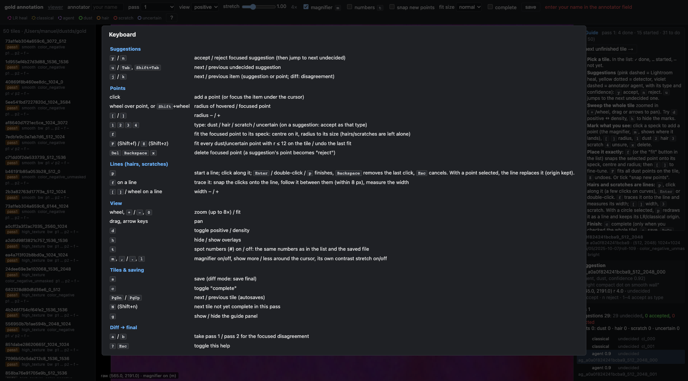

*Figure 3. The full keyboard reference (`?`), with the sections added in this phase: fitting (`f`, `F`, `Z`), lines (`p`), spot numbers (`t`) and the magnifier (`m`, `,`, `.`, `l`).*

Table 1 lists the keys that this phase added. The original keys from Dataset Part 8 (`y`/`n` for suggestions, `1`–`4` for types, `[`/`]` for radius, `s` to save, `c` for complete, `PgDn` for the next tile) are unchanged.

| Key | Action | Section |
|---|---|---|
| `N` | open the next tile not yet complete in this pass | 1 |
| `g` | show or hide the guide panel | 1 |
| `f` | fit the focused point to its speck, or trace the focused line | 3, 6 |
| `F` | fit every dust/uncertain point with r ≤ 12 on the tile, and trace every line | 3 |
| `Z` | undo the last fit | 3 |
| `m` | magnifier on or off | 4 |
| `,` / `.` | magnifier shows more / less around the cursor | 4 |
| `l` | magnifier's own contrast stretch on or off | 4 |
| `t` | spot numbers on or off | 5 |
| `p` | start a line; with a point selected, redraw that point as a line | 6 |
| `Enter`, double-click | finish the line | 6 |
| `Backspace` / `Esc` while drawing | remove the last click / cancel the line | 6 |

*Table 1. Keys added in this phase.*

## 2. Who writes the gold files

Before the individual features, one architectural fact shapes all of them. The gold annotations live in `~/dustds/gold/{tile_id}.p1.json` (and `.p2.json`, `.final.json`). `~/dustds` is the frozen dataset of the DUST-001 project, and a standing rule of the work is that the assistant never writes it. The only writer is the user's browser, through the server's validating API.

This rule matters most for the fit feature. The natural request, and the one the user made, was "correct the diameter and position to properly place the spot". The direct implementation would be a script that rewrites the JSON files with corrected circles. That would put the assistant's judgement into the ground truth without the user seeing it, and it would bypass the server's validation. The implementation instead puts the correction where the user works: a key that changes the points in the browser's memory, shows the result, can be undone, and is saved only when the user presses `s`.

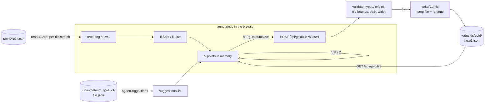

*Figure 4. The data path. Fits and traces run in the browser on crops the server renders from the raw scan; only the user's save writes the gold file, and it goes through `validate` and an atomic write. Agent answers (Part 4) enter as read-only suggestions.*

The server side of this path was built in Dataset Part 8. `validate` checks that the tile id and pass in the body match the URL, that the annotator is named, that every point is finite, inside the tile plus a 64 px margin, of a known type, and has an origin that is either `"manual"` or the id of a known suggestion. `writeAtomic` writes a temporary file in the same directory and renames it over the target, so a crash cannot leave a half-written file. This phase extended `validate` twice, for lines and for agent suggestions, and both extensions appear below.

A second consequence of the rule concerns verification. To check the fit against the user's own points, the work needed an implementation that reads the gold files and the image data without writing anything. That implementation is `scripts/90-gold-fit-check.py`. It reads `~/dustds/gold/*.p1.json` and the exported density tiles in `~/dustdet/cv_tiles/`, and it writes its reports under `~/dustdet/gold_fit/`. Section 3.4 compares it with the browser code.

## 3. Fit-to-speck

### 3.1 What a correct circle is

The user's request came after a session in which they had added 30 manual points on tile 7edbfe9c, all at the tool's default radius of 3 px. Their message was "I added a lot of manual points for some faint dust specs … can you verify the radius is placed correctly?" Answering it requires a definition. A gold point is used in two ways. Evaluation matches a detector's output to it within a distance that depends on its radius. Training, when it uses the gold tiles, turns it into a disk mask. For both uses the centre should be the centre of the speck's light, and the disk should cover the speck including its soft edge, but not the grain around it.

Scanned dust is not a sharp disk. The scanner's optics blur it, so a 3 px speck has a bright core, a soft halo and no edge. A useful definition therefore has to come from the profile. The fit uses the region above half of the speck's peak contrast. Its value-weighted centroid is the centre, and its equivalent radius r50 = √(area/π) is the half-height radius. The circle's radius is a multiple of r50, chosen so that the disk reaches out to where the halo has faded.

### 3.2 The algorithm

`fitSpot(p)` in `dustview/static/annotate.js` works on a crop of the raw scan around the point. It requests the crop from the same endpoint that draws the tile, at zoom 1 so that one crop pixel is one scan pixel, in the `pos` mode. That mode maps each channel to density relative to the film base, linearly, with one window per tile. Dust adds density, so it is bright in this mode. The window is a square of side 2·half + 1 with half = max(16, 3r + 8).

```js
const t = S.tile, r0 = Math.max(p.r, 0.5), half = Math.ceil(Math.max(16, 3 * r0 + 8)), n = 2 * half + 1;
const X0 = Math.floor(p.x) - half, Y0 = Math.floor(p.y) - half;
im.src = `/api/gold/${encodeURIComponent(t.tile_id)}/crop.png?` +
  new URLSearchParams({ x: X0, y: Y0, w: n, h: n, z: 1, mode: "pos", s: 1 });
await im.decode();
// draw into a canvas, read RGBA, average the three channels into v[]
```

The procedure then runs in six steps.

1. **Smooth.** A 3×3 box filter with clamped edges reduces single-pixel grain without moving a 3 px speck.
2. **Remove the background as a plane.** The pixels in a ring between r + 4 and r + 10 around the label (with r at least 3) are fitted with a + b·dx + c·dy by least squares. The 3×3 normal equations are solved by Cramer's rule, and the plane is subtracted from the whole window. After this step, 0 means "local background".
3. **Estimate noise.** The noise is 1.4826 × the median absolute deviation of the ring residuals, which estimates the standard deviation of the grain without being pulled by a bright neighbour.
4. **Find the peak.** The brightest pixel within max(3, r) of the label is the peak. If its value is less than 3 × the noise, the function returns `{ ok: false }` and the point is left alone.
5. **Grow the core.** Starting from the peak, a 4-connected flood fill collects every pixel at or above half the peak. The centre is the value-weighted centroid of that region, with pixel centres at i + 0.5.
6. **Size.** r = max(1.5, k · √(A/π) + 0.5), with k from the *fit size* menu.

The plane fit is the step that took a failure to discover (Section 3.3), and its code is compact:

```js
// plane fit on the ring: normal equations for a + b*dx + c*dy
for (let i = 0; i < n * n; i++) {
  const d = dist(i);
  if (d < sr + 4 || d > sr + 10) continue;            // ring only
  const f = [1, (i % n) + 0.5 - lx, Math.floor(i / n) + 0.5 - ly];
  for (let a = 0; a < 3; a++) { R[a] += f[a] * sm[i]; for (let b = 0; b < 3; b++) M[a][b] += f[a] * f[b]; }
  ring.push(i);
}
const D = det3(M), co = [0, 1, 2].map((k) => det3(M.map((row, a) => row.map((x, b) => (b === k ? R[a] : x)))) / (D || 1));
for (let i = 0; i < n * n; i++) sm[i] -= co[0] + co[1] * ((i % n) + 0.5 - lx) + co[2] * (Math.floor(i / n) + 0.5 - ly);
```

The core growth and the radius follow:

```js
const seen = new Uint8Array(n * n), q = [pk], thr = 0.5 * peak; seen[pk] = 1;
let W = 0, SX = 0, SY = 0, A = 0;
while (q.length) {
  const i = q.pop(), x = i % n, y = (i / n) | 0;
  W += sm[i]; SX += sm[i] * (x + 0.5); SY += sm[i] * (y + 0.5); A++;
  for (const [dx, dy] of [[1, 0], [-1, 0], [0, 1], [0, -1]]) { /* push neighbours >= thr */ }
}
const r = Math.max(1.5, Math.round((+$("#fitsize").value * Math.sqrt(A / Math.PI) + 0.5) * 10) / 10);
return { ok: true, x: X0 + SX / W, y: Y0 + SY / W, r, snr };
```

Three properties of this design deserve a note. The search radius for the peak is the label's own radius, at least 3 px. So the fit corrects a point that is a few pixels off, but it cannot jump to a different speck 10 px away. The threshold of 3 × noise is the gate that makes "no clear speck here" an explicit answer, which turned out to be as useful as the corrections (Section 3.4). And the half-peak region is a measure that does not depend on how bright the speck is: a faint speck and a strong one of the same size get the same radius.

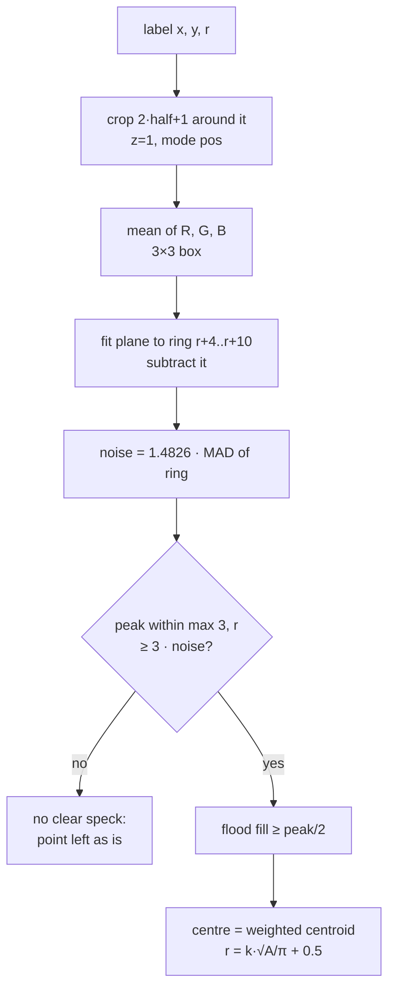

*Figure 5. The fit-to-speck pipeline.*

### 3.3 Two versions that did not work

The algorithm above is the third version. The first two failed in ways that the contact sheets made visible, and both failures say something about scanned film.

The first version estimated the background as the median of the ring and the noise as the MAD around that median, with no plane. On tile 7edbfe9c it reported four of the 41 points as "no clear speck". One of them, #38 at (1350, 1509), is a plainly visible dot. Its smoothed values, in thousandths of the density range, showed why:

```
[[158 152 145 133 126 124 119 109 102]
 [159 154 147 135 125 120 114 107 102]
 [155 151 151 144 132 122 114 109 104]
 [154 156 174 184 174 145 119 103  95]
 [161 169 199 217 204 156 118 102  96]
 [160 171 202 221 207 157 117 102  99]
 [160 166 183 193 184 147 115 103 104]
 [153 152 154 157 153 140 121 110 109]
 [150 148 145 145 144 137 119 107 107]]
```

The speck peaks at 221 over a background of about 130, a step of about 90. But the background itself falls from 158 on the left to 102 on the right across 9 px. A ring around the label sees that whole gradient, so its MAD is large and the speck's contrast came out at 1.8 × noise, below the gate of 3. Fitting a plane to the ring removes the gradient before the noise is measured. With the plane, #38 measures well above the gate, and the only point left without a speck on that tile is #13, which has nothing under it (Part 2 shows its contact-sheet cell).

The first version also sized the circle differently. It grew a second region down to 20 % of the peak and took its radius, capped at 2.5 × r50 + 1. That rule leaked: where a speck sits in a bright neighbourhood, the 20 % region spreads into the neighbourhood. Figure 6 shows the result on the user's points, with the user's circles in green and the fitted ones in orange. On sheet 1 cell 12 the fit returned r = 7 for a speck of about 3 px.

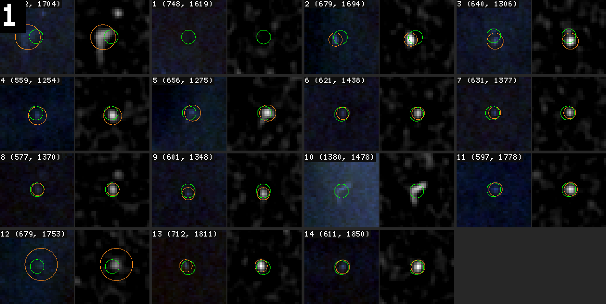

*Figure 6. The first fit on the user's 30 manual points of tile 7edbfe9c: the tile (left of each pair) and the speck view (right), user circle green, fit orange. Several fitted radii are too large, for example cells 0 and 12, where the 20 % region leaked into the surroundings.*

The replacement rule is a multiple of the half-height radius, which cannot leak because the half-height region of a compact speck is compact. The contact sheets were produced with goja-cv, by annotating both circles on the tile and the speck view and laying all points out with `cv.sheet`:

```js
const marks = []
for (const f of F) { marks.push({ circle: [f.lx, f.ly, f.lr], color: 'lime' });
                     if (f.ok) marks.push({ circle: [f.x, f.y, f.r], color: 'orange' }) }
const a = img.levels({ auto: true }).annotate(marks), s = img.view('speck').annotate(marks)
show(cv.sheet(pts.slice(0, 15), { views: [a, s], size: 32, zoom: 5, labels: 'index' }).look('manual 0-14'))
```

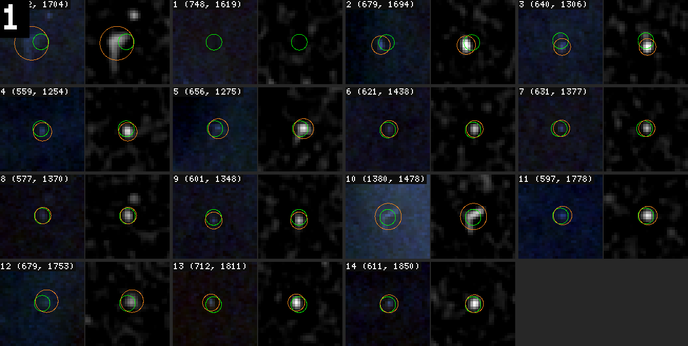

*Figure 7. The same 15 points after the plane fit and the half-height radius rule. The orange circles sit on the specks; cell 0 is a speck with a short tail, which the fit covers with r 6.4.*

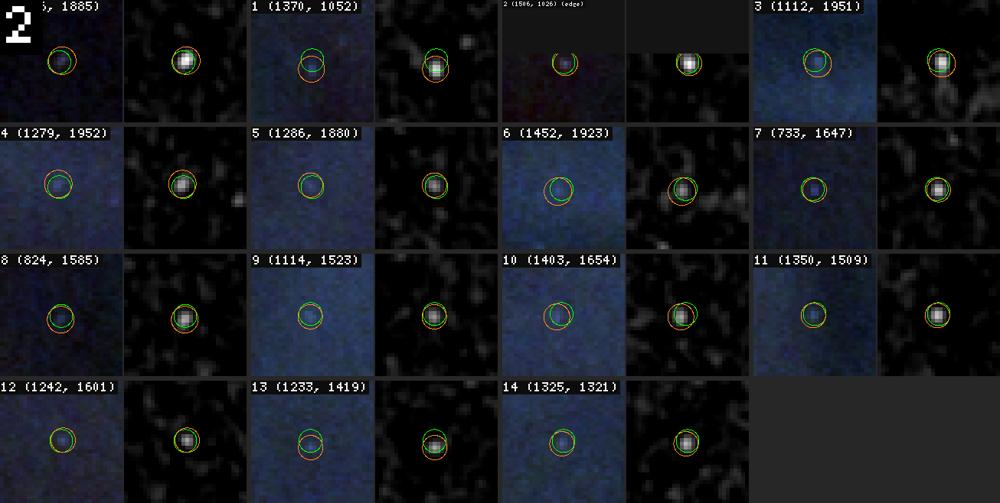

*Figure 8. The other 15 manual points. In cells 1 and 13, the user's green circles sit 2 px above the speck, and the fit moves them down.*

### 3.4 Checking the fit against an independent implementation

A fit that runs in the browser on 8-bit crops is easy to get subtly wrong: off-by-half-pixel centres, a different smoothing edge rule, a different noise estimate. The check was a second implementation in Python on different data. `scripts/90-gold-fit-check.py` runs the same six steps with NumPy and SciPy on the 16-bit density tiles that the goja-cv work uses. Then a headless Chrome session, driven by Playwright, called the browser's `fitSpot` on the same 41 points of 7edbfe9c and compared:

| Quantity | Result |
|---|---|
| points with a speck in both implementations | 40 of 40; the same point (#13) without a speck in both |
| largest difference in position, \|dx\| + \|dy\| | 0.16 px |
| largest difference in radius | 0.1 px |
| median difference in position and radius | 0.0 px |

*Table 2. The browser fit against `90-gold-fit-check.py` on tile 7edbfe9c.*

The two implementations agree to within the rounding of the 8-bit crop. With that established, the Python script became the way to report on the user's existing points without touching them. On 7edbfe9c the user's labels were already good: the median distance from label to fitted centre was 0.8 px, with 6 of 41 points more than 1.5 px off and the largest offset 3.6 px. Across all 19 labelled tiles (163 points, hairs and scratches excluded), the script found 159 with a clear speck and 4 without:

- **7edbfe9c #13** has nothing under it.
- **40869f8b #3** is a classical suggestion the user accepted, on a spot with contrast 2.8 × noise.
- **a0cff2a3 #1 and #3** are real specks directly below a bright band. Half of their ring lies on the band, so even the plane model cannot describe their surroundings.

The fit leaves all four alone, and the message line says so.

### 3.5 The radius the user wanted

The first release used k = 1.6. The user looked at a fitted point and wrote "dot 3 is a little bit too small". In the magnifier, #3 on 7edbfe9c, a classical suggestion they had accepted, had r 3.5 after the fit. The circle covered the bright core but not the soft halo that the eye still sees as part of the speck. The rule is right, but the multiple is a matter of what the annotation is for, and the user's eye is the reference. The fix was a *fit size* menu in the header with three values, stored in `localStorage`:

| Fit size | k | #3 on 7edbfe9c | Intended use |
|---|---|---|---|
| tight | 1.6 | r 3.6 | the bright core only |
| normal (default) | 2.0 | r 4.4 | core and soft halo |
| loose | 2.4 | r 5.2 | generous masks |

*Table 3. The fit-size menu. The radius column is the measured fit of the same point at each setting.*

The script has the same parameter (`--fit-scale`, default 2.0), so its reports match the tool's default.

### 3.6 Applying fits, and undoing them

`fitPoints(idx)` applies the fit to a list of point indices. `f` calls it with the focused point, the per-point *fit* button in the sidebar calls it with that row's point, and `F` calls it with every point on the tile. Before changing anything it copies the whole point list into `fitUndo`, and `Z` restores that copy. A single fit reports its effect in the message line:

```
fit: moved 1.2 px, r 3 → 4.4 (contrast 15 × noise) · Shift+Z undoes
```

A tile-wide fit reports a summary instead. In the browser test on 7edbfe9c it read "fit 42 points: 40 adjusted (max shift 3.7 px), 1 without a clear speck · Shift+Z undoes · s saves", and `Z` restored all 42 points exactly.

Three classes of points are excluded from `F`. Hairs and scratches drawn as circles are skipped, because a disk fit to a line is meaningless (Section 6 gives them their own fit). Points with r > 12 are skipped in the tile-wide fit, because the all-tiles check showed what happens otherwise. Tile 1d955ef4 has two "dust" labels of r ≈ 63 that cover a 250 px vertical line, and the disk fit shrank one to r 26.6 and moved it 15 px. A large label can still be fitted on purpose with `f`. Finally, a *snap new points* checkbox runs the fit on every new click, so a speck can be marked with one click at the right size.

## 4. The magnifier

### 4.1 Why the view is not enough

At the "fit" zoom the tile view shows the 1024 px tile in about 920 screen pixels, so one screen pixel covers about 1.1 scan pixels. A faint speck of 3 px is three screen pixels of slightly different brightness. The user can zoom to 2×, 4× or 8× with the wheel, but zooming changes the whole view, and placing 30 points means zooming in and out 30 times. The request was direct: "add a kind of magnifier that goes along with the mouse so I can better see what's under the cursor".

### 4.2 Drawing from what is already loaded

The magnifier is a 240 × 240 `<canvas id="lens">` absolutely positioned inside the viewport, with `pointer-events: none` so that clicks pass through it to the tile. On every mouse move over the viewport, `drawLens()` redraws it. The interesting part is where its pixels come from. The tile is displayed as a grid of `` blocks, each requested from the crop endpoint at an integer zoom z = ceil(view scale). At z = 1 the blocks are 1024 px, at z = 2 they are 512 px, at z ≤ 4 256 px, and above that 128 px. The magnifier does not request anything. It draws from those blocks with `drawImage`, using a source rectangle in the block's own pixels:

```js
for (const im of $("#imgs").children) {
  if (!im.complete || !im.naturalWidth) continue;
  const [bx, by] = im.id.slice(1).split("_").map(Number), B = imgB;   // block index, block size in raw px
  const bw = Math.min(B, t.w - bx * B), bh = Math.min(B, t.h - by * B);
  const z = im.naturalWidth / bw;                                      // the block's own zoom
  const ua = Math.max(u0, bx * B), ub = Math.min(u0 + L, bx * B + bw); // overlap with the lens window (raw px)
  const wa = Math.max(w0, by * B), wb = Math.min(w0 + L, by * B + bh);
  if (ua >= ub || wa >= wb) continue;
  g.drawImage(im, (ua - bx * B) * z, (wa - by * B) * z, (ub - ua) * z, (wb - wa) * z,
                  (ua - u0) * k, (wa - w0) * k, (ub - ua) * k, (wb - wa) * k);
}
```

Here (u0, w0) is the top-left of the lens window in tile coordinates, L its span in raw pixels, and k = 240 / L its magnification. The factor `z = naturalWidth / bw` is what makes the lens work at every view zoom. At z = 1, a block's pixels are scan pixels. At z = 4, each scan pixel is four image pixels, and the source rectangle is scaled by four. Image smoothing is off, so the lens shows pixels as squares. A window that spans two blocks is drawn in two pieces. The span is set with `,` and `.` from the list 12, 16, 24, 32, 48 raw pixels, and the default of 24 gives 10×.

### 4.3 Its own contrast

The tile's display stretch is one window per tile, chosen so that the whole tile reads well. Inside a 24 px window that stretch wastes most of the range: a faint speck on a mid-grey wall differs from the wall by a few grey levels. The lens therefore stretches its own pixels after drawing them. It samples every seventh pixel's channel sum and takes the 1st and 99.5th percentiles. Then it maps all three channels through one linear window between them. One window for all channels keeps colours comparable, which matters on colour film, where the colour of a dot is evidence (Part 2).

```js
const lo = lum[Math.floor(lum.length * 0.01)] / 3, hi = Math.max(lo + 4, lum[Math.floor(lum.length * 0.995)] / 3);
for (let i = 0; i < d.length; i += 4) for (let c = 0; c < 3; c++) d[i + c] = (d[i + c] - lo) * 255 / (hi - lo);
```

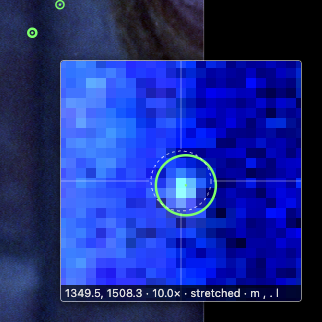

*Figure 9. The magnifier at 10× with its own stretch over the faint speck at (1350, 1509) on tile 7edbfe9c. The green circle is the user's point; the dashed white circle is where a click would put a new point, at the radius a new point would get.*

The `l` key turns the stretch off, for the rare case where the tile's own window is what the user wants to judge.

### 4.4 What the lens draws on top

After the pixels, the lens draws, in this order:

1. a dashed white circle at its centre, with the radius a new point would get, so the user sees the click's result before clicking;
2. a crosshair with a gap around that circle;
3. every overlay item in the window, from the same `overlayItems()` list the SVG overlay uses (points, suggestions, lines), in the same colours;
4. spot numbers, when they are on (Section 5);
5. a footer with the cursor's raw coordinates, the magnification and the stretch state;
6. a header naming the item under the cursor.

The header comes from the same hit test that highlights items on the tile. A point shows as "#3 dust r 3.5 · cl_006", a line as "#1 hair line w 5.4 · lr_…", and a suggestion with its id and decision.

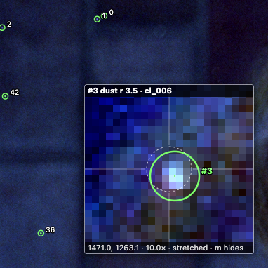

*Figure 10. With the cursor on a point, the lens header names it ("#3 dust r 3.5 · cl_006") and the number appears next to the circle.*

The lens is placed 28 px below and to the right of the cursor, so that it does not hide the speck being clicked. If it would leave the viewport on the right or bottom, it flips to the other side of the cursor. `m` toggles it, and the header checkbox and the viewport's coordinate readout show its state.

## 5. Spot numbers

The user's next requests were about naming points: "show which dot is underneath … a toggle to show labels with the spots numbers, and show number of the spot in the sidebar as well". The number of a point is its index in the `points` array, which is also its position in the saved file. That choice makes the number stable across the tool, the scripts and conversations. When the fit check reported "#13 has no speck", the user could find #13 in the tool. It has one consequence the user should know: deleting a point renumbers every point after it.

`t` and a header checkbox toggle the numbers on the tile and in the lens. The sidebar lists every point with its number, its origin, its type and its radius (or its length and width for a line), and has a *fit* button per row. The focus panel for a selected point shows its number and a *fit to speck* button.

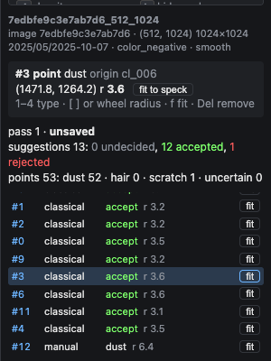

*Figure 11. The focus panel and the point list. Each row starts with the spot number; accepted suggestions show their source and decision, and every point has a fit button.*

The first version of the labels produced a bug report that was really a layout problem: "#3 seems to be 8 when toggling t". The data was right; S.points[3] was cl_006 and the label read "3". But the label was drawn at the circle's right edge, slightly above its centre, which is exactly where the right tick of the selection reticle runs. In the magnifier the same position is crossed by the crosshair. A horizontal white line through the left half of a "3" closes its open side, and the glyph reads as "8". The fix moves every label diagonally up and to the right, at (x + 0.75·R + 9/scale, y − 0.75·R − 7/scale), away from both axes. In the lens the labels are drawn last, on a dark box, after the crosshair. The SVG labels have a dark stroke painted under the fill.

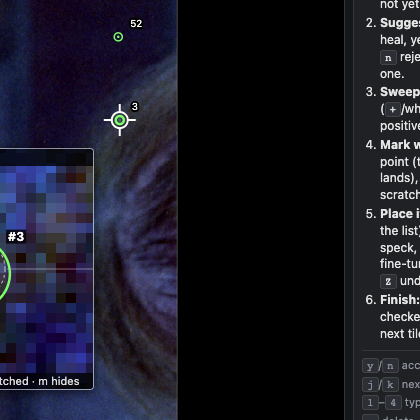

*Figure 12. After the fix: "3" sits up and to the right of the selection reticle on the tile, and "#3" sits on a dark box in the magnifier, away from the crosshair.*

The numbers feature also produced a bug in the setup code, one introduced by the assistant. The code that loads the saved "numbers" setting and attaches the checkbox listener was inserted into the `m` key handler instead of the page setup. The text replacement that added it matched the first occurrence of an anchor line, and that occurrence was in the key handler. So the setting loaded only after the first press of `m`, and every press of `m` added another listener to the checkbox. It was found while adding the line mode and fixed in commit c15f1cb. The lesson is mundane: an anchor-based edit should assert that its anchor is unique, and the later edits in this phase do.

## 6. Lines for hairs and scratches

### 6.1 Why a circle is the wrong shape

The user sent two screenshots, a short straight streak and a long curved fibre, and asked "what am I supposed to do? make a big ass radius circle? that seems off somehow". It is off, and the numbers say by how much. Hair #1 on tile c71dd0f2 is about 34 px long and 3 px wide at half height. The smallest circle around it has radius 19.5 px and an area of about 1,195 px². The hair itself, as a band 34 px long and 5.4 px wide, covers about 184 px². A circle label claims seven times more film than the defect occupies, and most of what it claims is clean grain. As a training mask that teaches a model that grain is defect. As an evaluation target it makes the match distance so large that any detection nearby counts as a hit.

### 6.2 The data model

A point gained two optional fields: `path`, the centre line as absolute raw-pixel vertices, and `width`, the band's full width in pixels. The existing `x`, `y`, `r` stay and are set to the circle around the whole line, computed by `lineCircle()` from the path's bounding box and the farthest vertex plus half the width. Every reader that only knows circles (`dustdet/gold.py`, the evaluation scripts, the diff matcher) still sees the object at the right place and size.

On the server, the Go struct uses `omitempty` for both fields:

```go
type goldPoint struct {
	X      float64 `json:"x"`
	Y      float64 `json:"y"`
	R      float64 `json:"r"`
	Type   string  `json:"type"`
	Origin string  `json:"origin"`
	// Lines (hairs, scratches): the centre line as absolute raw vertices and its full width in raw px. x, y, r
	// are then the circle around the whole line, so readers that only know circles still see the object.
	Path  [][2]float64 `json:"path,omitempty"`
	Width float64      `json:"width,omitempty"`
}
```

The `omitempty` tags are a compatibility guarantee, and a test pins them: `TestGoldPointJSON` marshals a circle point and requires exactly `{"x":1,"y":2,"r":3,"type":"dust","origin":"manual"}`, the format of every file written before this phase. Before the struct change, a path sent by the browser would have been silently dropped by `json.Unmarshal` into the old struct. That is why the server change came first and was committed separately.

`validPath` adds the line rules to `validate`. A point without a path and width passes unchanged. A line needs 2 to 4,000 vertices, all finite and inside the tile plus the 64 px margin, and a width in (0, 64]. A width without a path is rejected, as is a path of one vertex. `TestValidPath` covers each rule with a case.

### 6.3 Drawing a line

Line mode is a small state machine in `S.draw`. `p` starts it with an empty vertex list, and every click in the viewport adds a vertex instead of adding a point. `Backspace` removes the last vertex, `Esc` cancels, and `Enter`, a second `p` or a double-click finishes. A double-click delivers two clicks before the `dblclick` event, so the handler drops the duplicate vertex if the last two are within 2 px. While drawing, the overlay shows the vertices and a dashed rubber band to the cursor.

`finishLine()` turns the vertices into a point of type `hair`, with the width last used (stored in `localStorage`, 3 px initially). If a circle was selected when `p` was pressed, the line replaces that circle instead of adding a new point. Its origin is kept, so an LR suggestion the user had accepted as a circle stays "LR · accept" and now carries a line. Without this, converting a suggestion to a line would mean deleting it, which the tool records as a rejection of the suggestion, the wrong record for a real hair.

### 6.4 Tracing a line

The user's second request was "can we add auto-fit for scratches like we have the autosize for dust specks?" A person's clicks along a hair are a few pixels off, too sparse on curves, and placed past the ends. The tracer's job is to keep the topology the person gave (which line, in which order) and replace the geometry with the image's.

`fitLine(p)` works on a crop of the line's bounding box plus 14 px, capped at 2,048 px a side. It computes a ridge map:

$$\text{dd} = G_{\sigma=1} * v - G_{\sigma=4} * v, \qquad \text{ridge} = \max(\text{dd}, 0)$$

This is the same difference of Gaussians as the speck view in Part 1, here in JavaScript with a separable kernel. The noise is 1.4826 × the MAD of `dd` over the crop. Then:

```
allowed  = pixels within 8 px of the clicked polyline          # the band
nodes    = for each click: the strongest allowed ridge pixel within 4 px
cost[i]  = 1 / (0.05 + min(ridge[i] / (4·noise), 1))²            # cheap on the ridge, ~400 off it
trace    = concat over consecutive nodes of Dijkstra(nodes[k-1], nodes[k])
             on 8-connected allowed pixels, step cost = len · (cost[a] + cost[b]) / 2
strength = median(ridge / noise) along trace
if strength < 2: no clear line
trim both ends while ridge < max(2, 0.3 · strength)             # find where the hair ends
path     = Douglas–Peucker(trace pixel centres, 0.9 px)
width    = (fitsize / 1.6) · median half-height width of cross-sections every 3 px + 1, in [1.5, 30]
```

Each piece answers a specific failure.

- **The band.** The minimum-cost path has to be confined. A hair often runs next to a scene edge, and an unconstrained path follows whichever is brighter. The 8 px band around the user's clicks makes the user's topology a hard constraint and lets the image decide only the geometry inside it.
- **The cost function.** The cost is a steep inverse of the normalised ridge, about 0.9 on a clear ridge and 400 on background. That makes the path pay heavily for each pixel off the line, so it follows the ridge even when the ridge curves.
- **Dijkstra.** It runs with a binary heap written inline in two arrays, from each snapped click to the next.

The ends are the place where clicks are least accurate. A user who clicks 5 px past the end of a hair forces the path through grain, and the ridge there is near zero. Walking in from each end while the ridge stays below 30 % of the median (and at least 2 × noise), and requiring two consecutive pixels below that level, trims the trace to where the line actually is.

The width comes from cross-sections. Every third trace pixel defines a normal from its neighbours three pixels away on either side. Values are sampled bilinearly along the normal from −8 to +8 px in steps of 0.5, and the half-height width is the distance between the two points where the profile falls below half its central peak. The median over all cross-sections is the line's FWHM.

### 6.5 Calibrating the width on a real hair

The first version measured the cross-sections on `dd`, the σ = 1 smoothed difference of Gaussians, and applied the same k as the speck fit (width = k · FWHM + 1). On hair #1 of c71dd0f2 it returned 8 px. Profiles across the hair, taken with goja-cv on the density tile, give the reference:

```
x1050: 49 48 49 53 51 50 53 59 76 95 100 90 69 56 52 54 58 59 59 59 55
x1058: 59 56 56 55 57 60 62 63 65 73 90 100 83 64 60 60 61 58 53 51 51
x1066: 53 51 54 56 57 57 61 70 86 98 95 75 58 56 56 56 58 61 58 56 58
x1074: 62 62 62 61 58 57 59 72 91 100 88 69 62 57 55 59 61 59 54 51 52
```

*Each row is a vertical profile across the hair at one x, 1 px per value, scaled to the peak = 100.*

The peak is about 100 over a background of about 55, so half height is about 77. Three samples and a fraction lie above it in each profile, an FWHM of about 3.2 px. The visible hair, soft edges included, is about 5 px wide. Two things had inflated the first measurement. The σ = 1 blur broadens a 3 px line by about a pixel. And a k of 2 doubles a width that, for a line, is already measured across the line rather than as a radius. The second version measures on a 3×3 box filter minus the σ = 4 background, which broadens far less. It also uses k / 1.6 (1.0, 1.25, 1.5 for tight, normal, loose). On hair #1 it returns 5.4 px at *normal*.

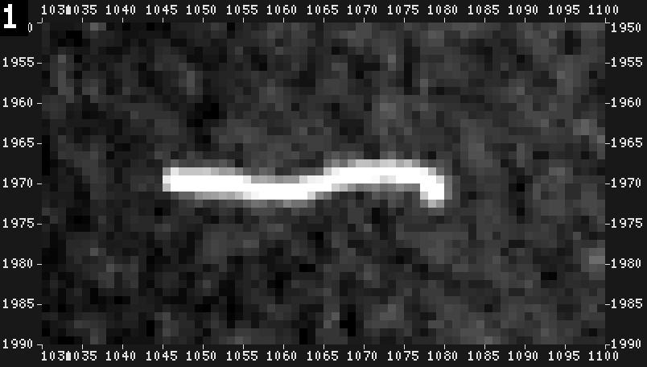

*Figure 13. Hair #1 of tile c71dd0f2 at 10× (goja-cv `crop` with `ruler: 5`): a wavy fibre from x ≈ 1045 to 1080 with a hook at the right end, about 3–4 px thick.*

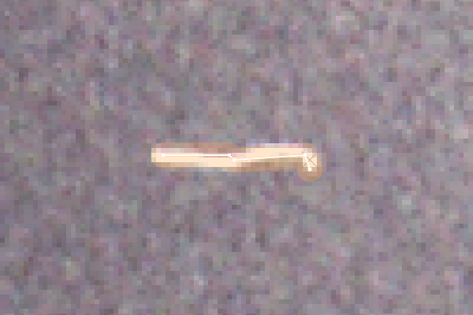

*Figure 14. After four rough clicks and `f`: the traced centre line follows the wave and the hook; the band shows the measured width of 5.4 px.*

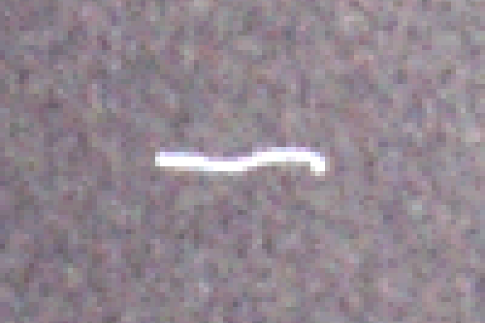

*Figure 15. The same view with the overlay hidden (`h`), for comparison with Figure 14.*

The end trimming was tested on hair #0 of the same tile, a short ")" arc. The test clicks were placed 14 px above and below the label, about 5 px beyond each end. Before trimming, the trace ran from y 1785.5. After trimming, it runs from 1789.5 to 1807.5, which matches the visible arc (1789.5 to 1807.4, measured on a zoomed crop).

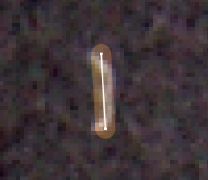

*Figure 16. Hair #0 of c71dd0f2. The clicks extended 5 px past both ends; the trace stops where the ridge fades. The arc's 2 px bulge is inside the 4.8 px band, but the centre line itself comes out nearly straight.*

Figure 16 also shows the tracer's main limitation. The arc bulges only about 2 px from its chord. The σ = 1 ridge of a 3 px line is broad enough that the straight chord costs almost as little as the curved crest, and the minimum-cost path takes the chord. The band still covers the hair, so as a mask the line is correct. A tracer that must follow sub-ridge-width curvature would need a narrower ridge filter or a curvature term. Two further limits are recorded in the diary. A line longer than the 2,048 px crop cap is traced only inside the crop. And the evaluation code reads only `x`, `y`, `r`, so until it learns about `path`, lines are scored as circles.

### 6.6 Rendering a line

On the tile, a line is two SVG polylines: a translucent band with a stroke width of `width` raw pixels, and a thin centre line. The overlay's general rule makes every stroke non-scaling (`#ov * { vector-effect: non-scaling-stroke; }`), so circles stay 1.5 screen pixels thick at every zoom. The band must scale, because its width is a measurement in scan pixels. The rule `#ov .band { vector-effect: none; }` overrides the general rule by specificity (an id and a class beat an id and the universal selector). The magnifier draws the same two strokes on its canvas with `lineCap = "round"`. Hit testing for a line uses the distance to the centre line: a click within half the width (or 3 screen pixels) of any segment selects it.

## 7. Smaller additions

Two small features close gaps that the line mode opened. Accepted suggestion rows in the sidebar now show a type badge, coloured like the type, because an LR heal the user accepts as a hair was listed as "LR · accept" with nothing to say it was a hair. And the counts panel lists hair and scratch points that are still circles, as links. A click selects the point and centres the view on it, and the message says what to do next: press `p` and click along it.

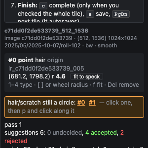

*Figure 17. The "hair/scratch still a circle" box on tile c71dd0f2, with the two LR hairs #0 and #1 as links.*

The last addition belongs to Part 4 but lives in this tool. Annotator agents write their answers to `~/dustdet/vlm_gold_v1/{tile_id}.json`, and the server reads that directory through a new `--agent-dir` flag. `agentSuggestions()` turns each answer point into a suggestion with:

- the id `ag_{tile_id}_{index}` and the source `agent`;
- the agent's confidence as its score;
- the agent's type and note;
- for hairs and scratches, the agent's path and width.

The UI draws them in violet, dashed. Accepting one with `y` keeps its type and, for a line, its path. Two failure cases needed explicit handling. An answer with an unknown type becomes `uncertain`, and a path of one vertex is dropped. And because an agent's answer for a tile may be regenerated after the user has decided on its suggestions, `validate` accepts decisions and origins with the `ag_` prefix even when the current answer no longer contains that id. Otherwise a re-run of one agent would make the tile impossible to save. `TestAgentSuggestions` covers the conversion and both edge cases.

## 8. How the tool was tested

Every feature in this report was tested in a real browser before it was described to the user, under one constraint: the tests must never save. The gold files are the user's work in progress, and a test that saved would overwrite them. The tests drove the system Chrome through Playwright (`channel="chrome"`; the bundled Chromium was missing) against the running server. Each started by asserting that the annotator field was empty: with no annotator, `save()` refuses, and the `beforeunload` beacon does not fire. They then called the page's global functions directly. In a classic script, top-level `function` declarations and `const` bindings are reachable from `page.evaluate`, so `fitSpot(S.points[3])` and `buildDoc()` could be called and their results compared, without clicking.

A typical test from the line work:

```python
pg.goto("http://127.0.0.1:8765/annotate#tile=c71dd0f2de533739_512_1536&pass=1")
assert pg.evaluate("annotator()") == ""          # no annotator: nothing can be saved
pg.evaluate("S.view.scale = 6; ...; focusItem({k:'p', i:1}); render()")
pg.keyboard.press("p")
for (x, y) in [(1045, 1970), (1063, 1969), (1077, 1968), (1080, 1975)]:
    cx, cy = pg.evaluate(f"annot.toClient({x}, {y})"); pg.mouse.click(cx, cy)
pg.keyboard.press("Enter"); pg.keyboard.press("f")
print(pg.inner_text("#msg"))                     # line fit: 5 vertices, 34 px long, width 3 → 5.4 …
print(pg.evaluate("buildDoc().doc.points[1]"))   # the JSON that a save would send
```

The server side has Go unit tests for the parts that decide what reaches the disk: `TestValidPath`, `TestGoldPointJSON` and `TestAgentSuggestions`, beside the review-mode tests from earlier phases. The static files are embedded in the binary, so every UI change was followed by `go vet`, `go test`, a rebuild and a restart of the viewer on port 8765, and a `curl` that checked the served JavaScript contained the change.

## Key points

- A gold circle is defined by a measurement. The centre is the value-weighted centroid of the region above half the speck's peak, and the radius is a user-chosen multiple of that region's equivalent radius.
- Background gradients are the main hazard of local statistics on scans. Subtracting a plane fitted to the ring turned a clear speck from 1.8 × noise into a clear detection.
- The assistant never writes the frozen dataset. Corrections are tool actions that the user sees, can undo with `Z`, and saves, and a separate read-only script reports on the files.
- Two implementations on different data agreed to 0.16 px. That agreement is what justifies trusting the browser fit on 8-bit crops.
- The magnifier costs no requests, because it draws from the crop blocks already on screen and rescales by each block's own zoom.
- A spot number is a position in the saved file, which makes it stable across the tool, the scripts and conversation. A label must not sit where a reticle or crosshair line can cross it.
- Hairs and scratches are polylines with a width. The `x`, `y`, `r` fields remain as the enclosing circle, so older readers keep working, and `omitempty` keeps every circle file byte-identical.
- The tracer keeps the user's topology and takes the geometry from the image: clicks snap to the ridge, a minimum-cost path joins them inside an 8 px band, and the ends are trimmed where the ridge fades.

## Closing

With these additions the tool is fast enough for the work it exists for. A faint speck is found in the magnifier, clicked, and snapped to its true centre and size. A hair takes four clicks and a key. Thirty hand-placed points are checked and corrected in one keystroke that can be undone. What the tool cannot do is look at a tile on its own. Thirty-one of the fifty gold tiles were still untouched when this part was written, and each needs a full sweep for specks that no source has proposed. [[PROJECT REPORT - Film Dust Annotation - Part 4 - Annotator Agents - Playbook, Trials and Pre-Annotation over MCP - A Technical Deep Dive|Part 4]] describes how annotator agents, driving goja-cv through MCP, produced violet suggestions for those 31 tiles. It also describes how the playbook was tuned until they found 93 % of the user's own points. The measurements those agents rely on are the subject of [[PROJECT REPORT - Film Dust Annotation - Part 2 - Measuring a Speck and Deciding Where to Look - A Technical Deep Dive|Part 2]].

## Sources

- Repository: `/Users/manuel/code/wesen/2026-11-07--dust-scanning`
- Ticket: `ttmp/2026/11/07/DUST-002--film-dust-detector-model-exploration/` — `reference/01-diary.md` steps 11–14; screenshots in `reference/dustview-shots/` and `reference/goja-cv-usage/`
- Browser: `dustview/static/annotate.js`
  - fitting: `fitSpot`, `fitPoints`;
  - lines: `fitLine`, `blurG`, `simplify`, `lineCircle`, `pathDist`, `startLine`, `finishLine`;
  - display: `drawLens`, `renderOverlay`, `renderSide`, `renderProgress`, `nextUnfinished`;
  - suggestions and saving: `decide`, `buildDoc`.
- Page and styles: `dustview/static/annotate.html` (guide, help, header controls), `dustview/static/annotate.css` (`#guide`, `#lens`, `#ov .band`), `dustview/static/index.html`, `app.js`, `style.css` (Images-page guide and navigation)
- Server: `dustview/annotate.go` (`goldPoint`, `validPath`, `validate`, `agentSuggestions`, `registerAnnotate`), `dustview/main.go` (`--agent-dir`); tests `dustview/annotate_test.go` (`TestValidPath`, `TestGoldPointJSON`, `TestAgentSuggestions`)
- Check script: `ttmp/…/scripts/90-gold-fit-check.py` (`--fit-scale`, `--manual-only`), reports in `~/dustdet/gold_fit/`
- Commits:

  | commit | change |
  |---|---|
  | c877e98 | guide and navigation |
  | c41e223 | magnifier and fit-to-speck |
  | e4de152 | fit-all skips r > 12 |
  | cc70685 | spot numbers, under-cursor label, fit size |
  | 09c1c63 | label placement |
  | c15f1cb | numbers-init fix; server `path`/`width` |
  | 9ecc1c5 | lines and the tracer |
  | 3da19b7 | type badges, redraw box |
  | ed613e7 | agent suggestions |
