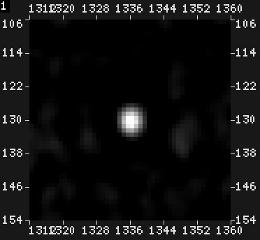
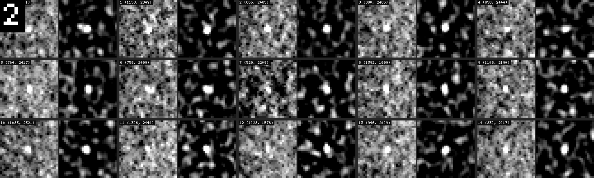
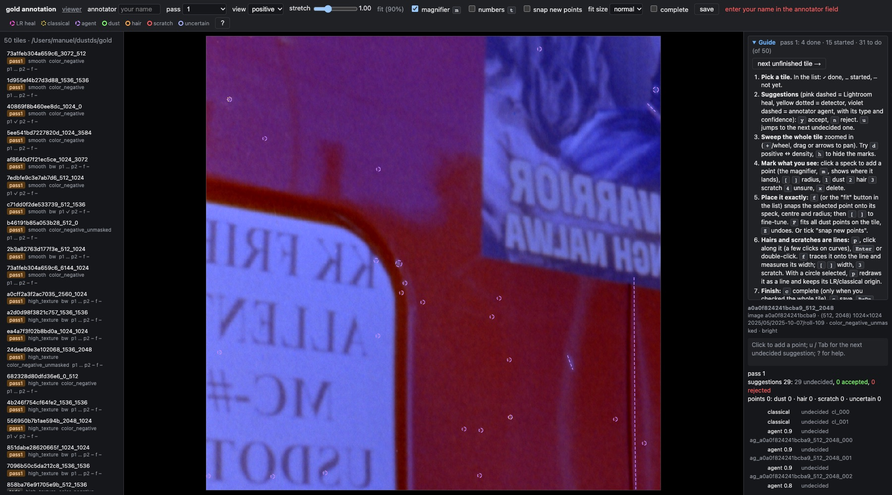
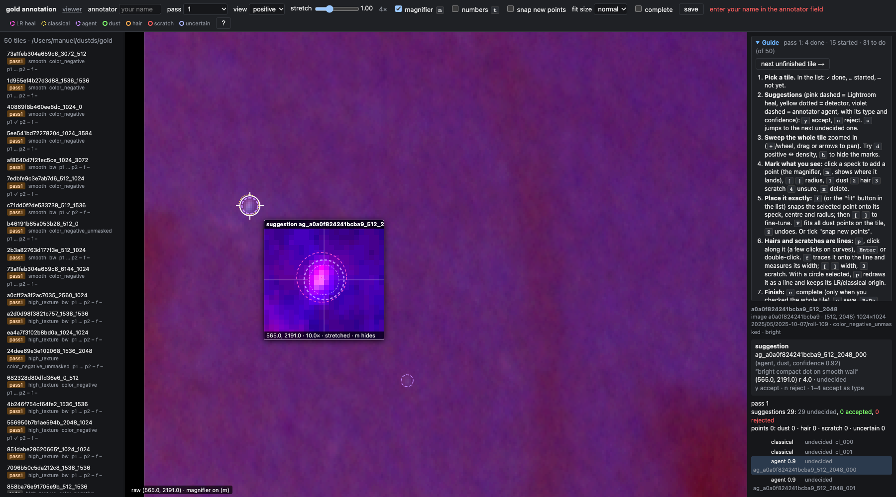
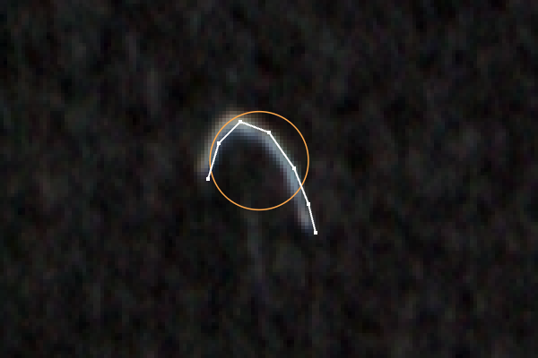

# Film Dust Annotation, Part 4: Annotator Agents — Playbook, Trials and Pre-Annotation over MCP — A Technical Deep Dive

The first three parts of this series built the instruments of the annotation workflow:
- [[PROJECT REPORT - Film Dust Annotation - Part 1 - Making Faint Dust Visible - Density Tiles and the Speck View - A Technical Deep Dive|Part 1]]: a density export and a *speck view* in which faint dust stands out.
- [[PROJECT REPORT - Film Dust Annotation - Part 2 - Measuring a Speck and Deciding Where to Look - A Technical Deep Dive|Part 2]]: point measures and candidate lists that say where to look.
- [[PROJECT REPORT - Film Dust Annotation - Part 3 - The Annotation Tool - Magnifier, Fit-to-Speck and Lines - A Technical Deep Dive|Part 3]]: an annotation tool with a magnifier, fit-to-speck and lines for hairs.

This part puts those instruments into the hands of language-model agents. Each agent receives one gold tile, drives goja-cv through MCP, and writes a list of suggestions that the user accepts or rejects with one key in the annotation tool.

The interesting part is not that agents can annotate. A vision model looking at a 1024 px film tile will find some dust. The interesting part is how the quality depends on the interface the agent is given and on the objective it is told to optimise. Three trials on four labelled tiles changed the recall from 68 % to 93 % without changing the model or the tool, only the decision rules in the playbook. The 31-tile production run then produced 669 suggestions. Its transcripts contain 374 lines of goja-cv code, which became the source of the next helper.

> [!summary]
> - **Pre-annotation is a recall problem.** A wrong suggestion costs the annotator one keypress; a missed speck costs a search of the whole tile. Trial 2, written for precision, found 68 % of the user's points. Trial 3, written for recall, found 93 %, and its confidence ranks well enough to sort by: 75 % of the suggestions at ≥ 0.6 are the user's.
> - **The playbook is the whole interface.** The agents saw goja-cv through a 3 KB helper file and a decision procedure. In 345 evals none called `cv.docs`, `cv.help`, `profile`, `annotate` or `compare`. What the playbook names is what gets used.
> - **The 31 untouched gold tiles carry agent suggestions now.** There are 669 suggestions: 607 dust, 52 hairs, 10 scratches, 62 of them as lines. They appear as violet suggestions in `dustview`, and accepting one keeps its type and its line.
> - **The agents' own code is data.** `scripts/91-extract-agent-evals.py` recovers every eval from the transcripts (374 evals, 0 errors). The most effective workaround it found, a low-threshold blob pass filtered by local contrast, is now `mem.faint()`.

## 1. Why pre-annotate the gold set

The gold set is the 50-tile, every-speck reference built in [[PROJECT REPORT - Film Dust Dataset - Part 8 - The Gold Set and the Annotation Tool - A Technical Deep Dive|Dataset Part 8]]. Its purpose is to make detector errors countable: a detector's hit, miss or false alarm is judged against a person's exhaustive marks, not against the Lightroom heal record, which only says where the photographer happened to heal.

When this work started on 2026-11-09, pass 1 of that labeling had this status, read from `~/dustds/gold/*.p1.json`:

| pass 1 status | tiles |
|---|---|
| a `.p1.json` exists | 19 |
| marked `complete` | 2 |
| no file at all | 31 |

*Table 1. Gold pass 1 at the start of the agent work.*

Every tile already had suggestions: Lightroom heal cores ("LR") and the hits of a Hessian blob detector ("classical"). Those two sources share a blind spot, which is the reason the gold set exists. The photographer did not heal faint dust, and the classical detector is tuned to compact, high-contrast blobs. The specks that make a detector look good or bad on the gold set are exactly the ones neither source proposes. On the 19 started tiles, the user was finding them by sweeping each tile at 2–4×, at about 3–5 minutes per tile per pass.

An annotator agent attacks that sweep. It does not replace the person. Its output is a third suggestion source that the person accepts (`y`) or rejects (`n`) in the same list as the other two. That framing fixes the objective before any prompt is written.

Consider the two ways a suggestion list can be wrong:

| error | what the annotator does | cost |
|---|---|---|
| a suggestion that is not dust | sees it in the list, looks at it, presses `n` | one keypress and a glance |
| a speck with no suggestion | must find it by sweeping the whole tile | the sweep the agent was meant to remove |

*Table 2. The cost asymmetry that makes pre-annotation a recall problem.*

A list with half wrong entries and almost no misses is far more useful than a list with no wrong entries and a third missing. This asymmetry, stated here in two rows, took one failed trial to become the agents' actual instruction (Section 4).

## 2. Giving an agent goja-cv: the MCP plumbing

### 2.1 Registration, and why nothing happened for a day

goja-cv is a Go binary that evaluates JavaScript against a lazy image API. It runs as a CLI (`goja-cv eval -e CODE`) or as an MCP server (`goja-cv mcp`), and the server exposes the tools `eval`, `open`, `create_session`, `list_sessions`, `history` and `bindings`. It was registered once at user scope, with read roots on the exported tiles and the dataset:

```bash
claude mcp add -s user cv -- /Users/manuel/go/bin/goja-cv mcp \
  --root /Users/manuel/dustdet/cv_tiles --root /Users/manuel/dustds
```

The registration reported `✔ Connected`, and a raw JSON-RPC probe listed all six tools. Yet the tools never appeared in the running Claude Code session. A session loads its MCP tools when it starts or when the user reconnects the server through `/mcp`. A server registered during a session is connected but not loaded. Every goja-cv call in the first day of work therefore went through the CLI, including the calibration work of Parts 1 and 2 and the first draft of the playbook. The diary records this as the first fact a maintainer should know about the usage logs: there were no `mcp__cv__*` calls until the user restarted the session with `claude --continue`.

After the restart, the first MCP eval in this project opened a tile at its raw-scan origin, measured the speck the whole series uses as its reference example, and returned a zoomed look:

```js
const img = cv.open("/Users/manuel/dustdet/cv_tiles/40869f8b460ee8dc_1024_0.tif", { encoding: "linear", origin: [1024, 0] })
return { info: (await img).frame,
         m: (await img.measure([[1336, 130]], { coreRadius: 3, ringRadii: [6, 12] }))[0].snr,
         zoom: img.view("speck").crop([1312, 106, 48, 48]).look({ zoom: 6, ruler: true, label: "MCP check" }) }
// info: [1024, 0, 1024, 1024]
// m: 4.7939
```



*Figure 1. The first MCP look. The rulers read absolute raw-scan coordinates because the tile was opened with `origin`.*

### 2.2 One session per agent

The MCP server keeps state per session: the bound `img`, and `mem`, a plain object whose values and functions survive between evals. With no session id, every eval runs in one default session. Two agents in the default session would overwrite each other's `mem.img` and `mem.hotRows` without an error. The second agent's hot list would silently describe the first agent's tile.

The fix costs one tool call. Each agent first calls `create_session`, receives an id, and passes it as `sessionId` on every `eval`. The playbook states this in its first table, and every agent prompt repeats it:

> Create your own goja-cv session first (mcp__cv__create_session) and pass its sessionId on EVERY mcp__cv__eval call: other annotators use the same server in parallel.

Up to eight agents then ran against one server process at the same time, with no interference across 374 evals.

### 2.3 One agent session, end to end

```mermaid
sequenceDiagram
  participant A as Agent (Sonnet)
  participant CV as goja-cv MCP server
  participant FS as Files
  participant DV as dustview
  A->>FS: Read playbook 04 and helpers 84-cv-helpers.js
  A->>CV: create_session
  CV-->>A: sessionId
  A->>CV: eval(helpers, sessionId)
  CV-->>A: "helpers ready (v1)"
  A->>CV: eval(mem.tile(id, ox, oy); mem.views())
  CV-->>A: scene, speck looks
  A->>CV: eval(mem.hot(0.4), mem.hot(0.3))
  CV-->>A: rows "id x y sp snr chroma area aspect"
  loop 15 rows per look
    A->>CV: eval(mem.sheet(rows))
    CV-->>A: contact sheet (scene | speck)
  end
  A->>CV: eval(mem.faint()) / mem.sweep(q)
  A->>CV: eval(mem.zoom(x, y)) / mem.probe(x, y)
  CV-->>A: 8× looks with rulers, snr and sp
  A->>FS: Write vlm_gold_v1/{tile}.json and diary/{tile}.md
  DV->>FS: read {tile}.json on request
  DV-->>DV: violet "agent" suggestions
```

*Figure 2. One annotator agent's session. `mem.faint()` and `mem.sweep()` were added after the 31-tile run (Section 8); the run itself swept quarters by hand.*

## 3. The playbook is the interface

The agent never reads goja-cv's own documentation. It reads two files: the playbook (`reference/04-goja-cv-dust-playbook.md`) and the helper file (`scripts/84-cv-helpers.js`), which it pastes whole into its first eval. Everything the agent knows about film dust, the views, the coordinates and the decision rules comes from those two files. This makes the playbook a piece of software. A sentence in it changes behaviour across every tile, as Section 4 shows.

### 3.1 What the agent looks at

The playbook gives the agent three views of the tile, each chosen by measurement in Part 1:

| view | content | use |
|---|---|---|
| `scene` | the tile, stretched 1–99 % | judging what belongs to the picture |
| `speck` | grey DoG (σ 1 vs 4), bright part, white at 5 × p99 | finding compact bright dots; 79 % of the user's specks rank among the 50 brightest bumps |
| `speckColor` | the same on all channels | dust stays grey, colour grain and coloured scene detail are tinted |

*Table 3. The three views in the playbook.*

The tiles store film density, so dust, hair and scratches are bright: they block light, the negative is denser there, and denser renders brighter. The playbook says this in one bold sentence, because a model's prior about "dust" in a photograph is a dark speck on a print.

### 3.2 The helpers

The helper file defines a small vocabulary on `mem`. It is short enough to paste (about 3.2 KB in the version the agents used) and is the only goja-cv API most agents ever called:

| helper | returns | built from |
|---|---|---|
| `mem.tile(id, ox, oy)` | opens the tile at its raw-scan origin | `cv.open(..., { encoding: "linear", origin })` |
| `mem.views()` | `{ scene, speck, speckColor }` | `img.view(...)` |
| `mem.hot(level)` | blobs of the speck view above `level`, each probed, as rows `id x y sp snr chroma area aspect [EDGE]` sorted by `sp`; every level kept in `mem.hotByLevel` | `mask.luminance`, `components`, `measure` |
| `mem.sheet(points)` | a contact sheet: scene \| speck for up to 15 points | `cv.sheet` with per-cell stretch |
| `mem.zoom(x, y)` | two 8× looks with rulers: scene and speck | `crop`, `levels`, `look({ zoom, ruler })` |
| `mem.probe(x, y)` | `{ snr, sp, step, chroma }`, best position within 2 px | `measure` on the tile and on the speck view |

*Table 4. The helper vocabulary. `snr` is the core step over the ring spread on the tile; `sp` is the step on the speck view (1 = the view's white). Part 2 derives both and their thresholds.*

### 3.3 Decision rules

The rules are an ordered list, applied to every zoom, where the first rule that matches decides:
1. Dark in the scene view: not dust.
2. Part of the scene (a lamp, a window, a glint, a repeated pattern): reject.
3. A compact dot clearly brighter than the grain, soft-edged, grey in `speckColor`: dust at 0.6–0.95.
4. A faint compact dot about as bright as the grain: see Section 4.3. This is the rule that changed.
5. A thread: hair if curved or irregular, scratch if straight and long, scene if it follows a contour.
6. Tinted in `speckColor`: probably scene or colour grain.

A table of probe numbers (`snr`, `sp`, `chroma`) follows the rules as a second opinion, with explicit thresholds from Part 2's study of gold dust against random places: random places stay below snr 0.8 and sp 0.14 at the 99th percentile.

### 3.4 The answer format

Each agent writes `~/dustdet/vlm_gold_v1/{tile_id}.json`:

```json
{
  "tile_id": "40869f8b460ee8dc_1024_0",
  "annotator": "claude-sonnet + goja-cv v1 (pre-annotation)",
  "points": [
    {"x": 1336.0, "y": 130.0, "r": 3.0, "type": "dust", "confidence": 0.9,
     "snr": 4.3, "chroma": 0.2, "seen_in": "hot#2, zoom", "note": "compact grey dot on the foam band, not scene"},
    {"x": 1490.0, "y": 410.0, "r": 22.0, "type": "hair", "confidence": 0.8,
     "path": [[1475, 395], [1486, 404], [1494, 416], [1508, 428]], "width": 3,
     "seen_in": "speck sweep", "note": "curved fibre"}
  ],
  "spots_reviewed": 41, "zooms": 23, "notes": "scene, grain level, anything odd"
}
```

The coordinates are absolute raw-scan pixels, the same frame as the gold files. Hairs and scratches carry `path` and `width`, the line format Part 3 added to the annotation tool. The annotation tool turns them into line suggestions that the person can refine with the trace fit. `confidence` is defined as "your probability that a careful human would call it that", which makes it a sort key for the person rather than a self-assessment.

## 4. Measuring an annotator: three trials on four labelled tiles

### 4.1 The protocol

An agent's output on an untouched tile cannot be scored, because nothing on that tile is labelled. Four tiles were labelled by the user before the agents ran, and those four became the test bench:

| tile | stratum | film |
|---|---|---|
| `24dee69e3e102068_1536_2048` | high texture (foliage) | colour negative, unmasked |
| `40869f8b460ee8dc_1024_0` | smooth (night scene) | colour negative |
| `af8640d7f21ec5ce_1024_3072` | smooth (water, ducks) | B&W |
| `c71dd0f2de533739_512_1536` | smooth (gradient) | B&W |

*Table 5. The four trial tiles.*

The agents worked blind. The prompt forbids reading `~/dustds/gold/` and any earlier agent answer. Scoring uses `scripts/81-vlm-compare.py`, written for trial 1 and given `--dir`/`--out` options so that later trials are scored with the identical rule. The rule is a greedy match by agent confidence: an agent point matches a user point within $\max(3,\ r_{user}+2,\ r_{agent}+2)$ px. Two numbers come out per tile:
- **recall vs the user**: the share of the user's points that some agent point matches;
- **precision vs the user**: the share of agent points that match a user point.

### 4.2 Trial 1 and trial 2

Trial 1 ran before goja-cv v1, with a Python renderer of zoomed crops and no measurement tools. Trial 2 ran with the v1 playbook as described in Section 3, with decision rule 4 in its original wording:

> 4. **About as bright as the brightest grain blobs nearby**: grain. Reject, or give 0.3 if it looks a bit different from the grain (more compact, rounder).

The results on the same four tiles, scored by the same script:

| tile | user points | trial 1: agent / recall / precision | trial 2: agent / recall / precision |
|---|---|---|---|
| 24dee69e (foliage) | 5 | 10 / 100 % / 50 % | 6 / 40 % / 33 % |
| 40869f8b (night) | 13 | 27 / 69 % / 33 % | 20 / 69 % / 45 % |
| af8640d7 (water) | 18 | 53 / 89 % / 30 % | 43 / 100 % / 42 % |
| c71dd0f2 (gradient) | 33 | 65 / 100 % / 51 % | 19 / 55 % / 95 % |
| **total** | **69** | **155 / 91 % / 41 %** | **88 / 68 % / 53 %** |

*Table 6. Trials 1 and 2 against the user's pass 1.*

The tools made the agents more careful and less useful. On c71dd0f2, trial 2 was right 95 % of the time and found only 18 of the user's 33 points. The 15 points it missed were all manual points the user had added that day. Measured with the same probe the agents use, they look like this:

```text
714,1981  snr 1.19 sp 0.23      1153,2349 snr 0.96 sp 0.21      666,2485  snr 0.89 sp 0.21
880,2485  snr 0.88 sp 0.18      858,2444  snr 0.70 sp 0.15      764,2417  snr 0.94 sp 0.16
758,2499  snr 0.96 sp 0.21      529,2209  snr 0.86 sp 0.16      1392,1699 snr 0.60 sp 0.16
1108,2190 snr 0.73 sp 0.16      1085,2321 snr 1.03 sp 0.20      1306,2440 snr 0.66 sp 0.16
1028,1576 snr 0.92 sp 0.16      946,2009  snr 0.96 sp 0.20      830,2017  snr 0.98 sp 0.19
```



*Figure 3. What trial 2 missed. Every point has sp between 0.15 and 0.23, above the 99th percentile of random places (0.14). Its snr is around 1, where random places rarely reach.*

Each of these is a compact dot in the speck view, a little brighter and rounder than the grain blobs around it. The trial-2 agent on this tile described them in its report as "the faint dust tail (sp 0.2–0.3, snr ≈ 1) … barely distinguishable from grain", and kept only seven at 0.3–0.4. The user marks them. Rule 4 told the agent that "about as bright as the grain" means grain, and the agent applied it. The model was not the problem. The instruction encoded the wrong objective.

### 4.3 Recall first

The playbook change has three parts. Section 4 now opens with the cost argument from Table 2, stated to the agent in its own terms:

> **Your answer is a list of suggestions for a person, who accepts or rejects each with one key.** A wrong suggestion costs them a keypress; a missed speck costs them a search of the whole tile. So **recall comes first**: suggest every compact dot that is not clearly scene, and use the confidence to say how sure you are.

Rule 4 now carries a threshold instead of a comparison:

> 4. **Faint compact dot, about as bright as the brightest grain blobs nearby**: if `sp` ≥ 0.15 and it is rounder or more compact than the grain, **suggest it as dust at 0.3–0.5** (the user marks these). Reject only when it looks exactly like the grain blobs around it, or `sp` < 0.12.

And the procedure gains a closing check, which turns "consider the hot list" into a list the agent must finish:

> **Before you write the answer**, go through every row of `mem.hot(0.3)` with `sp` ≥ 0.15 that you have not decided yet (look at them on sheets, 15 per look): each one is either scene (reject), grain (reject) or a suggestion.

The helper file changed alongside. `mem.hot` used to overwrite `mem.hotRows` on every call, so a 0.3 pass erased the 0.4 list. It now also stores every level in `mem.hotByLevel[level]`. Spots whose blob centroid fell outside the tile (one agent saw a row at y 1025 on a tile ending at 1023) are clamped and flagged `EDGE`.

### 4.4 Trial 3

The same four tiles, the same model, the new playbook:

| tile | user points | trial 3: agent / recall / precision |
|---|---|---|
| 24dee69e (foliage) | 5 | 46 / 80 % / 9 % |
| 40869f8b (night) | 13 | 30 / 77 % / 33 % |
| af8640d7 (water) | 18 | 61 / 100 % / 30 % |
| c71dd0f2 (gradient) | 33 | 65 / 97 % / 49 % |
| **total** | **69** | **202 / 93 % / 33 %** |

*Table 7. Trial 3 against the user's pass 1.*

Recall rose from 68 % to 93 %, above trial 1's 91 %, at the cost of precision. The precision number only matters once the list is sorted, because the person sees the high-confidence suggestions first. Cutting trial 3's list at a confidence threshold shows how well the agent's confidence ranks its own suggestions:

| confidence ≥ | suggestions | user points found | suggestions that are the user's |
|---|---|---|---|
| 0.0 | 202 | 93 % | 33 % |
| 0.35 | 133 | 83 % | 44 % |
| 0.45 | 94 | 77 % | 57 % |
| 0.6 | 51 | 55 % | 75 % |

*Table 8. Trial 3 cut at confidence thresholds (same matching rule as Table 7).*

The confidence is a usable ranking. Three of four suggestions at ≥ 0.6 are the user's points, and the long tail below 0.4 is where the faint specks and the grain live together. The playbook's confidence bands came from the agents' own scale. On c71dd0f2 the trial-3 agent mapped `sp` directly to confidence (0.9 at sp ≥ 0.4, then 0.8, 0.65, 0.5, 0.4 and 0.3 for the faintest). That is a monotone function of a measure that separates dust from random places with AUC 0.97 (Part 2). Unsurprisingly, it ranks well.

The foliage tile is the exception that the averages hide. On 24dee69e, 4 of 46 suggestions are the user's. In the speck view, every leaf edge and specular glint is a compact bright blob. The agent said so itself: "Many other 0.3 foliage dots look the same as grain or specular glints." A person reviewing that tile rejects about 42 suggestions. At one key each, that is cheaper than a full sweep, but it is the case where recall-first is closest to its cost limit.

### 4.5 Why "precision vs the user" understates the agents

The precision column compares the agent with the user's **pass 1**, and pass 1 is incomplete. Trial 1 already showed agent-only points that look like real dust on three of the four tiles. Part 3's fit check found a label with nothing under it (7edbfe9c #13), and the sheets of Part 2 found four questionable gold labels. A suggestion counted as wrong here is in some cases a speck the user has not marked yet. The true precision is somewhere above the measured one. Pass 2 and the diff will tell how far above.

## 5. The 31-tile run

### 5.1 Orchestration

The production run covered the 31 tiles with no pass-1 file. Each tile got one Sonnet agent with an identical prompt template, differing only in tile id, origin and film type. The template restates the objective ("A person will accept or reject each of your suggestions with one key, so recall comes first"), the session rule and the blind rule, and names the two output files:
- the answer, `~/dustdet/vlm_gold_v1/{tile}.json`;
- the agent's own diary, `~/dustdet/vlm_gold_v1/diary/{tile}.md`, with fixed sections "What I did", "What worked", "What didn't work", "What fooled me / hard calls" and "goja-cv friction".

Halfway through the run, after several agents reported that real dust on edge-heavy tiles had very low `sp`, the template gained one sentence for the remaining tiles:

> Note: on tiles with strong scene edges the speck view's scale is set by those edges, so real faint dust can have sp well below 0.15; the 2x quarter sweep of the speck view and snr matter there.

Agents ran in a rolling window of eight: a new tile started as soon as one finished. The cost per tile was stable:

| measure | range | typical |
|---|---|---|
| wall time | 58–157 s | about 80–100 s |
| tool calls | 10–21 | 14–18 |
| tokens | 65–113 k | about 80 k |
| goja-cv evals | 4–14 | 9 |

*Table 9. Cost of one pre-annotated tile (from the task notifications and script 91).*

### 5.2 What came out

All 31 answer files parsed and validated. Together they hold 669 suggestions:

| | count |
|---|---|
| dust | 607 |
| hair | 52 |
| scratch | 10 |
| with a `path` (line suggestion) | 62 |
| confidence ≥ 0.7 | 116 |
| confidence 0.4–0.7 | 264 |
| confidence < 0.4 | 289 |

*Table 10. The 31-tile run.*

The count per tile ranges from 2 to 85, median about 17. The spread tracks the scene, not the dust:
- **Few:** d4350f8a (sky with wires, 2 suggestions) and 7ecd48d5 (night street, 3) are near the bottom. On both, the agent rejected almost every hot spot as a scene light or a wire halo.
- **Many:** b54a23af (85, rocky texture) and af8640d7_512_1024 (78) are at the top. There every round dot in the grain passes the recall rule.

### 5.3 What the agents reported

The diaries and final reports repeat a small set of observations. Each one is a property of the speck view or the hot list, seen from inside a tile:

| observation | example (tile) | consequence |
|---|---|---|
| Strong scene edges set the speck view's scale, so real dust has sp 0.03–0.1 and the `sp ≥ 0.15` rule misses it | cf07d270: "the real dust (1738,1289) was not in either list" | dust found only by sweeping; led to `mem.faint` |
| Dust in dark areas is below the hot list | cfca85b4_512: "the hot list does not reach the dark regions at all" | boosted speck crops |
| Saturated blobs show as hollow rings in the speck view and probe low | b54a23af: "The 1263,893 oval probes at only sp 0.21" | scan the scene view for large bright objects |
| A speck merged with a bigger blob has no hot row | ea4a7f3f: "1876,2168 had `sp` 0.254 and appeared in neither list" | quarter sweep |
| Coordinates read off ruler crops are 5–10 px off | cfca85b4_2048: "About 28 of 32 guessed positions probed at sp near 0" | probe or zoom before writing |
| Per-cell sheet stretch makes grain look like dust | 851dabe2, 7abb4c05 | judge faint cells with the probe numbers |
| On busy tiles the hot list is mostly scene | 8af4cabe: "About 55 of the 62 rows are blur-streak rims" | filter rows by region in JS |

*Table 11. Recurring observations in the agents' reports.*

Some agents also reported their own shortcuts, and these matter for how the suggestions should be read. Four examples:
- On 4b246f75, 119 of 131 hot rows sat in sharp foliage. The agent "rejected them as leaf texture after the numbered overlay and the quarter sweeps, so I did not zoom them one by one".
- On b46191b8, 43 rows were "judged in bulk as building or bumper edges".
- On 7096b50c, the agent skipped the quarter sweep entirely.
- On 66a94f2b, the agent did "only a partial sweep for hairs".

The person reviewing those tiles should expect missed specks inside the areas the agent dismissed as a whole. Several agents also miscounted their own totals in the `notes` field and said so in their final reply (58f9e866: "The diary and JSON `notes` say 16 points. I miscounted, so please use 17"). The `points` array is authoritative.

The diaries are candid about hard calls, which makes them useful beyond the suggestions. From cf07d270, a B&W tile with dark frame bars:

> Vertical scratch is dark, not bright: playbook rule 1 says reject, but it is a clear long line; kept at 0.55.

This is a case the playbook did not anticipate: a scratch that removed emulsion renders as a thin *dark* line in density. The agent broke rule 1 deliberately and said why.

## 6. Agent suggestions in the annotation tool

### 6.1 Loading

`dustview` reads the agents' answers at request time. A new option, `--agent-dir`, defaults to `~/dustdet/vlm_gold_v1` next to the dataset root. Each answer point becomes a suggestion with source `"agent"`:

```go
// agentSuggestions reads an annotator agent's answer for a tile ({dir}/{tile_id}.json, playbook section 6) as
// suggestions with ids ag_{tile_id}_{index}, source "agent", score = the agent's confidence.
s := goldSuggestion{ID: fmt.Sprintf("ag_%s_%03d", id, i), X: p.X, Y: p.Y, R: max(p.R, 1), Source: "agent",
    Score: p.Confidence, Type: p.Type, Note: p.Note}
if !goldTypes[s.Type] { s.Type = "uncertain" }
if len(p.Path) >= 2 { s.Path, s.Width = p.Path, min(max(p.Width, 1), 64) }
```

The suggestion list for a tile is the concatenation of the stored suggestions (LR and classical, in `~/dustds/gold/suggestions/`) and the agent's. The dataset directory is not written. The agent answers live in `~/dustdet`, which keeps the dataset's frozen files untouched, as the project's working rule requires. Because the directory is read on every request, the 31 answers appeared in the tool as they were written, without a restart.

### 6.2 Identity and regenerated answers

Agent suggestion ids are positional: `ag_{tile}_{index}`. If an agent's answer for a tile is regenerated after the user has decided some of its suggestions, the old ids disappear or point at different specks. The server validates every save against the tile's current suggestion ids, and a decision for an unknown id used to be an error. That would have made a regenerated answer block the user from saving the tile at all. The validation now accepts unknown ids with the `ag_` prefix, both in `suggestion_decisions` and as a point's `origin`:

```go
if p.Origin != "manual" && !sugg[p.Origin] && !strings.HasPrefix(p.Origin, "ag_") { // agent answers may be regenerated
```

The accepted point itself carries its coordinates, so nothing is lost if its suggestion vanishes. Only the link back to the agent's note does.

### 6.3 Display and acceptance

Agent suggestions are violet and dashed, next to the magenta LR and yellow classical ones. A line suggestion is drawn as a dashed polyline along its path. The selected-item panel shows the agent's type, confidence and note. The sidebar row shows "agent" and the confidence. Accepting with `y` keeps the agent's type: in `decide()`, the type defaults to the suggestion's own type when no type key was pressed. A suggestion with a path becomes a line point with that path and width. Keys `1`–`4` still accept with an explicit type, which overrides the agent's.



*Figure 4. A tile no person has labelled yet, with the agent's suggestions. The guide panel at right lists violet as "annotator agent, with its type and confidence".*



*Figure 5. One agent suggestion under review. The magnifier (Part 3) shows the speck at 10× with its own contrast stretch; the person decides with `y` or `n`.*



*Figure 6. An agent hair on af8640d7, accepted as a line. The agent's path follows the arc; `f` (Part 3's trace fit) refines it onto the ridge.*

## 7. The test-split question

Thirteen of the 31 pre-annotated tiles belong to the gold **test** split, the 20 tiles reserved for final scoring (the other 30 gold tiles are the dev split). Agent suggestions shape what a person marks: a faint speck the agent proposes is more likely to be marked than one the person must find unaided. The final labels on those tiles therefore lean towards what a DoG-based view reveals.

The bias is the same for every model later scored on the test tiles, so it does not favour one model over another. It also points in the direction the gold set wants, towards more complete labels. It is still a property of the labels that a reader of a test-set number should know about. The alternative was to leave the test tiles without agent suggestions, so that they record what a person finds unaided. The user was offered that choice before the second half of the run. The run went ahead on all 31, and the diary records the caveat.

## 8. Mining the agents' code

### 8.1 Extraction

The user asked whether the code the agents wrote was being kept. It was not: each eval existed only inside a subagent transcript. Claude Code stores those as JSONL files under the session directory, `subagents/agent-*.jsonl`, one record per message. An eval is a `tool_use` block named `mcp__cv__eval` whose `input.code` is the JavaScript. Its result is the `tool_result` with the same id. `scripts/91-extract-agent-evals.py` reads them directly; for one tool's inputs and outputs that is about 150 lines of Python, and simpler than converting the transcripts with `go-minitrace` first:

```python
for rec in lines:
    msg = rec.get("message", {})
    for c in msg.get("content", []) if isinstance(msg.get("content"), list) else []:
        if c.get("type") == "tool_use" and c.get("name") == "mcp__cv__eval":
            calls.append((c["id"], c["input"].get("code", ""), rec.get("timestamp", "")))
        elif c.get("type") == "tool_result":
            results[c.get("tool_use_id")] = (text_of(c.get("content")), bool(c.get("is_error")))
```

It writes, under `various/agent-evals/` in the ticket:
- one JavaScript file per agent and run, every eval in order with the first lines of its result and the helper paste collapsed to one comment;
- `evals.jsonl` with one record per eval;
- `summary.md`.

The agent's run label (trial 2, trial 3, pre-annotation) comes from the prompt. The totals: **39 agents, 374 evals, 0 errors**. Of those, 29 evals were the helper paste itself. Every agent produced valid JavaScript on the first try, every time, for 345 evals.

### 8.2 What the agents wrote

A typical eval is short (median 183 characters) and composes helpers with plain JavaScript. Two examples show the style. The first filters the hot list for review on 1e89d2e8_512_1024; the region test removes a telegraph pole and a tree that dominate the list:

```js
const r = mem.hotByLevel[0.3].filter(o=>o.sp>=0.15 && !(o.x>1380 && o.y<1260))
mem.rest = r
return { n: r.length, rows: r.map((o,i)=>[i,o.x,o.y,o.sp,o.snr,o.chroma??"-",o.area,o.aspect].join(" ")+(o.edge?" EDGE":"")) }
// n: 44
```

The second pages a filtered list into contact sheets on 2b3a8276, the lattice tile, four looks per eval:

```js
const P=i=>mem.R15.slice(i*15,i*15+15).map(o=>[o.x,o.y]);
return { a: mem.sheet(P(3),40,"45-59"), b: mem.sheet(P(4),40,"60-74"), c: mem.sheet(P(5),40,"75-89"), d: mem.sheet(P(6),40,"90-104") }
```

Counting recurring patterns over the 345 non-paste evals gives the agents' working vocabulary beyond the helpers:

| idiom | evals | agents |
|---|---|---|
| probe a list of points in a loop | 30 | 25 |
| scene crop with `levels({ auto: true })` | 35 | 24 |
| filter `mem.hotByLevel` / `mem.hotRows` by `sp` | 26 | 23 |
| filter rows by a region box | 8 | 7 |
| quarter sweep: 512 px speck crop at 2× with ruler | 9 | 7 |
| an extra low-threshold pass (`hot(0.2)`, `spots(0.06)`) | 6 | 6 |
| boosted speck view (`levels({ white: < 1 })` or `exposure`) | 4 | 4 |

*Table 12. Idioms in the agents' evals (`various/agent-evals/evals.jsonl`).*

The helper calls themselves: `mem.sheet` in 161 evals, `mem.zoom` in 119, `mem.hot` in 78, `mem.probe` in 65. The goja-cv ops used directly were `look`, `crop`, `view`, `levels`, `min`, `max` and `measure`, with one `exposure`. Nothing else appeared. No agent called `cv.docs`, `cv.help`, `profile`, `sample`, `annotate`, `compare`, `highpass`, `dog` or `localContrast`. The playbook and helpers did not mention them, and the agents did not go looking. That finding, and what it means for goja-cv's documentation and API, is the subject of [[ARTICLE - Deep Dive - goja-cv in Agent Hands - Feedback from 39 Annotator Agents|the goja-cv feedback article]].

### 8.3 From an agent's workaround to a helper

The most effective idiom came from the agent on 2b3a8276, a B&W tile dominated by a lattice and plank edges. Its hot list was all scene, and its isolated dust in dark areas had `sp` of 0.04–0.09, below every threshold in the playbook. It wrote its own pass:

```js
const items=(await mem.spots(0.06)).items; const out=[];
for(const it of items){ if(it.area<5||it.area>80||it.aspect>3) continue; const x=it.cx,y=it.cy; if(x>2380&&y<2300) continue; out.push(it)}
const rows=[]; for(const it of out.slice(0,120)){const p=await mem.probe(it.cx,it.cy); if(p.snr>=1.4) rows.push([Math.round(p.x),Math.round(p.y),p.sp,p.snr,it.area,it.aspect.toFixed?it.aspect.toFixed(1):it.aspect].join(" "))}
return {n:items.length,c:out.length,rows}
// n: 356
// c: 65
// rows: [2166 2344 0.178 2.444 55 1.8, 2128 1745 0.214 5.54 44 1.1, 2107 1737 0.173 3.382 42 2.0, ...
```

The logic is sound and general:
- **Low level:** take the speck view's blobs at a very low level, so nothing is lost to the view's global scale.
- **Shape:** keep compact shapes (area 5–80 px², aspect below 3).
- **Contrast:** keep only blobs that stand out from their own surroundings by the probe's `snr`, which is a local measure and does not depend on the tile's strongest edges.

That is exactly the failure the other agents described in Table 11. It is now a helper, with one addition: candidates within 4 px of a hot spot are skipped, so the two lists do not overlap.

```js
mem.faint = async ({ level = 0.06, snrMin = 1.4, areaMin = 5, areaMax = 80, aspectMax = 3, max = 200 } = {}) => {
  const items = (await mem.spots(level)).items.filter(it => it.area >= areaMin && it.area <= areaMax && (it.aspect ?? 1) < aspectMax)
  const known = Object.values(mem.hotByLevel || {}).flat()
  const rows = []
  for (const it of items.slice(0, 600)) {
    if (known.some(k => Math.hypot(k.x - it.cx, k.y - it.cy) < 4)) continue
    const p = await mem.probe(it.cx, it.cy)
    if (p.snr >= snrMin) rows.push({ x: Math.round(p.x), y: Math.round(p.y), snr: p.snr, sp: p.sp, area: it.area, aspect: r3(it.aspect) })
  }
  rows.sort((a, b) => b.snr - a.snr)
  mem.faintRows = rows
  return { candidates: items.length, kept: rows.length, rows: rows.slice(0, max).map(o => [o.x, o.y, o.snr, o.sp, o.area, o.aspect].join(" ")) }
}
```

On cf07d270, the tile whose agent reported that "the real dust (1738,1289) was not in either list", `mem.faint()` runs in 0.18 s:
- it considers 80 low-level blobs and keeps 6;
- its first row is `1739 1289 2.415 0.089 80 1.336`, the missed speck;
- three of the other five rows are dots the agent found only by sweeping by hand.

Its rows also carry exact coordinates. That removes the 5–10 px errors agents made when reading positions off ruler crops.

A companion helper, `mem.sweep(q)`, returns one quarter of the speck view at 2× with rulers, stretched to that quarter's own 99th percentile. Several agents had boosted dark sweeps by hand (`exposure(2.5)` on 682328d8, `levels({ white: 0.25 })` on cfca85b4). The playbook now runs `mem.faint()` after the hot list, sweeps with `mem.sweep`, and tells agents not to trust coordinates read off rulers.

One agent-reported idea did not survive measurement. Several reports suggested scaling the hot list by the grain noise instead of the tile's 99th percentile, so that strong edges stop raising the bar. Script 88 measured it on the 197 gold points of the 19 labelled tiles:

| hot-list scale | spots per tile (median) | gold covered |
|---|---|---|
| p99-based, level 0.3 (current) | 71 | 91 % |
| noise-based, 5.5σ | 103 (mean 153) | 87 % |

*Table 13. The noise-scaled hot list, measured and rejected.*

The noise scale floods grainy tiles and covers less. The p99 scale stays. `mem.faint` handles the edge-heavy tiles with a local criterion instead of a global one.

## 9. What comes next

The agent work is done; the measurements that matter next depend on the person's review.

1. **Acceptance rate per confidence band.** Once the user has reviewed some pre-annotated tiles, the accepted and rejected decisions on `ag_` suggestions give the true precision per band. This replaces the "precision vs pass 1" proxy of Table 8 with the user's actual judgement.
2. **Provenance of accepted points.** The `seen_in` field records how each suggestion was found (`hot#id`, `speck sweep`, `scene`). Counting accepted points by provenance says which part of the playbook earns its cost: the hot list, the sweep or, for future runs, `mem.faint`.
3. **A trial-4 check of the new helpers** on the four labelled tiles. It should show whether `mem.faint` raises recall on the edge-heavy tiles without flooding the smooth ones.
4. **Pass 2 and the diff.** The blind second pass of [[PROJECT REPORT - Film Dust Dataset - Part 8 - The Gold Set and the Annotation Tool - A Technical Deep Dive|Dataset Part 8]] will show how much the agent suggestions moved pass 1. It will also show how incomplete pass 1 was on the four trial tiles, and so how much Section 4.5's understatement amounts to.

## Key points

- An annotator agent's output is a suggestion list for a person. A wrong entry costs one key and a miss costs a sweep, so the agent's objective must be recall, and its confidence must rank its entries.
- The decision rules in the playbook determined the result more than the model or the tool did. One rule change took recall from 68 % to 93 % on the same four tiles with the same model.
- The agent's confidence is a usable ranking: 75 % of trial-3 suggestions at confidence ≥ 0.6 match the user's points, against 33 % for the whole list.
- Parallel agents on one MCP server need one session each. The default session shares `mem` and `img`, and a collision would not raise an error.
- The agents used only the vocabulary the playbook and helpers gave them. No agent consulted goja-cv's own docs in 345 evals.
- The transcripts are a dataset. Extracting the evals turned 39 separate reports into countable idioms, and the best agent workaround became `mem.faint()`, which finds a speck the hot list missed in 0.18 s.
- Thirteen pre-annotated tiles are test tiles. Their final labels lean towards what a DoG view shows, which is the same for every model scored on them and is recorded as a caveat.

## Closing

This series followed one question through four layers.
- **Part 1** asked how to make a faint speck visible at all, and answered with density tiles and a DoG view.
- **Part 2** asked how to measure a speck and where to look, and answered with a core-and-ring probe and a hot list.
- **Part 3** asked how a person marks what they see precisely and quickly, and answered with a magnifier, a fit to the speck and traced lines.
- **This part** asked whether those instruments can do the first sweep for the person. They can, if the instruction says what the person needs: every plausible speck, honestly ranked.

What remains is the person's work: reviewing the suggestions, completing pass 1, a blind pass 2 and the diff. Then the gold set can finally score a detector.

## Sources

- **Repository:** `/Users/manuel/code/wesen/2026-11-07--dust-scanning`.
- **Ticket:** `ttmp/2026/11/07/DUST-002--film-dust-detector-model-exploration/`.
  - `reference/04-goja-cv-dust-playbook.md`: the agents' playbook, recall-first rules and output schema.
  - `reference/01-diary.md`: steps 7 (trial 1), 14 (trials 2 and 3, agent suggestions in dustview) and 15 (31-tile run, eval mining).
  - `reference/10-goja-cv-usage-diary.md`: step 13, the first MCP use.
  - `reference/09-goja-cv-v1-field-report.md`.
- **Scripts:**
  - `scripts/84-cv-helpers.js`: `mem.tile`, `mem.views`, `mem.hot`, `mem.sheet`, `mem.zoom`, `mem.probe`, `mem.faint`, `mem.sweep`.
  - `scripts/81-vlm-compare.py` (`--dir`, `--out`): trial scoring.
  - `scripts/88-cv-hot-recall.py` (`--sigma`): the hot-list scale test.
  - `scripts/91-extract-agent-evals.py`: eval extraction.
- **Agent artifacts:**
  - answers in `~/dustdet/vlm_gold_v1/{tile}.json`, with `trial2/` and `trial3/` archived;
  - agent diaries in `various/agent-diaries/{trial2,trial3,pre-annotation}/`;
  - extracted evals in `various/agent-evals/` (`*.js`, `evals.jsonl`, `summary.md`).
- **Annotation tool:**
  - `dustview/annotate.go`: `agentSuggestions`, the `ag_` tolerance in `validate`; test `TestAgentSuggestions` in `dustview/annotate_test.go`.
  - `dustview/main.go`: `--agent-dir`.
  - `dustview/static/annotate.js`: `SRC`, `decide`.
- **Reports:** `~/dustdet/reports/vlm-compare.html`, `vlm-compare-trial2.html`, `vlm-compare-trial3.html`.
- **Commits:**
  - 3da19b7: type badge and redraw list;
  - aea3678 and 80b57ce: playbook sessions, line output, recall-first;
  - b199934: hot rows clamped;
  - ed613e7: agent suggestions in dustview;
  - 2fec901: diary step 14;
  - 1a05792: `mem.faint`, `mem.sweep`, script 91;
  - aa7d6a5: 31-tile run, evals and diaries saved.
