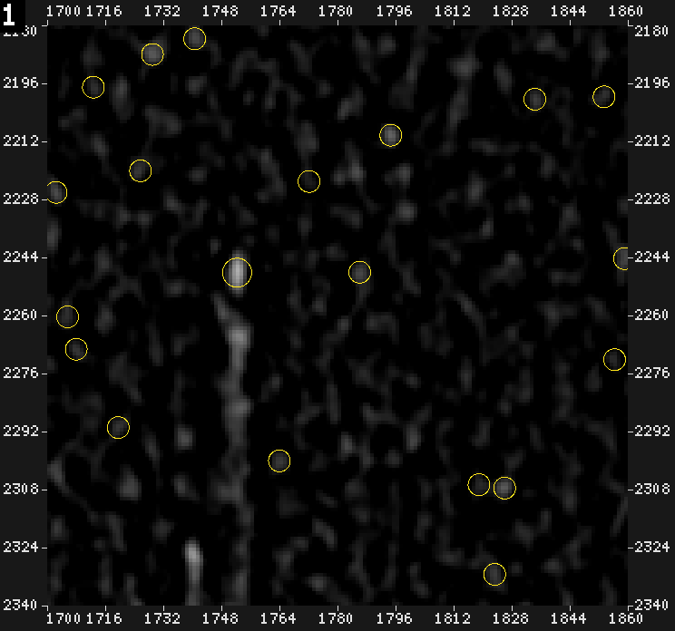
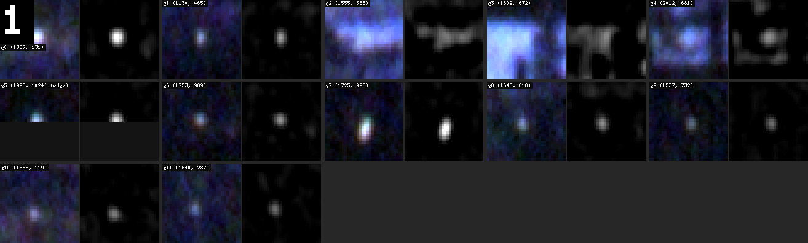
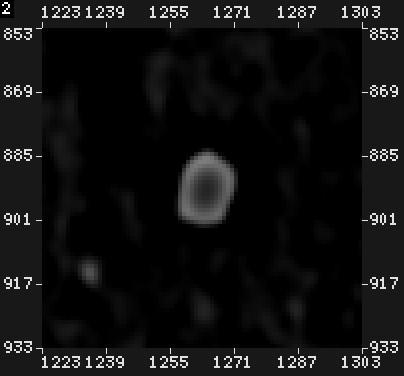
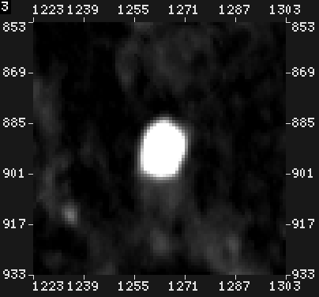

# goja-cv: From First Real User to v2 — Image Model, Inspection, Measurement, API v2 and Agent Ergonomics

goja-cv is a lazy image-analysis engine written in Go and driven from JavaScript. Agents call it through one
`eval` tool over MCP: they write a few lines of JS, get YAML numbers back plus images ("looks"), and use it the way
a person uses a darkroom or Photoshop to inspect pictures. An earlier note,
[[ARTICLE - Deep Dive - Teaching a Cheap Model an Image Eval API - goja-cv, Docs and pi Runs]], told how the first
version was taught to a cheap model through documentation and API fixes. This report covers what happened next, in
one long day (2026-11-09): goja-cv met its first real user, the film-dust annotation project
([[PROJECT REPORT - Film Dust Annotation - Part 4 - Annotator Agents - Playbook, Trials and Pre-Annotation over MCP - A Technical Deep Dive|Film Dust Annotation, Part 4]]),
and was rebuilt through five tickets, eight pull requests and three rounds of measured agent runs into a smaller,
stricter version 2.

> [!summary]
> - **Five tickets, one direction.** GCV-001 to GCV-003 added what a real user asked for: an honest image model
>   (encodings, working spaces, frames), inspection tools (crop, zoom, rulers, contact sheets, high-pass views) and
>   measurement with data out. GCV-004 then cut the API down to "one way per thing", driven by what 751 agent calls
>   actually used. GCV-005 added what 39 annotator agents had to improvise: task libraries, compact tables, `peaks`
>   and morphology.
> - **Evidence, not taste.** Every design decision was checked against counts from agent transcripts, gold-labelled
>   dust points, or a failing test. Several intuitions lost: a noise-scaled view, a warning with 1 true positive in
>   19, and a measuring rule that used the wrong radius.
> - **Process as a product.** Each ticket went guide → cold review read → revision → phased implementation behind a
>   seven-step gate → PR → automated review → agent validation, with every agent keeping a diary. The review reads
>   found 15, 4 and 4 blocking issues in the guides before any code existed.
> - **Agents find holes.** Two sandbox escapes were found by agents and reviewers, not by design: a `require` that
>   read any file on disk, and a repeated `--root` flag that made a read-only data folder writable.

## 1. The system in one page

Before the story, the vocabulary. Each term here is used throughout the report.

**Nodes and the lazy graph.** `img.view("speck").crop([1700, 2360, 96, 96])` does not compute anything. Each call
creates a *node* in a hash-consed graph (identical calls become the same node). Computation happens only when the
code `await`s a node, asks for a *look* (`node.look()`), or saves it. An evaluator caches results by node and scale,
so a second look at the same crop is free.

**Kinds.** A node is an `Image` (pixels), a `Value` (a measurement such as `stats()`), or `Regions` (a set of
connected areas or points, each an *item*). In v2 a mask is simply a one-channel image.

**Ops and the registry.** Every operation (`gaussian`, `crop`, `measure`, `peaks`, …) is an `OpDef` in a Go
registry: its name, receiver kind, typed arguments, a run function, and docs. The JS API, `cv.help`, the CLI
`goja-cv ops` and the MCP instructions are all generated from the registry, so there is one source of truth.

**Doc px and frames.** Coordinates are *doc px*: pixels of the full image, independent of the scale at which a node
is evaluated. A *frame* is a node's rectangle in doc px. A tile cut from a scan at (1536, 1536) can be opened with
`origin: [1536, 1536]`, and then every coordinate, ruler and measurement is in raw-scan coordinates, which is what
the dust labels use.

**Encoding and space.** Pixel data is *encoded* (sRGB, a perceptual curve) or *linear* (proportional to light or, in
the dust tiles, to film density). An op works in a *space*: some only make sense in linear light (exposure,
healing), others are fine in either.

**Looks.** A look is a rendered PNG/JPEG of a node plus a caption naming the op chain, the size and the doc-px
window. Over MCP, looks are returned as image content beside the YAML result; on the CLI they are written as files.

**Sessions.** `goja-cv mcp` serves an `eval` tool backed by go-go-goja's REPL sessions. Each agent creates its own
session; `mem` keeps values between evals.

```
JS eval ──> Proxy node handles ──> registry/binder ──> hash-consed graph
                                                          │
   await / look / save ───────────> evaluator (cache, scale, render) ──> kernels (Go, parallel)
                                                          │
   YAML result + looks <── result processor (tables, captions, warnings, context block)
```

## 2. How the work was organised

### 2.1 From a handover list to tickets

The film-dust project used goja-cv v1 for a day and handed over 23 issues: no crop or zoom looks, no rulers,
no contact sheets, no signed arithmetic, no high-pass view, inputs always decoded as sRGB, no point sampling or
line profiles, no data export, and so on. They were grouped into three tickets that each build on the previous one:

| ticket | theme | handover issues |
|---|---|---|
| GCV-001 | image model: encodings, working spaces, frames, decoders, channels, named images | 6, 7, 13, 20 |
| GCV-002 | inspection: crop, zoom, rulers, sheets, signed arithmetic, high-pass views | 1–5, 8, 14, 15, 22 |
| GCV-003 | measurement and data out: sampling, profiles, region measures, one schema, export | 9, 10, 16, 17, 21, 23 |

Later, GCV-004 (API v2 and foundations) came from a code review plus usage evidence, and GCV-005 (agent ergonomics
and analysis primitives) from the feedback of 39 annotator agents.

### 2.2 The loop each ticket went through

1. **A guide for an intern.** One agent wrote a design and implementation guide in textbook style: concepts
   introduced before use, current code cited by `path:line`, decision records with alternatives, a deletion
   checklist, pseudocode, phases with their tests. The guides ran from 1,200 to 2,700 lines.
2. **A cold review read.** A second agent, with no part in the writing, read the guide as a newcomer would, checked
   dozens of citations against the code, ran small experiments, and rated findings P1 (blocks implementation or is
   wrong), P2 or P3.
3. **Revision.** The writer fixed every finding or argued it away in a disposition table. The coordinator settled
   open questions with the user in between.
4. **Phased implementation.** An implementer built the guide phase by phase. Every commit had to pass a seven-step
   gate: gofmt, build, vet, `go test ./... -count=1 -race`, `make lint`, a log-message check, and a smoke test.
5. **PR and automated review.** CI (tests, lint, CodeQL, GoSec, vulnerability and secret scans) plus a Codex review
   bot. Every review comment was fixed on the branch it belonged to, with a regression test that fails without the
   fix.
6. **Agent validation.** The same questions were put to a cheap model (DeepSeek through the pi harness) on the
   build before and after the ticket, and the transcripts were counted.

Every agent kept a diary in a fixed format (what I did, why, what worked, what didn't, what I learned, what was
tricky, what deserves a second pair of eyes, what next, how to review). Those diaries are the reason this report
can quote numbers.

| guide | review findings | P1 (blocking) | after revisions |
|---|---|---|---|
| GCV-001..003 (three guides) | — | 15 | 0 after three rounds |
| GCV-004 | 37 | 4 | 36 fixed, 1 partly |
| GCV-005 | 33 | 4 | 31 fixed, 2 partly |

### 2.3 Branches and pull requests

Prototype stage, local only: no backward compatibility anywhere. Each ticket was a branch stacked on the previous
one so that work never waited for a merge; the user merged in order.

| PR | content |
|---|---|
| #2, #3, #4 | GCV-001, GCV-002, GCV-003 (stacked) |
| #5 | a small v1 patch for the field user (silent look drops, stepChroma, sheet badge, ruler labels) |
| #6 | GCV-004, API v2 |
| #7 | GCV-005, agent ergonomics and primitives (stacked on #6) |
| #8 | `--root` once-only; relative `--prelude` |

Parallel work used separate git worktrees: while one implementer finished GCV-004, another built GCV-005's
morphology phase, and the later merge had only mechanical conflicts because both sides followed the same guides.

## 3. GCV-001: an honest image model

### 3.1 Encoding belongs to the data, space to the op

v1 decoded every file through the sRGB curve into linear light. That is right for photographs and wrong for
anything else: the dust project's tiles store *film density*, and a scientific TIFF stores physical values. Asked
"what are the 1st and 99th percentiles of this tile?", an agent got numbers in a space nobody meant.

GCV-001 separated two ideas:
- **encoding** is a property of the data: `cv.open(path, { encoding: "linear" })` declares that the stored values
  are already linear;
- **working space** is where an op computes: `exposure` multiplies light and must work in linear; `levels` and
  `blend` are display operations.

Conversions are explicit, cached `convert` nodes inserted while the graph is built, so `explain()` shows them and
the cache shares them.

### 3.2 Frames, boxes and points

`DocW`/`DocH` became a `Frame` (origin and size in doc px). Boxes and points got their own argument types, so an
object `{x, y}` can no longer be silently misread as a point, and a box outside the frame is an error at build
time with a fix that gives the nearest valid box.

### 3.3 Decoders, channels, named images

- A decoder registry with an own TIFF parser (8/16/32-bit, float, LZW, Deflate, PackBits, predictor, big-endian),
  PNG/JPEG, `.npy`, and VueScan DNG. A 1024² window of a 7,256 × 7,326 DNG opens in 18 ms. The TIFF and NPY
  fuzzers ran 47,000 and 110,000 inputs without a crash.
- Channel ops (`channel`, `split`, `toLab`, `colormap`), and *macros*: ops that expand into a small graph but show
  as one node in captions (the view presets of GCV-002 are macros).
- Named images: `cv.open(other, { as: "ref" })` (in v2: `name: "ref"`) keeps a second image in the session.

### 3.4 Result

Same questions, same model, before and after: **48 and 41 calls before, 26 and 23 after**. Before, the agents
answered the encoding question by reverse-engineering the sRGB decode through 1×1 statistics boxes; after, they
used `encoding: "linear"` in their fourth call. No remaining error came from a missing capability.

## 4. GCV-002: inspection views and looks

### 4.1 What a person does at a light table

The handover's first five issues were all about *looking*: magnify a spot, read its coordinates, see many spots at
once, subtract two images, and see "what differs from its surroundings". GCV-002 added:

```js
img.crop([1700, 2360, 96, 96]).look({ zoom: 4, ruler: true })      // magnified, with absolute rulers
cv.sheet(points, { views: [img, img.view("speck")], size: 40 })    // a contact sheet of many crops
a.sub(b).mul(4).add(0.5)                                           // a signed difference, zero = grey
img.highpass(3), img.dog(1, 4), img.localContrast(8)               // "what stands out" views
img.view("speck")                                                  // a named preset of the above
```

### 4.2 Render classes

Zooming exposed a design question: at 8×, should a crop be computed at 8× resolution? The answer was to classify
ops: *pixel ops* compute at scale ≤ 1 and are then upsampled; *geometric ops* (crop) change the window;
*decoration ops* (overlay, annotate, rulers) are drawn at the final resolution, so a 1 px outline stays 1 px at any
zoom and labels stay readable. `Evaluator.Render` walks the graph by class.

### 4.3 Result

On a gold tile with 15 labelled dust points: **61 and 54 calls before, 30 and 37 after**, errors 8 and 2 → 2 and 1.
The agents used the new view, ruled zooms and sheets without being told to. Recall did not change (9, 8 → 9, 9 of
15): the limit had moved from *seeing* to *ranking candidates*. That observation came back two tickets later as
`peaks`.

## 5. GCV-003: measurement and data out

- **Point measures.** `img.sample(points)` reads values; `img.measure(points)` compares a core disk with a ring
  around it and returns `step`, `spread`, `snr` (step over the ring's spread), per-channel steps and `stepChroma`
  (how coloured the step is). `img.profile(a, b, { width })` reads values along a line, rendered as a chart.
- **One flat region schema.** Region items became flat records: `id, x, y, w, h, cx, cy, area, aspect, …`, where
  `x, y` is the box corner and `cx, cy` the centre. The same schema drives `where`, CSV columns and docs.
- **Data out.** `cv.json`, `cv.csv` and `node.save` wrote files under an out-root, with TIFF and PNG metadata
  (encoding and origin) so a saved image reopens with the same values and coordinates.

Result: **79 and 89 calls before, 57 and 44 after**. Before, agents built CSVs by paging YAML into their own
context; after, they wrote 742-row CSV/JSON files and reopened a saved TIFF with the right frame.

## 6. What a code review taught about foundations

The automated reviews of PRs #2–#4 found eight real bugs. Fixed one by one, they looked unrelated. Grouped by cause,
they were four classes:

| class | example | foundational fix (GCV-004) |
|---|---|---|
| opt-in safety flags and silent zero values | a parameter passed as `encoding` was read as `""` and became sRGB | options are literal values only; accessors fail loudly |
| two representations of one thing | `cv.compare([img, img])` laid out a deduplicated input list and clipped the second image | one accessor for node lists, in list order |
| a postcondition checked on one branch | a sheet shown at `maxSide: 512` stayed 1,566 px | one exit point in `Render` enforces the size |
| home-made infrastructure | path containment by string resolution (a dangling symlink escaped), a hand-written JSON writer (Go escapes like `\x00`), CSV shape guessing | Go's `os.Root`, `encoding/json`, records-only tables |

None of the eight came from backward compatibility. They came from mechanisms: opt-in flags, duplicate
representations, unchecked postconditions, and reinvented infrastructure. The question then became: could the API
itself make these classes impossible to write?

## 7. GCV-004: API v2, one way per thing

### 7.1 The evidence

751 eval calls from 18 agent runs were counted feature by feature:

| feature | uses | reading |
|---|---|---|
| parameter sliders (`P.slider`) | 0 | never used |
| a node as an option value (`{ white: dog.stats().p999 }`) | 4, one run | `(await dog.stats()).p999` does the same |
| `{ space: … }` option | 198 | 80 of them `stats({ space: "encoded" })`: agents want file units |
| `await` vs `cv.evaluate` | 1,139 vs 85 | two ways to evaluate |
| `.look(` vs `show(` | 167 vs 87 | two ways to show |
| JS `.filter(` vs `where`/`sortBy`/`top` | 74 vs 85 | agents filter in plain JS as often as with the query ops |
| errors | E_UNKNOWN_METHOD 35 (`mask.stats`, `Regions.filter`), E_ACCESS 23 (reopening saved files) | the kind split and two roots |

Of 246 synonym and redirect keys, agents had typed 14.

### 7.2 The changes

**Literal options.** Parameters and value lifting are gone. A data dependency is an `await`:

```js
// v1                                                   // v2
img.levels({ white: dog.stats().p999 })                 const s = await dog.stats()
                                                        img.levels({ white: s.p999 })
```

That deleted the `Static` flag, value input references and lifted-input deduplication: the first two bug classes
became impossible to write.

**Space on the image.** Instead of a `{ space }` option on every op, `img.as("linear" | "encoded")` converts once,
and ops follow their receiver's space. Files open in file units, which is what agents wanted in 80 calls. A few
*physical* ops (exposure, heal, inpaint, colour conversion) convert to linear internally and back. In ops with two
images the receiver decides, and masks are never converted (converting a 0.5 weight through a curve silently
changes it — a review finding).

**Masks are images.** The Mask kind is gone: a mask is a one-channel image, so `m.stats()` works and every image op
applies. Ops that need one channel say so at build time, with the fix `img.toGray()`.

**Regions are arrays.** Awaiting a Regions node gives a plain JS array of items. Each item keeps a hidden link to its
region set as `[node, index]` (not by `id`, which agents may edit or repeat), and the link survives `filter`,
`sort`, `slice` and object spread. Every op that takes regions accepts the node, an array of items, or literal
boxes, circles and points. The query ops (`where`, `sortBy`, `top`, `only`, `without`) are deleted.

**One output.** `cv.save("rows.csv", x)` replaces `cv.json`, `cv.csv` and `node.save`; the extension picks the
format. Saving the same path twice in one eval is an error.

**One workspace.** `--root DIR` is the one read-write directory; `--read DIR` (repeatable) adds read-only ones; a
relative path is looked up in the workspace, then the read directories. Each is a Go `os.Root`, so the operating
system refuses `..` and symlink escapes. A save never writes through a symlink and never replaces a file the session
opened (compared by file identity, not by path — an in-root symlink to an input defeated the path check).

**Other.** `look()` delivers every look an eval creates (`show()` is gone); awaiting an image returns its file,
encoding and frame without computing pixels; the synonym tables are deleted.

### 7.3 Results

The removed surface disappeared from agent code without causing errors:

| in agent code | before | after |
|---|---|---|
| `{ space }` | 70 | 0 |
| `cv.evaluate` | 33 | 0 |
| `show(` | 99 | 0 |
| `cv.json` / `cv.csv` | 20 | 0 |

Median calls fell from 31.5 to 29, 51 to 39 and 45 to 42 on the three question sets; no E_ACCESS remained. The
code base shrank by 867 non-test lines while regions, saving, the workspace and names were all rewritten.

### 7.4 Two investigations

**The speck ranking "dropped".** A gated test reported the speck view ranking gold dust at median rank 75 instead
of 18. The v1 build gave the same number on the same data, so it was not a code regression; it was not the labels
either. The tiles had been re-exported with density stored as the code value, and the tests opened them as sRGB.
Opened as linear, the view ranks gold dust at median 24 with 78.2 % in the top 50. The tests now assert relative
properties (the speck view beats a plain stretch; ranking by snr beats ranking by area) instead of counts.

**The wrong radius.** The new `measure` uses an item's `r` as the core radius. Over 197 gold points, measuring with
the label's `r` gave median snr 0.86 — worse than a fixed 3 px core (1.17). The gold `r` is the annotation tool's
*fit radius*, about twice the speck's own; with `r/2` the median is 1.56. The rule stayed ("`r` is the object's
radius"); the dataset side converts.

## 8. A patch for the field user

While v2 was being designed, the film-dust user started validating gold points with v1. Writing a tested
getting-started note for them found four bugs within an hour:
- a `look()` that was neither returned nor passed to `show()` was dropped silently, and looks beyond four per eval
  were dropped without a warning;
- `stepChroma` divided by an almost-zero step (3.25 at snr 0.12);
- the sheet's look-number badge covered the first cell's label;
- ruler labels ran together ("16191651").

They shipped as PR #5 within the hour (`stepChroma` is `null` below |snr| 1; a `LOOKS` warning names dropped
looks), and v2's "every look is delivered" removed the first class entirely.

## 9. GCV-005: what 39 annotator agents needed

### 9.1 The feedback

39 Claude Sonnet agents pre-annotated dust on 31 tiles through the MCP server: 374 evals, zero errors
([[ARTICLE - Deep Dive - goja-cv in Agent Hands - Feedback from 39 Annotator Agents]]). Two findings shaped the
ticket:

1. **A task helper library replaced the docs.** No agent opened `cv.docs` or `cv.help`. Every agent pasted the
   3 KB helper file into its first eval (39 pastes; 10 agents trimmed it), then worked through `mem.hot`,
   `mem.sheet`, `mem.zoom` and plain JS. The ops they typed themselves were few: `look`, `sheet`, `crop`, `view`,
   `levels`.
2. **Models cannot read coordinates off pictures.** Positions read off 2× ruler crops were 5–10 px off; on one tile
   24 of 32 guessed positions probed below sp 0.06. What worked was coordinates *as data*.

From the second came a design rule: **never make a model read a number off a picture; every look comes with the
data it shows.**

The feedback's own counts were wrong at first — the extraction script recognised a paste only by its final marker
line — and were corrected at the source before the design used them.

### 9.2 Task libraries and readable results

- **`cv.load(path, args)`** runs a script file in the session, resolved through the same workspace and `--read`
  rules as `cv.open`. `--prelude` is just a load at session start. An `eval_file` MCP tool was considered and
  rejected: the token cost was the 3 KB paste, not the 20-character call, and an MCP-only tool would not work on
  the CLI or in embedded hosts.
- **Function docs in the context block.** A function whose body starts with a comment shows that comment the first
  time its name appears or its source changes:

  ```
  new functions: |-
    mem.hot(snr = 1, radius = [2, 4, 8]): Candidate spots (peaks with snr >= snr) as rows { id, cx, cy, r, sp, snr, chroma, edge }, by sp; also mem.hotRows.
  ```
- **Compact tables.** An array of flat records renders as a header line and one row per item, with a paging note
  that names the next `.slice(…)` and `cv.save(…)`.
- **`UNUSED_NODE` deleted.** The study had 19 of these warnings, 18 false; the one true positive would have gone
  silent under any reasonable redesign. In v2 a node you never await, look at or save simply does nothing, and the
  eval waits for every load and save it started. A redesign that kept the warning by rewriting agent source with a
  parser was cut at review.

### 9.3 `peaks`

`img.peaks({ radius, snr, polarity })` returns local maxima as region items with sub-pixel centres and the same
core/ring numbers `measure` reports:

```
for each radius r in radii:
    step(x, y) = mean(core disk r) − mean(ring [1.5r, 2.5r])      # disk chord sums over row prefix sums, in row bands
    candidates = local maxima of step (disk max filter)            # non-maximum suppression
    refine each candidate with a separable parabola (sub-pixel)
    measure each candidate exactly (= img.measure at that centre and r)
    keep |snr| ≥ threshold
merge across radii: of two peaks whose cores overlap, the higher |snr| wins
```

Because local noise comes from each peak's own ring, a dust speck in a dark corner is judged against dark
surroundings — the structural fix for the "speck view scale is set by scene edges" complaint, after a noise-scaled
view had been tried and measured worse (87 % vs 91 % coverage).



*Peaks (yellow circles, radius = the peak's `r`) on a 160 px window of the speck view, 4× with absolute rulers. The
long streak is a labelled dust object; it gets one large peak at its head.*



*`cv.sheet` of 12 gold dust points (tile 40869f8b, scene | speck view per cell), labelled with the caller's
`label` field. Peaks were found within 4 px of 9 of them.*

### 9.4 Morphology

Two ops on one-channel images: `erode(r)` and `dilate(r)`, with a disk (up to 64 doc px) or a line element at any
length. Opening, closing and top-hat are compositions with help entries (`x.sub(x.erode(r).dilate(r))` is a
top-hat), not ops — the same rule that refused a `tophat` op refused `opening`. Mask `grow`/`shrink` were merged
into `dilate`/`erode`.

A saturated speck has a flat top, so a difference-of-Gaussians view turns it into a ring with a dark centre, and
"bright dot in the speck view" misses it. A top-hat keeps it filled:

| speck view (DoG) | top-hat, r 12 |
|---|---|
|  |  |

Dilation of a 4096² image takes 43 ms at r = 3 and 284 ms at r = 64; making the shared 1-D min/max routine
closure-free sped it up threefold, which also sped up the speck background.

### 9.5 Results

Gold metrics on 15 tiles and 190 dust points:

| | peaks, snr 1 | v1 hot list |
|---|---|---|
| dust covered | **90.5 %** | 86.3 % |
| median position error | **0.36 px** | 0.99 px |
| candidates per tile | 354 | 71 |
| dark-area dust | 31 of 33 | 31 of 33 |
| saturated dust | top-hat 60 of 63 | 59 |

An snr threshold of 1.4 drops coverage to 70.5 %, and 0.5 gains ten points for fifteen times as many peaks, so the
default stayed 1. A line opening cut elongated scene components from 40 to 8 at the cost of one dust point in 164.

Agent runs on a playbook-like task, before (GCV-004) and after (GCV-005):

| run | calls | errors | gold located (of 53) | far from gold | median error |
|---|---|---|---|---|---|
| before a / b | 69 / 62 | 18 / 8 | 4 / 5 | 15 / 12 | 0.26 / 0.28 px |
| after a / b | 61 / 42 | 11 / 2 | 14 / 13 | 2 / 5 | 0.13 / 0.12 px |

## 10. Security holes found along the way

Each of these was found by an agent, a reviewer or a test written for something else:

| hole | how it was found | fix |
|---|---|---|
| a dangling symlink inside the out-root let `save` create a file outside it | Codex review of PR #4 | v2 workspace on `os.Root` |
| an in-root symlink to an opened input let `save` overwrite it | the GCV-004 cold review, by experiment | identity check with `os.SameFile`; never write through a symlink |
| predictable temporary file names could be pre-planted as symlinks | Codex review of PR #6 | exclusive creation (`O_EXCL`) under random names |
| `require("/abs/path.js")` loaded any JS file on disk | a pi agent used it to load its library from outside the roots | the session's require loader refuses every file; `cv.load` is the one way |
| a repeated `--root` silently kept the last value, so a v1 registration made the gold-data folder writable | testing the user's existing MCP registration against v2 | `--root` is once-only, with a fix pointing to `--read` |

The pattern: a sandbox boundary needs *identity* (compare files, not names), *exclusivity* (create, don't open),
*a single path* (one loader for scripts) and *strict flags* (no silent last-wins for security-relevant options).
And agents probe boundaries: the `require` escape was used within two runs of being available.

## 11. Working rules this produced

- **Count before you design.** Usage counts decided what to delete (parameters: 0 uses), what to change (`space`:
  198 overrides), and what not to build (an `eval_file` tool).
- **Judge a warning by its true positives.** `UNUSED_NODE` had one in nineteen.
- **Fix counts at their source.** Wrong numbers in a hand-off flowed into a design revision before the extraction
  script was fixed.
- **Never make a model read a number off a picture.** Return coordinates, ids and measurements as data next to every
  look.
- **Keep calibration continuous.** The v2 helpers find candidates with `peaks` but report `sp`/`snr` with the probe
  settings the playbook's thresholds were calibrated on, so the decision rules carried over unchanged.
- **One way per thing, and delete the rest.** No aliases, no migration diagnostics, no compatibility shims at the
  alpha stage. Each removed mechanism removed a bug class.
- **A cold reader finds what the writer can't.** Every guide had blocking findings that only a fresh reader with
  the code open could see.
- **Regression tests must fail without the fix.** Twice the first test passed without the fix (tiny JSON saves
  finished before the race; a vacuous binary-path comparison) and had to be rewritten.

## 12. Current status

- goja-cv `main` is v2 (`8d27f81`, GCV-001 to GCV-005 merged); `~/go/bin/goja-cv` is installed from it. PR #8
  (`--root` once-only, relative `--prelude`) is open.
- The film-dust project is ported: helpers (`scripts/84-cv-helpers.js`, built on `peaks`, loaded with
  `--prelude`), the annotator playbook (`reference/04`) and a v2 getting-started guide (`reference/12`) in DUST-002.
- The user's `cv` MCP server must be re-registered with v2 flags (`--root` workspace, `--read` for tiles and data,
  `--prelude` for the helpers).

## 13. Open questions and next steps

- Rerun one annotator agent on the v2 playbook and compare with the 39-agent study; the single-session comparison
  so far (9 of 13 gold points either way, 36 vs 45 evals, no pastes) is indicative only.
- Windowed evaluation: crops of a full 53 MP scan still compute pixel ops on the whole frame; `peaks` on a full scan
  is about 5 s.
- `cv.info` is still typed by agents in half the runs; decide between an alias and better instructions.
- The xgoja provider keeps its host's `require` policy by design; document it if an xgoja host is ever exposed to
  agents.

## 14. Where things are

- Repository: `/Users/manuel/code/wesen/go-go-golems/goja-cv` (GitHub `go-go-golems/goja-cv`).
- Tickets with guides, review findings and diaries: `ttmp/2026/11/09/GCV-001…` to `GCV-005…`; the coordination
  diaries are GCV-001 `reference/01`, GCV-004 `reference/02` and GCV-005 `reference/02`.
- Agent runs and their scripts: `/Users/manuel/code/wesen/2026-11-07--dust-scanning/ttmp/2026/11/08/CVJS-001--js-eval-cv-api-for-agents-compare-9-implementations/various/pi-runs/` (runs 07–36, with a results table in `README.md`).
- Field user docs: `/Users/manuel/code/wesen/2026-11-07--dust-scanning/ttmp/2026/11/07/DUST-002--film-dust-detector-model-exploration/` (`reference/11` agent feedback, `reference/12` v2 getting started, `scripts/84-cv-helpers.js`).

## Related notes

- [[ARTICLE - Deep Dive - Teaching a Cheap Model an Image Eval API - goja-cv, Docs and pi Runs]] — the v1 story.
- [[ARTICLE - Deep Dive - goja-cv in Agent Hands - Feedback from 39 Annotator Agents]] — the feedback behind GCV-005.
- [[PROJECT REPORT - Film Dust Annotation - Part 1 - Making Faint Dust Visible - Density Tiles and the Speck View - A Technical Deep Dive]] — the speck view and density tiles.
- [[PROJECT REPORT - Film Dust Annotation - Part 4 - Annotator Agents - Playbook, Trials and Pre-Annotation over MCP - A Technical Deep Dive]] — the annotator agents.
