# slop v3: Pinboard — Shared Boards, Apps as Code in Sandboxed Frames, an Agent and CLI Verbs — A Technical Deep Dive

Pinboard is a canvas of windows. A window, called a *clip*, holds a note, a link, an image, a Markdown document, a group of other clips, or a small application. The applications are written on the board itself, in a fluent JavaScript grammar, and they are stored on the board as source text. An agent beside the canvas reads the board, sorts clips into collections and writes new applications using the same operations a person uses. It began as a single-file prototype that kept everything in one browser's IndexedDB, for one person.

This report explains how that prototype became a slop app. On slop, many people work on one board at the same time. A person keeps many boards and shares each one separately. Applications written by one collaborator run on everyone else's screen. The board can be read and changed from a terminal and by an agent over MCP. The work is tickets SLOP3-016 (design and phases 0–6) and SLOP3-017 (review fixes). It was merged as pull requests #39 (2026-11-08), #40 and #42 (2026-11-09), and deployed on slop.yolo, the staging server, on 2026-11-09. The report covers the data model, the shared operation core, the collaboration layer in the page, the trust model for code written by other people and how it was tightened four times, the two agents, and the command-line and MCP verbs. It also lists the platform features that slop gained along the way.

> [!summary]
> - **A board is a store, and every object is a document.** Clips, records, app versions and a shared transaction log are documents in one slop store per board. One JavaScript core applies operations to them in the page, in the board's server-side actor and behind the CLI, so every caller gets the same validation and the same log.
> - **Code written by someone else never runs in the viewer's page.** Each board app runs in a sandboxed iframe with an opaque origin and no network, and it changes the board only by sending steps that the page checks against one shared table. Only the actor writes app records, so the author and the hash a viewer consents to are facts, not claims.
> - **The board's vocabulary reaches beyond the browser.** The app ships JavaScript verbs in its own tree; the slop CLI discovers and runs them as the signed-in person (`slop pb Kitchen clip add …`), the server runs the same verbs for MCP tools, and a server-side agent uses the board's actions as model tools, one transaction per tool call.

## 1. The starting point and the requirements

The prototype is seven script files that share one global object, `window.PB`. Together they are 2,221 lines, including 61 lines of HTML and 210 of CSS:

| File | What it does |
|---|---|
| `store.js` | the state `PB.S`, IndexedDB persistence, the mutation recorder, undo and redo, events |
| `dsl.js` | the grammar: immutable `ui.*` builders, fragments, an intermediate representation, collection queries |
| `render.js` | builders to DOM, the runtime context `c`, dependency tracking per window |
| `board.js` | the canvas, clips, drag and drop, paste, selection, the board API, `describe()` |
| `apps.js` | the `app()` builder, the registry that evaluates app source, the built-in apps, the reference text |
| `agent.js` | the agent panel: model calls with one tool, `eval` |
| `main.js` | boot |

Two properties of the prototype made the port possible. First, persistence is separated from state. All durable changes go through `PB.mutate(fn)`, whose recorder writes each changed value through one function, `write()`, and rendering reads only `PB.S`. Replacing `write()` and the loader replaces the storage without touching the 200 KB of interface code. Second, rendering is already incremental by key. Every window records which keys it read while rendering (`state:<clip>:<key>`, `coll:<name>`, `clips`), and a change re-renders exactly the windows whose keys it touched. A change made by another person only has to produce the same keys.

The request asked for seven things, which the design guide recorded as requirements:

| Id | Requirement |
|---|---|
| R1 | Several people collaborate on one board, live. |
| R2 | A person creates several boards. |
| R3 | A board is shared with named people, with members, or by link, to view or to edit. |
| R4 | The board is reachable from the CLI, authenticated by the existing device login. |
| R5 | CLI access uses JavaScript verbs mounted into the `slop` CLI. |
| R6 | It stays a computational pinboard: people and the agent build apps on it together. |
| R7 | New machinery on the frontend and the backend is allowed where needed. |

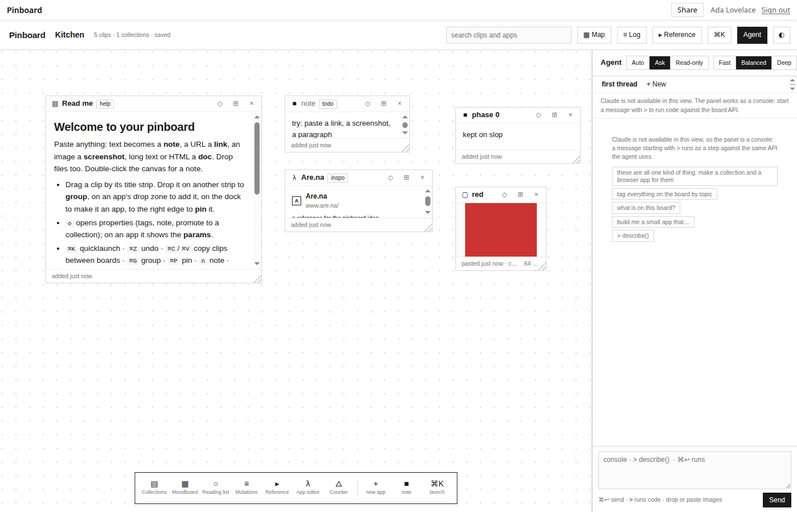

*Figure 1. A board on a local slop server after phase 0. The dock at the bottom holds the built-in apps; the agent panel is on the right. "Kitchen" is the board's title, read from `board/meta`.*

## 2. The slop pieces Pinboard is built on

Pinboard uses slop's existing primitives wherever they fit. Each one needs a precise definition, because the rest of the report depends on what it guarantees.

- **Store.** A store holds documents, uploaded files and a room for real-time messages, and it may run an *app*: a manifest `app.json`, a page and an actor. Every store has an owner and an id that is unique across the server.
- **App store and board store.** The store `pinboard` holds Pinboard's code. Each board is a separate store of type `pinboard` that *runs* the app `pinboard`, at a snapshot of the app store's files. A push to the app store therefore reaches the boards without touching their data.
- **Level.** A person holds a level on a store: `view` < `interact` < `admin` < `owner`. Levels come from grants to a person, from grants to an audience (`@guest`, `@member`, `@subscriber`), and from share links.
- **db.** Documents live at paths such as `clips/clip:k3x9…` or `board/meta`. They can be read once or subscribed to (`onSnapshot`). Writes are last-writer-wins per document, and the manifest declares rules per path prefix that say which level may read and write there. Everything under `data/users/<id>/` is private to that person at the platform level. Limits are 256 KiB per document, 25,000 documents per store and 64 subscriptions per view.
- **Live host, shell and sandbox origin.** A page opens at a URL on the live host (`apps.<domain>`). The shell signs the person in and frames the page on a sandbox origin derived from the store and the app, so one app cannot script another or slop itself.
- **Page runtime.** In the page, `claude.use(name)` returns a capability or `null`: `db`, `user`, `room` (presence and topics), `assets` (uploads), `sample` (model calls, metered against the viewer's budget) and `slop` (actions and helpers). Every call made through it runs *as the viewer*.
- **Actor.** Server-side JavaScript per store. It handles one event at a time, and each event handler runs as a *turn*: one SQLite transaction that commits or rolls back as a whole. When the handler awaits real I/O, the code after the `await` runs in a new *continuation turn* with the visitor restored. The actor's `db` is the store's own, and the page rules do not apply to it.
- **createApp mount.** A mount such as `/pb/:id --type pinboard --createApp pinboard` serves any store of type `pinboard` by id. At an unused id, the shell offers a signed-in member "Create a new one". The server then creates a store with a generated id (`s-` and eight characters) and makes the creator its owner.
- **Verbs and the device login.** The server's API is a table of verbs (`docs.set`, `grant.set`, `link.new`, …). The CLI, the HTTP API and the MCP endpoint are generated from that table. `slop auth login` performs a device-code login and stores a token for the CLI.

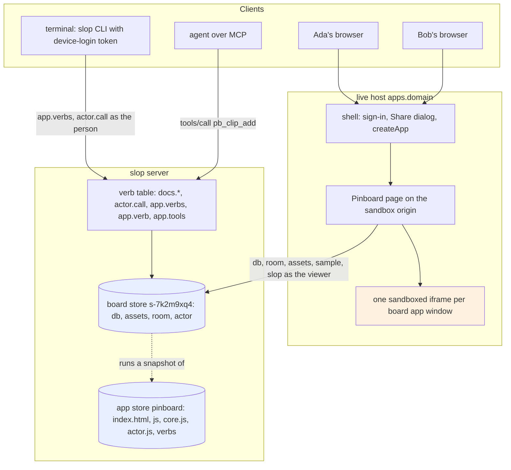

*Figure 2. The parts of Pinboard on slop. Every arrow into the board store carries a person's identity; the frames talk only to the page.*

## 3. A board is a store

### 3.1 The documents

Every kind of object is one collection, and every object is one document. A document is small and can be written on its own, and the privacy rules can be stated per path. The model as built:

| Path | Document | Written by |
|---|---|---|
| `board/meta` | `{title, seeded, about, logDays?}` | admin |
| `clips/<id>` | `{id, kind, x, y, w, h, z, title, tags, note, added, …kind fields, binding?, source?}` | interact |
| `colls/<seg(name)>` | a collection schema `{name, fields, indexes, store, version}` | interact |
| `records/<id>` | a record, with its collection in `coll` and `added` | interact |
| `apps/<name>` | `{name, source, version, sha256, uid, by, at, icon, title, about, w, h, state, params, …}` | the board's actor only |
| `apps/<name>/versions/<n>` | `{source, by, uid, at, sha256, note}` | the board's actor only |
| `log/<tx id>` | one transaction `{id, by, uid, at, label, ops, undone, revertOf?, trimmed?}` | interact |
| `data/users/<id>/view` | that viewer's pan and zoom, minimap, agent threads and modes | that person |
| `data/users/<id>/trust` | `{apps: {<name>: <sha256>}}`, that viewer's consent to app versions | that person |

Records are flat (`records/<id>` with a `coll` field) rather than nested under their collection, which the design guide had proposed. The page keeps all records in memory and queries them there, so one subscription to `records` serves every collection. A collection name is free text and a path segment is not, so names pass through `seg()`, which writes every byte outside `[A-Za-z0-9_\-.:@+]` as `~` and two hex digits. Ids are a kind and ten base-36 characters (`clip:k3x9q0d2ab`), about 3.6 × 10¹⁵ values, so that many writers can create objects without coordinating. `:` is legal in a path segment, so an id is its own segment.

The manifest declares the rules, the capabilities and the verbs:

```json
{
  "title": "Pinboard", "type": "pinboard", "page": "index.html", "actor": "actor.js",
  "capabilities": {
    "db": { "rules": [
      { "path": "board", "read": "view", "write": "admin" },
      { "path": "apps",  "read": "view", "write": "self" }
    ] },
    "user": { "scopes": ["profile"] }, "room": {}, "assets": {}, "downloads": true, "sample": {}
  },
  "slop": { "verbs": { "alias": "pb", "include": ["verbs/*.js"], "title": "board/meta" } }
}
```

Paths without a rule take the defaults: read at `view`, write at `interact`. The rule `"write": "self"` on `apps` needs explanation. `self` is not a level anyone holds. A rule that asks for it can only be met by a more specific rule ending in `{self}`, which matches the writer's own id (`pkg/rt/rules.go`). Pinboard declares no such rule below `apps`. The effect is that no page and no client writes under `apps/`, the board's owner included. The actor still can, because it writes the store directly. Section 6.5 explains why this rule is the core of the trust model.

### 3.2 Many boards per person, each shared on its own

Requirement R2 and R3 follow from one decision: a board is a store. A person makes as many boards as they like, and grants and links belong to one store, so a link to one board opens only that board.

A board is created by visiting an unused id under the mount. The "New board" button of the home page links to `/pb/new-<random>`, which never names an existing store. The shell sees no store there, sees the mount's `createApp`, and offers "Create a new one". `POST /_site/create` creates `s-7k2m9xq4` (type `pinboard`, app `pinboard`, owner the visitor), and the shell moves to `/pb/s-7k2m9xq4`. The page then finds no `board/meta`, seeds three welcome clips in one transaction, names the board "Untitled board" and selects the title for typing. Someone who wants a readable id creates the board from the CLI instead: `slop store new kitchen --app pinboard --type pinboard`.

Sharing needed no new machinery, because the live shell already gives every store's owner a Share dialog. A share link is a way to obtain a grant, not a standing key:

1. The owner makes a link at `view` or `interact`. The server stores only a hash of the token and returns the URL once, `…/pb/s-7k2m9xq4?k=k_…`.
2. Whoever opens it gets the token removed from the address bar by the shell and sent with the request that opens the view. The server redeems it by writing a grant for that person with `via = <link id>`. A link never lowers a level someone already has.
3. From then on the grant lets the person in, without the link.
4. Revoking the link deletes every grant written `via` it, at once.

### 3.3 Listing a person's boards

The home page at `/boards` must list "yours" and "shared with you", and a page cannot call `store.ls`. Slop gained a page runtime call for this, `slop.stores.list({type, title})`, served by a view RPC (`pkg/doors/pages/storesrpc.go`). It takes the stores the viewer can see (owned, granted, or open to an audience they are in), keeps those of the given type, sorts them newest first and stops at 200. With `title`, it reads the named document from each store and returns its `title` field.

The title read is the part that needed care. Reading `board/meta` from many stores in one call with the platform's rights would leak titles hidden from the viewer. Each read therefore opens the store *as the viewer* at `view`, and filters the document through the store's own read rules, exactly as a page read would. The platform does not know Pinboard's layout: the manifest's `slop.verbs.title` names the document (`board/meta`), and the same field lets the CLI resolve `slop pb Kitchen` to a store id.

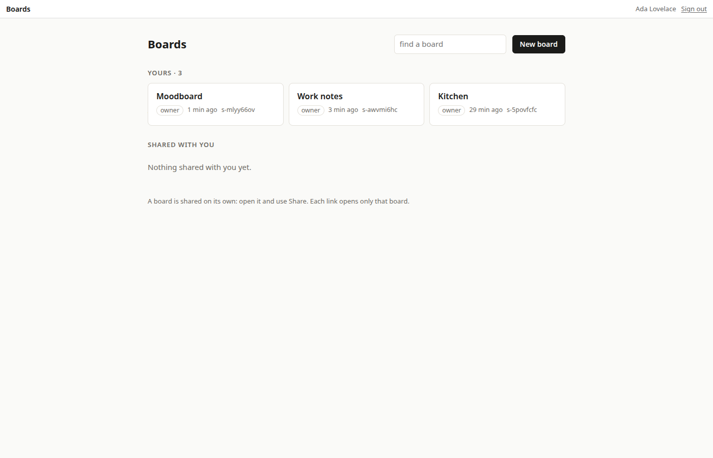

*Figure 3. `/boards` for a person with three boards. Titles come from each board's `board/meta`, read as the viewer.*

One defect in the first version is worth recording. The RPC returned nothing, because it filtered on `Decision.OK` after calling `Access.Level`. `Level` computes the level and leaves `OK` false; only a check against a required level sets `OK`. The filter now compares the computed level, as `store.ls` does.

## 4. One core for the page, the actor and the CLI

### 4.1 The storage adapter

The page, the actor and the verbs must apply the same operations with the same checks and produce the same log. The prototype's recorder was already pure apart from `write()` and `PB.S`, so it moved into `core.js`, a file with no DOM and no network. It is written as a UMD module. In the page it is `window.PinboardCore`; in the actor and in Node it is `require('./core.js')`. It runs against a storage adapter:

```js
storage = {
  get(store, id),          // current value or undefined
  put(store, id, value),   // value, or null to delete
  list(store),             // every value of a store
  level(),                 // 'view' | 'interact' | 'admin' | 'owner'
  now(), id(kind), z(),    // clock, fresh ids, next stacking order
  appDef(name),            // an app's definition, for m.open (page only)
}
```

`createCore(storage)` returns `mutate`, `recorder` and `revert`. Every operation is built on one primitive, `m.set(store, id, fn, label)`. It checks the level, reads the current value, computes the new one, writes it through the adapter, and appends an *op* `{store, id, before, after, label}` to the transaction. It also adds the render keys the change touches. `place`, `move`, `tag`, `insert`, `update`, `promote`, `register` and the rest are short functions over `m.set`:

```js
m.move   = (id, p) => m.set('clips', id, c => (need(c, id), c.x = Math.round(p.x), c.y = Math.round(p.y), c), 'move ' + id);
m.update = (coll, id, patch) => m.set('records', id, r => {
  if (!r) throw new Error('no record ' + id);
  return Object.assign(r, typeof patch === 'function' ? patch(r) : patch);
}, 'update ' + coll + '/' + id);
```

`mutate(fn)` runs `fn(m)` as one transaction. If `fn` throws, it writes every op's `before` back in reverse order and rethrows, so a failed step leaves the board as it was. The level check happens before anything changes: `interact` for clips and records, `admin` for apps. The store would refuse a write anyway, but the page has already changed `PB.S` and the screen by then. Checking first turns a refused write into an error inside the mutation, which the page shows as a message, instead of a screen that silently disagrees with the board.

### 4.2 The three adapters

| Host | `get`/`put` | When writes happen | Who writes the log |
|---|---|---|---|
| page (`js/store.js`) | `PB.S`, with `put` scheduling a debounced db write | 40 ms after the last change to a document (300 ms for typing) | the page, `log/<tx>` debounced 300 ms |
| actor (`actor.js`) | `db.doc(path).get()` / `.set()` in the current turn | in the turn's transaction | `commit()`, in the same turn |
| verbs | none directly: verbs call the actor's actions | through the actor | the actor |

The actor's `commit(ctx, args, fn)` is the whole server-side write path. It runs `core.mutate(fn)` against the turn's `db` and, when the transaction changed anything, writes the log entry in the same turn. The entry's `by` says who and how: `Ada Lovelace (cli)`, `bob (mcp)`, or `agent (for Ada Lovelace)`.

### 4.3 A transaction, traced

During the staging deploy, a temporary board was driven from the CLI:

```text
$ slop on pb-smoke-1109 clip add --url https://example.com --title "smoke test"
| clip:83pk335lyf | link |
$ slop on pb-smoke-1109 board describe
Untitled board  (pb-smoke-1109)
1 clips · 0 collections · 0 records · 0 apps
  clip:83pk335lyf  link   smoke test
$ slop on pb-smoke-1109 board log
| 1794203143324 | Manuel Odendahl (cli) | tx:ry8cg85x6q | place clip:83pk335lyf (link) | false |
```

The verb called the actor action `addClip`. The action chose a free spot below everything on the board (`x: 40`, `y: 32` on an empty board), and `m.place` filled in the defaults and the id. The log entry it wrote has this shape (reconstructed from the code; `uid` elided):

```json
{ "id": "tx:ry8cg85x6q", "by": "Manuel Odendahl (cli)", "uid": "usr_…", "at": 1794203143324,
  "label": "place clip:83pk335lyf (link)", "undone": false,
  "ops": [{ "store": "clips", "id": "clip:83pk335lyf", "before": null, "label": "place clip:83pk335lyf (link)",
            "after": { "id": "clip:83pk335lyf", "kind": "link", "url": "https://example.com", "title": "smoke test",
                       "x": 40, "y": 32, "w": 260, "h": 110, "z": 1, "tags": [], "note": "", "added": 1794203143324,
                       "source": { "from": "cli", "at": 1794203143324 } } }] }
```

The entry keeps each op's values, before and after, so that any person in any tab can later revert the step without reading history from anywhere else. A document is limited to 256 KiB, so `logEntry` measures the serialized entry's UTF-8 length with a hand-written `byteLength` (the actor has no `TextEncoder`). Over 200 KiB, it keeps only the paths. Such a step can no longer be reverted by others.

Two more pieces of the core exist because the same file runs in three places. `sha256` is written in plain JavaScript, with the round constants computed from the primes, because goja has no `crypto` and the page and the actor must agree on an app version's hash. `canon`/`same` compare values as JSON with sorted keys, because the server returns documents with their keys sorted. Section 5.4 shows what went wrong before that comparison existed.

## 5. Collaboration in the page

### 5.1 Loading and applying other people's changes

`PB.load()` reads `clips`, `apps`, `colls`, `records`, `board/meta` and the newest 200 log entries into `PB.S`. `PB.subscribe()` then subscribes once per collection. Each snapshot's changes go through `applyRemote`:

```js
for (const ch of snap.docChanges()) {
  const id = PB.unseg(ch.doc.id), path = coll + '/' + ch.doc.id;
  if (dirty.has(path)) continue;          // our own edit is still waiting to be sent
  let data = ch.type === 'removed' ? null : PB.clone(ch.doc.data());
  const cur = PB.S[store][id];
  if (PB.same(cur, data)) continue;       // our own write coming back, or nothing new
  if (data == null) delete PB.S[store][id]; else PB.S[store][id] = data;
  remoteAt[path] = Date.now();            // someone else changed this document now
  C.keysFor(store, id, cur, data).forEach(k => keys.add(k));
}
if (keys.size) { PB.emit('remote', keys); PB.emit('change', keys); }
```

Three rules are encoded here. A document with an unsent local edit is skipped, so a snapshot cannot overwrite what the person is typing. A value equal to `PB.S` is skipped. That covers the echo of one's own writes without any bookkeeping by transaction id, because the runtime overlays pending writes in snapshots and a confirmed write comes back with the same value. Every genuinely new value records `remoteAt[path]`, the time someone else last changed that document, which undo uses. The emitted keys are the same ones a local mutation emits, so the renderer needs no change: `B.onChange(keys)` re-renders the windows whose recorded dependencies intersect them.

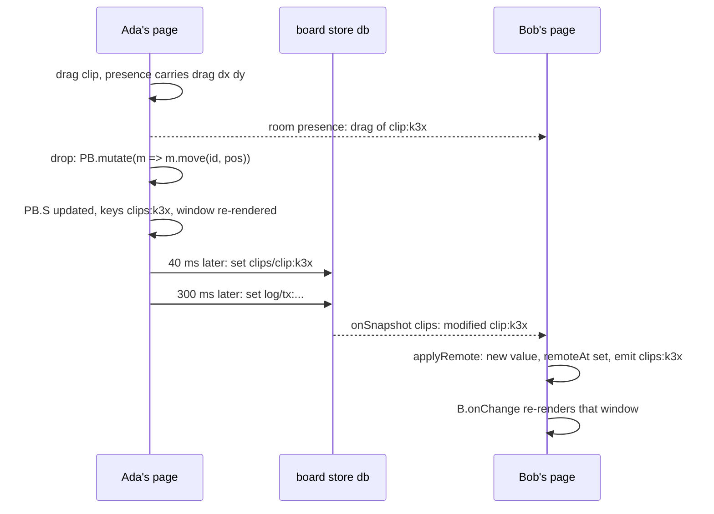

*Figure 4. A move as Bob sees it: live through presence during the drag, durable through one document write on the drop.*

### 5.2 Writing

Writes are debounced per document path. `PB.save(store, id, delay)` schedules a write 40 ms after a mutation, or 300 ms after typing or window state, so a burst becomes one write per pause. While the write waits, the path is *dirty*. The runtime already serializes writes per document, but it cannot see a write that the page has not sent, which is why the dirty set exists. When a write is refused or fails, the page reads the document again and shows what the board holds, so `PB.S` never stays ahead of the store. A viewer's writes are dropped before they are sent: z-order and typing stay in that tab.

### 5.3 Undo when other people are editing

In the prototype, undo wrote each op's `before` value back. With several people that is wrong. If Ada places a note and Bob then moves it, Ada's undo of her placement would erase Bob's move. The core's `revert(ops, mayOverwrite)` puts a document back only if it still holds the value the op wrote, or if `mayOverwrite(op)` says that overwriting is safe. Undo and log revert use it with different rules:

| | Undo (⌘Z) | Revert from the Board log |
|---|---|---|
| Whose steps | my own transactions in this tab | anyone's step in the shared log |
| A document is put back when | it holds what my op wrote, **or** nobody else changed it since my transaction (`remoteAt(path) <= tx.at`) | it holds exactly what that step wrote |
| What is kept | other people's later changes | anything changed since the step |
| Recorded as | the log entry marked `undone` | a new transaction with `revertOf`, and the original marked `undone` |

The undo rule is looser than the design guide's proposal, which allowed only "the document still holds the value the op wrote". The guide's rule failed on the person's own work: typing into a note one just placed, or bringing it to the front, changes the value too, and then every undo of one's own work would count as a conflict. `remoteAt` records only other people's changes, so one's own later edits do not block one's own undo while anyone else's do. The log revert keeps the strict rule because it has no record of what else happened in other tabs. When ops are skipped, the page says so: "1 change was not undone: someone changed it since."

The first two-person test found a defect in this mechanism. Ada placed a note and undid it, and the note stayed on Bob's screen. Equality was `JSON.stringify(a) === JSON.stringify(b)`, and the server returns documents with sorted keys, so Ada's own write came back looking different. `applyRemote` then set `remoteAt` for Ada's own write, and her undo saw a conflict with herself. `canon()`, which sorts keys before comparing, fixed it. Any code that compares documents on slop has to be independent of key order.

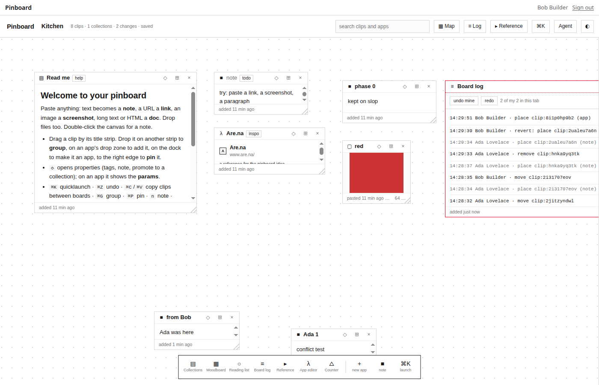

*Figure 5. The Board log on Bob's screen during the phase 1 test. Bob reverted Ada's "place"; the reverted entries are dimmed.*

### 5.4 Shared, momentary and per-viewer state

The prototype stored everything about a window in its clip, including the text of an app's search box. On a shared board that would make one person's typing change everyone's view. State therefore splits three ways:

| Kind | Examples | Where it lives | How it travels |
|---|---|---|---|
| shared and durable | a note's text, positions, app params, records, `c.state` | clip and record documents | db writes, debounced |
| shared and momentary | cursors, selections, a clip being dragged, the viewport | room presence | about 15 patches a second |
| per viewer | pan and zoom, minimap, agent threads, `c.local` | `data/users/<me>/view`, or memory | private db document, or none |

Presence is one small object per open page, `{cursor, sel, view, drag}`, patched and flushed at most every 66 ms. The page draws other people's cursors with their names, outlines the clips they have selected in their colour, and moves the clips they are dragging. Clicking a person in the header *follows* them: the page applies their `view` until the person pans or zooms. A drag produces dozens of positions a second; writing them would churn the clip document and the log. Presence carries them, and the drop writes once.

The grammar gained `c.local` for the third row: per viewer, per window, kept in the tab. `ui.input('q').local()` binds a search box to it. The built-in Collections, Moodboard and Reading apps moved their search, selection and caption state there.

One more rule concerns defaults. An app declares initial state, such as `state({ n: 0 })`, and the prototype copied it into each window when the window opened. A window opened before a default existed, or from an app record that did not store it, then read `undefined`. Defaults are now applied when state is read (`makeCtx` in `render.js`): a stored key wins, otherwise the declared default is returned, and an object default is copied once per render context. This fixed old records without a migration.

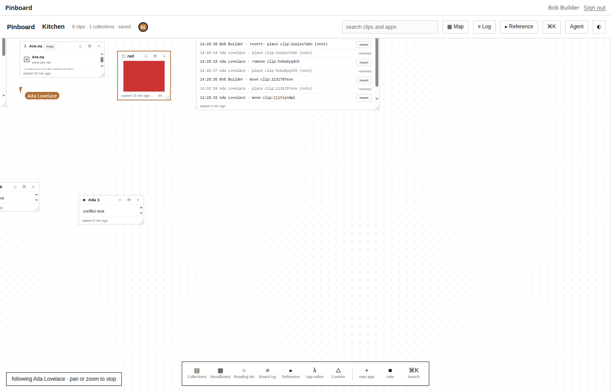

*Figure 6. Bob follows Ada: her cursor and name tag, her selected clip outlined in her colour, and the "following" banner at the bottom left.*

## 6. Apps written by other people

This part of the design carries the most risk, and it changed the most during review. It is easiest to follow in the order the problem was understood.

### 6.1 The grammar and what an app is

An app is one chain of builder calls ending in `register()`:

```js
app('counter')
  .icon('△').title('Counter').about('a first app')
  .size(260, 180)
  .state({ n: 0 })
  .param.slider('step', 1, { min: 1, max: 10 })
  .view(ui.stack(
    ui.text().bind(c => c.state.n).bold().class('bignum'),
    ui.button('+').on('click', (ev, c) => c.set('n', c.state.n + c.param('step')))))
  .register()
```

Builders are immutable: every call returns a new builder. They are `Proxy` objects, so a misspelt or misplaced method throws an error that names the right builder ("stack has no method "cols". … ui.grid(…).cols(n) lays out columns"). The agent reads these errors as step results, so a wrong call tells it which builder to use. A lambda that receives `c`, the runtime context, runs when the window renders. Reading `c.state.n` through the context records the key `state:<clip>:n`, so the window re-renders when that key changes. `c.db.recipes.where(…)` reads records and records `coll:recipes`. Changes go through `c.set`, `c.db.<coll>.insert/update/remove` or `c.mutate(m => …)`, all of which end in `PB.mutate`.

Apps are kept on the board **as source text**. The editor, the agent and the Reference app all work with source, and evaluating the source yields the definition. Six apps ship with the code: Collections, App editor, Moodboard, Reading list, Reference and Board log. They live in memory as `PB.builtins` and are never written to a board. The Counter above is different. It is the editor's template, and the first admin on a new board registers it as an ordinary board app, so it runs like any app someone wrote.

### 6.2 The threat

In the page, every runtime capability acts as the viewer. `db` writes as the viewer, `sample` spends the viewer's model budget, and `assets` uploads as the viewer. If Bob registers an app on a board Ada can open, and Ada's page evaluates it, then Bob's code runs as Ada. It can reach anything Ada's page can reach, including her model allowance and her private documents.

### 6.3 Step one: admin-written versions and per-viewer consent (phase 3)

The design guide's decision was that only board admins register apps, that every version records its author and hash, and that each viewer runs a version written by someone else only after accepting it once. An app runs without a prompt in three cases, checked in `trusted(a)`:

1. it is a built-in, checked by object identity (`a === PB.builtins[a.name]`), never by a field a document could claim;
2. the viewer registered it (`a.uid === me`);
3. the viewer's trust document holds this app's name with the sha256 of the source that would run.

Otherwise the window shows the prompt "Greeter v2 was written by Ada Lovelace, just now", with *Run it* and *View source*. Accepting writes `{apps: {greeter: <sha256>}}` to `data/users/<me>/trust` (or browser storage for viewers, who cannot write the db). A new version brings the prompt back.

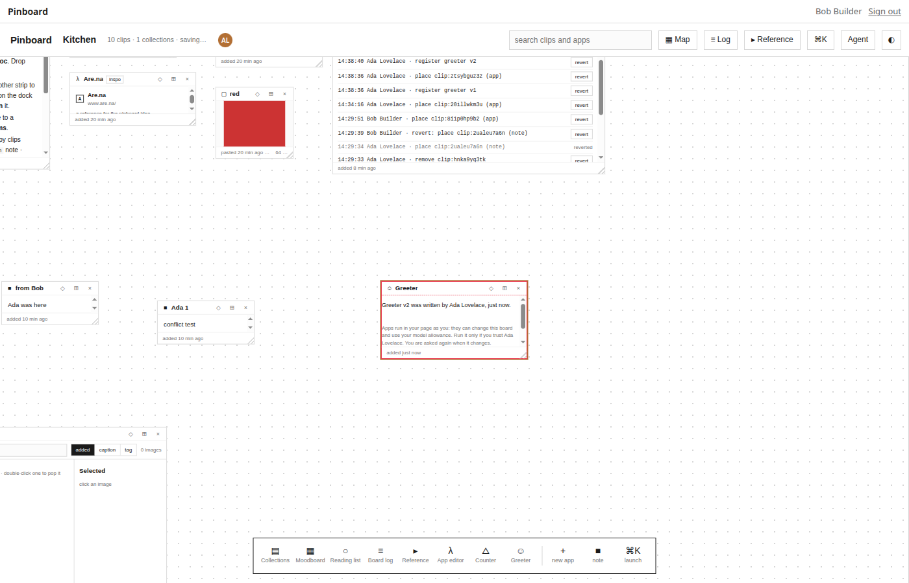

*Figure 7. The trust prompt as built in phase 3, on Bob's screen. Its text still says apps run in the page; phase 6b moved them into frames and changed the text.*

Phase 3 evaluated a trusted app's source with a narrowed scope: the `new Function` parameter `PB` was `undefined`. That stops `PB.x` and `typeof PB`, but not `window.PB`, because code made by `new Function` runs in the page's global scope. The guide had already said so: the narrowed scope prevents accidents, not a determined author.

### 6.4 Step two: every board app in its own sandboxed frame (phase 6b)

Every app that is not built in now runs in an `<iframe sandbox="allow-scripts">`. Without `allow-same-origin`, the frame has an opaque origin: no cookies, no storage, no access to the page's document or globals. Its document is built once from Pinboard's own `style.css`, `steps.js`, `frame.js`, `dsl.js` and `render.js`, inlined into a `srcdoc` under this policy:

```text
default-src 'none'; script-src 'unsafe-inline' 'unsafe-eval'; style-src 'unsafe-inline'; img-src blob: data:
```

`'unsafe-eval'` is needed because the app's source is evaluated with `new Function` inside the frame. The isolation comes from the sandbox and from `default-src 'none'`, which forbids every network request. The grammar and the renderer run unchanged inside the frame. App code is closures over `c`, called by the renderer, so the renderer has to run where the closures live. The frame therefore works on a *copy* of the board, and the page keeps the copy current.

The connection is a `MessageChannel`. When the frame loads, the page posts `init` with one port; after that, the frame talks only to that port, and the page never has to trust a `window` message from an opaque origin. The messages:

| Direction | Message | Meaning |
|---|---|---|
| page → frame | `init {app, clip, S, local, sel, log, me, theme}` | the source, the window, a snapshot of the board |
| page → frame | `sync {S, sel, log, theme, ack}` | a fresh snapshot, at most once per animation frame |
| page → frame | `blob {ref, blob}` | an image's bytes (the frame cannot load the page's URLs) |
| page → frame | `drop {x, y, item}` | a board drag released over this frame |
| frame → page | `meta {def}` | size, params and state the source declares |
| frame → page | `mutate {seq, ops}` | steps of data to apply as the app |
| frame → page | `set {patch}` | this window's own state |
| frame → page | `open`, `toast`, `blob`, `error`, `dropped` | requests and reports |

The snapshot is everything the app may see: clips, records and collections, the apps' names and titles without their sources, and only the board's shared meta. That last point was a review finding (section 9). `PB.S.meta` also holds the viewer's own view document, including agent threads, and the first version sent it to every frame.

The page applies a frame's `mutate` as `PB.mutate(…, 'app:<name>')`. It does so under the viewer's level on the board, and the log shows `app:probe (Ada Lovelace)`. The frame can change the board as the viewer, because the viewer accepted the app, but it cannot reach the viewer's account, model allowance or any other store.

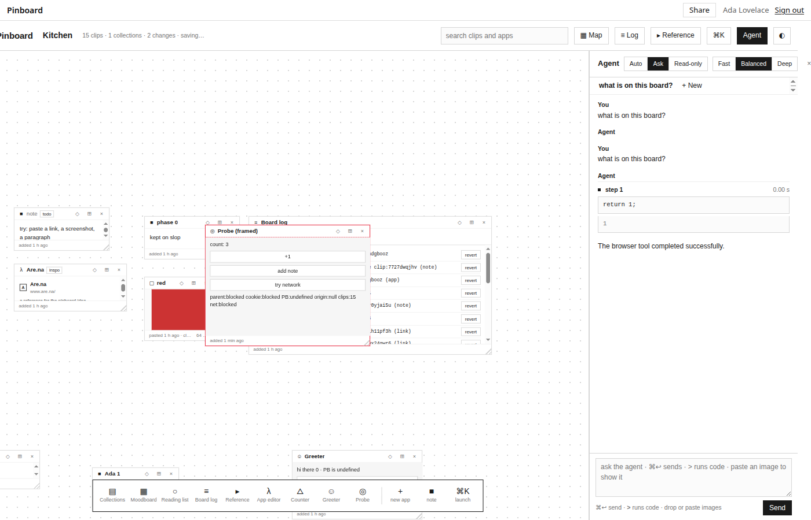

*Figure 8. The test app "Probe" inside its frame: `parent:blocked cookie:blocked PB:undefined origin:null`, and `net:blocked` after "try network". Its "+1" and "add note" buttons changed the board through `mutate`.*

### 6.5 The frame protocol is one table

A frame's own code cannot be trusted: app code runs there and can patch `MessagePort.prototype.postMessage`. The page is the boundary, and it decides what each step may do. The first version had two lists of steps, one in the frame and one in the page, and functions crossed the boundary as `null`. `m.update(coll, id, r => ({n: r.n + 1}))` arrived as a `null` patch, which the core merged as a no-op. A documented API silently did nothing in framed apps.

`js/steps.js` is now the single contract, loaded by both sides. `OPS` lists the 21 steps an app may take, with the kind of each argument (`id`, `str`, `obj`, `point`, `ids`, `patch`, …). `register`, `unregister` and `removeCollection` are not among them. Each step may have a frame-side `record` and a page-side `check`:

- **`record` (frame).** It turns a call into data. A function argument is allowed only where the table says so (`update`'s patch, `promote`'s mapping), and it runs *in the frame* on a copy of the record. `update` then sends `{set, unset}`, the fields to assign and the fields the function deleted. Fresh ids for `place`, `open` and `insert` are made in the frame, so the app gets them back synchronously, as it would in the page.
- **`check` (page).** It refuses an unknown step (by `hasOwnProperty`, so `__proto__` is refused too), a wrong kind, a missing or extra argument, and `place` of `kind: 'app'`. It drops an id that is taken or malformed, strips `id`, `kind` and `app` from `setAttr`, and rebuilds `update`'s function from `{set, unset}` in the page's own code. The page reads at most 500 steps from a batch, and one refused step fails the whole batch.

A differential test (`test/steps.test.js`) applies every operation twice to equal boards. The first path calls `core` directly; the second records the step in the frame, serializes it, checks it in the page and applies it through `core`. The two resulting boards must be equal. Breaking `steps.js` on purpose showed that the test catches the reported bug: ignoring function patches fails three cases.

A second review finding showed that the frame also needs an optimistic copy. Each `c.db` call is its own `mutate`, and the frame's copy changed only when the page's sync arrived. Two consecutive increments both read `n: 0` and both sent `n: 1`. The frame now numbers its batches (`seq`), applies each one to its copy at once, and re-applies the batches the page has not yet acknowledged over every copy the page sends. The page sets `ack` to the highest batch it has handled, applied or refused, and a sync carries it:

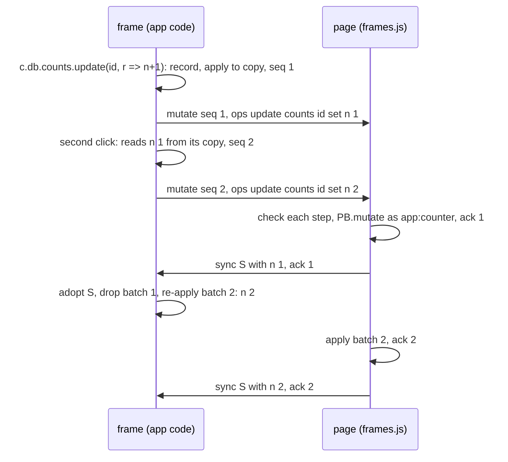

*Figure 9. Optimistic batches: the frame reads its own writes across handlers until the page acknowledges them.*

### 6.6 Who writes app records (the P1 finding)

The most serious review finding was about the trust check itself. `trusted()` read `a.uid` and `a.sha256` from the app record, and the manifest let any board admin write any field of that record. An admin could keep an approved hash while changing the source, or set `uid` to the viewer's id. Either way, the admin's code would run for the viewer without a prompt.

The fix moves authorship to the one party that can authenticate the caller:

1. **No page or client writes under `apps/`.** The rule became `write: self` (section 3.1). `docs.set` applies the same rules as page writes, so the CLI path is closed too.
2. **Registration is an actor action.** `registerApp` requires `admin`. It checks the name (`/^[a-z][a-z0-9_-]{0,59}$/i`) and the source size (160 KiB, because the record and its version document both hold the source). It computes `sha256` itself and stamps `uid` from the authenticated visitor, whatever the caller sent. It writes the record through `commit()`, so the log records "register greeter v2", and writes `apps/<name>/versions/<n>`.
3. **The page hashes what it runs.** `trusted()` and `trust()` hash `a.source`, memoized per source text, and never read `a.sha256`. The `uid` exemption remains, and it is now sound because only the actor writes `uid`.
4. **App changes are not reverted from the log.** That would be a page write under `apps/`. An app goes back by registering an earlier version, whose source the version history keeps.

A later review round found that the version history was not safe either. `unregisterApp` keeps the versions, but registration numbered from the current record, so re-registering a removed app started at 1 and overwrote the history. The next version is now one more than the larger of the record's version and the highest kept version.

The host test `TestPinboardAppRegistration` checks the contract from the outside. Bob (admin) sends `uid` and `sha256` copied from Ada's app with `by: "Ada"`, and the record still names Bob. A direct `docs.set` under `apps/` is refused for the admin and for the owner. With the rule set back to `write: admin`, the test fails at the forged write.

### 6.7 The last evaluation in the page: probe frames (#42)

After phase 6b, one path still evaluated other people's source in the page. The App editor's *Describe IR* button called `evalSource(c.state.src)` with full `PB`, and *Register* evaluated with the narrowed scope to learn the app's name, size and params before calling `registerApp`. The editor's source is shared window state. Someone at `interact`, or a framed app through a `set` step, can stage source in it, and the viewer who presses the button runs it with the page's authority.

`PB.frames.probe(src)` closes this path. It builds a hidden sandboxed frame from the same document as app windows and sends `probe {source, S, me}`. The frame evaluates once, draws nothing, and answers `probed {def, describe, describeError}` or `error`. The page listens only for those two answers, so a source that declares a schema and therefore sends a `mutate` while it is evaluated cannot write to the board through a probe. The page removes the frame after the answer or after 5 seconds. *Describe IR*, *Register*, the agent's app-registering step and first-run seeding all go through it. `evalSource` now throws unless the source is one of the shipped built-in sources, so the invariant is a check rather than a convention.

The trust boundary, as it evolved:

| Stage | Where another person's code runs | What decides consent | Remaining gap |
|---|---|---|---|
| prototype | the page, with `PB` | nothing (one person) | everything |
| phase 3 | the page, `PB` shadowed | `uid` and `sha256` fields of the record | `window.PB`; forgeable fields |
| phase 6b | a sandboxed frame per window | the same fields | forgeable fields; editor evaluates in the page |
| SLOP3-017 F1 | a sandboxed frame per window | `uid` stamped by the actor, hash of the source that runs | editor evaluates in the page |
| #42 | frames only, including probes | as above | a frame can navigate itself (section 11) |

## 7. The two agents

### 7.1 The page agent

The page agent is the prototype's agent, unchanged in structure. It calls the page runtime's `sample` with the conversation and one tool, `eval`. The tool's input is the body of an async function, run in the page with `board, db, ui, app, apps, m, describe, log, fragment, PB` in scope. Each request carries the instructions, the reference text, the last 14 messages, and a YAML description of the board cut at 30,000 characters. Selected image clips go with it, fetched on demand. A step times out after 25 seconds, and its result comes back as YAML cut at 9,000 characters. Three modes govern steps: *Auto* runs each one, *Ask* waits for "Run this step", and *Read-only* makes mutations throw.

This agent runs model-written code in the page on purpose. It is the viewer's own agent, acting with the viewer's level and paying from the viewer's budget, and *Ask* lets the viewer approve every step. Its changes appear in the shared log as `agent (Ada Lovelace)` and can be reverted by anyone under the rule in section 5.3. When a step registers an app, the registration goes through a probe and `registerApp` like any other.

### 7.2 The server agent and tools in actor `sample`

The terminal and MCP need an agent that works without a browser. That required a platform change: actor `sample` accepted no tools. It now accepts `{name, description, inputSchema, execute}`, at most 16, with the same metering as the page.

The difficulty is that a tool needs the store, and the store is reachable only inside a turn. The model backend waits for the tool on its own goroutine, which must not touch the VM. Each tool call therefore becomes a continuation turn of the event that called `sample`:

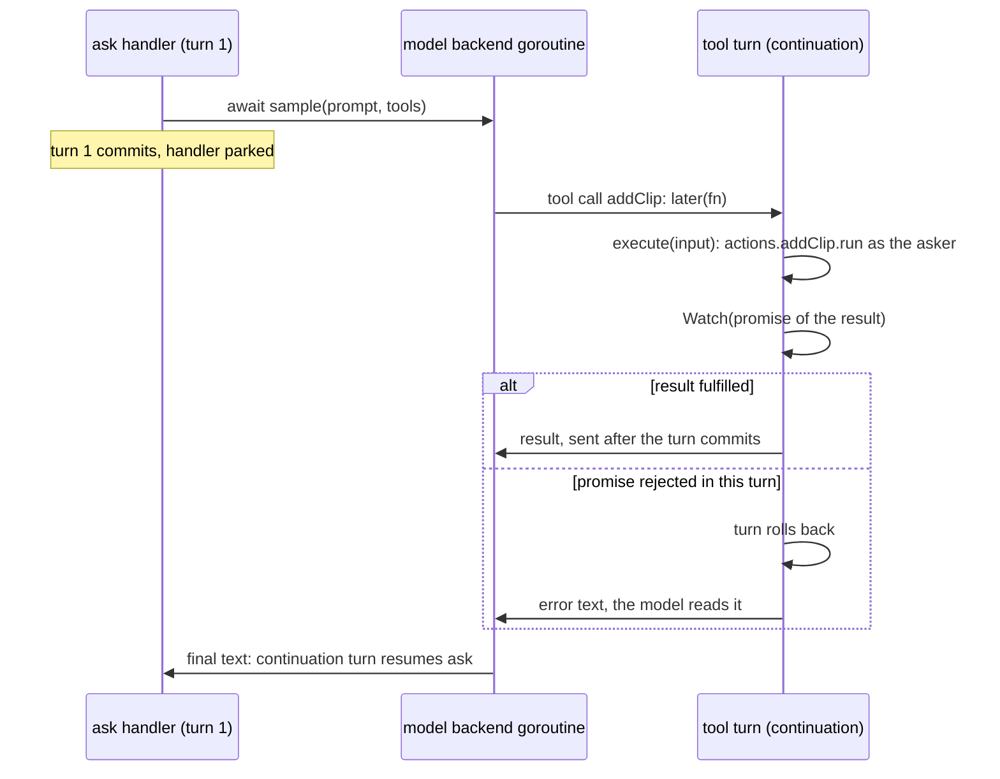

*Figure 10. A tool call is its own transaction. A tool that fails leaves no writes, and the model reads the error.*

Two primitives in `pkg/actor` make this work. `Actor.Later()` returns a function that posts work as a continuation turn of the current event, from any goroutine. `Actor.Watch(p, done)` makes the event wait on a promise besides its handler. After each turn of that event, a watched promise that rejected in that turn rolls the turn back. A fulfilled one reports its value only after the turn commits, so a tool's success is never reported for writes that did not commit. The second primitive came from a review finding. Before it existed, an asynchronous tool that wrote, awaited, wrote again and then threw kept its first write while the model was told the tool had failed.

Pinboard's `ask` action builds its tools from the board's own actions. The five read tools (`describe`, `clips`, `collections`, `query`, `log`) are offered to anyone with `view`, and the five write tools (`addClip`, `tagClip`, `removeClip`, `insert`, `update`) only from `interact` up. Each tool calls `actions[name].run(ctx, {...input, via: 'agent'})`. The core checks the asker's level again for every operation, and the log writes `agent (for <name>)`. The agent is available as `slop pb <board> board ask "…"` and as the MCP tool `pb_board_ask`. It answers `unavailable` until an admin turns on `sample` for the app.

### 7.3 Log pruning

The log grows with every step. An actor alarm runs every six hours. It keeps the newest 500 steps and anything newer than `board/meta.logDays` (30 by default, clamped to 1–365), and deletes older steps, at most 1,000 per run. Undo and revert reach only what is still in the log.

## 8. The board from a terminal and over MCP

### 8.1 Verbs in the app's tree

Requirements R4 and R5 asked for board access from the CLI through JavaScript verbs. The CLI's commands are compiled from the server's verb table, while board operations are app logic that differs per app and changes with each push. The design uses go-go-goja's jsverbs. An app ships plain JavaScript files whose top-level functions carry `__verb__` metadata written as literal values. A scanner finds them without running the code, and each becomes a Glazed command with flags, help and output formats:

```js
// apps/pinboard/verbs/clip.js
function add(url, text, title, tags, note) {
  const b = require("slop").board();
  return b.call("addClip", { url, text, title, tags, note, via: b.via || "cli" });
}
__verb__("add", {
  parents: ["clip"],
  short: "Add a note or a link",
  fields: {
    url: { help: "A link" }, text: { help: "A note's text" }, title: { help: "Title" },
    tags: { type: "stringList", help: "Tags" }, note: { help: "A note about the clip" },
  },
});
```

Pinboard ships ten verbs: `clip add|ls|rm|tag`, `coll ls|query|insert`, and `board describe|log|ask`. Every mutation goes through an actor action, so verbs inherit the core's checks and the log. Each `__verb__` names its `parents` explicitly, because jsverbs would otherwise derive the command path from the file's directory and produce `verbs clip add`.

### 8.2 Discovery and the cache

The manifest's `slop.verbs` names the alias (`pb`), the files (`verbs/*.js`) and the title document. The verb `app.verbs {store, have?}` returns the verb sources of the app a store runs, at the snapshot it runs. It authorizes on the *board* at `view` and reads the matching files from the app store as the platform. The app store is usually private to its author, but every viewer of a board needs its verbs; the host test checks that Carol, a viewer, gets the verbs while her own `files.ls` on the app store answers `not_found`. The CLI caches sources per `app@snapshot` and sends `have`, so an unchanged app costs one small request. The cache directory is keyed by the server's normalized URL (scheme, host, path) plus a hash. A review finding showed that keying by host alone would let two servers on one host share cached code, and the cache holds executable sources.

### 8.3 Running a verb locally

`slop on <store> <group> <verb> …` is always available, and `slop pb <id or title> …` appears once the CLI has seen the alias. A title is resolved over `store.ls`, narrowed to the alias's type, by the `title` field of each board's title document; an ambiguous title lists the ids. The command tree is built from words that cannot contain spaces. Cobra names a command after the first word of its `Use`, so `slop pb 'Kitchen Board' clip ls` used to print help and exit 0. A store name with whitespace is now replaced by the store's id.

The verb runs in a fresh goja runtime in the CLI process. Its `require` registry resolves relative paths among the scanned sources and has exactly one native module, `slop`:

```js
const b = require("slop").board();   // the store this command runs on, and no other
b.id; b.title; b.type; b.app; b.via; // via: cli, mcp or http
await b.call(action, args);          // actor.call on this store
b.me(); b.meta();
b.docs.get(path); b.docs.query(coll, q); b.docs.set(path, data, {ifVersion}); b.docs.update(path, data); b.docs.rm(path);
```

`board(x)` with another store's id or title throws "this command runs on … only". Every member of the board object is a verb call made with the person's token. The verb therefore has no rights the person lacks, and it cannot reach other stores, the file system, processes or the network. A probe confirmed that `require('fs')`, `exec`, `os`, `database` and `child_process` fail with "Invalid module". The CLI's token can call any verb the person may call; the module is what narrows it to one board.

### 8.4 Running a verb on the server, and MCP

An MCP client cannot run JavaScript, so the server runs verbs too. `app.verb {store, verb, values, alias?}` uses the same invoker as the CLI. Only the caller differs: on the server, each module call is a nested call into the verb table as the requesting principal, so every scope, level and store check applies as for a direct call. The JSON values are converted to each field's declared type, choices are checked, and defaults are applied. The run is limited to 4 minutes, raised from 30 seconds when `board ask` began waiting on a model, and console output comes back as logs, capped at 64 KB.

The verb field types needed a restriction. Several Glazed types read files while the arguments are parsed: `file`, `stringFromFile`, `objectFromFile`, and `keyValue` with an `@` value. A verb field declared `{type: "stringFromFile", default: "/home/me/.ssh/id_ed25519"}` would make the CLI read that file when the person ran the verb, and the verb's code could write the contents to the board. On the server, an MCP caller could name a server path. Scanning now refuses any field outside a list of plain types (`string`, `bool`, `int`, `float`, the list types, `choice`, `choiceList`, `date`), in the CLI and on the server alike. The test uses that exact SSH-key default.

`app.tools` lists the tools of the apps the caller's stores run: at most 200 visible stores at `view` or above, each app with an alias at the newest snapshot any of them runs, one tool per verb. A tool is named `<alias>_<group>_<verb>` (`pb_clip_add`). Its input schema is derived from the verb's fields, with `store` added and required. Tools are listed per app, not per store, so a person with 50 boards gets ten Pinboard tools, not 500. `tools/call` routes only names that this list contains. The first version split any unknown name at its first `_`, so `no_such_tool` became a call to app `no`; an existing MCP test caught that.

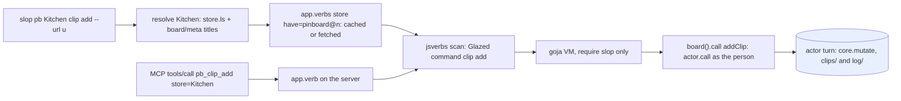

*Figure 11. One verb, two entry points. Both end in an actor action that runs as the person.*

## 9. Review and the defects it found

The work was reviewed by Codex on four pull requests, which were then consolidated into #39, and again on #39 itself. The first pass produced eight findings. SLOP3-017's design traced most of them to four root causes and fixed each cause where it lived:

| Root cause | Findings | Fix |
|---|---|---|
| A security decision read data the other side can write | P1: trust read writable `uid`/`sha256`; the verb cache shared between servers | only the actor writes app records; the page hashes the source; the cache keyed by full URL |
| A boundary without one contract | functions crossed the frame as `null`; a title used as a command word; log size in UTF-16 units; images classified by a byte cache | `steps.js` with a differential test; ids for dispatch, titles for display; `byteLength`; one `isAssetRef` |
| Defaults copied into data when a window opened | old records had no `state` | defaults applied when state is read |
| One promise decided a turn's outcome | an async tool's failure kept its writes | `Actor.Watch` |

Four more review rounds on the consolidated #39 found seven more problems, each in a narrower corner of the same new code:

| Round | Findings | Fixed by |
|---|---|---|
| 1 | P1: the frame snapshot included the viewer's agent threads; P2: no optimistic copy in the frame | `PB.sharedMeta`; `seq`/`ack` batches |
| 2 | P2: a guest's sign-in prompt on `/boards` was overwritten; P2: drags could not reach a dropzone inside a frame | `return` after the prompt; a `drop` message with coordinates scaled by the iframe's `offsetWidth` |
| 3 | P2: `collection` steps missing from the frame's copy; P2: frames did not sync on the page's own mutations | `applyLocal` handles collections; sync on `mutation` |
| 4 | P2: re-registering an app overwrote its kept versions | number from the highest kept version |

The probe-frame fix (#42) came from outside the review. It was found on 2026-11-09 while a separate specification was being drafted (that specification was later withdrawn). Every fix above has a test that fails on the code before it.

## 10. How it was verified, and where it runs

**Node tests** (`node --test apps/pinboard/test/*.test.js`, 40 passing) load the page and frame scripts into a `vm` context with a minimal DOM stub (`test/harness.js`). They cover the core (transactions, rollback, revert with and without conflicts, levels, sha256 against `node:crypto`, ids, log trimming), the step table (differential and refusal cases, optimistic batches), read-time defaults, the frame snapshot, and the probe path.

**Host tests** run a real slop server in process:

| Test | What it checks |
|---|---|
| `TestPinboardApp` | board creation through `/_site/create`; the manifest's rules per level; actor actions per level; `slop.stores` for owners, sharers and strangers |
| `TestPinboardAppRegistration` | forged `uid`/`sha256` ignored; direct `apps/` writes refused; versions after unregistering |
| `TestPinboardVerbs` | `app.verbs` for a viewer of a hidden app store; the CLI path end to end |
| `TestPinboardVerbsRemote` | `app.verb`, refusals with their codes, `app.tools`, MCP listing and calls, `bob (mcp)` in the log |
| `TestPinboardAgentAndPrune` | `ask` off until the policy allows it; the fake model's tool call; log pruning by age |
| `TestActorSampleTools` | a tool's write commits; a throwing tool rolls back; an async tool that fails after an `await` keeps only what committed before it |

**Two-person browser checks** on a local server, with two Playwright contexts, covered every phase: concurrent moves, undo conflicts, presence and following, the trust prompt, framed apps and hostile messages sent from inside a frame, drops into frames at zoom 0.6, and the probe path with a planted hostile source. The screenshots in this report come from those runs.

**Staging.** On 2026-11-09 Pinboard was deployed on slop.yolo from `05961e9`:

```sh
slop store new pinboard && slop push apps/pinboard --store pinboard
slop policy set pinboard sample @member on        # the agents, on each member's own allowance
slop policy set pinboard assets @member on
slop mount set --host apps.slop.yolo.scapegoat.dev --path /pb/:id --storeParam id --type pinboard --createApp pinboard
slop store new pinboard-home && slop push apps/pinboard-home --store pinboard-home
slop grant set pinboard-home @member view
slop mount set --host apps.slop.yolo.scapegoat.dev --path /boards --store pinboard-home
```

`/boards` and `/pb/<id>` answer 200 to a guest, and the CLI smoke board in section 4.3 worked end to end before it was deleted. Only `@admin` has model access on staging, so the agents work for admins until `llm set @member on --budget …` is decided.

## 11. Limits and open questions

- **Last writer wins per document.** Two people typing in one note at the same time overwrite each other at each 300 ms write. A per-field merge or a CRDT was out of scope.
- **Whole snapshots to frames.** Each sync posts the board to every live frame. That is fine for tens of clips; a large board with several framed windows would want diffs.
- **A frame can navigate itself.** `sandbox="allow-scripts"` cannot stop `location = 'https://…?data'`, and CSP has no `navigate-to`. An app could carry its copy of the board out. That is not an escalation, because only board admins register apps and they can read the board already, and the copy holds no `data/users/*`.
- **Framed apps lose some features.** App menus and `agentDescribe` are closures and are not carried over the port. `c.local` lives in the frame and is lost when the frame reloads.
- **Listing costs.** `slop.stores.list` opens up to 200 stores per call to read titles, and every MCP list or call runs `app.tools` over up to 200 stores. A title in the registry row, or a short per-principal cache, would be cheaper.
- **Server-side verbs have no memory bound.** goja has none. A verb can hold a request goroutine for up to 4 minutes; a concurrency cap per principal would bound it.
- **Binary size.** Measured in phase 5, Glazed's CLI glue added about 9.5 MB to the release binary (42.3 MB to 51.8 MB). Most of it comes in through the dependencies of Glazed's sources and table formatter. tree-sitter is not linked, because go-go-goja#107 added a pure-Go scanner.
- **Sharing.** Only the owner sees the Share dialog, it cannot invite a named person, and its links last 30 days. Whether board admins should share is an open decision.
- **Viewers run apps.** A viewer can open apps, and their mutations fail at the level check. Apps that only display are useful to viewers; this was kept, but it was never formally decided.
- **A platform primitive.** The store already records each document's writer. If pages could read it, authorship checks such as the one in section 6.6 would not need an actor action. It was recorded as a separate platform ticket.

## Notes on the implementation record

- **Tickets** (in the repository's `ttmp/2026/11/07/`):
  - SLOP3-016: the intern guide (`design-doc/01-…`), the actor VM migration design (`design-doc/02-…`), and the diary in 14 steps;
  - SLOP3-017: the review-fix design and the diary in 16 steps, including the staging deploy.
- **Pull requests:**
  - #36 (phases 0–4), #37 (phase 5) and #38 (actor VM) were closed into #39, merged on 2026-11-08 (+10,228 lines with docs and the actor runtime work);
  - #40 made the go-go-goja engine the default actor runtime;
  - #42 added probe frames;
  - go-go-golems/go-go-goja#107 added host runtime options, the plain-VM invoke and the pure-Go scanner.
- **Code:**
  - `apps/pinboard/`: about 4,200 lines of app code and 590 lines of node tests;
  - `apps/pinboard-home/`;
  - `pkg/appverbs/`, `pkg/commands/appverbs.go`, `cmd/slop/cmds/appverbs.go`;
  - `pkg/doors/pages/storesrpc.go`;
  - `pkg/doors/actors/sample.go`;
  - `pkg/actor` (`Later`, `Watch`).

## Related notes

- [[PROJECT REPORT - slop v3 - A Store-Based Hosting Service from Design to Deployment - A Technical Deep Dive]]
- [[PROJECT REPORT - slop v3 - One Object Model - Paths Across Stores, Registry Documents and Durable-Object-Shaped Storage - A Technical Deep Dive]]
- [[PROJECT REPORT - slop v3 - Per-App Modules - Safe Database and HTTP Endpoints for Sandboxed Actors - A Technical Deep Dive]]
- [[PROJECT REPORT - slop v3 - The Catalog Apps - Static Views, an MCP Server, a Shelf and a Curator - A Technical Deep Dive]]
