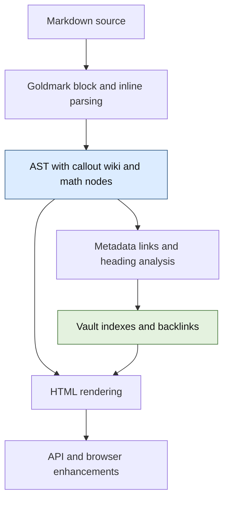

# Publish Vault: A Structural Markdown Rendering Pipeline

A Markdown renderer must preserve more than the text of a document. It must distinguish authored source line endings from explicit visual breaks, recognize extensions without treating code as syntax, connect references to the correct published notes, and produce HTML whose structure remains valid after those decisions. Publish Vault's Markdown migration changed where those decisions are made: callouts, wiki links, mathematical expressions and image references are now interpreted as structured elements, and vault-specific resolution happens while rendering rather than through regular-expression passes over HTML.

The work began with a visible rendering defect. A paragraph wrapped normally at the browser edge, but it also broke at every physical line ending in the Markdown source. A single renderer setting caused that behavior; a callout processor then depended on the exact HTML that setting emitted. Correcting the paragraph behavior exposed a more general architectural dependency between parsing, rendering, and later attempts to recover structure from strings.

> [!summary]
> - Goldmark's abstract syntax tree is the intermediate representation for callouts, wiki links, math and ordinary Markdown.
> - Vault indexing and document rendering are separate stages. Render-time callbacks resolve notes, headings and assets against the current vault state.
> - The vault retains source bytes and compact heading indexes, but reparses and renders one document at a time rather than retaining every AST.
> - The implementation is committed on a development branch; it has not been deployed to the public site as part of this work.

## 1. From source lines to visual lines

Consider a list item authored as two source lines:

```markdown
- A guest that never returns must not stall the host. The runtime bounds each segment with
  an interrupt counter and a per-world budget.
```

Markdown distinguishes the newline in this example from an explicit hard break. The newline is a **soft break**: it separates source lines within one paragraph or list item, but it does not demand a new visual line. A hard break is explicitly written with two trailing spaces or a backslash before the newline. The browser chooses where soft-wrapped text fits in the available width.

The previous Goldmark configuration enabled `html.WithHardWraps()`, converting every soft break to an HTML `<br>`. At a narrow width the browser could also wrap before that element. The result was a sequence of full and unexpectedly short lines. The live HTML confirmed the cause: the list item contained a `<br>` exactly where the source line ended.

The apparent fix was to remove `WithHardWraps()`. That change alone was insufficient. The callout processor examined HTML emitted by Goldmark and used the first `<br>` in a blockquote as the boundary between the callout title and body. Its interpretation of the source therefore depended on a presentation choice made by the HTML renderer. A multiline callout could also produce malformed paragraph markup when the processor split the generated HTML in the wrong place.

This incident identifies a general failure mode: once syntax has been converted to an output string, a later stage must infer meaning from that output's serialization. If it instead consumes a structured document, changing how a paragraph renders does not change how a callout header is identified.

## 2. Parsing, analysis and rendering are different operations

An **abstract syntax tree**, or AST, represents parsed constructs as nodes. A paragraph has inline children; a blockquote has block children; a code span is distinct from ordinary text. The tree is not HTML. It is a representation from which HTML and other analyses can be produced.

For example, this note fragment:

```markdown
> [!note] Read **first**
> See [[Target#Details|the details]] and $x_1$.
```

has a structure equivalent to:

```text
Callout(type=note)
  Title
    Text("Read ")
    Strong(Text("first"))
  Paragraph
    Text("See ")
    WikiLink(target="Target", heading="Details", alias="the details")
    Text(" and ")
    InlineMath(tex="x_1")
```

This is a conceptual representation; the actual node types and source segments are in the Go packages. The important point is ownership. The callout parser identifies the header boundary. The wiki-link node carries the target, heading and alias. The math node carries TeX. Rendering decides how each appears in HTML, while backlink analysis visits the same wiki-link nodes that rendering uses.

The pipeline is:



The tree belongs to a particular source buffer. Goldmark nodes often store positions into the source rather than copies of their text. `internal/parser/document.go` therefore gives each `Document` its own source bytes and AST. Rendering creates a separate renderer configured with resolution callbacks and does not modify the document tree. This matters for repeatability: rendering the same document against one index and then a different index must not preserve the first resolution as hidden state.

The implementation uses Goldmark's extension points rather than introducing a second independent compiler framework. Block parsers, inline parsers, paragraph transformers, AST transformers and node renderers are different kinds of extension because they run at different points in the parse. Their order is part of the contract.

## 3. Callouts: preserve the source boundary before rendering

An Obsidian-style callout begins with a blockquote line such as `> [!note] Title`. Its title ends at the physical end of that line; its body can contain paragraphs, lists, links and nested callouts.

`internal/parser/callout.go` handles that distinction before inline parsing. A paragraph transformer recognizes the marker in the first line of the blockquote and creates a title node for the remaining source segment. Goldmark then parses title content normally, so `**first**` becomes strong emphasis rather than literal asterisks. After parsing, an AST transformer replaces the identified blockquote with a callout node. Its ordinary child nodes remain available to the rest of the renderer.

The transformation is intentionally postorder and separates traversal from mutation. Goldmark's walker advances from one sibling to the next through the current node. Replacing a node during that walk can detach it and erase the pointer needed to visit its next sibling. The implementation first collects candidate blockquotes, then replaces them after the walk; a sibling-callout regression test covers the failure mode.

The resulting HTML retains the existing frontend hooks: `.callout-title`, `.callout-body`, and, for an initially closed callout, `.callout-collapsible`. The `-` marker starts closed; `+` retains the existing open behavior. CSS and the click handler live in `web/src/styles/prose.css` and `web/src/components/organisms/NoteHtml/NoteHtml.tsx` respectively. These selectors are an integration contract between server rendering and the browser, not an implementation detail of the parser alone.

## 4. Wiki links, note identity and headings

A wiki link is not simply a URL written in Markdown. In `[[Target#Heading|Alias]]`, the target identifies a vault note, the heading names a location in that note, and the alias controls visible text. `![[...]]` denotes an embed; an image embed identifies an asset rather than a note. `internal/parser/wikilink_ast.go` stores these fields on the parsed node.

Backlinks are collected from those nodes. Thus a wiki-looking string inside a code span, fenced block or indented code block does not create a body reference. YAML frontmatter remains a separate metadata convention: references there are scanned independently because the frontmatter is metadata rather than rendered Markdown. Image embeds are excluded from note backlinks.

Resolution cannot be completed while parsing one note. A short target such as `[[Target]]` may refer to a note elsewhere in the vault, and that target may be unpublished or absent. `Vault.loadNote` parses eligible files and collects references; the vault then builds canonical and suffix-based indexes and backlinks. Rendering takes a `parser.Resolver` whose note, heading and image callbacks consult those indexes.

Heading fragments require particular care. Goldmark assigns IDs during parsing, and its rules do not necessarily match Publish Vault's note-slug rules. Punctuation and duplicate headings are enough to make a guessed fragment wrong. The new `HeadingIndex` is derived from the parsed heading nodes and their actual assigned IDs. It normalizes heading text for lookup, selects the first duplicate, and accepts an already-assigned exact ID. A cross-note heading lookup first resolves the note and then asks that note's index; a self-heading lookup uses the current document's index.

The short-name index also needed a deterministic rule. Previously a Go map iteration could select different winners for ambiguous suffixes or titles, and aliases could compete with canonical paths. The updated index reserves canonical slugs first and processes candidate aliases in sorted order. A full path is therefore stable; an ambiguous short alias chooses the lexicographically first canonical slug. This deliberately changes the outcome of some formerly nondeterministic links. An author who needs a particular target should use a sufficiently specific path.

## 5. Mathematical expressions as nodes

Markdown processing can change TeX before a browser typesetter sees it: underscores can become emphasis, backslashes can be interpreted as escapes, and ampersands can be encoded. The old pipeline avoided this by replacing math regions with private-use sentinels before parsing and restoring them in the rendered HTML. That approach required later passes to know whether a sentinel represented text content or an HTML attribute; inserting a math element inside an attribute could corrupt the markup.

The new implementation in `internal/parser/math_ast.go` has inline and display math nodes. `scanMathAt` in `internal/parser/math.go` contains the shared delimiter recognition rules; Goldmark controls whether the location is an eligible inline or block context. Inline code and code blocks remain code. The renderer escapes TeX as element text under the `.math` class. The browser reads that text and MathJax performs typesetting; the server does not evaluate TeX.

Display math can span multiple source lines. A block parser recognizes display blocks, while an AST transformation moves display nodes out of ordinary paragraphs. When display math is inside a container where a block `<div>` would be invalid, such as an inline link or table cell, the renderer uses a `<span class="math math-display">`. The frontend determines the MathJax display mode from the class rather than from the tag name.

Delimiter scope is not trivial. An apparent opening `$$` inside a blockquote must not use a closing delimiter from an unrelated later block. A regression test demonstrated that such a mistake could consume a heading as paragraph text. The block lookahead now checks enclosing quote markers and list continuation indentation before accepting a closer. A separate source audit found real multiline quoted equations in the vault, but did not establish that the synthetic cross-container failure occurs in a published document. The audit is lexical and does not prove the absence of all unusual nesting cases.

## 6. Tables are parsed before their inline contents

The order of parsing creates another boundary. Goldmark's table transformer identifies cells before inline wiki-link and math parsers run. A pipe inside `[[Target|Alias]]` or `$a|b$` can therefore be mistaken for a cell separator unless the table stage recognizes that protected syntax. Goldmark also follows the header's column count: extra cells in a malformed body row are discarded.

The real-vault comparison exposed imported notes with one header column and additional body cells. The old math pre-pass had accidentally broken some of those tables into paragraphs; a straightforward AST migration caused Goldmark to discard the extra cells instead. Neither behavior is a good representation of the source.

`internal/parser/table_ast.go` handles the affected cases before the normal GFM table transformer. It preserves pipes inside recognized math and wiki links, expands rows with extra cells, and retains the table-specific escaped-pipe behavior for code spans. Ordinary conforming tables continue through Goldmark's existing extension. This feature has a maintenance cost: its delimiter and cell-boundary assumptions must be reviewed when Goldmark changes. The tests demonstrate the cases that motivated it; they are not a proof that every possible malformed table has a uniquely correct interpretation.

## 7. Asset resolution and the raw-HTML trust boundary

An ordinary Markdown image is a Goldmark image node. Its renderer passes the destination to the vault's image callback, which resolves relative paths against the note directory. A wiki image embed uses the vault's asset index and emits a visible missing-image marker if no asset resolves. A resolver returning an empty ordinary-image destination leaves the original destination unchanged.

Raw HTML requires a separate path. The current application intentionally enables Goldmark's unsafe HTML mode, meaning it trusts vault-authored HTML. The structural renderer tokenizes a raw HTML fragment when it must resolve an `` attribute, changing that attribute without applying a regular expression to the entire rendered page. Other raw token bytes are preserved. This operation is not a sanitizer: a person who can write arbitrary HTML into a published vault can still supply active markup. That trust policy must be reconsidered separately if vault input becomes untrusted.

Dynamic note titles, wiki aliases, headings, asset paths and TeX are escaped for their HTML contexts. Structural nodes reduce the need to inject markup into source strings, but they do not remove the need to review URL policies and raw-HTML trust.

## 8. Rebuilds, source ownership and cost

Vault state changes over time. A note can be added, deleted, hidden with `publish: false`, or gain a heading. A resolved link cannot be permanently embedded into the output of the first parse; other notes may need to resolve differently after the next reload.

The implementation stores a note's source and its compact heading index together. During `rebuildHTML`, it parses and renders one note at a time against the current locked vault indexes. It accumulates the new HTML and publishes the set only after all note renders succeed. A render failure is returned to the caller; it is not a full rollback of note and index changes that already happened before the rebuild. The watcher also removes deleted notes from search when a subsequent HTML rebuild fails.

Keeping all ASTs would avoid reparsing but could retain a large number of tree nodes and source segments. The chosen design trades a second parse for bounded AST retention. One local comparison of the same 2,372-note vault measured 17.439 seconds and 215.4 MiB live heap after garbage collection for an archived baseline, versus 17.964 seconds and 212.1 MiB for the optimized structural implementation. These are single observations, not repeated benchmarks or measurements of peak resident memory. The first structural version took 32.064 seconds because it unnecessarily repeated metadata, reference and excerpt analysis while rebuilding; `ParseForRendering` removed that repeated analysis.

## 9. What was verified

The branch's full `make ci-check` passed after the migration: formatting, backend lint, generated-logger check, Go and plugin tests, gosec, vulnerability analysis, frontend type-check and frontend build. The vulnerability scanner reported zero called vulnerabilities; it separately noted vulnerabilities in imported packages and required modules for which it did not identify calls to vulnerable symbols. The parser, vault and watcher packages also passed the race-enabled test command. An embedded backend binary built and displayed its help successfully.

A local browser smoke fixture exercised a soft-wrapped paragraph, a formatted callout title, a resolved wiki link, a table with an extra cell, and inline/display math. The DOM contained no hard break in the source-wrapped paragraph and MathJax marked both math forms done. The fixture had no favicon, producing two favicon 404s; it was not a test of the public production site.

A real-vault inventory compared 2,372 published notes on the baseline and migration. Aggregate wiki-reference, callout and image counts matched. Differences in backlink assignment exposed nondeterministic ambiguous aliases, which are now deterministic; math count differences prompted examination of raw HTML, code and table behavior. Equal aggregate counts do not prove semantic identity. The diary and the ticket's scripts record the probes, failures and limits.

## 10. Working rules and remaining operational work

- Treat the Markdown source and its AST as one lifetime. Do not retain nodes after discarding their source, and do not silently mutate the source of a stored document.
- Analyze and render the same wiki-link nodes. Do not add a second body scanner that can disagree about code or escapes.
- Resolve cross-note references after indexes exist. Re-render against current state on reload rather than modifying prior HTML in place.
- Preserve ordinary Markdown flow and explicit hard breaks as distinct cases. Test callout, list, table, code and math interactions when changing precedence.
- Keep raw HTML trust explicit. Structural parsing is not sanitization, and URL/attribute escaping remains necessary.
- Deploy and verify separately. The branch and local evidence do not establish that `parc.yolo.scapegoat.dev` runs the new backend.

The implementation lives at `/home/manuel/code/wesen/go-go-golems/publish-vault`, branch `task/markdown-ast-pipeline`. The implementation checkpoint is commit `b4384c3`; the dependency/toolchain security update is `e4e4b47`. Ticket `PV-MARKDOWN-030` contains the original design, the current implementation guide, regression probes and detailed diary. The original design was uploaded to reMarkable before implementation; that copy is not an updated implementation report.
