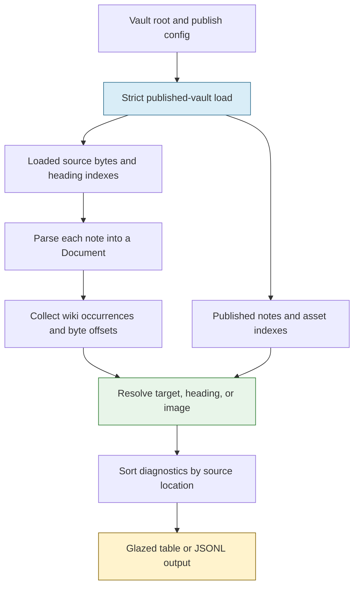

# Publish Vault: Validating Published Wiki References

A link validator for an Obsidian vault has to answer a narrower and more consequential question than whether a matching file exists on disk. Publish Vault serves a selected set of notes, assigns them URL-oriented slugs, resolves short names through an index, and interprets heading fragments using the target document's parsed headings. A note that exists but is excluded from publication cannot satisfy a published link. Conversely, a short wiki target can resolve successfully without resembling the file's full path. A useful diagnostic therefore depends on the same publication and resolution decisions as the renderer.

This report examines a read-only validator built on those decisions. It follows a source occurrence from a Goldmark syntax node through the published vault indexes to a structured diagnostic, explains the source-position and snapshot contracts, and examines what happened when the tool was applied to a real vault. The result is not a complete Markdown conformance checker. It is a small implementation with explicit limits, an initial corpus-triage tool, and an open review question about whether occurrence extraction always matches rendered behavior.

> [!summary]
> - `retro-obsidian-publish validate` checks body wiki-note targets, heading fragments, and wiki-image embeds against a loaded published-vault view.
> - Validation records every parsed wiki occurrence and its source byte offset; the existing backlink list is intentionally not used as a source-location inventory.
> - The command uses the server's indexes and publication policy but opts into stricter load failure behavior, because an incomplete scan must not be reported as a successful one.
> - A local scan produced 813 warnings. Grouping and inspection exposed several distinct causes; the count is not a count of confirmed content defects.
> - The validator is on open [PR #32](https://github.com/go-go-golems/publish-vault/pull/32), not merged or deployed as of this report. A review finding about wiki syntax inside image alt text remains unverified and unresolved.

## 1. Why published-view validation differs from file checking

Consider the source link:

```markdown
[[Roadmap#Release plan|release plan]]
```

It has three different fields. `Roadmap` is a target name, `Release plan` is a requested heading, and `release plan` is the visible alias. A diagnostic should first decide whether `Roadmap` names a published note. If it does, the next question is whether that specific note's heading index can resolve `Release plan`. A note that exists but lacks the heading should produce a different result from a target that does not resolve at all.

The distinction is operational. Publish Vault recognizes `.vault-ignore`, a separate `.publish/config.yaml` blacklist, and the `publish: false` frontmatter flag. These policies combine to determine which notes are available to the site. A validator that walks every `.md` file and matches names independently can say a link is valid because it found a private or excluded file, even though a reader cannot open that target on the public site.

The vault loader also constructs a wiki-link index. This index maps authored names to canonical slugs after applying the application's naming and collision rules. A **slug** is the identity used in a published URL; it is not necessarily the exact spelling of the source filename. Validation therefore calls the existing resolver rather than inventing a new file-matching rule.

This decision follows the earlier [[PROJECT REPORT - Publish Vault - A Structural Markdown Rendering Pipeline|Markdown pipeline migration]]. That work moved wiki links and other constructs into a structured document representation. The validator builds on the same parser, but it asks a different question from rendering: not “what HTML should this note produce?” but “which source occurrences refer to unavailable published objects?”

## 2. From Markdown source to a diagnostic

The implementation on `task/vault-lint` separates parsing, publication state, rule evaluation, and output. The relevant code is in `internal/parser`, `pkg/vault`, `internal/validate`, and `cmd/retro-obsidian-publish/commands/validate`.



The validator resolves the configured root once, including symlinks, and loads either the supplied config path or the default `.publish/config.yaml`. It constructs a vault with that configuration and an opt-in strict-load setting. The load produces the published-note and asset indexes, then the validator iterates over published notes in path order. For each source note it obtains a copy of the source retained by the vault, parses that source, collects wiki occurrences, and applies a small set of checks.

The order matters. An occurrence cannot be checked correctly until the target index and heading indexes exist. A target lookup cannot be replaced by a local filename test because canonical slugs and aliases are established by the loader. The final diagnostic is sorted by source path, line, column, and rule so that repeated runs on the same input produce a stable order.

A simplified control flow captures the current implementation; this is explanatory pseudocode rather than an exported API:

```go
for each published note in path order:
    source = copy of note's loaded source
    document = ParseDocument(source)
    for each document.WikiOccurrences():
        if occurrence is a wiki-image embed:
            check vault.ResolveAssetEmbed(target)
        else:
            slug = current note's slug for a self-link
            if target is nonempty:
                slug = vault.ResolveWikiLink(target)
                if unresolved: report missing target and continue
            if a heading was requested:
                check vault.ResolveHeading(slug, heading)
```

The `continue` is significant. `[[Missing#Plan]]` should not produce one warning for a missing note and a second warning for a heading on a note that could not be found. A self-link such as `[[#Plan]]` is different: its target is the current note, so there is no need to call the note-name resolver.

## 3. Why an occurrence is not a backlink

Before this work, `Note.WikiLinks` already described references used by vault indexing and backlinks. A **backlink** is a reverse relationship: if source note A references target B, B can list A among its incoming links. That relationship needs the target and source identity, but it does not need every repeated spelling in A.

A lint diagnostic needs a different unit of information. If the same broken link appears on two lines, the author needs two locations. A self-heading link must also be checked even though it is not a cross-note backlink. Wiki-image embeds need validation even though they are not note backlinks. The existing reference list is deduplicated and excludes some of these cases; using it for lint would silently omit occurrences.

The new `Document.WikiOccurrences()` method traverses the parsed AST and returns `WikiOccurrence` values. Each occurrence carries a target, heading, alias, embed and image flags, and a source byte offset. `internal/parser/wikilink_ast.go` records the Goldmark reader's position when it recognizes the wiki syntax. The existing `WikiLinks` and backlink behavior remain separate.

The position contract is deliberately modest. The validator builds a list of source line starts and uses the occurrence's byte offset to calculate a one-based line and byte column. A byte column differs from a visual character column when a line contains multibyte UTF-8. The implementation also checks that the source at the stored position starts with the expected wiki delimiter; an unavailable or inconsistent position becomes zero rather than a fabricated source location.

`internal/parser/occurrence_test.go` tests repeated links, a self-heading link, a wiki-image embed, a code span, CRLF input, a blockquote, a list, and a preceding non-ASCII character. The test establishes those specific examples, not every possible Goldmark container. Source positions are a contract that needs regression coverage because a correct diagnostic attached to the wrong line can misdirect a future repair tool.

## 4. Published snapshots, source ownership, and incomplete loads

The server's vault stores source bytes and compact heading indexes with each published note, then reparses one document at a time for rendering. The validator adds `Vault.SnapshotSource(slug)`, which returns a **copy** of a published note's loaded source, and `Vault.ResolveHeading(slug, heading)`, which queries its heading index. The copy prevents a caller from mutating the vault's internal byte slice.

Using the loaded bytes also avoids a specific mismatch. If the validator reread a note from disk after the vault had already indexed it, it could analyze a newer version of the source while resolving links and headings against older indexes. The copied source and the heading index correspond to the same note load.

This is not an atomic filesystem snapshot of the entire vault. The loader visits files over time; concurrent edits during that walk can still produce a mixed view. The command is intended for offline use against a stable checkout. It does not start a watcher or hold a live server snapshot open. `Vault.AllNotes()` returns note pointers rather than a deep copy of the complete vault, so the current implementation depends on not concurrently mutating the loaded vault during validation.

The other distinction is failure policy. The serving path historically logs and skips some filesystem or note-load errors to preserve availability. That is not a safe default for a validator: if an eligible note could not be read, an empty findings list cannot mean it passed. `Vault.WithStrictLoad()` changes the behavior for this caller so relevant walk or note-load errors fail the load. Normal server use does not opt into that behavior. The command also treats a config-load or matcher-compilation error as an operational failure.

Configuration is not incidental. `vault.New(root)` loads `.vault-ignore`, but the `.publish/config.yaml` policy is supplied separately through `vault.WithConfig(cfg)`. `internal/validate/validate.go` loads and passes that configuration before constructing the vault. Reusing the loader without supplying the config would validate a different set of notes from the server.

## 5. The three implemented checks

The first version has three warning rules:

| Rule | Question answered | Boundary |
|---|---|---|
| `WIKI_TARGET_MISSING` | Does a nonempty wiki-note target resolve in the published note index? | A file elsewhere in the private vault does not establish that the published target exists. |
| `WIKI_HEADING_MISSING` | After the note resolves, does its heading index contain the requested fragment? | The current check is a heading lookup, not support for Obsidian block IDs. |
| `WIKI_IMAGE_MISSING` | Does a wiki-image embed resolve through the vault asset index? | This is not a general check for ordinary Markdown image URLs. |

The image distinction follows the renderer's actual APIs. `Vault.ResolveAssetEmbed` returns a path and a boolean for wiki-image embeds. `Vault.ResolveAssetURL`, used for ordinary Markdown images, constructs a URL but does not establish that the file exists. The validator does not treat URL construction as an existence check.

The command also does not fetch external URLs, inspect arbitrary raw HTML, or validate wiki references found only in frontmatter. These are intentional scope boundaries, not cases for which the tool reports success. Raw HTML remains trusted by the publisher; running the validator is not a sanitization step.

There is an important current review concern about the phrase “published-body wiki occurrences.” A reviewer noted that `Document.WikiOccurrences()` walks into a Markdown image's alt-text subtree. The image renderer uses that subtree to construct plain alt text and skips rendering it as an ordinary link. Consequently, a nested wiki node could produce a missing-target warning even though the published page has no corresponding clickable wiki link. This [PR #32 review comment](https://github.com/go-go-golems/publish-vault/pull/32#discussion_r4542950566) was present when this report was written; it has not been independently verified or fixed here. It demonstrates why sharing an AST is necessary but not sufficient: a validation traversal must also follow the renderer's semantic boundaries.

## 6. Command behavior and structured output

The new command is registered in `cmd/retro-obsidian-publish/commands/root.go` and implemented as a Glazed command in `commands/validate/validate.go`:

```bash
retro-obsidian-publish validate --vault ./my-vault
retro-obsidian-publish validate --vault ./my-vault --format jsonl --strict
```

`--vault` falls back to `VAULT_DIR`. `--config` can override the default vault configuration path. The default mode emits warnings but exits successfully when the scan completes. `--strict` returns a nonzero status when warnings exist. Configuration errors or incomplete loads are operational errors and also return nonzero. The error message distinguishes a strict-findings failure from an operational failure; the current program maps both to exit status 1.

A diagnostic row has fields such as `rule`, `severity`, `path`, `line`, `column`, `message`, and `target`. JSONL places one object on each line; it is not a complete result envelope. Consumers must inspect the process status as well as the output. In particular, a partial output stream followed by an operational error is not a clean scan.

One implementation risk is output flushing when strict mode returns an error. `validate_test.go` builds the actual binary and exercises both non-strict and strict JSONL runs. The strict test verifies that the warning row remains parseable on stdout and that the failure message is written on stderr. The same test covers the environment fallback and explicit invalid configuration. These process-level checks matter because a mock rule test cannot establish how the Cobra/Glazed command and its output processor close on an error path.

## 7. What the first corpus run showed

A non-strict local run against the author's vault completed and produced 813 warning occurrences across 91 source notes. The report was written to a private local JSONL file with restrictive permissions. The run is a snapshot of that local corpus, not a measurement of every possible vault or a current live-site audit.

| Initial rule | Warning occurrences |
|---|---:|
| Missing wiki target | 440 |
| Missing heading | 372 |
| Missing wiki image | 1 |
| **Total** | **813** |

Those numbers become useful only after distinguishing causes. The ticket's `scripts/01-group-warnings.py` groups the JSONL rows by rule, heuristic category, and target, retaining every source path, line, and column. It creates its output exclusively with mode 0600 and refuses to overwrite an existing file. Its companion test checks occurrence conservation, ordering, classification, permissions, and overwrite refusal. Neither script publishes the private report.

For that historical scan, grouping yielded 505 groups: 84 occurrences classified as possible shell tests, 51 as block references, 356 other missing-target occurrences, 321 other missing-heading occurrences, and one missing image. The categories are mutually counted by the script, but the shell classification is a heuristic rather than proof of author intent. A warning also does not prove that a source note should be changed: a link to an intentionally unpublished note is unavailable to the published site but can be deliberate.

Two examples show why interpretation matters.

**Shell expressions.** The characters `[[` and `]]` are also used by shell conditional syntax. In one transcript, shell commands appear in a blockquote without a Markdown code fence. The parser can interpret expressions such as `[[ -x ... ]]` as wiki-link-shaped content. Fencing the actual script block is a possible content correction, but the extent of the intended block must be reviewed before editing. Automatically rewriting every warning would risk changing the source's meaning.

**Block references.** Obsidian can refer to a block with syntax such as `[[Source Library#^ref-example|label]]`. The target note may contain `^ref-example` on a paragraph, but the current validator checks the heading index. A `#^` warning therefore describes a capability mismatch, not necessarily a missing source block. Correct end-to-end support would require indexing block IDs, rendering stable block anchors, resolving those IDs, and teaching the validator to use that same resolution. Relabeling the warning alone would not add that support.

A later heuristic inspection of the grouped report also found 314 heading-warning occurrences in four source files for which a same-directory `Index of Design Patterns.md` contained an exactly matching Markdown heading. That is a **candidate set**, not 314 verified safe edits: publication eligibility, the actual resolved note, source intent, and each proposed replacement still need confirmation. It illustrates the value of grouping repeated failures, not a license for blind replacement.

## 8. Validation evidence and implementation history

The work started with ticket `PV-LINT-031` and a design guide. Its central decision was to build a narrow read-only command rather than a plugin system, a second parser, or an automatic fixer. The implementation added parser occurrences, vault accessors, strict loading, the rule engine, CLI tests, and a small report-grouping script.

The implementation diary records two useful failures. The first commit attempt was rejected by `glazed-lint` because the new CLI used `os.Getenv`; it was changed to the existing `serve` command's `os.LookupEnv` convention. Later, the initial `make ci-check` stopped at `logcopter-check` because generated logger files for the new packages were absent. Running the project generation target and then rerunning the gate resolved that failure.

The recorded evidence includes a successful `make ci-check` after logger generation, targeted race tests for parser, validator, vault and CLI packages, and real-binary tests for JSONL and strict behavior. Pre-push checks passed when the branch was published. The grouping script's test passed separately. The full project gate predates the later addition of the grouping scripts; the pre-push checks and script test are the relevant later evidence. These checks do not prove every warning is correct, nor do they resolve the open image-alt review finding.

## 9. Current limits and next work

The immediate operational priority is to make diagnostic meaning precise before using `--strict` as a publishing gate. The report already shows that missing targets, unsupported block references, shell-like source, ambiguous short names, and genuine stale links can appear in the same warning stream. Grouping helps a human investigate them, but it does not decide which interpretation is correct.

A practical next iteration would:

1. Resolve the image-alt traversal review finding with a renderer-consistent test.
2. Classify or implement block references separately from headings.
3. Group repeated targets and show candidate published notes or headings, preserving ambiguity.
4. Offer a reviewable patch only after an explicit choice, with a source-content check before applying it; do not automatically alter the vault.
5. Review a small sample of each warning category with the vault owner before making strict mode a CI requirement.

The command's present strength is that it grounds diagnostics in the same published indexes as the site and preserves actionable source occurrences. Its principal limitation is equally important: the correctness of a diagnostic depends on matching the renderer's interpretation of syntax and on the specific classes of references the validator knows how to inspect. A read-only warning is evidence for investigation, not an instruction to rewrite a note.

## References

- Source repository: `/home/manuel/code/wesen/go-go-golems/publish-vault`, branch `task/vault-lint`, inspected at `d17fe46a67865ff0ec73ff27452bf5376cefe9c6`.
- Pull request: [go-go-golems/publish-vault #32](https://github.com/go-go-golems/publish-vault/pull/32), open at the time of writing.
- Design and implementation diary: `ttmp/2026/11/11/PV-LINT-031--pragmatic-vault-validation-and-lint-tool/` in the source repository.
- Parser and resolution: `internal/parser/document.go`, `internal/parser/wikilink_ast.go`, `pkg/vault/vault.go`.
- Rule engine and CLI: `internal/validate/validate.go`, `internal/validate/validate_test.go`, `cmd/retro-obsidian-publish/commands/validate/`.
- Grouping and tests: ticket `scripts/01-group-warnings.py` and `scripts/02-test-group-warnings.py`.
- Related context: [[PROJECT REPORT - Publish Vault - A Structural Markdown Rendering Pipeline]].
