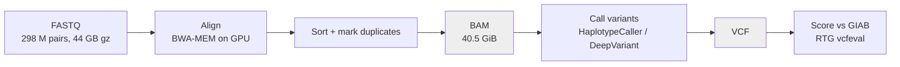
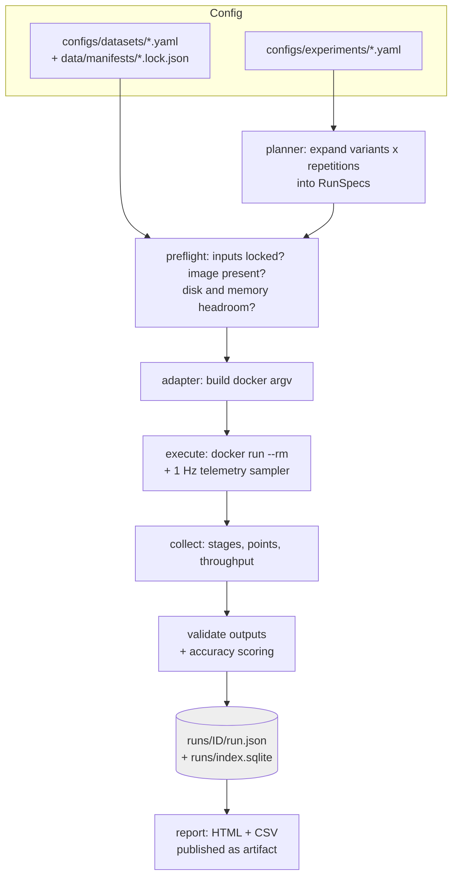
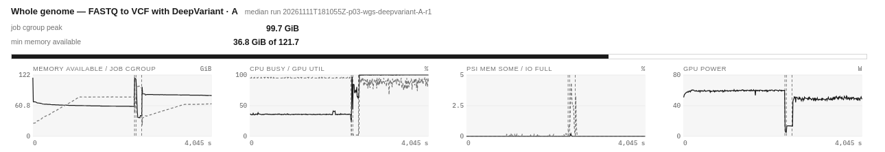
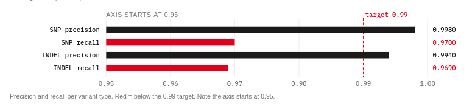
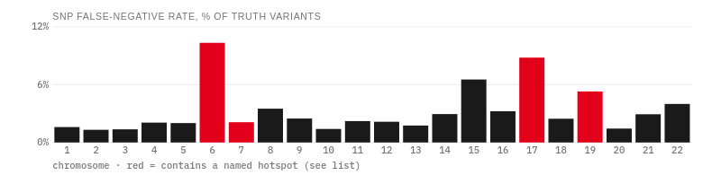
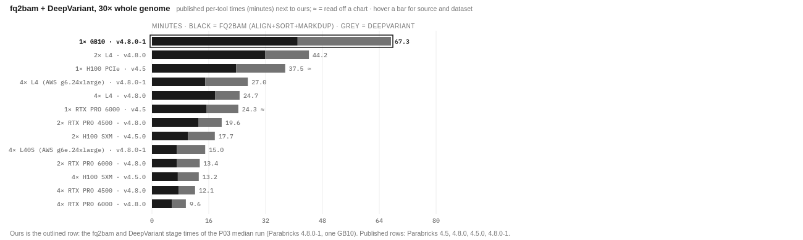
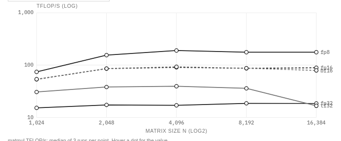
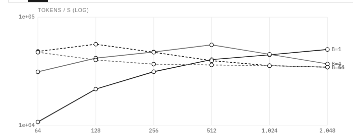

# SparkBricks: Benchmarking Genomics and Biological Models on a DGX Spark

SparkBricks measures what one NVIDIA DGX Spark can do for genomics and for large biological models: which workloads run at all, how fast they run, and whether the answers are still correct. The machine is `bling`, a GB10 desktop with one Blackwell-class GPU, 20 Arm cores and 128 GB of memory that the CPU and the GPU share (see [[PROJ - Bling - Bringing a DGX Spark onto Tailscale]]). The software under test is NVIDIA Parabricks 4.8.0-1 for genomics, and NGC PyTorch containers for protein and DNA language models. This report covers the first day of the project (2026-11-11). On that day a benchmark framework called `sparkbench` was designed and built, about 60 runs were executed, the whole-genome result was traced to a reference-genome problem, and the results were placed next to every published Parabricks number found.

> [!summary]
> - **One machine, one genome, about an hour.** A 30× human genome (HG002, 298 million read pairs) goes from raw reads to a validated variant call set in 67.5 minutes. Memory peaks at 99.7 GiB, which leaves 36.8 GiB free, and nothing swaps. That is roughly 20 genomes a day.
> - **About half of one H100.** Nobody has published Parabricks timings for the Spark. Next to the published numbers, it runs alignment plus DeepVariant at about 1/1.8 the speed of one H100 PCIe, and 1.5× slower than two L4s on the same Parabricks version.
> - **The reference genome mattered more than any tool option.** Precision was on target (0.998) but recall was 0.970, not about 0.99. The misses cluster in MHC and a few other regions, where the reference shipped with the sample data spreads reads across 786 extra ALT and HLA contigs at mapping quality 0.
> - **Measurement hygiene is most of the work.** Every run is validated, telemetered and recorded. The framework's own bookkeeping caught contaminated runs, a false "busy host" signal and its own parser bugs.

## 1. The question and the machine

SparkBricks asks three questions, each with a defined form of answer.

| Question | Form of the answer |
|---|---|
| What can it run? | A capability matrix: for each workload and data size, did the run produce validated output, or which resource ran out first? |
| How fast? | Median wall-clock time of repeated runs, throughput (read pairs/s, tokens/s), and resource curves for CPU, GPU, memory pressure and disk. |
| How accurate? | Precision, recall and F1 for SNPs and indels against a published truth set. For model workloads: agreement between reduced precision and fp32. |

The machine shapes all three answers. `bling` reports 20 Arm cores, 121.7 GiB of usable memory, 16 GiB of swap, a 3.7 TB NVMe disk and the GB10 GPU on driver 580.178.04. The important property is **unified memory**: the GPU has no separate memory of its own. A CUDA allocation is taken from the same physical pool as the Linux page cache and every process on the machine. Three consequences follow, and the framework had to account for each of them:

- `nvidia-smi` reports `memory.total` and `memory.used` as `[N/A]`. The per-process figure from `--query-compute-apps` is still available.
- The Linux control group (cgroup) of a container does not appear to be charged for GPU allocations. The first smoke run had a cgroup peak of 33.7 GiB, while system-wide `MemAvailable` fell by about 50 GiB. That attribution is inferred, not proven, so the framework records both numbers. The one that answers "how close was the machine to its limit" is the minimum `MemAvailable` during the run.
- A runaway GPU allocation can push the host into the kernel's OOM killer, which kills the whole process and loses every result not yet written. Section 7.3 explains how the model workloads turn this into a recorded per-point failure instead.

## 2. A short genomics primer

The genomics benchmarks measure one standard pipeline. Its terms are used throughout the report, so they are defined here in pipeline order.

A sequencer produces **reads**: short fragments of DNA, here 151 bases each, read from both ends of a fragment (a **read pair**). The reads arrive as gzipped **FASTQ** text files. **Coverage** is how many reads overlap an average position of the genome; 30× is the common standard for a human whole genome (WGS) and needs about 300 million pairs.

**Alignment** places each read on the **reference genome** (GRCh38). Parabricks runs BWA-MEM, the standard aligner, on the GPU. The aligner also assigns each read a **mapping quality** (MAPQ). MAPQ 0 means the read fits several places equally well, and variant callers ignore such reads. The aligned reads are sorted by position, PCR duplicates are flagged (**duplicate marking**), and the result is written as a **BAM** file. The Parabricks tool that does all of this is `fq2bam`.

**Variant calling** decides, position by position, where this genome differs from the reference, and writes the result as a **VCF** file. Two callers are compared. **HaplotypeCaller** (from GATK) re-assembles local haplotypes and scores reads with a pair hidden Markov model. **DeepVariant** (from Google) turns read pileups into images and classifies them with a convolutional network. Parabricks runs both on the GPU.

**Accuracy** is measured against **GIAB HG002**, a reference sample from the Genome in a Bottle consortium. GIAB publishes a curated truth set of variants and a BED file of **confident regions** where that truth is reliable. Comparing a call set to the truth inside those regions yields true positives (TP), false positives (FP) and false negatives (FN). From those:

```text
precision = TP / (TP + FP)        share of calls that are correct
recall    = TP / (TP + FN)        share of true variants that were found
F1        = 2·P·R / (P + R)
```

SNPs (single-base changes) and **indels** (small insertions and deletions) are scored separately, because indels are much harder to call.



The projects are defined by which span of this pipeline they time. P01 times FASTQ → BAM, P02 times BAM → scored VCF, and P03 times the whole chain end to end.

## 3. The measurement system: `sparkbench`

The design rule, taken from the original proposal, is **one framework, many experiments**. A shell script per benchmark would time, log and validate in its own way, and the numbers could not be compared. `sparkbench` is one Python runner (`src/sparkbench/`). Every experiment goes through the same configuration loader, execution wrapper, telemetry sampler, validator and results store. Experiments differ only in a YAML file and a small **adapter** that knows how to build one tool's command line.

The second rule is that **a run is not successful because the process exited with status 0**. A run succeeds only if its outputs pass validation. A BAM must exist, be coordinate-sorted and indexed, and contain exactly twice as many primary reads as the input had pairs. A VCF must parse and contain records. If the experiment asks for accuracy, scoring must complete. A run that exits 0 and writes a truncated BAM is a failure, with the failed check recorded.

### 3.1 Architecture



An experiment file states everything needed to reproduce the run. This is the whole-genome experiment:

```yaml
id: p03-wgs-deepvariant
project: p03
dataset: hg002-30x
adapter: parabricks.deepvariant_germline
image: nvcr.io/nvidia/clara/clara-parabricks:4.8.0-1
reference: grch38-pb-sample
resources: {min_free_disk_gib: 300, min_available_mem_gib: 60}
repetitions: {warmup: 0, measured: 1}
timeout_minutes: 360
keep_outputs: true
variants:
  A: {note: defaults, read_group_sm: HG002}
validate:
  bam: {expect_pairs_from_input: true}
accuracy: {truth: giab-hg002-v4.2.1-grch38}
```

The planner expands each variant into one optional warmup run plus N measured runs. Each run gets an ID such as `20261111T181055Z-p03-wgs-deepvariant-A-r1` (batch timestamp, experiment, variant, repetition) and runs in a container named `sb-<run_id>`. Images are referenced by digest, never by tag. The data directory is mounted read-only, and outputs go to a per-run directory owned by the calling user.

### 3.2 Datasets are locked inputs

Every input file is described in a hand-written manifest and hashed into a machine-owned lock file (`data/manifests/<id>.lock.json`). Before every run, preflight re-checks that each locked file still has the size and modification time it had when hashed, which costs nothing. `sparkbench datasets verify` recomputes the full hashes. Outputs can become datasets: the P03 BAM was registered as `hg002-30x-bam` with `datasets register-output`, which hard-links the file, records the producing run ID and image digest, and verifies it. P02 then reads that BAM by dataset ID, so the provenance of every caller benchmark goes back to a specific alignment run.

Model weights for the biological models use the same mechanism. Each weight file is listed with its Hugging Face URL pinned to a commit hash, and with the sha256 that Hugging Face publishes for large files. A model's `main` branch can change; a commit hash cannot.

### 3.3 Telemetry, and what each number means

A sampler thread records one row per second into `telemetry.csv`. Each row holds `/proc/meminfo`, `vmstat` swap counters, pressure-stall information (PSI) for memory, I/O and CPU, CPU busy percentage, disk read and write bytes, the container's cgroup memory (`memory.current`, `memory.peak`, `memory.events` OOM count), and GPU utilisation, power, clock and temperature from a long-lived `nvidia-smi -lms` process. Two details took debugging:

- The container runs with `--rm`, so its cgroup directory disappears the moment the process exits. The sampler therefore keeps the last values it read; the final reading would otherwise be lost.
- Container and host share the kernel's monotonic clock. Workload scripts stamp every event with `time.monotonic()`, so events written inside the container line up with host telemetry rows without any clock conversion.

At the end of a run the rows are summarised into the run record: peak cgroup memory, minimum `MemAvailable`, maximum PSI values, swap activity, mean CPU and GPU utilisation, GPU power and disk totals.

### 3.4 Failure classes

When a run fails, the runner assigns exactly one failure class. The first matching rule wins:

```python
def classify(code, stderr_tail, oom_kill, timed_out, interrupted):
    if interrupted:                          return "interrupted"
    if timed_out:                            return "timeout"
    if oom_kill > 0 or code == 137:          return "resource:memory"     # kernel OOM kill wins
    if "cuda out of memory" in stderr_tail:  return "resource:gpu-oom"
    if "no space left on device" in ...:     return "resource:disk"
    if "exec format error" in ...:           return "compat"
    return "tool:error"
```

The order matters. Exit code 137 means the process received SIGKILL. Without a timeout, that is almost always the kernel OOM killer, and the cgroup may already be gone, so `oom_kill` can be unknown even for a real OOM. A CUDA out-of-memory message in the log must not override a kernel kill, because the kernel kill is the more fundamental limit. Validation failures, and failures before the run starts (`preflight:disk`, `preflight:input`), have their own classes. A run stopped on purpose is recorded as `interrupted` and shown as STOPPED in the report, not as a failure.

### 3.5 The report

`sparkbench report` renders one static HTML page from the SQLite index, the run records and the telemetry files. A variant without the document skeleton is published as a claude.ai artifact for sharing. Charts are inline SVG generated in Python. The page has seven views:
- **Overview:** the three questions with goal, status and answer, plus a pipeline diagram and the roadmap.
- **Experiments:** one card per benchmark.
- **vs. datacenter:** the comparison with published results.
- **Accuracy, Resources, Runs, Glossary.**

Every number comes from the run store. The explanatory prose lives in a separate hand-written file (`configs/report/narrative.yaml`) and is dated. Each card says what the experiment does, what data it uses, the run mode, what was expected and how it fits the larger plan. It ends with an "expected vs. observed" table in which every row is marked as expected, worth noting, open question, surprise or missed.

## 4. P01: the alignment option matrix

P01 asks how fast the Spark turns raw reads into an analysis-ready BAM, and which `fq2bam` options matter on this machine. It uses the Parabricks sample bundle: 26.7 million read pairs, 6.1 Gbases, about 2× of a human genome, small enough that each run takes under two minutes. Each variant ran once as a warmup and three times measured.

| Variant | What it tests | Median | Notes |
|---|---|---|---|
| A | defaults: align + sort + mark duplicates | 103.1 s | 258,596 pairs/s, CV 0.1 %, cgroup peak 33.8 GiB, BAM 4.53 GiB |
| B | `--align-only` | 81.1 s | unsorted BAM 6.24 GiB, peak 19.5 GiB |
| C | `--no-markdups` | 103.0 s | no saving |
| D | BQSR table from known indels | 111.1 s | +8 s |
| E.1 / E.2 | BWA host threads 8 / 20 | 103.4 / 103.3 s | no effect |
| F1 | `--gpusort` | 103.4 s | no effect |
| F2 / F3 | `--gpuwrite` (± gpusort) | 114.9 / 114.6 s | BAM 5.31 GiB; runs contaminated, see below |

The stage times printed by Parabricks itself explain the pattern. Of the 103 s, 80 s is "GPU-PBBWA mem, Sorting Phase-I", during which the GPU is 95 % busy and the CPU about 36 %. The tool is limited by GPU alignment, so changing the number of host threads (E) or moving the sort to the GPU (F1) cannot help. `--no-markdups` saves nothing because the post-sort pass that would mark duplicates runs anyway. `--align-only` skips that pass and the second sort phase, and saves 22 s.

F1–F3 can't be interpreted. While they ran, a 44 GB download and its hash verification ran on the same machine. The download script already flushed each chunk and dropped it from the page cache so the benchmark's inputs stayed cached. That prevented one problem (cache eviction) but not the other (disk and CPU contention): the per-chunk `fdatasync` competes with the benchmark's own writes. All nine affected runs are annotated, and the report shows the annotation next to their numbers. The NVIDIA 4.6 release notes later turned out to say that `--gpuwrite` "is not recommended for use on DGX Spark as it may fail", so F2/F3 matter less than they first seemed.

## 5. P03: one whole genome, end to end

P03 is the headline question: can one Spark take a 30× human genome from raw reads to a validated call set, and how long does it take? The input is HG002 Illumina 2×151 bp at 30× from Google's public DeepVariant data: 298,008,882 read pairs, 89,998,682,364 bases, 44 GB of gzipped FASTQ (md5 checked against the source). The tool is `pbrun deepvariant_germline`, which runs `fq2bam` and DeepVariant in one container. The reference is the GRCh38 shipped in the Parabricks sample bundle.

### 5.1 Time and resources

| Stage (from the Parabricks log) | Seconds |
|---|---|
| GPU-PBBWA mem + Sorting Phase-I | 2,300 |
| Sorting Phase-II | 35 |
| Marking Duplicates, BQSR | 127 |
| DeepVariant | 1,578 |
| **Container wall clock** | **4,051.7 (67.5 min)** |


*P03 telemetry. Left to right: memory available (solid) and job cgroup (dashed); CPU busy (solid) and GPU utilisation (dashed); memory and I/O pressure; GPU power. Dashed verticals mark stage boundaries.*

The telemetry splits the run into three phases with different bottlenecks:

| Phase | CPU | GPU util | GPU power | Disk read / write | Memory |
|---|---|---|---|---|---|
| align + sort I (38 min) | 36 % | 95 % | 59 W | 15 / 40 MB/s | cgroup up to 78 GiB |
| sort II + mark duplicates (3 min) | 71 % | 3 % | 12 W | 605 / 366 MB/s | cgroup 99.6 GiB, MemAvailable down to 36.8 GiB |
| DeepVariant (26 min) | 100 % | 88 % | 49 W | 16 / 1 MB/s | 64.5 GiB |

Three observations are worth keeping. Alignment is GPU-bound: the input reads come from page cache at 15 MB/s, and I/O pressure is near zero. An earlier guess during the run, that gzip decompression was starving the GPU, was wrong, and the telemetry shows why. The memory peak is the short sort-and-mark phase, not alignment; on a 128 GB unified-memory machine that is the phase to watch at deeper coverage. DeepVariant keeps both processors busy: it builds pileup examples on all 20 CPU cores while the GPU runs inference.

The output validated: 598,902,836 BAM records, of which 596,017,764 are primary, exactly 2 × 298,008,882. Mapping rate was 99.73 % and the duplicate rate 7.89 %. The VCF has 7,844,530 records.

### 5.2 Accuracy, and a recall gap



| Type | TP | FP | FN | Precision | Recall | F1 |
|---|---|---|---|---|---|---|
| SNP | 3,265,191 | 7,421 | 101,183 | 0.9977 | 0.9699 | 0.9836 |
| INDEL | 509,279 | 3,181 | 16,190 | 0.9938 | 0.9692 | 0.9813 |

Precision is where published DeepVariant results put it. Recall is two to three points lower than expected. A recall gap of that size is systematic, so the next step was to find where the misses were, rather than to rerun anything. vcfeval writes the missed variants to `fn.vcf.gz`. Counting them per chromosome and per 1-Mb window gives a clear picture:



Chromosome 6 misses 10 % of its truth SNPs, against 1–2 % on most chromosomes. Within chr6, the 1-Mb windows from 29 to 33 Mb contain 19,400 of the 101,183 missed SNPs. That is the MHC, the region holding the HLA immune genes. The next densest windows are chr17:45 Mb (the MAPT/KANSL1 inversion region) and chr19:54 Mb (the KIR/LILR cluster). Two facts point to the cause. First, 35,238 of the missed SNPs are homozygous in the truth (genotype 1/1); DeepVariant does not miss homozygous variants in unique sequence that has usable reads. Second, the reads themselves are missing. Counting primary reads per megabase in the BAM gives:

```text
region                  primary reads   fraction MAPQ 0
chr6:31-32 Mb (MHC)          32,962          0.795
chr17:45-46 Mb              113,687          0.355
chr20:30-31 Mb              194,423          0.057
chr20:50-51 Mb              221,700          0.001
```

The MHC megabase receives about a sixth of the reads of an ordinary megabase, and 80 % of those are at MAPQ 0. The BAM header shows the reason: the reference has 3,366 contigs, including 261 `_alt` contigs, 525 `HLA-*` contigs and 2,385 decoys. These are alternative copies of variable regions. An aligner that is not alt-aware treats an ALT copy as just another place a read can go, so reads from MHC either land on HLA contigs or split evenly between the primary and the ALT copy and get MAPQ 0. Parabricks' `fq2bam` help has no alt-aware option. GIAB and Google's published DeepVariant numbers use the GRCh38 **no-alt analysis set**, which has 195 contigs and no ALT or HLA sequences.

The four named regions account for 25.3 % of the missed SNPs while spanning well under 1 % of the genome. That explains a quarter of the gap directly. The rest is spread across many smaller ALT-covered loci, which is consistent with the same mechanism but has not been proven. The proving experiment is a rerun on the no-alt reference. Its inputs are ready: the NCBI no-alt FASTA and prebuilt BWA index were downloaded and md5-checked, and the dataset is locked. It ran for 19 minutes before it was deliberately stopped to reprioritise, and it is queued for the end of the plan. Those 19 minutes answered a separate question, below.

### 5.3 An open question: alignment speed per base

Alignment in P03 ran at 2.35 Gbases per GPU-minute, about half the 4.6 measured in P01 on the sample data. The GPU was not throttling: the SM clock held at 2,373–2,392 MHz and 73–77 °C for the whole 38-minute phase. The partial no-alt run aligned at the same 2.35 Gbases/min, so the extra decoy and ALT contigs are not the cause either. The remaining candidates are read length (151 bp against about 115 bp mean in the sample data) and the genome content itself. Running fq2bam on a 26-million-pair HG002 subset would separate them.

## 6. P02: two callers on chromosome 20

P02 compares the two callers on exactly the same reads: chromosome 20 of the registered P03 BAM, scored against GIAB truth restricted to chr20. Each caller ran one warmup and three measured runs.

| Caller | Median | Peak memory | SNP P / R / F1 | INDEL P / R / F1 | FP (all) |
|---|---|---|---|---|---|
| HaplotypeCaller | 58.3 s | 12.6 GiB | 0.992 / 0.984 / 0.988 | 0.988 / 0.978 / 0.983 | 729 |
| DeepVariant | 60.0 s | 17.1 GiB | 0.998 / 0.986 / 0.992 | 0.994 / 0.981 / 0.987 | 157 |

DeepVariant makes 4.6 times fewer false positives for 2 % more time. Both callers are deterministic: the three measured runs of each produced identical TP, FP and FN counts. DeepVariant misses 1,034 chr20 SNPs here, exactly as many as in the chr20 slice of the whole-genome run. That cross-checks the region-restricted scoring and confirms the calls do not depend on how the run is split. Both callers' recall is about a point low, which is consistent with section 5.2: the BAM inherits the reference problem, and chr20:30–31 Mb already has 5.7 % of its reads at MAPQ 0.

## 7. The Spark next to published datacenter GPUs

No one has published Parabricks timings for the DGX Spark or the GB10. A research pass collected 37 published results from 25 sources: NVIDIA's documentation and release notes, NVIDIA blogs, cloud-vendor posts and peer-reviewed papers. GB10 appears there only as "supported/tested" (since 4.7.0-1) and in known-issue notes. The comparable numbers are per-tool times for `fq2bam` (align, sort, mark duplicates) and DeepVariant on a 30× genome. Our row is the sum of the corresponding stages of the P03 run: 41.0 + 26.3 = 67.3 minutes.



| Platform | Parabricks | fq2bam + DV (min) | Spark takes |
|---|---|---|---|
| 1× H100 PCIe | 4.5 (read from chart) | ≈37.5 | 1.8× as long |
| 1× RTX PRO 6000 | 4.5 (read from chart) | ≈24.3 | 2.8× |
| 2× L4 | 4.8.0 | 44.2 | 1.5× |
| 4× L4 | 4.8.0 | 24.7 | 2.7× |
| 2× H100 SXM | 4.5.0 | 17.7 | 3.8× |
| 8× H100, same HG002 pipeline, end to end | 4.2 | 14 | 4.8× |

The comparison is approximate, and the report says so next to the chart. The only single-GPU datacenter values come from one figure in NVIDIA's Parabricks 4.5 blog, where only the speedup labels are printed; the bar heights were read by eye to about ±0.5 minutes. NVIDIA's 4.8.0 table, the same version as ours, uses 2 and 4 GPUs, each with a large x86 host, and scaling from 2 to 4 GPUs is sublinear, so a 1-GPU estimate cannot be obtained by doubling a 2-GPU time. Published tables also time each tool separately from a ready BAM, and name the dataset only as "30× WGS Illumina".

Within those limits the picture is consistent. Per GPU, the Spark runs this pipeline at about half the speed of an H100 PCIe. DeepVariant is relatively weaker than alignment (ratios 1.9–2.1 against 1.3–1.7), which matches the telemetry: DeepVariant keeps all 20 Arm cores at 100 %, while NVIDIA asks for at least 24 CPU threads per two GPUs. The only published truth-set accuracy for a Parabricks 4.8.0 DeepVariant run (AWS, HG002 on DNBSEQ data) has SNP precision 0.998, identical to ours, and recall 0.987 against our 0.970. That fits the reference explanation from section 5.2.

## 8. Large biological models

The second half of the project asks a question for which the Spark's unified memory is the distinguishing feature: which protein and DNA language models fit, how fast they run, and whether reduced precision changes their outputs. A model that needs 60 GB of weights cannot load on a 24–48 GB GPU card at all, but it can on the Spark.

### 8.1 What exists on Arm

The first step was checking which containers exist for arm64, because the Spark cannot run x86 images. NGC PyTorch 25.10/26.05/26.10 and the OpenFold2, Boltz-2 and ColabFold MSA-search NIMs publish arm64 images. The BioNeMo framework, the AlphaFold2 NIM and the Evo 2 40B NIM are amd64-only. That rules out NVIDIA's packaged Evo 2 path, so Evo 2 runs through the open-source `evo2` package. `evo2` 0.6.0 and its backend `vtx` 1.1.0 turned out to be pure-Python wheels. They install on top of NGC PyTorch 26.05, which already ships Transformer Engine 2.15 and flash-attention 2.7.4, with nothing to compile. NGC PyTorch 26.05 runs on the GB10, which reports compute capability 12.1, by using sm_120 kernels with CUDA 13.2 forward compatibility on the 580 driver.

### 8.2 The workload contract

Parabricks provides its own command, `pbrun`. Model workloads instead consist of a small, pinned Python script in `workloads/` that runs inside a pinned container image. The adapter passes the whole configuration as one JSON argument, so the command line stays a pure function of the experiment and can be tested against golden files:

```text
docker run --rm --gpus all --ipc=host --user 1000:1000 \
  -v data:/data:ro -v workloads:/workloads:ro -v <run>/out:/out -v <run>/scratch:/scratch \
  <image by digest> python /workloads/esm_embed.py --config-json '{"knobs":{...},"model":{...},"dataset":{...}}'
```

The script writes one JSON object per line to `/out/metrics.jsonl`. Three event types matter: `phase` events (model load, warmup) become stage times; `point` events record one point of a sweep (for example sequence length 512 × batch 16 × bf16) with seconds, units, peak CUDA memory and a status; and a final `summary` event states how many points were planned. Validation then requires that the file parses, that a summary exists, that every planned point was reported, and that a minimum number of points succeeded:

```json
{"event":"point","point_id":"L512-B16-bf16","point":{"length":512,"batch":16,"dtype":"bf16"},
 "status":"ok","seconds":0.204,"units":{"sequences":16,"tokens":8224},
 "tok_per_s":40275.4,"cuda_max_allocated_gib":0.503,"t_mono":77513.42}
```

### 8.3 Making out-of-memory a result

On unified memory, a sweep that runs out of memory at its largest point can take the whole machine with it. Each model workload therefore caps the CUDA caching allocator with `torch.cuda.set_per_process_memory_fraction(0.8)`, about 97 GiB of the 121.7 GiB pool. An allocation beyond the cap raises `torch.cuda.OutOfMemoryError` inside PyTorch, before the kernel is involved. The helper (`workloads/_sbworkload.py`) catches it, records the point as `cuda_oom` with the error text and peak memory, empties the cache and continues. Larger batches at the same length are recorded as `skipped` rather than attempted. So the boundary of what fits becomes data in the record, and the run itself still succeeds.

### 8.4 The roofline: what the GPU can compute and move

Before any model result can be judged, the achievable ceilings have to be measured inside the same container the models use. The P00 roofline times square matrix multiplies from 1k to 16k in five precisions, and a 4 GiB copy and triad for memory bandwidth (three runs, CV ≤ 1.5 % for most points).



| Precision | Best TFLOP/s | at n |
|---|---|---|
| fp32 | 18.6 | 8192 |
| tf32 | 39.5 | 4096 (falls to 16.7 at 16384, unexplained) |
| fp16 / bf16 | 90.5 / 92.8 | 4096 |
| fp8 (`torch._scaled_mm`) | 189.7 | 4096 |
| **GPU memory bandwidth** | **≈220 GB/s** (copy and triad) | about 80 % of the 273 GB/s LPDDR5x specification |

The bandwidth number sets a hard ceiling for text generation. At batch 1, every generated token requires reading all model weights once, so a model with W bytes of weights cannot generate faster than 220 GB/s ÷ W. For the 82 GB Evo 2 40B that is under 3 tokens per second before any other cost.

### 8.5 First model result: ESM-2 150M

ESM-2 is a family of protein language models from 150 million to 15 billion parameters. P08 embeds proteins from a deterministic Swiss-Prot panel: 64 proteins per length bin, each cut to exactly 64–2,048 residues so every point has a fixed token count, plus 64 natural-length "golden" proteins for checking precision. The 150M model completed 53 of 53 points in each of three measured runs (188 s per run, CV 0.2 %).



The bf16 chart has two regimes:
- **Batch 1:** throughput rises steadily with length, from 10,700 tokens/s at 64 residues to 50,300 at 2,048. A single short sequence is dominated by fixed per-call cost.
- **Batches 16 and 64:** throughput falls with length, from about 48,000 tokens/s at 64 residues to about 34,500 at 2,048, because attention cost grows with the square of the length.
- **Batch 4:** in between, peaking at 55,400 tokens/s at 512 residues.

The overall peak is 56,300 tokens/s (length 128, batch 16). bf16 is 2.25× faster than fp32 at length 2,048, batch 64 (34,400 against 15,300 tokens/s). The estimated compute rate (2 × parameters × tokens ÷ time) peaks at 16.6 TFLOP/s, about 18 % of the bf16 roofline, which is expected for a model this small. Mean-pooled bf16 embeddings agree with fp32 at a minimum cosine similarity of 0.99997 across the golden panel.

## 9. What went wrong, and what it taught

Most of the debugging was about the measurement system rather than the workloads. These are the failures worth remembering.

**Concurrent work contaminates benchmarks in more than one way.** The download script avoided page-cache eviction with per-chunk `fdatasync` plus `posix_fadvise(DONTNEED)`, but the flush itself competed with the benchmark's disk writes. Nine P01 runs had to be annotated. The fix was a scheduling rule rather than a better download script: no downloads or hashing during timed runs. Every run now also records what else was running when it started.

**A lagging metric produced false alarms.** The first "quiet host" check used the 1-minute load average with a threshold of a quarter of the cores. It flagged all three back-to-back DeepVariant runs ("loadavg 15.68"), because the load average decays over minutes and still reflected the previous run. The check now samples `/proc/stat` over one second.

**Two parser bugs, both caught by the self-test.** Before trusting the accuracy engine, the GIAB truth set was scored against itself, which must give TP = all and FP = FN = 0. That test exposed a vcfeval summary parser that zipped the header against values shifted by one column (`69797.0 == 69800`). `import pysam` also does not import the `pysam.bcftools` submodule, which must be imported explicitly. RTG Tools vcfeval stands in for hap.py, which has no Arm build. Mixed SNP/indel records are counted in both splits, so SNP + INDEL differs slightly from ALL; this is documented as not hap.py-equivalent.

**Image digests can lie about provenance.** The local PyTorch image's first repository digest pointed at a `localhost:5000` mirror. The digest was verified equal to NVIDIA's published index digest with `docker buildx imagetools inspect`, and digest selection now prefers the repository named in the experiment. Locally built images have no registry digest, so they are recorded by content-addressed image ID.

**A process-kill pattern that killed itself.** `pkill -f "<pattern>"` matched the shell running the command, because the pattern appeared in that shell's own command line, and the shell died (exit 144). PIDs from `pgrep`, killed explicitly, avoid this.

## 10. Working rules this produced

- A run is successful only when its outputs validate. The exit code is evidence, not the verdict.
- Record the minimum system memory available, not just the container's memory peak. On unified memory they differ, and only the first measures headroom.
- Nothing else runs during timed runs. When something must, record it in the run and annotate the result rather than silently keeping it.
- Explain a systematic accuracy gap by locating the errors before rerunning anything. Count misses per region, then inspect the reads there.
- Pin every input by hash and every image by digest, and record both in the run. A result without its exact inputs cannot be compared later.
- Turn resource limits into recorded results. A capped allocator and per-point failure records give a capacity boundary instead of a crashed run.
- Keep interpretation separate from numbers. The narrative file is dated, and every interpretive claim in it names its source or is marked approximate.

## 11. Current status

As of the evening of 2026-11-11:

- **Done:** framework milestones M0–M2 and M6, about 60 runs in all.
  - **Genomics:** smoke test; P01 (36 runs, 4 variants to rerun quietly); P02 on chr20 for both callers; P03 whole-genome DeepVariant.
  - **Models:** P00 roofline; P08 ESM-2 150M.
  - **Report:** the published datacenter comparison is part of it.
- **Running:**
  - ESM-2 650M is running, with 3B and ESMFold queued behind it.
  - About 165 GB of model weights are downloading: ESM-2 15B, ESMFold, Evo 2 1B/7B/40B. The traffic goes over the 1 Gb/s Ethernet link, in six parallel streams because single-stream Hugging Face throughput dropped to about 10 MB/s.
- **Deferred to the end, by decision:** the P03 no-alt rerun, P03 with HaplotypeCaller, P02 on the whole genome, the ceiling tests (60× coverage, two genomes at once) and genomics breadth (P04 long reads, P05 somatic, P06 pangenome).
- **Dropped:** a CPU-only baseline. The comparison that matters for this machine is against other GPUs.

## 12. Open questions and next steps

- **ESM-2 15B, the unified-memory test:** 60 GB of fp32 weights. Which batch and length points fit under the 97 GiB cap in fp32 and in bf16?
- **Evo 2 7B and 40B:** how long a DNA context can each score at batch 1, and how close does generation get to the 220 GB/s bandwidth bound? Does the 40B model, with 82 GB of weights, load at all next to the operating system and page cache?
- **Recall:** does the no-alt reference bring recall to about 0.99, and how much of the remaining 75 % of misses outside the named regions does it recover?
- **Alignment speed:** why is whole-genome alignment half as fast per base as the sample data, given that neither throttling nor the decoy contigs explain it?
- **Folding accuracy:** ESMFold accuracy against experimental structures (TM-score on post-training-cutoff targets) needs a truth panel and a US-align build. The MSA-based folding methods need about 256 GB of ColabFold databases.

## 13. Where things are

- Repository: `/home/manuel/code/wesen/2026-10-11--parabricks-benchmarks`
  - `src/sparkbench/`: runner, adapters (`adapters/parabricks.py`, `adapters/workload.py`), telemetry, validation, accuracy, store, report.
  - `configs/experiments/`, `configs/datasets/`, `configs/report/narrative.yaml`, `configs/report/published.yaml`.
  - `workloads/`: `roofline.py`, `esm_embed.py`, `esmfold.py`, `evo2_score.py`, and the `_sbworkload.py` helper.
  - `containers/esm`, `containers/evo2`: derived image definitions, base pinned by NGC digest.
  - `runs/<run_id>/`: `run.json`, `telemetry.csv`, logs, outputs, accuracy files; `runs/index.sqlite`.
- Ticket SPARK-001: `ttmp/2026/11/11/SPARK-001--sparkbricks-genomics-benchmarking-platform-for-dgx-spark/`
  - `design-doc/01-…intern-guide…md`: the genomics design and implementation guide.
  - `design-doc/02-…large-model-workloads…md`: the model-workload design.
  - `reference/01-diary.md`: step-by-step diary with commands, numbers and failures.
  - `sources/published-parabricks-gpu-results-2026-11-11.md`: the 37-row published-results survey with every URL consulted.
- Shareable report: https://claude.ai/artifact/RES424VPKTMjdcHjWWJode (private until shared).

## Related notes

- [[PROJ - Bling - Bringing a DGX Spark onto Tailscale]]: the machine these benchmarks ran on.
