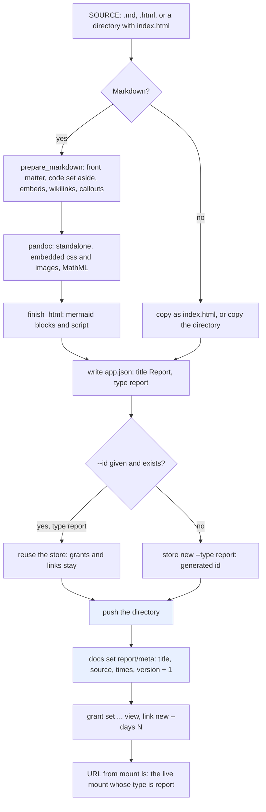
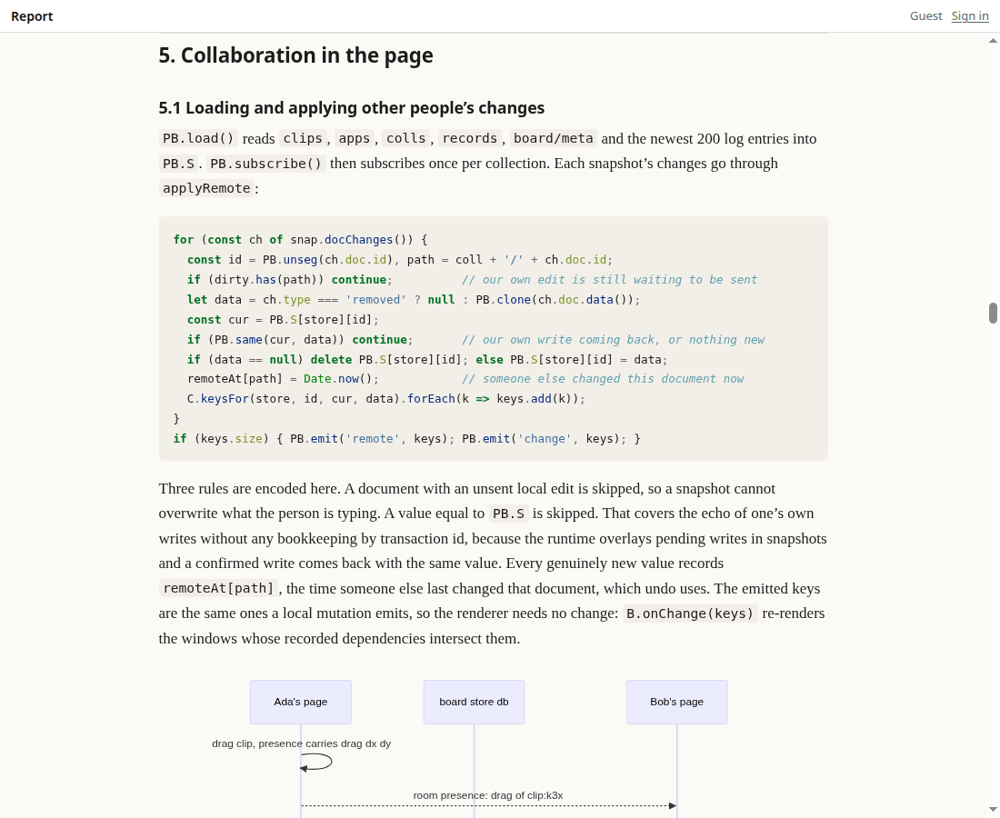
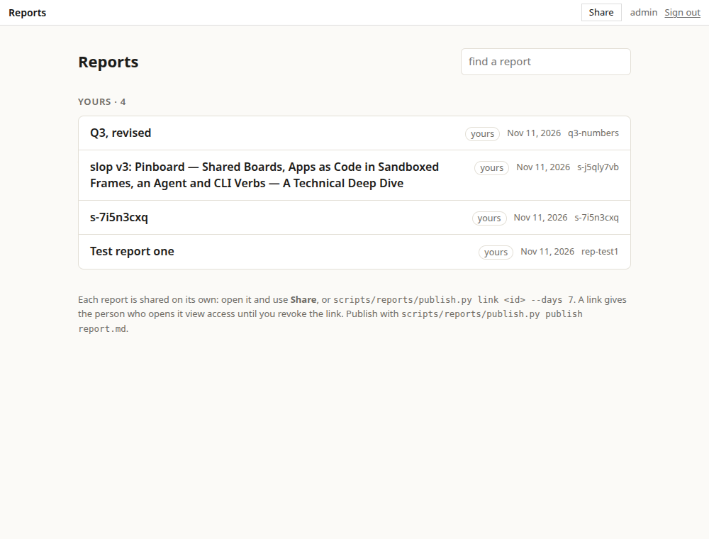
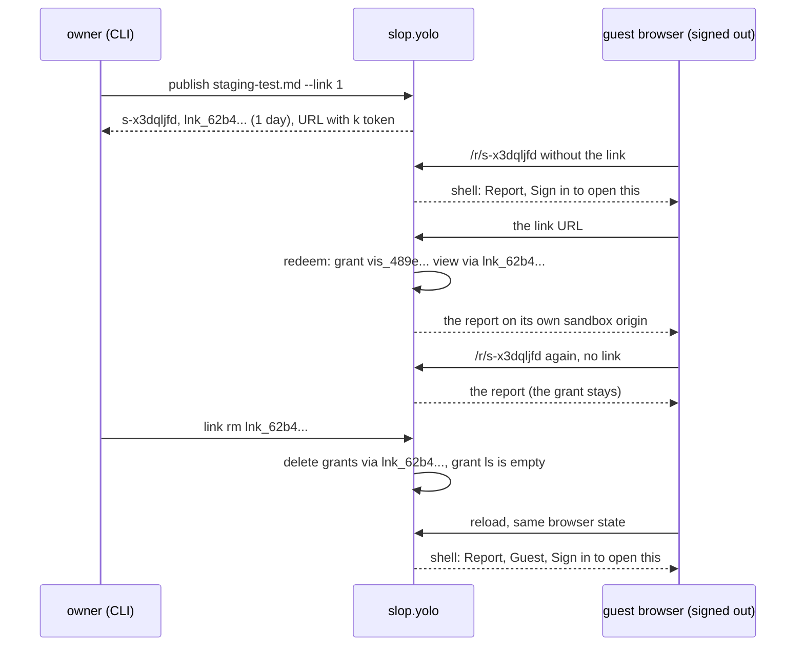
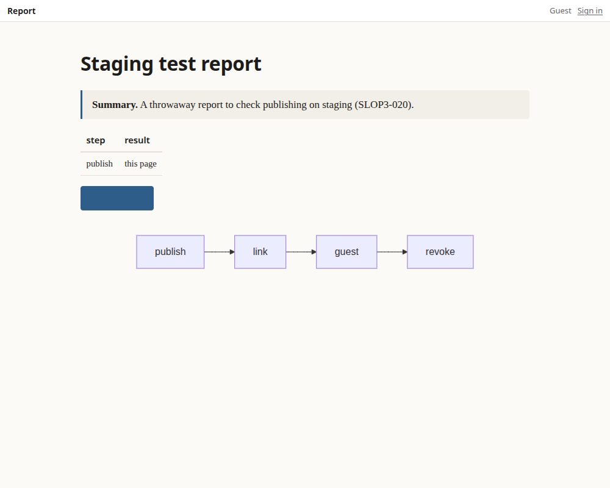

# slop v3: Publishing Reports — One Store per Report, Shared by Link or Grant — A Technical Deep Dive

The goal was to publish HTML pages and Markdown documents, such as the deep-dive reports in this vault, on slop. Each one is private by default and can be shown to chosen friends, for a while or until revoked, without giving them anything else. This report covers the design discussion that settled how to do it, the measurements made before writing code, the publish script and the list page that came out of it, and the defects found along the way. One review finding concerned code examples silently rewritten as Obsidian links; another defect left formulas printed as raw TeX.

The work is ticket SLOP3-020, pull request #43 (merged 2026-11-11) and the follow-up #44. No platform code changed. Everything is built from slop's existing stores, mounts, grants and share links: a 387-line Python script, a 41-line stylesheet, 120 lines of tests and an 88-line page. Four of this vault's reports are published privately on slop.yolo, the staging server, and listed at `/reports`.

> [!summary]
> - **Sharing in slop is decided per store, so each report is its own store.** One store per report gives each report its own grants, its own share links and its own sandbox origin. One typed mount, `/r/:id`, serves all of them.
> - **The platform already enforces access; the app should not.** Invite codes in an app would duplicate hashed tokens, expiry, revocation and guest identity, and the content would have to be hidden from slop itself. What slop lacks (groups, link limits, roles) belongs in slop, and only once a real need appears.
> - **Measuring first changed the design.** Slop's sign-in page tells a stranger that a store exists and shows its app title, and a link turns into a grant that outlives the link's expiry. The script answers the first with generated ids and a neutral title; the second is stated in the documentation.

## 1. The problem in slop's terms

Four slop primitives decide who can read what. Every design option below is a different arrangement of them.

- **Store.** Slop's unit of data, code and access. A store holds files, documents, uploaded assets and optionally an app (an `app.json` manifest, a page and an actor). Every store has an owner and an id unique on the server.
- **Level.** What a person may do on a store, on an ordered scale: `view` < `interact` < `admin` < `owner`.
- **Grant.** A level given to a subject on *one* store. A subject is a person (`usr_…`), a guest identity (`vis_…`), another store, or an audience (`@guest`, `@member`, `@subscriber`).
- **Share link.** A URL carrying a secret token (`?k=k_…`). The server stores only a hash of the token. The first time someone opens the link, slop writes a grant for them, recorded as obtained `via` that link, so later visits need no link. Revoking the link deletes exactly the grants it produced.

Two hosts serve content. The **static host** (`site.<domain>`) serves files without sign-in; anything there needs `@guest view` and is therefore readable by anyone with the URL. The **live host** (`apps.<domain>`) serves pages inside a **shell**. The shell signs the visitor in, checks their level, and frames the store's page on a **sandbox origin** of its own (`s<hash>.sbx.<domain>`), so one store's scripts cannot reach another store or slop itself. A **mount** binds a path on a host to a store. A mount with a store parameter, `/r/:id --storeParam id --type report`, serves every store of the given type by the id in the path.

## 2. Four ways to publish a report, and the one chosen

The design came out of a conversation that considered four arrangements. They differ in where the access decision is made.

| Option | Where access is decided | What goes wrong |
|---|---|---|
| Add reports to the catalog | nowhere: the catalog is public | Its data and views are on the static host; a private report would leak at least its title. |
| One store holding every report | the store's grants | A link opens every report in it, and all reports share one sandbox origin, so one report's scripts can read another's browser storage. |
| One store, with invite codes checked by its actor | the app's own code | It reimplements tokens, expiry, revocation and guest identity, and the content must be hidden from slop itself (section 2.1). |
| **One store per report** | **slop's grants and links, per report** | Nothing new is needed. Groups, link limits and roles are missing (section 2.2). |

### 2.1 Why access belongs to the platform

An app could enforce sharing itself. The store would admit everyone at `view` (`@guest view`). The reports would live where only the actor can read them, such as the actor's SQL database or a document path whose rule no page can meet. The page would send an invite code to the actor, which checks it against an `invites` table and returns the HTML. This works, and it gives a few things links do not: one code that opens several reports, a use limit, a label such as "for Alice", and a code that can be typed instead of a URL.

It also works against the platform. Everything readable at `view` is readable by every guest and by every CLI call, so the content has to be hidden from slop's own document API. The actor becomes the only security boundary, and a bug in its check leaks everything. Recipients see nothing under "shared with you", because slop does not know anything was shared. Slop already does each part of this job, as the comparison shows:

| Need | Slop today | Only the app version |
|---|---|---|
| a secret that grants access, expires and can be revoked | share links (hashed token, `--days`, revoke deletes the grants it gave) | |
| visitors without an account | a guest identity, kept if they sign in later | |
| enforcement on every path (page, CLI, MCP, open views) | yes | only where the actor checks |
| one code for several reports; use limits; labels | | ✓ |

Access rules inside an app are right when they are part of the app's domain. Pinboard's per-viewer consent to app versions is an example. "Who may open this report" is not part of a report's domain; it is exactly what a store's grants express.

### 2.2 What would belong in slop instead

The discussion also sketched the platform features that the app-level version would otherwise imitate. They are recorded here because they set the order of future work.

1. **Groups as grant subjects.** A person owns a group such as `friends`. A grant can name it (`grant set q3 group:friends view`), and access checks expand it. Adding or removing a member changes access to every report shared with the group at once. A group invite link would let people without accounts join. The access check already expands audiences through their groups (`sysdb.GroupsOf`), so this extends existing machinery. Until it exists, a publish script can loop over a list of user ids.
2. **Link labels and use limits.** These are small additions to the link record.
3. **Semantic roles.** An app would declare *permissions* (`comment`, `edit`, `export`) and *roles* that bundle a base level with permissions. Grants and links would carry a role, and a person's permissions would be the union over all their grants, with no deny rules. Document rules and actor actions would accept a permission wherever they now accept a level. Levels would remain for platform matters (sharing, deleting, pushing code), so an app cannot grant itself platform powers by naming a permission.

    One limit belongs in any such design. Permissions that restrict *writes* (comment, edit, import) can be enforced. A permission that restricts what someone does with data they can *read*, such as "export but not view", cannot: whoever can read the data can copy it. Such a permission can only hide a button or gate a server-side export.

The decision was to build only what works today, and to add groups, then link options, then roles when a concrete need appears. The most likely first need is friends commenting on a report.

## 3. Measuring before building

Before any code was written, one report was published by hand on a local slop server and opened in a fresh, signed-out browser. The report had an `app.json`, an `index.html` that loads mermaid from jsDelivr, and an SVG next to it. Each question took one command or one page load to answer:

| Question | Result |
|---|---|
| Does a store created without `--app` run its own `app.json`? | Yes: `app status` shows the manifest and `broken: ""`. |
| Can documents be written to a store whose app declares no `db` capability? | Yes: `docs set rep-test1 report/meta` succeeded and read back. |
| Does `/r/:id --type report` serve it? | Yes, to anyone with at least `view`. |
| What does a stranger see at an existing id? | The shell's "Sign in to open this", **with the title from `app.json`**. |
| What does a stranger see at an id that does not exist? | "There is nothing here." |
| Does a link work for someone without an account? | Yes. The guest received `vis_ee6e… view via lnk_acae…`, and the link's use count became 1. |
| Is the link needed again? | No. The guest kept access without it. |
| Does revoking the link remove access? | Yes: `link rm` left `grant ls` empty. |
| Do scripts from a CDN run inside a report? | Yes. The sandbox page's only policy is `frame-ancestors`, so mermaid 11 loaded and drew a diagram. |
| Do relative assets load? | Yes. `` loaded (`naturalWidth 40`). |

Two of these results changed the design.

The first is a disclosure by the shell. A guessed id answers differently depending on whether the store exists, and an existing one shows its app's title to a visitor with no access. The fix inside this project's scope is to make ids unguessable and the visible title meaningless. The script lets `store new` generate the id (`s-` and eight random characters) unless asked otherwise, and writes `"title": "Report"` into every report's `app.json`. The real title goes into a document, `report/meta`, which only people with `view` can read, and into the page's own `<title>`, which is served only after the shell has admitted the visitor. Whether the shell should show app titles to people without access is a separate platform question.

The second is that a link is a way to obtain a grant, not a key that is checked on every visit. "Share for a week" therefore means that the link can be *opened* for a week. Someone who opened it keeps access until the link is revoked or the report deleted. The README and the reports page both say so.

## 4. A report store

A report is a store of type `report` that carries its own page:

```text
report store s-ypd4lpdl (type report, owner: you)
  files, served on the report's own sandbox origin
    app.json      {"title": "Report", "type": "report", "page": "index.html"}
    index.html    the report, one self-contained page for rendered Markdown
  documents
    report/meta   {"title", "source", "publishedAt", "updatedAt", "version"}
  access
    owner         you
    grants        usr_… view · vis_… view via lnk_… · …
    links         lnk_… view, expires …   (revoked links stay listed, with revokedAt)
```

The report has no actor and asks for no capabilities. Its type is set when the store is created and cannot be changed except by an administrator. That matters for the mount:

```sh
slop mount set --host apps.<domain> --path /r/:id --storeParam id --type report
```

Without `--type report`, `/r/<any id>` would serve any store the visitor can open, under a path meant for reports.

## 5. The publish script

`scripts/reports/publish.py` has three commands. `publish SOURCE` makes or updates a report, `link ID --days N` makes another view link, and `ls` lists your reports with their versions, grant counts and active links. It uses only the Python standard library and shells out to two programs: `pandoc`, and the `slop` CLI with its existing login. It never reads the token. A link's URL contains a secret, so it is printed once and nowhere else.



*Figure 1. `publish`, from a file to a URL. The two blue steps write to the server; everything above them happens in a temporary directory.*

### 5.1 Making Obsidian Markdown portable

Notes in this vault use Obsidian syntax that pandoc does not know. `prepare_markdown` rewrites it before pandoc runs:

| Obsidian | Becomes |
|---|---|
| YAML front matter | removed; its `title` becomes the page title |
| `![[my pic.png]]` | `` |
| `[[PROJ - ZK Tool]]`, `[[note#section\|text]]` | `PROJ - ZK Tool`, `text` |
| `> [!summary]` | `> **Summary.**` |

The title is taken, in order, from `--title`, the front matter, the first `# ` heading, an HTML file's `<title>`, and finally the file name.

The conversions are regular expressions, and the first version applied them to the whole text. Codex's review of the pull request found the consequence: code examples were rewritten too. A Bash test in a fenced block,

```bash
[[ -f report.html ]] && echo exists
```

matches the wikilink pattern, and would have been published as `-f report.html && echo exists`, a different and broken command, with no warning. Callouts and embeds had the same problem inside fences.

The fix sets code aside before converting and puts it back afterwards. `set_code_aside` reads the text line by line and recognizes fenced blocks by the CommonMark rules:
- a fence opens with three or more backticks or tildes, possibly after blockquote markers, because Obsidian puts code inside callouts;
- it closes with the same character, at least as many, and nothing else on the line;
- an unclosed fence runs to the end of the text.

In the text between fences it also finds inline code spans: a run of backticks, any text, and a run of the same length, not crossing a blank line. Each piece of code is replaced by a placeholder, `\x00<n>\x00`, which none of the conversion patterns can match:

```python
text, kept = set_code_aside(text)          # fences and code spans → \x00<n>\x00
text = EMBED.sub(…, text)                  # ![[x]]   → 
text = WIKILINK.sub(…, text)               # [[a|b]]  → b
text = CALLOUT.sub(…, text)                # > [!note] → > **Note.**
return title, PLACEHOLDER.sub(lambda m: kept[int(m.group(1))], text)
```

Placeholders, rather than a Markdown parser, fit the problem. The conversions need to know only where code is, and that takes three rules. A parser, or a pandoc Lua filter, would move Obsidian handling into a second language for one finding. One case remains unprotected: code indented by four spaces without a fence. Telling it apart from the continuation lines of a list item requires real parsing, and Obsidian notes rarely use it.

### 5.2 One page from pandoc

pandoc renders the prepared text with these flags:

```text
--from markdown+autolink_bare_uris-yaml_metadata_block
--to html5 --standalone --embed-resources --mathml --css report.css
--resource-path <the source's directory> --metadata pagetitle=<title>
```

`--embed-resources` inlines the stylesheet and every local image as `data:` URIs, so a Markdown report becomes one file that does not depend on the vault's `_assets/` folders. The YAML metadata extension is turned off because the front matter has already been removed; otherwise a `---` rule later in a note could be read as a metadata block.

`--mathml` was added after the first real publication. The Catalog Apps report contains two formulas, a similarity measure and the squarified treemap's worst aspect ratio:

```text
\text{sim}(a, b) = J(\text{tags}_a, \text{tags}_b) + \tfrac14 \, J(\text{caps}_a, \text{caps}_b)
```

pandoc's default HTML math could not convert them and printed them as raw TeX ("Could not convert TeX math … rendering as TeX"). With `--mathml`, pandoc converts TeX to MathML, which browsers render natively, so the page stays self-contained. A test that publishes `$$J(A, B) = \frac{|A \cap B|}{|A \cup B|}$$` checks for `<mfrac>`, and checks that no `$$` is left in the page. The first version of that test asserted that `\frac` was absent, and failed: MathML keeps the TeX source in a hidden `<annotation encoding="application/x-tex">` element.

Mermaid is the one thing loaded from elsewhere. pandoc writes a fenced `mermaid` block as `<pre class="mermaid"><code>…</code></pre>`. `finish_html` removes the `<code>` wrapper and, only when there is at least one diagram, adds mermaid 11.4.1 from jsDelivr with a light or dark theme that follows the reader's setting. Inlining mermaid would add megabytes to every report that has a diagram. Mermaid reads pandoc's escaped source (`A --&gt; B`) correctly.

### 5.3 Creating or updating the store

Without `--id`, the script calls `store new --type report` and uses the generated id. With `--id`, it first calls `store meta`. If the store exists and its type is `report`, the report is updated in place: the same id, the same grants and links, and a new snapshot of files. If the store exists with another type, the script stops with "catalog is a store of type '', not a report: choose another --id", so a typo cannot overwrite an unrelated store. `report/meta` keeps `publishedAt` across updates and increments `version`.

Grant subjects must look like `usr_…` or `vis_…`, because `grant set` does not accept email addresses. A friend finds their id with `slop whoami`. `--grant-file` reads one id per line, which is how a group can be approximated until groups exist.

### 5.4 A trace

Publishing the vault's Pinboard report on the local server printed:

```text
built markdown (5 mermaid): 'slop v3: Pinboard — Shared Boards, … — A Technical Deep Dive', 837 KiB
published s-j5qly7vb (v1): slop v3: Pinboard — Shared Boards, … — A Technical Deep Dive
  http://apps.localhost:18490/r/s-j5qly7vb
  link lnk_dd3a4262cc74b97a5c28b167 (view, until 2026-11-18 15:04):
  http://apps.localhost:18490/r/s-j5qly7vb?k=…
```

The 837 KiB are mostly the six screenshots, inlined. A signed-out browser that opened the link saw:
- the correct document title;
- 5 of 5 mermaid diagrams drawn;
- all 6 images (`naturalWidth 1400`);
- 11 tables;
- no `[[` left in the page;
- the summary callout labelled "Summary.";
- "Report" in the shell's bar.



*Figure 2. A section of the rendered Pinboard report, opened by a signed-out guest through a link. The shell's bar says "Report"; the code is highlighted by pandoc and the sequence diagram is drawn by mermaid.*

## 6. The reports page

`apps/reports-home` is a page with no actor. It calls a runtime function that slop gained for Pinboard's "my boards" page:

```js
const reports = await slop.stores.list({ type: 'report', title: 'report/meta' });
// → [{ id, app, level, mine, createdAt, title }]
```

The server collects the stores the viewer can open (owned, granted, or open to an audience they are in) and keeps those of type `report`. It then reads `report/meta` from each one, *as the viewer*, under that store's own read rules, and returns the `title` field. The page therefore cannot show a title the viewer could not read by opening the report. The page sorts reports into "Yours" and "Shared with you", filters them by title or id, and links each to `/r/<id>` on the live host that framed it (`target="_top"`, because the page itself runs on a sandbox origin).

The page's store has no grants, so only its owner can open it. Because the list is computed per viewer, granting it `@member view` would also be safe: a friend with an account would see only the reports shared with them. The page does not create links, because pages cannot call `link.new`. Sharing is done with the script or with the Share dialog that the shell shows a report's owner.



*Figure 3. `/reports` on the local server: four reports, titled from their `report/meta`. The one without a title is a store created by a probe during the measurements; it has no `report/meta`, so its id is shown.*

## 7. Sharing and revoking, end to end

On slop.yolo, the mount and the reports page were set up with four commands, and a throwaway report was shared and revoked:



*Figure 4. The life of a share link on staging. The last request reused the guest's saved browser state, so it tested the same identity that held the grant, not a new visitor.*



*Figure 5. The throwaway staging report through its link: the callout, a table, an inlined image and a mermaid diagram. It was deleted after the revocation test.*

The link's token never appeared in a command line, a log or the ticket. The script's output was filtered before it was saved. The URL went to a scratch file, and the test browser read that file from a loopback HTTP server, because the browser automation could neither `require` files nor open `file://` URLs.

## 8. Verification

| Layer | What was checked |
|---|---|
| unit tests (13) | front matter, embeds, wikilinks, callouts; code spans and fences left alone, including fences inside blockquotes and an unclosed fence; mermaid finishing; a full Markdown build with an inlined image, a table and a diagram; MathML; HTML titles |
| local server | every row of the table in section 3; the Pinboard report through a link; an HTML report updated in place (v1 → v2); the refusals (a non-report `--id`, an email as grant subject, a missing file); `--dry-run`; `ls`; `link --days 0`; `/reports` as the owner and as a guest |
| staging | the mounts and `/reports`; the full link life cycle of Figure 4; four vault reports published privately |
| review | Codex on #43: one P2 (code rewritten), fixed with tests that fail on the old code; the re-review was clean |

The tests caught two of my own mistakes on their first run. In the callout pattern, `^(\s*>\s*)\[!(\w+)\][+-]?\s*(.*)$`, the final `\s*` crossed the line end, so a callout line was joined with the line after it ("> **Summary.** > - one"). The front-matter pattern swallowed the blank line after the closing `---` in the same way. Both now use `[ \t]*`. Any regular expression run with `re.M` that means "spaces on this line" should say exactly that.

## 9. Where things stand

Four reports from this vault are published on slop.yolo, privately, with no grants or links: Pinboard, The Catalog Apps, Catalog Views and One Object Model. They are listed at `https://apps.slop.yolo.scapegoat.dev/reports`. Sharing one is `publish.py link <id> --days 7`. #43 is merged; #44 (MathML) is open.

Known limits:

- **Friends need an account or a link.** A guest's access belongs to one browser; on another device they need a link again, while it is still valid.
- **A guessed id still reveals that a report exists.** Generated ids make guessing impractical, and the visible title says only "Report". The shell's behaviour is a platform question.
- **Reports drift from their sources.** A report is a snapshot of the note when it was published; edits in the vault reach it only when it is republished with `--id`.
- **Indented code blocks** are not protected from the Obsidian conversions.
- **Mermaid comes from jsDelivr** when a report with diagrams is opened.
- **Groups, link labels and limits, and roles** do not exist yet (section 2.2).

## Notes on the implementation record

- **Ticket:** SLOP3-020 in `ttmp/2026/11/11/`. It holds the guide (`design-doc/01-guide-publishing-reports-on-slop-one-store-per-report.md`), the diary in five steps, and the evidence in `various/` (measurement logs, browser results, staging logs, screenshots).
- **Code:**
  - `scripts/reports/publish.py`, `report.css`, `test_publish.py`, `README.md`;
  - `apps/reports-home/`.
- **Pull requests:**
  - #43 (`f829777`, the Codex fix `76a64f0`), merged as `1ba342e`;
  - #44 (`c3d5c7a`, MathML).

## Related notes

- [[PROJECT REPORT - slop v3 - Pinboard - Shared Boards, Apps as Code in Sandboxed Frames, an Agent and CLI Verbs - A Technical Deep Dive]]
- [[PROJECT REPORT - slop v3 - The Catalog Apps - Static Views, an MCP Server, a Shelf and a Curator - A Technical Deep Dive]]
- [[PROJECT REPORT - slop v3 - A Store-Based Hosting Service from Design to Deployment - A Technical Deep Dive]]
