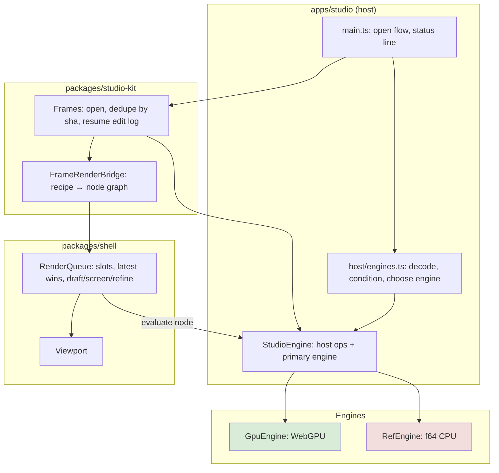
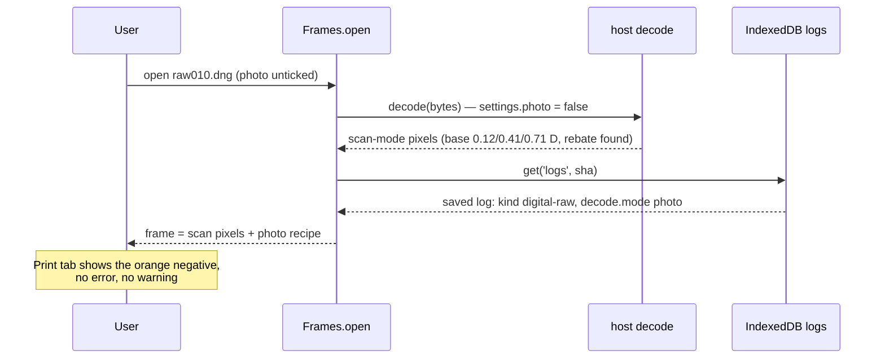
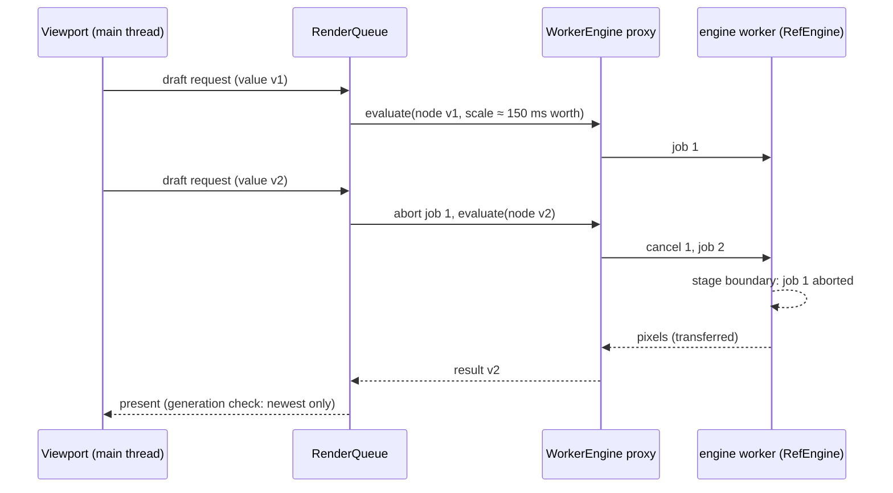
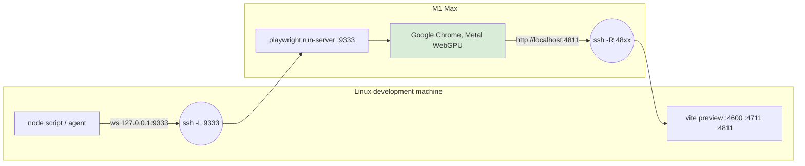

# Chromobench Usability Cosplay and Real-GPU Measurement

Chromobench is a browser application that prints photographs through a physical model of colour film and
photographic paper. It opens two kinds of input: digital camera RAW files, which it treats as scene light exposed
onto a film stock, and scans of colour negatives, which it inverts through the negative's dye densities. The
result is printed on a modelled enlarger with darkroom controls (exposure time, aperture, CC filtration, paper
grade). This report covers one day of work, 2026-11-12, in which the application was used for the first time the
way its intended user would use it: a photographer working on his own Nikon D750 files and a real negative strip.
The session found three defects that made correct prints impossible and a responsiveness problem that froze the
window for seconds at a time. The report explains the testing method, each defect's mechanism, the fixes, and the
remote real-GPU measurement setup that was needed to tell software-renderer artefacts from real behaviour.

> [!summary]
> 1. **User cosplay** (CHB-026): an agent plays the target photographer on his real files, makes ordinary mistakes
>    on purpose, measures main-thread stalls, and writes a diary plus a first-person experience report. Session 01
>    produced 16 findings, three of them blockers.
> 2. **Fixes in four workstreams** (CHB-027): open mode guessed per file and saved edits keyed by mode; the CPU
>    engine, decoding and scan conditioning moved into a worker; errors and values in the photographer's words;
>    multi-frame strips (pending).
> 3. **Real-GPU measurement over SSH**: a Playwright server on an M1 Max drives Google Chrome with Metal WebGPU on
>    behalf of scripts on the Linux machine. On real hardware the slider drag that froze the CPU engine for 12 s
>    returns its result 0.28 s after release with no stall.

## Why this work existed

Until this session every test of chromobench used synthetic fixtures: generated TIFF scans with known densities,
a mock engine, and browser tests that click through scripted flows. Those tests establish that the physics and the
plumbing are correct. They do not establish that a photographer can open his own files and get a print. The
user asked for that check directly: play the photographer the application is for, use his real photographs,
"pinpoint friction points or just broken things", and keep a record that cheaper tester agents can repeat.

The test material was 33 NEF files from a Nikon D750 (6032×4032, 14-bit lossless RAW), covering dusk and night
streets at ISO 2000–8000, tungsten interiors with mixed light, daylight streets and portrait-orientation frames,
plus one DNG holding three frames of a colour negative strip. These are private family photographs; they stay on
the development machine and appear in this note only as file names and measurements.

## Background: the parts of chromobench involved

Five concepts recur in everything below, so they are defined here first.

A **frame** is one opened image together with its edit history. A frame's **recipe** is the complete,
serialisable description of how it is printed: the source (file hash, decode mode), the film and paper stocks, the
enlarger settings, the viewing conditions. Every user action is a **mutation** of the recipe, and the ordered
list of mutations is the frame's **edit log**. The edit log is persisted in IndexedDB under the file's SHA-256, so
that opening the same file again resumes its edits.

The **decode mode** says what the pixels of a file mean. In *photo* mode a camera RAW is demosaiced by LibRaw
(compiled to WebAssembly) into linear camera RGB and treated as scene light; the recipe's `kind` is `digital-raw`.
In *scan* mode the same file is read as a photograph of a negative: CFA-binned linear RGB, then **scan
conditioning** finds the film base (the unexposed, orange-masked film at the frame's edge, called the rebate),
measures the scanner's flare and converts transmittance to density; the recipe's `kind` is `negative-scan`.

The **engine** evaluates a recipe into pixels. Two implementations share the same physics: `GpuEngine`
(WebGPU compute shaders, working image up to 4000 px on the long side) and `RefEngine`, the f64 reference
implementation in TypeScript, used when WebGPU is unavailable, at a 512 px working image because it computes every
pixel on the CPU.

The **render queue** in the UI shell schedules evaluations per display slot (main viewer, before/after view,
thumbnails). Its rule is *latest wins*: a new request replaces a waiting one, and an in-flight request for a
different result is aborted. During a slider drag the viewer asks for a **draft** pass at reduced size, then a
**screen** pass at display size when the gesture ends, then a **refine** pass for the visible region when zoomed
past 1:1.

A **main-thread stall** is an interval during which the browser could not run any JavaScript event handler or paint
a frame. The measure used throughout is the gap between consecutive `requestAnimationFrame` callbacks: a gap over
100 ms means the window was unresponsive for that long.



## Method: user cosplay

A cosplay session is a usability test in which the tester *is* the user. The tester follows a written persona (an
experienced photographer with darkroom practice, Lightroom habits, a German keyboard, no programming background)
and acts only through visible controls: buttons, menus, sliders, typed values, keyboard shortcuts. Debug hooks,
URL flags and the agent DSL are allowed for measuring and for explaining a result, never for performing a task.

Three rules make a session productive rather than confirmatory. First, the tester makes the user's ordinary
mistakes on purpose: opening before reading the options, opening the same file twice, dragging too far and
undoing repeatedly, typing `0`, `-5`, `1000`, `abc`, `7,5` and an empty string into number fields, reloading
when something looks stuck. Second, every action is measured with a probe injected into the page, which records
main-thread stalls, status-line changes and every toast message (toasts disappear after 2.6 s, too fast to catch in
screenshots). Third, the session produces two documents: a rigid chronological diary with exact commands,
diagnostics and timings, and a first-person **experience report** in the photographer's words, with
*developer commentary* callouts that attach the code-level cause to each observation.

The probe is a short script installed with Playwright's `addInitScript`, so it survives reloads:

```js
const P = (window.__probe = { t0: performance.now(), toasts: [], stalls: [] });
let last = performance.now();
const tick = (t) => {
  if (t - last > 100) P.stalls.push([Math.round(last - P.t0), Math.round(t - last)]);
  last = t;
  requestAnimationFrame(tick);
};
requestAnimationFrame(tick);
new MutationObserver((ms) => { /* push every added .ck-toast with its text and kind */ })
  .observe(document.body, { childList: true, subtree: true });
```

The ticket CHB-026 holds the persona, a catalogue of the test files, the session protocol, ten scenario briefs
(first contact, night at high ISO, tungsten interiors, crop and rotation, the negative strip, sorting and batch,
export, looks, a deliberate-misuse session, the next day) and the probe scripts, so that tester agents on a
cheaper model can run sessions with comparable output.

## Session 01 findings

The first session used one daylight NEF and the negative strip, on the CPU reference engine (the headless test
browser has no hardware GPU). It produced 16 findings. The table lists the ones that shaped the fix.

| ID | Severity | Finding |
|---|---|---|
| F1 | blocker | A camera RAW opens as a negative by default; the photo appears inverted. The fix was a top-bar checkbox labelled "photo", off by default, not remembered, effective only for files opened afterwards |
| F2 | blocker | Opening a file that is already open does nothing, and the status line says "opening …" indefinitely |
| F3 | blocker | A file's first decode mode is stored with its edit log; reopened in the other mode, it is decoded one way and rendered the other |
| F4 | major | The CPU engine runs on the main thread: 1.7–2.4 s stall per preview; a 20-move slider drag took 12.2 s; opening the DNG froze the window for 6.7 s |
| F5 | major | The library is empty after a reload |
| F6 | major | No way to remove a frame or reopen it differently; right-clicking a thumbnail opens Chrome's own image menu |
| F7 | major | Validation errors reach the user verbatim: `E_ARG_RANGE: print.enlarger.time_s = 0 is outside the allowed range [0.1, 600] (s).` |
| F8–F16 | minor/note | Typed-value surprises (a leading sign means "relative"), jargon in the status line, raw stock ids, a 512 px preview that looks out of focus, a three-frame strip shown as one frame |

The negative pipeline itself was correct: opened on a clean slate, the strip printed as a plausible positive with an
automatic first exposure of 2.23 s and printer-light corrections of +2 / 0 / −3 points. What failed was the
bookkeeping around it.

## Deep dive 1: the open-mode defect (F1–F3)

The three blockers are one mechanism seen from three sides. The decode mode was a global setting read at decode
time, while the frame's identity and its persisted edit log were keyed by the file's hash alone. Nothing related
the two.

Trace the sequence that made the negative strip unprintable. The tester opens `raw010.dng` while "photo" is still
ticked from a previous file. `decodePhoto` runs; `Frames.open` finds no saved log for the hash and creates one whose
recipe has `kind: "digital-raw"` and `source.decode.mode: "photo"`; the log is saved under the hash. The print is
an orange strip, which is correct for a negative treated as scene light. There is no way to remove the frame, so
the tester reloads the page, leaves "photo" unticked and opens the file again:



The status line reported scan conditioning while the committed recipe described a photo, and nothing compared
them. The defect was permanent for that file: only an in-memory store (`?fresh`) or clearing site data escaped it.
F2 is the same identity rule in the other direction: `Frames.open` returned the existing frame for a known hash
before decoding, and the host's open loop wrote a final status line only for multi-file opens.

The fix (CHB-027 workstream A) makes the mode part of identity and removes the global setting:

- `HostServices.decode` takes an explicit mode. The top-bar checkbox becomes File ▸ Open as ▸ Auto / Photo /
  Negative, with Auto as the default.
- Edit logs are keyed by `(sha, mode)`. A legacy log keyed by hash alone is resumed only when its `kind`
  matches the decode.
- Every frame shows its mode and offers "Re-open as photo / as negative", which decodes again and starts or
  resumes that mode's log.
- Opening an open file selects it; the status line always ends with "opened …" or an explained error.

Auto needs a classifier. It lives in ingest (`packages/ingest/src/conditioning/open-mode.ts`, `guessOpenMode`) and
was calibrated on all 33 NEFs and the strip. Its first rule was wrong in an instructive way: it counted an
*open gate* (a population of pixels brighter than all film by at least 0.2 D, which in a scan means the light
source seen past the film's edge) as evidence of film. Blown daylight skies satisfy that test, and 8 of 9 sampled
NEFs were classified as negatives. The corrected rules use the orange mask as the primary evidence: an open gate or
a rebate counts only together with an orange cast, and the mask is measured as red over *green* as well as red over
blue, because warm tungsten light raises red over blue without raising red over green. Camera RAWs are classified
on their photo-mode decode, their prior. Calibration values (log ratios on the 512 px working image):

| File | Decode | R/B | R/G | Orange score | Result |
|---|---|---|---|---|---|
| DSC_8559 (daylight) | photo | −0.11 | −0.27 | 0.03 | photo |
| DSC_8541 (tungsten) | photo | 0.39 | −0.04 | 0.21 | photo |
| raw010 (negative strip) | scan | 0.59 | 0.31 | 1.00, rebate at the edge | negative |

When the score falls between the thresholds the application asks once per batch, with its guess preselected.

## Deep dive 2: why the window froze (F4)

The render queue already implemented the right policy: during a drag, a new request replaces the waiting one, and an
in-flight request for an outdated value is aborted through an `AbortSignal`. The policy had no effect on the CPU
path because `RefEngine.evaluate` ran synchronously on the main thread. An abort signal is observed only when the
running code yields; a two-second synchronous evaluation does not yield, so each pointer move during a drag queued
behind a full render, and the browser could neither paint nor deliver the next pointer event. Playwright's mouse
events wait for the page, so the 20-move drag that a hand performs in 0.6 s took 12–16 s of wall time.

Workstream B measured before changing anything. Its baseline on the CPU engine:

| Step | Time to result | Worst stall |
|---|---|---|
| Open NEF as photo | 9.8 s | 3.5 s |
| Drag Time, 20 moves (photo) | 15.9 s | 3.2 s |
| Open DNG as negative | 5.1 s | 5.1 s |
| Drag Time, 20 moves (negative) | 11.8 s | 2.2 s |

Profiling the reference engine stage by stage on a synthetic frame established where the time goes. A print-only
change (time, filtration, grade) does not recompute the negative's stages: the expensive per-pixel dye-density
solve and everything upstream of it are cached by node id, because recipe nodes are content-addressed. The cost is
the print side, about 14 µs per pixel, of which the final display step (an OkLCh gamut knee) is about 40 %. At that
rate a 0.5-megapixel draft costs about 7 s on the CPU, so the draft size has to follow the engine's measured speed
rather than the screen size.

The design that follows from those numbers has four parts:

1. **An engine worker.** Decoding, linearisation, resampling and scan conditioning run in a module worker for
   both engines, and the worker hosts `RefEngine` when there is no WebGPU. A `WorkerEngine` on the main thread
   implements the contract's `Engine` interface by posting jobs and receiving pixels as transferable buffers.
   An aborted signal sends `cancel`: a queued job is dropped, a running one stops at its next stage boundary.
2. **Staged evaluation.** `RefEngine` evaluates the node graph stage by stage, inputs first, with a yield hook and
   an abort check between stages. Its caches are least-recently-used and bounded in bytes. Sampled stages live in
   a separate cache, so draft-size grids never evict the full-resolution negative stages.
3. **Sampled previews.** A preview at scale < 1 computes the print stages only at the pixels the result samples.
   Nearest-neighbour sampling commutes with pointwise operations, so the sampled result is bit-identical to
   computing the full image and then sampling it.
4. **Drafts sized by time.** The studio bridge measures the engine's pixels per millisecond and sizes draft
   passes to about 150 ms (at least 30 k pixels, in half-octave steps so that successive drafts share a sampling
   grid).



Making the engine asynchronous exposed a latent defect in the shell. The shell's `settle()` runs idle tasks until
none remain, and some idle tasks requeue themselves while a render is outstanding. With a synchronous engine the
render was always finished by the time the idle loop ran; with an asynchronous one the task requeued itself
forever, and `settle()` never returned after a drag. The fix runs each self-requeueing task once per idle run. The
same change broke a measurement assumption: with the page no longer blocked, a `waitForFunction` for the status
text matched the previous step's "rendered 3" and the next step raced the open.

## Deep dive 3: measuring on a real GPU from a Linux machine

The development machine has no GPU that Chrome can use. The repository's browser tests run WebGPU on SwiftShader
(`--use-webgpu-adapter=swiftshader` in `playwright.config.ts`), a CPU implementation of Vulkan. It is adequate
for conformance and pixel-parity tests and useless for timing: a GPU-engine slider drag under SwiftShader did not
finish within 20 minutes. Two open questions depended on real hardware: the after-numbers of workstream B on the
GPU engine, and whether a hang that workstream A saw in one of four to six runs of a GPU browser test was a
SwiftShader artefact.

The owner's MacBook Pro (Apple M1 Max, macOS 15.7, Google Chrome 157) has Metal-backed WebGPU and is reachable over
SSH. Three constraints determined how to drive it from the Linux machine.

**WebGPU requires a secure context.** `navigator.gpu` is defined only for `https:` origins and `localhost`. A
page loaded from `http://<linux-host>:4811` on the Mac silently falls back to the CPU engine. A reverse SSH tunnel
solves this: `-R 4811:127.0.0.1:4811` makes the Linux preview server answer at the Mac's `localhost:4811`.

**Raw CDP fails with this version pair.** Chrome started with `--remote-debugging-port=9222` and a separate
profile directory accepts DevTools connections, but Playwright 1.65's `connectOverCDP` aborts during its own
initialisation:

```text
browserType.connectOverCDP: Protocol error (Browser.setDownloadBehavior):
Browser context management is not supported.
```

**A Playwright server of the client's exact version works.** `npx playwright@1.65.0 run-server --port 9333` on
the Mac accepts `chromium.connect()` over a WebSocket and launches a browser per connection with launch options
that the client sends in a request header. `channel: 'chrome'` selects the installed Google Chrome instead of
Playwright's Chromium build, and `headless: false` keeps the normal GPU process.



The client side is a few lines:

```js
import { chromium } from '@playwright/test';
const browser = await chromium.connect('ws://127.0.0.1:9333/', {
  headers: { 'x-playwright-launch-options': JSON.stringify({ channel: 'chrome', headless: false }) },
});
const page = await (await browser.newContext({ viewport: { width: 1440, height: 900 } })).newPage();
await page.goto('http://localhost:4811/?engine=gpu');
```

A smoke script confirms the adapter (`vendor: "apple"`, `architecture: "metal-3"`) and the application's own engine
label, `GPU · apple metal-3 · 4000 px`. Because several agents share one Mac and timings from two browsers at once
are meaningless, runs take a lock first: `mkdir /tmp/chromobench-pw/lock` on the Mac is atomic and fails while
another run holds it.

Files reach the remote browser through `setInputFiles`, which streams them over the Playwright protocol and the
tunnel. This is slow: a 30 MB NEF took about 44 s (≈ 0.7 MB/s). Measurements therefore start when `setInputFiles`
returns, and GPU-path checks that do not need a real camera file use a small synthetic one.

The first measurement on the M1 used a build of `main` from before any CHB-027 change, with the same NEF and the
same 20-move drag as the CPU baseline:

| Step | M1 Max, GPU engine | Linux, CPU reference engine |
|---|---|---|
| Open, time to result after upload | 9.6 s | 9.8 s |
| Open, worst stall | 1.0 s | 3.5 s |
| Drag, time to result | 0.28 s after release (drag took 2.0 s) | at the end of a 15.9 s drag |
| Drag, worst stall | none | 3.2 s |

On real hardware the old build already drags without stalls; the drag freeze of F4 belongs to the CPU path
(Firefox and Safari without WebGPU, older machines) and to SwiftShader. The remaining GPU-path problem is the open:
decoding and scan conditioning on the main thread cost a one-second stall, which the engine worker removes for
both engines.

## Current status

CHB-027 runs as four workstreams in separate git worktrees, each with its own diary in the investigation format.

- **Workstream C (wording, forms, messages): merged.** Validation errors read "Time must be between 0.1 s and
  600 s", with the code in the tooltip and unchanged for agents. Out-of-range typed values are clamped with a note,
  relative entries announce their effect, stock ids are shown as names, the status line reads "Fast (graphics
  card)" or "Compatibility mode: slower (no WebGPU)", and undo names the frame it changes. Shortcuts now follow the
  keyboard layout, so Ctrl+Z works on a German QWERTZ keyboard; it previously arrived as Ctrl+Y.
- **Workstream A (open mode, library): committed on its branch, not merged.** Open mode per file, logs keyed by
  mode, re-open and remove, a library that survives a reload (thumbnails, re-reading files through stored file
  handles), drag and drop to open, and the host's top bar folded into the shell's File, Edit and View menus.
  Open: an intermittent hang in one GPU browser test, now testable on real hardware.
- **Workstream B (responsiveness): committed on its branch, not merged.** The engine worker, staged and sampled
  evaluation, time-sized drafts, the `settle()` fix and an end-to-end test that the window does not freeze on
  open or drag. Open: after-numbers on the M1.
- **Workstream D (a strip of several frames opens as several frames): not started**; it depends on A's frame
  identity.

The same day closed nine earlier tickets whose work was done, after auditing their open tasks against the code, and recorded two owner
decisions: the agent sandbox stays QuickJS with the synchronous build and deferred promises, and this version is
not public, which defers the data-licence questions.

## Important project docs

- `/home/manuel/code/wesen/chromobench/ttmp/2026/11/12/CHB-026--user-cosplay-simulation-photographer-persona-usability-testing/`:
  persona, test material, session protocol, scenarios S01–S10, findings F1–F16, the session-01 experience report
  and diary, probe scripts.
- `/home/manuel/code/wesen/chromobench/ttmp/2026/11/12/CHB-027--fix-cosplay-session-01-findings-open-mode-responsiveness-library-wording-strips/`:
  implementation plan, one diary per workstream, the real-GPU playbook
  (`playbook/01-real-gpu-browser-testing-on-the-m1-mac-over-ssh.md`) and scripts (`scripts/mac-*.mjs`).
- Code: `apps/studio/src/host/engines.ts` (decode and engine choice), `packages/studio-kit/src/bridge/frames.ts`
  (frame identity and edit logs), `packages/shell/src/app/render/queue.ts` (render scheduling),
  `packages/ingest/src/conditioning/open-mode.ts` (the photo/negative classifier, on workstream A's branch).

## Open questions

- Does the intermittent GPU-test hang reproduce on Metal, or only under SwiftShader?
- How large can the reference engine's working image grow (512 px today) once drafts keep drags fluid off the
  main thread? A sharper CPU preview addresses finding F10.
- Should the browser test suite gain a real-GPU project that runs against the Mac on demand?
- The display step's OkLCh knee is about 40 % of a print-only change on the CPU; is a cheaper formulation
  acceptable for drafts?

## Near-term next steps

1. Workstream B's before and after numbers on the M1; merge A, then B; full checks.
2. Workstream D: detect inter-frame gaps on a strip and open one frame per image area.
3. A cosplay re-run of session 01 against the merged build, with a before/after table per finding.
4. Tester agents on scenarios S01 (first contact), S05 (the negative strip) and S09 (deliberate misuse).

## Project working rule

A defect counts as fixed when the photographer's own sequence of actions, mistakes included, produces the
correct print on his own files, and the window stays responsive while he does it. Synthetic tests guard the
physics; cosplay sessions and real-GPU measurements guard the experience.
