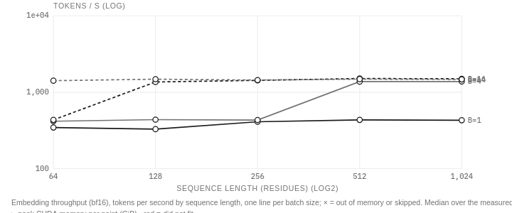
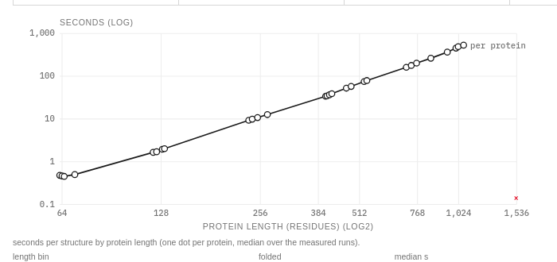
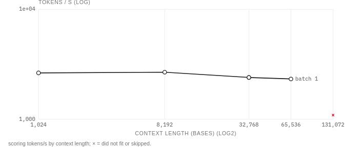
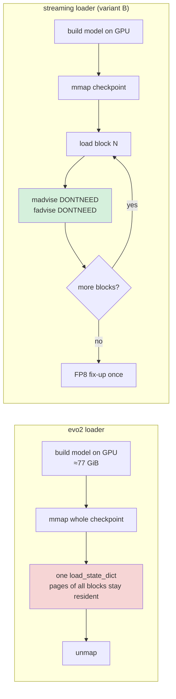

# SparkBricks: Large Biological Models on a DGX Spark — What Fits in 128 GB

This note follows [[PROJECT REPORT - SparkBricks - Benchmarking Genomics and Biological Models on a DGX Spark - A Technical Deep Dive]], which covered the first day of SparkBricks: the `sparkbench` framework, the genomics results and the first protein model. This note covers the second half of the plan, the large biological models, measured overnight from 11 to 12 November 2026 on `bling`, a DGX Spark with one GB10 GPU and 128 GB of memory that the CPU and GPU share. The models are four sizes of the ESM-2 protein language model (150M to 15B parameters), the ESMFold structure predictor, and three sizes of the Evo 2 DNA language model (1B, 7B, 40B). The note also covers what had to change in the framework once runs lasted all night and the agent session hosting them could no longer be trusted to keep them alive.

> [!summary]
> - **Unified memory lets the Spark run models a 24–48 GB card cannot hold.** ESM-2 15B, with 56 GiB of fp32 weights, ran every point of its sweep in fp32 and bf16, peaking at 81 GiB. It also failed its bf16-versus-fp32 agreement check, which the smaller models pass easily.
> - **Capacity limits come from the single largest tensor, not total memory.** Evo 2 7B scores 64 kb of DNA but not 131 kb, because one step asks for a 32 GiB block. ESMFold stops between 1,060 and 1,530 residues, because one step asks for an L³-sized 53 GiB tensor.
> - **The 40B model failed in the loader, not in the model.** The stock evo2 loader keeps the memory-mapped checkpoint resident beside the GPU copy of the model, and on unified memory both use the same RAM. A streaming loader, gated by a bit-exact equivalence check on the 7B, is queued.
> - **Overnight runs need to outlive the agent.** A memory-pressure reaper in the agent harness killed three benchmark queues mid-run. Queues now run as systemd user units, and orphaned runs are reconciled from their telemetry.

## 1. Why models, and why this machine

A DGX Spark's GPU is slower than a datacenter GPU at almost everything: the first note measured about 92.8 TFLOP/s for bf16 matrix multiplies and about 220 GB/s of memory bandwidth, against 989 TFLOP/s and 3.35 TB/s for an H100 SXM. What the Spark has instead is capacity. The GPU allocates from the same 128 GB pool as the operating system, so a model whose weights would not fit on a 24 or 48 GB workstation card can still be loaded. The model half of SparkBricks therefore asks a capacity question first and a speed question second:

1. Does the model load, and up to what sequence length and batch size does a forward pass fit?
2. How fast does it run, compared with what the roofline (the measured compute and bandwidth limits) allows?
3. Does reduced precision (bf16) still give the answers fp32 gives?

Every model runs as a pinned Python workload script inside a pinned NGC PyTorch container, and reports one JSON `point` event per sweep point. The first note (sections 8.2 and 8.3) describes that contract and the allocator cap that turns an out-of-memory error into a recorded `cuda_oom` point instead of a crashed machine. The cap is 80 % of device memory (97.35 GiB) for ESM and ESMFold, and 85 % (103.43 GiB) for Evo 2.

| Model | Parameters | Weights | What a point measures |
|---|---|---|---|
| ESM-2 150M / 650M / 3B / 15B | 0.15–15.1 B | 0.55 GiB to 56.3 GiB (fp32) | One embedding forward pass for a (length × batch × precision) point |
| ESMFold | 3B stem + folding trunk | ≈8 GiB in use | One full structure prediction for a natural protein |
| Evo 2 1B / 7B / 40B | 1.1 / 6.6 / ≈40 B | 2.1 / 12.3 / ≈77 GiB (bf16) | One scoring forward pass over L bases of GRCh38; then 256 generated bases |

## 2. ESM-2: four sizes, one surprise each way

ESM-2 is a family of protein language models. P08 embeds a deterministic Swiss-Prot panel: 64 proteins per length bin, each cut to an exact length so a point has a fixed token count, plus 64 natural-length proteins on which bf16 and fp32 embeddings are compared by cosine similarity of the mean-pooled vectors.

| Model | Peak bf16 tokens/s | Best TFLOP/s | Peak memory | bf16 vs fp32, min cosine |
|---|---|---|---|---|
| 150M | 56,000 (L128, B16) | 16.5 | 6.8 GiB | 0.99997 |
| 650M | 15,060 (L256, B64) | 19.6 | 15.0 GiB | 0.99986 |
| 3B | 5,855 | 33.2 | 35.8 GiB | 0.99997 |
| 15B | 1,360–1,510 at ≥2,048 tokens per call | 45.7 | 81.3 GiB (L1024, B64, fp32) | **0.98550** |

The compute column rises with model size as expected: small models leave the GPU idle between kernel launches, and large ones keep it busy. The 15B reaches about half of the measured bf16 matrix-multiply peak, which is a reasonable ceiling for a transformer that also spends time on attention, normalization and memory traffic.

**15B fits, which was not expected.** The plan assumed fp32 would run out of memory at large batches. It did not: every sweep point ran in both precisions, and the largest (1,024 residues × 64 sequences in fp32) peaked at 81.3 GiB under the 97 GiB cap. Loading was the slow part, at 333–358 s for 56 GiB, about 170 MB/s, which is far below the disk's speed and not yet explained.



**15B's bf16 embeddings disagree with fp32.** Eight of the 64 natural proteins fall below the 0.999 cosine threshold; the worst is 0.9855 for Q12130, a 139-residue uncharacterized yeast protein. The result is identical in both runs, so it is deterministic rounding sensitivity, not noise. The three smaller models never go below 0.9998 on the same panel. The run is therefore recorded as `failed:validation` while its throughput points stay valid, and the report advises fp32 for 15B embeddings until the cause is understood.

**Small bf16 calls on 15B are slow.** Below about 2,048 tokens per call, bf16 runs at 330–440 tokens/s, between 0.76× and 1.07× the fp32 speed. That is about 13 TFLOP/s, far from both the compute limit and the bandwidth limit (reading 28 GiB of bf16 weights at 220 GB/s takes 0.14 s per call). The chart above shows it: batch 1 and batch 4 stay flat while the larger batches climb to the 1,400–1,500 plateau. The likely cause is the GPU kernel chosen for those matrix shapes, but this is unconfirmed.

**A conditions note became a finding.** The 150M and 650M models were first measured while about 165 GB of model weights were downloading, and the 650M curve had dips at middle lengths that were blamed on the downloads. Quiet reruns on 12 November reproduce every point to within 2–3.5 %, dips included (at batch 16, 13.5k tokens/s at 64 residues, 10.3k at 512, 14.8k at 1,024). The downloads had not affected the measurements, and the dips come from the workload itself. The old runs are kept in the runs table but marked `superseded`, which removes them from medians and charts.

## 3. ESMFold: the L³ tensor

ESMFold predicts a protein's 3D structure from its sequence alone: an ESM-2 3B stem produces per-residue representations, and a folding trunk refines a pair representation (one vector per residue pair) and emits coordinates. P07 folds natural Swiss-Prot proteins, four per length bin, and checks each PDB file (one Cα atom per residue, finite coordinates, confidence scores in range).



| Length bin | Median seconds | Peak memory | Median pLDDT |
|---|---|---|---|
| ≈64 aa | 0.47 | 8.0 GiB | 79.5 |
| ≈256 aa | 10.4 | 8.9 GiB | 92.9 |
| ≈512 aa | 66.5 | 14.0 GiB | 87.7 |
| ≈768 aa | 191 | 29.1 GiB | 76.4 |
| ≈1,024 aa | 474 | 48.6 GiB | 69.9 |
| 1,530 aa | out of memory | — | — |

Time grows as about L^2.7 above 250 residues, so a 500-residue protein takes about a minute and a 1,000-residue protein about eight. All 28 structures that ran passed the checks.

The out-of-memory message for the 1,530-residue protein explains the ceiling precisely:

```text
Tried to allocate 53.37 GiB. ... this process has 72.50 GiB memory in use. 97.35 GiB allowed;
Of the allocated memory 70.95 GiB is allocated by PyTorch, and 1.28 GiB is reserved by PyTorch but unallocated.
```

53.37 GiB is exactly 1,530³ × 4 × 4 bytes. That is one fp32 score for every triple of residues (i, j, k) in each of four attention heads, which is what the trunk's triangle attention computes when it runs unchunked. The term grows with L³, while the rest of the model grows with L², so it decides the limit. Only 1.28 GiB was free inside PyTorch's cache, so this is a genuine shortage rather than fragmentation. ESMFold's `chunk_size` option computes that tensor in slices; a follow-up experiment (`p07-esmfold-chunked`) folds the same 1,024-residue protein chunked, to measure the cost of chunking, and then one protein each at 1,536 and 2,048 residues.

## 4. Evo 2 1B and 7B: long DNA contexts

Evo 2 is a DNA language model built on StripedHyena 2, an architecture that mixes convolution-based Hyena operators with a few attention layers. Its main promise is long context: the published models handle up to a million bases. P09 scores windows of GRCh38 chr20 from 35 Mb at increasing lengths (one forward pass at batch 1), then generates 256 bases from a 1 kb prompt. NVIDIA's packaged Evo 2 service is x86-only, so this runs the open-source `evo2` 0.6.0 package on NGC PyTorch 26.05.



| | 1 kb | 8 kb | 32 kb | 64 kb | 131 kb | Generation |
|---|---|---|---|---|---|---|
| **1B** (2.1 GiB) | 9,692 tok/s | 8,704 | 7,729 | — | 6,809 (36 GiB) | 51.0 tok/s |
| **7B** (12.3 GiB) | 2,636 | 2,674 | 2,397 | 2,324 (48 GiB) | out of memory | 10.8 tok/s |

Scoring speed is nearly flat in context length. Most of the model's layers are Hyena operators, long convolutions computed by FFT whose cost grows as L log L rather than L², and only a few layers use attention. Generation is bounded by bandwidth: each new base reads every weight once, so the 7B's 13.2 GB of weights at 220 GB/s allow at most 16.7 bases per second. It reaches 10.8, 65 % of that bound.

**The 7B's 131 kb limit is one block, not the total.** The failed request is a single 32 GiB allocation, made while 52.4 GiB is allocated and 31.6 GiB sits in PyTorch's cache as freed blocks too small to reuse. PyTorch's `expandable_segments` allocator option is designed for this kind of fragmentation. A second variant enabled it, confirmed inside the container that it took effect (one expandable segment instead of two fixed ones in a probe), and got the same failure to within 2 GiB. The cap leaves about 17 GiB to grow, and no rearrangement of the cache creates a contiguous 32 GiB block. Getting to 131 kb on one Spark would need the model to compute that step in pieces, which is a change to the model code rather than to the allocator. The 1B model, whose tensors are smaller, scores 131 kb at 36 GiB.

## 5. Evo 2 40B: a loader problem on unified memory

The 40B checkpoint is 82 GB. In bf16 the model needs about 77 GiB on the GPU, which leaves around 40 GiB of the 121.7 GiB pool for everything else. The first attempt did not get through loading: available memory fell from 123 GiB to 27 GiB in 15 seconds, then to 2.6 GiB at 157 seconds, and swap started filling.

Reading the evo2 and vortex code explains it. The loader first builds the whole model on the GPU in bf16, which accounts for most of the 96 GiB drop in the first 15 seconds. It then memory-maps the checkpoint file and applies it in one `load_state_dict` call:

```python
state = torch.load(path, map_location="cpu", mmap=True, weights_only=True)
model.custom_load_state_dict(state)   # every tensor of all 50 blocks, in one call
```

A memory-mapped file costs nothing until it is read; once read, its pages stay resident until the mapping is released, and the mapping lives until the call returns. On a discrete GPU those pages sit in host RAM, separate from the GPU's memory, so nobody notices. On the Spark, the 77 GiB model and the checkpoint's resident pages compete for the same 128 GB.



The streaming loader applies the checkpoint one block at a time (51 groups: `blocks.0` to `blocks.49` plus embedding and output layers). After each block it unmaps that block's pages with `madvise(MADV_DONTNEED)` and drops them from the page cache with `posix_fadvise(POSIX_FADV_DONTNEED)`, so at most about one block of checkpoint is resident. It still calls vortex's own `custom_load_state_dict`, because that function converts the Transformer Engine FP8 metadata stored in the checkpoint. Three details make a partial call safe:

- **Narrowed key set.** `custom_load_state_dict` treats every model key absent from its input as missing and writes default FP8 metadata for it. During each call, `model.state_dict` is temporarily replaced by a function returning only the current block's keys, so earlier blocks' loaded metadata is not overwritten.
- **Deferred FP8 fix-up.** The function ends with `fixup_fp8_extra_states(model)`, which checks the FP8 scaling state of every Transformer Engine layer, including layers not yet loaded. The first check run failed here with `KeyError: 'scaling_fwd'`. It is now a no-op during the block loads and runs once at the end.
- **Per-block Wqkv permutation.** The function also reorders the query/key/value weight rows of every attention block, reading each one from the state dict, so it would fail on blocks not in the current call. The loader switches that step off and applies the same arithmetic to each block's own tensors as it loads.

A wrong loader could load a 40B model with subtly wrong weights and produce plausible but incorrect numbers. The loader therefore runs behind a gate: `scripts/check_evo2_stream_loader.py` loads the 7B twice, once with each loader, and requires every parameter and buffer to hash identically, every FP8 scale and amax history to match, and the logits of a fixed 1 kb window to be bit-identical. The gate is the first item of the queue that runs the 40B. It caught the first version of the loader, which stopped before the 40B run started. The 40B run itself has a host-memory guard: if available memory drops below 6 GiB, the workload exits with a dedicated code that is recorded as `resource:host-memory-guard`, rather than pushing the machine into swap.

## 6. Keeping overnight runs alive

The first attempt at the 40B model had a side effect worth recording. As available memory fell to 2.6 GiB, the Claude Code harness's memory-pressure reaper killed the three background shells that were running benchmark queues. That was not the kernel's out-of-memory killer, and the commands had not failed. The runner process died mid-run, its Docker container kept running as an orphan, and its record stayed in the `running` state.

Three changes followed:

- **Queues run as systemd user units.** `scripts/sbqueue.sh launch NAME ITEM...` starts `systemd-run --user --unit sbq-NAME`, which is not a child of the agent's shell. `SBQ_AFTER=OTHER` chains queues, and an item written as `'!command'` is a gate that stops the queue if it fails. Each queue writes `BEGIN`/`END` lines to `runs/_queues/NAME.log`.
- **Runs know who owns them.** Each record stores the runner's PID and the machine's boot ID. SIGTERM goes through the same path as Ctrl-C (stop the container, record `interrupted`). `sparkbench reconcile` finds `running` records whose runner is gone, optionally stops the orphaned container, and finalizes the record as `interrupted:orphaned` from its telemetry and the points it wrote. Every queue runs it before each item.
- **Replaced runs stay visible.** `sparkbench supersede RUN... --reason` keeps a run in the runs table but drops it from medians, charts and the capability matrix. It was used for the 150M and 650M runs made during downloads.

On unified memory a container's memory limit offers no protection either: the cgroup is not charged for CUDA allocations, so Docker's `--memory` cannot stop a GPU allocation from exhausting the host. Protection has to come from inside the workload, through the allocator cap and the host-memory guard.

## 7. Working rules this produced

- Read an out-of-memory message for the size of the failed request, not just the fact of failure. In both capacity limits here, that number identified the tensor responsible.
- Check how an allocator option behaves in the actual image before relying on it, and keep a negative result: `expandable_segments` was active and still did not help.
- Treat a loader for a model that fits only once as untrusted until it is checked bit for bit against the reference loader on a model that fits twice.
- Run multi-hour queues outside the agent's process tree, and make every run record recoverable after its runner dies.
- When a shape in the data survives a quiet rerun, record it as a finding about the workload, not as a measurement condition.

## 8. Current status

As of the morning of 2026-11-12:

- **Measured:** ESM-2 150M, 650M (quiet reruns, three runs each), 3B and 15B (one run each); ESMFold up to ≈1,000 residues; Evo 2 1B and 7B (two allocator variants).
- **Running (systemd queues, in order):**
  - `genomics`: P03 whole genome on the no-alt reference (the recall question from the first note), P03 with HaplotypeCaller, P02 on the whole genome with both callers, and the four P01 variants that need a quiet rerun.
  - `evo40`: the loader equivalence gate on the 7B, then Evo 2 40B with the streaming loader.
  - `fold`: ESMFold with chunked attention at 1,024, 1,536 and 2,048 residues.
- **Not started:** long reads (P04), somatic calling (P05), pangenome (P06), the OpenFold2 and Boltz-2 NIMs, ColabFold MSA search, and the ceiling tests (60× coverage, two genomes at once).

## 9. Open questions and next steps

- **Does Evo 2 40B load and run with the streaming loader,** and how close does generation get to its bound of 220 GB/s ÷ 82 GB ≈ 2.7 bases per second?
- **Why do 15B's bf16 embeddings disagree with fp32** for some short proteins, and is it the attention, the layer norms, or accumulated rounding over 48 layers? Comparing per-layer activations between precisions on Q12130 would locate it.
- **Why are small bf16 calls on 15B no faster than fp32?** A kernel trace (Nsight Systems) of a 139-token call would show which GEMM kernels run.
- **Why does the 15B fp32 checkpoint load at only 170 MB/s?**
- **Does chunking let ESMFold fold 2,048 residues,** or does the L² pair representation run out next?
- **How accurate are the ESMFold structures?** That needs a panel of experimental structures released after the model's training cutoff and a TM-score tool.

## 10. Where things are

- Repository: `/home/manuel/code/wesen/2026-10-11--parabricks-benchmarks`
  - `workloads/esm_embed.py`, `workloads/esmfold.py`, `workloads/evo2_score.py` (including `stream_load_checkpoint`), `workloads/_sbworkload.py` (allocator cap, out-of-memory points, host-memory guard).
  - `scripts/sbqueue.sh` (detached queues), `scripts/check_evo2_stream_loader.py` (loader equivalence gate).
  - `configs/experiments/p07-*.yaml`, `p08-*.yaml`, `p09-*.yaml`; interpretation in `configs/report/narrative.yaml`.
  - `src/sparkbench/runner.py` (`reconcile`, SIGTERM handling), `src/sparkbench/cli.py` (`reconcile`, `supersede`).
- Ticket SPARK-001 diary, steps 13–18: `ttmp/2026/11/11/SPARK-001--sparkbricks-genomics-benchmarking-platform-for-dgx-spark/reference/01-diary.md`.
- Shareable report: https://claude.ai/artifact/RES424VPKTMjdcHjWWJode (private until shared).

## Related notes

- [[PROJECT REPORT - SparkBricks - Benchmarking Genomics and Biological Models on a DGX Spark - A Technical Deep Dive]]: day one, the framework and the genomics results.
- [[PROJ - Bling - Bringing a DGX Spark onto Tailscale]]: the machine.
