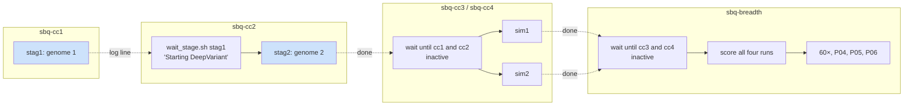
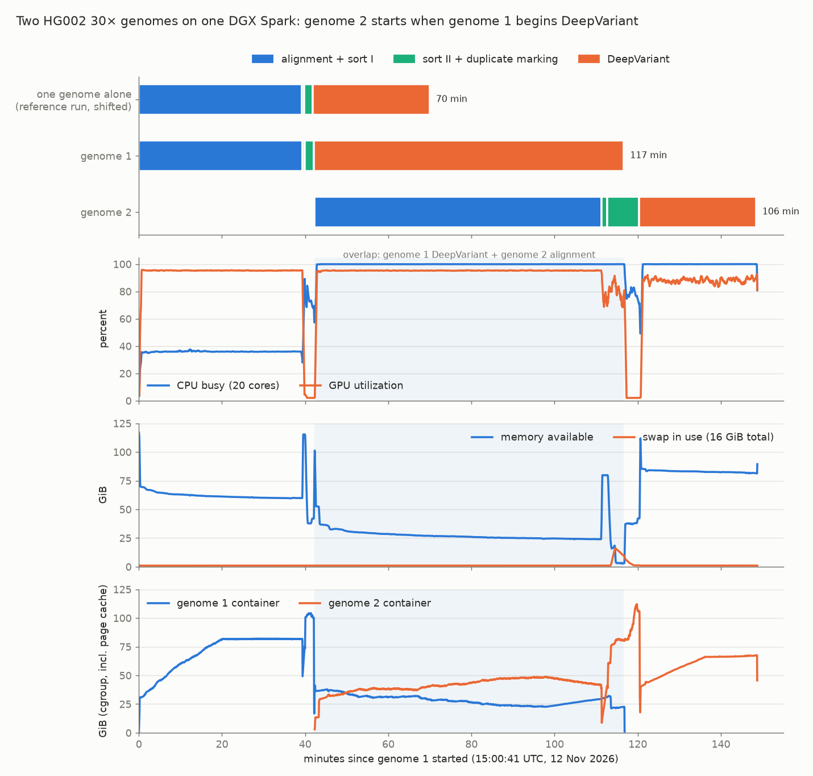

# SparkBricks: One Genome Fills the Spark — Hard Filters, Two Genomes at Once and the Breadth Pipelines

This note covers the afternoon and evening of 12 November 2026 in SparkBricks, the project that measures NVIDIA Parabricks 4.8.0-1 genomics pipelines and large biological models on `bling`, a DGX Spark. The Spark has one GB10 GPU, 20 Arm cores and 128 GB of memory that CPU and GPU share. It follows [[PROJECT REPORT - SparkBricks - Day Two Results - Reference Choice, Caller Precision, Evo 2 40B and Long Proteins]]. That note ended with a whole-genome DeepVariant run on the GRCh38 no-alt reference: 70.2 minutes, SNP F1 0.9954. It also showed that HaplotypeCaller's gap to DeepVariant was almost entirely precision.

Four pieces of work followed, in the order the user approved them ("do 1. 2. 3. 4."):

1. Check whether GATK's standard hard filters close HaplotypeCaller's precision gap, and move the datacenter-GPU comparison onto the no-alt run.
2. Find out whether one Spark processes more genomes per day when it runs two at once.
3. Prepare a 60× genome.
4. Prepare the three projects not yet started: long reads (P04), somatic tumor/normal calling (P05) and pangenome-aware calling (P06).

The first two are finished and are the core of this note. The second answered its question with a clear no, and the measurements explain why. The third and fourth are built, committed and queued, but have not run yet. They are described here as designs, with the risks to watch when they run.

> [!summary]
> - **GATK's generic hard filters make HaplotypeCaller worse on a modern benchmark.** On HG002 30× against GIAB v4.2.1, SNP F1 falls from 0.9897 to 0.9850. The filters remove 17,000 false SNPs but also 48,000 true ones. Two rules do the damage: `MQ<40` and `SOR>3` each catch about three true SNPs for every false one. Only `QD<2` is selective.
> - **One genome already uses all of the Spark.** Starting a second genome when the first reaches DeepVariant made the pair finish in 148.7 minutes instead of 140.3 minutes sequentially, 6 % slower. During the overlap the two jobs together progressed at 0.94 of one job's speed. The GPU is busy 88–95 % of the time in both alignment and calling, and two processes share it by time-slicing, so overlap finds no idle GPU time. When the second genome sorted and marked duplicates beside the first genome's DeepVariant, free memory fell to 2.5 GiB and the 16 GiB of swap filled.
> - **Measured against the right reference, the Spark is 1.9× one H100 PCIe** for a 30× genome (70.0 vs ≈37.5 min), 1.6× two L4s, and faster than the two-A100 DGX published in 2023 (87.9 min).
> - **Breadth is built and queued.** The plan is a 60× genome, PacBio HiFi with `pacbio_germline`, SEQC2 HCC1395 exome tumor/normal pairs through Mutect2 and DeepSomatic, and the HPRC v1.1 graph through `pangenome_germline`. This needed four new adapters, sample-free somatic scoring and a GATK FilterMutectCalls post-filter.

## 1. Where the project stood

SparkBricks runs every workload through `sparkbench`, a small Python framework in the repository at /home/manuel/code/wesen/2026-10-11--parabricks-benchmarks. An *experiment* is a YAML file that names a dataset, a reference, a container image, an adapter and one or more *variants*. A variant is a set of tool options. The runner launches the container and records several things for each run in a directory under `runs/`:

- the resolved configuration;
- a telemetry trace sampled every second, covering CPU, GPU, memory, swap, pressure-stall information and disk;
- stage timings parsed from the tool's log;
- a `run.json` with the outcome.

If an experiment declares an `accuracy:` block, the run's VCF is then scored against a truth set with RTG `vcfeval`. Datasets are locked inputs: each has a manifest with URLs, checksums and expected record counts. The first deep dive, [[PROJECT REPORT - SparkBricks - Benchmarking Genomics and Biological Models on a DGX Spark - A Technical Deep Dive]], describes the architecture in full.

Two baseline results from the morning recur throughout this note:

| Run (HG002 30×, GRCh38 no-alt) | Elapsed | SNP P / R / F1 | INDEL F1 |
|---|---|---|---|
| DeepVariant germline, FASTQ → VCF | 70.2 min | 0.9979 / 0.9930 / 0.9954 | 0.9908 |
| HaplotypeCaller on that run's BAM (caller only), unfiltered | 27.5 min | 0.9885 / 0.9910 / 0.9897 | 0.9855 |

The DeepVariant run is `20261112T060425Z-p03-wgs-deepvariant-noalt-A-r1`. It is the solo reference for the concurrency experiment in section 4.

## 2. Hard filters on HaplotypeCaller

### 2.1 What a hard filter is

HaplotypeCaller is the GATK germline caller. It reports every candidate variant it can support and expects a separate step to decide which candidates to trust. GATK offers two such steps:

- **VQSR** learns a model from known variant sites. It needs a large cohort or a whole genome, plus the training resources.
- **Hard filtering** applies fixed thresholds to per-site annotations that HaplotypeCaller writes into the INFO field. GATK recommends it when VQSR is not possible, and many single-sample pipelines use it by default.

The test was whether hard filters close the precision gap of section 1. HaplotypeCaller made 38,733 false-positive SNPs where DeepVariant made 7,179.

Each annotation measures one way a call can be an artifact rather than a real variant:

| Annotation | What it measures | Why a high or low value is suspicious |
|---|---|---|
| `QD` | variant quality divided by the depth of reads carrying it | Low QD means weak evidence per read: the call is supported by depth, not by clean evidence. |
| `FS` | Fisher's exact test for strand bias (Phred-scaled) | Real variants appear on reads from both strands. A variant seen on one strand only is often a sequencing artifact. |
| `SOR` | strand odds ratio, a strand-bias test that behaves better at high depth | Same reasoning as FS. |
| `MQ` | root-mean-square mapping quality of the reads at the site | Low MQ means the reads could map elsewhere: the site may be in a repeat or a duplicated region. |
| `MQRankSum` | rank-sum test of mapping quality, alt reads vs ref reads | Alt reads that map worse than ref reads suggest mismapped reads. |
| `ReadPosRankSum` | rank-sum test of position within the read, alt vs ref | Alt alleles only near read ends suggest an alignment artifact. |
| `QUAL` | Phred-scaled confidence that the site is variant | Low confidence. |

GATK's documented generic thresholds are:

```text
SNPs:    QUAL<30 || QD<2 || FS>60  || MQ<40 || SOR>3  || MQRankSum<-12.5 || ReadPosRankSum<-8
Indels:  QUAL<30 || QD<2 || FS>200 ||          SOR>10 ||                    ReadPosRankSum<-20
```

### 2.2 Implementation: a post-filter that does not rerun the caller

The filter belongs after the caller, so it should not require rerunning a 30-minute caller. `sparkbench postfilter RUN... --preset gatk-hard` takes a finished run, filters its kept VCF, scores the result with the same `vcfeval` path as the run itself, and stores the result next to the original score.

The filter is a *soft* filter: records are kept, and a failing record gets a label in the FILTER column. This matches GATK's `VariantFiltration` and keeps the filtered VCF auditable, because every removed call is still there with the reason attached. The preset is a list of `(label, bcftools expression)` pairs, applied one at a time with `bcftools filter -m +`, which adds labels without overwriting earlier ones. From `src/sparkbench/accuracy.py`:

```python
FILTER_PRESETS = {
    "gatk-hard": [
        ("GATK_SNP",   'TYPE="snp" && (QUAL<30 || INFO/QD<2 || INFO/FS>60 || INFO/MQ<40 || INFO/SOR>3'
                       ' || INFO/MQRankSum<-12.5 || INFO/ReadPosRankSum<-8)'),
        ("GATK_INDEL", 'TYPE!="snp" && (QUAL<30 || INFO/QD<2 || INFO/FS>200 || INFO/SOR>10'
                       ' || INFO/ReadPosRankSum<-20)'),
    ],
}
```

Three details matter for correctness:

- **Missing annotations.** A missing annotation does not trigger a rule. `bcftools` treats a comparison with a missing value as false, which matches VariantFiltration.
- **Mixed records.** A record with both SNP and indel alleles counts as an indel (`TYPE!="snp"`).
- **Stored scores.** The result is stored as extra rows in `run.json` `accuracy[]` with `filter: gatk-hard`. The unfiltered rows stay. `score_accuracy` was changed to keep these rows when a run is rescored, so rescoring can no longer silently delete a post-filter result. The report shows a second table with the change in false positives and false negatives.

### 2.3 Results

Filtering and rescoring the whole genome took 218 seconds.

| HaplotypeCaller run | SNP TP / FP / FN | SNP P / R / F1 | INDEL F1 |
|---|---|---|---|
| no-alt, unfiltered | 3,336,002 / 38,733 / 30,372 | 0.9885 / 0.9910 / **0.9897** | 0.9855 |
| no-alt, gatk-hard | 3,287,877 / 21,824 / 78,497 | 0.9934 / 0.9767 / **0.9850** | 0.9858 |
| sample reference, unfiltered | 3,258,661 / 25,979 / 107,713 | 0.9921 / 0.9680 / 0.9799 | 0.9776 |
| sample reference, gatk-hard | 3,210,111 / 12,403 / 156,263 | 0.9962 / 0.9536 / 0.9744 | 0.9777 |

On both references the filters raise precision and lower F1. On no-alt they remove 16,909 false SNPs and 48,125 true ones. Indels are essentially unchanged. The no-alt VCF ends with 4,786,754 PASS records, 257,652 labelled `GATK_SNP` and 4,020 labelled `GATK_INDEL`.

### 2.4 Which rule does the damage

A filter is a union of rules, so the aggregate hides which rule is responsible. To separate them, I counted how often each rule fires on the unfiltered run's `vcfeval` output. `tp.vcf.gz` holds the calls that match the truth set, and `fp.vcf.gz` holds the calls that do not. A short pysam loop evaluates every SNP rule on every record:

| Rule | True SNPs caught (sole rule) | False SNPs caught (sole rule) | True : false |
|---|---|---|---|
| `MQ<40` | 31,091 (28,717) | 7,302 (6,038) | 4.3 : 1 |
| `SOR>3` | 19,065 (16,718) | 5,963 (3,919) | 3.2 : 1 |
| `QD<2` | 384 (332) | 6,212 (4,428) | 1 : 16 |
| `FS>60` | 0 | 19 | — |
| `QUAL<30`, `MQRankSum`, `ReadPosRankSum` | 0 | ≤ 1 | — |

The table shows three things:

- **`QUAL<30` is inert.** HaplotypeCaller does not emit calls below QUAL 30 by default, so the rule never sees a candidate.
- **`QD<2` is the only selective rule.** It removes sixteen false SNPs for every true one. Applied alone, it would move SNP F1 to about 0.9906 by arithmetic on these counts. That variant was not rescored, so the number is an estimate.
- **`MQ<40` and `SOR>3` remove three to four true SNPs per false one.** In the "sole rule" column the effect is mostly not shared with other rules: 28,717 of the true SNPs that MQ catches are caught by MQ alone.

A likely explanation, not verified by stratification here: the GATK thresholds were published when benchmarks avoided difficult regions. GIAB v4.2.1 deliberately includes segmental duplications, the MHC and other low-mappability regions. In those regions true variants are carried by reads with lower mapping quality and less even strand coverage. A rule that treats low MQ as evidence of error was tuned for a benchmark without those regions. Stratifying the true positives by the GIAB difficult-region BEDs would test the explanation directly. That is an open item.

The conclusion for the comparison is simple. The standard way to make HaplotypeCaller more precise moves it further from DeepVariant, not closer. DeepVariant's advantage on this genome comes from the model, not from a missing filtering step.

## 3. The datacenter comparison, on the right reference

The day-one comparison with published datacenter-GPU results used the run on the sample-data reference. That run had the recall problem traced to the reference on day two. `configs/report/published.yaml` now points at `p03-wgs-deepvariant-noalt`. NVIDIA times fq2bam (alignment, sort and duplicate marking) and DeepVariant separately. The Spark's numbers come from the stages of one `deepvariant_germline` run:

| System | Parabricks | fq2bam | DeepVariant | Sum | Spark ÷ system |
|---|---|---|---|---|---|
| **DGX Spark (GB10)**, this run | 4.8.0-1 | 41.9 | 28.1 | **70.0** (70.2 end to end) | 1.0× |
| 1× H100 PCIe (read off a chart) | 4.5 | 23.7 | 13.8 | ≈37.5 | 1.9× |
| 1× RTX PRO 6000 (read off a chart) | 4.5 | 15.3 | 9.0 | ≈24.3 | 2.9× |
| 2× L4 | 4.8.0 | 31.92 | 12.27 | 44.2 | 1.6× |
| 8× H100, end to end | 4.2 | — | — | 14 | 5.0× |
| 4× A100 DGX, end to end | 3.7.0-1 | — | — | 49.1 | 1.4× |
| 2× A100 DGX, end to end | 3.7.0-1 | — | — | 87.9 | **0.8×** |

The fairest row is the single H100 PCIe: one GPU against one GPU, two Parabricks versions apart. There the Spark takes 1.8× as long for fq2bam and 2.0× as long for DeepVariant. Section 4 adds a qualification. On the Spark, DeepVariant keeps all 20 cores at 99 % for 28 minutes, and the datacenter hosts have far more CPU cores beside each GPU. The DeepVariant ratio therefore compares host CPUs at least as much as GPUs.

Accuracy can also be compared, once. The only published truth-set result for a Parabricks 4.8 DeepVariant run uses HG002 on DNBSEQ-T7 data and reaches SNP recall 0.987. This run reaches 0.993. The sequencer and the read set differ, so this is a consistency check, not a ranking. On day one the point read "miss"; on the no-alt reference it reads "ok".

## 4. Two genomes at once

### 4.1 The hypothesis, read from solo telemetry

A 30× genome on the Spark has two long phases with different resource profiles. The solo run's telemetry, averaged over each stage, shows them:

| Stage (solo run) | Seconds | CPU busy | GPU busy | Memory available (min) |
|---|---|---|---|---|
| alignment + sort phase I | 2,350 | 35.8 % | 94.9 % | 59.9 GiB |
| sort phase II | 35 | 79.7 % | 4.4 % | 85.7 GiB |
| duplicate marking (+ BQSR slot) | 127 | 71.8 % | 2.1 % | 37.5 GiB |
| DeepVariant | 1,686 | 99.4 % | 87.5 % | 42.2 GiB |

During alignment, two thirds of the CPU sits idle. DeepVariant is CPU-bound: its `make_examples` step, which turns aligned reads into image-like tensors, runs on the CPU and keeps all 20 cores busy. The obvious idea is to overlap the two phases. If genome 2 starts aligning when genome 1 starts DeepVariant, genome 2's alignment should use the GPU while genome 1's calling uses the idle cores. If that works, two genomes take less than twice the time of one.

Memory looked like it would fit. Alignment never left less than 59.9 GiB available, and DeepVariant never less than 42.2 GiB. Two alignments at once looked riskier: by the fq2bam help text, the sort buffer defaults to 70 % of host memory. That case got its own variant with `--memory-limit 32`.

The `GPU busy` column turned out to matter most, and it was read too lightly at planning time. `nvidia-smi` reports GPU utilization as the fraction of time during which at least one kernel was running. It does not measure how much of the GPU those kernels occupy. Both phases keep a kernel running about 90 % of the time.

### 4.2 How the experiment was built

The experiment is `configs/experiments/p03-wgs-concurrent-2x.yaml`, filed under P03 because ceiling tests belong to the end-to-end whole-genome project. It has four variants:

- `stag1` and `stag2` are default runs. `stag2` starts when `stag1` reaches DeepVariant.
- `sim1` and `sim2` start at the same moment, each with `--memory-limit 32`.

Both genomes in a pair use the same HG002 FASTQs. Starting genome 2 at the right moment needs a gate that watches another run. `scripts/wait_stage.sh` takes a run-id suffix and a pattern. It polls the newest matching run's `stderr.log` every 10 seconds, exits 0 when the pattern appears, and exits 1 if the run ends first:

```bash
# scripts/wait_stage.sh SUFFIX PATTERN [TIMEOUT_S]
while :; do
  d=$(ls -dt "$ROOT"/runs/*-"$suffix" | head -1)
  grep -q -- "$pattern" "$d/stderr.log" && exit 0          # stage reached
  [ "$(status_of "$d")" != running ] && exit 1             # run ended first
  sleep 10
done
```

The runs themselves go through `scripts/sbqueue.sh`, which runs a list of experiments as a systemd user service. Queues therefore survive the agent session that started them. The queue file format already supported gate commands. It gained an `SBQ_RUN_ARGS` environment variable so that both pairs could run with `--defer-accuracy`. Scoring a genome with `vcfeval` takes several minutes of all cores. Running it while the other genome is still being processed would contaminate that genome's timing, so scoring waits until both pairs are done.



### 4.3 What happened

The staggered pair ran from 15:00:40 to 17:29:24 UTC. Both runs succeeded and neither container's cgroup recorded an out-of-memory kill.



The figure has four panels. The top panel shows stage bars, with the solo run aligned to genome 1's start for comparison. The second shows system-wide CPU and GPU busy percentages, smoothed over 30 s. The third shows memory available and swap in use. The fourth shows each container's cgroup memory, which includes page cache. The shaded band is the overlap.

| Stage | Solo | Genome 1 | Genome 2 | What it overlapped with |
|---|---|---|---|---|
| alignment + sort I | 2,350 s | 2,360 s | **4,140 s** (1.76×) | genome 2's ran beside genome 1's DeepVariant |
| sort phase II | 35 s | 35 s | 85 s (2.4×) | genome 1's DeepVariant |
| duplicate marking | 127 s | 128 s | **460 s** (3.6×) | the end of genome 1's DeepVariant, then its shutdown |
| DeepVariant | 1,686 s | **4,476 s** (2.65×) | 1,686 s | genome 1's ran beside genome 2's alignment |
| elapsed | 4,209.9 s | 7,011.6 s | 6,388.3 s | |

The two stages that ran alone are controls: genome 1's alignment and genome 2's DeepVariant. Both match the solo run to within 10 seconds. Every slowdown in the table therefore comes from the overlap, not from the machine having changed since the morning.

For the pair as a whole:

| | Wall time for two genomes | Genomes per day |
|---|---|---|
| sequential (2 × solo) | 140.3 min | 20.5 |
| staggered pair | **148.7 min** | 19.4 |

Overlapping made the Spark about 6 % slower than running the genomes one after the other.

### 4.4 Why: the two phases share one GPU by time-slicing

Normalized progress rates are the clearest way to read the overlap. Divide a stage's solo time by its time in the overlap, and the result is the fraction of its solo speed the stage achieved:

```text
genome 2 alignment:   2,350 s / 4,140 s = 0.568 of solo speed
genome 1 DeepVariant: 1,686 s / 4,476 s = 0.377 of solo speed
                                           -----
combined                                   0.945 of one job's speed
```

The aligner's own log confirms the first number independently. Parabricks prints aligned bases per GPU-minute every ten seconds. The solo run steadied at 2.26–2.32 × 10⁹, and genome 2's alignment in the overlap at 1.25–1.37 × 10⁹, which is 57 %.

A combined rate below 1 means the overlap did less total work per second than either job alone. Idle CPU cannot be the limit, because the CPU did not stay idle. The GPU explains it. Without NVIDIA's Multi-Process Service (MPS), which this setup does not use, kernels from two processes do not run on the GPU at the same time. The driver time-slices between the two CUDA contexts. Each phase needs the GPU for a known fraction of its solo time, so the combined rates are bounded by:

```text
0.949 × r_align + 0.875 × r_dv ≤ 1        (GPU time is not shared, only divided)
0.949 × 0.568   + 0.875 × 0.377 = 0.539 + 0.330 = 0.869
```

The GPU was measured 95.2 % busy during the overlap. So 87 % of the GPU's time did work the solo runs would also have done, and the remaining 8 percentage points went to switching between contexts or to kernels running less efficiently while interleaved. This is an inference from the arithmetic, not a profile. The direction does not depend on the exact split, though: if both phases keep the GPU busy about 90 % of the time on their own, overlapping them can win back at most the remaining 10 %, and switching costs about as much.

The CPU picture is harder to read. CPU busy was 99.9 % during the overlap, while the same arithmetic gives about 58 % of useful CPU work (0.358 × 0.568 + 0.994 × 0.377). Threads that busy-wait for the GPU or for each other count as busy in `/proc/stat`. Busy-percent therefore marks the CPU as unavailable without showing what it was doing. Pressure-stall information for the CPU (`some avg10`) averaged 44.8 % in the overlap and 0 % in solo alignment, so tasks really were waiting for cores.

The planning mistake was to treat the GPU-busy column as headroom information when it is occupancy information. Alignment does leave CPU free, but DeepVariant cannot use that CPU without also needing the GPU, which alignment already holds 95 % of the time.

### 4.5 Memory at the boundary

The overlap itself was comfortable for memory. Available memory sat at 23–30 GiB for 69 minutes and nothing swapped. The problem came when genome 2 finished aligning and began sort phase II and duplicate marking while genome 1 was still in DeepVariant. In the solo run that stage is the memory peak.

| Window | Memory available, min | Swap in use, max | Memory pressure, full avg10, max |
|---|---|---|---|
| genome 1 aligning alone | 37.5 GiB | 1.0 GiB | 1.8 % |
| overlap: DeepVariant + alignment | 23.5 GiB | 1.0 GiB | 4.8 % |
| genome 2 sort II / duplicate marking beside DeepVariant | **2.5 GiB** | **16.0 GiB** (all of it) | **21.3 %** |
| genome 2 DeepVariant alone | 42.2 GiB | 1.2 GiB | 0 % |

A `full` memory-pressure value of 21 % means that in that 10-second window, every runnable task was stalled waiting for memory 21 % of the time. That is why duplicate marking took 3.6× as long. The kernel avoided an out-of-memory kill by reclaiming page cache and swapping. The machine's other tenant also felt it: Claude Code's own background shell, a 30-second polling loop waiting for genome 1 to finish, was stopped by Claude Code's low-memory guard during this window.

A caution about the per-container curve: cgroup `memory.current` includes the page cache charged to the container. Genome 2's container reached 112.2 GiB, but much of that is reclaimable file cache from the BAM it was writing. The useful sizing numbers are the system-wide memory available and swap. The `peak_cgroup_mem_gib` figure in `run.json` is an upper bound, not a requirement.

### 4.6 The simultaneous pair, still running

The second pair, two genomes started together, each with `--memory-limit 32`, began at 17:34:52 and was still aligning when this note was written. The aligner logs already answer the throughput question for that phase. Each genome aligns at about 1.01 × 10⁹ bases per GPU-minute, so the pair aligns 2.02 × 10⁹ bases per minute against the solo 2.26–2.32 × 10⁹. Two alignments at once deliver about 88 % of one alignment's throughput. They are less efficient than the staggered overlap, as expected from the 95 %-busy GPU. Projected from those rates, both alignments finish about 89 minutes after the start, against 78 minutes for two sequential solo alignments. The DeepVariant halves will then overlap each other on 20 cores. Accuracy for all four concurrent runs is scored after the pair finishes.

### 4.7 What this means

A DGX Spark runs one 30× genome at a time at full speed: about 20 genomes a day, end to end, on Parabricks defaults. Running two at once does not raise that number and can push the machine into swap. For throughput, the right scheduler is a plain sequential queue. The interesting tuning question moves elsewhere: whether DeepVariant's CPU-bound `make_examples` can be made cheaper. Each stage on the Spark is bound by a different resource, and only one of them is the GPU.

## 5. Breadth: the pipelines for 60×, long reads, somatic and pangenome

All four breadth projects are built, unit-tested (49 tests pass), committed in `1399830` and queued behind the simultaneous pair. None has run yet, so this section describes inputs, design and the specific risks to check.

### 5.1 Datasets, and why each one

Every input is public and pinned in a manifest under `configs/datasets/`.

| Manifest | What it is | Why this one |
|---|---|---|
| `hg002-60x` | HG002 NovaSeq 6000 60×, R1/R2 (41.6 + 43.2 GB) from Google's `brain-genomics-public` bucket, md5-pinned | Same flowcell and lane (`A00744:46:HV3C3DSXX:2`) as the 30× used so far, so the 30× is a downsample of this library. The 60× run changes coverage and nothing else. |
| `hg002-hifi-30x-bam` → `hg002-hifi-30x` | PacBio Revio HG002 30-fold, GRCh38 aligned and haplotagged BAM (37.2 GB), converted to FASTQ locally | A current long-read HG002 set with a published DeepVariant result from PacBio (SNP F1 0.999438, INDEL F1 0.990657 at 30×). |
| `seqc2-wes-pair` | SEQC2 HCC1395 (tumor, SRR7890883) and HCC1395BL (matched normal, SRR7890874) whole-exome FASTQs from ENA, 2×125, md5-pinned | The standard public somatic benchmark: a breast-cancer cell line and a normal line from the same person, with a consensus truth set. |
| `seqc2-truth` | SEQC2 v1.2.1 merged high-confidence SNV + indel VCF (41,072 records), high-confidence BED, exome BED | Its VCF has no sample columns, which affects scoring (section 5.3). |
| `hprc-v1.1-d9` | HPRC v1.1 minigraph-cactus GRCh38 graph, GBZ (4.42 GB). Giraffe indexes, path list and FASTA are built locally | The graph NVIDIA's 4.8 documentation uses. HG002 is *not* among its 44 samples, so calling HG002 against it is not circular. |

One training-data fact qualifies every HG002 result. HG002 is in DeepVariant's training data, with 17 Illumina WGS and 10 PacBio replicates. Genome-wide HG002 F1 is therefore optimistic, and Google's own published metrics use the held-out HG003. DeepSomatic trains on HCC1395 with chromosome 1 held out, so chromosome 1 is the fair scope for the somatic comparison.

### 5.2 Four new adapters

Each Parabricks tool is wrapped by a `PbrunTool` adapter in `src/sparkbench/adapters/parabricks.py`. An adapter maps dataset roles to command-line flags and declares which outputs the run produces. The help text of every new tool was captured to `.txt` and parsed `.json` first, so flag names come from the binary and not from memory.

| Adapter | `pbrun` tool | Inputs (dataset key → flag) | Outputs |
|---|---|---|---|
| `pacbio_germline` | minimap2 alignment + DeepVariant PacBio model | `fq` → `--in-fq` | BAM, VCF |
| `somatic` | BWA-MEM alignment of both samples + GPU Mutect2 | `t_r1/t_r2` → `--in-tumor-fq`, `n_r1/n_r2` → `--in-normal-fq` | `calls.vcf.gz`, `tumor.bam`, `normal.bam` |
| `deepsomatic` | DeepSomatic on existing BAMs | `tumor_bam`, `normal_bam` | VCF |
| `pangenome_germline` | Giraffe alignment to the graph + pangenome-aware DeepVariant | reference roles `gbz`, `dist`, `min`, `zipcodes`, `paths` | BAM, VCF |

DeepSomatic needs BAMs, and the somatic run produces two. `datasets.register_output` already turned a run's output into a new dataset manifest. It now accepts comma-separated artifacts, and a new kind `aligned-bam-pair` yields the keys `tumor_bam`, `tumor_bam_bai`, `normal_bam` and `normal_bam_bai`. Both somatic callers therefore see the same alignments. Their difference is then the caller alone, which is the same discipline the P02 caller comparison used on day two.

### 5.3 Scoring somatic calls

Germline scoring compares genotypes. `vcfeval` matches a query sample's genotype against a truth sample's genotype after normalizing representation. Somatic calling breaks that in two ways:

- **The truth VCF has no sample columns.** SEQC2 publishes sites and alleles, not genotypes.
- **Somatic genotypes mean something else.** A tumor carries subclonal mutations at variant-allele fractions far below 50 %. A germline genotype like `0/1` does not describe that, and callers report their own conventions.

The somatic mode compares alleles only. With `somatic: true` in the experiment's accuracy block, `accuracy.evaluate` adds three `vcfeval` options:

```python
extra = ["--sample", "ALT", "--squash-ploidy", "--all-records"] if somatic else []
```

- `--sample ALT` tells vcfeval that the truth has no sample and to treat every ALT allele as present.
- `--squash-ploidy` compares alleles regardless of zygosity.
- `--all-records` stops vcfeval from dropping records whose FILTER is not exactly `PASS`. The truth's FILTER column reads `PASS;HighConf`, which vcfeval would otherwise treat as filtered, leaving an empty truth set. The query side is unaffected, because sparkbench already restricts it to PASS or `.` records before scoring. Raw Mutect2 output, before `FilterMutectCalls`, leaves FILTER as `.`, so the raw score covers every call and works as a recall ceiling.

The mode was tested by scoring the truth set against itself on chromosome 1, which gave 3,573 true positives.

The evaluation region is also new. Somatic truth is defined inside the SEQC2 high-confidence BED, and an exome run only covers the exome. The accuracy block's new `regions: [exome_bed]` names extra BED keys from the truth manifest. A new `intersect_beds` function intersects them with the high-confidence BED before scoring, so the score covers exactly the bases that are both trusted and sequenced.

**Mutect2 needs its filter.** Parabricks ships GPU Mutect2, matching GATK 4.3.0.0, but not `FilterMutectCalls`. NVIDIA's somatic tutorial runs the GATK 4.3.0.0 jar on the raw VCF. The `postfilter` command from section 2 therefore gained a second preset, `mutect2`. It runs `FilterMutectCalls` with default arguments from `data/tools/gatk-4.3.0.0/` and stores the scored result beside the raw one. The filter reads a `<vcf>.stats` file that Mutect2 writes, and whether `pbrun somatic` writes it under the name the filter expects is unverified until the run happens. That is why the post-filter step in the queue is marked non-fatal. Best practice would also use a panel of normals and gnomAD allele frequencies. Neither is used here, which will cost precision against published Mutect2 results.

### 5.4 Long reads from an aligned BAM

PacBio publishes the HG002 HiFi set as an aligned, haplotagged BAM. `pacbio_germline` wants reads. `scripts/prep_hifi_fastq.sh` converts the BAM with `samtools fastq -F 0x900`, using the samtools binary inside the Parabricks image so that no new software is installed. The flag drops secondary (0x100) and supplementary (0x800) records, so each read appears exactly once. Without it, split alignments would put parts of the same read into the FASTQ several times.

One limitation follows from the source. A reads file reconstructed from an aligned BAM contains whatever the BAM contains. If PacBio's BAM omits unmapped reads, the FASTQ does too, and the run aligns a slightly cleaner read set than a sequencer would produce. The effect on runtime and accuracy is expected to be small, but the note records it because it is invisible in the results.

### 5.5 The pangenome reference

`pangenome_germline` aligns reads to a variation graph with vg Giraffe and calls with pangenome-aware DeepVariant. It needs Giraffe indexes built by the vg version it was compiled against, 1.75.1. The prebuilt `.d9.min` and `.d9.dist` files that HPRC publishes are older and lack the "zipcodes" index. `scripts/prep_pangenome.sh` runs the third-party container `quay.io/vgteam/vg:v1.75.1`, which ships an arm64 build:

```bash
vg autoindex -p $P.autoindex.1.75.1 -G $P.gbz -w giraffe -t 20     # .dist, .shortread.withzip.min, .shortread.zipcodes
vg paths -x $P.gbz -L --paths-by GRCh38 > $P.paths                 # reference paths in the graph
grep -v -e _decoy -e _random -e chrUn_ -e chrEBV -e chrM -e chain_ $P.paths > $P.paths.sub
vg paths -x $P.gbz -p $P.paths.sub -F > $P.fa                     # linear FASTA for --ref
samtools faidx $P.fa
```

Nobody has published how much memory index construction for a human pangenome needs on a 128 GB machine. The script therefore samples `MemAvailable` every 5 seconds into `autoindex.mem.log` while it runs.

The main risk is contig naming. The FASTA extracted from the graph may name contigs by their graph path, for example `GRCh38#0#chr1` rather than `chr1`. GIAB truth sets and BEDs use `chr1`. If the names are prefixed, scoring finds no overlap and reports recall near zero, which would look like a failed caller rather than a naming mismatch. The prep script prints the first kept path and the first FASTA contig. These have to be read before the P06 run is trusted, and the contigs renamed if needed.

### 5.6 The queue

The breadth queue (`sbq-breadth`, started 15:16 UTC) waits for both concurrency queues to go inactive, then runs:

1. Score the four concurrent runs with `sparkbench accuracy`.
2. Fetch every breadth dataset in parallel (`scripts/fetch_parallel.sh`, which also fetches the GATK release). Verify the 60× and SEQC2 read counts. Prepare the HiFi FASTQ (non-fatal).
3. Run `p03-wgs-60x`, `p04-pacbio-wgs` and `p05-somatic-wes`.
4. Register `seqc2-wes-bams` from the somatic run, then post-filter its VCF with `--preset mutect2` (non-fatal).
5. Run `p05-deepsomatic-wes`.
6. Prepare the pangenome (non-fatal), then run `p06-pangenome-wgs`.

The downloads run while nothing is being timed. The project rule is that no download or hashing overlaps a timed run, because both compete for the disk and the CPU. One exception happened this afternoon: the SEQC2 truth set (about 30 MB) was fetched while genome 1 was aligning, and the diary records it as negligible.

### 5.7 What the breadth results will be compared with

Published numbers exist for each new project, though rarely for one GPU:

| Workload | Published | Source |
|---|---|---|
| Giraffe, paired-end 30× | 36.5 / 27.9 min on 2 / 4 RTX PRO 6000; 76.9 / 50.5 min on 2 / 4 L4 | Parabricks 4.8 docs |
| pbmm2 / minimap2, 35× PacBio | 12.1 / 10.2 min on 2 / 4 RTX PRO 6000 | Parabricks 4.8 docs |
| DeepSomatic, 50× T/N | 54.3 / 35.1 min on 2 / 4 H100 SXM | Parabricks 4.5 blog |
| Mutect2 | 27.7 / 13.7 min on 2 / 4 H100 SXM | Parabricks 4.5 blog |
| DeepSomatic 1.9 WES, CPU | 15.5 min, SNV recall 0.9439, precision 0.9909 | DeepSomatic r1.9 metrics |
| DeepVariant 1.9 PacBio, CPU (HG003) | 66 min, SNP F1 0.998509, INDEL F1 0.993898 | DeepVariant r1.9 metrics |
| Pangenome-aware DeepVariant 1.9, CPU (HG003) | 4 h 35 min, SNP F1 0.998117, INDEL F1 0.996423 | DeepVariant r1.9 metrics |

## 6. What went wrong, and what it taught

- **The concurrency plan read utilization as headroom.** Section 4.4 has the details. The data needed to predict the result, GPU busy at 95 % and 88 %, was in the solo run's summary before the experiment started. The experiment still earned its two hours: it measured the context-switching cost and the memory boundary, which the summary could not have shown.
- **The agent's own tooling shares the machine.** When memory ran short, Claude Code stopped its background waiter. Nothing in the benchmark depended on it, because the queues are systemd services and gate on each other, not on the session. Had a run depended on the session, it would have been lost. The rule from day two still holds: anything longer than a few minutes runs in a systemd queue.
- **Container memory peaks include cache.** The 112 GiB peak for genome 2 looks alarming next to 128 GB of RAM. The swap counter and pressure-stall numbers carry the real signal. Both are already in the telemetry, and the report should lead with them.

## 7. Working rules this produced

- Read GPU utilization as occupancy, not as spare capacity. Before overlapping two GPU jobs, add their solo busy fractions. If the sum is well over 100 %, overlapping cannot help.
- Judge an overlap by summing the normalized progress rates of its parts. A sum below 1 means the overlap lost throughput, whatever the utilization graphs look like.
- Test a filter rule by rule against the scored `tp`/`fp` records before trusting it as a unit. The aggregate F1 hides which rule removes true calls.
- Keep post-processing results beside the raw score, labelled. Never replace the raw score.
- For somatic truth without samples, match alleles (`--sample ALT --squash-ploidy`) and score inside the intersection of the confident and the sequenced regions.
- Print and check contig names whenever a reference is derived from another artifact, such as a graph or a BAM, before any accuracy number is believed.

## 8. Current status

| Item | State |
|---|---|
| GATK hard filters on HaplotypeCaller (both references) | done, in the report |
| Datacenter comparison on the no-alt run | done, in the report |
| Staggered two-genome pair | done: both runs succeeded; 148.7 min for two genomes vs 140.3 sequential; accuracy pending |
| Simultaneous two-genome pair (`--memory-limit 32`) | running since 17:34 UTC, aligning at 88 % of solo combined throughput |
| 60×, P04 PacBio, P05 Mutect2 + DeepSomatic, P06 pangenome | built and queued behind the simultaneous pair |
| Code | pushed to the private GitHub repository `wesen/sparkbricks` |
| Shareable report artifact | not yet republished with this afternoon's results |

## 9. Open questions and next steps

- Rescore HaplotypeCaller with `QD<2` alone, to confirm the ≈0.9906 estimate.
- Stratify the true SNPs removed by `MQ<40` and `SOR>3` using the GIAB difficult-region BEDs, to test the segmental-duplication explanation.
- Finish the simultaneous pair and score all four concurrent runs. Accuracy should match the solo run, and a difference would mean concurrency changed results, not only timing.
- Run the breadth queue. Check the 60× memory peak in sort phase II and duplicate marking, whether `pbrun somatic` writes the `.stats` file, and the pangenome contig names.
- Profile DeepVariant's `make_examples` on the Spark. With 20 cores at 99 % for 28 minutes, it is the stage most likely to gain from tuning, and the stage that most separates the Spark from a datacenter host.
- Score HG002 on chromosome 20 or a held-out region, to show how much of the genome-wide F1 comes from HG002 being in the training data.
- Clean up the large BAMs from the concurrency runs once accuracy is scored.

## 10. Where things are

- Repository: /home/manuel/code/wesen/2026-10-11--parabricks-benchmarks (GitHub `wesen/sparkbricks`, private).
- Diary: `ttmp/2026/11/11/SPARK-001--sparkbricks-genomics-benchmarking-platform-for-dgx-spark/reference/01-diary.md`, steps 26 onward.
- Hard filters: `src/sparkbench/accuracy.py` (`FILTER_PRESETS`, `apply_filter`, `filter_mutect_calls`) and `src/sparkbench/runner.py` (`postfilter_accuracy`).
- Concurrency: `configs/experiments/p03-wgs-concurrent-2x.yaml`, `scripts/wait_stage.sh`, `scripts/sbqueue.sh`. Runs `20261112T150040Z-p03-wgs-concurrent-2x-stag1-r1`, `20261112T154256Z-p03-wgs-concurrent-2x-stag2-r1`, and the solo reference `20261112T060425Z-p03-wgs-deepvariant-noalt-A-r1`.
- Breadth: manifests in `configs/datasets/`, experiments `p03-wgs-60x`, `p04-pacbio-wgs`, `p05-somatic-wes`, `p05-deepsomatic-wes`, `p06-pangenome-wgs`, scripts `fetch_parallel.sh`, `prep_hifi_fastq.sh`, `prep_pangenome.sh`.
- Data-source research: `ttmp/.../sources/breadth-data-sources-2026-11-12.md`. Published GPU results: `configs/report/published.yaml`.

## Related notes

- [[PROJECT REPORT - SparkBricks - Benchmarking Genomics and Biological Models on a DGX Spark - A Technical Deep Dive]]
- [[PROJECT REPORT - SparkBricks - Large Biological Models on a DGX Spark - What Fits in 128 GB]]
- [[PROJECT REPORT - SparkBricks - Day Two Results - Reference Choice, Caller Precision, Evo 2 40B and Long Proteins]]
- [[PROJ - Bling - Bringing a DGX Spark onto Tailscale]]
