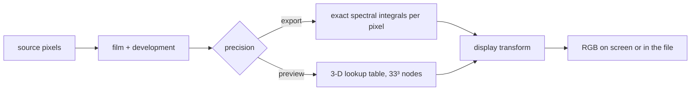
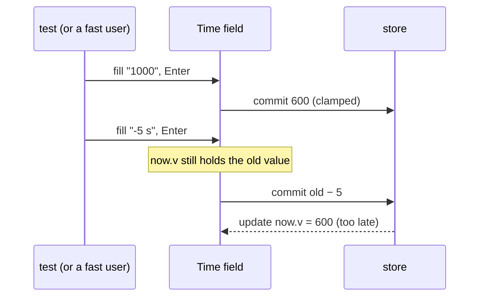

# Chromobench: The First Run on a Real GPU

Chromobench is a browser darkroom: it prints digital RAWs and colour-negative scans through a physical model of
film and paper. It has two engines that compute the same print. The WebGPU engine is the one the photographer is
meant to use; the CPU reference engine computes in f64 and serves as the oracle that the GPU engine is tested
against. This report covers one session, 2026-11-14, in which the GPU engine and its test suite ran for the first
time on the machine they were written for, an Apple M1 Max, with the browser driven locally rather than through a
tunnel. The earlier report,
[[PROJ - Chromobench Usability Cosplay and Real-GPU Measurement - Technical Project Report|Chromobench Usability Cosplay and Real-GPU Measurement]],
ended with the question "should the browser test suite gain a real-GPU project?" This report answers it, and
explains what the answer revealed about the difference between a test passing and a test measuring what its name
claims.

The central finding is narrow and precise. The GPU engine reads its preview lookup tables through the hardware
texture filter. On Metal, that filter computes its interpolation weights with 8 fractional bits; on SwiftShader, the
software renderer the test suite had always used, it computes them in f32. The parity tolerances were tuned on
SwiftShader, so six GPU tests fail on the real GPU, and the cause can be shown in one line of WGSL and one
measurement.

> [!summary]
> - **The suite never ran on a GPU.** `playwright.config.ts` launched both WebGPU projects with
>   `--use-webgpu-adapter=swiftshader`, on every machine. A new `REAL_GPU=1` switch drops the flag; headless
>   Chromium then gets the Metal adapter.
> - **On Metal, 100 of 106 browser tests pass.** Four chain-parity tests fail because preview tables are read through
>   the hardware filter, whose weights are quantised to 1/256 (measured: 257 distinct weights, maximum weight error
>   1/512). Switching the lookup to the kernel's manual trilinear path makes all four pass. One test fails on Metal's
>   less exact `pow`/`exp`/`log` (4 codes of 65535). One test simply asserts that the adapter is SwiftShader.
> - **Every error is below one 8-bit level.** Exports, which use exact per-pixel integrals, matched core in every run.
> - **The engine itself works.** A Time drag settles in about 0.2 s at 4000 px with no main-thread stall; the CPU
>   engine needs about 1.2 s at 640 px. The first print and strip handling agree between engines on ten real files.
> - **Two unrelated defects surfaced.** Every Mod shortcut in the browser specs was spelled for Linux, and a typed
>   relative entry (`-5 s`) committed right after another commit is applied to a stale base value.

## 1. The two engines and why they are compared

A print in chromobench is a chain of physical stages: scene or negative → film exposure → film development → enlarger
→ paper exposure → paper development → display. Several stages involve spectral integrals: the light that passes
through three dye layers, weighted by the paper's spectral sensitivities, summed over wavelength. Evaluating those
integrals per pixel is exact but expensive. Evaluating them once on a grid of inputs and interpolating is fast and
approximate. Chromobench uses both strategies, and the choice depends on what the result is for.

| Path | Used for | How the spectral stages are evaluated |
|---|---|---|
| CPU exact | export from the CPU engine | f64 integrals per pixel |
| CPU tabulated | CPU previews (640 px) | f64 tables, interpolated in f64 |
| GPU export | export from the GPU engine | f32 integrals per pixel in the shader |
| GPU preview | everything on screen (up to 4000 px) | f32 tables, interpolated by the GPU |

The GPU parity suite (`packages/gpu/test/browser/*.spec.ts`) checks each GPU path against its CPU counterpart:
GPU export against CPU exact, GPU preview against CPU tabulated. The second comparison isolates one question: given
the same table, does the GPU interpolate it the way core does? The tolerance for that comparison is tight, `maxLevels
< 0.1`, a tenth of an 8-bit display level, because in principle the only difference is f32 against f64 arithmetic.



The rest of this report is about the box labelled "3-D lookup table" and what "interpolated by the GPU" means on
two different adapters.

## 2. What the test suite actually measured

A test run is a claim about an environment as much as about code. The handoff guide for chromobench stated that "on
a Mac with a GPU, the `[chromium-webgpu]` and `[gpu-parity]` projects exercise the real GPU engine." The
configuration said otherwise:

```ts
// playwright.config.ts, before this session
{
  name: 'gpu-parity',
  use: {
    browserName: 'chromium',
    channel: 'chromium',
    launchOptions: {
      args: ['--enable-unsafe-webgpu', '--use-webgpu-adapter=swiftshader', '--enable-features=Vulkan'],
    },
  },
},
```

`--use-webgpu-adapter=swiftshader` forces Chrome's software WebGPU implementation regardless of the hardware. The
flag was added on a Linux development machine with no usable GPU, where it is the only way to get WebGPU at all.
It was never made conditional. To see what Chrome provides on the Mac without it, a probe launched four browsers
and asked each for an adapter:

```js
const a = await navigator.gpu.requestAdapter({ powerPreference: 'high-performance' });
const i = a.info;
return [i.vendor, i.architecture, i.isFallbackAdapter ? 'fallback' : ''].join(' | ');
```

| Launch | Adapter |
|---|---|
| bundled Chromium 158, headless, the suite's flags | google · swiftshader · fallback |
| bundled Chromium 158, headless, no flags | apple · metal-3 |
| Google Chrome 157, headless, no flags | apple · metal-3 |
| Google Chrome 157, headed, no flags | apple · metal-3 |

Two facts follow. First, every green GPU run before this session was a SwiftShader run. Second, headless mode is not
an obstacle on macOS: the earlier report's remote setup used `headless: false` as a precaution, and the precaution
is unnecessary. The fix to the configuration is a single constant:

```ts
// REAL_GPU=1 drops the SwiftShader flags so the WebGPU projects get the machine's own adapter (Metal on a Mac;
// headless works there). Without it every run, on any machine, tests the software adapter.
const webgpuArgs = process.env['REAL_GPU']
  ? []
  : ['--enable-unsafe-webgpu', '--use-webgpu-adapter=swiftshader', '--enable-features=Vulkan'];
```

The default is unchanged, so the Linux machine keeps working. The switch makes the real-GPU run a deliberate act
with a name, instead of an assumption.

## 3. A detour: the suite had never run on macOS

Before the GPU question could be asked, the suite had to pass on the Mac with its default configuration. It did
not: 14 of 106 tests failed. Thirteen failures shared one cause, visible in two lines:

```ts
// a spec
await page.keyboard.press('Control+z');

// packages/shell/src/core/keys.ts:120
const mod = platform.mac ? e.metaKey : e.ctrlKey;
```

The application binds its shortcuts to "Mod", which is ⌘ on macOS and Ctrl elsewhere. The specs pressed Ctrl
literally. On Linux the two are the same key; on macOS `Control+z` reaches the app as an unbound chord, the undo
never happens, and the next assertion fails with a value from before the undo. Playwright has a key name for
exactly this case, `ControlOrMeta`, which resolves per platform. All fourteen occurrences across seven spec files
were Mod chords (`Control+z` ten times, the two spellings of `Control+Shift+Z`, `Control+k`, `Control+Alt+0`), so the
fix was mechanical.

The key points:

- A suite that has only run on one platform encodes that platform's assumptions in places nobody reads as
  assumptions. A key name is one of them.
- The failure mode was quiet: no error, just a state that did not change. The assertion that failed was several
  lines after the cause.

## 4. Six failures on Metal

With `REAL_GPU=1`, the full suite ran on Metal in 1.1 minutes. All end-to-end studio tests and the 320-case engine
conformance suite passed. Six GPU-parity tests failed:

| Test | Measure | Metal | Bound |
|---|---|---|---|
| preview chain: display RGB vs core tabulated | `maxLevels` | 0.861 | < 0.1 |
| darkroom chain (real mode), preview | `maxLevels` | 0.577 | < 0.1 |
| multi-exposure print, paper log H (preview) | `xPre.maxDiff` | 3.7e-4 | ≤ 2e-4 |
| worker (f64) tables vs GPU tables | `maxLevels` | 0.116 | < 0.01 |
| output display: oklch knee and TRC vs core | share of values off by > 2e-6 | 0.34 % | < 0.2 % |
| tables stage 1: device capabilities | `adapter.fallback` | `false` | `true` |

Reading this table well means separating three kinds of failure.

The last row is not a numerical failure at all. The test asserts `expect(r.caps.adapter.fallback).toBe(true) //
SwiftShader`: it encodes the environment as a requirement. On any real GPU it must fail.

The fifth row involves no lookup table. It compares the display transform (an oklch gamut knee and a transfer curve)
computed in WGSL against core. On Metal the maximum linear error is 3.0e-5 and the worst 16-bit output is 4 codes
away from core, which is 0.016 of an 8-bit level. Metal's `pow`, `exp2` and `log2` are less exact than SwiftShader's on
these inputs (WGSL allows both), and the test's bound of 2e-6 was set from what SwiftShader delivered.

The first four rows share a pattern that points to a single cause. Every one is a preview measurement. In the same
tests, the export assertions passed: `export.maxLevels < 0.1` held in the darkroom chain and the multi-exposure
print. And `max8bit ≤ 1`, the bound on the worst 8-bit difference, held in all of them. The preview path is off by
less than one display level, but by far more than f32 arithmetic explains.

## 5. Hardware texture filtering

### 5.1 How the preview reads a table

The kernel that runs the print chain, `packages/gpu/kernels/pointwise.wgsl`, has four ways to read a 3-D table. The
mode is a uniform:

```wgsl
fn lut3(T: texture_3d<f32>, v: vec3<f32>, lo: f32, hi: f32) -> vec4<f32> {
  let N = textureDimensions(T).x;
  let Nf = f32(N);
  let u = clamp((v - vec3<f32>(lo)) / (hi - lo), vec3<f32>(0.0), vec3<f32>(1.0));
  let mode = U.misc.y;
  if (mode == 1u) { return tetra(T, u * (Nf - 1.0), N); }
  if (mode == 2u) { return trilin(T, u * (Nf - 1.0), N); }
  if (mode == 3u) { return textureSampleLevel(T, samp, u, 0.0); }          // BROKEN on purpose: no half-texel mapping
  return textureSampleLevel(T, samp, (u * (Nf - 1.0) + 0.5) / Nf, 0.0);     // the Studio's (u·32 + 0.5)/33
}
```

Mode 0 is the preview default (`LOOKUP.hw` in `packages/gpu/src/chain/run.ts:78`). It hands the coordinate to
`textureSampleLevel` with a linear sampler, and the texture unit performs the trilinear interpolation. The
expression `(u · (N − 1) + 0.5) / N` is the half-texel mapping: texel centres sit at `(i + 0.5) / N` in normalised
coordinates, so a value `u = 0` must land on the centre of texel 0 and `u = 1` on the centre of texel `N − 1`. Mode
3 omits this mapping on purpose, as a negative control for the tests.

Modes 1 and 2 do the interpolation in the shader. `trilin` fetches the eight surrounding nodes with `textureLoad`,
which returns stored values without filtering, and weights them in f32:

```wgsl
fn trilin(T: texture_3d<f32>, u: vec3<f32>, N: u32) -> vec4<f32> {
  let i = min(vec3<u32>(floor(u)), vec3<u32>(N - 2u));
  let t = u - vec3<f32>(i);
  var acc = vec4<f32>(0.0);
  for (var c = 0u; c < 8u; c++) {
    let d = vec3<u32>(c & 1u, (c >> 1u) & 1u, (c >> 2u) & 1u);
    let w = select(1.0 - t.x, t.x, d.x == 1u) * select(1.0 - t.y, t.y, d.y == 1u) * select(1.0 - t.z, t.z, d.z == 1u);
    acc += w * textureLoad(T, i + d, 0);
  }
  return acc;
}
```

Both compute the same mathematical function, trilinear interpolation between the same eight nodes. They differ in
who computes the weights `t`. Mode 0 is one texture instruction; mode 2 is eight loads and the arithmetic. That
cost difference is why the preview uses mode 0.

### 5.2 What the texture unit does with the weights

WebGPU does not specify the precision of filter weights. Vulkan exposes it as the device limit
`subTexelPrecisionBits`, which must be at least 4; Metal does not publish a number. The precision can be measured.
A 2 × 1 texture holds 0 in texel 0 and 1 in texel 1. Sampling at the coordinate that should give weight `w` for
texel 1 returns `w` itself, quantised however the hardware quantises it:

```wgsl
@compute @workgroup_size(64) fn main(@builtin(global_invocation_id) id: vec3u) {
  let w = f32(id.x) / 4095.0;      // the wanted weight of texel 1
  let u = (0.5 + w) / 2.0;         // texel centres at 0.25 and 0.75
  o[id.x] = textureSampleLevel(t, s, vec2f(u, 0.5), 0.0).r - w;
}
```

Run over 4096 weights, in the same Chrome, on both adapters, for `rgba16float` and `rgba32float` textures:

| Adapter | Distinct weights returned | Maximum weight error | Implied fractional bits |
|---|---|---|---|
| Metal (M1 Max) | 257 | 0.00195 (1/512) | 8 |
| SwiftShader | 4096 (all requested) | 6.0e-8 | ≥ 12 (f32) |

The texture format makes no difference; the quantisation is in the weights, not the stored values. On Metal, every
weight is rounded to a multiple of 1/256, so an interpolated value can be off by up to 1/512 of the difference
between the two nodes it lies between, on each axis. SwiftShader computes the weight in f32, which is what core's
f64 reference assumes.

### 5.3 From weight error to display error

The error on an axis is at most `|Δ| / 512`, where `Δ` is the difference between adjacent table nodes along that
axis. How far that moves a displayed pixel depends on two things the table does not show by itself: how steep the
table is between nodes (a 33-node grid over the full exposure range has large steps where the film curve is steep),
and what follows the lookup. In the preview chain the table output feeds the display transform, whose transfer curve
amplifies small linear differences in the shadows. The measured result of all of this is the first table in
section 4: up to 0.86 of an 8-bit level for the display RGB, and 3.7e-4 in paper log H.

### 5.4 The experiment

A hypothesis about the cause is worth less than a change that removes the symptom. The preview's default lookup was
switched from mode 0 to mode 2 for one run, keeping everything else the same:

```ts
// packages/gpu/src/chain/run.ts:78, temporarily
const lookup = t.lookup ?? (t.precision === 'export' ? LOOKUP.tetra : LOOKUP.trilinear);
```

| GPU-parity on Metal | Hardware lookup (mode 0) | Manual trilinear (mode 2) |
|---|---|---|
| chain tests (4) | 0 pass | 4 pass |
| conformance | 320 / 320 | 320 / 320 |
| output display | fail | fail (unrelated, section 4) |
| caps asserts SwiftShader | fail | fail (unrelated, section 4) |
| total | 34 / 40 | 38 / 40 |

All four chain tests pass with the manual lookup. The change was reverted after the run; whether to make it
permanent is a decision with a cost attached (section 7).

The key points:

- Hardware trilinear filtering on Metal quantises weights to 8 bits. This is normal GPU behaviour, not a defect.
- SwiftShader computes the weights in f32, so tests tuned on it assume a precision that real GPUs do not provide.
- The error stays below one 8-bit level and never touches exports, which do not use tables.

## 6. The typed-entry race

One end-to-end test, `e2e/studio-wording.spec.ts`, failed three times in three runs on the Mac, each time at a
different step. One run is enough to show the mechanism. The test sets Time to 1000 s (clamped to 600 s, with a
toast saying so), confirms that the committed value is 600, then types `-5 s`, a relative entry meaning "five
seconds less". The expected toast is `Time −5 s → 595.0 s`. The toast that appeared was `Time −5 s → 5.0 s`.

The field's Enter handler, in `packages/studio-kit/src/dom/arg.ts`, parses the text against the control's cached
value:

```ts
if (e.key === 'Enter' && now.f) {
  const text = field.value;
  const parsed = parseEntry(kk, text, now.v);   // a relative entry is applied to now.v
  ...
  commitSet(now.f, c.value);
}
```

`now.v` is updated when the previous commit has propagated through the store back to the control. Playwright's
second `fill` and `press('Enter')` arrived before that propagation, so the relative entry was applied to an older
value (10 s, judging by the result of 5.0 s), not to 600 s:



The test passed twice in a row with `slowMo: 150`, which delays every Playwright action by 150 ms, and a second test
that types `+1/3 st` after a commit failed once in a full run and passed three times alone. A timing-dependent
failure that disappears when input slows down is a race. The M1 Max exposes it because it runs the test faster than
the Linux machine did; the bug is in the code on every platform. The range input a few lines above already reads its
base as `st.peek(pathOf(now.f)) ?? now.v`, the store's current value. Using the same base for typed entries is the
likely fix. It was recorded as a task, not fixed in this session.

## 7. What the tolerances should say

A tolerance in a parity test is a statement about two things: how exact the code is, and how exact the hardware is.
The suite's bounds mixed these, because they were measured on an adapter whose hardware was emulated in f32. There
are two coherent ways to separate them.

| Option | Preview lookup | Parity bounds | Cost |
|---|---|---|---|
| A | keep the hardware filter on every adapter | per adapter: SwiftShader keeps today's bounds; a real GPU gets `max8bit ≤ 1`, `maxLevels < 1` | none at runtime; the bound no longer catches a small interpolation regression on real GPUs |
| B | manual trilinear on non-fallback adapters | today's tight bounds everywhere | eight texel loads instead of one filtered sample per lookup; not yet measured at 4000 px |

Option A accepts that the preview is a preview: its error is already below one display level, and exports are exact.
Option B buys back core-equal previews at an unmeasured cost. Either way, the test that asserts SwiftShader must
become adapter-aware, and the display-transform bound needs a value for Metal's transcendental functions. Before
choosing B, the cost should be measured with the Time-drag timing in the next section.

## 8. The engine on the real GPU

The numerical findings say what the GPU computes. The photographer cares about what it feels like. CHB-027's
measurement scripts were written to drive the Mac remotely through a Playwright server and an SSH tunnel. Running on
the Mac itself, they need one change: `chromium.launch({ channel: 'chrome', headless: false })` in place of
`chromium.connect(...)`. Against a production build:

```json
{ "gpu": { "vendor": "apple", "architecture": "metal-3" }, "engine": "GPU · apple metal-3 · 4000 px" }
```

The timing script opens a file, waits until the render counter has been still for 2.5 s, then drags the Time slider
with twenty real mouse moves and measures again. A rAF probe records main-thread gaps over 100 ms. Times in ms:

| File | GPU open | GPU worst stall | GPU drag settles | GPU renders | CPU open | CPU drag settles | CPU renders |
|---|---|---|---|---|---|---|---|
| D750 NEF, daylight | 6570 | 200 | 203 | 8 | 5654 | 1214 | 3 |
| D750 NEF, night | 6596 | 200 | 206 | 8 | 5864 | 1028 | 3 |
| D750 NEF, tungsten | 6489 | 200 | 206 | 8 | 5863 | 1223 | 3 |
| 3-frame negative strip (DNG) | 1139 | 108 | 212 | 9 | 2841 | 1213 | 5 |
| Epson scan, 10 MP (DNG) | 2250 | 200 | 205 | 7 | 4442 | 1418 | 5 |

The drag is what the GPU engine exists for: the final print arrives in about 0.2 s at 4000 px, with eight
intermediate renders and no stall, against 1.2 s and three renders at 640 px on the CPU. A NEF opens slightly
slower on the GPU engine because LibRaw's decode in a worker dominates and the GPU then prints at 4000 px instead
of 640. The one cost the CPU engine does not have is a single main-thread stall of 100–200 ms during each GPU open,
probably pipeline creation or a synchronous upload; it is recorded as a task.

### 8.1 The first print on both engines

The changes of the previous two days (automatic exposure for photos, as-shot white balance, strip frame detection
and orientation) had been checked on the CPU engine only. A script opened ten private files on each engine and
recorded what the first print proposed. All ten files opened in the same mode, with the same frame count, frame
orientation and film-base note on both engines. Where the two engines' proposals can be compared directly:

| Comparison (GPU vs CPU) | Result |
|---|---|
| exposure time | equal on 9 of 10 files |
| colour lights on strips | within 0.007 log H |
| mean picture, NEFs | within 1 level of 255 |
| mean picture, strip frames | within 0.4–3.6 levels (400 point samples of a 4000 px image vs a 640 px image) |
| portrait rotation | applied on both (2674 × 4000 vs 428 × 640) |
| interface spec (layout switch, History in words, Actual Pixels) with `engine=gpu` | 5 / 5 pass |

The one file where the time differs shows how the first print works. It sets the exposure in two parts. The mean
density goes into the enlarger time, rounded to the time slider's grid of 1/6 stop; the remainder stays in the colour
lights:

```ts
/** Time on the time slider's grid: 10 s · 2^(k/6), clamped. */
export function gridTime(t: number): number {
  const k = /* clamp */ Math.round(6 * Math.log2(t / 10));
  return Number((10 * 2 ** (k / 6)).toFixed(3));
}
// ...
const t2 = real ? gridTime(t0 * 10 ** m) : t0;
const moved = Math.log10(t2 / t0);          // log H moved into the time
lights = total.map((l) => l - moved);       // the remainder stays in the lights
```

One sixth of a stop is `log10(2) / 6 = 0.0502` log H, so the neutral remainder in the lights is within ±0.025
unless the time hits a clamp. For the daylight NEF, the total exposure each engine measured, `log10(time) + lights`, was 0.7726 on the GPU
and 0.7784 on the CPU. The rounding boundary between 5.612 s and 6.3 s lies at 0.7742. The two measurements fall
0.0016 below and 0.0042 above it: the GPU proposes 5.612 s with lights +0.024, the CPU 6.3 s with lights −0.021.
The printed picture is the same (mean 105.0 against 105.1), but a photographer who switches engines would see a
different time for the same print. A tie-break or a small hysteresis around the boundary would make the proposal
stable; this is also recorded as a task. Note that the first print meters through the `preview` path, so on the
GPU its measurement goes through the hardware-filtered tables of section 5.

## 9. What changed

| Change | Where |
|---|---|
| `REAL_GPU=1` switch for the WebGPU projects | `playwright.config.ts` |
| `Control+` → `ControlOrMeta+` in fourteen key presses | seven browser spec files |
| handoff corrected: the suite runs SwiftShader unless `REAL_GPU=1` | `docs/HANDOFF.md` |
| local versions of the Mac smoke and timing scripts; a GPU-vs-CPU first-print script | ticket CHB-034 `scripts/` |
| diary, tasks, timing JSON | ticket CHB-034 |

With these changes, the default suite on the Mac fails 2 of 106: the typed-entry race, and one SwiftShader tolerance
that is narrowly missed on this machine (2.62e-6 against ≤ 2.5e-6; the same test passes under SwiftShader on the
Linux machine). With `REAL_GPU=1` it fails the six tests of section 4.

## 10. Open questions and next steps

- **Preview lookup on real GPUs.** Option A or B of section 7. Measuring the Time-drag cost of manual trilinear at
  4000 px comes first.
- **Adapter-aware parity tests.** The capability test should check the adapter it got, not demand SwiftShader; the
  display-transform bound needs a value for Metal.
- **The typed-entry race.** Read the base from the store, as the range input does.
- **The 200 ms stall per GPU open.** Profile pipeline creation and texture upload on the main thread.
- **A stable first-print time.** A tie-break at the 1/6-stop boundary.
- **A routine.** Run `REAL_GPU=1 CI=1 pnpm test:browser` on the Mac after every change to the GPU engine. Every green
  run before this session measured SwiftShader.

## 11. Where things are

- Ticket: `chromobench/ttmp/2026/11/14/CHB-034--real-gpu-check-on-the-m1-max-browser-suite-on-metal-smoke-and-timings-post-chb-027-checks-on-the-gpu-engine/`
  (diary with five steps, tasks, scripts `01-gpu-smoke.mjs`, `02-open-and-drag.mjs`, `03-first-print-gpu-vs-cpu.ts`).
- Lookup modes: `packages/gpu/kernels/pointwise.wgsl` (`lut3`, `tetra`, `trilin`), `packages/gpu/src/chain/program.ts`
  (`LOOKUP`), `packages/gpu/src/chain/run.ts:78` (preview default).
- First print: `apps/studio/src/host/first-print.ts` (`gridTime`, `firstPrint`, `measureExposure`).
- Typed entries: `packages/studio-kit/src/dom/arg.ts` (the field's Enter handler).

## Related notes

- [[PROJ - Chromobench Usability Cosplay and Real-GPU Measurement - Technical Project Report]]: the cosplay method,
  the open-mode and responsiveness defects, and the remote real-GPU setup this session replaced with local runs.
