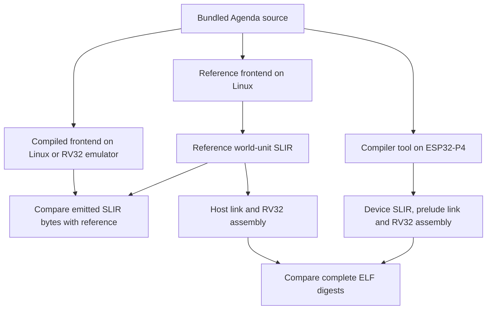
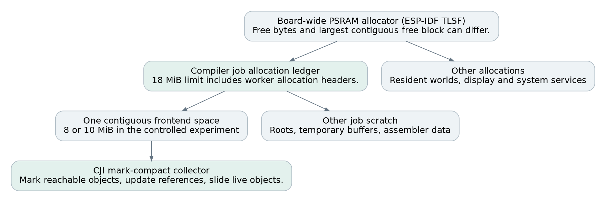
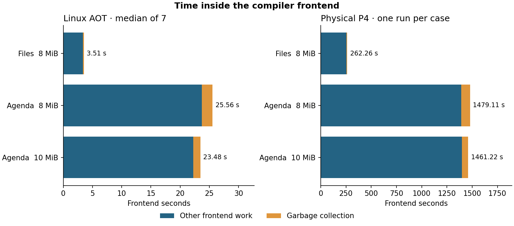
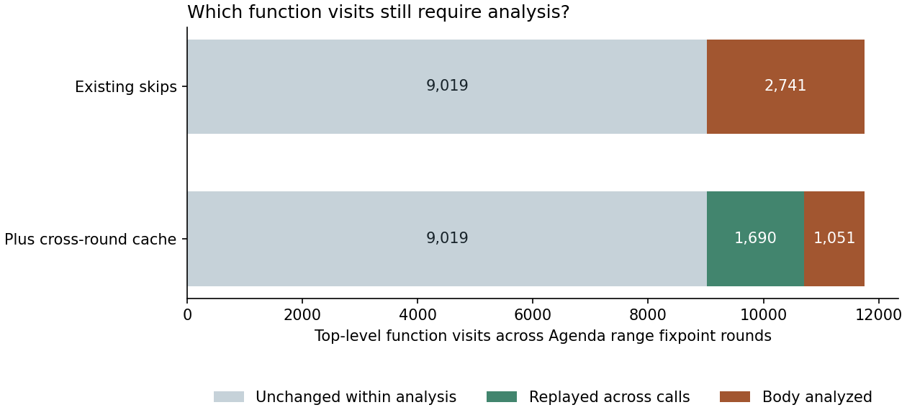

# Compiling Agenda on the PicoCalc

The ESP32-P4 in a PicoCalc compiled Agenda, a JavaScript application for managing tasks and reminders, into a 301,496-byte RISC-V module. The module matched the one built independently on Linux, byte for byte. On the board, the measured job took 24 minutes and 40 seconds. Understanding that time requires following the compiler through three levels of detail: which phase was running, which source operations the phase repeated, and which of those operations a different implementation could safely omit.

The first hardware experiment increased the compiler heap by a quarter and saved 18 seconds. A subsequent Linux experiment changed one condition in numeric range analysis and reduced frontend time by 11.9%. A second Linux experiment reused earlier inference results and reduced it by 28.8%, with a much larger live heap. Each result applies to a specific executable, workload and measurement boundary. This report follows the evidence available at the November 18 headless-board checkpoint.

## From a JavaScript world to an RV32 module

PicoCalc OS calls an application or driver a *world*. Its manifest supplies a name, an entry file, budgets and any claims the world needs, such as access to a filesystem path or peripheral. The kernel delivers events to worlds. QuickJS can execute a world's JavaScript directly. CJI provides another execution path for supported sources. It compiles the world ahead of time into an ELF module containing native code for the P4. Compiling Agenda and dispatching an event to a running Agenda instance are separate operations. Only the first appears in the 24-minute measurement.

The compiler itself can also be compiled. The reference frontend runs under Node on the development host. It emits SLIR, the intermediate representation consumed by CJI's assembler. Building that frontend yields the *stage-1 compiler*. A native x86-64 stage 1 makes instruction profiling practical on Linux. An RV32 build allows the same computation to run in an emulator or on the board. On the physical P4 the compiler tool is loaded into the running system and receives the selected world's source.



The *world unit* contains the code emitted for the individual world. Linking resolves it with the shared prelude before assembly produces the loadable module. This gives the experiment two correctness checks. The earlier check isolates frontend changes by comparing SLIR. The later check includes the device linker and assembler by comparing the final ELF. At this checkpoint 20 of the 22 manifest JavaScript worlds had host-matching device output. Calc and Sandbox remained outside the successful set. A matching digest establishes reproducible translation for the tested source. Application behavior and display latency require their own runtime tests.

## Why a compiler can run out of space in free PSRAM

The compiler sees several different quantities called “memory.” ESP-IDF allocates blocks from regions with particular capabilities. The compiler job charges its temporary allocations against an 18 MiB scratch ceiling. Within that budget, the frontend manages a contiguous arena using its own compacting garbage collector. The outer allocator can have enough total free bytes while its largest eligible block is too small. The inner collector can exhaust its arena while the outer allocator still has free PSRAM. Raising the scratch ceiling resolves neither condition by itself.

The port changed the order and lifetime of allocations. It reserves the frontend arena while a sufficiently large block is available. During loading, the decompressed compiler can use that space before the frontend starts allocating language values. Avoiding the overlap made the full Agent compile possible. The physical board emitted a 750,832-byte Agent module in 906.4 seconds. Files and Agenda later completed with an 8 MiB contiguous frontend arena. These runs establish which programs fit. There was no successful before-and-after pair from which to calculate an allocator speedup.



Consider three lines from the successful 8 MiB Agenda run. Times are relative to the start of the job, and the PSRAM fields are bytes.

```text
begin     elapsed_ms=1   psram_free=25013256  psram_largest=13107200
relocated elapsed_ms=452 psram_free=11733560  psram_largest=8388608
frontend  elapsed_ms=458 allocs=1             scratch=8388624
```

At relocation, total free PSRAM exceeded 11 million bytes, but the largest free block was exactly 8 MiB. The frontend subsequently reported 4,491,400 bytes of peak live data. The first number describes the outer allocator at one instant. The second describes the maximum reachable data observed by the inner collector. Peak scratch for the whole job was 10,048,551 bytes because the arena and the other temporary buffers are charged together.

## Locate the time before changing the compiler

The board reports phase transitions and periodic heartbeats over UART. A record contains the source identifier, phase, elapsed time, allocation count and scratch usage. A heartbeat confirms that the reporting mechanism is alive. A stable allocation count is compatible with a long stretch of computation on existing data. Completion requires a terminal record and a matching module digest.

| Workload and arena | Linux frontend | P4 frontend | P4 time inside GC | Complete P4 job |
|---|---:|---:|---:|---:|
| Files, 8 MiB | 3.514 s | 262.264 s | 9.206 s | 263.136 s |
| Agenda, 8 MiB | 25.556 s | 1,479.109 s | 85.898 s | 1,480.340 s |
| Agenda, 10 MiB | 23.479 s | 1,461.217 s | 62.050 s | 1,462.449 s |

The table uses Linux frontend medians from the first timing matrix and one physical run per configuration. GC time is included in frontend time. For Agenda at 8 MiB, only 1.231 seconds of the entire job fell outside the frontend. Even eliminating every measured collection would save at most 5.8% if everything else stayed fixed. Enlarging the heap reduced collection count from 424 to 297 and saved 23.848 seconds inside GC. The complete run improved by 17.891 seconds, or 1.21%. With one board pair, the evidence does not establish how much of the remaining difference would recur.



The host and board agreed exactly on the number of collections and cumulative slide bytes for Agenda at 8 MiB. The collector recorded 1,434,574,696 survivor bytes across collections and 211,914,816 bytes passed to its slide operation. A surviving object can be visited repeatedly, and an object already in the right position can stay there. These counters describe different operations. Neither is a measurement of external PSRAM bus traffic.

## What Linux and RV32 profiling can establish

The native Agenda instruction-address run counted 136,873,785,452 executed x86-64 instructions in Callgrind. The build added local symbols and verified that the executable text bytes were identical to the ordinary build. The address reader excludes call-edge counts when summing self costs, checks that the sum equals the reported total, and resolves addresses against the profiled executable. Its highest-count single instruction was the entry move in `whole_bits`, executed 554,879,759 times. That function examines the representation of a boxed number. The count identifies a repeatedly executed operation. The time recoverable by removing a particular call depends on its caller and the work required in its place.

A separate process-CPU sampler collected 35,612 instruction-pointer samples for Agenda. About 8.6% landed directly in `whole_bits`, 7.5% in `rt_any_index` and 6.6% in `rt_any_eq`. Instruction counts measure frequency. Timer samples estimate where the process spends CPU time. Inclusive attribution follows calls down from a function, while self attribution charges the instruction currently executing. Thus range analysis can own most of the inclusive count even when the most frequently sampled instructions sit in low-level runtime functions.

RV32 emulation supplies a third view. Files consumed roughly 55.75 billion guest instructions compared with 20.17 billion native x86-64 instructions. Several dynamic-value operations occur prominently on both architectures, and the RV32 profile also exposes software floating-point work. The emulated instruction count belongs to the guest instruction set. Translating it into physical seconds would require information about instruction latency, memory accesses, caches and contention on the board. The physical phase clock supplies elapsed time directly. A completed Files guest profile supports this comparison; the ticket still listed the broader guest comparison as open at the report checkpoint.

## Why library specialization revisits inference

Consider the expression `tasks.filter(isOpen).map(titleOf)`. CJI must determine the receiver type of each method, select a suitable implementation, and account for the callbacks. The return type of the specialized filter helps determine how to compile the following map. A helper introduced in one pass can therefore make another call resolvable in a later pass.

The implementation in `src/library.js` calls `instantiateLibraryTaking`. It rewrites resolvable calls and adds specialized helper definitions to the program. It invokes type inference on the expanded program. Inference includes numeric range analysis, which tracks bounds and exceptional cases such as negative zero and NaN. A loop or a call between functions may revise an earlier conclusion. The analysis repeats until the summaries stabilize, a condition called a *fixed point*.

```text
repeat while library expansion adds definitions
    rewrite resolvable calls and append their specialized helpers
    infer types on the expanded program
    recompute numeric summaries until they stabilize
        revisit functions whose inputs may have changed
```

Agenda introduced 79 helpers over six expansion rounds, in groups of 12, 58, 1, 4, 3 and 1. The reference trace counted seven full range analyses and 95 fixed-point iterations. Files introduced eight helpers over two expansion rounds. A separate pass-timing diagnostic attributed 17,178 of Agenda's 18,253 measured pass milliseconds to library instantiation, about 94%. That diagnostic forces collections when reporting statistics. Its value is the distribution of work inside that run. A separate inclusive instruction profile attributed about 88% of the whole native compiler's instructions to range analysis. Instantiation calls range analysis, so these two percentages describe overlapping work.

## Experiment one: reuse a validated function result

Within a single range analysis, CJI already records which summaries a function read. If none changes in a subsequent iteration, the compiler can skip its body. The candidate enables an existing cache across successive library expansions for the in-heap store. A cache entry must describe more than the function text. Even unchanged source can acquire a different inferred return type when a callee changes. Reuse requires matching code shape, answers to the type queries previously made, the relevant numeric summaries, and the stage and thresholds used to widen ranges toward convergence.

| Reference trace | Agenda | Files |
|---|---:|---:|
| Function visits | 11,760 | 348 |
| Already skipped by ordinary inference | 9,019 | 123 |
| Bodies ordinarily evaluated | 2,741 | 225 |
| Additional visits replayed from cache | 1,690 | 56 |
| Bodies still evaluated with caching | 1,051 | 169 |
| Reduction in interval joins | 44.5% | 5.5% |

The denominator matters. Caching avoided **61.7% of Agenda's remaining body evaluations**. The seven analyses and 95 fixed-point iterations still occurred. Validating candidates also cost work: 3,403 eligibility checks yielded 1,690 successful replays. The cache retained up to 1,530,495 UTF-16 code units of text. At two bytes per unit the payload alone is about 2.92 MiB, before other bookkeeping.



To measure the net effect, the experiment rebuilt the native stage-1 compiler, fixed its arena at 8 MiB, warmed each variant once, then alternated execution order across three measured rounds. Every output matched the independent reference SLIR. Median frontend time fell from **37.243 to 26.510 seconds**. Peak live heap rose from **4,491,400 to 7,268,696 bytes**, and collections rose from 424 to 676. This trade is material on a P4 whose arena must fit in a single available block.

## Experiment two: avoid computing an unchanged interval

Range analysis represents intervals by interned identifiers. If two operands have the same identifier, they already have identical bounds and exceptional-value flags. Their join, the interval that covers both inputs, must be that same interval. An immediate equality test can preserve the answer while avoiding the table accesses needed to compute it.

```javascript
function join(a, b) {
  if (a === b) return a
  // Continue with the existing interval merge for distinct identifiers.
}
```

This candidate came from counting operands at the actual operation. In the reference Agenda compile, **9,195,456 of 11,743,517 joins** received identical identifiers. The source observation predicted frequent opportunities. Rebuilding and timing the stage-1 compiler tested whether the shortcut paid for the added comparison.

With its own alternating control, the host median fell from **31.382 to 27.651 seconds**, an 11.9% reduction. Both variants reported exactly 424 collections, 4,491,400 peak live bytes and 211,914,816 slide bytes. Every output matched. The two experiments ran under different host loads and have different control medians. Their savings cannot be added: caching a body can also eliminate joins within that body. The shortcut is the simpler first device trial because its measured heap footprint was unchanged.

## The board configuration for the next comparison

The physical timing series above used a powered main board with the keyboard bus held between transactions. The operator subsequently confirmed that the external peripherals were switched off. The port now supports a headless benchmark build. It omits the keyboard and power worlds that poll the same I²C controller, the SPI display world and its dependent compositor. It still creates the kernel completion queue used by the console and filesystem. Requests targeting an unavailable peripheral settle with an error.

The first headless boot exposed the compositor dependency through five startup faults. After removing it from the headless manifest, the board reported zero transfers and zero errors on both external buses. The compiler answered over UART and compiled Flaky using an 8 MiB arena. Its frontend took 5.942 seconds and produced a host-matching 10,800-byte ELF. That test verifies the experimental setup. At this checkpoint both optimization timings above apply to Linux. A physical comparison needs an ordinary headless build and a candidate headless build using the same arena, source, instrumentation and final module check.

## Retracing the investigation

The project repository is `/home/manuel/code/wesen/2026-10-20--ds-js-os`. The evidence checkpoint is `a65b90a1edd46f55df848a249b7a4b31d7b8ac47`. From that checkout, the following paths lead from the original workload to the final measurements.

| Question | Where to look |
|---|---|
| Which source and permissions define Agenda? | `picocalc-os/js/apps/agenda.js` and `picocalc-os/js/system.json` |
| Where does the P4 load the compiler and manage its allocations? | `picocalc-os/port/esp32p4/compiler/install.c` and `tool.c` |
| Where are helpers specialized and intervals joined? | The November 17 CJI import ticket, under `sources/cji/src/library.js` and `sources/cji/src/ranges.js` |
| How were repeated operations counted? | The November 18 performance ticket’s `scripts/13-library-rounds.mjs` injects reference counters and verifies the emitted world unit. |
| How were the candidates built and compared? | In that ticket, scripts 14–16 rebuild one variant, alternate timed runs, check output bytes and compute the medians. The individual samples are in `various/linux-profiles/agenda-{memo,join}-trial.json`. |
| Which board records support the timings? | `various/p4/comparison.json`, `agenda-8-1.log` and `agenda-10-1.log` in the same ticket. The later `headless-smoke.jsonl` identifies the headless firmware and Flaky output. |

The physical trace established where time was available to save. The source trace then established how much repeated work specific changes could remove. The paired native builds measured the cost of the replacements, including cache validation and extra collection. The remaining question is narrow and testable: how much of each host improvement survives on the ESP32-P4 when the compiler, heap configuration and resulting Agenda module are otherwise held constant?
