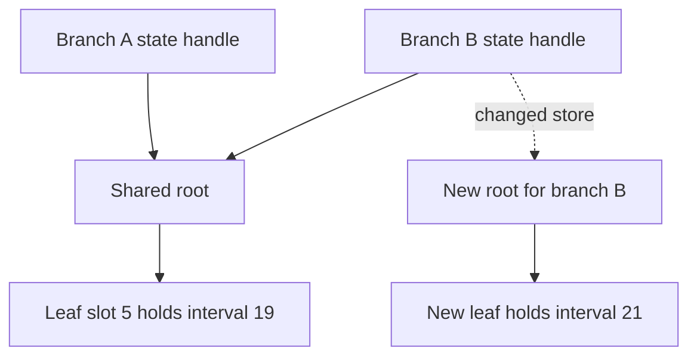
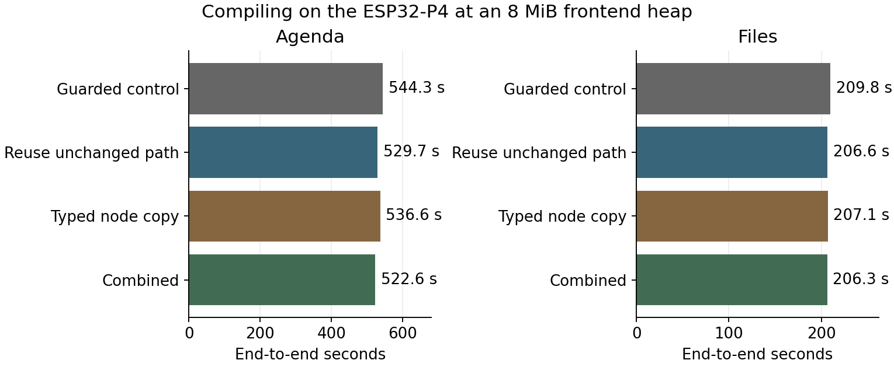

# When a Compiler Copies an Unchanged Fact

On a physical ESP32-P4, the original CJI frontend spent over 24 minutes compiling Agenda, a small application for the PicoCalc. A change to the scheduling of numeric proofs brought that time down to about nine minutes. This investigation starts with the nine-minute version. What instructions still execute, which can be removed, and what qualifies as a faster compiler on a memory-constrained board?

CJI itself is written in a subset of JavaScript. A workstation compiler can translate that source into a native Linux executable or a RISC-V frontend for the board. Both run the algorithm that analyzes Agenda, emits intermediate instructions and, on the board, produces a loadable module. There are two levels of optimization here. Giving a variable in Agenda a static representation may improve Agenda's eventual execution. Giving a private data structure in the compiler a static representation may improve the user's wait for every program that exercises it.

## Reconstructing the expense

A source-level pass called range analysis computes the numeric values that each expression might produce. CJI uses it to decide, for example, whether addition can use integer instructions while preserving JavaScript's result. A number may be fractional, be negative zero, be NaN, or exceed the magnitude for which an integer operation agrees with a JavaScript double. A compiler can know the type is numeric and still need a floating-point representation. Range facts are evidence for choosing that representation.

In the guarded compiler, Callgrind counted 49.36 billion x86 instructions for the Agenda compile. The range-analysis function and its callees accounted for 34.47 billion, or 69.85%. A native timer sample had separately found dynamic indexing, shape lookup and equality routines. An inclusive instruction count tells us which pass is expensive. A sampled instruction pointer identifies where CPU time is spent. Neither identifies how many of those individual calls the source algorithm actually needed.

Instrumentation of the compiled frontend supplied the missing evidence. It counted 15,922,776 dynamic index reads in a single emitted slice specialization. For this workload every observed receiver at that site was an ordinary array and every key was numeric. The generated loop already had an integer index. It boxed that index to call a general-purpose runtime routine that checked the representation before doing the load. This establishes a candidate for specialization, but it also raises a different question. Why did the analysis need to copy almost sixteen million array slots?

## The state of a function

Assign every local variable a consecutive slot number. A compact tree maps a slot number to an interval ID. Each tree node has 32 positions, so five bits of the slot select the child at a level. Most small functions need just one level. A function with slot 37 needs at least two: root child 1, followed by leaf position 5. The interval IDs refer to values interned for the lifetime of a single invocation of range analysis. Equality between two IDs is an exact comparison within that invocation.

When a conditional splits control flow, both branches initially know the same facts. They can share the root of an immutable tree. Updating one branch creates a path of new nodes while all unrelated subtrees remain shared. Later the analysis joins the two states. A shared subtree can be retained by checking that the two references are identical. Reusing memory here carries information about equality forward into a later compiler operation.



The original writer allocates and copies an existing node before assigning the selected child. On Agenda the reference trace counted 490,367 state writes, including 194,247 assignments of the ID already present. It copied 496,705 existing nodes. At 32 slots each, that is 15,894,560 slot copies, very close to the 15,922,776 reads counted in the independently compiled slice. The two totals are from separate executions. They identify a concrete cause without assuming the entire slice routine is exclusively used by the trie.

## Change the moment of allocation

The writer can descend before allocating. An update to an existing leaf first compares its interval ID with the new value. Identical IDs allow the original leaf to be returned. An internal node recursively computes its new child and reuses itself if the child is the same object. A changed child still triggers a shallow copy of the parent. Old versions remain available to other branches.

```text
i = (key >> (5 × level)) & 31
old = existing child at i
next = interval at a leaf, otherwise recursively update old
if the node exists and old equals next:
    return the node
copy = a new empty node or a shallow copy of this node
copy[i] = next
return copy
```

The safety argument follows the tree structure. At a leaf this algorithm preserves all other entries and stores exactly the requested value. At an internal node every other child is shared, while the recursive result represents the required mapping for the selected child. The root-holding state handle is still mutable. That distinction matters for exception processing, which can retain a reference to a state handle and expect it to reflect future updates. The optimization changes only immutable tree nodes.

The source-level experiment removed **197,158 existing-node copies** on Agenda. Some writes touch multiple levels, hence the difference between this count and the number of unchanged stores. Source-level counts establish that the mechanism worked. The compiled implementation now also performs a comparison at each visited level. Its net cost requires a timed run.

## Teach the compiler what one array contains

The second experiment changes the remaining node copies. An element can be a child object, an interval ID or undefined. Its value must retain a dynamic representation. The *container* is a private ordinary array of exactly 32 slots. These facts can coexist in CJI's type system as an array with dynamic elements, written `Any[]`.

The copy operation takes an `Any[]` receiver, allocates another 32-slot array and copies the slots with an integer induction variable. This is a local representation proof. All node constructors allocate the same array length. Only the private trie operations consume these nodes. No user-provided getter is invoked by a private node read. In source JavaScript, a new array may contain holes. The trie tests slots by reading them and comparing the resulting value with undefined. A general-purpose slice API has additional obligations, since enumeration or property-existence tests can distinguish a hole from an explicitly present undefined element. Keeping the helper private is part of the proof.

A dynamically held receiver may still require a check on entry. Once the local array representation is known, the generated loop can use a bounds check followed by an indexed element load with a known stride. The value in that slot remains tagged. This illustrates a useful meaning of static compilation in a dynamically typed source language: prove exactly the part of an operation needed to choose a cheaper instruction sequence. A mixed-value array does not by itself require redispatching every numeric subscript through a general property accessor.

## How to make the comparison fair

The experimental control includes the previously measured guarded range schedule. Three candidate compilers add the unchanged-write optimization, typed node copying, and both changes. All candidates use the ordinary stage-0 bootstrap translator. Each native run has the same source and 8 MiB heap. Every emitted SLIR unit must match an independently stored reference. Warm-up samples are excluded from the medians, and the order of the four treatments rotates. The host results describe the Linux compiler executable. The physical experiment checks whole modules and records the board's own frontend timer and end-to-end elapsed time.

A direct data-structure check exercises one-, two- and three-level trees, existing and absent leaves, changed and unchanged writes, and snapshots whose branches diverge. A source-level final result alone could miss the corruption of a shared node if only the newly written branch were observed. Checking both original and derived roots makes the persistence guarantee observable.

## What changed on the processor

The compiled frontend made **58.93 million** direct calls to dynamic indexing on guarded Agenda. With reuse alone it made 52.93 million. With typed copying alone it made 43.03 million, and with both changes it made 43.34 million. The two changes target some of the same work: a node that no longer needs copying no longer needs a specialized copy loop. The small increase from typed-only to combined also has a source-level explanation. The new tree writer inspects the previous child on its path. The totals include those new reads.

The x86 instruction counter places a useful limit on the effect. In billions of executed instructions, the Agenda total went from 49.355 to 46.764 in the combined configuration. That is 5.25% fewer instructions. Files went from 15.278 to 14.802 billion, a 3.12% reduction. Counting sixteen million fewer calls is significant, but many other operations remain in a 49-billion-instruction compile. The original 69.85% inclusive range-analysis share alone is insufficient to predict the speedup of changing one operation inside it.

On x86 the combined Agenda frontend median was 5.553 seconds compared with 7.286 seconds for the guarded control. Files medians were 2.127 and 2.126 seconds respectively. There were four measured rounds per variant after warm-up. Agenda control ranged from 5.36 to 9.71 seconds while the combined executable ranged from 5.24 to 6.49 seconds. The workstation was doing other work. The ranges overlap; absolute differences between these medians deserve less weight than verified physical times and counts from the same generated programs.

## Physical compiler measurements

The board completed each source once per firmware at an 8 MiB frontend heap. The command timer ends after creation of the loadable module. The frontend timer measures the compilation within that command; the GC timer measures time spent in the collector within the frontend. The instruction column is an independent count obtained by running the x86 compiler on the same source.

| World | Compiler | Module time (s) | Frontend (s) | GC (s) | x86 instructions (billions) |
|---|---|---:|---:|---:|---:|
| Agenda | guard | 544.293 | 543.063 | 58.914 | 49.355 |
| Agenda | reuse | 529.675 | 528.410 | 54.159 | 47.835 |
| Agenda | typed | 536.601 | 535.379 | 59.041 | 47.579 |
| Agenda | both | 522.587 | 521.380 | 54.173 | 46.764 |
| Files | guard | 209.770 | 208.873 | 9.838 | 15.278 |
| Files | reuse | 206.609 | 205.733 | 9.026 | 15.005 |
| Files | typed | 207.054 | 206.165 | 9.805 | 14.955 |
| Files | both | 206.321 | 205.457 | 9.121 | 14.802 |

| World | Compiler | Collections | Peak live (bytes) | Scratch peak (bytes) |
|---|---|---:|---:|---:|
| Agenda | guard | 255 | 5,728,200 | 10,048,551 |
| Agenda | reuse | 240 | 6,096,360 | 10,048,551 |
| Agenda | typed | 255 | 5,728,200 | 10,048,551 |
| Agenda | both | 240 | 6,096,360 | 10,048,551 |
| Files | guard | 74 | 4,312,224 | 9,251,666 |
| Files | reuse | 72 | 4,312,224 | 9,251,666 |
| Files | typed | 74 | 4,312,224 | 9,251,666 |
| Files | both | 72 | 4,312,224 | 9,251,666 |



Together the changes saved 21.706 seconds (3.99%) on Agenda and 3.449 seconds (1.64%) on Files. Independent x86 instruction reductions were 2,591,424,342 (5.25%) and 476,352,366 (3.12%). The combined build produced the shortest observed physical time for each world, but on Files it differed from path reuse alone by only 0.288 seconds. No estimate of run-to-run variation is available for these firmware comparisons. The combined application image occupied 3,974,928 bytes of flash, 176 more than the guarded control.

Look at elapsed time and allocation together. On Agenda, path reuse reduced collection count from 255 to 240, while the peak number of live bytes reported at collection increased by 368,160 (about 6.4%). The two observations are compatible. A different allocation pattern reaches the collection threshold at different points in the compile, and the maximum is sampled when the collector runs. The combined variant's scratch peak remained 10,048,551 bytes. Files' scratch peak was 9,251,666 bytes and its recorded live peak was 4,312,224 bytes in the combined case.

The combined firmware produced the expected module digests for both physical programs. Each independent compiler reproduced all 20 supported linked catalog modules on the host and passed all 278 original interpreter, pass and runtime tests. Two catalog sources retain their existing capped rejections. The combined candidate also matched the original source-level frontend on all 335 archive fixtures, including 46 rejected inputs, reproduced the ordinary compiler's SLIR when compiling it as input, and replayed the original Files proof sidecar in strict mode.

## Where an SD card fits

Reducing a state update can save CPU time on a cold compile. Saving proof information targets a different workload. The compiler can serialize previously computed facts, read them on a subsequent invocation and check that they still form a valid solution. The STATIC research ticket measured a 142,671-byte proof sidecar for Agenda. On the host, median Node process time was 1.239 seconds without sidecar information, 3.512 seconds while recording, and 0.801 seconds on verified replay. At those medians a recording paid for itself after approximately six subsequent hits. A source edit that invalidates the key changes that calculation.

Temporary pass data is a second storage use. The existing host file store wrote 593 records totaling 2.12 MB for Agenda and read 753 records totaling 2.63 MB. For 549 reads the requested offset differed from the cursor after the preceding operation. An SD-backed file can relieve RAM pressure, but serializing an entire hot trie on every update would introduce substantial traffic. Retain active state in RAM and evaluate a card for cold records or verified persistent sidecars. The physical firmware trials in this report used the existing in-memory compile path.

## Conclusion

The original compiler took 24 minutes 34.601 seconds for Agenda on the same headless board. Guarding the schedule of range proofs cut that time to 9 minutes 4.293 seconds. Preserving an unchanged trie path and typing the private node-copy loop together took it to 8 minutes 42.587 seconds. The firmware used an 8 MiB frontend heap for the comparison. That memory setting and those exact output modules are the conditions under which the candidate qualifies.

For a board owner experimenting with the faster frontend, the combined build has a reproducible opt-in path in the ticket. For a compiler developer seeking a further substantial reduction in wait time, measure the number of calls to proof consumers and the amount of state they can avoid constructing. Record which inputs and facts actually change, how often that change reaches a consumer, and how many joins find both inputs identical. Those counts would distinguish a sparse worklist that avoids visiting unaffected consumers from a change that saves only a few instructions inside every visit. The present experiment establishes the cost and correctness of the latter class of change. The board still spends more than eight minutes on Agenda, which gives the next experiment a concrete target.

## Further reading

The implementation ticket `PICOCALC-CJI-TRIE` is in the project's `ttmp/2026/11/18/` directory. Its guide describes the algorithm, actual source interfaces, inputs and expected failure cases. The companion `PICOCALC-CJI-STATIC` ticket records call-site attribution, interval joins, proof-file replay and SD-card traffic. The earlier [[ARTICLE - Compiling Agenda on the PicoCalc]] explains the compiler architecture and the original physical baseline.

For the general persistence model, see the original paper by Driscoll, Sarnak, Sleator and Tarjan. Cooper and Torczon's *Engineering a Compiler*, chapter 9, develops data-flow analysis and worklists for propagating changed facts. The distinction matters here: this experiment reduces the cost of state updates within an existing solver, while a sparse worklist would change which consumers run. [Making Data Structures Persistent](https://www.cs.cmu.edu/~sleator/papers/Persistence.htm)
