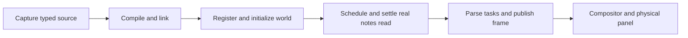

# PicoCalc Agenda — Comparing Wasm and RV32 on the same board

A backend choice changes several stages of a build-and-run cycle. Agenda's Wasm target compiles more quickly on the ESP32-P4. The RV32 target starts a world and runs its frame-producing turn more quickly. When tested on the same headless configuration, the elapsed time from source capture to the first view differed by only 25 ms at the median.

## Controlling the workload

Both firmware images contain the same typed reminder source, system catalog, app capabilities, development compiler and radio settings. The measurement tool checks that the ordered manifest entries agree except for the engine assigned to Agenda. Both targets open the real notes filesystem and use the same reactor source for reminder handling and rendering. The measurement stops at kernel publication of the file-backed frame.

The experiment ran six lab resets per target, followed by eight bundled rebuilds and five editable rebuilds. Each build creates a new compiler realm. The original application image matched the saved partition before testing and was verified again by the flash writer on restoration.

The experiment times through publication at E. System boot work, such as the other worlds' initialization, can occur between these stages. F requires the peripheral-enabled configuration and a separate physical capture.

## Cold start, loading, and first response

| Median of six headless boots | Wasm | RV32 |
| --- | ---: | ---: |
| Compile and link | 258.3 ms | 360.8 ms |
| Agenda engine initialization | 89.5 ms | 6.2 ms |
| Frame-producing turn | 2.92 ms | 1.10 ms |
| Source to first publication | 1.877 s | 1.902 s |
| Compiler allocator peak | 428,512 B | 433,496 B |
| Module size | 42,201 B | 24,304 B |

Every cold trial met two seconds. The maxima were 1.878 seconds for Wasm and 1.905 seconds for RV32. The approximately 102 ms compile advantage of Wasm was largely offset by RV32's approximately 83 ms shorter engine initialization. The remainder includes the system scheduler and notes read, so adding just the three stage medians does not recover end-to-end latency.

The world counter at publication was 147,456 B for Wasm and 124,588 B for RV32. Wasm's figure includes linear memory and interpreter stack. RV32's figure includes mapped segments and live world heap. The compiler peaks in the table use the same allocator accounting. Neither world figure measures the whole device's peak RAM.

## Rebuilding after the initial frame

The bundled rebuild median was 609 ms for Wasm and 646 ms for RV32. The later editable median was 488 ms for Wasm and 493 ms for RV32. The operator compiler can be at a different phase when a trial begins, even with identical saved state and order. The result establishes that both source paths work on the board and that cold start is below the stated target in these samples. The small batches leave tail latency uncertain.

Wasm is useful when separate linear-memory bounds and portability are needed. The current native loader is for trusted modules running with firmware privileges. RV32's smaller artifact and lower initialization and turn costs are useful for those modules. The cold Agenda result depends enough on compile and system startup that the native turn-time advantage alone doesn't predict the edit-to-frame latency.

## Reproduction and remaining physical evidence

Firmware revision `aa24f58` contains the matched raw trials and the reproduction scripts in the Agenda compiler ticket. `port/esp32p4/main/agenda_p4.c` defines the compiler and publication timestamps. `nucleus/native_wasm.c` and `port/esp32p4/optional/native_elf/native_elf_p4.c` define the two world memory counters. The design guide describes the source ABI, the matching test and the two peripheral-enabled images. Both images compile with the keyboard, compositor and display present. The assembled-device test still requires the physical launcher keypress and an observation of the changed display.
