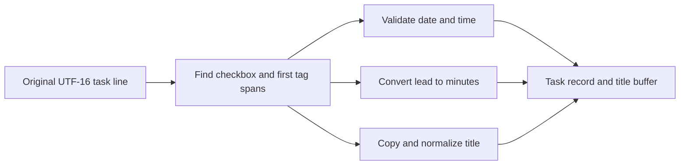

# PicoCalc Agenda — Compiling a stored reminder to WebAssembly

Agenda keeps its tasks in a text file shared with the PicoCalc editor. The line `- [ ] dentist @2026-11-03 14:30 !15m` contains the task's completion status, title, civil date, time, and reminder lead. The compiler milestone was to turn editable typed source into a Wasm module that parses this line and produces the same values as the installed JavaScript Agenda. The generated module executes the parsing and writes the title.

> [!summary]
> - A typed program compiles to a 2,605-byte Wasm module.
> - The host Wasm engine matched the installed Agenda parser on 6,411 complete task lines.
> - The record separates matching a date token from deciding whether the calendar and clock fields are valid.

## Read a task before scheduling it

An open task begins with a dash and a space. The optional checkbox can mark it completed. Agenda recognizes one date tag and one reminder lead. Later matching tags stay in the title. The clock gets the civil time only after the calendar and time validate. For the example above the parsed lead is 15 minutes and the event loop will eventually compute 14:15 in the configured time zone.

The stored line is part of the record's provenance. Agenda later uses the exact original text to locate a task in a shared file. The compiled parser leaves those code units intact and writes its display title to a separate buffer. This matters when another app edits the file between presentation and a user's action.

## A token can match the syntax and fail validation

Consider `- call @2026-02-30 14:30 !15m`. The date tag and time match the text pattern. February 30 fails calendar validation, so the task has no scheduled date or time. Its title is still `call`. The parser locates the date tag once and preserves its removal span independently of the validity flags. The same distinction applies to an out-of-range time. The first matching date tag decides the date even when it is invalid.

The year rule comes from the existing reference. Agenda obtains the last day of a month with `Date.UTC(year, month, 0)`. That API interprets a year in 0–99 relative to 1900. The typed validator uses the same year interpretation before applying the Gregorian rule. The century cases 1900, 2000, and 2100 demonstrate why a four-year divisibility test alone gives different answers.



## Lower the fields into linear memory

The typed source declares fields for task status, text start, date and time offsets, validity, lead time, and title length. The compiler assigns each field a four-byte offset in declaration order. A record read emits an i32 load at that offset, and a write emits an i32 store. The physical representation is one Wasm address while the compiler retains the record's declared name. This is how it rejects assigning an integer to a Boolean field even though both fit in four bytes.

The input string begins with its length in code units, followed by UTF-16 code units. The output buffer has the same layout with a capacity in its header. The title's actual length belongs to the record. The emitter checks an index with an unsigned comparison before computing its byte address. That check rejects negative indices because they compare as large unsigned values. Wasm also bounds the memory access to linear memory. The calling interface must allocate non-overlapping regions for the input, output, and record.

```text
scanTask(line, task)
    identify the task prefix and first syntactic tags
    set offsets, date validity, time validity and lead
writeTitle(line, output, task)
    advance past recognized spans
    collapse each run of whitespace to one separator
    write surviving UTF-16 code units to output
return success and the title length
```

Copying the surviving text in a second pass keeps the title operation independent of numeric validation. A pending space becomes an output separator only when another character follows. This yields the same leading and trailing trim behavior as the JavaScript parser and retains surrogate pairs from text such as `dentist 🦷`.

## Read the test results at the boundary they measure

The test script compiles the source, instantiates the new bytes in the host Wasm engine, and calls `parseTask`. It builds the same observable record shape as `agParse` by reading fields and the output title. When the compiled title is empty, it supplies Agenda's existing presentation label `(untitled)`. It exercises Unicode whitespace, repeated tags, prefix variations, impossible dates, invalid times, and malformed reminders. Two rejected programs test the line and column for an unknown field and for an integer written to a Boolean field.

| Check | Result |
|---|---:|
| Full task-line differential cases | 6,411 |
| Calendar comparisons across valid and invalid dates | 235,158 |
| Lead-token comparisons | 30,010 |
| Source-located compiler diagnostics | 2 |
| Existing host Agenda tests | 9 passed |

The stored-line milestone establishes the compiler and parser contract. The next integration adds task collections, emits the world entry points, reads the shared file through the kernel, and exercises clock events and a rendered view. The two-second cold-build target starts at source capture and ends at the first correct OS response. It requires device instrumentation. The assembled handheld's keypress-to-frame time is a separate measurement. The same workflow and oracle will be used for the trusted RV32 target after the Wasm path is integrated.

## Source and reproduction

- `picocalc-os/compiler/typed-wasm.js` contains the emitter. Search for `codeUnitAddress`, `bufferWrite` and `field`.
- `picocalc-os/worlds/agenda/reminder.typed` contains the editable source. Start at `parseTask`.
- `picocalc-os/js/apps/agenda.js` contains `agParse`, the JavaScript oracle used by the differential scripts.
- Ticket `PICOCALC-AGENDA-COMPILER` contains the implementation diary, the three differential commands in its `scripts/` directory, and the measured receipts in `various/`.
- Project commit `a8c71ad` contains the complete stored-line milestone.
