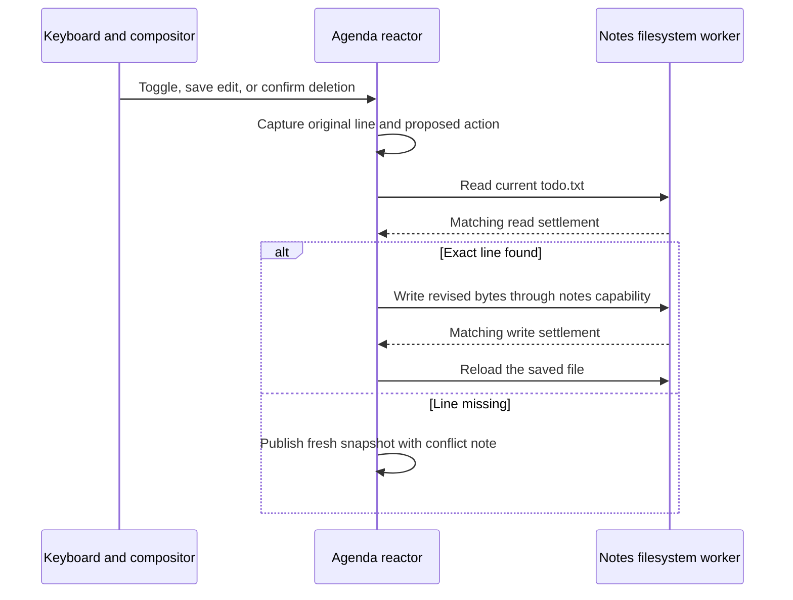

# PicoCalc Agenda — Editing a task in a shared text file

Agenda reads tasks from `notes/todo.txt`, which the Editor and the agent can also change. The grouped view holds a private snapshot of the file. Its selected task may have moved to a different line by the time a key command arrives. The edit path records the exact line the user saw, requests the current file, and applies a change only if that line is still present. The same reactor implements this protocol for Wasm and RV32.

## Selection identifies a source line

The view index sorts tasks by due date, time and file offset. The selected descriptor contains the byte offset of the original line in the retained UTF-8 text. A key handler copies that complete line before it queues a new filesystem read. The copy survives a later render, and the filesystem read delivers a fresh result through an event token.

The line is matched literally. If a preceding heading or a different task changed in the meantime, the newly read bytes remain in the output. If the selected line disappeared, the reactor installs the new snapshot and reports `todo.txt changed meanwhile; reloaded.` The original Agenda chooses the first exact match when multiple lines are identical. The typed world uses that same rule. This protocol detects conflicts visible when it rereads the file. A separate writer can still change the file between that read and the subsequent write.

## The three edits preserve surrounding bytes

The stored-task grammar accepts an indented checkbox line or a bare list item. `parseTask` returns the completion bit and the offset where the task text starts. The generated `agendaMark` function chooses the checkbox character for a toggle or for preservation of the original completion state. The C reactor performs the UTF-8 splice using those results.

- Enter or Space toggles the box. A bare item gains a box, and its existing title and metadata bytes are copied without normalization.
- F3 loads the original task text, including its date, time and lead tokens, into the input field. On acceptance the compiled `normalizeEntry` function canonicalizes the prompt. The reactor preserves the indentation and completion state. Backspace removes an entire Unicode code point before it adjusts the UTF-16 input length used to enforce the key-entry limit.
- F5 first displays the task title and records the original line. A second independent F5 on that same line requests deletion. Navigation and other keys cancel confirmation. Deleting a middle line consumes its following newline. Deleting a final line without a trailing newline consumes the preceding separator.

For example, toggling `  - call clinic @2026-11-03 2pm` inserts the checkbox and keeps the bytes after it. Editing the same line and accepting the prompt invokes the typed normalizer and can canonicalize `2pm` to `14:00`. A heading before the task and any text after it survive both operations.

## Where the compiler and runtime meet

The `agendaMark` bridge takes two typed boolean arguments, the current completion state and whether the operation toggles it. The signature is checked in `worlds/agenda/compile.js`, and the same compiled function is reached through the Wasm bridge or the sixth RV32 entry jump. Increasing the normalizer's capacity to the existing parser buffer size lets F3 operate on stored tasks longer than the keyboard's 120-unit append threshold. The RPC and screen buffers retain their independent limits.

The file operation is asynchronous. `nw_fs_read` and `nw_fs_write` return tokens and the reactor only accepts their matching settlements. A pending fresh read invalidates older refresh tokens before they can publish a stale view. After a write succeeds, the reactor schedules a fresh read through the same capability.

## Verification

The host simulator compared the original and typed apps through their keyboard paths and checked exact bytes for a bare checkbox toggle, Unicode backspace during an edit, duplicate-line deletion, deletion of the last line without a terminator, cancellation of delete confirmation, and conflict with a second writer. The RV32 harness executed the compiled instructions and checked the write requests, selection, confirmation, and conflict behavior with deterministic SDK stubs. Existing group, creation, reminder and restart checks passed.

The assembled ESP32-P4 accepted the note changes through the real notes capability and FAT filesystem. The test used serial-injected keys with the device's keyboard driver, compositor and display stack active. A CRC-checked framebuffer capture showed the remaining completed task and the deletion status. I²C and SPI reported no errors during that run. The capture establishes the framebuffer contents. Measuring the physical key press and its visible update on the panel remains a separate experiment.

| Measurement | Result |
| --- | --- |
| Bundled native compile on a single boot | 718.218 ms |
| Compiler allocator peak | 700,312 bytes |
| First Agenda response | 2.137 s |
| Agenda world bytes at first response | 183,437 |
| Agenda frame-producing turns during the injected sequence | 0.760–1.012 ms across 18 samples |
| Application image and partition | 4,180,208 bytes in 8 MiB |

The boot measurement used the newly initialized filesystem. Earlier runs used other notes and startup conditions, so the single sample cannot establish a speedup. The two-second target is still open for the complete configuration.

The application partition grew from 4 MiB to 8 MiB on a detected 32 MiB chip. The current table allocates the first 16 MiB. The app still starts at `0x10000`. The 128 KiB world store and the 8,000 KiB FAT partition were recreated at `0x810000` and `0x830000`. The original credentials partition stayed in place. The app has 4,208,400 bytes of flash headroom. The migration procedure and verified table are in `7c405c4`.

The Editor file-capability transfer remains open. The next qualification also needs cold series with comparable storage contents and an independent physical keyboard-to-LCD measurement. The implementation and its receipts are in `09bee0c`. Read `picocalc-os/worlds/agenda/wasm-world.c` at `request_change`, `find_line`, `change_file`, and `key_event` for the runtime path. The typed checkbox and prompt rules are in `picocalc-os/worlds/agenda/entry.typed`.

Related note [[PROJ - PicoCalc Agenda - Grouping and scrolling a file-backed task list]].
