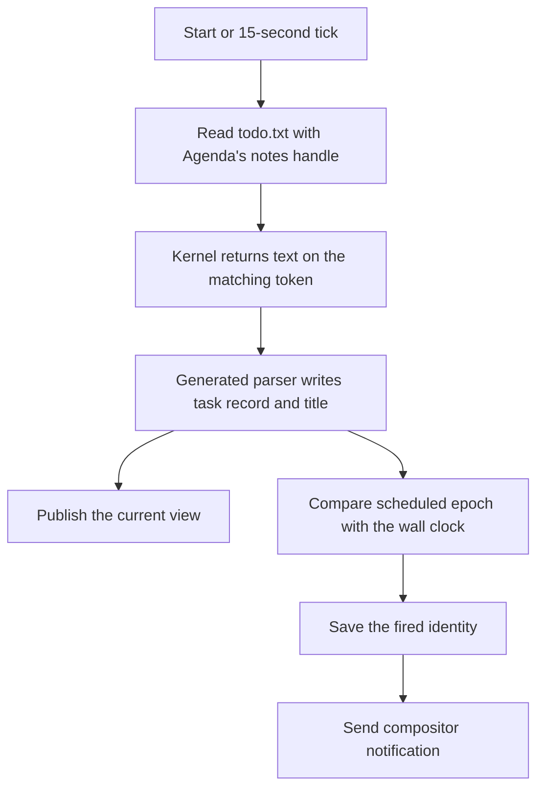
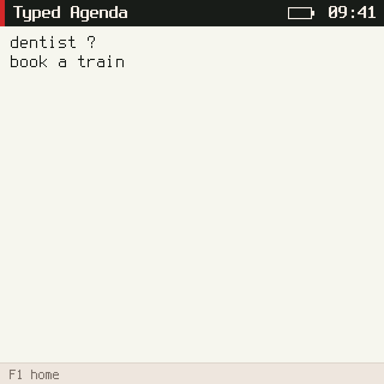

# PicoCalc Agenda — From a file read to a clock-triggered reminder

Agenda's stored reminder is a line in `notes/todo.txt`. Bringing the compiled parser into the app means defining when a world may read that line, when the result becomes available, how its date becomes a wall-clock instant, and how the device avoids repeating a notification. The simulator now runs this path with the normal PicoCalc kernel, WAMR backend, and SDK.

> [!summary]
> - The Agenda world opens its manifest's notes directory, receives a filesystem settlement, and runs the typed parser inside its own Wasm instance.
> - A clock tick produces a compositor notification and writes the fired identity to the world's persistent store. A second cold boot verifies suppression.
> - The real simulator compositor renders the file-backed view. Handheld timing has its own acceptance test.

## A runtime and generated functions share a module

A direct Wasm compile of the typed source creates functions for reading the task and writing its display title. The app runtime supplies the exported lifecycle functions used by PicoCalc, including the event buffer and dispatch functions. It also supplies UTF-8 conversion, an output frame, and the SDK call to read the clock.

The linker reads the runtime's type, import, function, export, and code sections. A call instruction encodes a function index. Imported functions occupy the first indices, then the existing runtime definitions, then the newly generated definitions. Using this final base when encoding typed function calls preserves all original runtime indices. The exported parser slot gets a small body that forwards to the appended typed parser. The integration test checks the slot signature and the byte layout of the task record. The original runtime supplies the memory in which that record lives.

## Authority belongs to the world

Agenda opens `fs:/notes` using its manifest claim. The filesystem kernel checks the claim, creates the directory handle, and validates the requested path relative to that handle. The read is deferred. Agenda keeps the returned token and consumes only the corresponding settlement. This is the point where the file contents and the current wall clock are both available. A test world running the same executable without the claim receives no file-backed frame.

The app re-reads the file at startup and every 15 seconds. This allows an edit by another world to appear without changing the compiler or the clock service. The display list currently includes up to 12 open rows and respects the frame byte limit. The scan still visits later rows for reminders.

## Civil time and elapsed time answer different questions

The line `- [ ] dentist @2026-11-03 14:30 !15m` supplies a civil time. Converting the Gregorian date and time without a zone gives a nominal UTC timestamp. Agenda applies the configured zone offset at that instant, following the existing QuickJS Date calculation, and subtracts 15 minutes. The result in the test's Eastern zone is 19:15 UTC. The next tick observes that the wall clock has reached the scheduled instant and publishes the notification.

The simulator starts one second before the reminder. At 999 ms it has sent nothing. The first periodic tick after the target sends one notification. File-read and dispatch costs are included in the virtual timestamp. An unset clock sends nothing. The autumn transition fixture exercises the earlier occurrence of 01:15, when the clock later repeats that hour.

## Persistence is part of notification delivery

The identity combines the scheduled epoch and normalized title. The journal is a JSON object compatible with Agenda's fired-record shape. A successful reminder schedules a store write and sends a `notify` message. The next simulator process loads the durable store, parses the same line, and suppresses the second notification. Retention has both a byte limit and a maximum entry count. Storage or notification I/O failures have their own behavior and remain outside the demonstrated success path.

The screenshot follows the real compositor and simulated display driver. The frame preserves the task's emoji in UTF-8. The screen font draws its fallback glyph. The next milestone is to compile this source on the PicoCalc itself, qualify memory and turn time, and measure separately the time from a physical keypress to pixels changing. The RV32 target follows this Wasm qualification and should use the same file, timer, notification, and restart cases.

## Reproduce the milestone

Build `picocalc-os` and run `scripts/04-check-wasm-world.mjs` in ticket `PICOCALC-AGENDA-COMPILER`. The receipt records module hashes, the frame, scheduled and observed epochs, and the screenshot identity. In the main repository, commit `c5fdd25` connects the timer and persistent journal to the Wasm world. Read `picocalc-os/worlds/agenda/wasm-world.c`, the `linkWorld` function in `picocalc-os/compiler/typed-wasm.js`, and the filesystem and clock cases of `nat_syscall`.
