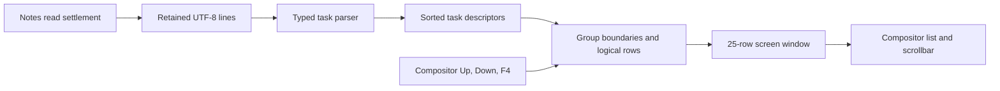

# PicoCalc Agenda — Grouping and scrolling a file-backed task list

Agenda derives its screen from `notes/todo.txt`. Each task has a position in the file, a position in the list drawn on screen and, when it is visible, a position in the message sent to the compositor. Each position serves a different operation. This checkpoint gives the Wasm and RV32 worlds the original Agenda's grouping and keyboard navigation while keeping each screen message within the native runtime's 16 KiB limit.

## From a file line to a task entry

The reactor opens the notes capability during initialization and requests `todo.txt` on start. The kernel delivers the read outcome as a settlement event. The settlement contains the file contents as a JSON string. The reactor decodes the string, replaces line separators in its private buffer with terminators, and gives each line to `parseTask`. The parser is compiled from typed source for the selected target. It returns a record with date and time flags, token offsets, a completion flag, and the length of the cooked title.

A task descriptor keeps the line's byte offset in the snapshot, a date key, its time in minutes, and a logical row number. The typed function `agendaDateKey` maps a date to YYYYMMDD, maps open tasks without dates to 100000000, and maps completed tasks to 100000001. This lets the shared reactor sort dated open tasks before the two remaining categories. For dated open tasks on the same day, an absent time sorts before a scheduled time. The file byte offset breaks ties and preserves file order for the undated and completed categories.

For example, on 1 November 2026, this file produces the rows shown below.

```text
- [ ] call clinic @2026-11-01 14:30 !15m
- [x] book a train
- [ ] buy milk @2026-11-01
- check the mail

row 0  TODAY · SUNDAY 1 NOV
row 1  · buy milk
row 2  · 14:30  call clinic             !15m
row 3  NO DATE
row 4  · check the mail
row 5  DONE                            shown after F4
row 6  ✓ book a train                  shown after F4
```

The first selected row is row 1. Two Down presses move to rows 2 and 4. The task entry for row 4 still points to the fourth line of the file. A future edit can use that text to identify the task in a fresh read even though its rendered order differs from the file order.

## The screen uses logical rows and a bounded window

The logical row count includes group headers. The selection is an index into task descriptors, which excludes headers. After a reload or F4, the reactor finds the first selectable row at or beyond the old logical position and falls back to the last visible task when needed. It also preserves the original behavior when an empty view reveals completed tasks. The list remains unselected until Up or Down.



`publish_view` chooses up to 25 consecutive logical rows around the selection and clamps that window at the ends. It emits a local selection index, the logical start index of the window and the total number of rows. In `drawList`, the compositor computes the first visible row from the logical selection and full list count, then translates it into the local window. The scrollbar uses the same full count. Visible titles are clipped on a UTF-8 boundary, and the notes snapshot retains the source text for a future edit. The F2 prompt occupies an input row underneath the list.

```text
logical_selection = window_start + local_selection       when selected
logical_first = scroll_start(logical_selection, total_rows, visible_rows)
local_first = logical_first - window_start
scrollbar_position = logical_first / (total_rows - visible_rows)
```

The pseudocode omits the renderer's clamps and its case for a list that fits without scrolling. The 25-row window covers the panel's visible list region even when it is clamped at the first or last task.

## One world protocol, two code targets

`worlds/agenda/compile.js` names the five functions across the C and typed boundary. The Wasm build patches exported bridge bodies. The RV32 build patches entry jumps in the fixed 48 KiB region of the executable template. The C reactor supplies file access, sorting, screen messages and keyboard handling. `nw_clock_today` supplies the local date, and `nw_clock_zone` reads the configured zone using an existing SDK wire operation. The typed entry functions supply the date classification and calendar arithmetic on both targets.

| Measurement or check | Result |
| --- | --- |
| Real simulator frame comparison with the original app | 14 grouped frames and four completed-only frames |
| Real simulator navigation through a long fixture | All 48 tasks reached in order |
| Native code execution | Loaded and relocated ELF checked F4 and selection, including both ends of the list fixture |
| Linked Wasm world | 60,615 bytes |
| Patched RV32 ELF | 63,076 bytes including the executable reservation |
| Panel-enabled ESP32-P4 application image | 0x3fc360 bytes, leaving 15,520 bytes in its 4 MiB partition |

The simulator compares row labels, due annotations, colors, completion icons and selected positions after actual compositor key dispatch. The RV32 check runs the native instructions with stubbed filesystem and clock SDK calls. The firmware build establishes the new flash footprint. This checkpoint has no new timing measurements on the assembled PicoCalc. The retained snapshot and its replacement can coexist during refresh, so the long-list memory boundary still needs device measurement. Task toggling, editing, deletion and the Editor capability handoff remain open.

The implementation and receipts are in commit `4f4ebf6`. Read `picocalc-os/worlds/agenda/wasm-world.c` for model and selection, `picocalc-os/worlds/agenda/entry.typed` for the typed calendar functions, and `picocalc-os/js/system/compositor.js` for window placement. The `PICOCALC-AGENDA-PARITY` ticket contains `grouped-agenda-simulator.png` and the linked-world receipts.

Related note [[PROJ - PicoCalc Agenda - Saving a typed task through the world runtime]].
