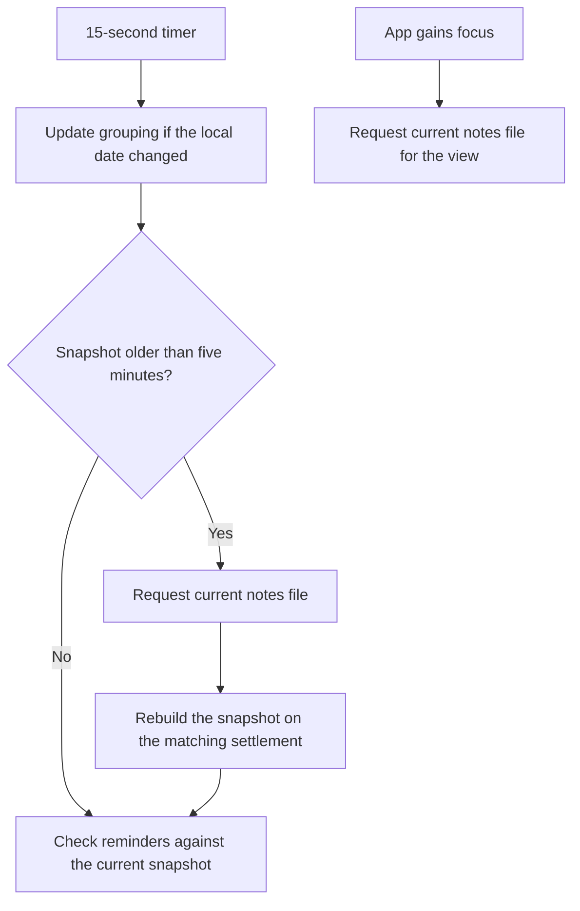

# PicoCalc Agenda — Keeping prompt errors and reminder refresh consistent

The original Agenda gives users the specific token that failed to parse, checks reminders every fifteen seconds, and rereads external file changes when the snapshot is more than five minutes old or the app regains focus. These behaviors involve separate inputs. The typed parser reads the user's prompt. The reactor reads the current wall clock and controls when to request a new notes snapshot. A faithful port has to keep these decisions in the same order as the original.

## Pass diagnostic coordinates across the backend boundary

The Agenda entry point `normalizeEntry` accepts a UTF-16 string, a local civil date or unset-clock marker, a caller-owned output buffer, and a two-word `EntryError` record. On success it returns the output length. Its negative return values identify the original error categories. An invalid date or time also records the original token's beginning and one-past-the-end offsets, measured in UTF-16 code units.

For input `x @tue 25:30`, the time occupies the span `[7, 12)`. The typed parser returns `-4` and writes the two offsets. The reactor reads that span from its original input buffer, encodes it for the display protocol, and renders `not a time: 25:30` while leaving the prompt active. The same calling convention works when the compiler emits Wasm or RV32.

```text
prompt     x @tue 25:30
offsets    012345678901
error      kind = -4, span = [7, 12)
```

The parser supplies the span because it already knows which word failed. A search for the word in the enclosing prompt could choose an earlier identical spelling that was ordinary task text. UTF-16 offsets also reflect surrogate pairs before the offending token. The tests exercise both cases. The launcher keeps the original Agenda name, description, shortcut, and icon.

`compile.js` checks the type and order of both `EntryError` fields before returning the linked application. The Wasm bridge takes four i32-shaped arguments, including a pointer into the world memory. The RV32 bridge uses the corresponding arguments in its native calling convention. The six jump slots in the ELF remain the same size.

## Separate notification timing from storage freshness

A reminder tick and a refresh solve different problems. The tick compares the current wall time with the time at which a task becomes eligible to announce. A refresh observes changes from another world. A tick can evaluate known reminders with the existing snapshot, so the common path avoids a filesystem request and a task-list rebuild.



The reactor uses monotonic time for the age of the file snapshot, wall time for reminders, and the configured local calendar for grouping. These clocks can vary independently. Crossing midnight changes a group header without requiring a file operation. A successful external refresh resets the measured snapshot age. Exactly five minutes old is still fresh. The check requests a new snapshot at the next fifteen-second tick. When a read is already in flight, the reactor records whether any coalesced request needs a reminder check after the read.

Reminder evaluation preserves file order even when the display sorts the tasks differently. When a timer reuses the snapshot, the reactor traverses the retained source lines. At startup and on a stale refresh it checks eligible tasks as the freshly read file is indexed. It keeps fired identities in memory even when a persistent-store write fails, so transient store failure can still deliver the notice and avoid duplicates during that process lifetime.

## Verification and remaining timing work

The generated-code fixtures compared 3,924 calendar/time combinations and 319 full prompts on both targets, including exact UTF-16 spans. The live simulator compared all six original prompt messages and checked that invalid input left the prompt active and the file unchanged. Its refresh scenario started just before midnight, wrote a new note from another world, and observed two notification times. Both the original and Wasm apps announced the existing task at the first fifteen-second tick, regrouped it under TODAY, and discovered and announced the new task on the 315-second tick. The native emulator confirmed the exact five-minute boundary and checked both an active error prompt and no corresponding filesystem read.

On the PicoCalc, the powered RV32 build displayed the offending date and time in two CRC-checked framebuffer snapshots. In both cases the prompt stayed open and the empty notes file stayed unchanged. The hardware check used serial-injected input. Measuring the delay from a physical key press to the visible panel remains open.

The same image then ran three cold starts on the settled 8 MiB partition with the panel enabled. The figures below use the image's source-to-first-publication instrumentation.

| Measure | Three-run range |
| --- | --- |
| On-device compilation | 723.440–723.711 ms |
| Compiler allocator peak | 709,796 bytes in all three runs |
| Source to first Agenda publication | 2.130–2.141 s |
| World initialization complete to notes read submission | 539.078–539.581 ms |
| Notes read submission to return | 113.215–126.050 ms |
| First Agenda frame-producing turn | 1.512–1.533 ms |
| Agenda world bytes at first response | 185,519 in all three runs |

The median first publication was 2.138 s. In those traces, sixteen other world startup attempts between Agenda initialization and notes submission consumed about 332 ms. This identifies a candidate for a controlled startup scheduling experiment, while the remaining part of the interval also needs attribution. A matched powered Wasm run is still needed to compare code targets under the same conditions.

Implementation and receipts are in `88f9e63`. The typed entry is in `picocalc-os/worlds/agenda/entry.typed`. The scheduled work runs through `refresh_tick`, `request_file`, and `publish_file` in `worlds/agenda/wasm-world.c`. Related note [[PROJ - PicoCalc Agenda - Passing a single file to Editor]].
