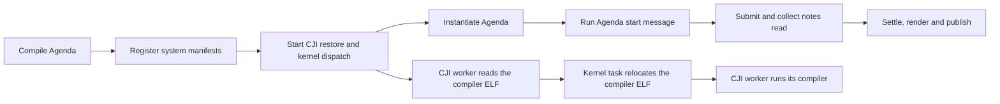

# PicoCalc Agenda — Measuring the startup dispatch delay

The native Agenda parser compiles in about 450 ms on the ESP32-P4. A full-system boot initially took 3.08 seconds from the start of that compile to publication of a view backed by the actual notes file. On a settled system a fresh build and world restart took a median of 573 ms. The difference is mostly attributable to the work between compilation and the start of Agenda's first file request. Stage timestamps show where that time accumulated.

## A timeline measured on the kernel clock

The firmware records the compiler start time before opening the source. It then logs elapsed microseconds before restoring the installed CJI development application, before dispatching world work, around Agenda engine creation, and when the notes read enters and returns from the filesystem queue. The publication timestamp closes the interval when the kernel has an updated Agenda frame. In the headless hardware configuration used here, it precedes any physical panel measurement.

The kernel schedules world initialization segments ahead of ordinary ready messages. Consequently, Agenda can have a valid native engine and still wait for its first start message to run. The filesystem worker is lower priority than the kernel task and runs on the same core. This choice keeps flash writes from suspending an in-progress kernel segment. It also means the measured file interval includes time waiting for the worker to run. The 43-byte task file gives little reason to expect a long transfer on its own.

## Moving the CJI relocation out of the earliest boot window

On this firmware, a previously installed CJI development application is restored at boot. A worker reads the compiler ELF. Relocation must happen on the kernel task's internal stack while instruction-cache maintenance coordinates both cores. Agenda and CJI therefore compete for the kernel task even though reading the compiler ELF and running its frontend happen on a worker.

The typed Agenda profile now lets the CJI worker start normally and defers its kernel-side relocation until Agenda first publishes or the two-second boot window expires. The same worker handoff and relocation execute when the deferral ends. When the installed artifact can be reused, the state machine takes the cache-hit route without waiting for relocation. The firmware has a deadline even if Agenda fails to reach its first frame.

## Matched cold boot results

Each column is the median of three resets with the same ESP32-P4 headless configuration, RV32 Agenda source, installed CJI slot, and notes file. All rows are elapsed from source capture.

| Milestone | Original schedule | Bounded relocation deferral |
| --- | ---: | ---: |
| Compiler done | 449 ms | 450 ms |
| Dispatch begins | 596 ms | 596 ms |
| Agenda engine instantiated | 1,460 ms | 1,317 ms |
| First file request submitted | 2,881 ms | 2,555 ms |
| First file reply reaches the kernel | 3,081 ms | 2,741 ms |
| First frame published | 3,083 ms | 2,743 ms |

The improvement was **339 ms**. All three optimized reboots still crossed the two-second deadline. CJI resumed relocation and reached frontend work, verified in the serial log. The experiment left the full duration of that unrelated compile unmeasured. The interval between engine creation and the first file request remains about 1.24 seconds. At this point, reducing the time of the Agenda compiler would help, but a complete analysis needs the cost of each boot world and the delay before its first ready message. That analysis can determine whether a scheduling change improves total system readiness and the visible Agenda experience.

## Reproducing the experiment

The baseline instrumentation is in firmware commit `def9918`, and the bounded change is in `b793934`. The `PICOCALC-AGENDA-COMPILER` ticket contains the raw stage timing JSON, serial boot sampler, and implementation diary. Review `port/esp32p4/main/agenda_p4.c` for the response timer, `nucleus/kernel.c` for dispatch, and `port/esp32p4/compiler/install.c` for the relocation phase. The physical input protocol uses the actual launcher shortcut, keyboard, and panel and records its own endpoints.
