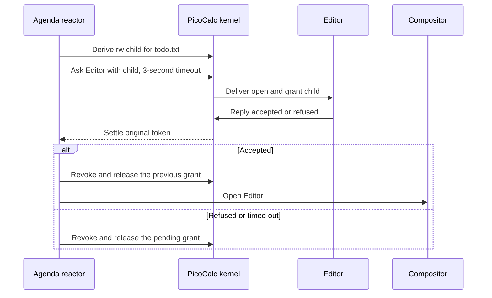

# PicoCalc Agenda — Passing a single file to Editor

Agenda owns a directory capability for `fs:/notes`. Editor receives access to just the document it is asked to open. F6 derives a read/write capability for `notes/todo.txt`, asks Editor to accept it, and brings Editor forward after a positive reply. This gives the same workflow to the original JavaScript app, the Wasm world, and the native RV32 reactor. The two compiled targets share one C implementation of the capability exchange.

## A file capability has an owner, a scope, and rights

The kernel handle table associates a numeric handle ID with its current holders, the world that created it, its path, and its rights. A host call checks the requesting world against that table. A child created by `fs_at` keeps the parent directory's ancestry, has one selected path, and receives the intersection of its requested rights and the parent's rights.

Agenda derives its child with `nw_fs_at(notes, "todo.txt", "rw")`. That request provides both read and write rights and omits the grant right. The world that minted the child may pass the child to Editor. Editor therefore obtains the right to read and write the task file. It cannot use that handle for another path or forward it to another world. This preserves the behavior of an Editor instance with no notes directory claim.

## The kernel constructs the message and its grant

The message visible to Editor has the same shape as the existing JavaScript application protocol.

```text
open({ file: narrowedFile, name: "notes/todo.txt" })
```

The native SDK uses `nw_ask_file` for this request. The kernel checks that the sender holds the capability, is allowed to grant it, and has supplied a narrowed file. It serializes the displayed name as a JSON string and emits the internal marker for the validated handle. The normal ask path carries the grant into the receiver's turn. The kernel grants the handle on message delivery before the recipient resolves it. Ordinary native JSON messages preserve their existing validation rules.



Agenda tracks the pending token and handle separately from the last accepted handle. A refusal can occur when Editor has unsaved changes. The refusal branch disposes of the pending grant and retains the previously accepted one. A successful replacement revokes the previous grant, then retains the new one. Revocation is checked on subsequent uses even when the recipient still holds a reference to the old handle.

## Verification

A host simulator run used the original JavaScript Editor with no directory claim. It opened the file through F6, modified it, saved it, and returned to Agenda. The sibling file was untouched and Agenda displayed the saved text after the focus reload. A second fixture kept all received handles so it could check their lifetimes explicitly. It verified successful access to the granted file, denial of another relative path and forwarding, revocation after refusal and timeout, and retention of the previous accepted handle until successful replacement.

The RV32 emulator ran the same reactor's F6 handler, checked its wire operations and payload arguments, and simulated success, refusal, timeout and replacement. This check used SDK stubs. The host and board runs use the real kernel capability table.

On the assembled PicoCalc, the on-device compiler emitted a 65,300-byte native ELF. F6 opened the board's bundled Editor. Its successful save changed the FAT file to `- editor fixtureX`, and reopening Agenda showed the updated title. The two framebuffer images passed their CRC checks and I²C and SPI reported no errors. The probe used injected keys and restored the previously empty notes file after the check.

The same boot gave a 722.012 ms compile, a 701,264-byte compiler allocator peak, and a 2.139 s first response with 184,419 world bytes. This was one boot on a settled filesystem. It leaves the two-second powered target open. The framebuffer captures and injected commands verify the workflow, while a measured physical key press and visible LCD response remain separate.

Read `picocalc-os/nucleus/native.c` at `NW_FS_AT`, `NW_ASK_FILE` and `NW_REVOKE` for kernel enforcement. The wire numbers and C wrappers are in `sdk/nw_wire.h` and `sdk/nw_calls.inc`. The reactor code is in `worlds/agenda/wasm-world.c` at `open_editor` and `editor_reply`. The original receiver is in `js/apps/editor.js` under its open handler.

Implementation and receipts are in `39ebfa7`. Related note [[PROJ - PicoCalc Agenda - Editing a task in a shared text file]].
