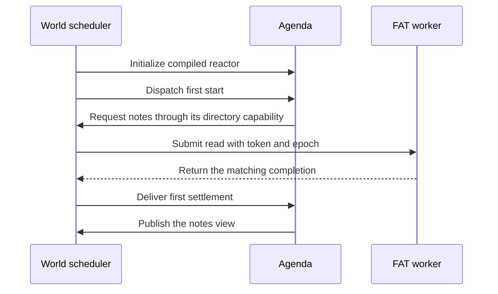

# PicoCalc Agenda — Scheduling its first notes read during boot

The powered PicoCalc builds Agenda from typed source and loads the generated world alongside the rest of the firmware's catalog. The first response requires the compiler to finish, the runtime to initialize Agenda, and its first file-backed screen to reach the compositor. The earlier native build took about 2.14 seconds across three boots. Its rendering turn took about 1.5 ms. The main scheduling delay came earlier, when an initialized Agenda was waiting for its first turn.

## Initialization and the first application turn

The manifest registers worlds and their resource claims before the dispatcher begins. Registration gives each world a stable table entry and supplies its code. The `boot_world` turn creates the actual JS, Wasm or RV32 instance and calls its initializer. Agenda uses that initializer to declare its screen metadata and reminder timer. The initializer does not yet load the notes. The kernel queues `M_START` as a separate event after initialization succeeds.

The kernel assigns a priority of 10 to instance creation. An ordinary app turn has a smaller priority. As a result, Agenda's `M_START` can sit behind unrelated instances for hundreds of milliseconds. This was visible as a roughly 539 ms interval from Agenda initialization to its first filesystem submission, with about 332 ms accounted for by the other world startup attempts beginning in that interval.

The candidate changes two scheduling choices. An eligible initial Agenda start and the settlement for its exact first notes read receive priority 11. The test for eligibility checks the typed Agenda world, its initial epoch, the startup deadline, and the token. All other ready events keep their existing priorities, including later Agenda focus messages, user keys, refreshes and editable compiler runs. The order of instance creation among the other worlds stays the same.

The filesystem worker runs on the same core as the kernel task and at a lower FreeRTOS priority. Therefore, early enqueueing can move the work into the queue long before that worker gets execution time. Use the interval from submission to returned completion to see this effect. The next interval, from completion to settlement, describes a distinct scheduling delay in the world lane. The candidate uses the existing filesystem worker and does not alter its scheduling parameters.

## Comparing matched images

The paired harness builds both targets from the same typed input, compiler integration and SDK configuration. It compares the emitted partition table and checks that only Agenda's engine differs in the startup manifests. Before the board run it verifies that the real notes file is empty. It seeds the same three tasks before timing either target and checks every intermediate file state during the interactive workflow. Cleanup restores the empty file on the native image.

An early validation attempt exposed a separate physical fault. The keyboard controller stopped acknowledging I²C, while the ESP32 continued to compile and publish Agenda over a working console link. That run's six file reads remained unchanged and its framebuffer capture failed validation. The subsequent runner records peripheral counters on every cold boot and requires a successful bus hold before a flash or reset. The old attempt is retained as fault evidence.

Both scheduler configurations used a mounted and settled FAT filesystem, the same three-task file, and the powered peripherals. There were three measured cold boots for each cell below. Every measured trial had zero errors on both I²C and SPI. All six candidate trials were below the two-second target, and all six controls were above it.

| Metric | Wasm control | Wasm early dispatch | RV32 control | RV32 early dispatch |
| --- | ---: | ---: | ---: | ---: |
| Median cold first response | 2.041 s | 1.702 s | 2.134 s | 1.787 s |
| Cold first-response range | 2.035–2.041 s | 1.690–1.731 s | 2.124–2.136 s | 1.785–1.787 s |
| Median compiler time | 513.173 ms | 519.456 ms | 723.488 ms | 721.576 ms |
| Median initialization to read submission | 531.989 ms | 2.217 ms | 538.948 ms | 1.631 ms |
| Median read submission to returned result | 122.704 ms | 327.523 ms | 125.900 ms | 328.608 ms |
| Median first publishing turn | 7.569 ms | 15.002 ms | 2.112 ms | 9.581 ms |
| Agenda world bytes at first response | 212,992 | 212,992 | 185,625 | 185,625 |

The median reduction was 338.768 ms for Wasm and 346.923 ms for RV32. The improvement is visible before and around the first I/O operation, with similar compiler times. The read spent longer between submission and return because it was submitted earlier while other startup work was still active. The instrumented publishing turn also took longer in the earlier boot window. The result of shifting these stages was a substantially earlier first publication on both targets. The traces measure the combined queue and return interval, so they leave the actual worker service time unresolved.

Both candidate workflows passed every notes readback during checkbox toggle, F3 edit, first F5 confirmation, confirmed F5 deletion, normalized task creation, and scoped Editor save. The final framebuffer on each target showed the same three retained tasks and completion state. The scheduler option defaults on for new typed Agenda P4 builds and remains selectable for reproducing controls. The implementation is `e7abb41` and the six powered candidate trials, functional receipts and screenshots are in `8f28b5e`.

## What the measurements establish

The cold endpoint begins at source capture and ends when the kernel publishes Agenda's first notes-backed frame. Settled rebuilds start a fresh compiler realm and world while the rest of the system is already running. The publishing turn covers one world event in the kernel, while the display receives its own work later. Raw receipts retain these figures independently. Wasm world bytes count through its runtime boundary, and the native figure counts through the ELF loader's boundary.

The workflow tests use injected keys and capture the compositor framebuffer. A physical latency run requires a view of the actual key and LCD in a common video timeline. Its start and end can be bounded by the two adjacent frames in which each event first occurs.

See the `PICOCALC-AGENDA-STARTUP` design before changing scheduling. Review `picocalc-os/nucleus/kernel.c` at `pick`, `picocalc-os/port/esp32p4/main/fs_p4.c` at `port_fs_submit`, and `agenda_p4.c` at `p4_agenda_boot_dispatch`. The startup design and its reMarkable delivery are recorded in `bdaaf54`. Related note [[PROJ - PicoCalc Agenda - Keeping prompt errors and reminder refresh consistent]].
