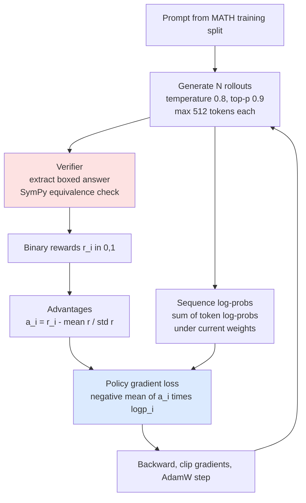

# Build a Reasoning Model (From Scratch) on a DGX Spark: Reproducing GRPO and Measuring What It Costs

This report records the first training experiment run against Sebastian Raschka's *Build a Reasoning Model (From Scratch)* on `bling`, an NVIDIA DGX Spark, on 18 November 2026. The book takes a pretrained Qwen3 0.6B base model and adds reasoning capability using inference-time techniques, reinforcement learning with verifiable rewards, and distillation. This report covers one complete circuit of the training path: a 50-step Group Relative Policy Optimization run, evaluated before and after on MATH-500.

The experiment succeeded. The base model scored 15.6% and the trained checkpoint scored 45.8%, a gain of 30.2 percentage points produced in fifteen minutes of training. Both figures were measured on this machine through the book's own evaluation pipeline. The book's published values for the same configuration are 15.2% and 45.6%.

The more durable result is the cost structure and the failure surface. Training was not the expensive part; evaluation was, by a factor of three. Two of the run's defects were silent, producing plausible-looking output while learning nothing or destroying a previous result. The reported training loop consumes roughly two thirds of its steps producing exactly zero gradient, by construction.

A second experiment tests the chapter-7 objective instead of the chapter-6 one, and produces the report's strongest result. Adding the KL divergence term that is supposed to stabilize training drives held-out accuracy from 46.0% to 0.0% over a hundred steps, by saturating the next-token distribution at uniformity. The failure is visible in the entropy metric half a training run before it is visible in accuracy. A five-condition sweep then shows that clipping is irrelevant to the outcome while the coefficient governing that term has a cliff between 1e-4 and 1e-3.

> [!summary]
> - **A 0.6B base model reached 45.8% on MATH-500 after 50 GRPO steps.** Training took 15m07s and peaked at 14.84 GB. The book's figure for the identical configuration is 45.6%, and its base-model baseline is 15.2%.
> - **Two environment failures were necessary before any training could run.** A missing `Python.h` blocked `torch.compile`, and a missing Dynamo configuration flag caused per-token recompilation that silently reduced generation to zero useful throughput.
> - **The token budget is a correctness parameter.** At `--max_new_tokens 96` the loop ran to completion, exited zero, and learned nothing, because the verifier could never observe a `\boxed{}` answer and every reward was structurally zero.
> - **32 of 50 steps produced exactly zero gradient**, because all four rollouts in a group scored identically. This is correct GRPO behaviour, and it means two thirds of the training compute is spent on steps that cannot change the model.
> - **Scripts overwrite tracked reference logs and each other's evaluation output.** `.gitignore` does not protect already-tracked files, and the evaluator's output filename contains neither the checkpoint nor a timestamp.
> - **The chapter-7 KL term drives accuracy to 0.0%.** With `--kl_coeff 0.001` the model fell from 10.0% at step 50 to 0 of 50 at step 100, while the no-KL arm held 40.0%. Entropy rose to 11.90 against a `log(151936) = 11.93` maximum, meaning the next-token distribution became uniform over the entire vocabulary.
> - **Entropy is a leading indicator of collapse.** It crossed 2.0 at step 36 and stood at 7.33 when accuracy was still 10% at step 50. The trajectory had committed to failure fifty steps before the final evaluation revealed it.
> - **Clipping is irrelevant to the outcome; the KL coefficient is decisive.** Tightening `clip_eps` from 10.0 to 0.2 changed a collapsed run from 0.0% to 0.0%. Reducing `kl_coeff` from 1e-3 to 1e-4 changed it from 0.0% to 40.0%, a cliff inside one order of magnitude of the script's own default.

## 1. The platform and why it matches the book's reference hardware

The book's own benchmarks were run on this hardware generation, which makes the reproduction unusually direct: there is no cross-machine translation to argue about. The Spark pairs an ARM CPU with a Blackwell GPU that reports compute capability 12.1, abbreviated `sm_121`.

A compute capability identifies the instruction set of an NVIDIA GPU. CUDA code for such a device ships in two forms. **SASS** is native machine code for one specific capability. **PTX** is an intermediate representation that the driver compiles for the installed GPU when a kernel is first launched. A wheel built with `compute_120` PTX therefore runs on `sm_121` hardware, with the driver performing the final compilation once and caching the result.

That distinction explains the one warning that appears on every execution in this project and should not be treated as an error:

```
Found GPU0 NVIDIA GB10 which is of cuda capability 12.1.
Minimum and Maximum cuda capability supported by this version of PyTorch is
(8.0) - (12.0)
```

The installed PyTorch was compiled for capabilities up to 12.0 but embeds PTX for `compute_120`. The reported architecture list confirms it directly:

```
arch list: ['sm_80', 'sm_90', 'sm_100', 'sm_110', 'sm_120', 'compute_120']
```

| Property | Value |
|---|---|
| Host | `bling`, NVIDIA DGX Spark |
| CPU | aarch64, 20 cores (Cortex-X925 and Cortex-A725) |
| GPU | NVIDIA GB10, compute capability 12.1 |
| Memory | 121 GiB unified between CPU and GPU |
| Driver and CUDA | 580.178.04, CUDA 13.0 |
| Python | 3.12.15, uv-managed |
| PyTorch | 2.10.0+cu130 |
| Triton | 3.6.0 |

Unified memory is the property that matters for the training chapters. The GRPO loop holds a policy model, rollout buffers for long token sequences, and an activation graph for the backward pass simultaneously. On a discrete GPU all of that must fit in a fixed VRAM budget. Here the same 121 GiB serves both roles, so the book's stated ceiling of about 70 GB for its larger run is reachable without changing the code.

## 2. What the book's code requires, and what it declared

The companion repository at `https://github.com/rasbt/reasoning-from-scratch` is a Python package plus per-chapter directories. Two files describe the dependency set, and they differ in a way that determines which installation path works.

`requirements.txt` lists the versions a reader needs. `pyproject.toml` lists the same libraries but also declares a platform-specific package index:

```toml
[tool.uv.sources]
torch = [{ index = "pytorch-cu130", marker = "sys_platform == 'linux' and platform_machine == 'aarch64'" }]

[[tool.uv.index]]
name = "pytorch-cu130"
url = "https://download.pytorch.org/whl/cu130"
explicit = true
```

That marker matches this machine exactly. Resolving through `uv` therefore selects the CUDA 13.0 build of PyTorch for aarch64 automatically. The `pip` route reads only `requirements.txt`, which contains no such marker, and would install the default x86-oriented wheel. The two installation paths described in the book are not equivalent on this hardware, and the difference is worth roughly 40 tokens per second.

Three facts about the repository state are worth recording because they are not what the book says:

- The book states that the repository ships a `.python-version` file so that `uv` selects a compatible interpreter. It does not exist on `main`; the path returns 404. Section 3 shows that this omission is what makes the first environment failure reachable.
- `requirements.txt` lists `reasoning-from-scratch >= 0.1.2`, a PyPI package, so the `pip` path installs a published snapshot rather than the working tree. The `uv` path builds the local package.
- The metrics logs under `ch06/02_rlvr_grpo_scripts_intro/logs/` are tracked files containing the author's reference runs. Any local training run overwrites them. Section 8 develops this.

## 3. Two environment failures

Neither failure was caused by the book's code being wrong. Both were caused by the environment resolving to something valid but insufficient, which is the harder class to diagnose because the first symptom appears far from the cause.

### 3.1 A header that `torch.compile` needs and the system interpreter lacks

The first attempt to compile the model failed inside Triton's runtime build step:

```
torch._inductor.exc.InductorError: CalledProcessError: Command '['/usr/bin/gcc',
'/tmp/tmp5uwkuil9/cuda_utils.c', '-O3', '-shared', '-fPIC', '-Wno-psabi',
'-o', '...cuda_utils.cpython-312-aarch64-linux-gnu.so',
'-l:libcuda.so.1', ... '-I/usr/include/python3.12']' returned non-zero exit status 1.
```

The relevant argument is the last one. Triton compiles a small C extension at run time to query device properties, and that extension includes `Python.h`. `uv` had selected the system interpreter at `/usr/bin/python3.12`, version 3.12.3, and the `python3.12-dev` package is not installed on this host, so `/usr/include/python3.12/Python.h` does not exist.

Two repairs are possible. Installing `python3.12-dev` requires sudo. The alternative keeps every change inside the home directory: install a uv-managed interpreter, which ships its own include directory, and pin the project to it.

```bash
uv python install 3.12          # cpython-3.12.15, includes include/python3.12/
echo "3.12" > .python-version   # uv prefers the managed interpreter over the system one
rm -rf .venv && uv sync
```

After that, `Python.h` resolves under `/home/manuel/.local/share/uv/python/cpython-3.12.15-linux-aarch64-gnu/include/python3.12/` and compilation proceeds. The general lesson is that a Python interpreter being present says nothing about whether its development headers are, and only a build step reveals the difference.

### 3.2 Dynamic shapes that turn compilation into a per-token rebuild

With compilation working, the `--compile` flag on the chapter-2 script produced this:

```
Time: 161.09 sec
0 tokens/sec
```

Dynamo explained why in its recompilation log:

```
[0/8] last reason: 0/7: tensor 'cache.cache[0][0]' size mismatch at index 2.
      expected 16, actual 17
```

A key-value cache stores the attention keys and values for every token already processed, so that each new token attends over cached state rather than the full prefix. The cache is therefore a tensor whose sequence dimension grows by one on every step. TorchDynamo specializes a compiled graph on the shapes it observes. A dimension of 16 and a dimension of 17 are different specializations, so the model recompiles for every token it generates. Compilation cost dominates and throughput collapses.

PyTorch 2.8 introduced a configuration flag that tells Dynamo to treat integer attributes on modules as unspecified rather than specialized. The book's notebooks set it, and so do `reasoning_from_scratch/ch03.py`, `qwen3_optimized.py`, and `qwen3_batched.py`. The standalone script `ch02/05_use_model/generate_simple.py` does not, which makes `--compile` on that script a trap rather than an optimization.

```python
torch._dynamo.config.allow_unspec_int_on_nn_module = True
```

With the flag set, and with two warmup passes to exclude compilation from the measurement, the same KV-cached generator reported:

| Mode | This machine | Book's DGX Spark table |
|---|---|---|
| KV cache, eager | 75.2 tok/s | 68 tok/s |
| KV cache, compiled | 102.9 tok/s | 98 tok/s |

The machine is at or slightly above the reference figures once the recompilation problem is removed. A correct diagnosis changes the answer by a factor of about 100 rather than by a few percent, which is why "compilation made it slower" is never sufficient evidence that compilation is unsuited to the workload.

## 4. The GRPO algorithm as the book implements it

Before describing the run, this section states what the training actually computes, because the shape of the algorithm explains both the results and the wasted compute in Section 6.

The setting is reinforcement learning with verifiable rewards. A prompt is a mathematics problem. The reward is not learned from human preferences; it is computed by a deterministic program. The book's chapter 3 builds that program: extract the content of a `\boxed{...}` expression from the model's response, normalize it, and compare it for symbolic equivalence using SymPy. A response scores 1 if a correct final answer can be extracted and 0 otherwise. Nothing in between exists, so the reward is binary.

Group Relative Policy Optimization generates several complete responses to the same prompt and turns their rewards into a learning signal by comparison within that group. The pipeline has five stages, and the fourth is the one that distinguishes it from supervised fine-tuning.



### 4.1 Rollouts

A rollout is one complete sampled response. Sampling uses temperature 0.8 and top-p 0.9 rather than greedy decoding, because a deterministic decoder would return the same response N times and the group would contain no variation to compare. The generator keeps the end-of-sequence token inside the response so that long training runs do not unlearn how to stop.

### 4.2 Rewards

The verifier from chapter 3 supplies the reward. This is what replaces the reward model that a preference-based pipeline would train. Its consequence for the experiment is direct: the reward function cannot be gamed by fluent prose, only by producing a correct, extractable final answer.

### 4.3 Advantages

Advantages normalize each rollout against its own group:

```python
rewards = torch.tensor(rollout_rewards, device=device)
advantages = (rewards - rewards.mean()) / (rewards.std() + 1e-4)
```

The book's worked example uses rewards `[1., 1., 0., 0.]`, which produces advantages `[0.8659, 0.8659, -0.8659, -0.8659]`. A positive advantage raises the likelihood of the actions that produced that rollout; a negative advantage lowers it.

The arithmetic of this formula has a consequence that governs the entire training budget. If every rollout in a group receives the same reward, the numerator of every advantage is zero and the group produces no gradient at all. That happens in two distinct situations: all rollouts correct, and all rollouts wrong. Section 6 measures how often each occurred.

### 4.4 Sequence log-probabilities

The fourth stage computes, for each rollout, the sum of the log-probabilities of its generated tokens under the *current* weights:

```python
logps = torch.stack(rollout_logps)          # one scalar per rollout
pg_loss = -(advantages.detach() * logps).mean()
```

The sum is taken over the whole sequence rather than averaged per token. Averaging would divide each term by its response length and thereby rescale the learning signal, which is not part of the original GRPO formulation. Chapter 7 revisits token-level normalization when it adds further modifications.

`advantages` is detached because it acts as a fixed learning signal for this update; gradients must flow only through the log-probabilities, which are the only term that depends on the parameters being optimized.

The leading minus sign converts a maximization into a minimization, because PyTorch optimizers minimize. Minimizing the negated objective produces exactly the same parameter updates as maximizing the original.

### 4.5 What this variant omits

The chapter-6 implementation deliberately omits the KL divergence term that penalizes drift from a reference policy. The repository argues this from published results in DAPO, Dr. GRPO, and Olmo 3, all of which report that the KL term can hurt performance on mathematics tasks. Chapter 7 reintroduces it and shows both the stabilizing effect and a specific failure it can cause.

## 5. Designing a run that is small and still meaningful

Two probes preceded the real run. The first was cheap and revealed the trap that governs the rest of this section.

A three-step run with `--num_rollouts 2 --max_new_tokens 96` completed in 16 seconds and reported:

```
[Step 1/3] loss=-0.0000 reward_avg=0.000 tok/sec=41.6 avg_resp_len=51.0
[Step 2/3] loss=-0.0000 reward_avg=0.000 tok/sec=37.0 avg_resp_len=8.0
[Step 3/3] loss=-0.0000 reward_avg=0.000 tok/sec=31.6 avg_resp_len=8.0
```

Every reward is zero. The cause is structural rather than statistical: the verifier only awards credit for a final answer it can extract from a `\boxed{...}`, and a base model that has not been trained to produce that format does not reach a boxed answer within 96 tokens. Every rollout therefore scores zero, every advantage is zero, and the loss is exactly zero. The loop ran correctly and learned nothing.

A second probe used the book's token budget:

```
[Step 1/6] loss=-0.0000 reward_avg=0.000 tok/sec=65.3 avg_resp_len=229.2
[Step 3/6] loss=-0.0000 reward_avg=1.000 tok/sec=68.4 avg_resp_len=107.8
[Step 5/6] loss=13.7501 reward_avg=0.250 tok/sec=68.5 avg_resp_len=219.8
[Step 6/6] loss=11.3951 reward_avg=0.250 tok/sec=69.5 avg_resp_len=257.8
```

Rewards become non-zero, and step 3 shows `reward_avg=1.000` — a group in which all four rollouts were correct, which is equally gradient-free but for the opposite reason. Section 6 shows that this is not an edge case.

The final run used the book's chapter-6 configuration exactly, so that the outcome is comparable to a published number rather than being an uninterpretable one-off:

```bash
uv run ch06/02_rlvr_grpo_scripts_intro/rlvr_grpo_original_no_kl.py \
  --steps 50 --num_rollouts 4 --max_new_tokens 512 --show_eta
```

The `--skip-zero-advantage-updates` flag available in this script was deliberately not used, because it changes the run relative to the published baseline.

## 6. Training dynamics

The run finished with `exit=0` in `15m07.152s` and peaked at `Max CUDA memory allocated: 14.84 GB`.

Reward rose and so did response length. Grouping the fifty steps into five blocks of ten:

| Steps | Mean `reward_avg` |
|---|---|
| 1–10 | 0.175 |
| 11–20 | 0.400 |
| 21–30 | 0.575 |
| 31–40 | 0.775 |
| 41–50 | 0.650 |

Over the full run, `corr(step, reward) = +0.440` and `corr(step, response_length) = +0.526`. The mean reward was 0.515 with a standard deviation of 0.420, which is large relative to the mean and visible in the step-by-step output.

The joint movement of reward and length is the expected signature of this training procedure. A base model that answers in a few tokens cannot satisfy a verifier that requires a boxed derivation, so the only way for a rollout to become rewardable is to emit a longer response containing that derivation. Length and reward are coupled through the reward function and not merely correlated by accident.

### 6.1 Two thirds of the steps cannot change the model

The reward distribution over fifty steps was:

| `reward_avg` | Count | Gradient |
|---|---|---|
| 0.00 | 14 | none, all wrong |
| 0.25 | 9 | present |
| 0.50 | 5 | present |
| 0.75 | 4 | present |
| 1.00 | 18 | none, all right |

Thirty-two of fifty steps had a reward of either 0.00 or 1.00 with four rollouts, meaning every advantage in the group was zero and the backward pass produced no update. Only 18 steps had non-zero loss. The loss values observed ranged from −23.46 to +13.75, and their magnitude should not be read as a quality signal: a step where one rollout is correct and three are wrong produces large advantages and therefore a large loss, while a step where all four agree produces exactly zero regardless of how good the model is.

This yields a concrete efficiency observation. In this configuration roughly 64% of the sampling compute produced no gradient. The sampling is where nearly all the wall-clock time goes, because generating 512 tokens four times takes far longer than the backward pass over them. A training run at this scale is therefore dominated by generating responses that are then discarded.

The repository already provides the corresponding optimization. `--skip-zero-advantage-updates` detects the all-equal case and skips the backward and optimizer step. That saves the cheaper half of the work. The expensive half, sampling the rollouts in the first place, cannot be skipped, because whether the group is degenerate is only known after the rewards have been computed. Strategies that would address the sampling cost itself — larger groups to raise the chance of mixed outcomes, difficulty filtering to avoid problems the model always solves or never solves — are the subject of chapter 7.

### 6.2 What a step costs

| Configuration | Peak memory | Steps | Wall clock |
|---|---|---|---|
| 2 rollouts, 96 tokens | — | 3 | 16 s including load |
| 4 rollouts, 512 tokens | 10.14 GB | 6 | 61 s including load |
| 4 rollouts, 512 tokens | 14.84 GB | 50 | 15m07s |

The repository publishes a memory table for larger groups: 8 rollouts at 1,024 tokens requires 30.50 GB and 8 rollouts at 512 tokens requires 20.31 GB. Scaling to the book's 8-rollout configuration would roughly double training time per step to about 36 seconds, putting 50 steps near 30 minutes, still far below the multi-hour figures the book's prose associates with its larger runs.

## 7. Evaluation, and why it dominated the budget

The reward trend is a property of the training loop. Demonstrating that the model reasons better requires the held-out benchmark, and this is where the experiment's real cost appeared.

The book uses MATH-500: 500 problems sampled from the MATH dataset, deliberately disjoint from the 12,000 problems used for training. Evaluation renders each problem as a prompt, generates up to 2,048 tokens, extracts a boxed answer, and grades it against the reference with the same SymPy-based verifier used to produce training rewards.

```bash
uv run ch03/02_math500-verifier-scripts/evaluate_math500_batched.py \
  --dataset_size 500 --which_model base \
  --checkpoint_path ch06/02_rlvr_grpo_scripts_intro/checkpoints/rlvr_grpo_original_no_kl/qwen3-0.6B-rlvr-grpo-step00050.pth \
  --batch_size 128
```

Results, with both ends of the comparison measured on this machine:

| Model | MATH-500 | Samples | Eval time |
|---|---|---|---|
| Qwen3 0.6B base | **15.6%** | 78/500 | 9.5 min |
| + GRPO, 50 steps, 4 rollouts, 512 tok | **45.8%** | 229/500 | 46.3 min |
| Qwen3 0.6B official reasoning checkpoint (published, not run here) | 48.2% | — | — |

Against the repository's published baseline for the same configuration (15.2%) and the same trained configuration (45.6%), the reproduction is within 0.4 and 0.2 percentage points respectively. The gain is a factor of 2.9, achieved in fifteen minutes on one GPU.

The trained model landed within 2.4 points of the officially released Qwen3 0.6B reasoning checkpoint, which was produced with a substantially larger recipe. That is the central result of the experiment: at this model scale, a binary verifier plus a few dozen policy updates recovers most of what supervised reasoning training provides.

### 7.1 Evaluation costs more than training

The asymmetry in the table is the practically important finding. The same 500 problems, the same batch size, the same generated-token ceiling produced a 9.5-minute evaluation for the base model and a 46.3-minute evaluation for the trained one, a factor of 4.9.

The cause is batching and generation length. A batch of 128 sequences must remain allocated until its longest member finishes. The base model averages a short answer, so most batches free quickly. The trained model averages around 580 tokens per response and reaches the 2,048-token ceiling often, so each batch is padded to the longest trajectory in it and every sequence in the batch occupies that padded length. Training the model made evaluating the model five times more expensive, because the training taught it to think longer.

For the experiment as a whole the split was:

| Phase | Wall clock |
|---|---|
| Training (50 steps) | 15m07s |
| Evaluation, trained checkpoint | 46.3 min |
| Evaluation, baseline | 9.5 min |
| **Total** | **≈71 min** |

Two thirds of the time went to establishing that the training had worked. Any plan that treats evaluation as a cheap afterthought will mis-budget the work by a large factor. The batched evaluator is not an optimization but a requirement at this model scale: the book reports 185.4 minutes for a reasoning-model pass over MATH-500 on an H100 without batching, against 14.6 minutes with it. This run's batched pass took 46.3 minutes, about 3.2 times the H100 figure, so the unbatched path here is expected in the region of ten hours per checkpoint.

## 8. Chapter 7: the KL term destroys the model

Everything so far used the chapter-6 objective, which omits the KL divergence term. Chapter 7 reinstates it and reports that the original formulation, run past fifty steps, degrades badly. Because this is the book's most consequential claim about training stability, and because reproducing a degradation is more informative than reproducing a success, it was tested directly with a controlled comparison rather than by reading the published table.

The design holds the script fixed and varies one flag. Both arms run `7_5_plus_kl.py` with 100 steps, 8 rollouts, 512 tokens, seed 42 and a MATH-500 evaluation at steps 50 and 100. They differ only in `--kl_coeff`.

### 8.1 Result

| Arm | step 50 | step 100 |
|---|---|---|
| `--kl_coeff 0.0` | 46.0% (23/50) | **40.0% (20/50)** |
| `--kl_coeff 0.001` | 10.0% (5/50) | **0.0% (0/50)** |

The repository's published rows for the same configuration are 47.4% → 44.0% without KL and 33.4% → 0.4% with it. The direction and the mechanism agree; the KL arm here degraded faster and further, reaching exactly zero of fifty problems.

Cost and memory differ substantially, because the KL objective requires a frozen copy of the model as its reference:

| Arm | Wall clock | Peak memory |
|---|---|---|
| no KL | 2h10m | 44.0 GB |
| KL 1e-3 | 2h56m | **49.00 GB** |

Against chapter 6's 14.84 GB at 4 rollouts, the KL configuration needs 3.3 times the memory. On this machine's 121 GiB of unified memory that is comfortable. On a discrete GPU with 24 GB it would not run.

### 8.2 The mechanism, visible in the tracked metrics

The chapter-7 scripts record entropy, advantage statistics and the policy ratio alongside reward and loss. Those extra columns are what make the failure legible instead of mysterious. Averaged over blocks of ten steps, the KL arm:

| Steps | KL loss | Resp len | Entropy | Policy ratio |
|---|---|---|---|---|
| 1–10 | −0.003 | 374.8 | 0.50 | 0.61 |
| 21–30 | −0.009 | 397.1 | 0.99 | 0.91 |
| 41–50 | −0.010 | 349.1 | 3.81 | 0.23 |
| 51–60 | +0.204 | 472.9 | 9.80 | 0.02 |
| 71–80 | +0.685 | 512.0 | 11.82 | 0.48 |
| 91–100 | +0.745 | 512.0 | **11.90** | 0.96 |

The vocabulary has 151,936 tokens, so `log(151936) = 11.93`. An entropy of 11.90 is a distribution that is effectively uniform over every token in the vocabulary. This is not a degraded model that still reasons poorly; it is a model emitting random tokens.

That reading is confirmed by the response-length column. Length pins to the 512-token ceiling at the same time entropy saturates, because uniform sampling almost never selects the end-of-sequence token. The model cannot stop.

The explanation follows from what the KL surrogate actually measures. The script computes

```python
kl_loss = kl_coeff * torch.mean(new_logps - ref_logps)
```

on rollouts sampled from the *previous* policy, with `ref_logps` detached and therefore constant during optimization. Minimizing this quantity means minimizing `new_logps` on exactly the tokens that were sampled. That is a direct instruction to assign *less* probability to the observed actions, which flattens the next-token distribution and raises entropy. The loss changed sign around step 25 and then grew monotonically, so for the remaining three quarters of the run this term was the only gradient signal: once every rollout in a group is wrong, every advantage is zero and the policy-gradient term contributes nothing at all.

The term introduced to prevent drift from the reference policy is what produces the drift.

### 8.3 Entropy is a leading indicator, not a symptom

The most useful measurement here is not the terminal accuracy but when the failure became inevitable, because the two are separated by dozens of steps.

| Event | Step |
|---|---|
| KL loss changes sign | 25 |
| Entropy exceeds 2.0 | 36 |
| Entropy exceeds 5.0 | 47 |
| Entropy exceeds 10.0 | 55 |
| Accuracy first measured (10.0%) | 50 |
| Accuracy collapsed (0.0%) | 100 |

Entropy crossed 2.0 at step 36. At step 50 it stood at 7.33 and accuracy was still 10%. The final evaluation, which is the first point at which the damage is unmissable, came fifty steps after the trajectory had already committed to failure.

This establishes a practical rule: **a rising entropy trend with flat or falling reward is a collapse in progress, not a transient.** Waiting for an evaluation to confirm it costs the remaining training time and, in this case, fifty steps' worth of compute.

### 8.4 Two failure modes that look alike and are not

A separate run at 4 rollouts with no KL serves as a contrast, and it produces a *different* pathology:

| | 4 rollouts, no KL | 8 rollouts, KL 1e-3 |
|---|---|---|
| Entropy trajectory | 0.85 → 0.23 (falls) | 0.50 → 11.90 (rises to uniform) |
| Response length | stuck near 7 tokens | pinned at the 512 cap |
| Accuracy | 14.0% → 16.0% | 10.0% → 0.0% |
| Interpretation | converges confidently on short wrong answers | loses all structure |

The first case becomes *more* confident while remaining wrong: entropy falls, responses stay at a handful of tokens, and accuracy finishes at 16.0% against a 15.6% untrained baseline. The model has learned to answer immediately and incorrectly. The second case becomes uniformly uncertain.

Both would be filed as "training failed" and both would be misdiagnosed, because entropy moves in opposite directions. The distinguishing measurement is cheap and the chapter-7 scripts already record it.

### 8.5 The sweep: clipping is irrelevant, the coefficient has a threshold

The KL arm above used `clip_eps` 10.0, which is not clipping at all; standard PPO uses 0.2. That left two explanations open: the KL term itself, or the KL term combined with a disabled clipping mechanism. A five-condition experiment closes the question, varying only `clip_eps` and `kl_coeff` with every other setting held at 8 rollouts, 512 tokens, seed 42 and 100 steps.

| `clip_eps` | `kl_coeff` | acc@50 | acc@100 | Final entropy | Peak memory |
|---|---|---|---|---|---|
| 10.0 | 0 | 46.0% | 40.0% | 0.10 | 44.0 GB |
| 10.0 | 1e-3 | 10.0% | 0.0% | 11.90 | 49.0 GB |
| 0.2 | 0 | 42.0% | **46.0%** | 0.15 | 44.2 GB |
| 0.2 | 1e-4 | 36.0% | **40.0%** | 0.74 | 47.5 GB |
| 0.2 | 1e-3 | 20.0% | 0.0% | 11.88 | 49.0 GB |

**Clipping does not matter.** Reading down the `kl_coeff = 1e-3` column, tightening `clip_eps` by a factor of fifty moves accuracy from 0.0% to 0.0% and terminal entropy from 11.90 to 11.88. Reading down the `kl_coeff = 0` column, the same change moves a healthy run from 40.0% to 46.0%. The clipped-ratio machinery is not what saves or destroys these runs. The KL term alone is sufficient.

One mild asymmetry is worth recording: at step 50 the tightly clipped KL arm is twice as accurate as the unclipped one (20.0% against 10.0%). Clipping does damp the early damage, and then fails to hold once every reward in a group is zero and the KL gradient has no counterweight.

**The coefficient has a sharp threshold between 1e-4 and 1e-3.** A tenfold reduction takes the model from total destruction to a healthy 40.0%. This is not a gradual relationship but a cliff, and it sits within one order of magnitude of the script's own default — which means the default value is on the wrong side of it for this model and dataset.

The `1e-4` arm also shows the subthreshold signature, which is the most useful diagnostic in the table. Its entropy by block of ten steps:

```
0.46  0.33  0.30  0.27  0.39  0.56  0.55  0.54  0.60  0.52
```

Entropy first falls as the model becomes more decisive, reaching 0.27 around steps 31–40, and then turns upward to roughly 0.55 and stays there. The healthy arms never do this: with `kl_coeff` 0, entropy falls to 0.12–0.17 and stays flat for the remaining sixty steps. A KL term small enough not to destroy the run is still large enough to reverse the entropy trend, and the reversal is visible long before accuracy suffers — 40.0% at step 100 is within noise of both healthy arms.

The three new runs cost 3h00m, 2h12m and 2h31m respectively, totalling 7h43m for the completed factorial. All results remain single-seed.

## 9. Defects found in the tooling

Four defects surfaced during this experiment. None is a bug in the algorithms; all four are properties of the scripts and of git's behaviour that would silently mislead a reader who did not check. A fifth, in the published artefacts themselves, is recorded at the end of the section.

**The training script overwrites tracked reference logs.** `ch06/02_rlvr_grpo_scripts_intro/rlvr_grpo_original_no_kl.py` writes to `logs/rlvr_grpo_original_no_kl_metrics.{csv,txt}`, which are committed in the repository as the author's reference runs. After the training run, `git status` reported both as modified:

```
 M ch06/02_rlvr_grpo_scripts_intro/logs/rlvr_grpo_original_no_kl_metrics.csv
 M ch06/02_rlvr_grpo_scripts_intro/logs/rlvr_grpo_original_no_kl_metrics.txt
```

`.gitignore` lists `*.csv` and `*.txt`, which suggests protection that does not exist: ignore rules do not apply to files that are already tracked. The reference logs were preserved by copying this run's output elsewhere and restoring the tracked files with `git restore`.

**The metrics CSV accumulates across runs.** The file appends rather than truncates, so after three probe runs and the real run it contained 317 rows spanning four separate runs, with no column identifying which run a row belongs to. Exactly 258 of those rows are the author's tracked reference log, whose steps run 1 to 258; the remaining 59 are this project's three-step probe, six-step probe, and fifty-step run. Summed naively, it reported a mean reward of 0.572 and a step-to-reward correlation of −0.259, both of which are artifacts of mixing a 258-row reference run with a 50-row run of this project. Filtering on the `total_steps` column recovered the correct figures of 0.515 and +0.440. Any analysis of these logs must segment by run explicitly.

**The evaluator's output filename omits the checkpoint.** `evaluate_math500_batched.py` writes `math500_{which_model}-{device}-batched-bs{batch_size}.jsonl`. Because both evaluations used `--which_model base --batch_size 128`, the baseline run replaced the trained model's per-problem results. The headline accuracy survived only because it had already been recorded; the per-problem data needed to classify the 271 failures as format errors or reasoning errors was lost, and recovering it requires repeating a 46-minute evaluation.

**A standalone script omits a configuration flag its siblings set.** As described in Section 3.2, `generate_simple.py --compile` runs at zero useful throughput because the Dynamo flag is absent. The notebooks and three library modules set it, so the omission is inconsistent rather than deliberate.

**Every checkpoint of one chapter-7 variant is truncated on Hugging Face.** All ten files in `7_5_plus_kl/checkpoints/` of `rasbt/qwen3-from-scratch-grpo-checkpoints` are about 1.05 GB instead of the 1.50 GB every other variant ships, and none of them loads: `torch.load` raises `PytorchStreamReader failed reading zip archive: failed finding central directory`. The first four bytes are the ZIP local header `PK\x03\x04`, but the final bytes are raw float data rather than the `PK\x05\x06` end-of-central-directory record, so the archives were cut short. A fresh download is byte-identical in size to what the API reports, which rules out a local transfer fault. The consequence is that the KL comparison in Section 8 could not be read off published checkpoints and had to be trained here; the defect is reported as [issue 281](https://github.com/rasbt/reasoning-from-scratch/issues/281).

## 10. Reproducing the experiment

The repository is a read-only upstream project. All local work is on the branch `local/spark-grpo-run`, which adds three files and modifies no source. `origin` remains the upstream repository and is never pushed to.

```bash
cd /home/manuel/code/others/reasoning-from-scratch

# Environment: uv-managed Python 3.12 is required for torch.compile.
uv python install 3.12
echo "3.12" > .python-version
uv sync                                    # resolves torch 2.10.0+cu130 for aarch64

# Train. Expect 15-20 minutes and about 15 GB.
uv run ch06/02_rlvr_grpo_scripts_intro/rlvr_grpo_original_no_kl.py \
  --steps 50 --num_rollouts 4 --max_new_tokens 512 --show_eta

# Evaluate. Rename the output immediately: the filename does not include the checkpoint.
uv run ch03/02_math500-verifier-scripts/evaluate_math500_batched.py \
  --dataset_size 500 --which_model base --batch_size 128 \
  --checkpoint_path ch06/02_rlvr_grpo_scripts_intro/checkpoints/rlvr_grpo_original_no_kl/qwen3-0.6B-rlvr-grpo-step00050.pth
mv math500_base-cuda-batched-bs128.jsonl math500_grpo-50.jsonl

# Restore the tracked reference logs that training overwrote.
git restore ch06/02_rlvr_grpo_scripts_intro/logs/

# Baseline for comparison.
uv run ch03/02_math500-verifier-scripts/evaluate_math500_batched.py \
  --dataset_size 500 --which_model base --batch_size 128
```

All training and evaluation artefacts are gitignored: `checkpoints/`, `math_train.json`, `qwen3/`, `*.pth`, `*.jsonl`. The run's metrics are preserved at `notes/runs/2026-11-18-grpo50/`, and the step-by-step record of the work, including both environment failures with their exact diagnostics, is at `notes/DIARY.md`.

The chapter-7 comparison needs two more invocations of the same script. Two details are load-bearing. Both arms write to paths derived from the script name alone, so the first arm's `logs/` and `checkpoints/` must be moved before the second starts. And stdout must be unbuffered, or a run that is demonstrably on the GPU shows an empty log for minutes:

```bash
# Both arms; move logs/ and checkpoints/ between them.
export PYTHONUNBUFFERED=1
for kl in 0.0 0.001; do
  uv run ch07/03_rlvr_grpo_scripts_advanced/7_5_plus_kl.py \
    --steps 100 --num_rollouts 8 --max_new_tokens 512 \
    --kl_coeff $kl --seed 42 --eval_on_checkpoint 50 --show_eta
done
```

The full sequence, including the `clip_eps` sweep and the analysis script that extracts entropy onset, is preserved in execution order at `ttmp/2026/11/18/REASON-001--reproduce-grpo-reasoning-training-on-dgx-spark/scripts/`.

Downloaded data: two model checkpoints of 1.5 GB each (base and reasoning) plus tokenizers, and the 12,000-problem MATH training split, fetched from `raw.githubusercontent.com/rasbt/math_full_minus_math500` with a Backblaze fallback. MATH-500 itself ships in the repository as `ch03/01_main-chapter-code/math500_test.json`, so no dataset library is needed.

## 11. Limitations and open questions

- The trained checkpoint's per-problem JSONL was lost, so the 271 failures have not been classified. The split between extraction failures and genuinely incorrect reasoning is unknown.
- Every timing is a single observation on one machine. No run-to-run variance was measured for either training or evaluation.
- The run used 4 rollouts and 512 tokens for the chapter-6 experiment. An 8-rollout chapter-7 run was later performed and reached 40.0% without KL, which is within noise of the 4-rollout result on the chapter-6 objective but far above the 16.0% that the chapter-7 script reaches at 4 rollouts. The two scripts differ by `inner_epochs` and clipping, so those factors are not separated here.
- Whether the same seed reproduces the same trajectory across GPUs is untested. The book notes that `cuda` and `mps` devices introduce floating-point differences and warns that results may vary.
- The reported correlation between step and reward (+0.440) mixes genuine learning with any difficulty ordering in the 12,000-problem dataset, which is not curriculum-sorted. Only the MATH-500 delta should be treated as evidence of capability.
- Chapter 8 was not run, so distillation remains unverified here. The clipped policy ratio, the format reward, and the three GRPO variants in `7_7_improvements` were also untested; only the KL term was isolated.
- The KL result is single-seed. Five conditions now separate the KL term from clipping, and establish a threshold between `kl_coeff` 1e-4 (40.0%) and 1e-3 (0.0%), but each condition was run once. Whether the threshold sits at the same place under another seed is untested.
- The KL collapse here is faster than the published one (10.0% at step 50 against 33.4%) and this remains unexplained. Clipping has been ruled out as the cause; the remaining candidates are the coefficient, the number of inner epochs, and seed variance.
- Only three KL strengths were sampled. The threshold is bounded between 1e-4 and 1e-3 but not located more precisely, and the shape of the dose-response curve between them is unknown.
- The no-KL arm ran partly concurrently with a second training process, so its 2h10m wall clock is inflated by GPU contention. Accuracy figures are unaffected; timings from this session are not benchmarks.
- The book's "about twelve hours and 70 GB for a few GRPO rounds" on the same hardware is now explained by run length rather than by a different configuration. A 100-step, 8-rollout run takes about three hours at these settings, so twelve hours corresponds to a few hundred steps. The no-KL arm measured 44 GB peak and the KL arm 49 GB, both within the stated 70 GB.

## 12. Key points

- A binary verifiable reward and fifty policy updates moved a 0.6B base model from 15.6% to 45.8% on MATH-500, within 2.4 points of the officially reasoning-tuned checkpoint, in fifteen minutes of training.
- The KL divergence term, introduced to keep a policy near its reference, can instead destroy it. Minimizing `kl_coeff * mean(new_logps - ref_logps)` on rollouts from the previous policy lowers the probability of exactly the sampled tokens, which flattens the distribution. Accuracy went from 10.0% to 0 of 50 while the no-KL arm held 40.0%.
- An entropy of 11.90 against a vocabulary of 151,936 tokens (`log` = 11.93) is not degraded reasoning, it is random output. The response length pins to the generation cap at the same time, because uniform sampling almost never emits the end-of-sequence token.
- Rising entropy with flat reward and falling entropy with flat reward are different diseases. The first is a distribution losing structure; the second is premature convergence on short wrong answers, which finished at 16.0% against a 15.6% baseline.
- Clipping is not a stabilizer for this objective. Changing `clip_eps` by a factor of fifty left the collapsed runs at 0.0% and the healthy runs between 40.0% and 46.0%, so the decisive variable is the KL coefficient itself.
- A KL coefficient small enough to leave accuracy intact can still reverse the entropy trend: at 1e-4, entropy fell to 0.27 and then climbed to about 0.55, while the unpenalized runs stayed flat at 0.12–0.17. Accuracy alone did not distinguish them.
- The token budget controlling how long a rollout may run is a correctness parameter. Too small a value produces a training loop that exits successfully, reports zero loss, and cannot learn, because the reward function never observes a rewardable answer.
- Group-relative advantages are exactly zero whenever all rollouts in a group tie, which occurred in 32 of 50 steps here, in both the "all wrong" and "all right" directions. Two thirds of the sampling compute produced no gradient by construction.
- Evaluation, not training, dominates the cost of a reasoning-model experiment: 46.3 minutes for the trained checkpoint against 9.5 minutes for the baseline on identical inputs, because longer generations make batch padding more expensive.
- A GPU warning about unsupported compute capability may be a correct description of a PTX-JIT path rather than an error. Checking the embedded PTX architecture list settles the question.
- When a compiled model slows to zero throughput, the decisive diagnostic is which shape is changing. A key-value cache changes length every token, and a missing Dynamo flag turns that into a rebuild per token.
- `.gitignore` provides no protection for files that are already tracked, so any script that writes into a directory of shipped reference logs will quietly modify the working tree.
- An evaluation artifact whose name omits the input's identity will eventually destroy a previous result, and the loss is discovered when the second run reports a different score than expected.

## Sources and related notes

- Book: *Build a Reasoning Model (From Scratch)*, Sebastian Raschka, Manning, 2026, ISBN 9781633434677. PDF and EPUB read from `/home/manuel/Documents/`.
- Code repository: https://github.com/rasbt/reasoning-from-scratch, local clone at `/home/manuel/code/others/reasoning-from-scratch`, branch `local/spark-grpo-run`, upstream commit `b864602`.
- Step-by-step record with full diagnostics: `/home/manuel/code/others/reasoning-from-scratch/notes/DIARY.md`, twelve steps including one explicit correction.
- Reproduction scripts in execution order: `/home/manuel/code/others/reasoning-from-scratch/ttmp/2026/11/18/REASON-001--reproduce-grpo-reasoning-training-on-dgx-spark/scripts/` (nine numbered steps plus a README).
- Run artefacts: `/home/manuel/code/others/reasoning-from-scratch/notes/runs/` — `2026-11-18-grpo50/` (chapter 6), `2026-11-18-kl-ab/` (the two-arm KL comparison) and `2026-11-18-collapse-sweep/` (the five-condition factorial), each with per-arm logs, checkpoints and evaluations.
- Upstream defect report for the truncated `7_5_plus_kl` checkpoints: https://github.com/rasbt/reasoning-from-scratch/issues/281
- Model weights: https://huggingface.co/rasbt/qwen3-from-scratch
- Training split: https://github.com/rasbt/math_full_minus_math500
- MATH-500: https://huggingface.co/datasets/HuggingFaceH4/MATH-500
- GRPO, from DeepSeekMath: https://arxiv.org/abs/2402.03300
- DAPO: https://arxiv.org/abs/2503.14476 — argues against the KL term on reasoning tasks
- Dr. GRPO: https://arxiv.org/abs/2503.20783
- DeepSeek-R1: https://arxiv.org/abs/2501.12948
- Other work on this machine: [[PROJECT REPORT - TRELLIS on DGX Spark - Porting Two Generations of Image-to-3D Models to aarch64 and sm_121 - A Technical Deep Dive]]
