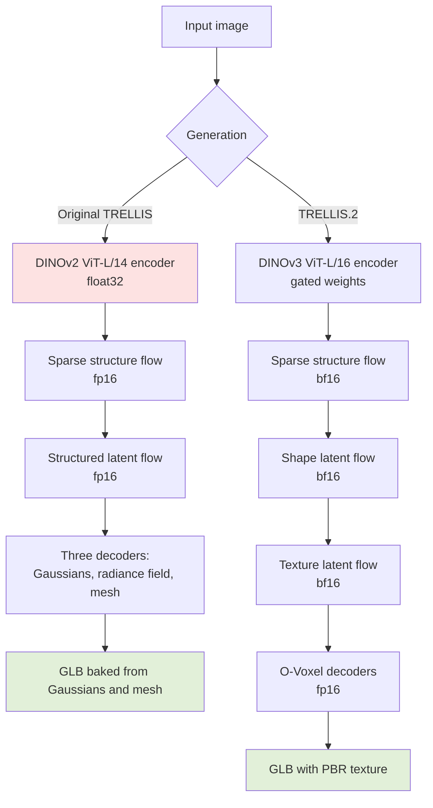
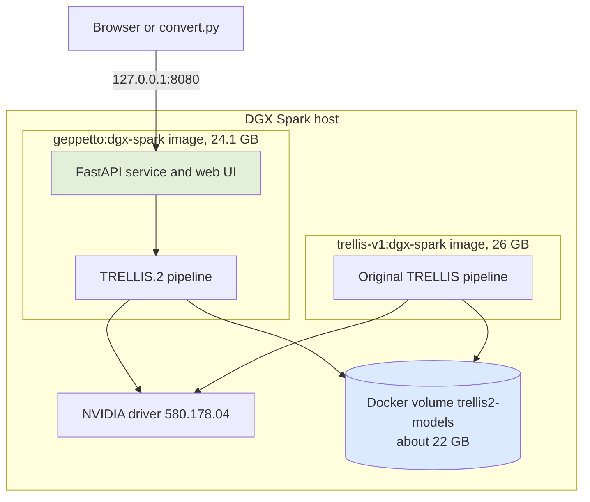
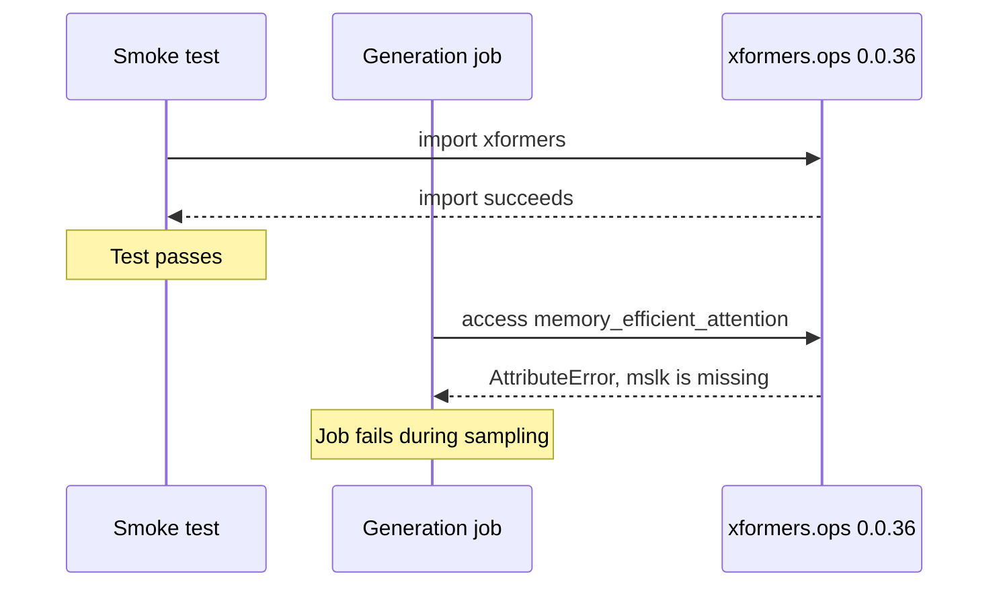
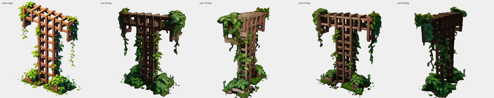
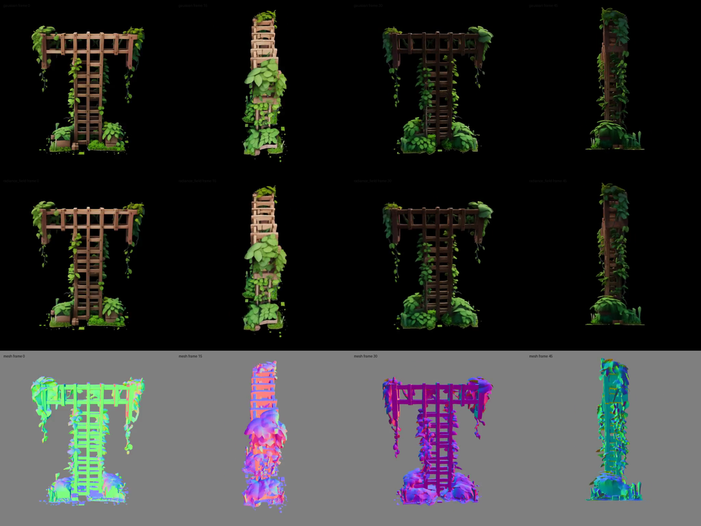

# TRELLIS on DGX Spark: Porting Two Generations of Image-to-3D Models to aarch64 and sm_121

This report explains how Microsoft's TRELLIS and TRELLIS.2 image-to-3D models were built and run on `bling`, an NVIDIA DGX Spark, on 18 November 2026. Neither project supports this machine upstream. TRELLIS.2 was verified by its authors on A100 and H100 GPUs, and the original TRELLIS targets Python 3.10, PyTorch 2.4 and CUDA 11.8. The Spark has an ARM CPU, a Blackwell GPU with compute capability 12.1, and CUDA 13.

Both models now generate textured 3D meshes on the Spark. The more durable result is an account of why the port failed each time it failed. Seven failures occurred, and they fall into a small number of classes that recur whenever compiled GPU software moves to a new platform: source-language requirements in headers, undeclared runtime dependencies, operator support that depends on both the GPU and the number format, and version limits that do not describe real incompatibilities.

> [!summary]
> - **Both models run on the GB10.** TRELLIS.2 produced a 471,047-face textured GLB at 512³ in 166 s with 2.65 GB of peak GPU memory. The original TRELLIS generated Gaussian, radiance-field and mesh outputs in 17.7 s and exported a 28,673-face GLB in a further 19.2 s, with 10.38 GB of peak GPU memory.
> - **Unpinned dependencies caused the first two TRELLIS.2 failures.** PyTorch 2.14.1 requires C++20 in its headers, and xformers 0.0.36 moved its attention kernels into a separate package. Pinning PyTorch 2.13.0 and xformers 0.0.35 resolved both.
> - **On sm_121, xformers has no `float32` attention operator.** Models that run in `fp16` or `bf16` work. DINOv2, which runs in `float32`, must bypass xformers.
> - **`spconv` compiles for GB10 with three small source patches.** Its `cumm<0.8.0` requirement does not reflect a code incompatibility: cumm 0.8.0 differs from 0.7.13 only in its version number and changelog.

## 1. The platform and what it requires of compiled code

A deep-learning model is usually discussed as a set of weights, but the program that executes those weights contains several layers of platform-specific machine code. Understanding the port requires separating those layers, because each one failed in a different way.

The **CPU architecture** of the Spark is aarch64, also called ARM64. Every compiled Python extension must be built for it. A package that publishes only x86-64 wheels must be compiled from source here, and a package that has neither an ARM wheel nor buildable source cannot be installed at all.

The **compute capability** identifies the instruction set of an NVIDIA GPU. The Spark's GB10 reports capability 12.1, abbreviated `sm_121`. CUDA code can be shipped in two forms. **SASS** is native machine code for one specific capability. **PTX** is an intermediate representation that the driver compiles for the installed GPU when the program loads. A library built with `-gencode=arch=compute_121,code=sm_121` contains SASS for the GB10 and requires no driver compilation.

A **CUDA extension** is a Python module containing C++ and CUDA code compiled against PyTorch's C++ headers. These headers matter because an extension is compiled with the C++ language standard its own build specifies, while the headers it includes impose their own minimum standard. Section 3 shows the failure that results when the two disagree.

The test machine had the following configuration.

| Property | Value |
|---|---|
| Host | `bling`, NVIDIA DGX Spark |
| CPU | aarch64, 20 cores |
| GPU | NVIDIA GB10, compute capability 12.1 |
| Memory | 121 GiB unified between CPU and GPU |
| Operating system | Ubuntu 24.04.5, kernel 7.0.0-1019-nvidia |
| Driver and CUDA | 580.178.04, CUDA 13.0 |
| Container runtime | Docker 29.6.2 with the `nvidia` runtime |

## 2. The two models and the software each one needs

TRELLIS and TRELLIS.2 both generate a 3D asset from one image, and both work in stages. A flow-matching model first predicts which regions of a voxel grid are occupied. Further flow models then predict a **structured latent**, a set of feature vectors attached to the occupied voxels. Decoders convert that latent into renderable or exportable 3D data. The two generations differ in the image encoder, the latent representation, the number format of their networks, and the libraries that implement sparse 3D operations.



The red node marks the one component whose number format later caused a failure. The table lists the differences that determined the porting work.

| Property | Original TRELLIS | TRELLIS.2 |
|---|---|---|
| Source commit | `193e0502` | `75fbf018` |
| Weights | `microsoft/TRELLIS-image-large`, 2.9 GB | `microsoft/TRELLIS.2-4B`, 16 GB |
| Image encoder | DINOv2 `dinov2_vitl14_reg` through `torch.hub` | DINOv3 `dinov3-vitl16-pretrain-lvd1689m`, gated by Meta |
| Flow model number format | `fp16` | `bf16` |
| Sparse convolution library | `spconv`, built on `cumm` | FlexGEMM |
| Mesh processing | `xatlas`, `pyvista`, `pymeshfix`, `igraph` | CuMesh, O-Voxel |
| Rendering extensions | `nvdiffrast`, `diffoctreerast`, `diff_gaussian_rasterization` | `nvdiffrast`, `nvdiffrec` |
| Packaging used here | A Dockerfile written for this project | The Geppetto project's `dgx-spark` target |

The word *gated* has a specific meaning on Hugging Face: the repository owner must approve each account before the files can be downloaded. TRELLIS.2 cannot generate without DINOv3. Access was requested during this work, and the approval was detected at 08:55:50, about fifteen minutes after the first check returned HTTP 403.

### 2.1 The installed system

Both models run in separate Docker images. Containers isolate each model's Python environment and leave the host's CUDA and Python installations unchanged. The weights live in one named Docker volume, so rebuilding an image does not download them again.



Geppetto's API has no authentication, and its compose file publishes the port on every network interface by default. Setting `API_PORT=127.0.0.1:8080` in `.env` restricts it to the local machine. The final dependency set is listed below. Every version in this table was either selected deliberately or recorded from a successful build.

| Component | Version | Used by | Reason for the choice |
|---|---|---|---|
| Base image | `nvidia/cuda:13.0.0-devel-ubuntu24.04` | Both | Geppetto's `dgx-spark` target |
| Python | 3.12 | Both | Default on Ubuntu 24.04 |
| PyTorch | 2.13.0+cu130 | Both | Verified by Geppetto on a Spark, and its headers accept C++17 |
| torchvision | 0.28.0+cu130 | Both | Paired with PyTorch 2.13 |
| xformers | 0.0.35 | Both | Last release with built-in attention kernels |
| transformers | 4.56.2 | Both | TRELLIS.2 depends on this DINOv3 module layout |
| nvdiffrast | 0.4.0 | Both | Compiles for this platform |
| cumm | 0.8.2, patched | Original | Contains fixes for CUDA 12.6 and later |
| spconv | 2.3.8 at `263d6b47`, patched | Original | Newest commit |
| Geppetto | `b307373f` | TRELLIS.2 | Newest commit at the time of the build |

## 3. Failure class one: a header that raises the language standard

The first image build stopped after six minutes. The final error named the `o_voxel` package, but the earliest compiler diagnostic identified the real cause:

```text
/opt/venv/lib/python3.12/site-packages/torch/include/ATen/ATen.h:5:2:
  error: #error C++20 or later compatible compiler is required to use ATen.
```

The failing translation unit was `CuMesh/src/hash/hash.cu`, compiled with `-std=c++17`. Geppetto's `dgx-spark.args` file requests `TORCH_SPEC=torch torchvision` with no version, so pip installed the newest release available that day, PyTorch 2.14.1. The first lines of `ATen.h` show the requirement change between releases.

```cpp
// torch 2.13.0: ATen/ATen.h
#if !defined(_MSC_VER) && __cplusplus < 201703L
#error C++17 or later compatible compiler is required to use ATen.
#endif
```

In PyTorch 2.14.1, the equivalent check demands C++20. An extension's build file controls `-std`, so an extension written for C++17 cannot be compiled against those headers without changing its build configuration. Geppetto documents PyTorch 2.13.0 as the version it verified on a Spark, and pinning that version resolved the failure.

The failure also exposed a weakness in the build. Upstream's `setup.sh` does not use `set -e`, so a failing command does not stop the script, and the script's exit status is that of the last command it runs. Each extension is installed inside an `if` block. When `--cumesh` fails, the later `if` conditions evaluate to false and the script exits with status 0, so Docker marks the layer `DONE`. The `--o-voxel` block is the last statement in the file, which makes its `pip` status the script's exit status. That is why the build stopped there, even though the compiler had already failed two layers earlier.

```text
#21 14.67 Failed to build cumesh
#21 DONE 14.8s
#22 DONE 9.4s
#23 ERROR: process "/bin/sh -c PATH=/opt/buildstub:$PATH bash setup.sh --o-voxel" did not complete successfully
```

A successful `docker build` therefore does not prove that every extension was installed. Only a test that imports each extension can establish that.

## 4. Failure class two: a dependency that appears only at inference

With PyTorch pinned, the image built and passed Geppetto's smoke test. That test verified the GPU and imported every extension and the attention backend. The service then loaded the model successfully, and the first generation failed after 18 seconds:

```text
AttributeError: xformers.ops.memory_efficient_attention and the related symbols are
unavailable because mslk could not be imported: No module named 'mslk'
```

The unpinned package this time was xformers. Version 0.0.36 moved its attention implementation into a separate package named `mslk`, and it exposes the old symbols through a module-level `__getattr__` that raises this error on first access. The sequence explains why the smoke test passed.



Installing `mslk` would have added a dependency that Geppetto had not tested on this platform. Pinning xformers 0.0.35 restored the documented working combination. The lesson applies beyond this package: an import test verifies that a module can be loaded, whereas a kernel can only be verified by executing it.

## 5. Failure class three: operators selected by GPU and number format

To close that gap, a new test called xformers attention directly on the GPU. It failed with an error that was more informative than the failure it was written to detect:

```text
NotImplementedError: No operator found for `memory_efficient_attention_forward` with inputs:
     query       : shape=(2, 128, 1, 64) (torch.float32)
`fa3F@0.0.0` is not supported because:
    requires device with capability <= (9, 0) but your GPU has capability (12, 1) (too new)
    dtype=torch.float32 (supported: {torch.bfloat16, torch.float16})
    operator wasn't built - see `python -m xformers.info` for more info
`fa2F@2.5.7-pt` is not supported because:
    dtype=torch.float32 (supported: {torch.bfloat16, torch.float16})
`cutlassF-pt` is not supported because:
    requires device with capability <= (9, 0) but your GPU has capability (12, 1) (too new)
```

xformers contains several implementations of attention and selects one at run time by checking each operator's requirements against the inputs and the device. On a GB10, the dispatcher's options reduce to one.

| Operator | Maximum compute capability | Number formats | Available on GB10 |
|---|---|---|---|
| `fa3F` | 9.0 | `fp16`, `bf16` | No, the GPU is too new and the operator is not built |
| `cutlassF-pt` | 9.0 | `float32` not rejected | No, the GPU is too new |
| `fa2F@2.5.7-pt` | No upper limit reported | `fp16`, `bf16` | Yes, for `fp16` and `bf16` only |

The result is a specific rule for this platform: **xformers attention on sm_121 works in `fp16` and `bf16`, and it does not work in `float32`.** The test itself was at fault, because it used a format the TRELLIS.2 flow models do not use. All five of their configurations specify `"dtype": "bfloat16"`. The corrected test uses the formats and call shapes that the models use, and it compares each result with PyTorch's own attention implementation:

```python
for dtype in (torch.bfloat16, torch.float16):
    # Dense path: trellis2/modules/attention/full_attn.py
    q, k, v = (torch.rand(2, 128, 64, device="cuda", dtype=dtype) for _ in range(3))
    out = xops.memory_efficient_attention(q, k, v)
    ref = F.scaled_dot_product_attention(q, k, v)
    dense_diff = (out - ref).abs().max().item()
    assert dense_diff < TOLERANCE
```

The maximum absolute difference was 3.91 × 10⁻³ in `bf16` and 4.88 × 10⁻⁴ in `fp16`, on both the dense path and the block-diagonal sparse path. These values equal 2⁻⁸ and 2⁻¹¹, the spacing between adjacent representable numbers in the interval [0.5, 1) for each format, so the two implementations differ by at most one unit in the last place for values in that interval.

The same rule later affected a real model. The original TRELLIS failed during its first generation, inside the DINOv2 image encoder:

```text
File "/models/torch/hub/facebookresearch_dinov2_main/dinov2/layers/attention.py", line 94, in forward
    x = memory_efficient_attention(q, k, v, attn_bias=attn_bias)
NotImplementedError: No operator found for `memory_efficient_attention_forward` with inputs:
     query       : shape=(1, 1374, 16, 64) (torch.float32)
```

DINOv2 enables xformers whenever the package can be imported. The TRELLIS image needs xformers for its `fp16` flow models, so removing the package was not an option. DINOv2's own source provides a narrower control:

```python
# dinov2/layers/attention.py
XFORMERS_ENABLED = os.environ.get("XFORMERS_DISABLED") is None
```

Setting `XFORMERS_DISABLED=1` makes DINOv2 use standard PyTorch attention. A search of the installed xformers package and the TRELLIS source found no other reader of that variable, so the TRELLIS flow models continue to use xformers.

## 6. Porting `spconv`: separating declared limits from real ones

The original TRELLIS performs sparse 3D convolution with `spconv`, which generates its CUDA kernels through a library named `cumm`. Both were compiled from source for this configuration, and three separate questions arose.

### 6.1 Which `cumm` version is acceptable

The first build stopped before compiling `spconv`:

```text
ERROR: Could not find a version that satisfies the requirement cumm<0.8.0,>=0.7.11 (from spconv)
```

`cumm` had already installed at version 0.8.2, and `spconv` declares an upper limit below that. A commit in `cumm` titled "change version to 0.8.0 to avoid break spconv" suggests an API break, but the release diff shows otherwise:

```text
$ git diff --stat v0.7.13 v0.8.0
 CHANGELOG.md | 4 ++++
 version.txt  | 2 +-
```

The changelog gives the reason: "CI environment gcc changed, so we need to increment minor version to avoid conflict." The bump appears to separate binary wheels built by different compilers. That concern does not apply when both packages are compiled together from source. Releases 0.8.1 and 0.8.2 also add fixes for CUDA 12.6 and later, which makes them the better choice for a CUDA 13 system.

### 6.2 Which patches the source needs

The `cumm` 0.8.2 source required two changes, and `spconv` required one. Each patch is followed by a `grep` in the Dockerfile, so a patch that stops applying fails the build.

```dockerfile
# 1. Accept GB10 as a CUDA architecture.
sed -i 's/"10.0", "12.0",/"10.0", "12.0", "12.1",/' cumm/common.py

# 2. Include CUDA 13 in the check for the newer NVRTC standard-library headers.
sed -i 's/(__CUDACC_VER_MAJOR__ > 13)/(__CUDACC_VER_MAJOR__ >= 13)/' include/tensorview/core/nvrtc_std.h

# 3. Allow the cumm release that was compiled alongside spconv.
sed -i 's/>=0.7.11, <0.8.0/>=0.7.11, <0.9.0/' setup.py
```

The second patch corrects a boundary error. Upstream's condition is:

```cpp
#if ((__CUDACC_VER_MAJOR__ > 13) || (__CUDACC_VER_MAJOR__ == 12 && __CUDACC_VER_MINOR__ >= 6))
```

For CUDA 13.0, the major version is neither greater than 13 nor equal to 12, so the condition is false and the code selects the older headers. The build was not attempted without this patch, so this report does not claim that the unpatched condition causes a compile error on CUDA 13.

### 6.3 When the kernels are compiled

By default, `cumm` and `spconv` defer compilation until a package is first imported. The first probe demonstrated this behaviour: its `cumm` installation completed in 1.6 seconds and produced no compiled library. Import-time compilation would make every new container compile the kernels again, and it also requires a visible GPU, because `cumm` calls `nvidia-smi` to identify the device when no architecture is specified. Three environment variables move compilation into the image build:

```dockerfile
ENV CUMM_CUDA_ARCH_LIST=12.1 CUMM_DISABLE_JIT=1 SPCONV_DISABLE_JIT=1
```

With these settings, the `spconv` layer compiled in 225 seconds. The resulting library contains 411 `sm_121` code objects, matching the 411 compile commands in the build log. It also contains 195 `sm_75` code objects whose origin was not traced.

A layer test then ran each of the three `spconv` layer types used by TRELLIS with both convolution algorithms:

```text
torch 2.13.0+cu130 gpu NVIDIA GB10 spconv 2.3.8
ok ConvAlgo.Native: voxels 1939 -> 1575 -> 1939, loss=0.0033
ok ConvAlgo.MaskImplicitGemm: voxels 1939 -> 1575 -> 1939, loss=0.0050
```

The voxel counts show the expected behaviour. Strided convolution reduces 1,939 voxels to 1,575, and inverse convolution restores the original 1,939. The test also confirmed that non-zero gradients reached all three layers.

## 7. Removing Kaolin

NVIDIA's Kaolin library has no aarch64 wheel on PyPI, and the setup script for the original TRELLIS installs it from NVIDIA's wheel index only for PyTorch versions up to 2.4.0. A dependency audit changed the task entirely. The only Kaolin symbol reached by inference code is a tensor-shape check in the bundled FlexiCubes module:

```python
from kaolin.utils.testing import check_tensor
```

The image therefore provides a 22-line module that implements this function, placed on `PYTHONPATH`:

```python
def check_tensor(tensor, shape=None, dtype=None, device=None, throw=True):
    """Return True when tensor matches shape, dtype and device. A None entry in shape matches any size."""
    problem = None
    if not torch.is_tensor(tensor):
        problem = f"expected a torch.Tensor, got {type(tensor)}"
    elif shape is not None and (
        len(shape) != tensor.ndim or any(want is not None and want != got for want, got in zip(shape, tensor.shape))
    ):
        problem = f"expected shape {tuple(shape)}, got {tuple(tensor.shape)}"
    # dtype and device checks follow the same pattern
```

This approach has a narrow justification. It is valid because the audit established exactly which symbol is used and what that symbol does. Replacing a dependency whose behaviour affects numerical results would require a much stronger argument.

## 8. Verification levels and what each one detected

The failures above share a structure: each check established less than it appeared to. The table lists the seven failures in the order they occurred and identifies the check that first revealed each one.

| Time | Failure | Class | First detected by |
|---|---|---|---|
| 08:41 | PyTorch 2.14.1 headers require C++20 | Language standard | Docker build, two layers after the first compile error |
| 08:51 | `cumm` 0.8.2 exceeds the `spconv` limit | Declared version limit | Docker build |
| 09:01 | xformers 0.0.36 lacks attention kernels without `mslk` | Undeclared runtime dependency | End-to-end generation |
| 09:04 | Attention test used `float32` | Test defect | Direct GPU execution |
| 09:07 | Test read a nonexistent `spconv.pytorch.__version__` | Test defect | Direct GPU execution |
| 09:12 | `nvdiffrast` needs PyTorch at build time | Build configuration | Docker build |
| 09:18 | DINOv2 sends `float32` tensors to xformers | Operator support | End-to-end generation |

Each level of verification answers a different question, and passing one level says nothing about the levels above it.

| Level | Check | What it proves | What it cannot prove |
|---|---|---|---|
| 1 | Build exit status | The final commands returned success | That earlier extension installs succeeded |
| 2 | Module import | Python can load each module | That lazily loaded kernels exist |
| 3 | Kernel execution on the GPU | The operation runs for the tested inputs | That the numerical output is correct |
| 4 | Comparison with a reference | The output agrees with a known implementation | That the complete pipeline works |
| 5 | End-to-end generation | All stages run on real weights and input | That the output file is usable |
| 6 | File validation | The GLB parses and contains faces | That the geometry resembles the input |
| 7 | Visual inspection | The asset resembles the input from several views | Quality over a range of inputs |

Level 2 passed while the xformers defect was present, and level 5 was the first level that executed DINOv2. Levels 3 and 4 were added in response, and they now run as part of the rebuild script.

## 9. Results

Each model generated one asset from an example image supplied in its own repository. The renders below were produced from the exported GLB files with a simple diffuse shader, so their colours show the base-colour texture under that shader and do not measure material accuracy.


*TRELLIS.2 at 512³, seed 42. From left to right: the input image and renders at azimuths of 30°, 120°, 210° and 300°. The generated crown preserves the openwork and the gemstones around its full circumference, including the sides the input image does not show.*



*Original TRELLIS, seed 1, in the same layout. The lattice, the vines and the planted base are all present in the exported mesh.*

The original TRELLIS also decodes each asset into three representations. The renders below come from the videos produced during the same run.



*Frames 0, 15, 30 and 45 of the turntable videos. The rows show the Gaussian decoder, the radiance-field decoder and the surface normals of the mesh decoder.*

| Measurement | TRELLIS.2 | Original TRELLIS |
|---|---|---|
| Input | Crown example image | `assets/example_image/T.png` |
| Key settings | 512³, texture 2048, seed 42 | Default sampler settings, texture 1024, simplify 0.95, seed 1 |
| Generation time | 149.8 s | 17.73 s for all three decoders |
| GLB export time | 14.66 s | 19.17 s |
| Peak allocated GPU memory | 2.65 GB | 10.38 GB |
| GLB size | 20,859,728 bytes | 2,525,004 bytes |
| GLB vertices | 429,961 | 28,987 |
| GLB faces | 471,047 | 28,673 |

The two columns should not be read as a speed comparison, because the inputs, resolutions and output detail all differ. Peak memory also reflects different loading strategies: TRELLIS.2 defaults to `low_vram=True`, whereas the original pipeline moves all of its models onto the GPU at once.

The TRELLIS.2 service reports a `face_count` of 2,554,020 for this job. That value is read from the mesh before GLB export reduces it to the 500,000-face decimation target, and the exported file contains 471,047 faces. The measured 166 s is close to the 171 s that Geppetto publishes for the same resolution and texture size on a Spark, although other builds were using the CPU during this run.

These are single runs of one input per model. They establish that the software works on this machine, but they do not characterize typical performance or quality.

## 10. Reproducing the installation

The ticket workspace contains every script in execution order, together with the build logs. The essential sequence for TRELLIS.2 is:

```bash
cd /home/manuel/code/wesen/2026-11-18--trellis-spark
T=ttmp/2026/11/18/TRELLIS-001--install-build-and-run-trellis-on-dgx-spark

git clone https://github.com/floatingsidewal/Geppetto.git third_party/Geppetto
git -C third_party/Geppetto checkout b307373f7e0a6d0e7962a655b6aff1d678075e59

# Requires a Hugging Face token at ~/.cache/huggingface/token with DINOv3 access.
"$T/scripts/03-configure-env.sh"

# Build the pinned image and test attention on the GPU.
BUILD_ONLY=1 "$T/scripts/13-rebuild-and-regenerate.sh" "$T/sources/logs" "$T/sources/results"

# Download the weights, then start the service and generate the first asset.
"$T/scripts/09-fetch-models.sh" "$T/sources/logs/09-fetch-models.log"
"$T/scripts/13-rebuild-and-regenerate.sh" "$T/sources/logs" "$T/sources/results"
```

The original TRELLIS needs no gated weights:

```bash
"$T/scripts/15-build-trellis-v1.sh" /tmp/build-trellis-v1.log
"$T/scripts/16-run-trellis-v1-generate.sh" /tmp/generate-trellis-v1.log /tmp/trellis-v1-results
```

The TRELLIS.2 web interface is served at `http://localhost:8080/app`. The original TRELLIS runs as a batch job through the second script, because its Gradio interface was not installed.

## 11. Licensing

The repositories carry different licences, and some of them restrict use. Built with DINOv3.

| Component | Licence position | Effect here |
|---|---|---|
| TRELLIS and TRELLIS.2 source and weights | MIT | The TRELLIS.2 project page also contains research-only language |
| DINOv3 | Meta DINOv3 License | Access is per account, and redistribution and attribution conditions apply |
| `nvdiffrast` | NVIDIA Source Code License, non-commercial | Present in both images |
| `diff_gaussian_rasterization` | Inria licence for non-commercial research and evaluation | Required by the original TRELLIS image |
| Geppetto default configuration | Records non-commercial components per job | The TRELLIS.2 job reported an empty list |

The original TRELLIS image should be treated as research-only because GLB export depends on non-commercial rendering components. This table describes the dependency graph and does not constitute legal advice.

## 12. Limitations and open questions

- TRELLIS.2 was tested only at 512³. The 1024³ and 1536³ cascades remain untested on this installation.
- No statistics exist for run-to-run variation, because each model ran once on one input.
- The original TRELLIS text-to-3D pipeline and its Gradio interface were not installed or tested.
- CuMesh and FlexGEMM are installed from unpinned Git URLs by upstream's setup, so a future rebuild can change their code.
- The individual necessity of the `nvrtc_std.h` patch was not isolated, and the 195 `sm_75` code objects in the `spconv` library remain unexplained.
- The DINOv2 code is downloaded by `torch.hub` from its default branch at run time, so a future first run may receive different code.

## 13. Key points

- A dependency without a version pin is a decision deferred to the build date. Two of the seven failures came from that source, and both packages had a known working version.
- A header can impose a language standard on every extension that includes it. The first compiler error identifies this; the final build error usually does not.
- A successful import does not prove that kernels exist, because libraries can load them lazily.
- Operator availability depends jointly on GPU capability and number format. On sm_121, xformers supports `fp16` and `bf16` attention but not `float32`.
- A declared version limit is a claim that can be checked. A release diff can show that the limit protects something other than source compatibility.
- A dependency audit can remove work. Kaolin was reduced to a single function after the audit showed how it was used.

## Sources and related notes

- Project repository and ticket: /home/manuel/code/wesen/2026-11-18--trellis-spark, ticket `TRELLIS-001`, with the step-by-step record in `log/01-diary.md`.
- TRELLIS.2: https://github.com/microsoft/TRELLIS.2
- Original TRELLIS: https://github.com/microsoft/TRELLIS
- Geppetto: https://github.com/floatingsidewal/Geppetto
- spconv: https://github.com/traveller59/spconv
- cumm: https://github.com/FindDefinition/cumm
- Other work on this machine: [[PROJECT REPORT - SparkBricks - One Genome Fills the Spark - Hard Filters, Two Genomes at Once and the Breadth Pipelines - A Technical Deep Dive]]
