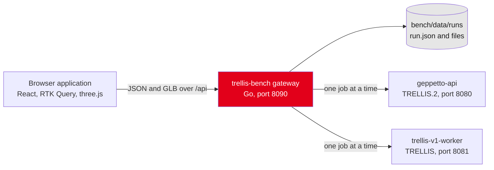
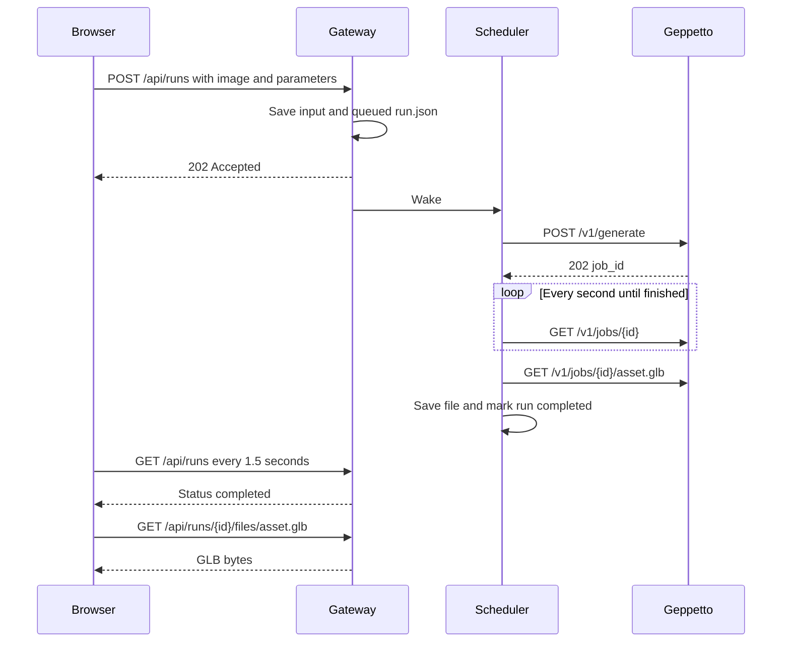
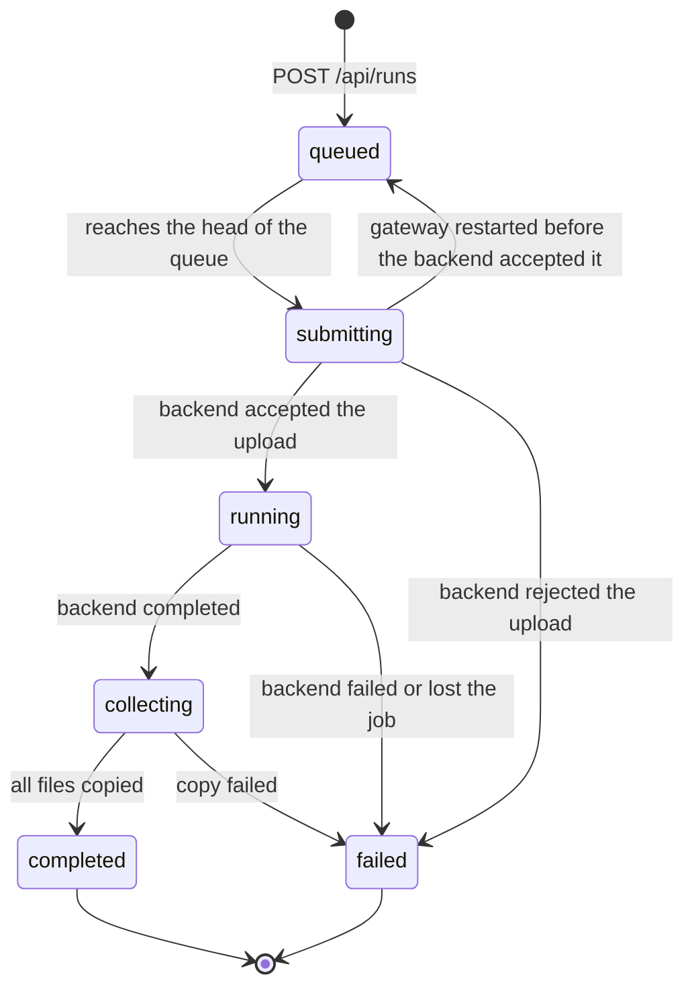
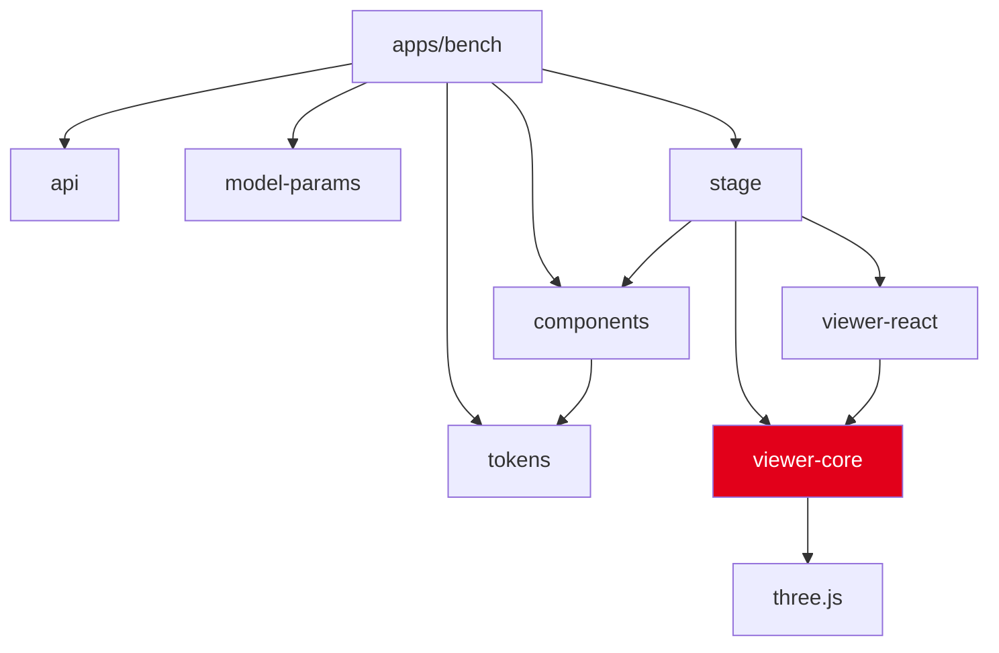

# Trellis Bench: A Browser Workbench for Two Image-to-3D Models on One GPU

Trellis Bench is a local web application for testing Microsoft's TRELLIS and TRELLIS.2 image-to-3D models on `bling`, an NVIDIA DGX Spark. A user chooses an image, selects one model or both, and presses Run. The application queues the work, runs one generation at a time, stores every result, and displays each generated mesh in an interactive orthographic viewer.

The application is small, but it has to solve several problems that are easy to underestimate. Two independent model services share one GPU and know nothing about each other. A generation can take minutes and cannot be cancelled once it starts. The browser needs a consistent view of work that changes on the server, while the 3D viewer changes its camera on every frame. The service has no user accounts, yet it must be reachable from another computer. This report explains how the system addresses each of these problems, what failed during its construction, and what the measurements do and do not show.

> [!summary]
> - **A Go gateway owns the GPU queue.** It runs one job at a time across both model services and stores each run durably. In an end-to-end test, TRELLIS finished at 14:49:08.705 UTC and TRELLIS.2 started 4 ms later.
> - **The front end is a set of reusable packages.** Seven workspace packages separate design tokens, React controls, the API client, model parameters, the three.js engine, its React binding and the inspection stage.
> - **Each kind of state has one owner.** RTK Query owns server data, Redux owns shared interface state, and the viewer engine owns frame-rate camera state.
> - **The most serious defects were in network behaviour.** Binding to `0.0.0.0` also opened the unauthenticated service on public IPv6 addresses, and a disconnecting browser could mark a healthy model service as offline.
> - **The final build passes every automated layer.** It has 27 Go test functions, 27 front-end tests, 78 Storybook render checks and a 12-test browser suite that performs real generation with both models.

> [!note]
> This report describes the bench at commit `7e68c93`. Image and video export was added afterwards in commit `769d3ab`, so its code and tests are not included in the figures below.

## 1. The problem

Before this project, the two models were installed but difficult to compare. TRELLIS.2 ran behind Geppetto, an existing HTTP service with its own minimal page. The original TRELLIS had only a batch script that processed one hard-coded image. The installation itself is described in [[PROJECT REPORT - TRELLIS on DGX Spark - Porting Two Generations of Image-to-3D Models to aarch64 and sm_121 - A Technical Deep Dive]].

The workbench had to meet the following requirements:

- A user can submit an image to either model, or to both, from one page.
- Two generations must never run at the same time on the GPU.
- Runs and their files must survive a browser reload and a gateway restart.
- A generated mesh must be inspectable from any angle, with and without its textures.
- Two results must be comparable under the same camera.
- The interface must follow the visual language of the `jig` workbench and the `lockstitch` project.

Three properties of the existing services shaped the design. Geppetto has one worker thread, so it serializes its own jobs, but it cannot coordinate with a second service. It has no way to stop a generation already in progress. Its `DELETE` operation also removes a job's directory while the worker thread continues to run, so a client must never delete a running remote job.

## 2. System architecture

The system consists of a browser application, a gateway and two model backends. A **backend** is a long-running HTTP service that keeps one model loaded in GPU memory. The **gateway** is the only component the browser contacts.



Each component owns a distinct part of the system:

| Component | Implementation | Owns | Size |
|---|---|---|---|
| Gateway | Go standard library | Run records, stored files, queue order | 1,714 lines, plus 896 lines of tests |
| Original TRELLIS worker | Python, FastAPI | TRELLIS in GPU memory | 509 lines |
| Geppetto | Existing Python service | TRELLIS.2 in GPU memory | Not modified |
| Browser application | TypeScript, React | Interface state and viewer | 2,892 lines, plus 542 lines of unit tests and stories |

The production gateway is one 13.2 MB binary that embeds the compiled interface, fonts and example images. The JavaScript bundle is 964 KB before compression.

### 2.1 One run from click to viewer

The sequence below follows one TRELLIS.2 run. The most important detail is the separation between accepting a request and starting GPU work. The gateway accepts the image immediately, but it uploads the image to Geppetto only when the run reaches the head of the queue.



## 3. One contract for two model services

The gateway would be more complicated if it needed separate logic for each model. The new worker for the original TRELLIS therefore implements the subset of Geppetto's HTTP API that the gateway uses:

| Request | Purpose |
|---|---|
| `GET /healthz` | Report whether the model is loaded |
| `POST /v1/generate` | Accept an image and JSON parameters, returning a job ID |
| `GET /v1/jobs/{id}` | Report status, timings, warnings and artifact paths |
| `GET /v1/jobs/{id}/{file}` | Download a generated file |
| `DELETE /v1/jobs/{id}` | Remove a finished job |

One Go client serves both backends. The parameters differ between models, so the gateway treats them as an opaque JSON object and leaves validation to the backend that understands them.

The worker differs from Geppetto in one deliberate way. It returns HTTP 409 when a client tries to delete a queued or running job, which removes the race described in Section 1.

### 3.1 Partial sampler objects

Both models use **samplers**, iterative procedures that refine random noise into structured data. Each sampler has settings such as a step count and a guidance strength. In Geppetto's request schema, the three sampler stages have different defaults. The texture stage, for example, uses a guidance of 1.0.

Pydantic, the validation library, applies stage-specific defaults only when the entire sampler object is omitted. If a client sends `{"texture": {"steps": 20}}`, the missing guidance receives the default of the generic `SamplerParams` class, which is 7.5. The request succeeds and silently changes the result.

The front end avoids this by always sending complete sampler objects:

```ts
export function buildParams(modelId, values, seed, randomSeed) {
  const params = { seed, randomize_seed: randomSeed };
  for (const [key, value] of Object.entries(MODELS[modelId].fixed)) assign(params, key, value);
  for (const item of definitions(modelId)) assign(params, item.key, values[item.key] ?? item.value);
  return params;
}
```

The `fixed` table holds upstream values for fields the form does not expose. The new worker fixes the same problem at its source by giving each stage its own parameter class.

## 4. Scheduling one GPU

Each backend serializes only its own jobs, so a scheduler above both backends must decide which job runs next. The scheduler is one goroutine. Because it executes a run to completion before claiming the next one, the program structure itself guarantees that the gateway never has two active generations.

A run moves through the following states:



The central function contains the whole lifecycle. Every state change is saved before the work that depends on it:

```go
if record.RemoteID == "" {
	input := backend.Input{Path: s.store.Path(record.ID, record.InputFile), FileName: record.SourceName}
	remoteID, err := model.Submit(ctx, input, record.Params)
	if err != nil {
		if ctx.Err() != nil {
			return
		}
		s.fail(record.ID, fmt.Sprintf("%s did not accept the run: %v. %s", name, err, hint))
		return
	}
	updated, err := s.store.Update(record.ID, func(r *run.Run) {
		r.RemoteID = remoteID
		r.Status = run.StatusRunning
	})
	// ...
}

remote, err := s.waitForRemote(ctx, model, record, name)
```

The test `TestRunsOneJobAtATimeInOrder` submits five runs to a fake backend that records the highest number of simultaneous jobs. The real system was also tested with both models. In that run, TRELLIS finished at `14:49:08.704` UTC and TRELLIS.2 started at `14:49:08.709` UTC.

A failed run does not stop the queue, and the scheduler does not retry it automatically. A retry could spend minutes of GPU time on an error that requires a decision from the user.

### 4.1 Recovery after a restart

The gateway can stop at any point in a run, so start-up reconciles each stored state:

| Stored status | Action at start-up | Reason |
|---|---|---|
| `queued` | Stay queued | No GPU work has started |
| `submitting` without a remote ID | Return to `queued` | The upload may not have completed |
| `running` | Resume polling | The backend may still be working |
| `collecting` | Resume copying | The backend still has the files |
| `completed` or `failed` | No change | These states are final |

One edge case is accepted. If the gateway stops after a backend accepts an upload but before the remote ID is saved, recovery submits the run again. This wastes GPU time but cannot produce an incorrect result, so a more complex submission protocol is not justified.

## 5. Durable run storage

Each run has one directory containing its input image, generated files and a `run.json` record. A crash must never expose a half-written record. The store therefore writes data to a temporary file, syncs it to disk, and renames it over the destination. On Linux, a rename within one filesystem replaces the destination atomically.

Creating a run has a second requirement: the image and the record must appear together. The store builds a complete hidden directory and publishes it with one rename:

```go
temporary := filepath.Join(s.root, ".new-"+record.ID)
if err := os.Mkdir(temporary, 0o755); err != nil {
	return run.Run{}, fmt.Errorf("create run directory: %w", err)
}
defer os.RemoveAll(temporary)

// Write the input image and run.json into the temporary directory.

if err := os.Rename(temporary, s.Dir(record.ID)); err != nil {
	return run.Run{}, fmt.Errorf("publish run directory: %w", err)
}
```

At start-up, the store deletes any leftover `.new-*` directory. It skips a corrupt record and logs a warning, so one damaged run cannot prevent the service from starting.

Generated files are copied from the backend into this directory. The copy costs disk space, but an old result no longer depends on the backend's storage. Artifact paths are also treated as untrusted input. A path must begin with the job's own prefix, and the file name must match `^[A-Za-z0-9][A-Za-z0-9._-]{0,63}$`.

## 6. Security of an unauthenticated local service

The gateway has no login. Its security depends on limiting which requests it accepts and where it listens.

A web page visited by the user can send a multipart POST to another origin without permission. In a **DNS rebinding** attack, a hostile domain is made to resolve to a local address, so the browser treats the local service as part of the attacker's site. The guard addresses both cases by checking the `Host` header on every request and the `Origin` header on state-changing requests:

```go
if !allowed[requestHost(r.Host)] {
	writeError(w, http.StatusForbidden, "this host name is not allowed; start the server with --allow-host to permit it")
	return
}
if r.Method != http.MethodGet && r.Method != http.MethodHead && !sameOrigin(r) {
	writeError(w, http.StatusForbidden, "cross-origin requests are not allowed")
	return
}
```

The response headers include a strict content security policy. All scripts and fonts are served by the gateway, so the page needs no third-party origin.

### 6.1 The IPv6 exposure

The default address is `127.0.0.1:8090`. To reach the application from another machine, a `make serve` target was added with the address `0.0.0.0:8090`. The intention was to listen on all IPv4 interfaces, which on this machine means the local network and Tailscale.

The verification step showed a different result:

```text
LISTEN 0 4096 *:8090 *:*
```

The `*` means the socket also accepted IPv6 connections. Go's `net.Listen("tcp", "0.0.0.0:8090")` treats the unspecified address as every local address, including IPv6. This machine has globally routable `2600:` addresses, so the service could have been reachable beyond the local network, depending on the upstream firewall.

The Host guard does not reduce this exposure, because a remote client can send any `Host` header it chooses. The correct control is at the listening socket:

```go
func listenNetwork(host string) string {
	if ip := net.ParseIP(host); ip != nil && ip.To4() != nil {
		return "tcp4"
	}
	return "tcp"
}
```

After the change, `ss` reported `0.0.0.0:8090`. IPv4 requests through Tailscale and the local network returned HTTP 200, and connections to the machine's IPv6 addresses were refused.

## 7. Front-end package architecture

The first front-end draft used plain JavaScript modules with no build step. The requirements then changed: the code had to use TypeScript and React, and components such as rendering had to be reusable as packages. The result is a pnpm workspace in `bench/ui/`.

A **workspace package** is a directory with its own `package.json` that other packages import by name. The dependencies form a directed graph with no cycles:



| Package | Responsibility | TypeScript lines |
|---|---|---|
| `tokens` | Colours, sizes, fonts and themes | CSS only |
| `components` | Presentational React controls | 424 |
| `viewer-core` | GLB loading and drawing, with no React dependency | 731 |
| `viewer-react` | React lifecycle and subscriptions for the engine | 84 |
| `stage` | Inspection surface with chips, measurements and transport | 298 |
| `api` | RTK Query endpoints and gateway types | 148 |
| `model-params` | Model settings expressed as data | 184 |
| `apps/bench` | Store, feature wiring and page layout | 1,023 |

Boundaries that exist only in documentation tend to erode, so this design uses tools that fail during normal development. pnpm gives each package access only to the dependencies it declares. Because `viewer-core` does not declare React, an import of `react` in that package cannot resolve. Each package's `exports` map also hides its internal files.

The packages export TypeScript source. Vite compiles that source when it builds the application, which keeps development simple and allows changes to reload across package boundaries. This choice has a cost: a project outside this workspace cannot install the packages from a registry until a library build is added.

## 8. State ownership

Front-end defects often arise when one fact is stored in two places. A run list copied into component state, for example, can disagree with the cached list after the next poll. Trellis Bench assigns each kind of state exactly one owner:

| State | Examples | Owner | Reason |
|---|---|---|---|
| Server state | Runs, health, queue depth | RTK Query cache | The gateway is the source of truth |
| Shared interface state | Selected run, form values, notices | Redux slices | Distant components read these values |
| Selected file | The chosen `File` object | React context | A `File` is not serializable |
| Viewer state | Camera, azimuth, load progress | `ViewerEngine` | Values can change on every frame |
| Local interface state | Delete confirmation | `useState` | One component uses the value |
| Location | Selected run ID | URL hash | A reload restores the selection |

### 8.1 RTK Query

**RTK Query** is the data-fetching layer of Redux Toolkit. An endpoint definition produces React hooks and manages caching, request deduplication, polling and refetching. A **cache tag** connects mutations to queries. When a mutation invalidates the `Runs` tag, the run list is fetched again.

```ts
listRuns: build.query<Run[], void>({
  query: () => 'runs',
  transformResponse: (body: { runs: Run[] }) => body.runs,
  providesTags: ['Runs'],
}),
deleteRun: build.mutation<{ deleted: string }, string>({
  query: (id) => ({ url: `runs/${id}`, method: 'DELETE' }),
  invalidatesTags: ['Runs'],
}),
```

The polling rate depends on the polled data. One hook, mounted near the root of the application, polls every 1.5 seconds while a run is active and every 10 seconds otherwise:

```ts
const hasActiveRuns = useAppSelector(selectHasActiveRuns);
const { isError, isSuccess, fulfilledTimeStamp } = useListRunsQuery(undefined, {
  pollingInterval: hasActiveRuns ? ACTIVE_POLL_MS : IDLE_POLL_MS,
  skipPollingIfUnfocused: true,
});
```

Polling was chosen over server-sent events because status changes are infrequent, and a missed update corrects itself on the next request. The cost is that displayed status can lag by up to one polling interval.

Binary files do not pass through RTK Query. The viewer and image elements load them directly from gateway URLs, which keeps large responses out of the Redux store.

### 8.2 Derived selection

The selected run is stored only as an ID. A memoized selector finds the corresponding record in the cached list:

```ts
export const selectSelectedRun = createSelector(
  [selectRuns, selectSelectedRunId],
  (runs, id) => runs.find((run) => run.id === id) ?? null,
);
```

This avoids a second copy of the run that reducers would need to keep consistent. The selection slice also responds directly to mutation results. When `createRuns` succeeds, the first created run becomes selected, so the component that submitted the form does not coordinate selection.

## 9. The viewer

The viewer is the most reusable part of the system, and its work does not fit React's rendering model. It owns a WebGL context, draws only when something changes, renders two models into one canvas, and must release GPU resources precisely. These are imperative operations, so `viewer-core` is a plain TypeScript class. React Three Fiber was rejected because it would make the rendering core depend on React.

![[_assets/trellis-bench-model-trellis2.png]]

*Figure 1. A TRELLIS.2 result in the PBR display mode. The measurement box reports 479,532 faces, and the title block identifies the source, model, seed and scale.*

### 9.1 Normalization and orthographic projection

Generated models have arbitrary coordinates and no physical scale. On load, the engine centres each model horizontally, places its lowest point on the ground plane, and scales its longest side to exactly one unit:

```ts
const box = new THREE.Box3().setFromObject(root);
const size = box.getSize(new THREE.Vector3());
const scale = 1 / Math.max(size.x, size.y, size.z, 1e-6);
const centre = box.getCenter(new THREE.Vector3());
root.scale.multiplyScalar(scale);
root.position.set(-centre.x * scale, -box.min.y * scale, -centre.z * scale);
```

Sizes are written with the unit `u` so they cannot be mistaken for millimetres. The camera is **orthographic**, meaning that an object's projected size does not depend on its distance from the camera. Screen distance therefore corresponds to a constant model distance, and the drafting grid and scale bar are true measurements in normalized units.

### 9.2 Display modes

Each display mode replaces a mesh's material and leaves its geometry unchanged:

| Mode | Implementation | Question it answers |
|---|---|---|
| PBR | Material from the GLB, with environment and directional lighting | How does the asset look when lit? |
| Base | Unlit base-colour texture | What colour was generated? |
| Clay | Neutral grey standard material | What is the shape without colour? |
| Normals | Surface direction mapped to colour | Are surfaces smooth and consistently oriented? |
| Wire | Clay with a wireframe overlay | How dense and regular is the mesh? |

![[_assets/trellis-bench-mode-normals.png]]

*Figure 2. The normals display mode for the original TRELLIS result. Colour encodes surface orientation, which exposes shape independently of the texture.*

![[_assets/trellis-bench-mode-wire.png]]

*Figure 3. The wire display mode for the same 20,479-face mesh. Triangle density is visibly concentrated around curved features.*

### 9.3 Comparing two models

Compare mode uses one renderer, one camera state and two scenes. The engine divides the canvas into left and right halves with `setViewport` and `setScissor`. Rotating either side therefore rotates both.

![[_assets/trellis-bench-compare-dark.png]]

*Figure 4. TRELLIS.2 and the original TRELLIS generated from the same input and compared under one camera in the dark theme. The measurement box shows 479,532 and 20,479 faces.*

### 9.4 Connecting the engine to React

The camera can change on every animation frame, so sending it through Redux would dispatch dozens of actions per second. The engine instead publishes immutable snapshots, and components subscribe with React's `useSyncExternalStore`:

```ts
export function useViewerValue<T>(engine: ViewerEngine | null, select: (snapshot: ViewerSnapshot) => T, fallback: T): T {
  return useSyncExternalStore(engine?.subscribe ?? noSubscribe, () => (engine ? select(engine.getSnapshot()) : fallback));
}
```

A component re-renders only when its selected value changes. During turntable playback, the transport updates on each frame while the measurement box does not.

This interface has two strict requirements. `getSnapshot` must return the same object until a visible value changes, or React can enter an endless render loop. The engine must also create its own canvases. React's development Strict Mode mounts effects twice, and a canvas whose WebGL context has been released cannot obtain a working context again.

## 10. Build and deployment

The compiled interface is embedded in the Go binary behind a build tag. A plain `go test ./...` works on a clean checkout without Node, while a release build generates the interface first:

```bash
go generate ./internal/web
go build -tags embed -o dist/trellis-bench ./cmd/trellis-bench
```

The content security policy imposes two build constraints. Vite must not inline fonts as `data:` URLs, so `assetsInlineLimit` is set to 0. The script that applies the saved theme before first paint must be an external file, because inline scripts are blocked.

The development proxy has a less obvious constraint. Vite's common `changeOrigin: true` setting would rewrite the `Host` header to the gateway address while the browser continued to send its original `Origin`. The gateway would then reject every POST and DELETE with HTTP 403.

## 11. Verification

Each test layer detects a different class of problem.

| Layer | Scope | Result |
|---|---|---|
| Go unit tests | Store recovery, queue order, API validation, Host and Origin checks | 27 test functions pass, also under the race detector |
| Front-end unit tests | Parameters, selectors, reducers, cache invalidation, controls | 27 tests pass |
| Worker acceptance | Validation errors and one real TRELLIS generation | Passed |
| Gateway acceptance | Both real models, queue order, guards and downloads | Passed |
| Storybook render check | 39 stories in light and dark themes | 78 checks pass |
| Browser suite | Interface, generation, viewer, compare, reload and delete | 12 tests pass in 6.5 minutes |

The browser suite runs in Chromium against the production binary, so it also exercises embedding and the security policy. Every test fails on a browser console error. A dedicated check compares a screenshot of the sheet with its background colour to detect a blank WebGL canvas.

![[_assets/trellis-bench-run-active.png]]

*Figure 5. The application during the browser test. TRELLIS.2 is starting and the original TRELLIS is waiting at queue position 1.*

### 11.1 Defects found during construction

The defects below show why several kinds of verification were needed.

| Symptom | Cause | Correction | Found by |
|---|---|---|---|
| Gateway panic at start-up | `GET /` and `/api/` were conflicting `ServeMux` patterns | Register the static handler on `/` with an explicit method check | Go tests |
| Service listened on `*:8090` | `0.0.0.0` with network `tcp` includes IPv6 | Use `tcp4` for IPv4 addresses | Inspecting the socket with `ss` |
| Healthy model shown as offline | Health checks inherited the request context | Detach checks from the client's lifetime | User report, then a failing test |
| Compare label was hidden | The measurement box covered the first label | Move the box below the labels and assert the layout | Screenshot review |
| Empty-state test failed in a full run | Generation tests ran first and created data | Order the specification files | Full suite |
| Story failed with console errors | Thumbnails requested gateway URLs in static Storybook | Allow a thumbnail URL prop | Story render check |
| `pnpm install` added security exclusions | Vitest 5.1.1 had been published hours earlier | Remove the exclusions and pin Vitest 5.1.0 | Reviewing generated configuration |

### 11.2 The false offline report

During real use, the interface briefly reported that TRELLIS.2 was offline while it was generating a helicopter model. The gateway caches health results for two seconds and shares them among clients, but it passed the current HTTP request's context into the health check. If that browser disconnected during the check, for example by reloading the page, the check was cancelled. The cancelled result looked like an unreachable backend, and it was then cached for other clients.

A test reproduced the defect before the fix:

```text
state after a client disconnected = offline, want ready
```

The corrected function detaches the shared check from the client. It also keeps a healthy backend's last good state through brief failures:

```go
func (s *server) steadyHealth(current backend.Health, now time.Time) backend.Health {
	record := s.healthLast[current.ID]
	if current.State != backend.StateOffline {
		s.healthLast[current.ID] = healthRecord{good: current, seen: now, known: true}
		return current
	}
	if !record.failed {
		slog.Warn("backend health check failed", "model", current.ID, "error", current.Cause)
	}
	record.failed = true
	s.healthLast[current.ID] = record
	if record.known && now.Sub(record.seen) < offlineGrace {
		return record.good
	}
	return current
}
```

A previously healthy backend is now reported as offline only after 15 seconds of failed checks. A backend that has never answered is reported immediately. The original event was not captured, so this defect is the confirmed mechanism and the likely cause, but it was not proven to be the cause of that specific report. During a later sample of 161 direct checks, Geppetto's slowest response took 0.32 s.

## 12. Results

The table lists the generations recorded through the worker, gateway and application. Each row is one run, and the inputs differ, so the values show observed ranges and are not a controlled benchmark.

| Input | Model | Settings | Generate | Export | Total | Peak GPU memory |
|---|---|---|---:|---:|---:|---:|
| `T.png` | TRELLIS | 12 + 12 steps, texture 1024 | 19.85 s | 76.60 s | 96.45 s | 10.43 GB |
| `T.png` | TRELLIS | 12 + 12 steps, texture 1024 | 17.42 s | 84.81 s | 102.23 s | 10.43 GB |
| Robot | TRELLIS | 12 + 12 steps, texture 1024 | 38.91 s | 72.01 s | 110.92 s | 10.24 GB |
| `T.png` | TRELLIS.2 | 512³, texture 1024 | 290.84 s | 27.35 s | 318.19 s | 2.65 GB |
| Robot | TRELLIS.2 | 512³, texture 2048 | 306.53 s | 19.21 s | 325.74 s | 2.65 GB |
| Robot | TRELLIS.2 | 512³, texture 2048 | 260.12 s | 33.31 s | 293.43 s | Not recorded here |
| Helicopter | TRELLIS.2 | 512³ | 209.61 s | 16.93 s | 226.54 s | 2.65 GB |

Microsoft reports about 3 s at 512³ on an H100, but that figure covers generation only. Geppetto's published DGX Spark benchmark is a more useful reference: 171 s end to end at 512³ with a 2048-pixel texture, and 294 s at 1024³. An earlier batch test on this machine took 166 s at 512³. The runs through the bench took between 226.54 s and 325.74 s.

The measurements do not establish why these runs were slower than the benchmark. The inputs differed, Geppetto documents substantial variation between seeds, and other GPU work was present on the machine during at least part of the testing. The three sampling stages accounted for only about 22 to 37 s of TRELLIS.2 generation in the inspected logs, so most of the generation time lies outside those progress bars.

The original TRELLIS shows a separate unexplained difference. GLB export took 72 to 85 s through the worker, compared with 19.17 s in the earlier batch script. These values come from different images and machine conditions, and the cause has not been profiled.

## 13. Reproducing the system

The model services must be running first. Geppetto serves TRELLIS.2 on port 8080, and the worker serves the original TRELLIS on port 8081:

```bash
cd /home/manuel/code/wesen/2026-11-18--trellis-spark

# Start the original TRELLIS worker.
make -C bench worker-up

# Serve on loopback only.
make -C bench run

# Or serve to other machines over IPv4.
make -C bench serve

# Run the checks.
make -C bench test
make -C bench storybook-check
make -C bench e2e
```

The end-to-end command performs real generation with both models and takes about seven minutes on this machine.

## 14. Limitations and open questions

- **There is no authentication.** Any device that can reach port 8090 over the local network or Tailscale can run jobs and delete runs.
- **Running jobs cannot be cancelled.** A mistaken long generation must finish before the queue continues.
- **Direct backend access bypasses the queue.** Requests sent to ports 8080 or 8081 are not coordinated by the gateway.
- **Browser coverage is limited to Chromium.** The automated viewer tests use software WebGL, so they do not measure interactive performance on a real GPU.
- **Disk use grows with every run.** Runs must be deleted manually.
- **Performance has not been profiled.** The variation in Section 12 needs repeated runs on an otherwise idle machine.
- **The packages are not yet published.** External use requires a library build.

## 15. Key points

- A gateway above independent model services is the simplest way to guarantee one active generation across all of them.
- Saving each state transition before its dependent work makes restart recovery a small table of explicit decisions.
- A Host guard protects against hostile browser pages, but only the listening socket controls network exposure.
- Work whose result is shared between clients must not inherit the lifetime of one client's request.
- Server data, interface state and frame-rate viewer state change at different rates, so each needs a different owner.
- Package boundaries remain reliable when the package manager and exports map enforce them.
- A complete sampler object is safer than a partial one when a validation library applies defaults at more than one level.

## Sources and related notes

Project files:

- Repository: `/home/manuel/code/wesen/2026-11-18--trellis-spark`
- Gateway: `bench/internal/scheduler/scheduler.go`, `bench/internal/store/store.go`, `bench/internal/httpapi/httpapi.go`, `bench/internal/httpapi/guard.go`
- Worker: `bench/worker-v1/server/engine.py`, `bench/worker-v1/server/app.py`
- Viewer: `bench/ui/packages/viewer-core/src/ViewerEngine.ts`, `bench/ui/packages/viewer-react/src/useViewerValue.ts`
- API and state: `bench/ui/packages/api/src/benchApi.ts`, `bench/ui/apps/bench/src/features/runs/useRunsPolling.ts`
- Ticket: `ttmp/2026/11/18/TRELLIS-002--trellis-bench-browser-workbench-for-testing-trellis-and-trellis-2/`, including the intern guide, front-end architecture document, implementation diary, logs and screenshots

Related notes:

- [[PROJECT REPORT - TRELLIS on DGX Spark - Porting Two Generations of Image-to-3D Models to aarch64 and sm_121 - A Technical Deep Dive]]

External references:

- TRELLIS: <https://github.com/microsoft/TRELLIS>
- TRELLIS.2: <https://github.com/microsoft/TRELLIS.2>
- Redux Toolkit Query: <https://redux-toolkit.js.org/rtk-query/overview>
- three.js: <https://threejs.org/docs/>
- Go `net` package: <https://pkg.go.dev/net>
