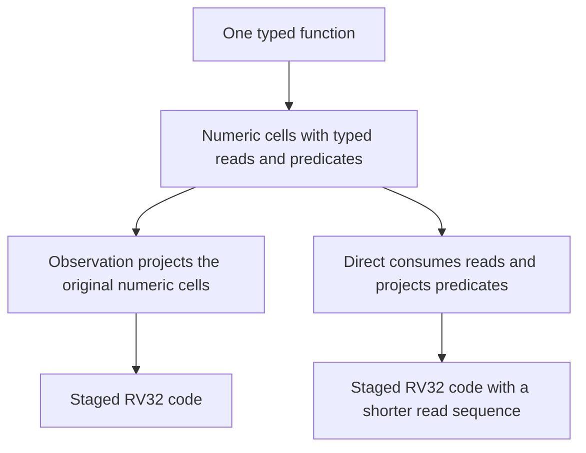

# Preserving checked text reads through native lowering

The PicoCalc compiler processes each typed function before parsing the next. Its JavaScript frontend originally delivered a stream of numeric operand-stack instructions to two backends, one that emits WebAssembly and one that emits RV32 machine code. A `charCodeAt` expression was already several instructions by the time native lowering began. Retaining the read as a typed operation let the native lowerer remove the temporary and emit all of the access machinery together.

> [!summary]
> - The observed stream produced byte-identical RV32 code and linked modules for Files, Agenda and Editor.
> - Direct reads removed 21, 98 and 367 native words respectively. Bounds traps, short circuit and UTF-16 reads agreed with Wasm.
> - Composing the read with destination-directed conditions and register allocation yielded 12,430 native Editor words under the loop-weighted register policy. All 24 application replays passed.

## The contract of a text read

The first four bytes at a string pointer hold its length. The following bytes hold unsigned 16-bit UTF-16 code units. A buffer puts its capacity in the same place. The current typed language checks the evaluated signed index with an unsigned comparison against the header. An index of −1 compares as the unsigned value 4,294,967,295 and fails for a valid buffer. The address of a valid unit is `receiver + 4 + 2 * index`, and the result is zero extended to an integer. The operation evaluates the index expression before checking the header. If the expression calls a function that mutates memory, that side effect precedes the check.

The earlier frontend allocated a temporary local for the index, then emitted operations for the comparison, trap and address calculation. The staged backend recognized the compare-and-branch sequence. It still needed to process the local and the surrounding stack operations.

## Preserve intent, then measure the representation

The experiment made the relevant frontend output explicit. A text-read operation carries the receiver's slot, its receiver kind and, in the observation lane, the old index temporary. Its operand is the already evaluated index, one level above anything the enclosing expression still needs. A predicate operation records a real scalar comparison followed by a branch. Its operands specify the comparison, the branch form, the structural argument and the polarity. A comparison used as the value in `let ready = a < b` retains ordinary Boolean materialization.

A projection method can make the cost of a representation measurable. It visits numeric instruction boundaries, expands typed operations to the old cells and feeds the same native consumer. The boundaries matter. The typed tag for a read has the same numeric value as a legal integer immediate. A traversal of individual cells would confuse them. In the observed lane the old temporary is reserved in the frontend at the same point as before, including when the argument contains a nested read.

The observed Editor stream carries 33,223 cells across 120 functions, down from 35,133 for staged. The largest function carries 2,478 versus 2,479. The per-function projection creates another array before the old stream can be discarded, and peak QuickJS usage includes retained native output and the final linked image. Cell counts are consequently a measure of representation size.

## Direct lowering and validation

The direct native implementation emits an unsigned branch that skips an `ebreak` when the index is valid. It shifts the index left once, adds the receiver base and loads the unit with `lhu`. It consumes one operand and produces one result. The result must fit the staged backend's stack discipline when older values use registers or spills. When A7 allocates locals to registers, the same operation obtains the receiver through the register allocator. That permits reusing the receiver's home on both sides of the check.

| World | Staged and observed words | Direct words | Bytes saved |
| --- | ---: | ---: | ---: |
| Files | 593 | 572 | 84 |
| Agenda | 2,793 | 2,695 | 392 |
| Editor | 16,541 | 16,174 | 1,468 |

The outlined read preserves UTF-16 units and the original bounds condition. Proof came from 126 focused executions against Wasm, including 46 traps. The fixture exercises zero, a negative position, the final valid position, the first invalid position, high UTF-16 values, a position-producing call and nested expressions that spill. The three application images match the observation oracle down to entries, relocations and record layout. Both register-policy compositions passed 24 additional replays each.

## Measure the trade on the handheld

Each application ran six balanced cold compiles per lane on each of two ESP32-P4 boots. Each build used a fresh QuickJS runtime, and all returned ELF hashes matched the host oracle. The observed lane cost 6.18% and 6.79% additional Editor compile time at a 0.42% QuickJS heap increase. The direct lane incurred a smaller 3.42% and 4.12% time cost and used 1.09% less peak heap, about 15.7 kB. Its native text was 1,468 bytes shorter in the same reserved ELF space.

| Paired physical effect versus staged | Boot 1 | Boot 2 |
| --- | ---: | ---: |
| Observation Editor compile time | +6.18% | +6.79% |
| Direct Editor compile time | +3.42% | +4.12% |
| Direct Editor peak QuickJS heap | −1.09% | −1.09% |
| Direct Files text comparison cycles | −18.86% | −18.86% |

The Files guest compared two 91-unit strings that differ at the last unit. It needed about 3,959 instead of 4,879 cycles per call at 360 MHz. The Agenda weekday guest stayed near 538 cycles. Those results describe the selected guest functions. The Editor result describes compilation, native text size and loading.

## Reuse the method

Choose an operation whose order, width and failure behavior can be described independently of its current encoding. Keep the baseline and observation backends equivalent down to emitted bytes before measuring a change. Then change one native consumer and compare its results and traps separately from cold compilation. In this case the comparison distinguishes a shorter numeric stream, a shorter emitted program and a smaller working allocation. Those quantities have different lifetimes.

The implementation and intern guide are in ticket `PICOCALC-STREAMED-TYPED-OPS`. Implementation commit `4397eb7` records the host-verified candidate. The ticket’s physical receipt holds the matched timing, heap, ELF digests and firmware restore evidence. The earlier staged compiler's design and physical context are recorded separately. [[ARTICLE - PicoCalc Compiler - How a Staged Operand Stack Made Room for Editor]]
