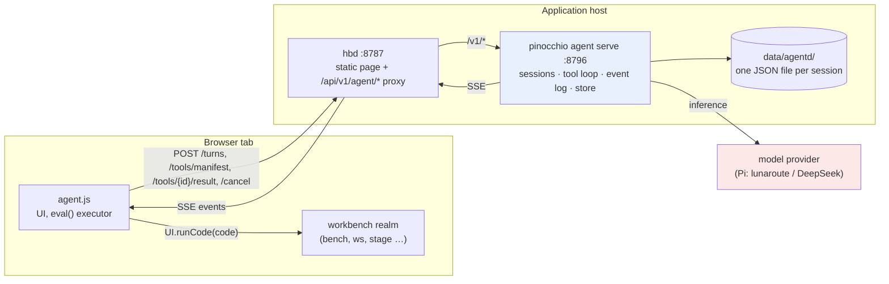
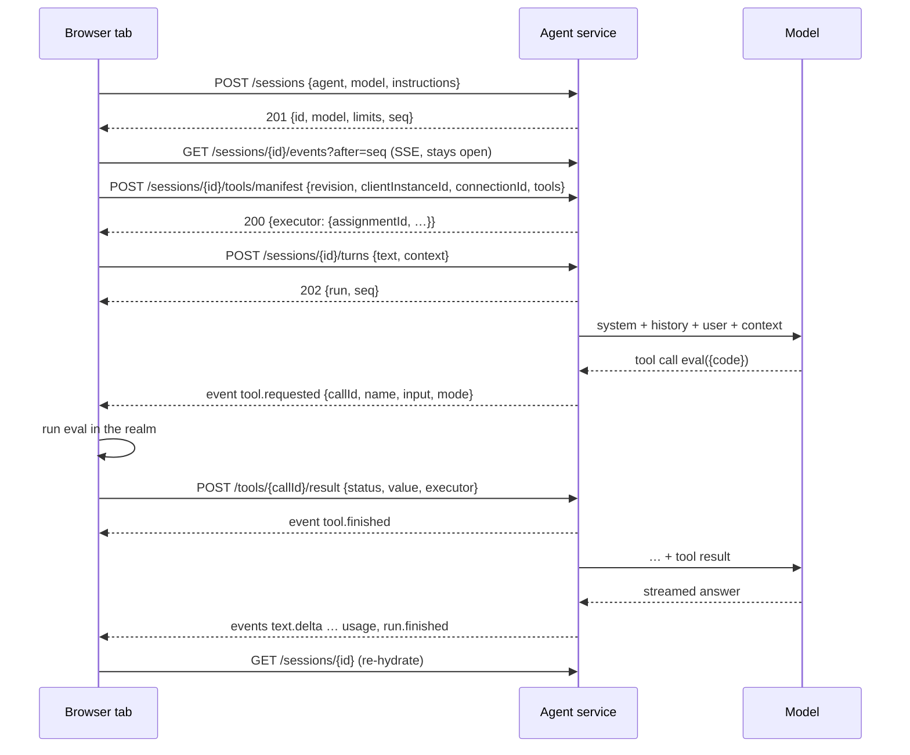

# Porting an Artifact Agent from claude sample() to a Real Agent Protocol

> [!summary]
> - `sample()` is an agent loop inside one call and memoryless across calls. A port moves the loop, the conversation and the credentials to an agent service (`pinocchio agent serve`) and leaves the tools in the page, which posts results back.
> - The prompt splits into three layers with different lifetimes: a static system prompt file on the server, page-generated instructions sent once per session, and a `[context]` block per turn that replaces the previous one.
> - With conversations on a server, several tabs can show one conversation, so "who runs this tool call" needs rules: opening does not claim, sending claims, reconnects keep a stable connection id, and only the current executor runs calls.
> - The first port (homolog-bench, DeepSeek 4.1 flash through Pi credentials) works: 11 tool calls, 48.6 s, 51k input tokens for a real workbench task. Section 15 lists the eight failures it met.

A claude.ai artifact can host an agent. The page calls `claude.use("sample")`, passes JavaScript
functions as tools, and the platform runs a short tool loop on the viewer's Claude account. When the
artifact becomes a self-hosted application, the agent has to move to a service the application
controls. This playbook is the procedure for that move and the reference for the protocol the page
speaks afterwards.

This is the second version. The first one was written before any code existed and described a plan.
This one is written after the first complete port: the homolog-bench workbench now runs its agent on
`pinocchio agent serve` (go-go-golems/pinocchio#219), with models resolved by geppetto's
`modelsource` (geppetto v0.14.2) and the browser page executing the tools. Everything in sections 4–15
describes code that runs, and section 15 records the failures the first port ran into. The
reader should come away able to port the next artifact without rediscovering them.

Sources and code (absolute paths):

- Platform spec `Artifact Claude API (sample) — Spec`, runtime contract 0.2.75: `/home/manuel/code/wesen/2026-11-19--homolog-workbench/ttmp/2026/11/19/HB-002--real-agent-service-for-the-workbench-geppetto-pinocchio-agentd-pi-credentials/sources/artifact-claude-api-sample-spec-0.2.75.md`
- Agent-service design: `/home/manuel/code/wesen/2026-11-19--homolog-workbench/ttmp/2026/11/19/HB-002--real-agent-service-for-the-workbench-geppetto-pinocchio-agentd-pi-credentials/design-doc/01-agent-service-design-pinocchio-agentd-with-browser-hosted-tools.md`
- Implementation diary, steps 1–6: `/home/manuel/code/wesen/2026-11-19--homolog-workbench/ttmp/2026/11/19/HB-002--real-agent-service-for-the-workbench-geppetto-pinocchio-agentd-pi-credentials/reference/01-diary.md`
- The same playbook inside the ticket: `/home/manuel/code/wesen/2026-11-19--homolog-workbench/ttmp/2026/11/19/HB-002--real-agent-service-for-the-workbench-geppetto-pinocchio-agentd-pi-credentials/playbook/01-porting-an-artifact-from-claude-sample-to-a-real-agent-protocol.md`
- Agent service: `/home/manuel/code/wesen/go-go-golems/pinocchio-agentd/pkg/agentd/` and `cmd/pinocchio/cmds/agent.go` (go-go-golems/pinocchio#219)
- Model sources: `/home/manuel/code/wesen/go-go-golems/geppetto/pkg/inference/modelsource/` (geppetto v0.14.2)
- Ported client and proxy: `/home/manuel/code/wesen/2026-11-19--homolog-workbench/web/js/agent.js`, `server/src/homolog_bench/agent_proxy.py`, `configs/agent/`, `tests/ui/agent.test.mjs` (wesen/homolog-bench#1)
- slop-computer, the `sample()` re-implementation to be ported next: `/home/manuel/code/wesen/go-go-golems/slop-computer`

## 1. What sample() is

`sample` is a function a page obtains with `await claude.use("sample")`. One call sends a prompt (a
string, or a list of `{role, content}` turns) and resolves with the whole answer. A call may carry
page tools: JavaScript functions with a name, a description and a JSON schema. While the call runs,
the platform loops. It asks the model; the model may request tool calls; the page runs them
(`execute(input, {signal})`); the results go back; the model is asked again, until it answers or the
platform's round limit forces an answer. The model, the credentials and the billing belong to the
platform, and the viewer's own Claude account pays.

Within one call this is an agent loop. Across calls it is not, and that is the central limitation:
the second call knows only what the page writes into its input.

## 2. The limits a port escapes

Every row is from the spec unless marked. The last column says what the port changes.

| Limit | Spec wording / value | After the port |
|---|---|---|
| No memory between calls | "Each call is memoryless; the page keeps any chat history itself." | The service keeps the conversation. |
| History is text only | `input` turns are `{role: "user" \| "assistant", content: string}` | Tool calls and tool results stay in the history as structured blocks. |
| Assistant turns are marked as page-supplied | "Assistant turns are labelled to Claude as page-supplied" | The model's own turns are its own. |
| No system prompt | "There is no `system` role." | A real system prompt, set once per session. |
| Input size | 256 KiB per call | The model's context window (DeepSeek 4.1 flash: 1,048,576 tokens). Compaction is still needed for very long sessions (section 17). |
| Rounds per call | "a handful of rounds", the last forced to be an answer (slop-computer: 10) | Per-agent `maxRounds` (homolog-bench: 40). |
| Tool results | ≤ 32 KB; `ctx.signal` aborts after 150 s | Per-agent `resultCut` (9,000 characters) and `toolTimeout` (120 s), enforced by the service. |
| No reasoning, no usage | `SampleResult` is `{text, truncated, modelTierApplied, modelApplied?}` | `reasoning.delta` and `usage` events; cost when the model has prices. |
| Model choice | a tier (`quick`/`default`/`complex`) or the viewer's chat model | Any model the operator has credentials for: Pi providers, pinocchio engine profiles. |
| Credentials and billing | the viewer's account | The operator's credentials, on the server; a per-session token budget. |
| Availability | `use()` may resolve `null`; consent prompt | The service is up or it is not; the page says how to start it. |

## 3. Workarounds artifacts use, and what happened to each

Artifacts grow workarounds for those limits. The table lists the ones found in homolog-bench, the
slop-computer lab agent and the Form Skate agent, and what the homolog-bench port actually did with
each.

| Workaround under sample() | Why it existed | What the port did |
|---|---|---|
| Instructions as the first `user` turn, re-sent every call | no system role | **Deleted.** Static rules moved to `configs/agent/homolog-bench.system.md`; the page's API reference is sent once at session creation (section 7). |
| History window (homolog-bench: last 16 messages) | 256 KiB input, no state | **Deleted.** The service keeps the whole conversation. |
| Tool calls folded into assistant text (`[I made N eval calls in this turn:] …`, 300 characters of code and of result each, 3,200 per message) | tool results could not be re-sent | **Deleted.** `tool_call` and `tool_result` blocks are in the history; the page hydrates them back from the service. |
| "Measure again rather than remember" | the model lost earlier results | **Relaxed.** The system prompt now says the model keeps every tool result, and that the `[context]` block is the truth about the current state. |
| Live state appended to the last user turn (`[Workbench state right now, added by the page]`) | no other channel for state | **Kept and formalised.** It is the `context` field of `POST /turns`; the service stores it as a separate block and drops the previous turn's block (section 7.3). |
| Result cutting in the page (4,000 characters) | 32 KB limit, re-reading cost | **Kept, and added on the server.** The page cuts at 4,000 for display, and the service cuts what the model sees at `resultCut`. |
| One `AbortController` per call | cancellation was per call | **Replaced** by `POST /sessions/{id}/cancel`. |
| Tier select (`Quick`/`Balanced`/`Deep`) | the platform offered tiers | **Replaced** by a model picker filled from `GET /v1/models`. |
| "Type continue" after the round limit | a handful of rounds | **Deleted.** 40 rounds per turn; Stop is always available. |
| Downloads through `claude.use("downloads")` | no file access in artifacts | **Replaced** by a Blob download. |

## 4. The architecture after the port

Four processes take part in a turn. The browser page owns the tools, because they act on state that
only exists in the page (homolog-bench: a JavaScript realm with the user's variables, an editor, the
views). The application server (hbd) serves the page and forwards agent requests on the same origin.
The agent service (`pinocchio agent serve`) owns the conversation, the model loop and the
credentials. The model provider is reached only by the agent service.



Each piece of the system has one owner, and the port is mostly the work of moving ownership:

| Concern | Under sample() | After the port |
|---|---|---|
| Conversation history | the page (localStorage, windowed) | the agent service (session store) |
| The model loop (call model → run tools → call again) | the platform | the agent service (geppetto `toolloop`) |
| Tool implementations | the page | the page (unchanged functions) |
| Which tab runs a tool call | the tab that made the call | the tab holding the executor assignment (section 9) |
| Credentials, model choice, billing | the viewer's Claude account | the operator: Pi agent dir or pinocchio profiles; token budget per session |
| System prompt | re-sent by the page | file on the server + page instructions once per session |
| Live page state | appended by the page every call | `context` block per turn, replaced each turn |
| Cancellation | `AbortController` | `POST /cancel` |

The tools stay in the page because their whole purpose is to act on page state. A server-side tool
would need that state shipped to the server. A page-side tool needs only its result shipped, and the
result is small.

## 5. One turn, end to end

The following sequence is one turn in which the model calls `eval` once. The trace under it was
captured from the service with the scripted engine (section 14), so the payloads are real; only the
session id is removed and the timestamps shortened.



```json
{"seq": 1, "type": "tools.manifest", "data": {"executor": {"assignmentId": "24c4e701-…", "clientInstanceId": "tab-4f2k", "connectionId": "c-9xq1"}, "revision": 1795134000000, "tools": ["eval"]}}
{"seq": 2, "type": "user.message", "run": "e3c3f92c", "data": {"text": "/tool eval {\"code\":\"ws.status().counts\"}"}}
{"seq": 3, "type": "run.started", "run": "e3c3f92c", "data": {"model": "fake:scripted", "tools": ["eval"]}}
{"seq": 4, "type": "usage", "run": "e3c3f92c", "data": {"round": {"input": 902, "output": 5, "rounds": 1}, "total": {"input": 902, "output": 5, "rounds": 1}, "stopReason": "stop"}}
{"seq": 5, "type": "tool.requested", "run": "e3c3f92c", "data": {"callId": "call_dd9ffda0", "name": "eval", "input": {"code": "ws.status().counts"}, "mode": "auto"}}
{"seq": 6, "type": "tool.finished", "run": "e3c3f92c", "data": {"callId": "call_dd9ffda0", "name": "eval", "status": "success", "error": ""}}
{"seq": 7, "type": "text.delta", "run": "e3c3f92c", "data": {"delta": "eval ", "text": "eval "}}
{"seq": 8, "type": "text.delta", "run": "e3c3f92c", "data": {"delta": "returned: ", "text": "eval returned: "}}
… seq 9–16 …
{"seq": 17, "type": "text.delta", "run": "e3c3f92c", "data": {"delta": "}\"", "text": "eval returned: \"→ { present: 27, absent: 7, indeterminate: 13 }\""}}
{"seq": 18, "type": "usage", "run": "e3c3f92c", "data": {"round": {"input": 918, "output": 11, "rounds": 1}, "total": {"input": 1820, "output": 16, "rounds": 2}, "stopReason": "stop"}}
{"seq": 19, "type": "run.finished", "run": "e3c3f92c", "data": {"text": "eval returned: \"→ { present: 27, absent: 7, indeterminate: 13 }\"", "truncated": false}}
```

The trace shows several properties a client relies on:

- Every event carries a sequence number (`seq`), and the SSE `id:` line carries the same number. A
  client that reconnects with `Last-Event-ID: 6` receives events 7–19 and nothing earlier.
- `text.delta` carries both the new piece (`delta`) and the whole answer so far (`text`). A page can
  assign `text` instead of appending, so a page that missed some deltas still shows the right
  answer after the next one.
- `usage` arrives once per model call (two rounds here: the one that asked for the tool, and the one
  that answered). `round` is that call; `total` is the session so far.
- `run` identifies the turn. The `tool.requested` of seq 5 belongs to run `e3c3f92c`, so a page can
  attach the tool call to the right answer bubble.
- The tool result reached the model as `"→ { present: … }"` with the quotes. Section 9.4 explains
  why and what it costs.

After `run.finished` the page fetches the conversation once more. The service answers with the
history the model actually holds:

```json
{"limits": {"maxRounds": 40, "toolTimeoutMs": 120000, "resultCut": 9000},
 "usage": {"input": 1820, "output": 16, "rounds": 2},
 "messages": [
  {"kind": "user", "text": "/tool eval {\"code\":\"ws.status().counts\"}"},
  {"kind": "context", "text": "engine: SIM · scenario dossier, seed 1"},
  {"kind": "tool_call", "callId": "call_dd9ffda0", "name": "eval", "input": {"code": "ws.status().counts"}},
  {"kind": "tool_result", "callId": "call_dd9ffda0", "result": "\"→ { present: 27, absent: 7, indeterminate: 13 }\""},
  {"kind": "assistant", "text": "eval returned: \"→ { present: 27, absent: 7, indeterminate: 13 }\""}]}
```

## 6. The protocol as built

The agent service listens on `127.0.0.1:8790` by default (8796 on the Spark, where 8790 is taken).
The application server exposes it under its own origin; homolog-bench uses `/api/v1/agent/*` →
`/v1/*`.

### 6.1 Endpoints

| Method and path | Body | Answer | Notes |
|---|---|---|---|
| `GET /v1/health` | | `{ok, agents, sessions}` | |
| `GET /v1/agents` | | `[{name, description, model, pageInstructions, limits}]` | `model` is the agent's default ref |
| `GET /v1/models` | | `{models: [{ref, source, label, api, contextWindow, maxOutputTokens, reasoning, thinkingLevels, cost?}], warning?}` | no secrets |
| `GET /v1/sessions?agent=` | | `[SessionView]` newest first | without messages |
| `POST /v1/sessions` | `{agent, model?, thinking?, instructions?}` | `201 SessionView` | `instructions` are appended to the system prompt (≤ 64 KiB, only if the agent allows it) |
| `GET /v1/sessions/{id}` | | `SessionView` with `messages` | for hydration |
| `DELETE /v1/sessions/{id}` | | `204` | cancels a running turn, deletes the file |
| `POST /v1/sessions/{id}/tools/manifest` | `{revision, clientInstanceId, connectionId, tools: [{name, description, inputSchema, mode?}]}` | `{revision, executor}` | `409` with `revision_regression` / `revision_conflict` |
| `POST /v1/sessions/{id}/turns` | `{text, context?}` | `202 {run, seq}` | `409 run_active`, `429 quota_exceeded` |
| `GET /v1/sessions/{id}/events` | | SSE | `Last-Event-ID` or `?after=N`; `: ping` every 15 s |
| `POST /v1/sessions/{id}/tools/{callId}/result` | `{toolName?, status, value?, error?, executor}` | `204` | identical duplicate → `204`; different → `409` |
| `POST /v1/sessions/{id}/cancel` | | `202 {cancelled}` | |

`SessionView` is `{id, agent, model, title, created, updated, running, usage, seq, limits, messages?}`.
`running` is the run id of the active turn, if any. `seq` is the last event's sequence number, which a
client uses as its `after` when it opens the stream right after loading the history.

### 6.2 Events

| Event | `data` | Page reaction |
|---|---|---|
| `tools.manifest` | `{revision, tools, executor}` | remember the current executor (section 9) |
| `user.message` | `{text}` | show the message unless this tab sent it |
| `run.started` | `{model, tools}` | show a pending answer, disable Send |
| `reasoning.delta` | `{delta}` | append to a folded "thinking" block |
| `text.delta` | `{delta, text}` | assign `text` to the answer |
| `tool.requested` | `{callId, name, input, mode}` | if this tab is the executor: run it (`auto`) or show Run/Decline (`human`) |
| `tool.finished` | `{callId, name, status, error}` | mark the step |
| `usage` | `{round, total, stopReason}` | update the token/cost line |
| `run.finished` | `{text, truncated, reason?}` | idle; `reason: "max_rounds"` when the round limit stopped it |
| `run.failed` | `{code, message, text}` | idle; show the message for `code` |
| `run.cancelled` | `{text}` | idle; show "Stopped." |

### 6.3 Error codes

HTTP errors have the shape `{error: {code, message}}`. Run failures arrive as `run.failed`. The
service classifies provider errors into fixed codes and keeps the provider's own message in its log,
so a page never shows a raw provider response.

| Code | Where | Meaning |
|---|---|---|
| `invalid_request` | HTTP 400 | bad body, unknown agent or model, instructions not allowed |
| `not_found` | HTTP 404 | no such session |
| `run_active` | HTTP 409 | a turn is already running in this session |
| `quota_exceeded` | HTTP 429 | the session's token budget is used up |
| `prompt_too_large` | HTTP 400 / `run.failed` | page instructions too long; or the conversation no longer fits the model |
| `authentication_error` | HTTP 503 / `run.failed` | the server's credential was rejected |
| `rate_limited` | `run.failed` | provider rate limit |
| `upstream_error` | `run.failed` | any other provider failure |
| `revision_regression`, `executor_mismatch`, `late_result`, … | HTTP 409 | tool-bridge errors from pinocchio's `frontendtools` |
| `agent-unavailable` | HTTP 502 from the application server | the agent service is not running (section 12) |

### 6.4 Tool result statuses

`success`, `failed`, `denied`, `cancelled`, `timeout`. A `failed` or `denied` result reaches the model
as an error with the `error` text, so the model can read it and change course.

### 6.5 Limits enforced by the service

Per agent, from its YAML: `maxRounds` (model calls per turn), `toolTimeout` (per tool call; the
model then receives "The tool eval did not answer within 2m0s; the page may be busy or closed …"),
`resultCut` (characters of a tool result the model sees; the cut ends with "… cut at 9000 of N
characters. Return less: pick fields, slice arrays, summarize."), `maxPageInstructionsBytes`, and
`budget.tokensPerSession`. One turn runs at a time per session.

## 7. Splitting the prompt into three layers

Under `sample()` the instructions, the API reference, the history and the current state were all one
text, rebuilt every call. After the port they are three layers with different lifetimes, and getting
the split right is most of the prompt work in a port.

### 7.1 Layer 1: the static system prompt (server file)

Rules that do not depend on the page's state go in a file next to the agent config, reviewed in git:
who the agent is, how to work, what it may and may not do, how to answer. In homolog-bench this is
`configs/agent/homolog-bench.system.md`, adapted from the old `rules()`. Three edits matter when
adapting:

- Remove everything that described the old history format ("[I made N eval calls…]") or asked the
  model to compensate for forgetting.
- Say what the model now has: "You keep the whole conversation, including every tool call and its
  result … each message from the person ends with a `[context]` block that describes the state right
  now. Trust it over your memory, and re-measure after anything changed."
- Move sentences that switch on page state (homolog-bench: SIM versus REAL engine) out of this file.
  They belong in layer 3, because the state can change in the middle of a session.

### 7.2 Layer 2: page instructions (once per session)

Some text is generated by the page but does not change during a session: an API reference produced
from the code, a list of presets. Re-sending it every turn wastes tokens; baking it into the server
file goes stale when the page changes. The service accepts it once, as `instructions` on
`POST /sessions`, and appends it to the system prompt. The agent must opt in
(`pageInstructions: true`) and the size is capped (`maxPageInstructionsBytes`, 64 KiB).

```js
function instructions() {
  return ['API reference', HB.bench.help('cheatsheet'), '',
          'Presets: ' + PR.store.summary(),
          'Preset names: ' + PR.store.list().map((p) => p.name).join(' | ')].join('\n');
}
// on the first send of a new conversation:
await api('POST', '/sessions', { agent: 'homolog-bench', model: $('#model').value, instructions: instructions() });
```

The system prompt file should say that the page appends this text, so a reader of the file knows the
prompt is incomplete without it.

### 7.3 Layer 3: the context block (every turn)

The page's live state goes in `context` on every `POST /turns`. The service stores it as its own user
block, starting with `[context]\n`, directly after the person's text. When the next turn arrives the
service removes the previous turn's context block before adding the new one, so the conversation holds
exactly one, the current one. The hydrated history marks it `kind: "context"`, and the page does not
display it.

Removing old context blocks is a deliberate choice. Keeping them would let the model see how the
state changed over time, but each block would cost tokens on every later model call, and old
blocks would contradict the current one. The tool results already record what the model measured
and when.

homolog-bench's context (the old `snapshot()`) now starts with an explicit engine line, because the
system prompt no longer carries it:

```
engine: SIM · scenario dossier, seed 1, speed normal (all data simulated)
last run: r3 stage0-core · 16 taxa · present 12 absent 2 indeterminate 2 (available as wb.lastRun)
workspace iqgap-stage0 @#3: present 27 · absent 7 · indeterminate 13 · not done 0 · open proposals 0
realm variables: ws, todo, job, pick
UI: tab agent, stage source last-run, editor holds preset "Stage 0 on the core species" (24 lines; read with ide.get())
```

## 8. Tools in the page

### 8.1 The manifest

The page describes its tools once per stream connection that claims them (section 9), with the same
name, description and JSON schema the `sample()` tool had. The `execute` function does not move.

```js
const EVAL_TOOL = {
  name: 'eval',
  description: 'Run JavaScript in the homolog-bench workbench realm (top-level await allowed). …',
  inputSchema: { type: 'object', properties: { code: { type: 'string' } }, required: ['code'] },
};
```

A tool may declare `mode: "human"`, or the agent YAML may set it (`tools: {edit: human}`). Human-mode
calls arrive with `mode: "human"`; the page shows Run and Decline, runs the tool on Run, and posts
`status: "denied"` on Decline.

### 8.2 Running a call and posting the result

```js
async function runTool(rec) {
  if (inflight.has(rec.callId) || finished.has(rec.callId)) return;   // never run a call twice
  inflight.add(rec.callId);
  const r = await UI.runCode(rec.code, { source: 'agent', actor: 'agent', max: 3500 });
  let out = (r.logs.length ? r.logs.map((l) => l.text).join('\n') + '\n' : '') + (r.ok ? '→ ' : '') + r.text;
  if (out.length > 4000) out = out.slice(0, 4000) + '\n… (cut by the page)';
  await api('POST', `/sessions/${cur.id}/tools/${encodeURIComponent(rec.callId)}/result`,
    r.ok ? { toolName: 'eval', status: 'success', value: out, executor: mine }
         : { toolName: 'eval', status: 'failed', error: out, executor: mine });
  inflight.delete(rec.callId);
}
```

`executor` must be the object the manifest acknowledgement returned. The service rejects a result
from any other identity (`executor_mismatch`).

### 8.3 Values must be objects on the wire

The tool bridge (pinocchio `frontendtools`) carries results as protobuf `Struct`s, so a result must
be a JSON object. The service wraps a non-object `value` as `{value: x}` and unwraps it before
the model sees it. A page can therefore post strings, numbers or arrays directly.

### 8.4 String results reach the model JSON-encoded

geppetto's tool loop serializes every result with `json.Marshal` (`pkg/inference/toolloop/loop.go`),
so a string result reaches the model quoted, with newlines escaped as `\n`. The trace in section 5
shows it: `"→ { present: 27, … }"`. Models read this fine, but multi-line output (logs, tables)
becomes one long escaped line and costs a few extra tokens. Passing strings through unencoded is a
small geppetto change that is still open (section 17). Until then, do not work around it in the
page.

### 8.5 Timeouts and cuts happen in the service

The service wraps the bridge with a per-call timeout (`toolTimeout`) and a result cut (`resultCut`).
When a page does not answer in time, the model receives an explanatory error instead of the loop
failing, and it can decide to try something smaller. The page's own 4,000-character cut is for
display; the model-facing limit is the service's, so that all clients of an agent behave the same.

## 9. Which tab runs a tool call

`sample()` never had this question: the tab that called `sample()` ran its tools. With a session on a
server, several tabs can show the same conversation, a tab can be reloaded in the middle of a turn,
and the stream can drop and reconnect. Someone has to run each tool call exactly once.

### 9.1 The executor assignment

pinocchio's `frontendtools.Manager` keeps, per session, one executor: the identity
`{clientInstanceId, connectionId}` that registered the manifest most recently, plus an `assignmentId`.
Each tool call is assigned to the executor current at the time it is requested. The result is accepted only
from that executor; an identical duplicate is accepted again (idempotent), a different one is
rejected. When the same `clientInstanceId` and `connectionId` register again, the manager keeps the
same `assignmentId`.

### 9.2 The rules the page follows

The first port registered the manifest every time a tab opened a conversation's stream. That made
the latest tab to open a conversation its executor, and it took tool calls away from a run in
progress in another tab (section 15, failure F6). The rules now are:

1. **Opening a conversation does not claim it.** Loading the page, switching conversations, or
   opening the same conversation in a second tab only reads.
2. **The tab that sends a turn claims it**, right before `POST /turns`, unless it already is the
   executor. A new conversation is claimed when its stream opens.
3. **A tab that has claimed re-registers when its stream reconnects**, with the same `connectionId`
   (stable per tab and session), so the assignment and any call in flight survive a restart of the
   application server or the agent service.
4. **A tab runs a `tool.requested` only if it is the executor** (its acknowledgement's `assignmentId`
   equals the latest `tools.manifest` event's). Other tabs show the step as "running in another tab".
5. **Revisions are `Date.now()`**, which is monotonic enough across tabs; the manager rejects a
   revision lower than the last one (`revision_regression`).

```js
const connIds = {};          // stable connection id per session in this tab
let claimOnOpen = false;     // set when this tab creates the session

es.addEventListener('open', () => { if (mine || claimOnOpen) registerTools(id); });

async function registerTools(id) {
  const connectionId = connIds[id] || (connIds[id] = 'c-' + Math.random().toString(36).slice(2, 10));
  const ack = await api('POST', `/sessions/${id}/tools/manifest`,
    { revision: Date.now(), clientInstanceId: CLIENT, connectionId, tools: [EVAL_TOOL] });
  mine = ack.executor; executor = ack.executor; claimOnOpen = false;
}
const amExecutor = () => !!(mine && executor && mine.assignmentId === executor.assignmentId);

// in send(), for an existing conversation:
if (!amExecutor()) await registerTools(cur.id);   // this tab sends, so its page runs the tools
```

### 9.3 What is still lost

A call assigned to a tab that is then closed or reloaded cannot be answered by anyone. The new page
gets a new `clientInstanceId`, so it is a different executor. Such a call ends at `toolTimeout`, and
the model is told the page did not answer. The page shows a note on an answer that was already
running when it loaded. Handing a pending call over to a new tab would need the manager to reassign
pending calls; it is not implemented.

## 10. Streams, history and hydration

### 10.1 Opening a conversation

The page loads the history first and then subscribes from the history's sequence number. Events that
are already reflected in the history are not replayed, so nothing is shown twice and no old
`tool.requested` is run again:

```js
async function open(id) {
  const view = await api('GET', '/sessions/' + id);
  cur = { id, view, msgs: toDisplay(view.messages) };
  connect(id, view.seq);           // new EventSource(`${BASE}/sessions/${id}/events?after=${view.seq}`)
}
```

`toDisplay` groups the service's blocks into what the UI shows: a user message, then one assistant
message holding the reasoning, the tool calls (each `tool_call` paired with its `tool_result` by
`callId`) and the text. Context blocks are skipped.

### 10.2 Live updates and reconnects

`EventSource` reconnects by itself after a dropped connection and sends `Last-Event-ID`, so the page
receives exactly the events it missed. If a client falls more than 256 events behind, the service
closes its stream, and the reconnect fills the gap from the event log (5,000 events in memory, 2,000
saved per session).

### 10.3 Re-hydrating after each run

When `run.finished`, `run.failed` or `run.cancelled` arrives, the page fetches the conversation again
and replaces its live view with the service's version. That picks up results of tool calls that ran
in another tab and keeps the display identical to what the model holds. Page-only details are copied
over by `callId`: timings, which steps were open. One more case needs care. A cancelled or failed
turn can leave no assistant block on the server, so the last local message (with its "Stopped." or
its error) is kept when the server's history ends at the user's message (failure F5).

### 10.4 The sender's own messages

The sending tab shows the person's message immediately and marks it local. When `user.message`
arrives for that turn, the page binds it instead of adding a second copy. Other tabs add it from the
event.

## 11. The server side

### 11.1 The agent config

```yaml
# configs/agent/homolog-bench.yaml
name: homolog-bench
description: IQGAP Stage 0 workbench agent; tools run in the browser realm.
systemPrompt: homolog-bench.system.md     # layer 1, relative to this file
pageInstructions: true                    # layer 2 allowed
maxPageInstructionsBytes: 65536
model: pi:lunaroute/deepseek-4.1-flash    # default; a session may choose another
thinking: low
maxRounds: 40
toolTimeout: 120s
resultCut: 9000
tools:
  eval: auto                              # or human
# budget:
#   tokensPerSession: 2000000
```

### 11.2 Models and credentials

The service resolves model references with geppetto's `modelsource`:

| Reference | Source |
|---|---|
| `pi:<provider>/<model>` | Pi's agent directory (`~/.pi/agent`: `auth.json`, `models.json`, `models-store.json`), including Pi's OAuth logins |
| `profile:<slug>` or `profile:<registry>/<slug>` | pinocchio engine profiles (`~/.config/pinocchio/profiles.yaml` or `--profile-registries`) |
| unprefixed | profiles first, then Pi |

`pinocchio agent models` lists what the operator's credentials allow, without secrets. On the Spark it
lists ten `pi:lunaroute/*` models. Pi models carry no prices, so `usage.usd` is absent for them;
profiles with `model_info.cost` produce a cost.

### 11.3 Running it

```bash
pinocchio agent models
pinocchio agent serve --agents configs/agent --address 127.0.0.1:8796 --state-dir data/agentd
#   --pi-coding-agent-dir DIR   (or Pi's own PI_CODING_AGENT_DIR)
#   --profile-registries yaml:PATH,…   --no-pi   --no-profiles
#   --engine fake               (scripted engine, section 14)
```

The service keeps one JSON file per session in `--state-dir`: metadata, the conversation as geppetto
turn YAML, and the recent events. A restarted service still has its conversations; the page's
history and `Last-Event-ID` resume both work across a restart.

### 11.4 Release chain

The service is part of pinocchio, and the model sources are part of geppetto. A change to either reaches
an application through tags: geppetto PR → merge → tag (v0.14.2) → `go get` in pinocchio → PR →
merge → install. Pseudo-versions are fine on feature branches, but nothing should land on pinocchio
`main` that depends on an untagged geppetto commit. geppetto's `main` requires verified commit
signatures; the SSH key that signs commits must be registered on GitHub as a signing key.

## 12. The application server as a same-origin proxy

The page talks to the agent service through the application server, for three reasons. The page then
needs no CORS. The agent service, which holds credentials, can bind to `127.0.0.1`. And the
application's own access control, whatever it is, covers the agent too. The proxy is short, but
the event stream must be relayed as it arrives, without buffering and without a read timeout:

```python
@router.api_route("/api/v1/agent/{path:path}", methods=["GET", "POST", "DELETE"])
async def agent(path: str, request: Request):
    base = get_settings().agentd_url                      # HB_AGENTD
    headers = {k: v for k, v in request.headers.items() if k.lower() not in _DROP}   # hop-by-hop
    req = _http().build_request(request.method, f"{base}/v1/{path}", params=request.query_params,
                                headers=headers, content=(await request.body()) or None)
    try:
        upstream = await _http().send(req, stream=True)   # AsyncClient(timeout=Timeout(30, read=None))
    except httpx.HTTPError as e:
        return _down(base, e)                             # 502 {error: {code: agent-unavailable, fix}}
    if upstream.headers.get("content-type", "").startswith("text/event-stream"):
        return StreamingResponse(upstream.aiter_raw(), headers={…, "X-Accel-Buffering": "no"},
                                 background=BackgroundTask(upstream.aclose))
    …
```

`Last-Event-ID` passes through with the other headers. The 502 body carries the command that starts
the service, and the page shows it.

Restarting the application server has two effects on a running agent turn. Every event stream drops
and reconnects, which rule 3 of section 9.2 makes harmless. And a tool that was waiting on the
application server itself fails: in homolog-bench, an `eval` running `await job.wait('60s')`. Before
restarting, check `GET /api/v1/agent/sessions` for `running`.

## 13. Porting procedure

1. **Inventory the artifact's `sample()` use.** Find every `claude.use("sample")`, every `sample(`
   call, the tools passed, the history builder, the instructions text, the state snapshot, the error
   copy and any approval logic. Each maps to a row of section 3.
2. **Write the agent config and the system prompt file** (section 11.1, 7.1). Pick the default model
   from `pinocchio agent models`.
3. **Decide the three prompt layers** (section 7): static rules → file; generated reference text →
   `instructions`; live state → `context`. Move state-dependent sentences out of the static file.
4. **Add the proxy route to the application server** (section 12), with the 502 body.
5. **Rewrite the client around a session.** Use the structure of homolog-bench's `agent.js`:
   `init` (agents, models, sessions), `open` (hydrate, then stream after `seq`), `connect`,
   `registerTools`, `onEvent`, `onToolRequested`/`runTool`, `send`, `rehydrate`, Stop → cancel.
   Delete the history builder, the folded tool summaries and the leading instructions turn.
6. **Keep the `execute` functions**, now called from `runTool`; post results with the executor
   identity. Keep the page-side cut for display only.
7. **Follow the tab rules of section 9.2**, including the stable connection id.
8. **Map errors to copy** (section 6.3), including `agent-unavailable` with the start command.
9. **Replace the tier select with a model picker** from `GET /v1/models`; the choice applies to new
   conversations, and a conversation keeps its model.
10. **Decide whether the `sample()` path stays.** An application that no longer runs inside claude.ai
    (homolog-bench) removes it. A host that must still run unmodified artifacts (slop-computer) serves
    both: the artifact contract for `claude.use("sample")` and this protocol for ported pages, over
    the same model sources and budget.
11. **Test with the scripted engine** (section 14), then run a live smoke test with a real model, then
    compare models on the application's own tasks.

## 14. Testing

### 14.1 The scripted engine

`pinocchio agent serve --engine fake` replaces the model with a deterministic engine that reads the
last user message (ignoring the context block):

| Message | Behaviour |
|---|---|
| `/tool NAME {json}` | calls tool NAME with the JSON object |
| `/tools N NAME {json}` | calls NAME N times, one per round |
| `/sleep MS text` | waits MS milliseconds (observes cancellation), then answers `echo: text` |
| anything else | answers `echo: <text>` |
| after a tool result | answers `NAME returned: <result>` or `NAME returned: error: <error>` |

It emits the same `text.delta` and `usage` events a real engine does, so the page cannot tell the
difference except by the content.

### 14.2 The browser test

`tests/ui/agent.test.mjs` drives the real page against hbd and the scripted service with Playwright.
It runs against a separate test instance (hbd on :8788, service on :8797), never against the instance
people use (failure F6). Checks:

1. the service is found;
2. a turn streams `echo: hello there`;
3. `eval` ran in the page realm (`agentProbe === 42`) and its result reached the model;
4. a failing `eval` reaches the model as an error;
5. reload hydrates `user, assistant, user, assistant:eval, user, assistant:eval` from the service;
6. opening the conversation in a second tab does not claim its tools;
7. sending from the second tab claims them, and the tool runs only there;
8. the first tab sees that answer live and is no longer the executor;
9. Stop ends a `/sleep` turn with "Stopped.";
10. a mocked 502 shows the start command;
11. no page errors.

### 14.3 Live smoke test

One real task through the page with the default model. Record the number of tool calls, the time,
the tokens and whether the answer is right. homolog-bench's first run with DeepSeek 4.1 flash, on the
simulated engine, asked to "Open the iqgap-stage0 workspace, run the Stage 0 queue on it, and tell me
which species are indeterminate and why. Show the workspace view when you're done." It made 11
`eval` calls, one of which failed and was corrected on the next round. It took 48.6 s and used 51k
input and 1.5k output tokens. It answered with the correct counts (27 present, 7 absent, 13
indeterminate) grouped by reason, and opened the Workspace view.

The input token count deserves attention. Each model call re-sends the whole conversation, so input
tokens grow with every round: 11 rounds of a modest conversation already reach 51k. Keeping tool
results small is the main way to limit this (section 8.5); compaction (section 17) is the next.

## 15. Failures met in the first port

| # | Symptom | Cause | Fix |
|---|---|---|---|
| F1 | The model saw `eval returned: "{\"value\":\"→ 2\"}"` | the bridge carries objects; the page's string was wrapped as `{value}` and passed to the model wrapped | unwrap `{value: x}` in the service before the model sees it (section 8.3) |
| F2 | The model saw `"→ 42"` with quotes | geppetto `toolloop` JSON-encodes all results | documented; geppetto change open (section 8.4) |
| F3 | `listen tcp 127.0.0.1:8790: bind: address already in use` | another service on the host owns 8790 | run on 8796; the default stays 8790 |
| F4 | CI rejected `os.Getenv` in geppetto and raw Cobra flags / `os.Getenv` in pinocchio | go-go-golems lint policy: environment and flags through Glazed | geppetto takes the Pi directory as an option; pinocchio declares it as `--pi-coding-agent-dir` in a section whose prefix makes Glazed read Pi's `PI_CODING_AGENT_DIR` |
| F5 | After Stop, the "Stopped." note vanished | re-hydration replaced the live view with the server history, which ended at the user's message | keep the last local message when the server has no answer for it (section 10.3) |
| F6 | A test page took tool calls away from a person's running conversation, which then lost two calls to the 120 s timeout | the client registered the manifest whenever a stream opened, and a reconnect used a new connection id | the tab rules of section 9.2; tests only against a test instance |
| F7 | An `eval` waiting on `job.wait` failed during a server restart | the tool depended on the application server being up | check for running turns before restarting (section 12) |
| F8 | The model picker sat outside its panel in narrow layouts | the header grid sized its column to the longest conversation title | `grid-template-columns: minmax(0, 1fr)` |

## 16. Worked example: homolog-bench `web/js/agent.js`, before and after

| Element | Before (sample()) | After (agent protocol) |
|---|---|---|
| Availability | `G.claude.use('sample')`, `sample.limits().tools` | `GET /agents` and `GET /models` through the proxy; notices for no server / no proxy / service down |
| Instructions | `rules()` as the first user turn of every call | `homolog-bench.system.md` (static) + `instructions()` once per session |
| History | `buildInput()`: last 16 messages; eval calls folded into 300-character summaries | none in the page; `GET /sessions/{id}` → `toDisplay()` |
| State | `snapshot()` appended to the last user turn | `snapshot()` as `context` on each turn |
| Tool | `evalTool(msg).execute` passed to `sample()` | `EVAL_TOOL` manifest; `runTool()` on `tool.requested` if executor |
| Streaming | `onText` → `msg.text` | `text.delta` → `msg.text = d.text` |
| Reasoning, usage | not available | folded "thinking" block; tokens in/out and cost in the header |
| Stop | `AbortController.abort()` | `POST /cancel` |
| Model | tier select | model picker from `/models`; default from the agent |
| Conversations | localStorage, 60 kept | sessions in the service's store; list, open, delete |
| Export | `claude.use('downloads')` | Blob download, `.md` / `.json`, includes model and usage |
| Several tabs | not an issue | executor rules (section 9) |
| Scripted demo | in the conversation list | page-local pseudo-conversation |

## 17. Open issues

- **Compaction.** Long sessions grow without bound; the next step is summarising older tool results
  when the history approaches a configured share of the context window.
- **String results** reach models JSON-encoded (section 8.4).
- **Pending calls of a closed tab** time out instead of moving to another tab (section 9.3).
- **Costs for Pi models** are unknown because Pi's catalog has no prices; a price table per model ref
  in the agent config would fill the gap.
- **The agent cannot stop jobs it started.** homolog-bench's job cancel is a UI button and an HTTP
  endpoint, not yet a realm function.
- **slop-computer** has not been ported; it must serve both `sample()` and this protocol (step 10 of
  section 13).

## 18. Checklist

- [ ] Inventory of the artifact's `sample()` use written (section 13 step 1)
- [ ] Agent YAML and system prompt file in the application repo; state-dependent sentences moved out
- [ ] Page instructions (generated reference text) sent once at session creation
- [ ] `context` sent on every turn; the system prompt explains the `[context]` block
- [ ] Proxy route on the application server; SSE unbuffered; 502 with the start command
- [ ] Client: hydrate, then stream after `seq`; re-hydrate after each run; keep page-only details
- [ ] Tools: manifest, `execute` unchanged, results posted with the executor identity
- [ ] Tab rules: open does not claim; send claims; stable connection id; run only as executor
- [ ] Human-mode tools show Run/Decline and post `denied`
- [ ] Error copy for every code, including `agent-unavailable`
- [ ] Model picker; conversation keeps its model
- [ ] Decided: protocol only (application) or both (host)
- [ ] Browser test against the scripted engine on a test instance
- [ ] Live smoke test with the default model; tool calls, time and tokens recorded
- [ ] Model comparison on the application's own tasks

## Related notes

- [[PROJECT REPORT - homolog-bench - From a Simulated Workbench to Real Homolog Search on the DGX Spark - A Technical Deep Dive]]: the workbench this agent drives
