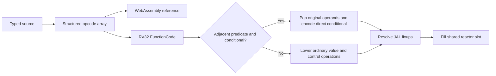

# Fusing integer comparisons and branches in the PicoCalc RV32 compiler

PicoCalc compiles typed world code into native RISC-V instructions on the ESP32-P4. Its typed frontend also targets WebAssembly, which gives the native backend a fixed sequence of structured integer operations to lower and a reference target for semantic tests. This project measures the effect of removing a comparison result that a conditional instruction immediately consumes. The resulting code uses the integer operands directly in an RV32 branch.

> [!summary]
> - Emitted instruction words fell from 804 to 738 for Files, 4,058 to 3,784 for Agenda, and 21,886 to 20,507 for Editor.
> - All 1,343 focused differential vectors agreed with WebAssembly, including 24 traps. Each compiler passed all 24 host replays.
> - Linked guest workflows ran with identical output and 5.84–8.63% fewer guest instructions for four Editor workloads. On the ESP32-P4 three long Files comparator fixtures used about 13.9% fewer cycles per call.

## Where the comparison result goes

A typed function such as this represents each intermediate operand by an entry in the frontend's abstract evaluation stack.

```js
function bump(b: i32, c: i32): i32 {
    let a = b + c;
    if (a > 0) { a = a + 1; }
    return a;
}
```

The first assignment loads the two local values, consumes them in an addition, and stores the resulting integer in local `a`. For the condition the frontend reads `a`, pushes the constant zero, emits `i32.gt_s`, and opens a void `if`. The comparison consumes two integers and produces a canonical integer boolean, with one meaning true. The opening instruction consumes that one result before either arm begins. The stack effects compose to a two-operand consumption with zero results. This composition supplies the correctness condition for the replacement. Any operands that remain below those two values retain their locations and values on both paths. [WebAssembly Core Specification, execution semantics](https://www.w3.org/TR/wasm-core-2/#exec).

The current PicoCalc backend gives the first five operand depths fixed homes in `t0` through `t4`. An operand at depth `d` beyond that range lives at offset `4 * (locals + d)` from the current stack pointer. A pop can therefore obtain the register of a shallow operand directly or emit one load into a scratch register for a deep operand. The previous register study moved most temporary values out of the frame and left predicate results eager. The new study starts from that backend at `6426798`. It changes the consumer of exactly one temporary value whenever the compiler can identify that consumer in the next operation. [[PROJECT REPORT - PicoCalc Compiler - Operand Registers on RV32]]



Source compilation is streamed function by function by default. Once a function has been parsed, its body is available as a complete opcode array. Each opcode occupies one array cell and immediate operands occupy subsequent cells. This layout permits a small adjacency check from an instruction with known length. There is no need to infer whether a byte found inside a signed immediate is an opcode. Fusion begins at one of seven decoded operations with no immediate cells.

## Why the two complements are separate

The RV32 ISA has equality branches, signed ordering branches, and unsigned ordering branches. The planner records a condition's true branch encoding and whether to reverse its registers. For example, a test of `a <= b` has the same truth value as `b >= a`, so the compiler uses `bge b,a`. Each complemented encoding differs in one low bit of funct3. Equality uses `beq` and `bne`, signed ordering uses `blt` and `bge`, and unsigned ordering uses `bltu` and `bgeu`. [RISC-V RV32I control transfer](https://docs.riscv.org/reference/isa/unpriv/rv32.html#conditional-branches).

| Wasm operation | True condition | Operand order |
| --- | --- | --- |
| `i32.eqz` | `beq` | left, zero |
| `i32.eq` | `beq` | left, right |
| `i32.lt_s` | `blt` | left, right |
| `i32.gt_s` | `blt` | right, left |
| `i32.le_s` | `bge` | right, left |
| `i32.ge_s` | `bge` | left, right |
| `i32.ge_u` | `bgeu` | left, right |

The frontend lowers `while (condition)` as a void block containing a loop. A fall-through path reaches the body and an unconditional structured branch repeats it. The frontend emits `i32.eqz; br_if 1` to exit if the condition becomes false. The compiler handles this by recognizing one extra adjacent `eqz` and complementing the predicate before choosing the jump. With a direct `if`, the block's alternate label is reached when the computed condition is false. With `br_if`, the selected structured label is reached when the condition is true. Those are different rules for the logical jump.

The machine code writes an inverted B-type instruction with displacement +8 followed by an unconditional `jal zero,target`. The first complement, when needed, chooses the truth condition for reaching the logical destination. The second complement is inside the common branch encoder and chooses the condition for skipping the jump. A local branch therefore always has a displacement of eight bytes. The J-type jump can reach about 1 MiB. The focused test verified a 12,004-byte displacement for a generated `if` body of 600 integer assignments.

```text
P = condition encoded by the original Wasm integer comparison
if a following eqz is matched:
    P = complement(P)

if consumer is if:
    jump_condition = complement(P)
    destination = alternate of the just-opened if
else:
    jump_condition = P
    destination = target selected by the br_if label index

emit B-type branch on complement(jump_condition) to PC + 8
emit JAL x0 to destination
```

In `bump`, `t0` holds `a` and `t1` holds zero. The first baseline instruction below materializes the predicate. The candidate uses the signed order in the branch itself. Both sequences skip `jal` when `0 < a` and execute it when `a <= 0`.

```text
baseline
  28: 005322b3  slt t0,t1,t0
  2c: 00029463  bne t0,zero,0x34
  30: 0140006f  jal zero,0x44

candidate
  28: 00534463  blt t1,t0,0x30
  2c: 0140006f  jal zero,0x40
```

The full function shrinks from 22 to 21 words. The zero constant is still loaded into `t1`. This experiment starts from eager operand evaluation, so the source producers still emit all their usual instructions. The proof of equivalence applies after the operands have been produced. The change fits independently of future work on lazy constants, fewer frame-based local loads, or branch shortening.

## Spills and control-flow joins

For a binary predicate, the candidate pops the right original operand into `t6` if it has spilled and the left original operand into `t5` if it has spilled. The two scratch registers keep both results available simultaneously. A unary condition reads one operand and compares it with architectural `zero`. Register order is selected after the pops, so swapping the inputs in an encoding has no effect on compiler depth or reload order.

The `if` frame records its entry height after those original operands have been consumed. The baseline reaches the same height after popping its boolean. Each arm of a result-producing `if` writes to the same home at the recorded entry height. For example, in `1000 + Math.max(x,y)` the live prefix contains 1000. The selected value from `Math.max` occupies the next depth on either path and the subsequent addition reads the same prefix and result registers. Larger arithmetic prefixes put those values in frame slots. The focused suite tests joins with 0, 4, 5, 6, and 8 earlier operands, including the mixed case where one original comparison input has spilled and the other resides in a register.

A load bound is an unsigned comparison generated inside the frontend. An index of `-1` has unsigned representation `0xffffffff`. It is beyond the last element of a short buffer. Using signed order in its native comparison would allow the negative offset to pass the guard. The host differential runs exercise indexes at `INT_MIN`, `-1`, zero, the last valid index, the length, and `INT_MAX`. A non-ASCII UTF-16 sentinel exercises unsigned halfword loads and memory state comparison in the same fixtures.

The fusion consumes no operands when a supported consumer is absent. A comparison stored in a local, passed as an argument, or returned still follows the existing normalization path. The static shape assertion checks the materialized case after masking placement-dependent JAL immediates. Execution validates that the actual call lands on its target. Short-circuit tests compare memory logs from side-effecting calls. This checks operand evaluation order, including the path which omits a later call.

## Static emitted code and image sizes

The application sources, import ABI, frontend, and system entry points are common to the two treatments. The constructor extracts both bundles from `6426798f69c691f5c1979233ebdeb540f8ce7c61` and applies a patch to the candidate's `typed-rv32.js`. The lowerer grows from 15,766 to 17,029 bytes. The experiment captures source digests, output digests, per-function counts, and alternate-order warm Node timings. Within each lane, streaming and buffered mode return byte-identical images and equivalent entries, records, signatures, and import relocations.

| App | Functions | Baseline words | Candidate words | Reduction | Generated code bytes reclaimed |
| --- | ---: | ---: | ---: | ---: | ---: |
| Files | 7 | 804 | 738 | 8.21% | 264 |
| Agenda | 34 | 4,058 | 3,784 | 6.75% | 1,096 |
| Editor | 120 | 21,886 | 20,507 | 6.30% | 5,516 |

The counts contain one word for each imported-call relocation. All 145 Editor relocations persist. Total conditional counts stay at 75, 323 and 1,037, in application order. Direct signed or unsigned branch instructions now account for 25, 100 and 582 of those sites. The rest include equality branches and a raw boolean branch. For the application images the new relational opcodes are a lower bound on the number of fused sites because fusing an equality test can also yield `beq` or `bne`. Two-word long branch sites retain their unconditional transfers.

With a fixed reservation, a smaller image leaves more unused bytes inside the same reactor slot. The measured complete ELF lengths are 24,424 bytes for Files, 66,364 for the locally assembled Agenda reactor, and 240,452 for Editor. Every runtime pair uses the same reactor for both modules. Its two linked module digests differ because code and relocated entry targets differ.

The warm compile samples are full frontend-through-image measurements in reused Node VM contexts after ten warmups per treatment. Across 31 alternating pairs, medians were 0.3452 → 0.3536 ms for Files, 1.7006 → 1.5436 ms for Agenda, and 6.1512 → 6.4031 ms for Editor. This is one warm host session with mixed changes. The handheld's cold run starts a new QuickJS runtime and loads source, and is a separate measurement.

## Dynamic guest execution and qualification

A focused interpreter compares 1,343 vectors against real Node WebAssembly, preserving the same arguments and initial memory in each run. Its aggregate counts go from 37,445 to 34,526 across those vectors. Twenty-four traps agree and all compared memory bytes match after execution. This test intentionally weighs branch limits more heavily than an application session. The independent linked emulator supplies a separate check of instruction execution, reactor packaging, and the SDK ABI. A second investigator also compared 637 returning cases and six traps through real RV32 guest ELFs and Wasm, including checks on stack restoration, UTF-16 sentinels and call order.

The complete workflow runner starts each treatment with the same driver, input, argument list and module pathname. It runs two pairs in the order baseline, candidate, candidate, baseline. For each workflow the four complete stdout hashes match. The driver starts the actual app entry points, and its final line reports a completed result. The reported count includes all guest instructions executed by the driver, reactor and application.

| Workflow | Baseline guest instructions | Candidate guest instructions | Reduction |
| --- | ---: | ---: | ---: |
| Files directory actions | 88,823 | 88,750 | 0.08% |
| Agenda persistence and mutations | 2,193,310 | 2,132,824 | 2.76% |
| Editor edit and save, 123 B | 2,543,239 | 2,376,228 | 6.57% |
| Editor open, 64 KiB | 7,621,786 | 7,081,589 | 7.09% |
| Editor dense inline preview, 64 KiB | 22,853,317 | 21,519,713 | 5.84% |
| Editor late navigation and save, 64 KiB | 42,316,056 | 38,662,647 | 8.63% |

Static counts weight every emitted instruction once. Guest counts include each execution of an instruction. Files removes 264 bytes from its full image and 73 instructions from the measured flow, whose complete driver also includes common reactor work. Editor removes up to 3,653,409 executed instructions from late navigation. The size gain of a fused site is independent of how often that site's condition is true, since both paths lose the instructions that prepared its boolean. The aggregate gain depends on how often control reaches each fused site. It also depends on whether the formerly materialized value had to be spilled.

Each lane passed all 24 prior host replays. They cover Files directory sorting and creation, Agenda calendar and entry behavior, and Editor movement, search, retention of positions, edits, and Markdown preview. The four measured Editor runs use drivers generated by the existing workflow that first compares compositor frames in the JS and Wasm versions. That workflow then checks RV32 native frames against the JS result. The candidate receives the same resulting ELF driver and its stdout is compared byte for byte by digest.

## Reproduce the paired experiment

Use the sources at revision `6426798` and the ticket scripts in the main project repo. The runtime measurement uses the built PicoCalc host simulator, cross GCC, the typed Wasm reactor, and the CJI RV32 emulator with adjacent support objects. The replays and constructor take their paths explicitly.

```bash
ticket=(ttmp/2026/11/19/PICOCALC-RV32-BRANCH--*)
work=$(mktemp -d)
bash "$ticket/scripts/01-construct.sh" "$work/pair"
node "$ticket/scripts/03-apps.mjs" count "$work/pair"
node "$ticket/scripts/04-differential.mjs" "$work/pair"
python3 "$ticket/scripts/05-guest.py" "$P4_GCC" "$RV32EMU" "$work/pair"
node "$ticket/scripts/08-worked-example.mjs" "$work/pair" "$P4_OBJDUMP"
```

The baseline RV32 source hash begins `64d5c155`, and the candidate's begins `8cdf92a2`. The matched frontend and typed world linker hashes begin `cc7e638c` and `e655f825`. The ticket keeps full hashes, C toolchain identity, emulator and support object digests, executable scripts, and the experimental compiler patch. The implementation and host qualification are committed at `12c6962` in the main project repo. The ticket directory is `ttmp/2026/11/19/PICOCALC-RV32-BRANCH--fuse-adjacent-integer-predicates-and-branches-in-the-picocalc-rv32-backend`.

## Physical compiler and comparator measurements

The hardware supervisor flashed one temporary ESP32-P4 application containing both compiler configurations. The cold compile sequence invoked the normal `compileTypedWorldRv32` entry point using the same source and reactor on every call. Each invocation created a fresh QuickJS runtime. Four blocks ran the baseline and fusion treatment once each as part of a four-treatment schedule. Each treatment occupied every run position once. The elapsed measurement includes reading the app source and reactor, evaluating compiler source, lowering and linking, and QuickJS teardown. SHA-256 validation of the returned module took place outside the measured invocation.

| Cold Editor measure, first boot | Baseline median | Candidate median | Difference |
| --- | ---: | ---: | ---: |
| Elapsed time | 2,483,993 µs | 2,450,901.5 µs | −33,091.5 µs |
| Peak accounted QuickJS allocation | 1,410,878 B | 1,394,718 B | −16,160 B |
| Linked module bytes | 240,452 | 240,452 | 0 |

The runtime held an independent SHA-256 oracle for the exact reactor embedded in this firmware. The generated module digests matched their expected lanes. The candidate finished 31.421, 60.010 and 34.501 ms sooner in three blocks and 12.148 ms later in the fourth. The first-boot medians suggest a small time reduction and a predictable small heap reduction. Peak accounted heap includes the live allocation sizes managed by QuickJS. The fixture measures cold compiler calls on one device and has four pairs.

The same device boot also measured both generated implementations of Files' `filesCompare` as direct native functions. The compiled bytes of both symbols were checked in the trial ELF. A test invocation validated the result before each fixture's batches. The kernel task ran on a 360 MHz core, and a batch measured a native cycle-counter window around 128 calls and a checksum update per iteration. All hashes matched. Each input had two warmup pairs and 16 measured pairs with alternating order.

| Comparator path | Baseline median cycles per call | Candidate median cycles per call | Median paired reduction | Candidate faster |
| --- | ---: | ---: | ---: | ---: |
| Two equal names of 91 UTF-16 units | 6,542.00 | 5,629.68 | 13.95% | 16/16 |
| First mismatch at unit 91 | 6,519.00 | 5,608.84 | 13.96% | 16/16 |
| Equal prefix of 71 units | 5,121.46 | 4,409.36 | 13.90% | 16/16 |
| First-unit mismatch | 105.16 | 95.16 | 9.48% | 14/16 |
| Directory-order shortcut | 30.13 | 30.16 | 0.04% | 9/16 |

The median of paired percentages need not equal the ratio of the two medians. The shortcut's order strata show opposite effects of a fraction of one cycle. The three longer comparisons remain close to a 13.9% saving across both order strata. Their loops repeatedly evaluate comparison and unsigned bound predicates. The early return paths enter the loop less often. These physical results explain why a synthetic comparator and the full Files guest workflow measure gains on different scales.

The repeat boot supplied four more cold pairs. Its baseline and candidate medians were 2,463,364.5 and 2,461,632.5 µs. The median of baseline minus candidate within each block was 2,977.5 µs, compared with 32,961 µs in the first boot. Three of four pairs favored the candidate in both. The repeat's peak heap medians were 1,410,872 and 1,394,728 B. The paired cycle reductions for the long comparator fixtures repeated at 13.96%, 13.96%, and 13.90%, each with 16 of 16 favorable pairs. This repeat supports a stable small heap reduction and stable improvement in a repeatedly executed comparison loop. The size of the cold compilation timing effect depends on the boot observed here.

The repeated firmware boot then loaded Editor compiled by the branch treatment and ran the supported 64 KiB long-inline Markdown preview. Two captured 640 by 640 frames matched the qualified physical image at every pixel outside the status clock. Both capture integrity checks passed. The replay establishes that this application screen matched on the candidate. The physical cycle measurement above isolates a Files function and the Editor runtime performance comparison uses guest instruction counts.

The supervisor's coordinating ticket is `ttmp/2026/11/19/PICOCALC-RV32-STUDIES--independent-picocalc-compiler-studies-of-branch-lowering-and-output-lifetime`. Its `various/p4-first-boot.json` records the trial identities, per-block rows and all 80 physical pairs. The independent audit at `various/examiner/board-first.json` verifies code identity and compares run orders.

## Next code generation question

The candidate shows the value of preserving the original operands until a conditional branch when that use is adjacent in the structured body. It keeps the existing long control transfer, so further gains from one-word direct branches have a clear control. Testing a branch-shortening treatment requires measuring actual B-type displacement after accounting for every removed word and remapping function addresses, labels and imports. The far-arm fixture is useful on that boundary because it still needs the two-word encoding. Larger language changes which separate predicate production from consumption require a separate analysis to preserve operand identity until the use.
