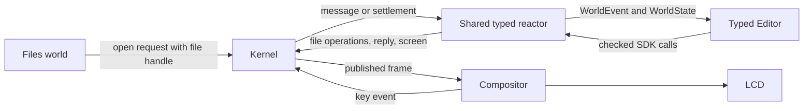
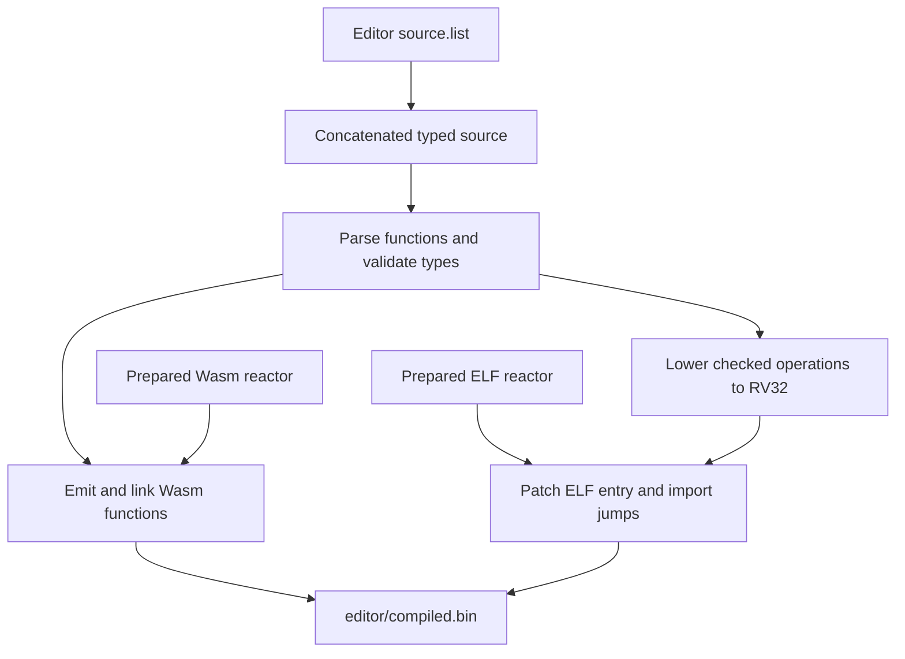
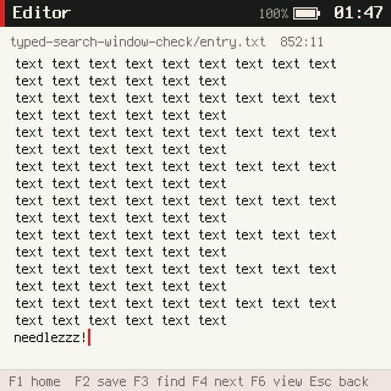
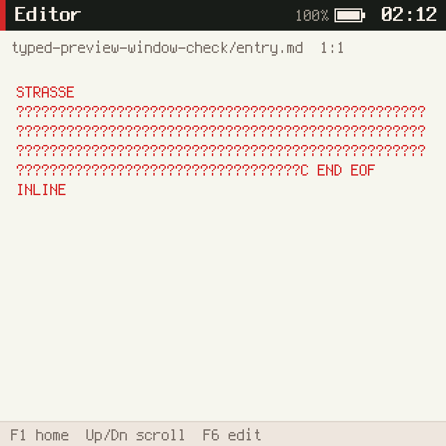

# PicoCalc Editor in Typed JavaScript

Editor opens a granted text file, edits its contents, and publishes a screen frame on the PicoCalc. The ESP32-P4 firmware used for this project compiles the app from eleven typed JavaScript files at boot. The same source produces a WebAssembly module or an RV32 ELF. The port covers the application event handler, editing, save transactions, cursor persistence, search, Markdown and the view. This report follows those responsibilities from the compiler through a physical 64 KiB editing and preview workload.

> [!summary]
> - The compiler checks a small language with explicit scalar, record and buffer types. It derives both backends from the same checked function representation.
> - The compiled app owns its decisions. A shared SDK supplies file capabilities, timers, checked text operations and frame publication.
> - File size, work per scheduler segment and drawable rows are independent constraints. The port needed explicit algorithms for all three.
> - Both firmware targets passed the standard handheld workflow. The final RV32 image also displayed the end of a 65,536-byte formatted Markdown line.

## 1. Three interfaces define the port

PicoCalc OS calls an application a *world*. The manifest names its entry module, engine, memory limit, turn budget and claims. The kernel delivers events to that world. Files offers a file handle in an open request, and Editor uses that handle to read and write the document. The manifest for the qualified typed Editor has an empty claims list. Its file authority arrives with the handoff, and the kernel checks that authority on each operation. The compositor routes keys and draws the app's frame on the 320 × 320 display.

A *reactor* is the prepared module that bridges the kernel's native-world interface to the compiled application. It owns counted text buffers and marshals incoming event data into the app's records. Editor exposes two functions, `typedWorldMeta` for metadata and `typedWorldEvent` for application behavior. The SDK is the interface in the other direction. Calls such as `typedSdkFileRead(handle)`, `typedSdkYield()` and `typedSdkScreen(...)` submit work or publish output through that interface. File policy, command interpretation, cursor placement, Markdown rules and screen construction live in the typed source. The C SDK supplies generic memory, encoding, dispatch and system-call operations.



This boundary also defines the security model. Wasm uses checked linear memory under the interpreter. The RV32 target runs trusted machine code in the device address space. Both app modules use the kernel's handle checks for filesystem operations through the SDK. A manifest without filesystem claims is evidence about the app's authority through that interface. [World SDK](file:///home/manuel/code/wesen/2026-10-20--ds-js-os/picocalc-os/sdk/nw.h) · [Native event dispatch](file:///home/manuel/code/wesen/2026-10-20--ds-js-os/picocalc-os/nucleus/native.c)

## 2. The typed language and the two compiler targets

The source resembles JavaScript and has a deliberately smaller type and execution model. A function declares typed parameters and a result. Local types can follow from their initializer. The compiler resolves function signatures, checks assignments and calls, and computes fixed field offsets for records. Its string and mutable buffer operations use counted storage. The build concatenates the files in `source.list` in dependency order, which matters because functions are available after their definitions. The final Editor payload was 70,859 bytes and fit within the 96 Ki code-unit bound for a complete typed world.

The Wasm frontend emits a checked stack-oriented function representation. For Wasm, the linker appends the emitted functions to a prepared reactor, validates the SDK signatures, and rewrites the exported entry stubs to call the new functions. The RV32 backend takes the same checked function representation and lowers its operations to RISC-V instructions. The ELF template contains an executable region reserved for emitted instructions, entry jumps and SDK import trampolines. The RV32 linker checks that the ELF format, slot header and code size agree with the program. It inserts the instructions and patches calls to their destinations. Both paths validate `WorldEvent` and the scalar `WorldState` contract before returning a module.



On the ESP32-P4, `editor_p4.c` reads the bundled source and reactor and selects the link function for the firmware profile. `p4_typed_compile` evaluates the compiler and linker in a temporary QuickJS context, charges its allocations to the compiler budget, and supplies a deadline. The runtime loads the returned module. QuickJS runs the compiler in this deployment. The compiled Editor runs under the engine selected by the manifest. The separate CJI experiments in [[ARTICLE - Compiling Agenda on the PicoCalc]] used a different frontend and workload, so their timings describe a different compilation job. [Source list](file:///home/manuel/code/wesen/2026-10-20--ds-js-os/picocalc-os/worlds/editor/source.list) · [World linker](file:///home/manuel/code/wesen/2026-10-20--ds-js-os/picocalc-os/compiler/typed-world.js) · [Wasm emitter and linker](file:///home/manuel/code/wesen/2026-10-20--ds-js-os/picocalc-os/compiler/typed-wasm.js) · [RV32 lowering and ELF linker](file:///home/manuel/code/wesen/2026-10-20--ds-js-os/picocalc-os/compiler/typed-rv32.js) · [P4 compile entry](file:///home/manuel/code/wesen/2026-10-20--ds-js-os/picocalc-os/port/esp32p4/main/editor_p4.c)

## 3. A document has byte offsets, code units and display columns

Files stores UTF-8. The live document uses UTF-16 code units, with a length independent of the buffer capacity. The app identifies a file position by logical line and code-point column, and maps that position to a wrapped display row. For example, `a🙂b` occupies six UTF-8 bytes, four UTF-16 units, and three code points. A cursor after the emoji is at UTF-16 offset three from the start of that line. A row column for the same position is two. Left and Right must step over a valid surrogate pair together.

These coordinate systems have distinct uses.

| Coordinate | Role | Concrete boundary |
| --- | --- | --- |
| UTF-8 bytes | File I/O, save snapshot, screen transport | A save checks the length of the encoded bytes. |
| UTF-16 units | Document storage, string views, spans and edit offsets | A supplementary code point occupies two units. |
| Logical line and code-point column | Cursor persistence and the position label | LF delimits a logical line. |
| Wrapped row and column | Cursor rectangle, viewport and search highlights | The editor wraps at 49 code points. Its LCD viewport shows 17 rows. |

On open, the SDK decodes a read receipt into the typed document buffer. The app normalizes CRLF and CR to LF in bounded slices. It captures the normalized state used by discard and restores the saved cursor. The persisted coordinate consists of the logical line and column, viewport top and a timestamp. The app restores the location by finding the appropriate LF boundary and converting the saved code-point column to a UTF-16 offset.

The buffer size and the output byte limit matter separately. A fixture of 65,536 bytes contained 851 CRLF pairs. Normalizing the pairs reduced it to 64,685 bytes. The navigation replay appended one ASCII character and verified exactly 64,686 saved bytes. Its final cursor was displayed as line 852, column 11. This is the result of the actual editing and storage path, with the position label using one-based display coordinates. [Text layout](file:///home/manuel/code/wesen/2026-10-20--ds-js-os/picocalc-os/worlds/editor/layout.typed) · [Open and normalization](file:///home/manuel/code/wesen/2026-10-20--ds-js-os/picocalc-os/worlds/editor/editor.typed) · [Position storage](file:///home/manuel/code/wesen/2026-10-20--ds-js-os/picocalc-os/worlds/editor/positions.typed)

## 4. Separate the live document from the bytes submitted to storage

An asynchronous save has a submission point and a completion point. The user can type between them. Editor captures the submitted bytes into the inactive snapshot slot before asking the kernel to write. The live document continues to receive edits. On a successful receipt, the submitted slot becomes the saved slot. A failed receipt leaves the previous saved snapshot available for discard. Esc can defer leaving while a save is pending, and completion only leaves when the live text is clean.

```text
begin_save:
    encode live text into the inactive snapshot slot
    submit those bytes to the current file handle
    record the write token and clear changed_since_submit

on_edit:
    mutate the live buffer
    mark changed_since_submit if a write is outstanding

on_matching_success:
    promote the submitted snapshot
    if changed_since_submit:
        dirty = live bytes differ from the promoted snapshot
    else:
        dirty = false
```

The exact comparison matters when a user makes an edit during the write and subsequently edits back to the submitted bytes. A mutation counter would mark that history as changed even though the content is clean. The fast path uses the mutation flag to skip the comparison when there were no intervening edits. The first 64 KiB save experiment had already written the correct bytes when Editor overran while processing its receipt. The optimization repaired the app-side settlement without changing the storage request. A useful regression test therefore checks file bytes, the completion notice and later editability. [Save and discard policy](file:///home/manuel/code/wesen/2026-10-20--ds-js-os/picocalc-os/worlds/editor/edit.typed) · [Snapshot SDK](file:///home/manuel/code/wesen/2026-10-20--ds-js-os/picocalc-os/sdk/typed/world.c) · [Initial port diary](file:///home/manuel/code/wesen/2026-10-20--ds-js-os/ttmp/2026/11/18/PICOCALC-TYPED-WORLDS--run-complete-typed-javascript-applications-on-picocalc/reference/01-implementation-diary.md)

## 5. Search and cursor movement need distinct continuations

The edited document can fit easily in memory and still take too long to scan in one scheduler segment. A *segment* is one uninterrupted dispatch or settlement. A *turn* may span several segments while its request or action is pending. For a long search, typed Editor keeps the cursor, phase and token in `WorldState`. The app yields through a zero-delay timer and resumes on the matching settlement. While the key turn is pending, later keys remain ordered behind it and the kernel can dispatch work to other worlds. Only a matching timer settlement advances the search.

Find visits the suffix of the current physical line, subsequent lines, earlier lines, and then the prefix of the original line. The typed logic chooses that traversal and verifies each candidate. A generic SDK seek skips characters that cannot begin a match. The candidate set accounts for ASCII case variants and the observed Unicode folding behavior, including Kelvin sign and dotted I. Dotted I can expand under lowercasing. The scan tracks the folded offset separately from the raw UTF-16 offset so later candidates and cursor placement remain consistent with the reference. An eligible candidate charges work based on query length. Search yields after a bounded amount of candidate work so a line with many partial matches can progress without overrunning.

The experiments separated three cases.

| 64 KiB case | Failure or outcome | Engineering consequence |
| --- | --- | --- |
| Absent query with a rare initial character | A scalar walk overran before the bulk seek was added. | Skip runs of irrelevant units in the shared SDK. |
| Absent query `text text z` | Bulk seek still visited thousands of candidates with matching prefixes. | Carry matching state across scheduler segments. |
| Successful `needle` hit at line 852 | Search could find the match while the subsequent wrapped-row walk still overran. | Slice viewport preparation on its own token and reuse row checkpoints. |

A viewport lookup stores up to 36 checkpoints in a circular buffer. Each checkpoint includes the logical and wrapped row location and the Markdown fence state. If the requested row is present, the app uses the stored location directly. Otherwise, it can start another walk from the oldest retained row when that row precedes the target. A destination before the retained checkpoints can trigger 64-row slices. When an edit changes a line, the app drops checkpoint entries from the affected logical line onward. Retaining the logical line end in a checkpoint also saves another full scan when many wrapped rows all belong to one long physical line. The resulting display rows, cursor and highlights all come from the same coordinate model.

The first physical EOF search displayed the correct position in the status line but the match was below the LCD viewport. The app had emitted 18 textarea rows. The compositor receives 270 pixels for the body, spends 12 on the status line and 4 on its gap, and has a 4-pixel inset for the textarea. At 14 pixels per row, 250 remaining pixels fit 17 whole rows. The corrected scroll bound puts the last visible row at index 16 and keeps the 16-row page increment. Logical position checks, frame checks and pixel captures each caught different failures. [Search state machine](file:///home/manuel/code/wesen/2026-10-20--ds-js-os/picocalc-os/worlds/editor/find.typed) · [Row checkpoint code](file:///home/manuel/code/wesen/2026-10-20--ds-js-os/picocalc-os/worlds/editor/view.typed) · [Compositor](file:///home/manuel/code/wesen/2026-10-20--ds-js-os/picocalc-os/js/system/compositor.js) · [Navigation design](file:///home/manuel/code/wesen/2026-10-20--ds-js-os/ttmp/2026/11/19/PICOCALC-EDITOR-NAV--keep-typed-editor-cursor-navigation-responsive-and-visible/reference/01-implementation-diary.md)



## 6. Markdown preview has two independent bounds

The first large preview built one list of all Markdown items. It stopped building the list when it approached the SDK's 16,384-byte screen staging limit. The resulting JSON was valid and the app stayed alive. The preview still omitted the end of the 21,614-byte fixture. No scroll input could recover rows that the world had never sent.

The typed preview now parses and wraps source text incrementally. It preserves the pending row when a paragraph continues on the next physical line. A ring holds 36 preview rows, and the world publishes a window of at most 17. The compositor's `lines` node accepts a wrapped-row mode and draws that window with the specified style and indentation. When the requested rows move outside the retained window, the parser resumes forward or reconstructs earlier rows in bounded steps. This gives frame size a bound independent of total document length.

A second problem lived before wrapping. The inline formatter copied each physical line into a 4,096-unit scratch buffer. An imported heading or paragraph can exceed that length even though the editor limits insertion into one logical line. A test put `**EOF INLINE**` after 4,900 bytes. Both Wasm cases omitted that phrase and logged no faults. A third fixture of repeated unmatched link openers exhausted the segment budget. The missing phrase identified a capacity limit. The crash identified repeated lookahead in delimiter matching.

The final inline path uses a 65,536-unit scratch buffer. It processes bold, inline code and links in that order, compacting each pass in place. A read cursor walks the input and a write cursor holds the next output position. A matched span advances the read cursor past its delimiters and copies the captured text to the write cursor. A failed link ending can rule out a whole interval of openers that share the same closing bracket. Advancing across that interval saves repeated scans of the same suffix. The continuation keeps its current pass, candidate, lookahead and write position when it yields.

```text
for each physical preview line:
    prepare its block style and source span
    if inline formatting is required:
        copy the span into fixed scratch storage
        for each pass in bold, code, links:
            scan and compact spans
            retain read, write and lookahead positions when yielding
    if the block is a heading:
        uppercase bounded input chunks, retaining unconsumed expansion
    feed complete words or width-sized word pieces to the row window
    publish the visible rows when ready
```

Heading conversion comes before wrapping. Uppercase can expand one source code point into several. The typed wrapper retains the unconsumed expansion and refills enough lookahead to tell whether a word continues past the display width. Spacing and line breaks follow the converted text, including when a conversion boundary falls inside a word. The maximum-size heading fixture exercised this with Greek expansions, a supplementary character, and bold and code inside a link whose destination occupied most of the file. A separate 65,536-byte line with thousands of nested formatted links tested repeated valid replacement. The malformed-link fixture passed on typed Wasm at 200 virtual ms while the reference still overran under the same virtual budget. [Preview window and uppercase stream](file:///home/manuel/code/wesen/2026-10-20--ds-js-os/picocalc-os/worlds/editor/preview.typed) · [Inline compaction](file:///home/manuel/code/wesen/2026-10-20--ds-js-os/picocalc-os/worlds/editor/markdown.typed) · [Before and after evidence](file:///home/manuel/code/wesen/2026-10-20--ds-js-os/ttmp/2026/11/19/PICOCALC-EDITOR-INLINE--preserve-inline-markdown-across-the-typed-editor-document-limit/various/long-inline-after.json)



The physical font substitutes question marks for some characters in this fixture. The differential frame comparison checks the Unicode sequence before drawing. The device framebuffer capture shows the visible heading, font fallback and final marker.

## 7. What was measured on the ESP32-P4

The table uses the final recorded reboot for each target. Compiler peak is the allocator's reported peak for the temporary QuickJS compilation context. World memory is the boot report for the instantiated Editor, with an allowance of 768 KiB per target. Module bytes describe the output file, and the RV32 ELF includes its prepared reactor and reserved code area. The loader measurement is its own interval. Measurements of end-to-end boot time, key response and LCD refresh would require separate intervals.

| Measurement | Wasm | RV32 |
| --- | ---: | ---: |
| On-device source compilation | 1.988 s | 3.138 s |
| Loader | 175.6 ms | 14.1 ms |
| Compiler peak allocation | 1,470,268 B | 2,454,960 B |
| Module size | 88,255 B | 240,452 B |
| Editor world memory at boot | 528.0 KiB | 710.1 KiB |
| Memory allowance | 768 KiB | 768 KiB |
| Firmware application image | 4,270,720 B | 4,461,472 B |

Several larger allocations are predictable from the layout. A full 65,536-unit UTF-16 document buffer uses 128 KiB for its text, and the formatter scratch adds another 128 KiB. Two UTF-8 save snapshots reserve about 128 KiB together. World accounting includes more than those buffers. The measured final RV32 boot report leaves about 58 KiB under its world limit. The firmware images fit the existing 8 MiB application partition. The app's segment budget on the tested device profile is 200 ms. The simulator uses virtual budgets, with 50 ms for several short fixtures and 200 ms for the largest cases. [Paired P4 measurements](file:///home/manuel/code/wesen/2026-10-20--ds-js-os/ttmp/2026/11/19/PICOCALC-EDITOR-INLINE--preserve-inline-markdown-across-the-typed-editor-document-limit/various/p4-inline-builds.json) · [World memory records](file:///home/manuel/code/wesen/2026-10-20--ds-js-os/ttmp/2026/11/19/PICOCALC-EDITOR-INLINE--preserve-inline-markdown-across-the-typed-editor-document-limit/various/p4-editor-worlds-at-boot.json) · [RV32 full-line receipt](file:///home/manuel/code/wesen/2026-10-20--ds-js-os/ttmp/2026/11/19/PICOCALC-EDITOR-INLINE--preserve-inline-markdown-across-the-typed-editor-document-limit/various/p4-full-inline.json)

## 8. How to evaluate a complete application port

The reference app, simulator, emulator and handheld each verify a different part of the implementation. The JavaScript reference gives expected editing behavior. The Wasm simulator can compare entire frame traces, PNG captures and exact file bytes under its virtual budget. The relocated RV32 emulator exercises emitted instructions, SDK glue and ordered settlements with controlled inputs. The handheld adds the actual board compiler, loader, keyboard world, filesystem and LCD framebuffer. Both final board variants passed the standard smoke workflow. The full-file physical navigation and the final maximum-line preview ran on RV32. The verified RV32 profile was left installed.

A single end-to-end test can miss distinct forms of failure. The save experiment had the right bytes and a crashed app. The clipped search result had the right coordinate and an incomplete visible viewport. The initial large preview had a syntactically valid frame and inaccessible final text. A robust port checks the transaction result, the state transition, the published frame and the drawn pixels at the boundary where each claim can be tested.

The report describes source revision `60a38f0`. The source and evidence links open files in the local project checkout. The backfilled diary references are in project commit `dd69a81`. The implementation and qualification records are grouped across the original port, capacity, navigation and inline-formatting tickets. The host replay commands are kept alongside their fixtures and expected outputs. A reader can start with the source list, follow one open through `typedWorldEvent`, then use the replay to relate the API calls to file bytes and pixels. [Original port diary](file:///home/manuel/code/wesen/2026-10-20--ds-js-os/ttmp/2026/11/18/PICOCALC-TYPED-WORLDS--run-complete-typed-javascript-applications-on-picocalc/reference/01-implementation-diary.md) · [Capacity diary](file:///home/manuel/code/wesen/2026-10-20--ds-js-os/ttmp/2026/11/19/PICOCALC-EDITOR-CAPACITY--qualify-typed-editor-across-the-supported-document-range/reference/01-implementation-diary.md) · [Navigation diary](file:///home/manuel/code/wesen/2026-10-20--ds-js-os/ttmp/2026/11/19/PICOCALC-EDITOR-NAV--keep-typed-editor-cursor-navigation-responsive-and-visible/reference/01-implementation-diary.md) · [Inline formatting and final audit](file:///home/manuel/code/wesen/2026-10-20--ds-js-os/ttmp/2026/11/19/PICOCALC-EDITOR-INLINE--preserve-inline-markdown-across-the-typed-editor-document-limit/reference/01-implementation-diary.md) · [Final replay script](file:///home/manuel/code/wesen/2026-10-20--ds-js-os/ttmp/2026/11/19/PICOCALC-EDITOR-INLINE--preserve-inline-markdown-across-the-typed-editor-document-limit/scripts/02-check-full-inline.sh)
