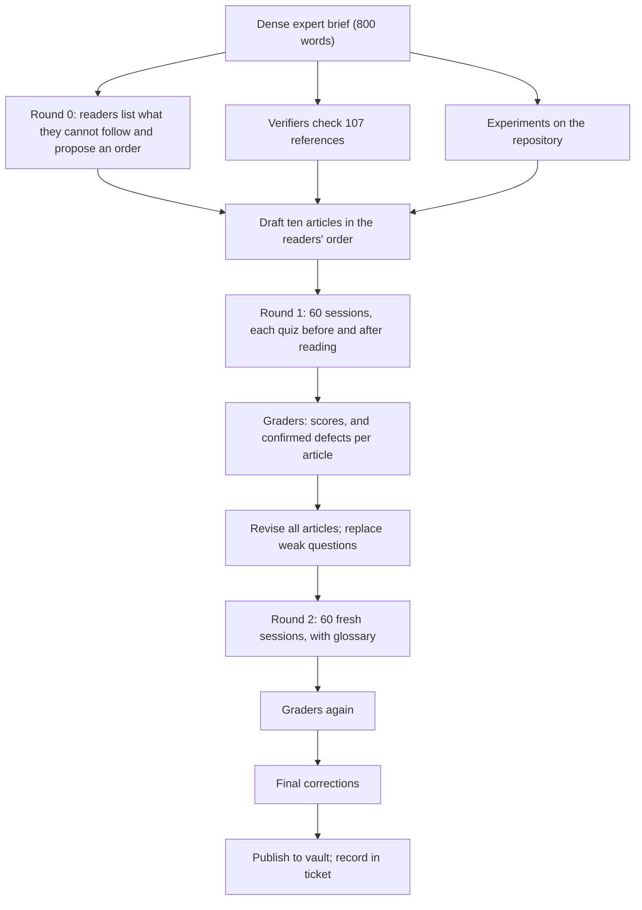
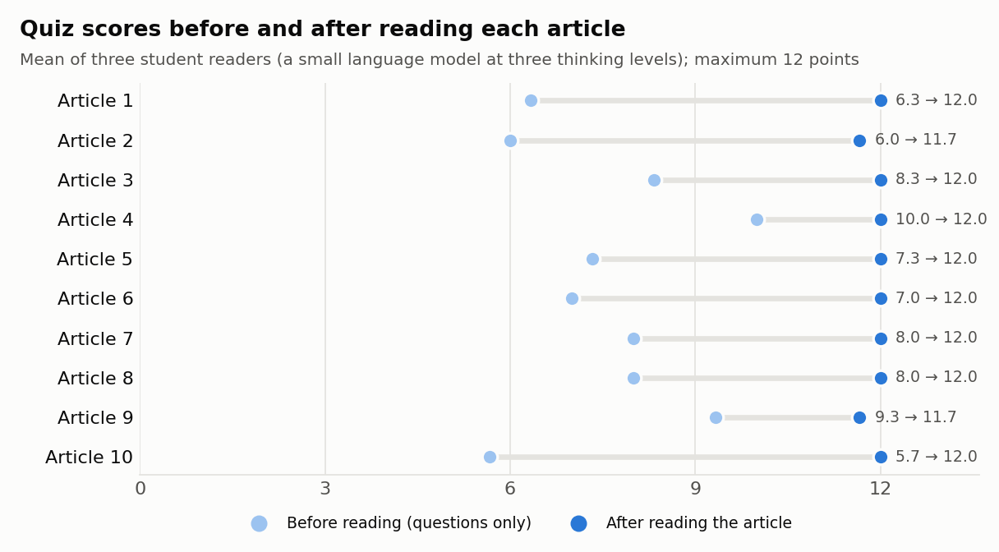
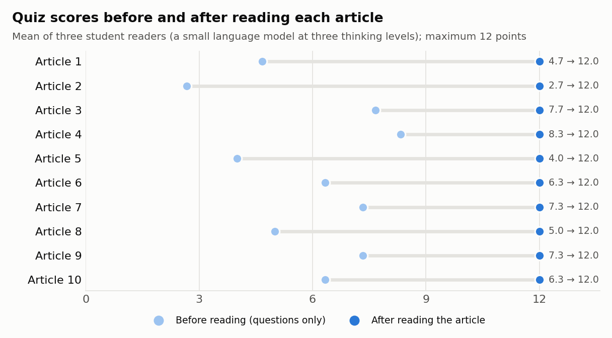

# Writing a Tested Special Issue: Student Readers, Graders and Verified References

On 19 November 2026 a ten-article teaching series, [[Compiling on a Handheld - 00 - Editorial and Reading Guide|Compiling on a Handheld]], was researched, measured, written, tested on readers and published in one working session. This report describes how. It is about the process and not about compilers: which steps were taken, in what order, with which tools and prompts, what each step produced, what went wrong, and which parts of the process did the work. Its purpose is to make the process repeatable for the next long document.

The central finding is simple to state. The document improved most at the points where a claim in it was checked against something outside the author: a source text, a measurement, the repository, or a reader who had only the page. The process is a way of arranging as many such checks as possible, cheaply, before publication.

> [!summary]
> - **Five independent checks were applied to the text**: verification of every reference, new measurements made for the document, a structure survey with weak readers, two rounds of quizzes and feedback from those readers, and a stronger grader that confirmed each complaint against the text.
> - **The weak readers did not measure learning. They located defects.** Graders confirmed 68 defects after the first draft and 42 after the first revision, including arithmetic errors and one factual error inherited from the author's earlier summary.
> - **The quiz score after reading was useless and the score before reading was useful.** After reading, readers scored 11.9 and 12.0 of 12. Before reading, they scored 7.6, which exposed that 24 of 60 questions did not need the article.
> - **Every stage wrote files.** Agents returned short summaries and put their full output on disk, which kept the author's working context small and left a complete record.

## 1. The task and the roles

The request was for a detailed, pedagogical, fully referenced series on what to build next for two compilers, to be validated by small-model "student" agents that answer quizzes and give feedback, with their transcripts and diaries kept. The starting material was an 800-word answer the author had given in conversation, written for an expert.

Five kinds of participant took part. Naming them precisely matters, because the process depends on giving each a job it can do.

| Role | What it was | Job | Why this role |
| --- | --- | --- | --- |
| Author | The main session (Claude Fable 5.2) | Decide structure, run experiments, write and revise every article | One voice; holds the argument |
| Verifier | Three general-purpose subagents with web access | Check each reference against publisher records or the source text | Independent of the author's memory |
| Student reader | A `pi` coding-agent session on `deepseek-4.1-flash`, at three reasoning levels | Read one article in an empty directory; answer questions; quote what it could not follow; write a diary | Has only the page, and is cheap |
| Grader | Five general-purpose subagents per round | Score answers against a written key; check each reader complaint against the article; condense | Stronger than the reader, and can verify |
| Instruments | Scripts run against the repository | Produce numbers the text can cite | Independent of everyone's opinion |

The reader and the grader are deliberately different models with different jobs. A weak reader produces many complaints, some of them wrong. A strong grader with access to the text and the repository decides which complaints are real. Neither is sufficient alone.

## 2. The pipeline



The three boxes that follow the brief ran at the same time. That parallelism is why the whole process fitted in a day: the verifiers needed about 22 minutes each, and the experiments and round 0 were finished before they returned.

## 3. Stage one: verify the bibliography before writing

Every reference in the starting brief had been cited from memory. Before any article was written, the references were split into three lists by subject (analysis and inference; code generation and loading; isolation, types and asynchrony) and each list was given to one verifier.

The brief to a verifier had four parts, and each part prevents a specific failure.

1. **The numbered list as the author remembered it**, with the instruction "fix anything wrong". A verifier corrects a concrete claim more reliably than it produces a bibliography from nothing.
2. **A required status per entry**: VERIFIED, CORRECTED (say what was wrong) or UNVERIFIED. This forces a decision and makes corrections easy to find.
3. **Specific questions inside entries**, such as "confirm it introduces widening" or "what does it report about load time versus native loading". These are the findings the articles would rely on.
4. **An output file path.** The verifier wrote its full notes to `sources/bib-0N-*.md` and returned only counts and the list of corrections.

Of 107 entries, 103 were confirmed, 4 were corrected, and one claim could not be confirmed and was not used. The corrections were small. The larger benefit was in the answers to the specific questions, which replaced remembered impressions with the sources' own figures. Three examples show the kind of change.

| Remembered | What the source says | Effect on the text |
| --- | --- | --- |
| Slim binaries loaded as fast as native code | Almost twice as slow on the fastest machine tested, judged acceptable | The article reports the cost and the reason it was accepted |
| Static Hermes requires type annotations to compile ahead of time | It requires sound types "for performance" | The claim was narrowed and quoted |
| The Tock paper shows isolation with RISC-V memory protection | The paper covers ARM only; the RISC-V port is in the project's documentation | Two sources are cited for two claims |

The verifiers also reported what they could not reach. Several publisher sites refused scripted access, so some abstracts were seen only through an index. The articles cite those works for their existence and subject and attribute no figures to them.

A script then built the consolidated reference list by collecting each article's reference section, removing duplicates, and attaching the DOI or URL found for that title in the verification notes. The notes themselves were published as an appendix.

**Rule that follows.** Verify references before drafting, not after. A corrected finding changes what a paragraph argues, and paragraphs are cheaper to write once.

## 4. Stage two: make measurements for the document

The brief asserted that the compiler's native output was wasteful. An assertion of that kind can be checked by anyone with the repository, so it was checked before being repeated. Four small programs were written and kept with the document.

| Program | What it does | What it gave the text |
| --- | --- | --- |
| Instruction classifier | Compiles three applications with the repository's compiler and decodes every emitted instruction | "50 to 55 percent of instructions are loads and stores of temporaries" |
| Disassembler wrapper | Compiles one small function and prints its machine code | The worked example used in three articles |
| Counting model | Walks the compiler's intermediate output and counts instructions under alternative rules | A predicted size for a backend that does not exist yet |
| Phase timer | Runs the compiler inside the same interpreter the device uses and times each phase | Where compile time goes |

Two practices made these numbers trustworthy enough to print.

**Tie each instrument to a known value.** The classifier's output for one application was 30,840 bytes, the figure in the project's own records for the device's build. The phase timer produced a module of the same size as the device's. These matches show that the instrument processes what the device processes.

**Validate a model against the present before using it to predict.** The counting model first applied the *current* compiler's rules and compared its count with the real output, function by function. It agreed for all 161 functions. Only then were the alternative rules applied. The text states both the validation and its limit: agreement on today's rules shows that the model reads the code correctly, and says nothing about whether the alternative rules can be implemented.

Reading the build configuration during this stage also exposed an error in the brief. The brief had said that one component, the compositor, was interpreted JavaScript. The build file showed it compiled to native code in the measured firmware. An argument in two articles had to be rebuilt on a different basis. No reader would have caught this, because the error was consistent with everything else on the page.

**Rule that follows.** For every quantitative claim, ask whether it can be recomputed from the repository in under an hour. If it can, recompute it and keep the script.

## 5. Stage three: let weak readers choose the structure

Before any article existed, three readers were given the 800-word brief. Each session did four things in order: answered fourteen general questions without seeing the brief; read the brief; wrote a reaction file under fixed headings; wrote a diary.

The reaction file's headings are the instrument, so they are reproduced here.

```text
Terms I could not explain          one line each, with the sentence it appeared in
Claims I could not follow          quote each; say what is missing
Clarity by section                 score 1 to 5, one sentence of reason
Questions I would ask the author   at least eight
A teaching order                   eight lessons, and what each must explain first
What example would help most       three places
```

The three readers, run independently, proposed nearly the same order: the machine and its vocabulary first; how to read the measurements second; each topic introduced by one worked example before any names from the literature; a table of costs and benefits last. They also named the same four claims as unsupported. The ten articles follow their order, and each of the four claims became a table of evidence or an argument.

This stage cost three sessions of about two minutes each. It replaced the author's plan, which had been organized by topic, with one organized by what a reader needs first.

**Rule that follows.** Ask for the teaching order before writing. Readers cannot tell an author what is true, and they can tell an author what they needed to know earlier.

## 6. Stage four: the quiz design

Each article ends with six questions. For each article and each reader, two separate sessions were run.

- **Before reading.** The session's directory contains only the questions. The reader answers from what the model already knows.
- **After reading.** The directory contains the article. The reader answers the same questions and writes feedback under fixed headings: passages read twice; terms never explained; claims that cannot be verified from the text; a score per section; questions the text did not allow it to answer; one thing to add and one to cut.

Sessions do not share memory, so the two conditions are independent samples of the same configuration. Ten articles, three readers and two conditions give 60 sessions and 360 answers per round.



The scores after reading were 11.9 of 12 in round 1 and 12.0 in round 2. A reader with the text open and the ability to search it will find any answer the text contains, so this number shows only that the answers are present. It cannot rank articles and should not be reported as evidence of teaching.

The scores before reading carried the information. In round 1 the mean was 7.6 of 12, and 24 of the 60 questions were answered correctly by readers who had not seen the article. Those questions tested general knowledge, or stated their own premise. A question such as "why must values be moved to agreed locations before a join?" was answered in full before reading by all three readers.

For round 2, 30 questions were replaced or reworded under one criterion: *a correct answer must require something that is only in the article*. That means a number measured for it, a definition as the article uses it, a step of its worked example, or a distinction it draws. The mean before reading fell to 6.0, and the count of questions answerable without the article fell from 24 to 11.



**Rules that follow.**

- Always run the before-reading condition. It costs half the sessions and is the only part of the quiz that tests the quiz.
- Write questions that need the document. Prefer "using the table in section 5.8, compute…" to "explain why…".
- Keep the answer key out of every reader's directory, and audit the transcripts for reads outside it.

## 7. Stage five: grading and synthesis

A reader's feedback file runs to about ten kilobytes. Thirty of them per round is more than an author should read in full, and a proportion of the complaints are mistaken. A grader handled both problems. Each of five graders took two articles and produced two files per article.

**Grades.** A JSON list with one object per answer: article, condition, reader, question, a score of 0, 1 or 2, and a reason of at most twenty words. The scoring rule was written into the key: 2 for all required points and nothing materially wrong, 1 for partly right, 0 otherwise.

**Synthesis.** At most 900 words under fixed headings, of which the first is the one that matters:

```text
1. Errors and inconsistencies in the article   check each yourself before listing it
2. Terms to define                             with the count of readers and the sentence of first use
3. Passages to rewrite                         quote, what was unclear, count of readers
4. Claims without support                      (a) support or soften  (b) a pointer would suffice
5. Section scores
6. Quiz diagnosis                              per question: scores before and after; ambiguous or leaky questions
7. Add and cut
```

Three instructions in the grader's brief produced most of its value.

- "Check each yourself against the article before listing it." Graders rejected reader complaints that were wrong and said so.
- "Quote the article's words so the editor can find the place." Every item could be located by search.
- "If the key itself is wrong or the question is ambiguous, still grade against the key and say so." Graders found a key that contradicted itself and several that were too narrow.

Graders also went beyond the brief in a useful way: they opened the experiment outputs and the repository to settle disputes, and they reported defects that no reader had raised, labelled as their own.

A selection of what this stage found shows why it is worth its cost.

| Defect | How it was found |
| --- | --- |
| A cost "per token" that divided the whole compile time by the token count while naming it the tokenizer's cost | All three readers could not reproduce the figure; the grader recomputed it |
| 84 + 146 written as 235 | Readers flagged the sum; the grader found the omitted 5 ms term in the source record |
| "Three orders of magnitude" where the only like-for-like row shows two | Grader's own check of the table |
| A power-loss argument that depended on an unstated fact | Two readers asked what happens if the write is in place; the author then confirmed the fact in the code |
| A state-machine outline that used a variable it could not access | Two readers traced the outline against its source listing |
| A share "under 5 percent" that held for one of two configurations | Grader recomputed the other from the article's own number |
| An example that broke the rule the article states two paragraphs later | Readers in round 2 |

Round 1 produced 68 confirmed items and round 2 produced 42. The round-2 items were smaller on average, and they still included errors of substance. The count did not reach zero, and the published text contains corrections that no reader has checked.

**Rule that follows.** Do not read reader feedback raw. Pass it through a checker that can open the text and the sources, and require quotations.

## 8. Revision practice

Three practices kept the revisions reliable.

**Snapshots per round.** The text exactly as each round's readers saw it was copied to its own directory before revising. A defect report can then always be matched to the words it referred to.

**Edits as exact replacements with assertions.** Each revision was a script of pairs, old text and new text, that stopped if the old text did not occur exactly once. This prevents a correction from landing in the wrong place or being silently skipped, and it makes each round's changes reviewable as a list.

**Check a fact in the repository before writing it into a correction.** Several corrections asserted new facts. Each was looked up first: that the installer alternates between two storage areas (one line of C), what a 1,450 ms figure included (the design record), which two fields encode a hand-written state (the application source). One correction written without looking was wrong and was caught on the next lookup.

Two structural changes came from the pattern of feedback and not from any single item. Readers of single articles reported terms as undefined that an earlier article had defined, so every article now restates in its opening paragraph the terms it borrows, and round-2 readers were also given the glossary. Reports of undefined terms then fell to a handful per article.

## 9. Running the readers: mechanics and failures

The mechanics are recorded in detail because each failure cost time and each has a one-line prevention.

**The working command.** A reader is one headless agent session in a directory that holds only its materials:

```text
pi -p --provider lunaroute --model deepseek-4.1-flash --thinking <level>
   --no-extensions -e <path to the provider's extension>
   --no-mcp --no-context-files --no-skills --no-prompt-templates
   --session-dir ./session --tools read,write,edit
   "Read TASK.md and carry out every step in order."
```

The task itself is a file in the directory, `TASK.md`, so the prompt is constant and the instructions are part of the record. The session writes its transcript as JSON lines, from which a script produces a readable transcript and an audit row: reasoning level, turns, tool calls, tokens, and any path read outside the directory.

**Four failures.**

| Failure | Cause | Prevention |
| --- | --- | --- |
| "No API key found" | Disabling all extensions also disabled the one that supplies the model provider | Keep that one extension |
| Directories named `s1 minimal` | A shell loop relied on word splitting that this shell does not do | Drive the sessions from a Python script |
| A cleanup command killed its own shell, and a recursive delete was proposed to recover | Process-matching by pattern; shell deletion | Destructive steps go in a Python script that checks paths and names first. The project owner asked for this, and it is now a standing rule |
| Ten sessions produced nothing for four minutes | The sessions inherited a socket as standard input from the background runner and waited on it | Give each session an empty standard input |

The fourth was diagnosed by elimination: a single session run by hand finished in 26 seconds, so the model was responsive; the stalled processes had no network connections; their standard input was a socket. The general lesson is to look at a stalled process's inputs before suspecting the service it calls.

A fifth problem appeared at the end. The documentation tool validates every Markdown file in a ticket, and a thousand session files carry no document metadata. The tool skips one directory by convention, and the session records, round snapshots and keys were moved there.

**Cost.** The figures below are from the audit files.

| Stage | Sessions or agents | Output tokens | Model time |
| --- | ---: | ---: | ---: |
| Round 0 | 3 reader sessions | 35,019 | 6 minutes |
| Round 1 | 60 reader sessions | 430,566 | 108 minutes, about 25 elapsed at ten in parallel |
| Round 2 | 60 reader sessions | 523,713 | 130 minutes, about 20 elapsed |
| Verification | 3 agents | about 0.9 million tokens of work in total | 21 to 24 minutes each |
| Grading | 10 agent runs | about 0.2 million tokens of work each | 12 to 17 minutes each |

Reader sessions took 60 to 90 seconds without an article and two to four minutes with one. The grading and verification agents, on a stronger model, were the larger expense and produced the larger share of confirmed findings.

## 10. What the method does and does not establish

The method establishes that a text has been checked in specific ways: its references against their sources, its numbers against instruments, its arithmetic and internal consistency against a careful second reader, its questions against the possibility of answering them without it.

It does not establish that people learn from the text. The readers are language models. Before reading they answered many general questions that a beginner could not, and after reading they answered with the text open. A model's report that a passage is confusing is a pointer to a passage, to be judged by a human editor.

Four further limits apply. All readers were instances of one model. Grading was done by language-model agents and was spot-checked, not repeated. Readers saw figures only as file names. And the last set of corrections was not tested.

## 11. The procedure, for next time

1. **Write the dense version first.** A page for experts fixes the claims that the long version must support.
2. **In parallel:** send every reference to verifiers with your recollection, specific questions and an output file; write instruments for every claim that the repository can settle; run round 0 on the dense version.
3. **Adopt the readers' order.** Turn each claim they could not follow into a table or an argument.
4. **Draft each unit with a fixed frame:** what the reader will be able to do, which earlier terms it borrows, one worked example from real material, key points, six questions.
5. **Write the answer key separately** and keep it out of reader directories.
6. **Run each quiz before and after reading**, three readers, fresh sessions, one unit per session, task in a file.
7. **Grade with a stronger model** that must check complaints against the text and quote it.
8. **Snapshot, then revise by exact replacement.** Look up each new fact before writing it.
9. **Replace every question that was answered before reading.**
10. **Run a second round with fresh sessions.** Stop when the confirmed defects are small; say in the document which corrections were not re-tested.
11. **Publish the method with the document:** the reader study, the verification notes, the scripts.

## 12. Where the records are

All material is in the repository `/home/manuel/code/wesen/2026-10-20--ds-js-os` under the ticket `ttmp/2026/11/19/PICOCALC-COMPILER-ISSUE--…/`.

| Path | Contents |
| --- | --- |
| `reference/01-investigation-diary.md` | Ten chronological steps, with every failure and its diagnostic |
| `design-doc/01-…index-to-the-special-issue.md` | Index of all parts |
| `scripts/run_students.py`, `run_round.py` | Session runner and round orchestration, including the task texts |
| `scripts/render_sessions.py`, `summarize_grades.py` | Transcript rendering with audit; score tables |
| `scripts/01`–`04`, `make_figures.py`, `build_references.py`, `publish_to_vault.py` | Instruments, figures, reference list, publication |
| `sources/bib-01` to `bib-03` | Reference verification notes |
| `sources/quizzes/` | Answer keys for both rounds; grader instructions |
| `sources/students/round0`, `round1`, `round2` | Per session: materials, answers, feedback, diary, raw and readable transcript; per round: audit, grades, syntheses |
| `sources/issue-round1`, `issue-round2`, `issue` | The text as each round saw it, and as published |

## Related notes

- [[Compiling on a Handheld - 00 - Editorial and Reading Guide]] is the document this process produced.
- [[Compiling on a Handheld - 14 - The Reader Study]] gives the reader study's results from the document's own point of view.
- [[Compiling on a Handheld - 15 - Bibliography Verification Notes]] reproduces the verifiers' notes.
