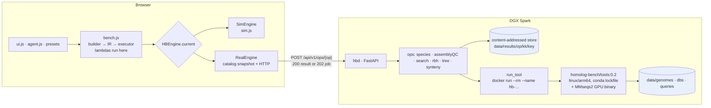
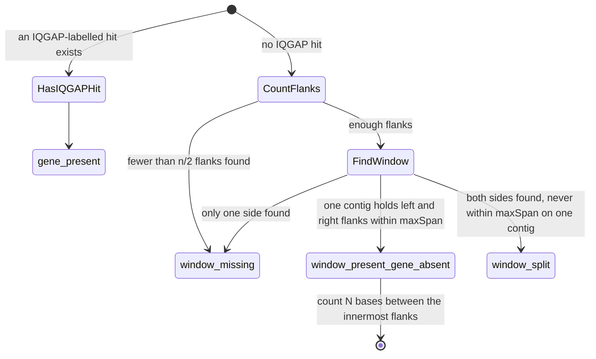

# homolog-bench — From a Simulated Workbench to Real Homolog Search on the DGX Spark

homolog-bench is a browser workbench for one scientific question: in which insect species has the gene IQGAP been lost? A scientist, or an AI agent with a single `eval()` tool, writes short JavaScript pipelines that search genomes, gather evidence and call each species *present*, *absent* or *indeterminate*. The workbench arrived as a 5,100-line single-page prototype in which every genome, hit and timing was produced by a seeded simulation. This report describes the first day of turning it into a system that searches real genomes with real tools on a DGX Spark, and what those genomes said.

The central technical move was to find the one interface through which the prototype touched its simulated data, turn it into an asynchronous, batched engine contract, and put a Python daemon behind it that runs pinned bioinformatics tools in an arm64 container and stores every result under a content address. The central scientific observation is that the pattern the prototype's simulator had been written to illustrate — IQGAP absent from flies and beetles — appears in real data, together with a case nobody had written into the simulator.

> [!summary]
> - The prototype's pipeline language, DAG compiler, cache and journaled workspace were kept intact. Only the data seam changed: `bench.js` now talks to an `Engine` (simulated or real) through async batched calls, and all 63 built-in presets produce byte-identical output on the refactored copy.
> - The real backend (`hbd`, Python 3.12, FastAPI) runs DIAMOND, BLAST+, HMMER, miniprot, MMseqs2 (CPU and GPU), MAFFT, trimAl, IQ-TREE, compleasm and NCBI Datasets inside one pinned `linux/arm64` image, and caches every tool operation under a sha256 key of everything that determines its output.
> - On the 16 core species, protein and genome searches find a full-length IQGAP ortholog in eleven and none in *Tribolium*, *Tenebrio*, *Drosophila*, *Anopheles* and *Rhodnius*. Whether these are losses is not yet decided: gene-order evidence from bee and silkworm flanks is too eroded in most of them to support an absence call.
> - Real tools exposed limits the simulator had abstracted away: miniprot cannot seed alignments below about 35 % identity at default settings, Pfam has renamed the IQGAP signature domain, and a full assembly-completeness check costs about three CPU-hours for a 144 Mb genome.

## 1. The question, and why "absent" is the hard answer

A gene is present in a species if a search finds it. A gene is absent only if every way the search could have missed it has been ruled out. The workbench is organised around that asymmetry. Five things can make a present gene invisible: the region was never assembled, the assembly is fragmented across the gene, the annotation pipeline did not predict the protein, the sequence has diverged below the search tool's sensitivity, or the search itself was misconfigured. Each kind of evidence the workbench gathers exists to rule out one of these.

| Way a present gene can be missed | Evidence that rules it out | Pipeline step |
|---|---|---|
| Assembly incomplete | completeness of near-universal single-copy genes (BUSCO/compleasm) above a threshold | `.assemblyQC()` |
| Search misconfigured | a positive-control gene (NF1) found by the identical search | `.withControl('NF1')` |
| Annotation gap | protein-to-genome alignment that ignores the annotation (miniprot, tblastn) | `.search('miniprot')` |
| Divergence | profile and structure search | `.search('hmmer')`, `.search('foldseek')` |
| Gene in an assembly gap | the neighbouring genes are present and adjacent, with nothing between them | `.evidence().flanks(...)` |
| Wrong family | reciprocal best hit to human and placement in a family tree | `.orthology()`, `.tree()`, `.label()` |

Only when all of this lines up does a pipeline call *absent*; otherwise it calls *indeterminate*. The language enforces this: a policy fragment refuses, at build time, any absence rule that does not read the control, the completeness and the synteny fields. The three-valued call and the build-time policy are the parts of the design that the real backend must never weaken.

## 2. The workbench as it arrived

The prototype is plain JavaScript loaded in a fixed order. `sim.js` defines the simulated world. `bench.js` (2,190 lines) defines everything else that matters: an immutable fluent builder, a compiler from builder steps to a frozen DAG (the IR), an executor that runs the DAG level by level with a cache, and a journaled workspace in which absence calls become proposals that only a human can approve. `ui.js`, `realm.js`, `presets.js` and `agent.js` add the editor, the shared evaluation scope, 63 example programs and the agent.

A pipeline reads as a recipe. This is the default preset, unchanged in the real system:

```js
core = bench('stage0-core')
  .params(param.slider('evalue', { min: 1e-50, max: 1, scale: 'log', default: 1e-5 }),
          param.slider('coverage', { min: 0, max: 1, step: 0.05, default: 0.5 }),
          param.slider('minBusco', { min: 0.5, max: 1, step: 0.01, default: 0.9 }))
  .fragments(control, synteny)
  .species.fromTable('core.tsv')
  .assemblyQC({ tool: 'compleasm' })
  .use(sensitiveSearch, { query: 'IQGAP1' }).withControl('NF1')
  .filter((hit, p) => hit.evalue <= p.evalue && hit.qcov >= p.coverage)
  .use(classify)
  .evidence().flanks({ from: ['Apis mellifera', 'Bombyx mori'], n: 6 })
  .call(c => c
    .present(e => e.hits.some(h => h.label === 'IQGAP' && h.arch.has('IQ', 'RasGAP_C')))
    .absent((e, p) => e.control.NF1 === 'pass' && e.compleasm >= p.minBusco
                      && e.synteny === 'window-present-gene-absent')
    .otherwise('indeterminate'))
  .report()
```

Building it produces sixteen nodes. `sensitiveSearch` expands to DIAMOND, HMMER and miniprot in parallel, and `.withControl('NF1')` adds a sibling search for the control gene beside each of them, so six search nodes share one DAG level and run concurrently. Every node gets two hashes: an own hash over its type, arguments, lambda source text, the parameter values it reads and the simulation state, and a Merkle hash that also covers its inputs. The cache is keyed by the Merkle hash. Moving the coverage slider from 0.5 to 0.8 therefore re-runs the filter and the seven nodes downstream of it and takes the six searches, the species node, the QC node and the merge from cache. In the simulator that saves microseconds. On real genomes it saves the difference between a slider that responds in a second and one that re-runs an hour of searches.

### 2.1 The seam

Everything above `sim.js` reached simulated data through one object, `HBSim`, aliased `S` on line 7 of `bench.js`. A grep over `bench.js`, `ui.js` and `agent.js` lists every member used. Most are catalog lookups — `S.has(taxon)`, `S.table('core.tsv')`, `S.resolveQuery('IQGAP1')`, `S.stateKey()`. Five are tool calls — `S.search(engine, row, query)`, `S.compleasm(row)`, `S.rbh(hit)`, `S.treeOf(hit)`, `S.synteny(row, flanks)` — and those five are synchronous and per species. Real tools are neither: they take seconds to hours, and they are far cheaper when given all species of a node at once. That observation fixed the shape of the change. Catalog lookups stay synchronous, served from a snapshot the browser loads when it connects. Tool calls become asynchronous batch calls, one per DAG node.

## 3. Moving the seam without moving anything else

The new file `web/js/engine.js` defines two implementations of one contract. `SimEngine` is `Object.create(HBSim)` plus six batch methods that loop over the synchronous simulator calls. `RealEngine` holds the catalog snapshot (catalog, tables, queries, engines, release) and turns batch methods into HTTP jobs. `bench.js` does not choose between them. Its `S` became a proxy that forwards every property access to `HBEngine.current`:

```js
const ENG = G.HBEngine;
const S = new Proxy({}, {
  get(t, k) { const e = ENG.current; const v = e[k]; return typeof v === 'function' ? v.bind(e) : v; },
});
```

Inside the executor only the five tool cases changed. The search case, for example, now issues one call for the whole node and distributes the result by taxon:

```js
const res = await S.searchBatch({ engine, mode, query, on, against }, rows, x.opOpts(node));
out.rows = rows.map((r) => {
  let hits = res.data[r.taxon] || [];
  if (node.args.evalue != null) hits = hits.filter((h) => h.evalue == null || h.evalue <= node.args.evalue);
  return isCtrl ? { ...r, controlHits: r.controlHits.concat(hits), controlRun: true } : { ...r, hits: r.hits.concat(hits) };
});
```

Two properties of the original design made this safe. Node hashes already include `S.stateKey()`; the simulator returns `scenario|seed`, the real engine returns `real|<release key>`, so simulated and real results can never share a cache entry. And the executor was already `async`, so awaiting a batch call required no restructuring.

The acceptance test for the refactor was strict: load the original prototype and the refactored copy side by side into Node `vm` contexts with stub UI globals, run all 63 presets through the shared evaluation scope of each, normalise timings and run identifiers, and compare the printed output.

```
presets: 63 · identical 63 · different 0
```

The test was rerun after every later change to `bench.js`, including the bug fix described in section 6.3, and stayed at 63 of 63.

## 4. The daemon: one container, one store, one key



The daemon is deliberately narrow. It runs tools and returns records; it never evaluates user code. The pipeline's lambdas — filters, call rules, labels — remain JavaScript in the browser, which is why `bench.fromJSON` still refuses to rebuild an IR from serialised lambda source. A tool node costs minutes, so one HTTP round trip per node is negligible.

### 4.1 Running a tool

`run_tool(argv)` executes one tool invocation in the pinned image:

```
docker run --rm --name hb-<uuid> --user uid:gid -e HOME=/tmp
           -v <data>:/data -v hbexec.py:/hb/hbexec.py:ro -w /data
           homolog-bench/tools:0.2  python /hb/hbexec.py <report.json> <stdout|-> -- <argv...>
```

Three conventions come from the SparkBricks benchmarking harness that ran on the same machine: argv is a list and never a shell string, the container has a deterministic name because killing the `docker run` client does not stop the container (cancellation runs `docker kill <name>`), and outputs belong to the calling user. The small wrapper `hbexec.py` runs the tool and writes `getrusage(RUSAGE_CHILDREN)` — user and system CPU seconds and peak RSS of the tool's process tree — next to the wall time. Every result carries this provenance block with the argv, the image and the last lines of stderr. CPU jobs share two slots and GPU jobs one, because two GPU jobs on the GB10 time-slice rather than overlap.

### 4.2 The op key

A cached result is only correct if its key covers everything that determines the output. For a search the key is

```python
payload = {"engine": "diamond", "mode": "ultra-sensitive", "query": sha256(IQGAP1.faa),
           "acc": "GCF_003254395.2", "input": sha256(protein.faa),
           "image": toolchain_id(), "v": ADAPTER_VERSION}
key = sha256(canonical_json({"op": "search", **payload}))
```

The first version used the Docker image id as the tool component. Adding the MMseqs2 GPU binary as a new image layer changed the image id and would have invalidated every DIAMOND, HMMER and miniprot result, although none of those tools had changed. The key now uses `toolchain_id()`, the sha256 of the conda lockfile exported inside the image (`micromamba env export --explicit`), and only the GPU engine's key additionally includes the GPU binary's digest. Two images that differ only in unrelated layers produce the same toolchain id; any change of a tool version produces a different one. Each stored result also records the payload its key was computed from, so results can be re-keyed rather than recomputed when the key scheme changes again — which was needed once already, to carry a three-CPU-hour completeness result across the scheme change.

The granularity of the key is one (engine, mode, query, assembly) combination, not one batch. The browser sends sixteen species in one call, the daemon looks up sixteen keys and runs only the missing ones. Adding a seventeenth species to a pipeline costs one search.

The two cache levels behave as intended. A three-species pipeline through `RealEngine` took 18.8 seconds the first time. The same pipeline from a fresh JavaScript process, whose own node cache was empty, took 640 milliseconds: every tool node was answered from the daemon's store.

## 5. From a species name to genes

### 5.1 Choosing an assembly

The 47 species and five tables were copied verbatim from the simulator, so `core.tsv` means the same sixteen species in both modes. For each species, `datasets summary genome taxon "<name>" --reference` returns candidate assemblies and a selection rule picks one:

```python
def choose(cands):
    return max(cands, key=lambda a: (a.reference, a.annotated, a.source == "RefSeq",
                                     LEVEL_RANK[a.level], a.contig_n50))
```

All 47 species resolved in 98 seconds and every one has an NCBI reference assembly. The result is `configs/catalog/snapshot.tsv`, which is reviewed in git and whose digest enters the release key. Real assemblies differ from the simulator's guesses in ways that matter for absence calls: six reference assemblies (*Glossina morsitans*, *Blattella germanica*, *Locusta migratoria*, *Gryllus bimaculatus*, *Stenopsyche tienmushanensis*, *Strigamia maritima*) have no annotation, so only genome engines can search them, and *Frankliniella occidentalis* has a contig N50 of 6 kb where the simulator assumed 94 kb.

Downloads run one at a time. Two concurrent `datasets download` calls failed with a usage message after two and a half minutes while the same download alone took six seconds, so the fetcher downloads sequentially with retries. The sixteen core assemblies, including the 3.1 Gb human and 3.2 Gb cockroach genomes, took twenty minutes.

### 5.2 The locus

Search tools report proteins, and annotated genomes have several protein isoforms per gene. Genome engines report coordinates. The merge step that combines DIAMOND, HMMER and miniprot needs one key that means "the same gene" in all three. The fetcher therefore derives `proteins.tsv` from the annotation: for every CDS feature it follows the chain CDS → mRNA → gene, prefers the NCBI `GeneID` cross-reference when present, and records the protein's coordinates. A protein hit's locus is `<accession>:<GeneID>`. A genome hit's locus is the gene that overlaps at least half of its interval, or a coordinate interval rounded to 1 kb when no annotated gene does. The same physical gene now has the same locus whichever engine found it.

## 6. Engines and the canonical hit

### 6.1 From alignments to hits

Each adapter parses its tool's native output into high-scoring segment pairs (HSPs), and shared code turns HSPs into the workbench's `Hit` record:

```
HSPs ──group by subject protein──▶ one alignment per protein
      (query coverage = union of HSP query intervals / query length; best e-value; best bitscore)
     ──group by locus─────────────▶ one Hit per gene (best-scoring isoform; isoform count kept)
genome HSPs ──cluster on contig+strand within 50 kb──▶ one Hit per locus
```

Coverage is a union of intervals, not a sum of lengths, because two HSPs that overlap on the query must not count twice. The engine e-value cut is always permissive (`-e 10`); the pipeline's own filter applies the real threshold, so moving a threshold never re-runs a search.

| Engine | Searches | Index per assembly | Notes |
|---|---|---|---|
| `diamond` | annotated proteome | `diamond makedb` | six sensitivity modes |
| `blastp` | annotated proteome | `makeblastdb -dbtype prot` | |
| `hmmer` | annotated proteome | none | `phmmer` with a sequence query, as in the simulator |
| `mmseqs`, `mmseqs-gpu` | annotated proteome | `createdb` (+ `makepaddedseqdb` for GPU) | GPU build from the MMseqs2 19 release, `--gpu 1` |
| `miniprot` | genome | `miniprot -d` per k-mer size | no e-values; modes set the seed k-mer |
| `tblastn` | genome | `makeblastdb -dbtype nucl` | slow on large genomes |

### 6.2 Domain architecture, and a renamed domain

The present rule asks `h.arch.has('IQ', 'RasGAP_C')`: does the hit contain both the IQ motifs and the RasGAP C-terminal domain that distinguish IQGAP from the other RasGAP-domain proteins? The simulator invented `arch`. The real system computes it with HMMER: a subset of eleven Pfam families is searched once against each whole proteome with the Pfam gathering thresholds (`hmmsearch --cut_ga`), and a hit's architecture is a lookup by protein. Each family's HMM is downloaded from the InterPro API and its `NAME` line is checked against the configuration. That check failed on the first run:

```
[pfam] PF03836 is named IQGAP_helical in Pfam, expected RasGAP_C
```

Pfam has renamed the family since the prototype's vocabulary was written. The configuration now carries both the current Pfam name, which is verified, and the label that `Hit.arch` reports, which stays `RasGAP_C` so that existing pipelines keep their meaning. Human IQGAP1 comes out as `CH IQ IQ IQ IQ RasGAP RasGAP_C`.

### 6.3 A bug that only real scores could expose

The merge step keeps one representative hit per locus. The prototype chose the one with the higher bitscore. In the simulator every engine's bitscore came from the same formula; in reality miniprot reports an alignment score on a different scale. On the first real run the merged *Apis mellifera* hit was miniprot's (score 2,361) rather than DIAMOND's (bitscore 1,070), and the evidence card showed no e-value. The comparison now prefers a hit that has an e-value, then the lower e-value, and uses bitscore only to break ties. Because simulated e-values are a monotone function of simulated bitscores, this ordering selects the same hits as before in simulation, which the parity test confirmed.

## 7. Evidence beyond the search

**Orthology.** For every hit's protein, a DIAMOND search against the human proteome finds its best human gene (the reverse direction). If that gene belongs to the RasGAP family, the forward check searches the human protein against the species' proteome and requires its best hit to be the same gene. Genes outside the family are reported as `none`; a failed forward check as `unassigned`.

**Family tree.** The hit proteins and eleven human RasGAP-family references are aligned with MAFFT, trimmed with trimAl and placed in an IQ-TREE maximum-likelihood tree (`LG+G4`, SH-aLRT support, rooted on RASA1). A hit's clade is the family of the references in the first ancestor that contains any reference, provided they all share one family. On the core species the 39-leaf tree took eleven seconds, and every reciprocal-best IQGAP ortholog fell in the IQGAP clade.

**Synteny.** For each source species (bee and silkworm), the three genes on each side of its IQGAP gene become flank proteins; miniprot aligns all flanks to each target genome; the target is then classified.



The first version accepted any contig that held at least one left and one right flank. It classified *Anopheles gambiae* as `window-present-gene-absent` with the two flanks 64 Mb apart, which is not a conserved neighbourhood in any useful sense. The rule now requires both sides within `maxSpan` (1 Mb by default) and, among qualifying windows, prefers more flanks and then a narrower span. In the source species themselves the windows are 45–160 kb.

## 8. What the genomes said

The table collects the evidence for the sixteen core species. "DIAMOND best" is the top hit of human IQGAP1 at ultra-sensitive settings with its gene name, query coverage and percent identity.

| Species | Order | Assembly | Contig N50 | DIAMOND best (gene · qcov · %id) | RBH | arch of IQGAP hit | MMseqs2-GPU qcov | miniprot k6 qcov | Synteny (Apis/Bombyx flanks) |
|---|---|---|---:|---|---|---|---:|---:|---|
| *Apis mellifera* | Hymenoptera | GCF_003254395.2 | 5,382,476 | LOC100578255 · 0.986 · 40.1 | IQGAP1 | CH+IQ+IQ+IQ+RasGAP+RasGAP_C | 0.986 | 0.986 | gene-present (6/6) |
| *Nasonia vitripennis* | Hymenoptera | GCF_009193385.2 | 7,180,486 | LOC100119792 · 0.986 · 40.1 | IQGAP1 | CH+IQ+IQ+IQ+RasGAP+RasGAP_C | 0.986 | 0.986 | gene-present (6/6) |
| *Bombyx mori* | Lepidoptera | GCF_030269925.1 | 15,957,419 | LOC101742168 · 0.998 · 37.8 | IQGAP1 | CH+IQ+IQ+IQ+RasGAP+RasGAP_C | 0.998 | 1.0 | gene-present (6/6) |
| *Danaus plexippus* | Lepidoptera | GCF_018135715.1 | 3,940,764 | LOC116779075 · 0.986 · 36.2 | IQGAP1 | CH+IQ+IQ+RasGAP+RasGAP_C | 0.986 | 0.986 | gene-present (6/6) |
| *Tribolium castaneum* | Coleoptera | GCF_031307605.1 | 16,193,484 | Nf1 · 0.168 · 25.4 | NF1 | — | 0.168 | none | window-split (5/6) |
| *Tenebrio molitor* | Coleoptera | GCF_963966145.1 | 7,033,857 | Nf1 · 0.168 · 25.4 | NF1 | — | 0.168 | none | window-split (5/6) |
| *Drosophila melanogaster* | Diptera | GCF_000001215.4 | 21,485,538 | Nf1 · 0.168 · 24.7 | NF1 | — | 0.168 | none | window-present-gene-absent (5/6) |
| *Anopheles gambiae* | Diptera | GCF_943734735.2 | 10,625,458 | LOC1273814 · 0.168 · 24.7 | NF1 | — | 0.168 | none | window-split (5/6) |
| *Acyrthosiphon pisum* | Hemiptera | GCF_005508785.2 | 25,986 | LOC100168908 · 0.982 · 33.7 | IQGAP1 | CH+IQ+IQ+RasGAP+RasGAP_C | 0.982 | 0.982 | gene-present (4/6) |
| *Rhodnius prolixus* | Hemiptera | GCF_049639745.1 | 27,976,301 | Nf1 · 0.168 · 22.3 | NF1 | — | 0.168 | none | window-split (5/6) |
| *Periplaneta americana* | Blattodea | GCF_040183065.1 | 42,422,338 | LOC138691246 · 0.984 · 40.5 | IQGAP1 | CH+IQ+IQ+IQ+RasGAP+RasGAP_C | 0.984 | 0.984 | gene-present (6/6) |
| *Zootermopsis nevadensis* | Blattodea | GCF_977971745.1 | 18,733,084 | LOC110838584 · 0.996 · 39.2 | IQGAP2 | CH+IQ+IQ+IQ+RasGAP+RasGAP_C | 0.996 | 0.984 | gene-present (5/6) |
| *Pediculus humanus* | Psocodea | GCF_000006295.1 | 34,097 | Phum_PHUM177470 · 0.951 · 30.8 | IQGAP1 | CH+IQ+RasGAP+RasGAP_C | 0.951 | none | gene-present (5/6) |
| *Frankliniella occidentalis* | Thysanoptera | GCF_000697945.3 | 6,044 | LOC113202847 · 0.99 · 39.2 | IQGAP1 | CH+IQ+IQ+IQ+RasGAP+RasGAP_C | 0.99 | 0.989 | gene-present (5/6) |
| *Daphnia pulex* | Cladocera | GCF_021134715.1 | 8,301,990 | LOC124192610 · 0.987 · 36.9 | IQGAP1 | CH+IQ+IQ+RasGAP+RasGAP_C | 0.987 | 0.989 | gene-present (4/6) |
| *Homo sapiens* | Primates | GCF_000001405.40 | 57,879,411 | IQGAP1 · 1.0 · 100.0 | IQGAP1 | CH+IQ+IQ+IQ+IQ+RasGAP+RasGAP_C | 1.0 | 1.0 | gene-present (3/6) |

Three things are worth reading out of this table.

First, the presence calls are unanimous. In eleven species every line of evidence agrees: a full-length hit covering at least 95 % of the query, an IQGAP reciprocal best hit, the IQ + RasGAP_C architecture, the IQGAP clade in the tree, and — where the genome engine is sensitive enough — a full-length genome alignment.

Second, five species have no IQGAP-like gene by any search: the two beetles, the two flies and the kissing bug *Rhodnius prolixus*. Their best IQGAP1 hit in every engine is NF1, covering 16.8 % of the query through the RasGAP domain that the two families share, and their NF1 control searches succeed. The beetle and fly cases are the pattern the prototype's "dossier" scenario was written to illustrate. *Rhodnius* was not in that scenario, and it stands next to an aphid (*Acyrthosiphon*, the same order) that keeps the gene.

Third, none of this is yet an absence call, and the reason is in the last column. With bee and silkworm genes as flanks, a conserved neighbourhood is found intact in Hymenoptera and Lepidoptera and in the fruit fly only weakly (one left and one right flank, 957 kb apart). In the beetles, the mosquito and *Rhodnius* the flanks are found but scattered over several chromosomes. Gene order has been rearranged over the hundreds of millions of years separating these orders from the flank sources, so the pipeline's synteny rule cannot fire, and the default call for those species is *indeterminate*. That is the system working as designed: absence of a search hit is not, by itself, evidence of loss.

## 9. What the real tools taught

**miniprot's sensitivity floor.** miniprot found nothing in the louse *Pediculus humanus*, although DIAMOND found an annotated IQGAP protein covering 95 % of the query. Aligning the query to the 20 kb region around the annotated gene also produced nothing, while the louse's own protein aligned with default settings. The cause is seeding: miniprot finds candidate regions through shared amino-acid 6-mers, and at 31 % identity there are too few. With `-k 4 -l 3` the same region aligned 98 % of the query. Since the k-mer size is fixed when the genome index is built, miniprot modes now map to separate indexes (k6, k5, k4). The k4 index has its own limit: it returned no hits at all on the 3.1 Gb human genome, most likely because with only 160,000 possible 4-mers almost every one exceeds miniprot's occurrence cap and is discarded. Divergent copies in small genomes need k4; large genomes need another route. This is precisely the "divergent copy" failure mode the workbench was built around, now with a measured threshold.

**MMseqs2 on the GB10 GPU.** The MMseqs2 19 release ships an arm64 GPU build. Pinned by digest into the image, it searched the bee proteome with IQGAP1 in under half a second and agreed with DIAMOND on every top gene across the core species. Over the sixteen proteomes, including building their padded databases, it used 109 CPU-seconds and 23 seconds of wall time against DIAMOND's 461 CPU-seconds and 49 seconds, while a compleasm job was occupying most of the CPU. These are single cold runs, not benchmarks; a measured comparison that separates index building from search is the next performance task.

**Completeness is the expensive evidence.** compleasm 0.2.10 now uses BUSCO's odb12 lineages; `insecta_odb12` has 3,114 marker genes. On the fruit fly it reported 97.75 % single-copy and 0.64 % duplicated (completeness 0.984) after 19 minutes and 10,827 CPU-seconds. Its miniprot stage scales with genome size, so the sixteen core genomes are a multi-hour batch. That batch runs as a `systemd-run --user` unit so that it outlives the session that started it.

## 10. Measured costs

The figures below are from single cold runs with 16 threads per tool and up to two concurrent CPU jobs, and they include building every per-assembly index the operation needed. All ran on an otherwise idle machine except the MMseqs2 GPU run, which overlapped a compleasm job using about 16 cores; its CPU and wall figures are therefore upper bounds.

| Operation (16 core species unless noted) | Wall | CPU-seconds |
|---|---:|---:|
| Catalog resolution, 47 species (NCBI Datasets) | 98 s | — |
| Fetch 16 assemblies incl. two ~3 Gb genomes | 20 min | — |
| DIAMOND ultra-sensitive, IQGAP1 | 48.6 s | 461 |
| MMseqs2 GPU, IQGAP1 | 23.2 s | 109 |
| miniprot k6, IQGAP1 (genomes) | 62.7 s | 331 |
| Reciprocal best hit, 28 hits | 58.2 s | 454 |
| Family tree, 39 sequences | 11.3 s | 69 |
| Synteny, 2 flank sources × 6 flanks | 63.3 s | 340 |
| compleasm, *D. melanogaster* only (144 Mb) | 19 min 23 s | 10,827 |
| Three-species pipeline through the browser engine, cold / warm | 18.8 s / 0.64 s | — |

## 11. Engineering rules this work preserves

- The language decides what counts as evidence. Policies that refuse weak absence rules at build time stay in the language; the backend only supplies better evidence.
- A cache key covers everything that determines the output and nothing else. Tool versions enter through the conda lockfile, inputs through file digests, adapter logic through a version number.
- User code does not cross the network. Lambdas run where they were written; the daemon runs pinned tools on named inputs.
- Scores from different tools are not comparable. Any step that chooses between hits from different engines must say how.
- A refactor of the core is accepted only when every existing program prints the same output.
- Long batches run outside the interactive session, and timing runs never overlap downloads or other batches.

## 12. Current status and next steps

As of this report the repository contains the imported prototype (`prototype/workbench/`), the evolving workbench with the engine seam (`web/`), the daemon and CLI (`server/src/homolog_bench/`), pinned tool images (`containers/tools/`), reviewed configuration (`configs/`), JavaScript parity and end-to-end tests (`tests/js/`) and Python unit tests. The ticket `ttmp/2026/11/19/HB-001--…` holds the intern guide, the operator playbook and a step-by-step diary.

Next steps, in order:

1. Finish the core completeness batch and run the default preset end to end on real data (`node tests/js/real_stage0.mjs`), producing the first real Stage 0 calls with saved provenance.
2. Choose flank sources closer to beetles and flies, or derive flanks from several sources, so that synteny can support or refute the five candidate losses.
3. Benchmark the engines on a quiet machine: MMseqs2 CPU against GPU, DIAMOND modes, miniprot k-mer modes, separating index time from search time, to replace the placeholder cost model behind `ir.plan()`.
4. Decide the open scientific questions: the lineage used for completeness of non-insect outgroups, and how genome engines without e-values should be filtered.
5. Move the workspace journal and the human-only approval guard to the daemon, where an agent cannot reach them.

## Related notes

- [[PROJECT REPORT - SparkBricks - Benchmarking Genomics and Biological Models on a DGX Spark - A Technical Deep Dive]] — the benchmarking harness whose runner conventions this project reuses.
- [[PROJECT REPORT - SparkBricks - Large Biological Models on a DGX Spark - What Fits in 128 GB]] — unified-memory limits on the same machine.
- [[PROJECT REPORT - SparkBricks - One Genome Fills the Spark - Hard Filters, Two Genomes at Once and the Breadth Pipelines - A Technical Deep Dive]] — why GPU jobs are serialised on the GB10.
