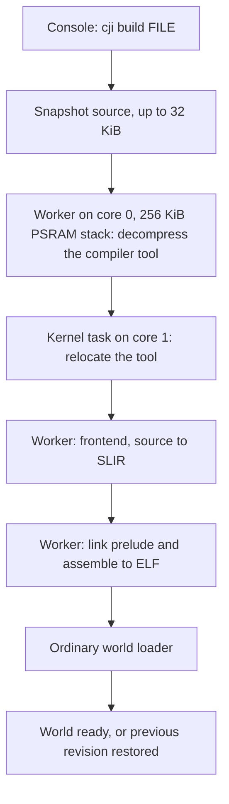
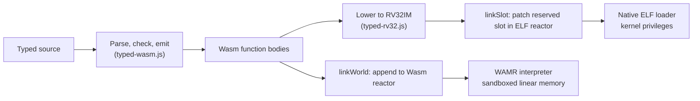
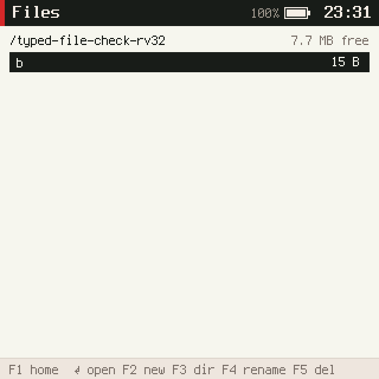
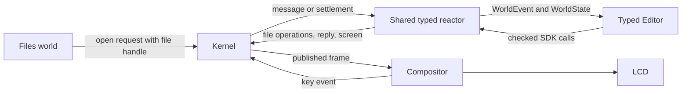
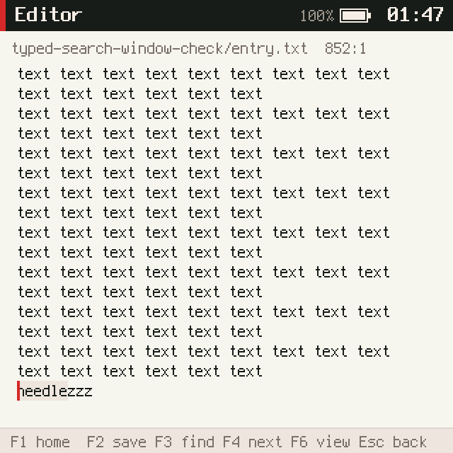
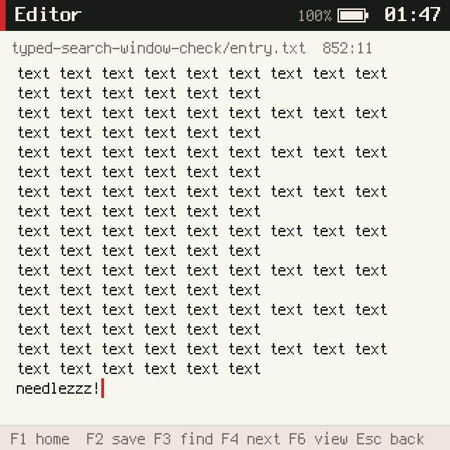
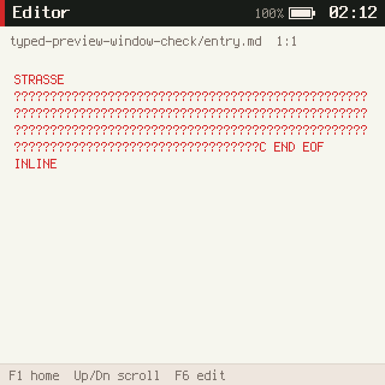

# Two Compilers on the PicoCalc: From a 25-Minute Build to Typed Apps Compiled at Boot

Between the evening of 17 November and the early morning of 19 November 2026, the PicoCalc OS repository received 166 commits about one question: can the handheld compile its own applications to machine code, and can it do so fast enough to be part of ordinary use? The device is a PicoCalc whose controller has been replaced by an ESP32-P4, a 360 MHz RISC-V microcontroller with 32 MB of PSRAM. The operating system on it runs every application, driver and service as a JavaScript program inside QuickJS.

The work produced two different answers. The first compiler, CJI, accepts a large subset of ordinary JavaScript, proves properties of it with whole-program analysis, and emits native RV32 code. It ran correctly on the device, and compiling the Agenda app with it took 24 minutes 35 seconds. A day of profiling and three verified optimizations reduced that to 8 minutes 43 seconds. The second compiler accepts a much smaller language with declared types, performs no whole-program analysis, and compiles the complete Editor app in about two seconds during boot. This report explains both compilers, the measurements that led from the first to the second, and what the project looks like now.

> [!summary]
> - **CJI runs on the ESP32-P4 and produces byte-identical output to the workstation build.** 20 of the 22 catalog worlds compile on the device. Compile times range from 8 seconds (Flaky) to 24.7 minutes (Agenda).
> - **Nearly all of that time is numeric range analysis repeated across library-specialization rounds.** Scheduling the proof once, with a guard for numeric collection keys, cut Agenda from 1,474.6 s to 544.3 s on the board. Two smaller changes reached 522.6 s.
> - **QuickJS already compiles the same Agenda source to bytecode in 37 ms on the same board.** A new language cannot be justified by compile speed. It is justified by declared representations and by compilation that needs only local information.
> - **A typed JavaScript subset now compiles on the device to WebAssembly or to RV32.** The compiler is about 1,070 lines of JavaScript. Files, Agenda policy and the entire Editor are built from typed source at boot, and both targets passed physical qualification.

## 1. The system the compilers serve

Four terms from the operating system are needed before the compiler work makes sense. The earlier report [[PROJECT REPORT - picocalc-os - Worlds, Turns, Handles and Frames - A Technical Deep Dive]] covers them in full.

A **world** is one scheduled program: an app, a driver or a service. The manifest `picocalc-os/js/system.json` lists 22 of them. Each world has a name, an execution engine, a memory limit, a set of claims that state which hardware and directories it may open, and a **turn budget**, the maximum time one event handler may run. A world that exceeds its budget or its memory limit is stopped, and the others continue.

The **nucleus** is the C kernel. It owns scheduling, message delivery and capability checks. It does not care how a world executes its handler. That indifference is what makes a second engine possible: the nucleus delivers an event and waits for the handler to return *done* or *will answer later*.

An **engine** is the mechanism that runs a world's code. Before this work there were three. QuickJS interprets JavaScript bytecode. WAMR interprets WebAssembly, with per-world linear memory and an import whitelist. The native ELF engine loads RV32 machine code and runs it on the kernel task with firmware privileges.

The **prelude** is the JavaScript library that gives world authors their API: `app()`, `service()`, `every()`, promise settlement and screen serialization. Every QuickJS world evaluates it at startup.

The trust difference between engines matters throughout this report. A Wasm world cannot address memory outside its own linear memory. A native ELF world can, because the ESP32-P4 has no memory protection between a loaded module and the firmware. A fault in native code can stop the whole device. Native worlds are therefore restricted to firmware-bundled, trusted code, and the question "which target should an app use" is partly a question about trust.

## 2. Timeline

| When | Work | Outcome |
| --- | --- | --- |
| 17 Nov, evening | Import CJI; run one compiled world on the P4 | `toplog` answers `pong` on hardware |
| 17 Nov, night | Shared prelude unit; migrate worlds by capability; compile on the device | 10 worlds ship native; device compiles `toplog` in 6 s |
| 17–18 Nov, overnight | Catalog sweep with `cji check` | 20 of 22 worlds compile on the board; Agenda takes 1,481 s |
| 18 Nov, 09:00–16:00 | Profile across Linux, emulated RV32 and the board; three optimizations | Agenda 1,474.6 s → 522.6 s |
| 18 Nov, 16:00–17:00 | Measure QuickJS bytecode; design a device language; prototype a direct Wasm emitter | 10 ms compile for a typed function on the board |
| 18 Nov, 17:50–22:15 | Typed Agenda on Wasm and RV32; cold boot under two seconds; feature parity | Both targets respond in about 1.7–1.8 s after power-on |
| 18–19 Nov, 23:15–02:15 | Typed Files; shared typed reactor; complete typed Editor; 64 KiB capacity work | Editor compiles from 11 typed files at boot on both targets |

## 3. The first compiler: CJI on the ESP32-P4

### 3.1 What CJI is

CJI is the compiler developed in the book *Compiling JavaScript, Incrementally*. It arrived as a workspace archive on 17 November and was reduced to a curated selection of 163 files in the ticket `PICOCALC-CJI`. Its pipeline has four parts.

- The **frontend** is written in JavaScript. It parses a supported subset of JavaScript, infers types, specializes library methods for each call site, and lowers the program to **SLIR**, a low-level textual instruction listing.
- The **assembler**, `slas`, is a C program built on SLJIT. It reads SLIR and emits position-independent RV32 code with relocations.
- The **C runtime** provides dynamic values, strings, a garbage collector and property lookup. It is linked into the firmware.
- The **prelude** described above is compiled by CJI itself, so that compiled worlds use the same author API as QuickJS worlds.

Two build stages recur in the measurements. **Stage 0** is the compiler's JavaScript source running under Node on a workstation. **Stage 1** is the compiler compiled by stage 0 into RV32 machine code. Stage 1 is what runs on the handheld. Because CJI can compile itself, the device needs no JavaScript interpreter to run the compiler.

### 3.2 Loading one compiled world

The first milestone was a 268-byte fixture called `toplog` that logs at startup and answers a ping. The loader in `port/esp32p4/optional/native_elf/native_elf_p4.c` performs five steps for any native module.

1. Check that the file is ELF32, RISC-V, with the `ilp32f` ABI.
2. Resolve imported names. `toplog` had 82 imports and 575 relocations. Some imports are functions such as `rt_collect`. Others are runtime globals such as `free_ptr` and must resolve to storage addresses. A generated table, `cji_resolve`, supplies these after the kernel's own symbol table has been searched, so the kernel's charged allocators keep precedence.
3. Relocate the segments into PSRAM.
4. Check the loaded size plus allocations against the world's memory budget.
5. Call the entry with two structure pointers. The kernel structure `nw_elf_kernel` carries one `call` function that takes an opcode, three numbers, three length-delimited inputs and an output buffer. The module structure `nw_elf_module` receives the world's `init` and `event` functions.

The first flashed image never started its console. The runtime allocated a 96 KiB field-lookup cache from internal RAM, and the kernel task then failed to obtain its 80 KiB stack. Internal RAM on this board is scarce: one boot log shows 35,831 bytes free once all worlds are running, against 26 MB of free PSRAM. The fix made field lookup uncached on the device, which also removed a hazard, because a cache of module addresses becomes stale when a world restarts. After commit `6a8e1a0` the fixture answered `pong` before and after a restart and was charged 232.7 KiB of its 320 KiB allowance.

### 3.3 Sharing the prelude

In the first build each module contained its own copy of the compiled prelude, so the trivial `toplog` loaded 199,616 bytes. The second stage compiled the prelude once into a relocatable unit, `unit.o`, linked it into the firmware, and assembled each world against its export list. The loaded size of each world dropped accordingly.

| World | Monolithic loaded bytes | Loaded bytes with shared unit |
| --- | ---: | ---: |
| toplog | 199,616 | 3,680 |
| flaky | 170,096 | 10,776 |
| snake | 233,840 | 77,072 |

Sharing code requires that state is not shared. Each world has a 512-byte **world block** holding its allocator pointers, garbage-collector root stack and saved runtime state. The runtime swaps this block in before a world's handler runs. A test built without the swap produced wrong answers in three of four worlds, which confirms that the swap is the isolation mechanism. A deliberately memory-hungry fixture crashed alone after three requests while its neighbours continued.

### 3.4 Migrating worlds by capability

The next stage moved real worlds to native code in an order chosen by what authority each needs, because each kind of authority required a new native kernel operation.

- **Keyboard and power** claim the I2C bus.
- **Settings** uses the network, the clock and the time zone.
- **Handle transfer** lets one world pass a capability to another inside a message. The wire form is a marker such as `{"$h":17}`, limited to eight distinct handles per message, and the kernel checks that the sender may grant each one.
- **Files and Editor** use directory claims and file handles, with a 65,536-byte file limit.
- **Compositor and display** use the framebuffer and SPI.
- **Agent** uses a transport for HTTPS requests with responses up to 65,536 bytes.

Three failures from this stage are instructive because each came from a difference between the QuickJS engine and the native one.

The compositor drew inverted colors. The compiled prelude reported the turn as done on the first promise settlement, while the asynchronous handler was still waiting for SPI transfers. A buffer that the handler would have restored remained complemented. The fix keeps the turn open until the outermost promise resolves.

Restoring the Agent's conversation took 147 to 160 ms against a 100 ms turn budget. Removing a JSON round trip brought it to 96.3 ms, and adding cooperative yields split it into turns of 10 to 59 ms.

The I2C read gap was specified in milliseconds in the JavaScript API and in microseconds in the native ABI. The value was converted at the boundary.

Ten worlds were selected to run native by the end of this stage. On the device, native Snake used 113.2 KiB where the QuickJS version had been observed at 230.9 KiB. The tickets record no paired speed comparison between QuickJS and native worlds, and they claim no speedup.

### 3.5 Compiling on the device

Phases 4 to 6 of the port put the compiler itself on the handheld. Stage 1 and the assembler are packaged as one private position-independent tool of 4.24 MB, compressed to about 645 KiB inside the application image.



Two details of this diagram were found by failure. The worker's stack must be in PSRAM because internal RAM had 29,007 bytes free against a 65,536-byte request. Relocation must nevertheless run on the kernel task, because the ESP-IDF cache-flush routine asserts that the calling stack is in internal memory, and the device rebooted when that assertion fired. A later stack overrun of 6,412 bytes, caused by assembler frames of 65,696 and 70,224 bytes, raised the worker stack from 128 KiB to 256 KiB.

Installation is durable. Two slots on the FAT partition hold source and artifact, and one NVS record names the active slot together with the source hash, the artifact hash and the firmware build identity. Source and artifact are written before the record changes. At boot the bytes are verified, and a changed firmware identity invalidates the cached artifact.

On the physical device, compiling `toplog` took 5,962 ms from source to a ready world. The resulting 3,704-byte ELF had the same SHA-256 on the workstation, in the RV32 emulator and on the board. A cache hit at boot took about 1,450 ms. A syntax error was refused after about 3,503 ms and left the previous world running.

### 3.6 The catalog sweep

A compile-only command, `cji check`, was then run over every world in the manifest. The table shows a selection.

| World | Source bytes | Compile time on the P4 | ELF bytes |
| --- | ---: | ---: | ---: |
| flaky | 349 | 8.2 s | 10,800 |
| keyboard | — | 16.3 s | 30,248 |
| snake | — | 59.9 s | 77,176 |
| settings | — | 150.5 s | 156,000 |
| files | 5,873 | 329.1 s | 193,896 |
| editor | 15,610 | 425.3 s | 243,936 |
| agent | 34,596 | 906.4 s | 750,832 |
| agenda | 16,326 | 1,481.4 s | 301,496 |

Twenty of 22 worlds compiled and matched the workstation's output. Calc exhausts the compiler's heap. Sandbox uses the comma operator and indirect `eval`, which the subset rejects. Several refusals during the sweep were reported as "compiler scratch limit" and turned out to be PSRAM fragmentation: one request for 8 MiB failed with 11.7 MB free because the largest contiguous block was 4.8 MB. Reserving the compiler's heap before relocation, and lending that reservation to the decompressor, resolved it.

The sweep established that the compiler was correct on the device. It also established that it was too slow to use. Agenda is a 16 KiB source file, and it took 24.7 minutes.

## 4. Why Agenda took 25 minutes

### 4.1 Measuring the same work in three places

The profiling ticket `PICOCALC-CJI-PERF` set up three environments that run the same stage-1 compiler on the same input.

| Environment | What it measures well |
| --- | --- |
| Linux, stage 1 assembled for x86-64 | Elapsed time, Callgrind instruction counts, instruction-pointer samples |
| `rv32emu` running the RV32 stage 1 | Deterministic guest instruction counts |
| The ESP32-P4 | Real phase times in microseconds, peak scratch memory |

A timing sample counts only if the compiler's output is byte-identical to an independent reference. On the host that reference is the SLIR produced by stage 0 under Node. On the board it is the SHA-256 of the linked ELF. This rule prevents a fast but wrong build from being recorded as an improvement, and section 4.3 shows a case where it mattered.

The garbage collector's work was identical in all three environments: 424 collections for Agenda with an 8 MiB heap, 4,491,400 bytes of peak live data, and 211,914,816 bytes moved by compaction. This agreement shows that the three environments execute the same computation and differ only in speed.

### 4.2 Where the time goes

The first hypothesis was garbage collection. The measurement rejected it. On the board, collection accounted for 85.9 s of Agenda's 1,479.1 s frontend, which is 5.8 percent. Raising the heap from 8 MiB to 10 MiB cut collections from 424 to 297 and saved 17.9 s, or 1.2 percent of the job. Linking, assembling and hashing together took about 1.2 s. The frontend's own analysis is the cost.

Two of the frontend's activities interact to produce that cost.

**Library specialization** rewrites each method call, such as `list.map(f)`, into a helper function specialized for the types at that call site. A specialized helper can itself contain method calls, so specialization proceeds in rounds until no new helpers appear. Agenda needs six expanding rounds that add 12, 58, 1, 4, 3 and 1 helpers.

**Range analysis** computes, for every numeric variable, an interval with flags for fractions, negative zero and NaN. The compiler uses it to decide whether an operation that looks like integer arithmetic may be compiled as integer arithmetic. If the proof fails, the operation is *demoted* to general floating-point numbers, and type inference runs again. The analysis is interprocedural: it iterates over all functions until their summaries stop changing, and each iteration is a **fixpoint round**.

The original compiler ran the complete range analysis after every specialization round. For Agenda that meant seven full analyses, 95 fixpoint rounds and 11,743,517 interval joins. Callgrind attributed 88.0 percent of the 136.9 billion host instructions to `analyzeRanges`.

### 4.3 Scheduling the proof once, and the bug that almost shipped

The obvious change is to run only structural type solving between specialization rounds and to run the range proof once at the end. A patch did this by adding a `receiverOnly` flag to `inferTypes`. Agenda's analyses fell from 7 to 2 and its interval joins from 11.7 million to 3.0 million. All 22 catalog results matched.

One archive fixture did not match. `collections/hashed.js` produced 327,897 bytes of SLIR instead of 320,000, and yet printed the same ten output lines. The byte-identity rule caught what the behavioral test missed.

The cause is specific and worth understanding. JavaScript `Map` and `Set` treat `-0` and `+0` as the same key and store `+0`. The compiler's library therefore selects among three helper variants for a key: the `Number` variant emits a test for zero and normalizes it, the `Int` variant uses the key directly because an integer has no negative zero, and the `Any` variant calls a dynamic helper. With the proof deferred, a key could look like `Int` at the moment the helper was chosen and be demoted to `Number` afterwards. The helper had already been selected without the normalization, and a later proof cannot repair a selection made earlier.

A reduced fixture built keys from `[0, 1].map(x => -x)` and printed one divided by the first key read back. The correct answer is `+Infinity`. The unguarded build printed `-Infinity`.

The fix is a guard. While specialization walks the program, it sets a flag when a call named `set` or `add` receives an `Int` first argument, or when `new Map` or `new Set` is constructed from integer arrays. When the flag is set, the full proof runs in that round as before.

```text
after each specialization round:
    run structural type solving
    if this round selected a helper by an integer key
       or a demotion is already in progress:
        run the full range proof now
    otherwise:
        return without the range proof
after the last round, if any helper was added:
    run the full range proof once
```

The guard is conservative: any method named `add` triggers the proof. The guarded build matched 335 archive fixtures, the 278-case original test suite, all 20 linked catalog ELFs and the compiler's own self-compilation.

### 4.4 Two smaller changes

With the proof scheduled once, range analysis was still 69.9 percent of the remaining host instructions. Two further changes addressed how the analysis stores its state. The vault article [[ARTICLE - When a Compiler Copies an Unchanged Fact]] treats them in detail.

The range solver keeps, for each function, a map from variable slot to interval. The map is a 32-way trie with immutable nodes, so that two branches of a conditional can share unchanged subtrees and a later merge can skip subtrees that are pointer-identical. The original update routine copied every node on the path to a slot before checking whether the new value differed from the old one. Of 490,367 writes during Agenda's compilation, 194,247 wrote the value already present. Each such write copied 32 entries per level and also destroyed the pointer identity that merges depend on. The **path reuse** change compares first and returns the existing node when nothing changes.

The second change concerns how a node is copied when a copy is needed. The generic `slice` helper boxes its loop index and calls a dynamic indexing routine that re-examines the receiver's type on every iteration. A private `cloneTrieNode` function with a declared array type lets the compiler emit a bounds check, a shift and a load. Direct dynamic-index calls from the slice specializations fell from 15,923,108 to 28,548.

### 4.5 Results on the board

Every row below is one complete compilation on the physical ESP32-P4 in headless firmware with an 8 MiB compiler heap. Each output ELF matched the reference digest.

| Build | Agenda | Files |
| --- | ---: | ---: |
| Ordinary stage 1 | 1,474.601 s | 261.854 s |
| Guarded proof scheduling | 544.293 s | 209.770 s |
| Guarded plus path reuse | 529.675 s | 206.609 s |
| Guarded plus typed node copy | 536.601 s | 207.054 s |
| Guarded plus both | 522.587 s | 206.321 s |

The guarded schedule removed 63.1 percent of Agenda's compile time. The two trie changes together removed a further 4.0 percent. The ticket draws a lesson from the second figure: removing 26.5 percent of all dynamic index calls bought 4 percent of board time, so call counts are a weak predictor of elapsed time on this processor.

Three caveats apply. Each cell is a single run, so close variants cannot be ranked. All three optimizations remain opt-in candidate builds, and none is merged into the imported compiler source. Two other candidates were measured on the host and rejected: a cross-round inference cache saved 28.8 percent of host time but raised peak live memory from 4.5 MB to 7.3 MB in an 8 MiB heap, and an interval-join shortcut showed no benefit once the guard was in place.

## 5. The decision to write a second compiler

After a day of optimization, the best CJI build compiled Agenda in 8 minutes 43 seconds. The device-language ticket `PICOCALC-CJI-DIALECT` asked what a different approach could achieve, and began with two measurements that frame the whole decision.

The first tested how far CJI could go if the range proof were removed entirely and replaced by local numeric rules. On the board this variant compiled Agenda in 169.739 s and Files in 140.602 s. Garbage collection was 17.9 s of the Agenda figure, and everything after the frontend was 1.3 s. No further scheduling change reaches interactive latency, because the remaining time is the frontend's type inference and specialization. A five-second target would require a further factor of about 34. A variant that simply disabled the proof was rejected as incorrect: it computed `(max + 2) - max` as 2 and turned `-0` into `+0`.

The second measurement was the alternative that already existed. QuickJS compiles source to bytecode on the same board, and the ticket measured all 22 worlds.

| World | Source bytes | QuickJS compile | Through registration | CJI native, best measured |
| --- | ---: | ---: | ---: | ---: |
| Flaky | 349 | 3.9 ms | 65.7 ms | 8.2 s |
| Files | 5,873 | 15.9 ms | 82.1 ms | 140.6 s |
| Agenda | 16,326 | 37.1 ms | 108.9 ms | 169.7 s |
| Calc | 95,967 | 193.8 ms | 311.3 ms | does not fit |

The "through registration" column includes serialization, a fresh runtime, prelude evaluation of about 45 ms, and the world's initialization. The conclusion in the design document is direct. Parsing JavaScript is already interactive, so a new language cannot be justified by compiling faster than QuickJS. Its justification is different: representations that the programmer declares, checking that needs only one function at a time, and runtime behavior that does not depend on a proof succeeding.

The ticket evaluated the routes below.

| Route | Verdict | Reason |
| --- | --- | --- |
| QuickJS source or bytecode | Keep for the existing catalog | Compiles in milliseconds; values stay boxed |
| Typed dialect transpiled to JavaScript | Diagnostics only | Still pays for boxed operators |
| Typed dialect to Wasm on WAMR | First backend | WAMR already ships, with memory isolation and metering |
| Custom bytecode virtual machine | Deferred | Needs its own verifier, interpreter and collector |
| Direct RV32 code | Trusted bundles only | Runs unsandboxed on the kernel task |
| Local numeric lowering inside CJI | Measured, insufficient | 140–170 s on the board |

A prototype closed the argument. A 118-byte Wasm module for a typed scrolling function was parsed, checked and emitted on the board in 10.4 ms, loaded by WAMR in 2.1 ms, and agreed with the original JavaScript on 667,780 inputs.

## 6. The typed language and its compiler

### 6.1 The language as implemented

The design document proposes a language with 64-bit floats, arrays, optional types, maps, closures and asynchronous functions. The compiler that exists implements a much smaller language, and the difference should be kept in mind when reading the design. What follows describes the implementation in `picocalc-os/compiler/typed-wasm.js`.

There are five kinds of type: `i32`, `bool`, `string`, `buffer` and declared `record` types. Every value occupies one 32-bit word.

- An `i32` wraps modulo 2^32 on addition, subtraction and multiplication. Division truncates toward zero. Division by zero and `-2147483648 / -1` stop the world with a trap.
- A `string` is a pointer to a 32-bit length followed by UTF-16 code units. It is read-only. A `buffer` has the same layout, is writable, and its header holds its capacity. The operations are `.length`, `.charCodeAt(i)`, `buffer.setCharCodeAt(i, c)` and `buffer.writeLiteral(offset, "text")`. Every access is bounds-checked.
- A `record` is a pointer to fields of four bytes each. Records are declared before any function.
- There is no string concatenation and no allocation. A program writes into buffers that the runtime provides.

Parameters and results are always annotated. A local variable takes the type of its initializer, and an annotation, if written, must agree. The statements are `const`, `let`, assignment, `if` with a block or a single `return`, `while`, and call statements. There is no `else`, no `for`, no `break`, and no `!==` operator. A function must be defined before the functions that call it, and every function ends with a `return`.

This function from `worlds/files/files.typed` orders two directory entries. It shows the whole character of the language.

```
function filesCompare(left: string, leftDir: bool, right: string, rightDir: bool): i32 {
    if (leftDir && !rightDir) return -1;
    if (rightDir && !leftDir) return 1;
    let at = 0;
    while (at < left.length && at < right.length) {
        const order = left.charCodeAt(at) - right.charCodeAt(at);
        if (!(order === 0)) return order;
        at = at + 1;
    }
    return left.length - right.length;
}
```

The source is valid to read as JavaScript with type annotations, which is why the project calls it typed JavaScript. It is not JavaScript in semantics: `at + 1` is 32-bit integer addition, and `left.charCodeAt(at)` traps when `at` is out of range, where JavaScript would return NaN.

### 6.2 One pass from text to WebAssembly

The frontend is a single recursive-descent parser driven by one regular-expression tokenizer. It checks types while it parses and writes Wasm opcodes directly into a byte array for the current function. There is no syntax tree, no control-flow graph and no data-flow analysis. The short-circuit operators `&&` and `||` become Wasm `if`/`else` blocks, and `while` becomes a `block` containing a `loop`.

For `filesCompare`, the expression `left.charCodeAt(at)` becomes: load `at`, load the length word at `left`, compare unsigned, trap if out of range, then load a 16-bit unit at `left + 4 + 2 * at`. Nothing about that code depends on any other function. This is the property that CJI's design could not provide: the cost of compiling a function is proportional to its length.

### 6.3 Linking into a reactor

A compiled program does not run alone. It is linked into a **reactor**, a prebuilt, trusted module written in C that implements the world interface for the kernel and calls into the typed code. For the Wasm target, `linkWorld` parses the reactor module, appends the typed functions' types and bodies after the existing ones, and replaces the body of each exported placeholder function with a short bridge that forwards its parameters to the typed function. The linker checks each placeholder's signature against the typed function's declared parameters.

The check happens at the source level for a reason. A `bool` field and a string pointer both become `i32` in Wasm, so the Wasm type section cannot detect that a record field was moved or retyped. The linker therefore compares the names, types and offsets of record fields before it emits any code.

### 6.4 The RV32 backend reuses the Wasm output

The native backend in `compiler/typed-rv32.js` is 327 lines, and it has no parser. It takes each function's Wasm opcode stream from the first backend and lowers it to RV32IM instructions. WebAssembly is the intermediate representation.

Wasm is a stack machine, so the lowering assigns every local and every operand-stack position a slot in the function's stack frame and uses three scratch registers to move values between slots. The generated code is not optimized, and it does not need to be for this workload. Explicit `ebreak` instructions implement the division traps.

Linking uses the same idea as on the Wasm side. A prebuilt ELF reactor contains a reserved executable region marked with three magic words. `linkSlot` finds that region, copies the generated code into it, patches each entry stub into a jump, and patches each call to a runtime function as a jump to a fixed table of trampolines in `sdk/typed/rv32-slot.S`. The order of that table must match the import list in `compiler/typed-world.js`. The ordinary ELF loader then validates and relocates the result as it would any native world.



### 6.5 Running the compiler at boot

The compiler is JavaScript, so on the device it runs inside QuickJS. The function `p4_typed_compile` in `port/esp32p4/main/typed_p4.c` creates a fresh QuickJS runtime with its own allocator that counts live bytes against a cap, and installs an interrupt handler that stops the compile at a deadline. The defaults are 2 MiB and 1.7 s. Editor is given 4 MiB and 6 s. It evaluates the compiler files from the firmware bundle, calls one function with the source text and the reactor bytes, copies out the resulting module, and frees the runtime. Each compile logs one line:

```text
editor compile source=bundle status=ok us=... peak_js_bytes=... module_bytes=...
```

The manifest names a path such as `editor/compiled.bin`. When the kernel reads that path during manifest loading, the port intercepts the read and runs the compile. A failed compile selects the original JavaScript app instead.

The arrangement inverts the CJI design. CJI removed the interpreter from the compile path by compiling the compiler. The typed compiler keeps the interpreter in the compile path and makes the compiler's work small enough that interpretation does not matter.

## 7. Agenda: the first complete application

### 7.1 One reminder from source to notification

Agenda reads `notes/todo.txt`, shows tasks, and sends reminders. A line such as `- [ ] dentist @2026-11-03 14:30 !15m` names a task, a date, a time and a lead of fifteen minutes. The reminder must appear at 14:15 in the configured time zone, once.

The typed source `worlds/agenda/reminder.typed` declares a `Task` record of eleven fields and a function `parseTask(line: string, title: buffer, task: Task): bool`. The C reactor `worlds/agenda/wasm-world.c` opens the notes directory through the world's `fs:/notes` claim, requests the file, and keeps the operation token. When the read settles with the matching token, the reactor calls `parseTask` for each line, computes the fire time, and compares it with the clock. If the reminder is due and its identity (the scheduled instant plus the normalized title) is not already stored, the reactor stores the identity and notifies the compositor.

In the simulator the 14:15 reminder became eligible at epoch 1793733300000 and reached the compositor 14,003 virtual milliseconds later, which is the next 15-second timer tick. A second cold boot suppressed the repeat. Differential tests compared the typed parser with the original JavaScript on 235,158 calendar combinations and 6,411 task lines, with no differences.

This first version is a hybrid. Parsing, entry normalization and date arithmetic are typed. Grouping, selection, file edits and the view are C code in the reactor. Section 8 describes the design that removes the app-specific C.

### 7.2 Compile cost on the board

The first Wasm link on the device took 483 ms and 1.36 MB of compiler heap. The linker was expanding the reactor's code into JavaScript arrays of numbers. Replacing that with byte views and one typed-array copy gave the figures below, over 20 trials each.

| Measure | Before | After |
| --- | ---: | ---: |
| Compile median | 483.4 ms | 258.7 ms |
| Compiler heap peak median | 1,358,068 B | 407,436 B |
| Source to first frame, median | 767 ms | 538 ms |

The RV32 linker's search for the reserved slot was similarly tightened, taking the native compile median from 449 ms to 361 ms.

### 7.3 A cold boot under two seconds

The target was two seconds from the start of the boot compile to the kernel's first file-backed frame. The first trace took 3.083 s, of which the compile was 449 ms. The rest was spent before Agenda's handler ever ran. Four changes closed the gap in headless firmware.

| Change | Median to first frame |
| --- | ---: |
| Baseline with stage timestamps | 3.083 s |
| Defer the CJI compiler's relocation until after the first frame | 2.743 s |
| Compile the QuickJS prelude once and reuse it in every world | 2.162 s |
| Faster slot search, plus a 50 ms grace period | 1.897 s over eight boots |

The first change addresses a conflict between the two compilers. The CJI tool is still restored at boot, and its relocation must run on the kernel task, where it blocks dispatch for about 145 ms.

The second change came from a per-world profile. The eleven QuickJS worlds spent 627 ms evaluating the same prelude source eleven times. The firmware now compiles the prelude once into a 44,544-byte bytecode buffer, and each world decodes it. Prelude work fell to 198 ms including the one-time build.

With the keyboard and LCD powered and the full application source, the figure was 2.14 s again. The cause was scheduling: creating a ready world has priority 10, and Agenda's start message has ordinary priority, so sixteen other worlds finished starting first. The change in `nucleus/kernel.c` raises Agenda's initial start message and the settlement of its first notes read to priority 11 while the first frame is pending.

| Powered, three cold boots each | Wasm | RV32 |
| --- | ---: | ---: |
| Control, median first response | 2,040,561 µs | 2,133,684 µs |
| Early dispatch, median first response | 1,701,793 µs | 1,786,761 µs |
| Boots at or below 2 s | 3 of 3 | 3 of 3 |

All of these endpoints are the kernel's frame publication. No instrument has yet measured the time from power-on or keypress to visible pixels on the LCD.

### 7.4 Wasm and RV32 on the same firmware

A matched comparison used the same board, the same headless configuration and the same 18-world manifest, changing only Agenda's engine. Six cold resets per backend.

| Measure | Wasm | RV32 |
| --- | ---: | ---: |
| Cold boot to first frame, median | 1.877 s | 1.902 s |
| Compile, median | 258.3 ms | 360.8 ms |
| Engine initialization, median | 89.5 ms | 6.2 ms |
| Frame-producing turn, median | 2.92 ms | 1.10 ms |
| Module bytes | 42,201 | 24,304 |

The two targets trade costs. Wasm compiles faster because it skips the lowering step, and loads slower because WAMR must instantiate the module. Native code runs each turn two to three times faster. For an app whose turns take one to three milliseconds, neither difference is visible to a user, and the choice returns to trust: the Wasm world is confined to its linear memory, and the RV32 world is not.

### 7.5 Feature parity and a full flash partition

The remaining Agenda features were then ported: task entry with date and time words, grouped navigation, toggle, edit and delete, and opening the notes file in Editor. The Editor handoff is a capability exercise. Agenda narrows its directory handle to one read/write file and sends it with a three-second timeout. It revokes a pending grant on refusal or timeout and revokes the previous grant when a new one is accepted. The simulator confirmed that the recipient could read that one file, could not name a second path, and could not forward the grant.

During this work the firmware image grew to within 15,520 bytes of its 4 MiB partition. The flash chip holds 32 MB, so the partition table was rewritten with an 8 MiB application partition at the same address, which required erasing the files partition. The CJI compiler tool alone accounts for about 660 KiB of the image.

## 8. A shared reactor and a fully typed Editor

### 8.1 Removing the app-specific C

Typed Files followed the Agenda pattern: four typed functions for name validation, ordering, selection and key policy, linked into a 334-line C reactor. It compiled on the board in 195 ms for Wasm and 246 ms for RV32.



The Editor port began the same way and was redirected by one requirement from the project owner: the apps should be "100% typed javascript". A C reactor that contains application decisions does not meet it. The response was a shared reactor, `sdk/typed/world.c`, that contains no knowledge of any app.

The contract has two entry points and two records. `typedWorldMeta(field, output)` returns the app's kind, title, shortcut key, description and icon. `typedWorldEvent(event, state, a, b)` handles every event. `WorldEvent` has exactly four fields: `kind`, `ask`, `token` and `ok`. `WorldState` is the app's persistent state between events, and it may contain only `i32` and `bool` fields, up to 80 of them. The linker validates both shapes.

Because the language has no allocation, the reactor owns all storage and lends it by number. `typedSdkBuffer(0)` returns the 65,536-unit document buffer. Other slots hold small scratch buffers, a 16,384-unit screen buffer, and two 65,536-byte snapshot areas for saving. The app calls back through 28 imported functions with names such as `typedSdkFileRead`, `typedSdkReply`, `typedSdkScreen` and `typedSdkYield`. The reactor converts UTF-16 to UTF-8 at this boundary.

Authority does not change. Editor's manifest entry has no claims at all. Its only file access is the single handle that Files or Agenda sends with an open request, and the kernel checks that handle on every operation.



### 8.2 Asynchronous work without closures

A language without closures or `await` needs another way to span an asynchronous operation. The mechanism is explicit state. The app starts an operation, stores the returned token in a `WorldState` field, and returns *will answer later*. When a later event arrives with a matching token, the handler continues from the recorded state. Line-ending normalization of a newly opened file shows the pattern.

```
function editorNormalize(text: buffer, state: WorldState): i32 {
    let read = state.unitsRead;
    let written = state.unitsWritten;
    const stop = Math.min(state.sourceLength, read + 4096);
    while (read < stop) {
        let unit = text.charCodeAt(read);
        read = read + 1;
        if (unit === 13) {
            unit = 10;
            if (read < state.sourceLength && text.charCodeAt(read) === 10) { read = read + 1; }
        }
        text.setCharCodeAt(written, unit);
        written = written + 1;
    }
    state.unitsRead = read;
    state.unitsWritten = written;
    return written;
}
```

Each call processes at most 4,096 units and records its progress in the state. The caller requests a timer with `typedSdkYield` and resumes on the matching token. The pending open request stays unanswered until the last slice finishes, so no later key can arrive against a half-normalized document.

### 8.3 A document has byte offsets, code units and display columns

The typed Editor is eleven source files totalling 70,859 bytes, concatenated in the order given by `worlds/editor/source.list` because a function is visible only after its definition. Before its algorithms make sense, four coordinate systems must be kept apart. Files stores UTF-8. The live document uses UTF-16 code units, with a length independent of the buffer's capacity. The app identifies a file position by logical line and code-point column, and maps that position to a wrapped display row. The string `a🙂b` occupies six UTF-8 bytes, four UTF-16 units and three code points. A cursor after the emoji is at UTF-16 offset three and at display column two. Left and Right must step over a valid surrogate pair together.

| Coordinate | Role | Concrete boundary |
| --- | --- | --- |
| UTF-8 bytes | File I/O, save snapshot, screen transport | A save checks the length of the encoded bytes. |
| UTF-16 units | Document storage, string views, spans and edit offsets | A supplementary code point occupies two units. |
| Logical line and code-point column | Cursor persistence and the position label | LF delimits a logical line. |
| Wrapped row and column | Cursor rectangle, viewport and search highlights | The editor wraps at 49 code points. The LCD viewport shows 17 rows. |

On open, the SDK decodes the read receipt into the document buffer. The app normalizes line endings in the bounded slices shown in section 8.2, captures the normalized state used by discard, and restores the saved cursor. The persisted position consists of the logical line and column, the viewport top and a timestamp. Restoring it means finding the right LF boundary and converting the saved code-point column to a UTF-16 offset.

The stress fixture used for the rest of this section is a 65,536-byte file, the largest the system supports. It contains 851 CRLF pairs, so normalization reduces it to 64,685 bytes. The navigation replay appended one ASCII character and verified exactly 64,686 saved bytes, with the final cursor displayed as line 852, column 11.

### 8.4 Separate the live document from the bytes submitted to storage

An asynchronous save has a submission point and a completion point, and the user can type between them. Editor captures the submitted bytes into the inactive snapshot slot before asking the kernel to write. The live document continues to receive edits. On a successful receipt, the submitted slot becomes the saved slot. A failed receipt leaves the previous saved snapshot available for discard.

```text
begin_save:
    encode live text into the inactive snapshot slot
    submit those bytes to the current file handle
    record the write token and clear changed_since_submit

on_edit:
    mutate the live buffer
    mark changed_since_submit if a write is outstanding

on_matching_success:
    promote the submitted snapshot
    if changed_since_submit:
        dirty = live bytes differ from the promoted snapshot
    else:
        dirty = false
```

The exact comparison matters when a user makes an edit during the write and then edits back to the submitted bytes. A mutation counter would mark that history as changed even though the content is clean. The flag exists only to skip the comparison when there were no intervening edits. The first 64 KiB save experiment had already written the correct bytes when Editor overran its budget while processing the receipt, and the fast path repaired that settlement without changing the storage request. A useful regression test therefore checks the file bytes, the completion notice and later editability, not the bytes alone.

### 8.5 Search and cursor movement need distinct continuations

A document can fit easily in memory and still take too long to scan in one scheduler segment. A *segment* is one uninterrupted dispatch or settlement. A *turn* may span several segments while its request is pending. Editor's budget is 200 ms per segment. For a long search, the app keeps the cursor, the search phase and a timer token in `WorldState`, yields through a zero-delay timer, and resumes on the matching settlement. While the key turn is pending, later keys stay ordered behind it and the kernel can dispatch other worlds.

Find visits the suffix of the current physical line, the following lines, the earlier lines, and then the prefix of the original line. A generic SDK operation, `typedSdkSeek`, skips units that cannot begin a match, and typed code verifies each candidate. The comparison reproduces the original's case folding, including two cases that are easy to miss: the Kelvin sign U+212A folds to `k`, and dotted capital I U+0130 folds to `i` followed by a combining dot, which adds one unit to the folded coordinate. The scan therefore tracks a folded offset separately from the raw UTF-16 offset. A slice has 1,024 units of work, and an eligible candidate is charged the full query length so that a long partial match cannot overrun.

Three cases on the 64 KiB fixture failed separately, and each required its own mechanism.

| 64 KiB case | Failure | Consequence |
| --- | --- | --- |
| Absent query with a rare first character | A unit-by-unit walk overran before the bulk seek existed. | Skip runs of irrelevant units in the shared SDK. |
| Absent query `text text z` | Bulk seek still visited thousands of candidates with matching prefixes. | Carry matching state across scheduler segments. |
| Successful `needle` hit at line 852 | The search found the match, and the wrapped-row walk that followed overran. | Slice viewport preparation on its own token and reuse row checkpoints. |

The third case shows that finding a position and displaying it are different costs. The Editor keeps a ring of 36 **row checkpoints** in a 256-unit SDK buffer. Each records where a wrapped row starts, the boundaries and number of the logical line that contains it, and whether a Markdown code fence is open at that point. If a requested row is in the ring, the app uses it directly. If the row is later than the ring, the walk starts from the newest checkpoint. A destination before the ring is rebuilt in slices of 64 rows. An edit drops the checkpoints from the first affected logical line onward, because earlier rows keep the same offsets, wraps and fence state. Storing the logical line's end in each checkpoint matters for a file that is one very long line: without it, each restoration rescanned nearly 64 KiB to find the line end.

One fault was found only on the physical display. After a search matched the last line, the status bar showed the correct position, 852:1, and the matching row was not visible. Both the original Editor and the port published 18 rows. The compositor gives the body 270 pixels, spends 12 on the status row and 4 on a gap, and insets the text area by 4. At 14 pixels per row, the remaining 250 pixels fit 17 whole rows. The row count was corrected in both implementations, and the page increment stayed at 16. Logical position checks, frame comparisons and pixel captures each caught a different failure in this work.





### 8.6 Markdown preview has two independent bounds

The first large preview built one list of all Markdown items and stopped when the list approached the SDK's 16,384-unit screen buffer. The resulting frame was valid and the app stayed alive, and the end of a 21,614-byte document was missing. No scroll input could recover rows that the world had never sent.

The typed preview now parses and wraps the source incrementally. It keeps a ring of 36 finished rows and publishes a window of at most 17. The compositor's `lines` node accepts a wrapped-row mode and draws the rows it is given. When the requested rows move outside the ring, the parser resumes forward or rebuilds earlier rows in bounded steps. Frame size is thereby bounded by the viewport and no longer by the document.

The second bound lies before wrapping. The inline formatter copied each physical line into a 4,096-unit scratch buffer. A test placed `**EOF INLINE**` after 4,900 bytes of one line. The original Editor displayed the phrase, and the typed Wasm build omitted it without any fault. A third fixture of repeated unmatched link openers exhausted the segment budget in both implementations. The missing phrase identified a capacity limit. The overrun identified repeated lookahead in delimiter matching.

The final formatter uses a 65,536-unit scratch buffer and three resumable passes for bold, inline code and links, in the same order as the original's three regular-expression replacements. Each pass must finish before the next begins, because deleting one delimiter can make previously separated characters adjacent.

```text
for each physical preview line:
    prepare its block style and source span
    if inline formatting is required:
        copy the span into fixed scratch storage
        for each pass in bold, code, links:
            scan and compact spans in place
            retain read, write and lookahead positions when yielding
    if the block is a heading:
        uppercase bounded input chunks, retaining unconsumed expansion
    feed complete words or width-sized word pieces to the row window
    publish the visible rows when ready
```

Compaction is in place: a read position walks the input and a write position holds the next output location. The write position never passes the read position, so moving a span cannot overwrite unread input. For links, a failed ending rules out a whole interval of openers that share the same closing bracket, and the pass copies that interval as literal text in one step. This removes the repeated scans that caused the overrun. After the change, the malformed-link fixture passed on typed Wasm at 200 virtual ms while the JavaScript reference still overran under the same budget.

Headings are uppercased before wrapping, and uppercase can expand one code point into several: `ß` becomes `SS`. The typed code converts 32 source units at a time, never splits a surrogate pair at a chunk boundary, and keeps at least 100 converted units of lookahead so the wrapper can tell whether a word continues past the 49-column width.



The question marks in this capture are a font limitation. The fixture contains characters outside the PicoCalc font, and the original Editor draws the same fallback glyph. The frame comparison checks the Unicode sequence before drawing.

### 8.7 Final measurements

The final firmware compiled Editor from source on the board at each boot. Compiler peak is the allocator's reported peak for the temporary QuickJS realm. World memory is the boot report for the running Editor.

| Measure | Wasm | RV32 |
| --- | ---: | ---: |
| Compile time | 1.988 s | 3.138 s |
| Compiler peak allocation | 1,470,268 B | 2,454,960 B |
| Compiled module | 88,255 B | 240,452 B |
| Loader time | 175.6 ms | 14.1 ms |
| World memory at boot, of 768 KiB | 528.0 KiB | 710.1 KiB |
| Firmware image | 4,270,720 B | 4,461,472 B |

An earlier build with a short workflow of 33 turns recorded 290.6 ms of Editor CPU time on Wasm and 52.9 ms on RV32, a ratio of about 5.5.

Several of the allocations follow from the layout. A 65,536-unit UTF-16 document buffer uses 128 KiB, the formatter scratch adds another 128 KiB, and two UTF-8 save snapshots reserve about 128 KiB together. The RV32 module is nearly three times the size of the Wasm module because the stack-slot lowering emits several instructions per Wasm opcode, and the ELF includes its reactor and the reserved code region. The native world uses 710 KiB of its 768 KiB allowance, which leaves about 58 KiB of headroom.

## 9. The project as it stands

The repository now contains two independent compilation paths, and each has a defined role.

| | CJI | Typed compiler |
| --- | --- | --- |
| Input | A large subset of ordinary JavaScript | Typed subset with `i32`, `bool`, `string`, `buffer`, records |
| Analysis | Whole-program type inference, specialization, range proofs | Per-function type checking in one pass |
| Compiler form on device | 4.24 MB of self-compiled RV32 code | About 1,070 lines of JavaScript run by QuickJS |
| Targets | RV32 native | Wasm on WAMR, or RV32 native |
| Compile time on the P4 | 8 s to 25 min per world | 0.2 s to 3.1 s per app |
| Memory during compile | 8 MiB heap, 9–14 MB scratch | 0.4–2.2 MB |
| Runtime memory model | Garbage-collected dynamic values | No allocation; runtime-owned buffers |
| Used for | Ten worlds prebuilt on the workstation and shipped native | Files, Agenda policy and Editor, built at boot in opt-in firmware profiles |

Three statements summarize the current state accurately.

The stock manifest still runs the original JavaScript apps under QuickJS. The typed apps are selected by firmware build options such as `PICOCALC_TYPED_EDITOR` and `PICOCALC_RV32_EDITOR`.

Editor is the only application whose behavior is entirely typed source on the shared reactor. Agenda and Files still keep application decisions in app-specific C reactors. A ticket opened on 19 November, `PICOCALC-AGENDA-TYPED-WORLD`, is titled "Move Agenda application policy into typed JavaScript" and contains only a scaffold so far.

Twelve of the fifteen catalog apps have not been ported: Launcher, Settings, Logs, System monitor, About, Keys, Snake, Chat, Calculator, REPL, Loader and Faults.

## 10. Method

The quality of the evidence is part of what was built, and four practices recur across all sixteen ticket workspaces.

**An existing implementation is the oracle.** Every typed function was compared with the JavaScript it replaces, on generated inputs: 235,158 calendar combinations, 107,776 layout vectors, 667,780 scroll inputs. Whole apps were compared frame by frame: the Wasm build's framebuffers must match the original's, and the RV32 emulator's frame trace must match both.

**A measurement counts only with a matching digest.** Compiler timings were admitted only when the output hash matched an independent build. This rule caught the negative-zero bug.

**Hardware evidence is recorded separately from simulator evidence.** Each physical run records the firmware hash, the source hash, I2C and SPI error counters, and CRC-checked framebuffer captures. The diaries state which claims rest on the simulator and which on the board.

**Each layer verifies a different claim.** The JavaScript reference gives the expected behavior. The Wasm simulator compares frame traces, PNG captures and exact file bytes under a virtual budget. The RV32 emulator exercises the emitted instructions and the SDK trampolines with controlled inputs. The handheld adds the real compiler run, loader, keyboard, filesystem and LCD. A single end-to-end test misses distinct failures: the save experiment had the right bytes and a crashed app, the clipped search had the right coordinate and an invisible match, and the first large preview had a valid frame and unreachable text. A port is checked at the boundary where each claim can be tested: the transaction result, the state transition, the published frame and the drawn pixels.

**Failures are written down with their messages.** Each diary step has a "What didn't work" section with the literal error text. Several findings in this report, including the 18-row viewport and the fragmentation refusals, come from those sections.

Two environmental problems recurred and are worth knowing. The keyboard controller on the I2C bus can remain stuck after an ESP32-only reset, producing runs in which every transfer fails; one such run recorded 1,231 failed transfers, and its timings were discarded. Serial transfer of large test files needed pacing and per-offset acknowledgement after a 21,614-byte upload arrived 1,120 bytes short.

## 11. Open questions

- **No measurement reaches the LCD.** Every latency in this report ends at the kernel's frame publication or a framebuffer capture over UART. Keypress-to-visible-pixel time is unmeasured.
- **Board measurements are thin.** The CJI optimization table has one run per cell. The startup comparisons have three cold boots per variant, which does not bound tail latency.
- **The CJI optimizations are unmerged.** The guarded schedule and the trie changes exist as patches and candidate firmware. The ticket's proposed next step, a demand-driven range analysis, is designed and not built.
- **Typed compiles run synchronously during boot.** Editor adds two to three seconds to startup on its own. Caching the compiled module keyed by source hash, as the CJI installer already does, is the evident remedy and has not been built.
- **The RV32 Editor is near its memory limit**, with about 58 KiB free of 768 KiB.
- **The implemented language is far smaller than the designed one.** Calc is 95,967 bytes of floating-point code with maps and closures. Porting it requires at least `f64`, and the design's arrays, options and closures remain unbuilt.
- **Whether CJI stays in the firmware is undecided.** Its tool occupies 660 KiB of the image and its boot-time relocation had to be deferred to keep Agenda's startup under two seconds.

## 12. Where to read the code

All paths are relative to `/home/manuel/code/wesen/2026-10-20--ds-js-os/`.

| Path | Contents |
| --- | --- |
| `picocalc-os/compiler/typed-wasm.js` | Tokenizer, parser, type checker, Wasm emitter, `linkWorld` |
| `picocalc-os/compiler/typed-rv32.js` | Wasm-to-RV32IM lowering, `linkSlot` |
| `picocalc-os/compiler/typed-world.js` | Shared world contract: entry signatures, 28 SDK imports, state limits |
| `picocalc-os/sdk/typed/world.c` | Shared typed reactor: buffers, UTF-16 operations, event marshaling |
| `picocalc-os/sdk/typed/rv32-slot.S` | Reserved native slot and trampoline table |
| `picocalc-os/port/esp32p4/main/typed_p4.c` | Bounded QuickJS realm that runs the compiler on the device |
| `picocalc-os/worlds/editor/*.typed` | The complete Editor, eleven files listed in `source.list`: `editor.typed` (events, open), `edit.typed` (keys, save, discard), `find.typed`, `view.typed` (row checkpoints), `preview.typed`, `markdown.typed`, `positions.typed`, `layout.typed` |
| `picocalc-os/port/esp32p4/main/editor_p4.c` | Selects the Editor source, reactor and link function for the firmware profile |
| `picocalc-os/worlds/agenda/`, `worlds/files/` | Typed policy plus app-specific C reactors |
| `picocalc-os/port/esp32p4/compiler/` | CJI on-device tool, installer and console commands |
| `picocalc-os/port/esp32p4/optional/native_elf/native_elf_p4.c` | Native ELF loader |
| `picocalc-os/nucleus/kernel.c`, `nucleus/vm.c` | Scheduler priorities; compiled prelude cache |
| `ttmp/2026/11/17/PICOCALC-CJI*/` | CJI import, device bring-up, port phases 1–6, catalog sweep |
| `ttmp/2026/11/18/PICOCALC-CJI-{PERF,RANGES,STATIC,TRIE}*/` | Profiling method, guarded scheduling, trie changes |
| `ttmp/2026/11/18/PICOCALC-CJI-DIALECT*/` | Device-language design, QuickJS measurements, alternatives |
| `ttmp/2026/11/18/PICOCALC-AGENDA-*/`, `PICOCALC-TYPED-*/` | Typed Agenda, startup work, Files, shared reactor |
| `ttmp/2026/11/19/PICOCALC-EDITOR-*/` | 64 KiB search, navigation and inline Markdown capacity |

## Related notes

- [[PROJECT REPORT - picocalc-os - Worlds, Turns, Handles and Frames - A Technical Deep Dive]] explains worlds, turn budgets and capabilities.
- [[ARTICLE - Compiling Agenda on the PicoCalc]] and [[ARTICLE - When a Compiler Copies an Unchanged Fact]] cover the CJI profiling and the range-state changes.
- [[PROJ - PicoCalc Agenda - Comparing Wasm and RV32 on the same board]] and [[PROJ - PicoCalc Agenda - Eight cold RV32 boots under two seconds]] hold the detailed startup receipts.
- [[PROJ - picocalc-os - PICOCALC-NATIVE - WebAssembly and Machine Code on the P4]] describes the WAMR and native ELF engines that both compilers target.
