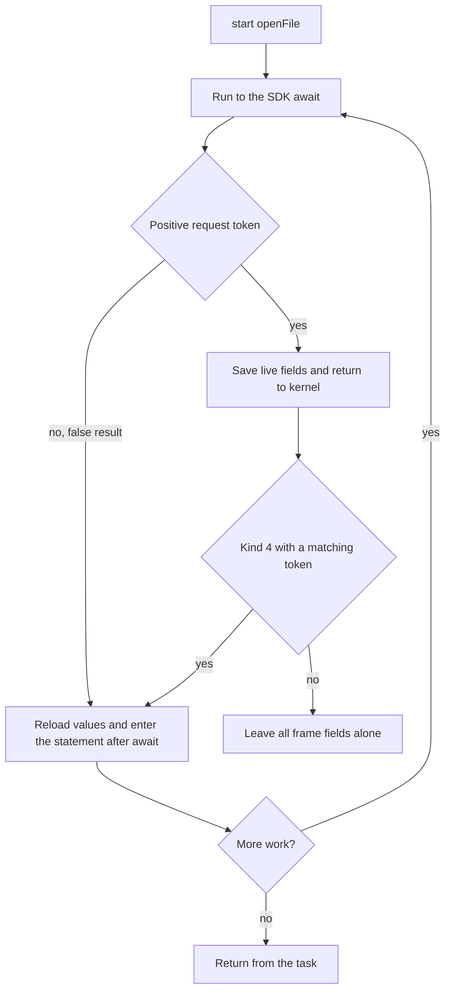

# How PicoCalc compiles await into static continuations

A PicoCalc Editor handler starts a file read and then returns. The reactor, which is the trusted C component that connects typed programs to the system, returns an integer token as soon as it accepts the request. Later the kernel delivers a new event with the same token and an `ok` flag. The original native call has already returned. To resume reading, Editor needs to know where to continue and which values the continuation will read.

Typed `await` lets the compiler represent that information in `WorldState`, the record whose scalar fields the reactor preserves across events. The same compiler handles conditional waits, waits inside loops, and awaits of other typed tasks. Editor uses it for Open and Find. The host compile of the combined Editor at revision `7b321a9` reports 70 declared and generated fields. The earlier single-read pilot used 74 fields and left normalization and Find on their hand-written continuations. [Production Editor revision](https://github.com/wesen/2026-10-20--ds-js-os/tree/7b321a9/picocalc-os/worlds/editor) · [[ARTICLE - PicoCalc Compiler - How Editor Resumes a Compiled File Read]]

> [!summary]
> A wait keeps only scalars whose current value can be read before it is overwritten. Each started task has its own fixed set of frames. The complete event handler matches a pending request and can run several waiting functions before returning.

## A saved value belongs to one point in the program

A *continuation* is what the function still has to do and the values it needs in order to do it. A *frame* is the group of `WorldState` fields that describes a suspended function. Its state number identifies the wait and its token identifies the outstanding reactor request. The other fields hold local or parameter values that were live when the request suspended.

This test task first waits for a file read. It then copies and normalizes up to 4,096 source units per turn, reacquiring the document's buffer on each iteration. The inner loop converts both CRLF and CR to LF.

```typescript
async function openFile(handle: i32, state: WorldState): i32 {
    const ok = await typedSdkFileRead(handle);
    if (!ok) return 0;
    const length = state.docLength;
    let read = 0;
    let written = 0;
    while (read < length) {
        const text = typedSdkBuffer(0);
        const stop = Math.min(length, read + 4096);
        while (read < stop) {
            let unit = text.charCodeAt(read);
            read = read + 1;
            if (unit === 13) {
                if (read < length && text.charCodeAt(read) === 10) { read = read + 1; }
                unit = 10;
            }
            text.setCharCodeAt(written, unit);
            written = written + 1;
        }
        await typedSdkYield();
    }
    state.normalized = written;
    return 1;
}
```

At the file read, `handle` is already used and `ok` comes from the next event. The frame saves no program values. At the timer wait, the next iteration tests `read < length` and writes at `written`, so all three scalars survive. The next iteration computes a new `stop` and reacquires `text` before reading them. The frame has five fields total, made up of the state number, token, and three saved scalars.

| Wait | Used before suspension | Available on continuation entry | Saved scalars |
| --- | --- | --- | --- |
| File read | `handle` | Current `state`, completion result `ok` | None |
| Timer | Current buffer during normalization | Current `state`, new buffer when the loop enters | `length`, `read`, `written` |

The compiler computes this table with a backward dataflow analysis. For each statement it starts with the set of live values after the statement, removes any value the statement overwrites, and adds the values the statement reads. A return has only the uses in its return expression. A branch includes the live values from each possible arm. At a wait, the result target is overwritten by the completion. The call arguments are used on entry to the wait and only survive if the following code also reads them.

A loop adds a cycle to the analysis. Each pass around the loop can make another value live at the start, so the analysis repeats until the set stops growing. A `break` instead uses the set from after the loop. The implementation tracks individual declarations, because two disjoint scopes can use the same name. This identity also controls which generated local receives a reload.

The reactor can lend a string or buffer reference for one handler call. A source command that reads the same local reference after waiting is rejected at that await. To continue with the document, the loop can ask the reactor for its current buffer again. References already supplied by the reactor for each event are *ambient parameters*. The handler's `event`, `state`, `output`, and `hints` formals are available again by name and type on every resume. The test passes a different output-buffer address to the resumed handler and verifies which buffer it writes. [Continuation compiler and test ticket](https://github.com/wesen/2026-10-20--ds-js-os/tree/2e4fee1/ttmp/2026/11/19/PICOCALC-CONTINUATION-G--compile-typed-await-into-static-picocalc-continuations)

## A task owns its frames

A *task* is an async function named in a `start` expression, together with the async functions reachable through its awaits. Each task gets one frame for each reachable function. Two tasks can suspend at the same time, including through the same helper. Their helper frames have separate fields. Within one task, the compiler rejects recursive call cycles, so an active chain can include at most one call to a given helper. A helper reused from multiple await sites in one task gets a caller selector in its frame.

The type checker still checks the original scalar type when a child returns a value. Within the dispatcher, the value moves as an integer word. Bool is encoded as 0 or 1. Enums and distinct integer types use their underlying word and regain their original types at the continuation entry. The appended frame fields use the same i32 and bool storage layouts as the reactor's existing fields.



A generated task step executes some ordinary typed statements and then reaches a transfer. If a reactor request returns a positive token, the step saves the fields for that wait and returns. If the token is zero or negative, the step assigns false to the await result and continues immediately. A generated program counter coordinates branches and loop heads that contain waits. The inner loop of the normalization example contains no await and remains a structured loop in the compiled output.

A handler's `resume()` tests only completion events. For a nested wait, the child owns the reactor token. The parent is waiting for its child with token zero. A matching event resumes the child. If the child returns, the dispatcher delivers its result to the waiting parent. It repeats this until a parent waits again or the root completes. Within the same handler call, the dispatcher places the completed value in the recipient frame’s token field. That field acquires a request token again only when the recipient starts another SDK wait. A busy start returns false and skips compound argument evaluation. `pending()` detects an outstanding task. `cancel task` clears its frame states and tokens so a later event cannot match them. Application code still releases any outstanding capabilities it owns. [Lowering and dispatcher](https://github.com/wesen/2026-10-20--ds-js-os/blob/2e4fee1/picocalc-os/compiler/typed-async.js)

## Follow the tokens and verify both targets

The host fixture instantiates a miniature reactor with deterministic tokens, a document buffer, and the same signatures used by the production linkers. It executes linked Wasm and uses the same event sequence to exercise the RV32 words in an interpreter. It also verifies the RV32 wrapper patches the ELF entry stub and exposes the same layout. The table shows the open task's trace over a 10,000-unit document.

| Point in the test | Request issued | Observable state |
| --- | --- | --- |
| Initial start | File read, token 1 | Handler returns with the request pending |
| Completion 1 | Timer, token 2 | First slice normalized |
| Completion 2 | Timer, token 3 | Second slice normalized |
| Completion 3 | Timer, token 4 | Final slice normalized |
| Completion 4 | None | Final character count and normalized document present |

The suite drives 29 events on Wasm, streamed RV32, and buffered RV32. It tests opposite completion order for two tasks sharing a helper, cancellation followed by a late completion, a repeated start with an argument that would otherwise change state, helper results that arrive immediately or through nested waits, a fresh ambient buffer after resumption, and both zero and negative request tokens. The test compares the whole `WorldState` after unknown and cancelled tokens. It also checks diagnostics for borrow lifetime, recursion, type mismatches and the 80-field limit. A separate byte comparison recompiles the original Files, Agenda and Editor sources from `289281c` and compares their complete linked images with both original compilers. All six linked files match. [Reproduction fixture](https://github.com/wesen/2026-10-20--ds-js-os/blob/2e4fee1/ttmp/2026/11/19/PICOCALC-CONTINUATION-G--compile-typed-await-into-static-picocalc-continuations/scripts/14-check-async-layout.mjs)

## Account for the memory used by the compiler

The compiler runs in QuickJS on the device and must fit an explicit heap budget. The first production pass retained a JavaScript object for every token in Editor. Both rewrite-only and raw RV32 runs exhausted a simulated 4 MiB allocator cap. This happened after the target layout was already small enough to use, so reducing the number of saved locals would have left the compiler problem in place.

The span pass first reads function signatures and uses the common lexer's brace-aware scan to find body boundaries. It records which calls link ordinary functions without holding their tokens. It retains typed source tokens only in async bodies and ordinary functions with possible task operations. Later, the checker consumes the retained ranges directly. The common frontend still emits the machine code and Wasm.

Seven alternating fresh QuickJS trials used the same staged Editor input. The first compiler needed an 8 MiB cap to finish. The span compiler ran at 4 MiB. The table measures the compiler and the raw RV32 program, before linking the target image.

| Measurement | Full token array | Function spans |
| --- | ---: | ---: |
| Median rewrite phase | 93.141 ms | 34.739 ms |
| Median raw RV32 phase | 205.218 ms | 139.184 ms |
| Peak raw RV32 allocator use | 5,720,480 bytes | 2,653,592 bytes |

A later paired run used the final 70-field Editor input. Reusing typed tokens reduced median rewrite time from 28.915 ms to 23.597 ms and median raw RV32 time from 103.558 ms to 97.939 ms. Both produced an 89,168-byte RV32 image. The synchronous E6 comparison was 80.877 ms on that host. Host measurements identify the compile phases and allocations that changed. The physical deadline and generated application's CPU time belong to the paired firmware trial. [First paired allocation observations](https://github.com/wesen/2026-10-20--ds-js-os/blob/2e4fee1/ttmp/2026/11/19/PICOCALC-CONTINUATION-G--compile-typed-await-into-static-picocalc-continuations/various/01-span-allocation-quickjs.jsonl) · [Final source timing observations](https://github.com/wesen/2026-10-20--ds-js-os/blob/2e4fee1/ttmp/2026/11/19/PICOCALC-CONTINUATION-G--compile-typed-await-into-static-picocalc-continuations/various/02-typed-token-reuse-quickjs.jsonl)

## Read a generated program

Run the continuation fixture from the project root. The layout it prints lists the task, each reachable function and its frame fields, and the source line and ordered save set for each wait.

```sh
node ttmp/2026/11/19/PICOCALC-CONTINUATION-G--*/scripts/14-check-async-layout.mjs
```

The production functions `compileTypedWorld` and `compileTypedWorldRv32` return the typed byte array expected by the loader. For an async program, the array also carries `asyncLayout`. Passing `{asyncSource: true}` includes the typed text used for generation. Its generated local declarations and integer-word conversions rely on compiler-owned names. Saving one more live scalar adds one word to the task frame and makes the new field visible in that layout. A useful first experiment is to move the declaration of `text` before the outer loop in the fixture and compare the diagnostic to the original five-field layout. [Compiler integration and investigation diary](https://github.com/wesen/2026-10-20--ds-js-os/tree/2e4fee1/ttmp/2026/11/19/PICOCALC-CONTINUATION-G--compile-typed-await-into-static-picocalc-continuations)
