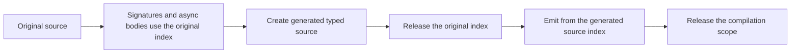

# How a lexical index serves the PicoCalc compiler

PicoCalc Editor compiles its typed program in a fresh QuickJS context before it can run. The compiler first reads function signatures, then returns to each function body to check types and emit code. An async program adds a pass over the original source and creates a second source string containing continuation steps. The same source position can therefore be visited several times during a cold compile.

A lexical index records where each token occurs and which other occurrences share its spelling. The compiler can read identifiers, literals, punctuation and matched braces from the index during later visits. The staged index reduced median host CPU time for the complete G4 RV32 compile from 91.186 to 74.002 ms. The two lanes emitted byte-identical Editor, Files and Agenda artifacts across Wasm and both RV32 modes. [Staged cursor and host evidence](https://github.com/wesen/2026-10-20--ds-js-os/tree/de07831/ttmp/2026/11/20/PICOCALC-LEXICAL-INDEX--index-typed-source-once-for-the-cold-picocalc-compiler)

## One spelling can have several positions

A *token* is an occurrence in the source paired with a classification. For example, the three occurrences of `x` in this fragment are all identifiers. Each has its own start and end offset in the immutable source string.

```typescript
if (x < 1) { x = x + 1; }
```

An occurrence row has four unsigned 32-bit words. It records the start offset, exclusive end offset, a symbol ordinal, and the closing brace row plus one when the occurrence is an opening brace. A symbol row has three words. It records the first spelling's range and its kind. The first `x` in the fragment supplies the spelling in the half-open range [4, 5). The following table uses the actual zero-based row numbers and UTF-16 offsets.

| Occurrence row | Source range | Spelling | Closing row plus one |
| ---: | --- | --- | ---: |
| 2 | 4–5 | `x` | 0 |
| 6 | 11–12 | `{` | 14 |
| 7 | 13–14 | `x` | 0 |
| 9 | 17–18 | `x` | 0 |
| 13 | 24–25 | `}` | 0 |

All three `x` rows refer to the same symbol. Each read still passes its current position to the compiler. The function emitter resolves its type and binding using the lexical scope at that occurrence. The brace link lets the signature scan jump from row 6 to the position after row 13. The later body emitter still checks the contents of the block. [Index design](https://github.com/wesen/2026-10-20--ds-js-os/blob/de07831/ttmp/2026/11/20/PICOCALC-LEXICAL-INDEX--index-typed-source-once-for-the-cold-picocalc-compiler/design-doc/01-a-scoped-lexical-index-for-the-typed-handheld-compiler.md)

The native scanner installed in the compiler context returns two ArrayBuffers. QuickJS exposes strings to C in CESU-8 for this scan, which lets the scanner count individual UTF-16 code units. A supplementary character in a literal therefore advances the JavaScript offset by two. The scanner compares complete spellings when a hash collides. JavaScript resolves a symbol's string and kind the first time it sees that symbol and shares those immutable values across reads.

## A cursor needs exact restart behavior

During a normal token read, the lexer advances its row pointer and updates the typed parser's current token. The parser also seeks directly to a function's body offset. The indexed cursor uses binary search after such a seek. A token start, a previous token end, and the start of the full source give it positions where the whole-source row sequence applies.

An arbitrary bounded read may start inside an identifier, an escaped string, or a comment. It may end where only part of a token fits. At those boundaries the lexer calls the reference scanner and preserves its exact offsets and diagnostics. The fallback also matters at the end of a valid line comment. The original sticky regular expression can backtrack when trivia consumes the entire tail and expose the comment's slashes as operators. A cursor that constructs EOF whenever it runs out of rows would change that behavior.

The native producer returns null if it cannot construct a compatible index. Consider this source.

```typescript
function a(): i32 { @ return 0; }
function a(): i32 { return 0; }
```

The signature pass skips bodies while collecting function names. It reports the duplicate function before the emitter examines the invalid token in the first body. Returning null preserves this order. An eager lexical exception in the native producer would report the invalid token first.

## Index lifetime follows source lifetime

The async pass starts with the original input. It finds await statements, works out which values must survive a wait, and produces a new typed program containing the generated steps. Offsets in that second string have their own meaning. The compiler scopes its source-index map to one compilation and drops the original index when it moves to the generated source. It retains the original source for mapped errors. The generated source receives a fresh index.



The fixture wraps the native provider and records every source it receives. A compile of an async function indexes the authored and generated strings once each. Repeating the compile in the same runtime creates a new pair. Editing an integer literal changes native output on the next compile. A rejected compile restores the previous scope so the next valid source can be compiled. The two index buffers and temporary native tables use the QuickJS allocator.

## Which token objects have to survive the next read

One symbol spelling can be shared because it is immutable. A token object also holds the current offset, which changes at every read. In the default indexed cursor, each read creates a fresh token object. The async parser keeps some of these objects and adds an end offset before it analyzes a retained subsection. Reusing one object for that parser would make different entries in its token array all describe the latest position.

The optional experiment reuses one current token only for the compiler's ordinary body emitter and the async declaration scan. Both inspect the current object before advancing. The async parser's retained range and the public lexer still receive distinct objects. This changes allocation behavior in the parser and leaves the lexical index's native representation unchanged. [Optional token-reuse overlay](https://github.com/wesen/2026-10-20--ds-js-os/tree/3a78414/ttmp/2026/11/20/PICOCALC-LEXICAL-INDEX--index-typed-source-once-for-the-cold-picocalc-compiler)

## What the host experiments establish

The direct native oracle passed 9,470 bounded and seek comparisons, 3,072 randomized comparisons and 73 compiler-input comparisons. It checked the exact diagnostic strings, including the duplicate declaration and an error mapped through generated async source. Real SDK reactors produced identical linked files in nine app and engine combinations. The historical E fixtures also passed 46 outcomes, three intentional traps and 30 rejected inputs. The G fixture drove 29 events on each target and checked 10,000 normalized units. Five historical Editor interleavings passed on Wasm and RV32. Those functional checks passed for both staged index variants. [Oracle and artifact receipts](https://github.com/wesen/2026-10-20--ds-js-os/tree/de07831/ttmp/2026/11/20/PICOCALC-LEXICAL-INDEX--index-typed-source-once-for-the-cold-picocalc-compiler/various)

The source, runtime and CPU affinity were fixed within each batch. Every sample used a fresh vendored QuickJS process at a 4 MiB heap cap. The measured interval starts after reading source and decoding the reactor input. It includes index creation, compiler execution and linking into the reactor. Each row below compares variants within one batch.

| Paired host experiment | Trials per lane | Earlier variant | Later variant | Median reduction |
| --- | ---: | ---: | ---: | ---: |
| Reference lexer and default index | 7 | 91.186 ms | 74.002 ms | 18.8% |
| Default index and borrowed current token | 11 | 51.962 ms | 49.264 ms | 5.2% |

The second experiment improved 10 of its 11 paired trials. Its paired median saving was 2.777 ms. Its absolute timings came from a separate batch, so the two reductions describe separate comparisons. Both indexed arms produced the same 240,452-byte Editor ELF with 70 state fields. Physical boot timing, including firmware setup and module copying, is measured by the paired board qualification. [Borrowed-token timing receipt](https://github.com/wesen/2026-10-20--ds-js-os/tree/3a78414/ttmp/2026/11/20/PICOCALC-LEXICAL-INDEX--index-typed-source-once-for-the-cold-picocalc-compiler/various)

To inspect the implementation, start with `nextIndexed` and `skipBody` in the staged overlay. Then follow `compileFunctions` from the original source to the generated source. The test driver can run that same compiler in vendored QuickJS with or without the native producer, and the artifact runner compares every emitted byte. [Reproduction scripts and investigation diary](https://github.com/wesen/2026-10-20--ds-js-os/tree/3a78414/ttmp/2026/11/20/PICOCALC-LEXICAL-INDEX--index-typed-source-once-for-the-cold-picocalc-compiler)
