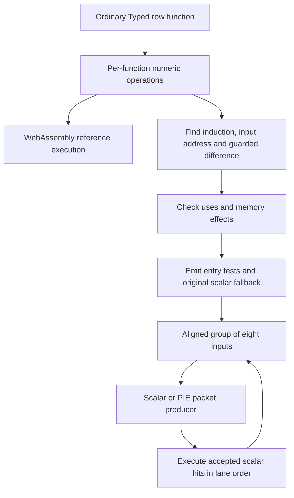
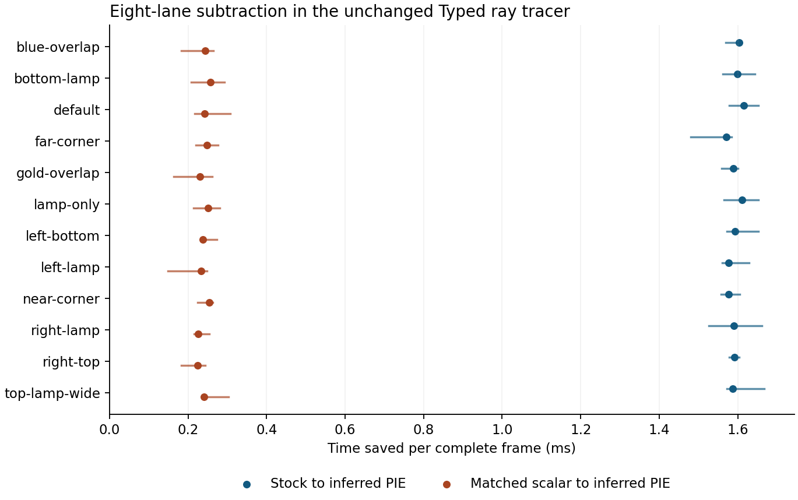

# Inferring eight-lane subtraction in a scalar ray tracer

At a fixed pixel, the PicoCalc ray tracer must decide whether a ray hits a sphere. At a fixed row, eight adjacent pixels ask the same arithmetic question about eight different input values. The ESP32-P4 has an instruction that can subtract eight pairs of 16-bit numbers at once. The application, however, asks for checked buffer reads and 32-bit integer subtraction, then uses the result to decide what happens next. Under what conditions may a compiler substitute the hardware instruction?

This chapter follows that question from one expression in an ordinary Typed JS program to instructions executed by the P4. In the opening scene, an inferred eight-lane implementation reduced the complete frame from 57.692 to 56.069 milliseconds. A scalar implementation with the same loop structure already reached 56.340 milliseconds. That third measurement changes the interpretation of the first two.

## The calculation at one pixel

The scene has a 160 × 160 pixel image. For each sphere the renderer precomputes squared horizontal distances, and for each row it subtracts the squared vertical distance from the squared radius. Call this last number `row`. For a pixel with squared horizontal distance `sample`, the difference `d = row - sample` is the discriminant. A negative result misses the sphere. A nonnegative result indexes a square-root table. The resulting depth competes with the closest hit already recorded for this pixel.

```text
for x from 0 through 159:
    d = row - read_u16(work, horizontal + x)
    if d >= 0:
        candidate = center_depth - read_u16(work, sqrt_table + d)
        previous = read_u16(work, depth_table + x)
        if previous == 0 or candidate < previous:
            write_u16(work, depth_table + x, candidate)
            write_u16(work, object_table + x, sphere_id)
```

With `row = 25`, samples of 9, 25 and 36 produce 16, 0 and −11. The first two lanes must execute the scalar hit code, including the tangent at zero. The third must skip the table lookup and writes. The compiler can calculate several discriminants together while preserving the order in which surviving hits visit the tables. No change to the ray-tracing source is required.

## Where the compiler can see the loop

Typed JS is the project's statically typed JavaScript-like language. Its frontend emits a numeric sequence of operations for each function. The Wasm target encodes a WebAssembly function body. The RV32 backend reads the operations and emits machine code for the P4's 32-bit RISC-V core. The processor's PIE extension adds wide registers and packed arithmetic to that scalar instruction set.

The row's native input contains a counted loop at tape cell 172. Tape cells are locations in the compiler's input array. At cells 182–205 the row value is loaded, the pixel index is added to a base, the buffer address is checked, an unsigned halfword is loaded, and the difference is tested. The same compiler can translate the rest of the hit code from the original operations at cells 207 through 291. Keeping these locations separate from machine-code byte addresses allows the inspector to show which source expression contributed to multiple output regions.



The analyzer recognizes relationships between operations. It finds a unit-increment induction variable, a loop-invariant upper bound, a contiguous checked input and a branch that consumes the nonnegative difference. It follows definitions and uses of the two temporaries the transformation would change. If a program later returns the last negative difference, for example, discarding the exact negative value would change its return value. Such a program retains ordinary code. An unrecognized call in the hit body also prevents the transformation, because the compiler cannot establish which memory that call may modify.

## A proof about the bits in one lane

The scalar load treats all sixteen input bits as unsigned. In contrast, the available packed instruction interprets each lane as a signed number and saturates a result outside its signed range. Saturation clamps a large positive result to 32,767 and a large negative result to −32,768. A direct replacement of the source subtraction would therefore calculate different numbers for legal inputs.

The compiled path requires `0 ≤ row ≤ 32766`. After the packed subtraction the consumer reads each result as an **unsigned** halfword and accepts it exactly when it is at most `row`. There are three cases.

| Input sample | Mathematical behavior | Result of the compiled test |
|---|---|---|
| From 0 through row | The signed subtraction computes an exact nonnegative difference. | The unsigned lane is in range and gives the correct table index. |
| Greater than row, through 32,767 | The subtraction is negative. | Its unsigned representation is at least 32,768 and the hit is skipped. |
| From 32,768 through 65,535 | Hardware reads the sample as a negative number. Subtracting it yields a value above row or saturates to 32,767. | Both possible results exceed row and the hit is skipped. |

The upper bound is strict for a reason. With `row = 32767` and `sample = 65535`, the mathematical result is negative. Hardware interprets the sample as −1 and saturates 32,768 to 32,767. The unsigned test would accept that lane. The entry test sends this input to the ordinary scalar loop. The narrow proof is sufficient because the scalar program observes a miss through its branch and only uses the arithmetic value on a hit.

## What eight early reads can change

Suppose a loop writes element 1 while processing element 0. Iteration 1 then reads that updated element. A vector load that fetched elements 0 through 7 before the first write would have captured the old value. The addresses in a real ray row usually occupy distinct ranges of one work buffer. General Typed programs can pass overlapping views, and static names alone do not establish disjointness.

The analyzer therefore represents each recognized output address as an invariant base plus the induction index. The emitted entry checks compare the actual intervals for this invocation, including the input's length header. They also restrict index arithmetic so that a wrapped address cannot make overlapping intervals appear disjoint. The fast path requires a valid input interval. Short or overlapping inputs use original scalar checks, preserving both the point of a trap and the writes preceding it. Inside an admitted interval the emitter processes individual inputs until the address is aligned to 16 bytes, processes complete groups, then returns the short tail to the ordinary loop.

Once admitted, one group has the following vendor-decoded instructions. The common scalar continuation reads the eight temporary halfwords from aligned private stack storage.

```asm
esp.vld.128.ip q1, a5, 16    # read eight input lanes, advance pointer
esp.vsub.s16   q2, q0, q1    # q0 holds eight copies of row
esp.vst.128.ip q2, t5, 16    # write eight candidate results to scratch
```

This boundary limits the possible speedup. Square-root lookups have data-dependent addresses. The nearest-depth comparison and conditional stores also remain scalar. The packet alone adds a scratch write followed by scalar reads. A compiler that could profitably consume several results directly would have a different cost structure and would require a further proof about those consumers.

## Checking generated work before timing it

The host harness assembled and disassembled the actual vendor instruction words, executed the emitted images on a separate RV32 interpreter, and compared their behavior with Wasm and with a compiled C reference. For twelve poses it checked every pixel, depth, object ID and padding cell. It also compared mutable guest memory and exercised overlapping input and output, mid-loop traps and saturation boundaries. For the widest test strides the standalone Wasm fixture needed a larger memory limit. Its function bytes were preserved.

In the opening clean frame the interpreter counted 15,532,634 fetched instructions for stock, 15,110,647 for matched scalar and 15,038,542 for PIE. The PIE path executed 3,300 complete packets. The untouched stock guest occupied 9,564 machine-code bytes. The packetized scalar image occupied 10,384 and PIE occupied 10,308. A packed producer saves 76 bytes relative to its matched implementation, while the full transformed guest costs 744 more bytes than stock. Maintaining a fallback has a measurable space cost.

A separate post-freeze loop summed sample headroom against a ceiling and processed a variable length. On an aligned long input, the interpreter retired 3,027 stock instructions and 1,231 PIE instructions. On a short misaligned input, the vector path never completed a group. It took 308 instructions against 282 for stock. This is evidence of transfer to a second consumer, with an explicit example in which selecting the pass loses. The fixture was authored by the implementer after the code freeze. Independent blind replication remains open.

## Measuring the part attributable to the vector unit

Three generated programs answer two experimental questions. Compare stock and inferred PIE to find what a user gains by enabling the pass. Compare matched scalar and inferred PIE to find what the vector producer contributes given the same loop organization. The matched scalar compiler emits the same admission tests, alignment handling, packet storage, scalar continuation and fallback. It fills scratch with eight scalar loads, subtractions and stores. This arrangement isolates the incremental contribution of the packed producer, including its load and store instructions.

Each of six blocks ran the three guest configurations in a different order. Each loaded guest rendered twelve scenes. The board recorded four entry points and ran scalar C and C+PIE controls alongside the Typed guest. Each load reported the expected checksum for the linked guest image. Time for a clean frame ends when the RGB565 image is ready in memory. It excludes transfer to the display.

| Opening scene | Stock Typed | Matched Typed | PIE Typed | Paired reduction from stock | Paired reduction from matched |
|---|---:|---:|---:|---:|---:|
| Primary intersections | 17.791 ms | 16.429 ms | 16.185 ms | 9.05% | 1.53% |
| Shading entry | 48.575 ms | 48.562 ms | 48.564 ms | 0.025% | 0.001% |
| Complete RGB565 frame | 57.692 ms | 56.340 ms | 56.069 ms | 2.80% | 0.43% |

The times are medians of six measurements. For a paired reduction, take the time difference between two guests in the same block, divide by that block's control time, then take the median across blocks. The phase entry points initialize their own inputs, so summing the first two rows gives a different calculation from timing the complete frame.



*Each point is the median of six paired differences. The line through it spans the smallest and largest observed differences. The blue series includes all compiler changes. The orange series holds the loop organization fixed. The intervals describe these six observations.*

The opening complete frame saved 1.616 ms against stock. Switching the matched packet producer to PIE saved 0.242 ms. On this workload scalar scheduling and range admission account for most of the change. Shading times crossed in both directions. There was no measurable systematic improvement in that control. The scalar C opening frame took 9.535 ms and hand-vectorized C took 8.363 ms. The inferred Typed guest still took 5.88 times as long as scalar C. Neither the isolated primary result nor its instruction reduction supports a claim of parity with C.

## The compiler runs on the handheld too

The first device experiment exposed a second performance problem. The stock compiler took about 454 ms to compile the unchanged scene. The compiler with the packed pass took about 658 ms. Decoding a function's compact numeric tape into a JavaScript object for each operation costs time and live heap in the handheld's JavaScript runtime. The pass paid that cost on functions that could never match its producer.

There is a cheap necessary condition. Every accepted producer contains an unsigned halfword load, subtraction, assignment of the difference, read of the same local, signed comparison with zero and entry to a conditional. A search directly on the raw tape rejects a function missing this sequence before allocating operation records. An operand can coincide numerically with an opcode, so the search may return false positives. Those functions proceed to the complete structural and dependence checks. The diagnostic inspector still decodes an explicitly requested function to explain its rejections.

I loaded the first PIE compiler and its filtered revision alongside stock in one firmware. The two PIE compilers emitted identical machine-code bytes and identical linked ELF images. The board reported the expected ELF checksum on all twelve PIE loads. All three compilers ran in each of the six possible load orders. This second trial isolates the cost of discovering a transformation while the transformed program stays fixed.

| Compiler | Median cold compile on P4 | Median peak JavaScript heap |
|---|---:|---:|
| Stock | 454.095 ms | 679,988 bytes |
| PIE, full decoding | 657.835 ms | 773,806 bytes |
| PIE, filtered decoding | 523.692 ms | 746,388 bytes |

The prefilter saved a paired median of 134.625 ms. Filtered PIE still cost an extra 70.324 ms over stock, and needed 66,400 additional bytes at peak. The saved runtime recovers the incremental cold cost after about **44 opening-scene frames**: round up 70.324 divided by 1.616. This is a break-even calculation for one compile followed by repeated rendering of a comparable scene. A compiler used for a single preview frame faces a different decision from one used for a sustained animation. The measurements support keeping the pass selectable.

## What to optimize next

The P4 benefits from vectorizing this expression. Its small contribution to the complete frame also identifies which proposal merits the next engineering effort. I would first measure ordinary generated shading and shadow code with the same source-to-PC inspector. For each hot loop, count executed frame-relative loads and stores, checked accesses and conditional branches. Choose a treatment that removes one class of repeated work across both primary and shadow code. Compile the same source, compare output against the same oracles and measure both entries on the board. If an optimization improves shade as well as primary, it can address a much larger fraction of the total frame time.

For a future packed producer, look for an adjacent consumer with unit-stride outputs and an arithmetic predicate that can stay in a wide register. Predict how many scratch round trips and scalar instructions would disappear on a real frame before writing a second matcher. The current pass is an opt-in research backend. Its evidence supports automatic discovery of this particular guarded expression and identifies its costs. The wider scalar and fused-consumer opportunities remain hypotheses.

## Reading the implementation

The project checkout is `/home/manuel/code/wesen/2026-10-20--ds-js-os`. Under it, the following artifacts form a short route from source to a physical result.

| Read | What to inspect |
|---|---|
| `picocalc-os/worlds/raytrace/raytrace.typed` | Find `typedRayComputeRow` and identify which expressions depend on the pixel index. |
| `picocalc-os/compiler/typed-pie-loops.js` | Follow `analyzeLoop`, `memoryEffects` and `grouped` from admission to machine-code generation. |
| `picocalc-os/compiler/typed-rv32.js` | Follow optional scheduling and inspection through the ordinary compiler entry point. |
| Ticket `various/host/comparison.md` | Compare the exact source, numeric tape, selected facts and final assembler listing. |
| Ticket `various/device/summary.json` | Inspect one scene's six paired differences and medians. |
| Ticket `scripts/03-qualify.mjs`, `06-board.py` and `10-compare-cold.py` | Reproduce semantic checks, hardware timing and cold-cost attribution. |

The ticket directory is `ttmp/2026/11/21/PICOCALC-PIE-LOOPS--infer-and-lower-packed-loop-regions-in-unchanged-typed-programs`. To see the machine instructions from this chapter, run the following from the checkout.

```sh
node picocalc-os/tools/typed-inspect.mjs \
  picocalc-os/worlds/raytrace/raytrace.typed \
  --function typedRayComputeRow --target rv32 --pie-loops pie
```

For the prior experiments on the same board, read [[ARTICLE - PicoCalc Scalar Breakdown - Separating the costs of a scalar ray on the ESP32-P4]] and [[ARTICLE - PicoCalc Typed Ray Tracer Lab - What eight lanes save in a complete Typed ray tracer]]. The inspector itself is described in [[ARTICLE - PicoCalc Compiler Inspection - Reading what the Typed compiler emits]].
