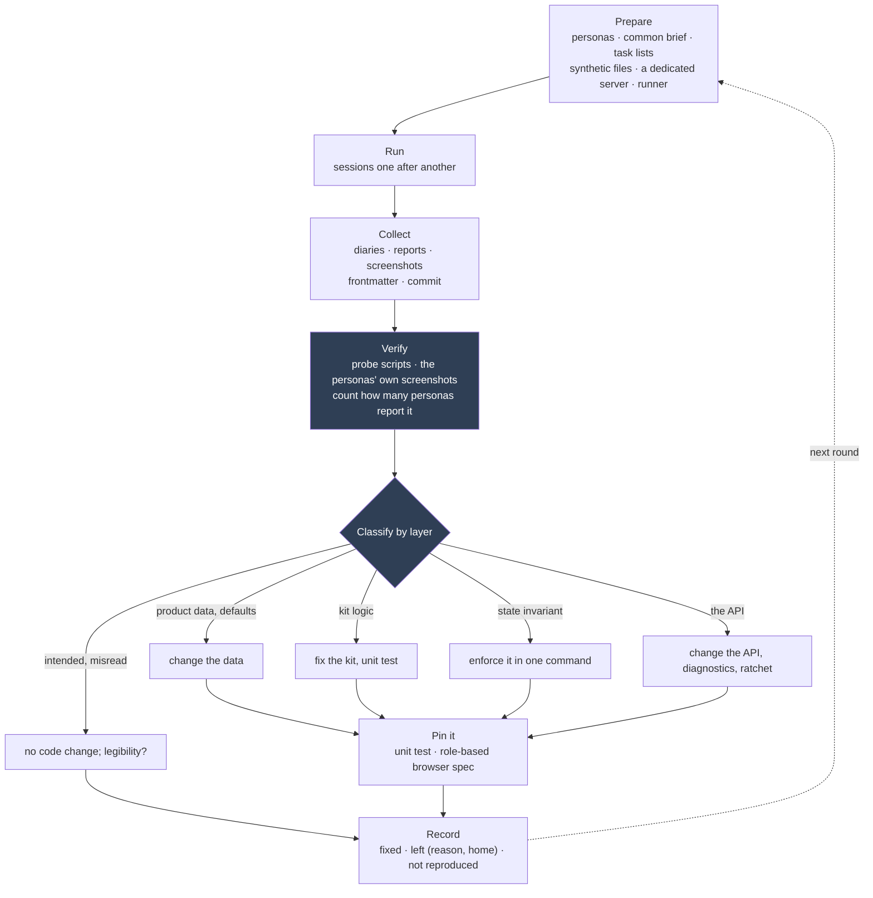
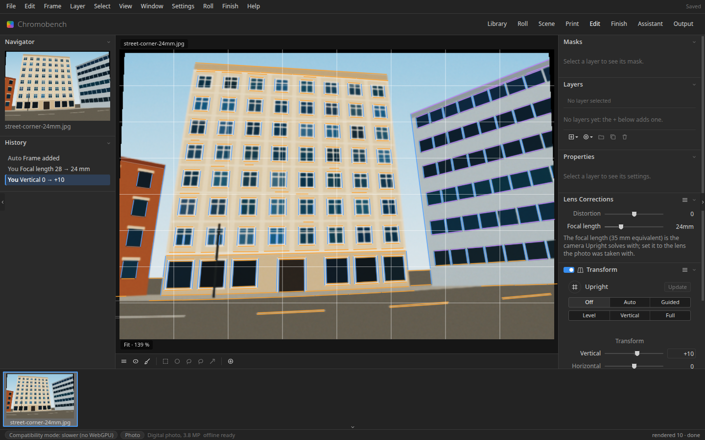
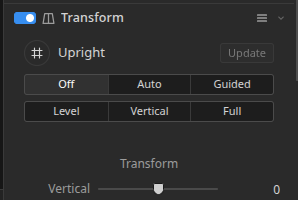
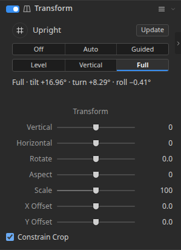

# Playbook: Persona Sessions with Agents — Improving Software and APIs from Usability Reports

A persona session is a usability test in which a coding agent plays a defined user, drives the real application in a browser, carries out a list of tasks, and reports what happened in that user's voice. Chromobench has run them since CHB-026 (rounds in CHB-026, CHB-031, CHB-050 twice and CHB-051), with fifteen sessions in the last three rounds. This note explains the method well enough to run it on other software. It concentrates on the step that decides whether a round is worth its cost: turning a finding into a change at the right layer, and in particular into a change to the API the interface is built with. Every example comes from those tickets, with the report text that triggered it, the cause found in the code, and what changed.

> [!summary]
> - **A finding is a symptom, not a diagnosis.** Agents misread, remember the reference product wrongly and describe intended behaviour as a bug. Every finding is reproduced with a probe script or checked against the persona's own screenshots before anything changes. In CHB-051 two of the most severe reports were disproved this way, one by the History panel in the persona's own screenshot.
> - **Classify each confirmed finding by the layer that caused it**: product data or defaults, a kit's logic, a state invariant across components, or the API itself. Fix it at the lowest layer that caused it, so that every other user of that layer benefits and a test can pin it.
> - **When the interface is a program written in an API, usability findings are API findings.** In chromobench, persona reports led to value adapters, a widget anatomy form, panel accessible names derived from titles, a lint ratchet on native controls, and the discovery that a declared `keys` field was never bound.
> - **Write down what is left and where it belongs.** A round ends with three lists: fixed (with commit and test), left (with the reason and the ticket it belongs to), and not reproduced (with the probe that tried).

## Why this note exists

The method was assembled over a week of tickets and re-derived from the previous ticket each time. The session protocol from the first round (CHB-026) describes one persona and the measurements of that round; the later rounds added a common brief, task lists, a runner script and verification probes, but none of it is written as a method. A colleague who wants to use persona sessions on their own software needs three things the ticket files do not give in one place: what the parts of a round are and why each exists, how to read the output without being misled by it, and how to decide which layer of the software a finding should change.

## What a persona session is

The terms below are used throughout. Each names an artefact a round produces or consumes.

| Term | Definition |
|---|---|
| Persona | A user with a background, a goal and habits, for example "an architecture photographer with fifteen years of Lightroom who uses Guided Upright on every facade". The background determines what the persona expects to find. |
| Common brief | The document every session of a round reads: what the software is, what is being tested, the setup, the rules, the required outputs. |
| Persona brief | The persona's background, the file to use and a numbered task list. |
| Task | One goal the persona must reach, stated as a user would state it ("level the crooked photo with one click"), not as a feature to visit. |
| Session | One agent run: it reads both briefs, drives the application with browser tools, saves screenshots and writes the two output documents. |
| Diary | A chronological record, one step per task, in a fixed format that ends each step with a result line (`done`, `partly` or `failed`, and the number of actions). |
| Experience report | A first-person account followed by fixed sections: a findings table, a task results table, a top-ten list of changes, an aesthetics section and a screenshot index. |
| Finding | One row of the findings table: where, what the persona expected, what the software did, a severity, a screenshot. |
| Probe | A script written after the round that reproduces a finding with exact inputs and prints a measurable result. |

Agents are not users. They have no muscle memory, they read the accessibility tree rather than the screen, and they sometimes state with confidence how the reference product behaves when it does not. What they provide is many independent readings of the same interface, each from a different set of expectations, written down in detail and at low cost. A round of seven sessions in CHB-051 took 2 hours 17 minutes of unattended time and produced seven diaries, seven reports of 355 to 575 lines and 244 screenshots.

## The parts of a round



The two highlighted steps are where a round succeeds or fails. Running sessions is mechanical once the runner exists. Verification and classification require reading code, and they determine whether the changes that follow address causes or symptoms.

## Preparing a round

### Choosing personas

A persona is worth including when it would use the feature for a different reason or with different habits from the others, because different habits exercise different paths. The seven personas of CHB-051, who tested a perspective-correction panel, show the principle:

| Persona | What the persona's habits exercise |
|---|---|
| Architecture photographer, Lightroom Upright expert | every mode, Guided Upright with several guides, exact comparison with the reference product |
| Real-estate photographer, 300 photos a week | the number of clicks, shortcuts, applying one correction to many photos |
| Photoshop retoucher | the manual sliders, typed values, reset gestures, the crop tool's interaction with the transform |
| Travel hobbyist, never used Lightroom | discoverability, vocabulary, recovering from mistakes |
| Keyboard and screen-reader user | focus order, accessible names, whether every action has a keyboard path |
| Visual designer | alignment, spacing, contrast, measured in pixels and contrast ratios |
| Forensic-imaging analyst who distrusts automatic results | whether the numbers are visible, reproducible and recorded |

The last three are not users of the photography in the usual sense, and they are the ones that find API-level defects most often. The keyboard user reads the accessibility tree, which is generated from the names the API gives controls. The designer measures values that come from shared tokens and shared primitives. The analyst asks what the data model records and whether the interface shows it.

### Writing the briefs

The common brief states the software and its purpose, what is new in this round, the setup (the URL, the test files with absolute paths, the browser tools, the window size), the rules and the outputs. Three rules have proved necessary:

1. Act in character through the visible interface; do not use developer hooks or code to perform tasks. Reading the DOM or the accessibility tree to find a control is allowed.
2. When stuck for more than about four attempts, write down what was tried and move on. Being stuck is a finding.
3. Save every screenshot taken into the session folder, with numbered descriptive names, and embed them in the report with a caption.

Task lists replaced open exploration in CHB-050's second round. The first round's personas toured the interface and reported what they noticed, which produced many findings but no measure of whether a user can get a job done. Tasks produce a result per task, so a round can be compared with the next one. A good task names the goal and leaves the path open:

```markdown
## Tasks
1. Open both files. Go to the place where you can correct perspective. Count the clicks it takes to get there.
2. On the first picture: make the verticals vertical with the fewest clicks you can, and crop away the empty corners.
3. On the second (crooked) picture: level it with one click.
4. Find out whether there are keyboard shortcuts or menu items for Upright modes.
5. Try to apply the same correction to the other picture (copy/paste or sync settings).
```

The required report sections exist because each one feeds a later step. The findings table becomes the triage list. The task results table is the round's measurement. The top ten gives the persona's own ranking, which matters when several personas agree. The aesthetics section forces concrete measurements instead of impressions ("row height 58.75 px; the blend dropdown computes to 18 × 22 px and shows only a chevron").

### Setup that avoids false findings

- **Synthetic files only.** The sessions write screenshots to disk and reports that may be shared. CHB-051 used a street scene rendered from a known camera (tilted 15.13°, turned 8.78°, 24 mm), which also gave the analyst persona a ground truth to compare with.
- **A dedicated server for the sessions.** A development server reloads when code changes, so fixes are made in a separate worktree while the sessions run. A long-running server may also miss new package exports; CHB-051's browser spec failed on the existing server and passed on a fresh one, so the personas used the fresh one.
- **Sessions in sequence.** The browser tools share one browser profile.
- **A runner that retries.** Model providers fail; in CHB-050 three of six sessions ended at once with "backend unavailable" and were run again. The CHB-051 runner retries a session up to twice when it ends without a report.

```bash
for s in "${sessions[@]}"; do
  d="$T/sessions/$s"; mkdir -p "$d/shots"
  for attempt in 1 2 3; do
    pi -p --no-session --model lunaroute/deepseek-4.1-flash \
      "You are a usability tester. Read $T/sessions/common-brief.md and $d/brief.md, then carry out every task …
       saving every screenshot into $d/shots/ … write $d/diary.md and $d/experience-report.md …" > "$d/pi-output.txt" 2>&1
    [ -s "$d/experience-report.md" ] && break
    sleep 20
  done
done
```

## Verifying findings

A confirmed finding has a reproduction. Three techniques produce one.

**A probe script** drives the application with exact inputs and prints values. The CHB-051 probe opened the test photo, drew one guide and moved its end, applied a mode and then typed a slider value, and travelled between two modules while hashing the viewer's pixels:

```text
1 guide: [{"type":"v","from":[124.54,377.72],"to":[150.6,35.21]}] solved {"pitch":1.41,"yaw":0.05,"roll":-3.83}
after end move: 1 guides [{"type":"v","from":[124.54,377.72],"to":[171.98,36.64]}]
Full: full {"pitch":16.96,"yaw":8.29,"roll":-0.41} tool upright-guide
after Vertical 5: full {"pitch":16.96,"yaw":8.29,"roll":-0.41} 5
Edit picture before/after the trip to Finish 904x651:692272211 904x651:692272211 SAME
```

Five lines settled five questions. A single guide already solved the picture (a real defect). Moving an end worked when the knob was hit exactly, so the report "endpoints are not draggable" was about the knob's size. The Guided tool stayed armed after choosing Full, which explained the reports of a grid that would not go away. A typed slider value kept the mode, contradicting a report. The trip between modules did not change the picture, contradicting another.

**The persona's own screenshots.** The analyst persona reported that typing a value into Vertical "silently flipped Upright to Off". The screenshot saved for that step shows the History panel with three rows: the frame added, the focal length changed, Vertical set to +10. Upright Full had never been applied in that session. The model never changes the mode on a slider edit.



**Checking the reference product.** All seven CHB-051 personas expected the sliders to show the solved correction, and five of them wrote it in the column for what they expected from Lightroom or Photoshop. In Lightroom Classic the Transform sliders stay at zero after an Upright mode; they are manual adjustments on top of it. The personas' expectation was wrong about the reference, and still pointed at a real problem: nothing on the panel showed what Upright had done.

A non-reproduced finding is not discarded. It goes to the "not reproduced" list with the probe that tried, and it is examined for what made the persona believe it. Both misreadings in CHB-051 came from the same cause: the selected mode was not legible. The selected segment differed from the others only by a slightly lighter fill.



Counting agreement helps rank findings. A finding reported independently by several personas with different habits is rarely a misreading of one session. "The sliders read zero after Upright" appeared in all seven CHB-051 reports; "Delete does not remove a guide" appeared in one, and was confirmed by reading the code.

## From finding to change: classifying by layer

A confirmed finding has a cause in one layer of the software. The layers below are chromobench's, but most applications built on an internal API have the same ones.

| Layer | What lives there | Typical evidence in a report |
|---|---|---|
| Product data and defaults | a panel's order and open state, default values, wording | "I had to scroll to find it", "12 px brush paints nothing visible" |
| Kit or module logic | the code that implements one feature | a wrong result for specific inputs |
| State invariants | relations between pieces of state owned by different components | "the grid stays after I left Guided", "two controls disagree" |
| The API | the builder functions, primitives, naming, binding rules every feature uses | the same defect in several features, a defect the feature's author could not have avoided, a name or a role that is wrong everywhere |
| None (intended, or misread) | — | not reproduced, or contradicted by evidence |

The rule is to fix at the lowest layer that caused the defect. A fix in the API reaches every feature built with it, and a test of the API pins the behaviour for all of them. A fix in one feature's code for a defect the API caused will recur in the next feature.

The rest of this section works through the API-level cases from CHB-050 and CHB-051, each with the report, the cause and the change.

### Case 1: three sliders, and controls outside the language (CHB-050)

**The reports.** The Photoshop persona measured the layer rows: 58.75 pixels tall, a name with 93 of 239 pixels, a blend dropdown 18 × 22 pixels wide that showed only a chevron, and dragging the lower half of a row scrubbed an opacity slider instead of moving the row. The designer persona of the next round measured three different right edges for values in three panels (176, 265 and 240 pixels).

**The cause.** Chromobench's UI is a program in `ck`, a JavaScript DSL with an inspectable intermediate representation. The layout grammar was used for frames (34 dock columns and 54 columns in production code), but the kits drew their own controls: 50 native `<input>` and 21 native `<select>` elements against 4 calls of the toolkit's slider, and three slider implementations side by side. A kit that needed a slider bound to a document argument could not use the toolkit's slider, because the slider could bind only to a path in state. So each kit wrote its own, with its own sizes.

**The API changes.**

- **Value adapters.** `ck.value({ read, path, write, set, tx, name })` lets any control bind to a value that is not a plain path: `read` gives the shown value, `write` turns a dragged value into the state to preview (for example, a slider in stops previewing a printer's seconds), `set` runs a command for a typed value or a key. With adapters, the one slider could edit every argument in the studio.
- **`ck.widget`.** A named anatomy of parts that expands into grammar nodes at build time, with part modifiers (`.part`, `.hide`, `.wrap`, `.before`, `.after`, `.order`) and call-site diagnostics through a Proxy for a misspelt part. A layer row became a widget whose parts the intermediate representation, the build passes and the agent can read, instead of an opaque renderer.
- **Density tokens** (`rowH` 28, `thumbW` 26, `labelW` 76, …) in the theme, so sizes are defined once.
- **A lint ratchet.** `check-controls` counts native controls in kit files and class-name selectors in browser specs, and refuses any increase. The baseline was 56 native controls in 11 files and 401 selectors; today it is 38 in 8 files and 367. A ratchet was chosen over an error because an error at zero would have failed the build until every panel had moved.

### Case 2: a lookup by name without its context (CHB-050)

**The report.** The Lightroom persona: "The Exposure layer's Stops slider runs from 0 to 6, so a mask cannot darken the sky."

**The first diagnosis was wrong.** The operation's contract range is −6 to 6, so the first explanation was a track that started at zero. Phase 3 of the implementation found the real cause: the function that renders an argument's control called `argModel(path)` without the document, and the model lookup then took the first operation in the catalogue with an argument of that name. `exposure1.params.stops` resolved to the darkroom Burn tool's `stops`, whose usual range is 0 to 6 and whose label is "Stops".

**The change.** `renderArg` passes the frame's document, so the lookup resolves the argument of the operation actually in the document. The control is now "Exposure", −3 to 3, centred on zero. The general rule for an API: a function that resolves a name must receive the context that makes the name unique, or it will pick a referent silently.

### Case 3: accessible names come from the API (CHB-050, CHB-051)

**The evidence.** The keyboard persona of CHB-051 reported unnamed groups, a panel with no heading and a Guided tool announced only as "switch, off". The role-based browser spec written for the same ticket failed to find the Transform panel's header: its accessible name was "Turn this panel on or off Transform transform-edit panel menu".

**The cause.** The panel renderer gave the header `role=button`, so its accessible name was the concatenation of its children's labels, and the menu button was named after the panel's internal id. No feature author could have fixed this from a panel definition; the names are made by the toolkit from the data the definition gives.

**The changes.** In the shell's panel renderer: the header is named by the panel's title, the switch has `role=switch` with `aria-checked` and is named "Turn Transform on or off", and the menu is "Transform panel menu". Every panel in the application changed at once. In CHB-050 the same reasoning had already given every typed value box the name "<label> value", which is what later specs and the keyboard persona use (`getByRole('textbox', { name: 'Focal length value' })`).

There is a reason to treat accessibility findings as API findings even for software without users who need assistive technology. Role-based tests address the interface through the same names a screen reader announces. When the API generates good names, tests can be written without class names, and the lint ratchet on class-name selectors can go down.

### Case 4: a declaration that nothing read (CHB-051)

**The report.** The architecture persona: "Only the panel menu's Delete Guide works, and only deletes the last guide; Delete and right-click do nothing."

**The cause.** The transform kit's product object declared `keys: { transform: { Delete: 'guide.delete', Backspace: 'guide.delete' } }`. The product builder accepts arbitrary fields and nothing reads that one. Keys are bound only by the kit builder's `.keys(map)`, which registers them in the scope `kit:<name>`.

**The change, and the change still owed.** The kit now calls `.keys({ Delete: 'guide.delete-key', Backspace: 'guide.delete-key' })`. Because kit keys are active in every module, the bound command is enabled only while the Guided tool is armed, so Delete keeps its meaning elsewhere. The menu's Delete Guide stays available at all times. The API change that would have prevented the defect is not made yet: `ck.product` should refuse fields it does not use, with the diagnostic and suggestion the rest of `ck` already gives for unknown methods. An API that accepts a declaration silently teaches its users that the declaration works.

### Case 5: invariants between independent pieces of state (CHB-051)

**The reports.** The designer, the analyst and the architecture persona all reported that the grid and the guides stayed on the picture after choosing another mode, after Reset and with the transform switched off. Three personas reported that the round "Guided Upright tool" button and the "Guided" mode button disagreed.

**The cause.** Three pieces of state were related only in the author's head: the armed tool (`ui.tool`), the document's mode (`transform.upright`) and the overlays, whose `read` functions decide whether they draw. The tool was armed by choosing Guided but never put down by choosing anything else. The overlays' `read` functions did not include whether the transform was enabled. In a DSL where an overlay is a `read` lambda plus a `paint` function, a condition missing from `read` appears on screen as a leak.

**The changes.** The commands, which are the only writers of document state, keep the invariant: `transform.mode` arms the tool for Guided and puts it down for every other mode; Reset and switching off put it down; the header's toggle runs a new command, `transform.guided-tool`, that selects Guided instead of arming the tool alone. The overlays' `read` functions include `enabled`. A unit test walks through the sequence and asserts the tool's state after each step.

### Case 6: the data model, made visible (CHB-051)

**The reports.** All seven: after Upright, the seven sliders read zero. The analyst: "The panel must be the record." The keyboard user: "A panel that reads 0 after the correction has been applied is worse than no panel."

**The cause.** A design decision, not a defect. The document stores the solved angles in `transform.solved` and the manual sliders separately, and the rendering composes them (`R = Rmanual · Rupright`). Storing the solve keeps old edits stable when the detector improves. Nothing on the panel displayed `solved`.

**Two options and the choice.** Writing the solve into the sliders would match what the personas expected, but it would merge two values that the model keeps apart for a reason: Update or a lens change would then overwrite the photographer's own slider values. The chosen change displays the stored value: a line under the mode buttons, `Full · tilt +16.96° · turn +8.29° · roll −0.41°`, selectable, with tabular figures, produced by a tested function `solvedWords`. When a finding asks for the data model to change, check first whether the model is right and only its presentation is missing.



### Case 7: shared primitives, changed once (CHB-051)

Two findings changed the shell's primitives rather than the feature:

- The selected segment was "imperceptibly lighter" (the designer measured a fill contrast of 1.16:1 against the unselected segments). `.ck-seg-b.is-on` is now bold with a 2-pixel accent rule. Every segmented control in the application changed.
- The retoucher double-clicked a slider's track to reset it, as in Camera Raw, and the value jumped to the click. Reset was bound to the label and the knob only; the track now resets too, for every slider.

These are small changes with a wide effect, which is the reason to look for them: a finding about one control is often a finding about the primitive that draws all controls of its kind.

### Cases that were not API changes

Most confirmed findings are not API changes, and forcing them into the API makes it worse. In CHB-051, Guided Upright solving from a single guide was a kit rule (the solver now waits for two guides, as Lightroom does). The knob size was a constant. The Transform panel being closed and last in its column was product data. In CHB-050's second round, "the brush paints nothing" was a default: the brush did paint, but the adjustment's default Exposure was zero and a 12-pixel stroke was hard to see, so the default brush size became 2.5 % of the picture's width. A duplicate of a brush-masked layer failed with `E_MUTATION: id "s1" is used twice`; the copy renamed the layer's ids but not the ids nested inside its mask's parts. That was reproduced in a unit test before the fix.

## Pinning each change

Every change is pinned by a test at the layer it changed:

- a unit test for kit logic and invariants (CHB-051's "persona fixes" test arms the tool, adds one guide, checks that nothing is solved, adds a second, presses Delete through the runtime's key router, switches modes and checks that the tool is put down);
- a test of the API for API changes (CHB-050's widget tests check that a widget expands to the expected grammar nodes and that a misspelt part throws at the call site);
- a role-based browser spec for what a user sees (CHB-051's spec asserts the solved line with a regular expression, `/^Full · tilt \+1[45]\.\d\d° · turn \+[89]\.\d\d° · roll −0\.\d\d°$/`, after setting the lens and applying Full).

## Recording what is left

A round ends with a table of what was found and not changed, each with the reason and the place it belongs. In CHB-051 this table holds the keyboard model (Tab hides panels, a pre-existing application-wide decision), copy and sync of the transform, persistence across reloads, the focal length from the photo's metadata, a fine drag on sliders, levelling from the horizon, holding the view during Guided, History truncation, and Guided by keyboard. Without the table, the next round's personas report the same things and the triage is repeated.

## Measuring a round

The task results table is the round's measurement. Each row is a task with its result and the number of actions. Across a round the totals show where users fail:

| Round | Sessions | Tasks | Done | Partly | Failed |
|---|---|---|---|---|---|
| CHB-051 (Transform panel) | 7 | 45 | 26 | 16 | 3 |

The three CHB-051 failures were applying a correction to another photo (no copy or sync for the transform), Guided Upright without a mouse, and restoring an edit after a reload. All three are on the "left" list, and none is a defect of the panel itself, which is what the table should help to see. Comparing rounds is meaningful only when the tasks are comparable, so a task list worth keeping is reused in the next round of the same feature.

## Costs and limits

- A session costs 15 to 30 minutes of unattended time with `pi` and a fast model, and about 20 to 25 MB of screenshots.
- Sessions take the interface literally. A hint shown only as a tooltip is invisible to an agent that does not hover; that is also true of many users, so it is a fair finding.
- Personas reproduce the expectations their brief gives them, and those expectations can be wrong about the reference product (Case 6).
- Agents misread state. Every severe finding needs a reproduction before it changes code.
- One model playing seven personas shares one set of blind spots. Different briefs reduce this but do not remove it; real users remain the final test.

## Working rules

- Give every persona a task list; measure tasks, not impressions.
- Use synthetic material with a known ground truth when the feature computes something.
- Run sessions against a server nobody is changing, and fix in a separate worktree.
- Reproduce before fixing: a probe script, the persona's screenshots, the reference product.
- Classify each confirmed finding by the layer that caused it, and fix at the lowest such layer.
- Prefer a change to a shared primitive or to the API when the defect would recur in the next feature.
- When a finding asks for a model change, check whether only the presentation is missing.
- Make the API refuse what it does not use; a silently accepted declaration is a defect waiting for a report.
- Pin every change with a test at its layer, and address the UI in tests by role and accessible name.
- End the round with three lists: fixed, left with reason and home, not reproduced.

## Templates

A common brief, the minimum:

```markdown
# Persona usability session — common brief
You are a usability tester … Developers know all the functions exist. Your job is to find what the user interface gets
wrong compared with what a <reference product> user expects. This round tests: <feature, its controls, where it is>.

## Setup
- The app: http://localhost:<port>/?fresh   Test files (synthetic): <absolute paths, with their ground truth>
- Tools: <browser tools>; window 1440×900 first.

## Rules
1. Act in character through the visible UI; no developer hooks. 2. Do not edit the repository.
3. Save every screenshot into shots/ with numbered names. 4. Stuck after ~4 attempts: write it down, move on.
5. Budget: 60–90 actions. 6. End each diary step with `**Result:** done | partly | failed — N actions`.

## Outputs
1. diary.md — one step per task, in this format: <the fixed headings>
2. experience-report.md — first person, then: Findings table (id | where | expected | actual | severity | screenshot),
   Task results, Top 10 changes, Aesthetics (measured), Screenshot index.
```

A probe, the skeleton:

```js
// reproduce findings N, M, K with exact inputs; print values, save screenshots
import { chromium } from '@playwright/test';
const [base, file, shots] = process.argv.slice(2);
const p = await (await chromium.launch()).newPage({ viewport: { width: 1440, height: 900 } });
await p.goto(`${base}/?fresh`);  /* open the file, reach the feature */
// finding N: do exactly what the persona did, then print the state it is about
console.log('N:', JSON.stringify(await p.evaluate(() => /* read state */ null)));
await p.screenshot({ path: `${shots}/probe-N.png` });
```

## Related notes

- [[PROJECT REPORT - Chromobench - Upright and Transform - Perspective Correction from Vanishing Directions, One Resample in Three Engines, and a Lightroom Panel in a UI DSL - A Technical Deep Dive]]
- [[PROJECT REPORT - Chromobench - Panels That Look Like Lightroom and Photoshop, Built Inside a UI DSL - A Technical Deep Dive]]
- [[PROJ - Chromobench Usability Cosplay and Real-GPU Measurement - Technical Project Report]]
