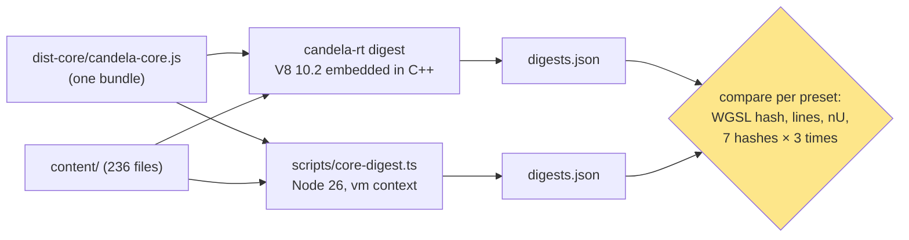
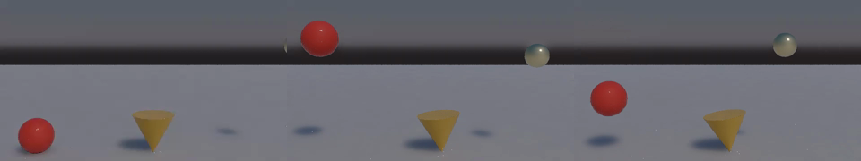
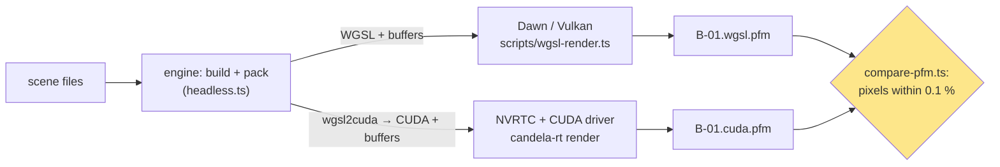
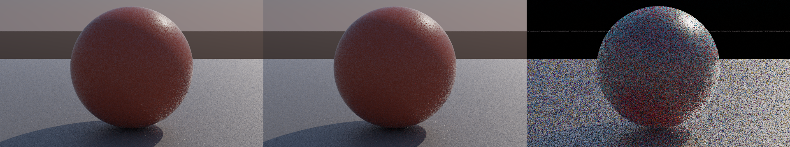
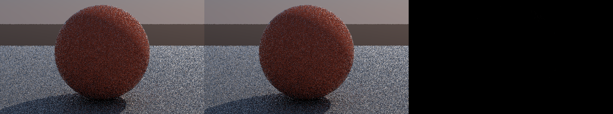
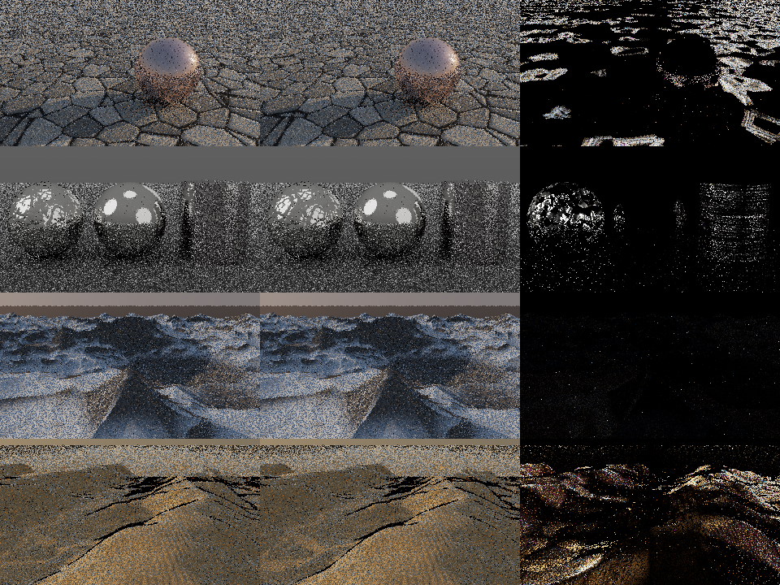
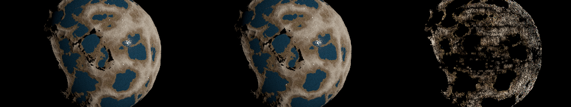

# Candela Render Runtime: Running Candela Scenes in Embedded V8 — A Technical Deep Dive

Candela's scenes are JavaScript programs, and its renderer is a GPU kernel. To render those scenes with NVIDIA OptiX on the DGX Spark, the program that drives the GPU must also be able to run the scenes' JavaScript, including the code that runs on every frame. This report describes the first milestone of that program, `candela-rt`: a C++ executable that embeds Google's V8 JavaScript engine, loads Candela's engine as a single bundled script, and builds every one of Candela's 105 example scenes. It also describes how the project proves that the embedded engine and the browser engine produce exactly the same scene data, the bug that made the first attempt hang, and the change that made Candela's builds deterministic.

The report assumes no prior knowledge of Candela, V8 or JavaScript engine embedding. It continues [[PROJECT REPORT - Candela on the DGX Spark - From a JavaScript Scene API to OptiX Ray Tracing - A Technical Deep Dive]], which covers path tracing, OptiX and the measurements that motivated this work.

> [!summary]
> - **The engine runs natively.** `candela-rt` embeds V8 10.2 from Ubuntu's `libnode` package. The whole TypeScript engine, bundled into one 321 KiB script, builds all 105 presets inside it in 6.6 seconds.
> - **The output is identical across engines.** For every preset, the generated GPU program and every data buffer the engine writes at three moments in time hash to the same values in V8 10.2 embedded in C++ and in Node 26: 105 of 105.
> - **Builds are deterministic.** Scene code now sees a seeded `Math.random`. Before the change one preset produced different data on every build, in any engine.
> - **The refactor has a gate.** A golden test records those hashes for all presets. Every later step of the planned engine split must leave them unchanged.
> - **Callbacks run in the native process.** The clock, behaviours and animation poses moved from the browser application into an engine class, `SceneSession`. `candela-rt session` steps every moving preset at 24 fps inside embedded V8, and each frame's buffers equal Node's.
> - **The renderer runs as CUDA.** A translator turns each scene's WGSL program into CUDA C++, which NVRTC compiles and `candela-rt` runs. At one sample per pixel, 101 of 105 presets reproduce WebGPU's image on at least 99 % of pixels to within 0.1 %. With the same algorithm, the CUDA program is 1.9 to 7.3 times faster than WebGPU on the same GPU.
> - **Rays are traced on the RT cores.** An OptiX target replaces one function of the translated program, the scene traversal, with hardware ray tracing. 104 of 105 presets look the same as in the WebGPU workbench, and scenes with meshes or many objects render 7 to 13 times faster than WebGPU.

## Why this project exists

The previous milestone established two facts. NVIDIA's ray-tracing hardware traces Candela's scene geometry about sixteen times faster than Candela's WebGPU kernel on an ambient-occlusion workload. And Candela is structured like a compiler: a *front end* runs the user's scene program and produces data, and a *back end* turns that data into a GPU program and GPU buffers. The design that followed (`design-doc/02` in ticket CANDELA-002) adds a second back end for OptiX. It hosts the front end in a native process, so that rendering on the Spark needs neither a browser nor Node.

The front end cannot be reduced to a data file and shipped to C++, because parts of a scene keep running after it is built. Four kinds of scene code run later:

| Callback | When it runs | Example preset |
| --- | --- | --- |
| `export const animation = t => poses` | Every frame, and once per motion-blur sample | K-09, the sewing machine |
| `.behavior((self, { t, dt }) => …)` | Every tick; it keeps state and integrates over `dt` | W-01, a bouncing ball |
| A derived param such as `P.gloss.map(g => 1 - g)` | Whenever the source slider moves | B-02 |
| A static param such as a scene choice | On change, by re-running the whole scene file | K-09's `scene` menu |

The design therefore puts a JavaScript engine inside the native renderer. The whole TypeScript engine runs in it, not only the scene file: the scene API is a JavaScript DSL whose material closures are traced with proxies and whose diagnostics read JavaScript stack traces. Porting that API to C++ would mean writing the language twice. C++ is reserved for what is specific to OptiX and heavy on data.

## Current project status

- `native/rt/` builds `candela-rt` with V8 embedded (commit `bb12bf3`). Its one command so far, `candela-rt digest`, builds presets and prints hashes of what they produce.
- `src/engine/core.ts` and `scripts/bundle-core.ts` produce the engine bundle `dist-core/candela-core.js`.
- `src/engine/digest.ts`, `scripts/core-digest.ts` and `tests/golden-pack.test.ts` implement the equality checks (commits `bb12bf3`, `9cf9c6e`).
- Scene code's `Math.random` is seeded per build (commit `19f016a`).
- The clock, behaviours and poses live in `src/engine/session.ts`; the browser and `candela-rt session` both use them (commit `76b75fd`).
- `src/engine/wgsl2cuda.ts` translates scene programs to CUDA; `candela-rt render` and `candela-rt cuda-sweep` compile them with NVRTC and run them (commits `1b79006`, `1780050`).
- `src/engine/targets/optix.ts`, `native/rt/src/optix_renderer.cpp` and the device programs in `native/rt/kernels/` form the OptiX target; `candela-rt render --backend auto` chooses between it and plain CUDA (commits `9ebcbee`, `7891b77`).
- Not started: render jobs (sequences, video), the live workbench. The ticket diary records each step (steps 11 to 17 for this report). The code is on GitHub as PR #1 of `wesen/2026-11-21--pbr-spark`, reviewed once by Codex (five findings, all fixed in `6e05a36`).

## Part 1. What it means to embed a JavaScript engine

### V8 as a library

V8 is the JavaScript engine of Chrome and Node. Both are programs that *embed* it: V8 itself is a C++ library that compiles and runs JavaScript, and the program around it decides what that JavaScript can see and do. A browser gives scripts `document` and `fetch`; Node gives them `require` and the file system. An embedding program can give them anything, or almost nothing.

The pieces of the V8 API that `candela-rt` uses, in the order a program meets them:

| Concept | What it is | Where candela-rt uses it |
| --- | --- | --- |
| Platform | Process-wide services: background threads for the compiler and the garbage collector. | Initialised once in `JsRuntime::initProcess`. |
| `v8::Isolate` | An independent JavaScript heap with its own garbage collector. Values never move between isolates, and only one thread may use an isolate at a time. A memory ceiling is set per isolate. | One per runtime, with a 4 GiB heap limit. |
| `v8::Context` | A global object (`globalThis`) with the ECMAScript built-ins, inside an isolate. The embedder decides what else the global object holds. | One per runtime, holding only `console`, `performance`, `atob` and `btoa`. |
| `Local<T>` and `HandleScope` | Handles through which C++ refers to JavaScript values. A handle is valid while its scope is alive, so the garbage collector knows what C++ is still using. | Everywhere values cross. |
| `Script::Compile` and `Run` | Compile source text and run it in a context. | Loading the engine bundle. |
| Function callbacks | C++ functions that JavaScript can call. | `console.log`, `performance.now`, `atob`. |
| Microtasks | The queue of promise continuations. An embedder that calls an `async` function must run the queue until the returned promise settles. | `JsRuntime::settle`. |
| Backing stores | The memory behind an `ArrayBuffer`. C++ can read a `Float32Array`'s numbers directly, without copying. | `JsRuntime::view<T>`, for the GPU buffers to come. |

The global object's contents are the sandbox. Scene files are user code, and the in-browser agent writes scene code too. In `candela-rt`'s context there is no `require`, no `fetch` and no file system object, so a scene file cannot touch the machine. It can only build a scene.

### Where V8 comes from on the Spark

V8 is large, and building it from source requires Google's own build tools and a long compile. Ubuntu packages Node 18 as a shared library, `libnode.so.109`, with V8's headers in `/usr/include/node`. That V8 is version 10.2, older than the 14.6 in the installed Node 26, but sufficient: the engine bundle targets ES2020.

Two checks were needed before using it. First, the library must export V8's C++ API, not only Node's. It does: `nm -D` lists `v8::platform::NewDefaultPlatform`, `v8::Isolate::New`, `v8::Context::New`, `v8::Isolate::PerformMicrotaskCheckpoint` and `v8::Context::AllowCodeGenerationFromStrings`. Second, the headers must be compiled with the same memory-layout options as the library, or objects are misread at run time. V8 has two such options, pointer compression and 31-bit small integers. Node records how it was built in `/usr/include/node/config.gypi`:

```text
'v8_enable_pointer_compression': 0,
'v8_enable_31bit_smis_on_64bit_arch': 0,
```

Both are off, which matches the headers' defaults, so `candela-rt` needs no special preprocessor definitions. Its CMake file finds the header directory and links `libnode`; nothing else is required.

### What the engine needs from its host

Candela's engine was written for the browser, so the first question was which browser features it depends on. The answer comes from reading `src/engine/candela.ts`, where scene files are executed. The relevant lines (`runFiles`) rewrite `import` and `export` into function calls, then create each module like this:

```js
fn = new Function('__req', '__exports', '__def', 'console', 'Math', ...SCOPE_NAMES,
  '"use strict";\nreturn (async () => {\n' + body + '\n})();\n//# sourceURL=' + path);
await fn(resolve, exportsObj, defaultOf, consoleShim, sceneMath, ...apiValues);
```

Three requirements follow. The context must allow creating functions from strings, which V8 can forbid per context. Every module body is an `async` function, so the host must drive promises. And the module sees the Candela API as function parameters, not globals, so the global object can stay almost empty. Searching the engine and the presets for other browser features found exactly three: `console`, `performance.now()` for build timings, and `atob`, which the sewing-machine preset uses to decode its base64 mesh data. No timers, no `fetch`, no DOM.

### The engine bundle

`src/engine/core.ts` is the entry point for everything that should run outside the browser: `build`, the catalogue loader, and the digest functions described below. `scripts/bundle-core.ts` passes it to esbuild:

```ts
await esbuild.build({
  entryPoints: ['src/engine/core.ts'], bundle: true,
  format: 'iife', globalName: 'Candela',     // one script that defines globalThis.Candela
  platform: 'neutral', target: 'es2020',     // no Node or browser built-ins; syntax V8 10.2 accepts
  outfile: 'dist-core/candela-core.js',
});
```

The result is a single 321 KiB script assembled from 18 source files. Its SHA-256 is written beside it; in the live workbench, browser and server compare that hash to make sure they run the same engine.

## Part 2. The runtime

### Creating the isolate and its global object

`native/rt/src/js_runtime.cpp` wraps the API in a class, `crt::JsRuntime`. The constructor creates the isolate with a heap limit, sets the microtask policy (explained below), and builds the global object from nothing:

```cpp
v8::Isolate::CreateParams cp;
cp.array_buffer_allocator = v8::ArrayBuffer::Allocator::NewDefaultAllocator();
cp.constraints.ConfigureDefaultsFromHeapSize(0, heapLimitBytes);
iso_ = v8::Isolate::New(cp);
iso_->SetMicrotasksPolicy(v8::MicrotasksPolicy::kExplicit);
...
auto ctx = v8::Context::New(iso_, nullptr, global);
ctx->AllowCodeGenerationFromStrings(true);            // build() creates modules with new Function
auto console = v8::Object::New(iso_);
for (const char* level : {"log", "info", "warn", "error", "debug"})
  console->Set(ctx, str(level), fn(hostConsole, holder(level))).Check();
g->Set(ctx, str("console"), console).Check();
g->Set(ctx, str("performance"), perf).Check();      // performance.now → std::chrono::steady_clock
g->Set(ctx, str("atob"), fn(hostAtob, holder("atob"))).Check();
```

Each host function receives a small *holder* object whose internal fields carry a pointer to the `JsRuntime` and, for `console`, the log level. That lets one C++ callback serve all five `console` methods and forward the text to whatever sink the program installs.

### Waiting for a promise from C++

`Candela.digestCatalog(...)` is an `async` function, so calling it returns a promise immediately. The work happens in promise continuations, which V8 keeps in its microtask queue. `JsRuntime::settle` runs that queue, and any platform tasks, until the promise is no longer pending:

```cpp
v8::Local<v8::Value> JsRuntime::settle(v8::Local<v8::Value> v) {
  if (!v->IsPromise()) return v;
  auto p = v.As<v8::Promise>();
  while (p->State() == v8::Promise::kPending) {
    iso_->PerformMicrotaskCheckpoint();
    while (v8::platform::PumpMessageLoop(gPlatform.get(), iso_)) {}
  }
  if (p->State() == v8::Promise::kRejected) throw JsError(stackOf(p->Result()));
  return p->Result();
}
```

The isolate's microtask policy is `kExplicit`. Under V8's default policy, `kAuto`, V8 runs microtasks on its own whenever the JavaScript call depth returns to zero. A host that drives promises itself wants a single place where that happens, and `kExplicit` gives it one.

### Reading numbers without copying them

The OptiX back end will receive its buffers (object records, light records, uniforms) as `Float32Array`s created in JavaScript. A typed array is a view onto an `ArrayBuffer`, whose bytes live in a *backing store* that C++ can address directly:

```cpp
template <class T> std::span<const T> view(v8::Local<v8::Value> v) const {
  auto a = v.As<v8::ArrayBufferView>();
  auto* base = static_cast<const uint8_t*>(a->Buffer()->GetBackingStore()->Data());
  return {reinterpret_cast<const T*>(base + a->ByteOffset()), a->ByteLength() / sizeof(T)};
}
```

The span stays valid while the array is alive, which C++ guarantees by keeping a handle to it. On the GB10, whose CPU and GPU share one memory, this is the first step towards handing frame data to the GPU without any copy.

## Part 3. Proving the two engines agree

### Why equality matters

In the planned live workbench, the browser and `candela-rt` each build the scene from the same inputs: the files, the param values and the seed. The browser needs its own build for the editor's diagnostics, the param panel and the WebGPU preview. `candela-rt` needs its own to render with OptiX and to run the callbacks on its own clock. That arrangement is only correct if the same inputs produce the same scene in both engines. Floating-point arithmetic in JavaScript is IEEE 754 double precision everywhere, so equality is expected. But expectation is not proof, and a single preset that draws random numbers during its build is enough to break it.

### What is compared

`src/engine/digest.ts` computes hashes of everything the compiler produces for one preset. It is part of the bundle, so both engines run identical hashing code and only the engine underneath differs:

- the generated WGSL program (`compiled.shared`), its line count, and the number of uniform rows;
- at times 0, 0.37 and 1.5 seconds, every buffer `pack` writes: `U` (uniforms), `O` (object records), `LI` (lights), `BV` (the top-level BVH), `SDs` and `SDd` (the scene data's static head and dynamic tail), plus pack's metadata, such as the object order and the sun direction.

`pack` is called the way the viewport calls it. A helper, `packEnv`, reproduces `Viewport.repack` from `src/engine/viewport.ts`: poses from the scene's `animation(t)`, the seed, and, for scenes whose camera has motion blur, one set of poses for each sample across the shutter. Without that, the multi-sample code path in `pack` would go untested.

The hash itself is plain JavaScript, two independent 32-bit lanes over the buffer's 32-bit words, because the embedded context has no `crypto` module:

```ts
for (let i = 0; i < words; i++) {
  let k = Math.imul(u32[i], 0xcc9e2d51); k = (k << 15) | (k >>> 17); k = Math.imul(k, 0x1b873593);
  h1 ^= k; h1 = (h1 << 13) | (h1 >>> 19); h1 = (Math.imul(h1, 5) + 0xe6546b64) | 0;
  h2 = Math.imul(h2 ^ u32[i], 0x01000193);
}
```

The Node side of the check, `scripts/core-digest.ts`, loads the same bundle into a fresh `node:vm` context that contains only the four globals `candela-rt` provides. A missing global therefore fails in Node too, instead of being masked by Node's larger environment.



### The first result: one preset that is never the same twice

```text
$ ./build/rt/candela-rt digest --json digest-v8.json
V8 10.2.154.26-node.28; bundle dist-core/candela-core.js loaded in 15.3 ms; content: 236 files, 1.9 MiB
105/105 presets built
$ npx tsx scripts/core-digest.ts --compare digest-v8.json
compare with digest-v8.json: 104/105 identical; differ: D-02 (t=0 O)
$ npx tsx scripts/core-digest.ts --compare digest-node1.json        # Node against Node
compare with digest-node1.json: 104/105 identical; differ: D-02 (t=0 O)
```

Every preset builds in the embedded engine. For 104 of them, the program and every buffer at every time are identical between V8 10.2 in C++ and V8 14.6 in Node 26. The exception, D-02, differs in its object records, and it differs just as much between two runs of the same Node. The cause is in the preset itself:

```js
const jitter = scene.group(g => { for (let i = 0; i < 5; i++)
  g.add(shape.sphere(0.15).at((i - 2) * 0.4, 0.15 + Math.random() * 0.3, 0) … ); });
```

D-02 is a teaching preset about diagnostics. It calls `Math.random()` inside a group's build lambda on purpose, to show warning W501. Its sphere heights are different on every build.

## Part 4. Deterministic builds

### The rule Candela already had

Candela's documentation lists determinism as an invariant. `content/docs/08-invariants.md` says "Build lambdas are deterministic", enforced by "`Math.random` interception" and reported as W501. A group lambda receives its own seeded generator, `(g, { rng }) => …`, which `makeRng(1)` restarts from the same seed in every group. The engine enforced the rule by temporarily replacing the global `Math.random` while a lambda ran and warning on the first call. The warning text told the user the consequence: "the scene hash will change on every run (no caching, no reproducible renders)".

That consequence is precisely what the live workbench cannot accept, so the design (decision D8) makes every build reproducible: scene code sees a `Math.random` seeded at the start of the build.

### The mechanism

Scene modules already receive the Candela API as function parameters. `Math` became one more parameter:

```ts
let rngState = 0;
export function seedSceneRandom(seed: number) { rngState = (seed ^ 0x9e3779b9) >>> 0; }
function sceneRandom() {                       // mulberry32
  noteSceneRandom();                           // W501 if called inside a build lambda
  rngState = (rngState + 0x6d2b79f5) >>> 0;
  let t = rngState;
  t = Math.imul(t ^ (t >>> 15), t | 1);
  t ^= t + Math.imul(t ^ (t >>> 7), t | 61);
  return ((t ^ (t >>> 14)) >>> 0) / 4294967296;
}
const sceneMath = Object.create(Math, { random: { value: sceneRandom, enumerable: false } });
```

`Object.create(Math, …)` makes an object whose prototype is the real `Math`. `sceneMath.sin`, `sceneMath.PI` and the rest resolve to the originals; only `random` is replaced. `build(files, { seed })` resets the state before running the files. The default seed is 0.

The binding lives in the module's scope, so every function the scene defines closes over it. That includes top-level code and build lambdas, and also the callbacks that run later (`animation`, behaviours, derived params). Their random numbers come from the same stream, continuing from where the build left off.

### Keeping the warning

The old detection patched the global `Math.random`, and scene code no longer calls the global. The lambda wrapper now sets a flag, and `noteSceneRandom()` warns when it is set. The seeded function calls it, and so does the patched global, which engine code still reaches. The warning's text had to change, because its claim is no longer true:

```text
before  W501  Math.random() called inside a build lambda: the scene hash will change on every run
              (no caching, no reproducible renders)
after   W501  Math.random() called inside a build lambda: its values depend on every earlier Math.random()
              call in the build, so edits elsewhere change this part of the scene
```

The new text states the remaining problem accurately. The stream is shared by the whole build, so inserting a `Math.random()` call earlier in the file shifts every later value. The lambda's own `rng` does not have that problem, so the hint to use it stays. D-02's notes and the W501 example in `content/docs/40-design-examples.md` were updated to match.

### The result

```text
D-02  seed 0: O 805fc8807a5ece63    W501 … at scene.js:13
D-02  seed 0: O 805fc8807a5ece63    W501 … at scene.js:13
D-02  seed 7: O ebb08ba50c825763    W501 … at scene.js:13
$ npm run test:golden                       → golden pack: 105/105 identical in 8.0 s
$ candela-rt digest + core-digest --compare  → 105/105 identical
```

The same seed now gives the same scene, a different seed a different one, and the warning still points at the right line. Every preset is identical between the embedded engine and Node.

## Part 5. The golden gate

The next phase of the design splits Candela's `compile()` and `pack()` functions. One half becomes target-neutral lowering; the other becomes a WebGPU *target* beside the future OptiX target. Clock, behaviours and poses move out of the browser's application code into an engine class that `candela-rt` can use. None of that may change what the browser renders.

`tests/golden-pack.test.ts` turns that requirement into a test. It records, for all 105 presets, the same digests the cross-engine check uses (the WGSL and every `pack` buffer at three times, with the viewport's exact `env`), in `tests/golden/pack-digests.json`. A run takes 8 seconds. The baseline was committed before any engine file changed (commit `9cf9c6e`). The only re-recording since then was D-02's, deliberately, when its output became deterministic. From here on, a refactoring step is finished when `npm run test:golden` reports 105/105.

## Part 6. Callbacks in the native process: SceneSession

### Where the clock lived

Three pieces of code decide what a moving scene looks like at time *t*, and before this step none of them were in the engine:

- `Viewport.posesFor(t)` (`src/engine/viewport.ts`) called the scene's `animation(t)` and merged poses pushed from outside, such as those an external animation tool sends.
- `Viewport.repack(t)` built the `env` for `pack`: poses, behaviour overrides, the seed, and the extra pose sets for motion blur.
- `Host.runBehaviors(dt)` and `Host.seek(t, dt)` (`src/app/host.ts`) ran each `.behavior()` callback, kept its state, and reset that state when the clock went backwards.

`Host` is the browser application's state object, so a native process could not use any of this. `src/engine/session.ts` now holds that code, moved without changes, as plain functions (`posesAt`, `makePackEnv`, `stepBehaviors`). The viewport and the host call those functions instead of their own copies, which keeps one implementation. A class, `SceneSession`, assembles them for hosts without a browser:

```ts
const s = new SceneSession({ seed: 0 });
await s.build(files);                  // build(files, { seed }), keeps compiled + animation + behaviours
for (let f = 0; f < 48; f++) {
  s.seek(f / 24, f ? 1 / 24 : 0);      // behaviours step by dt; seeking back with dt = 0 resets their state
  const P = s.pack();                  // animation(t) + behaviour overrides + seed + motion samples → buffers
}
```

### Checking it against closed forms

The preset W-01 animates three objects with behaviours that have exact solutions. A ball bounces on a parabola with period $\sqrt{8h/g}$. A pendulum swings with angle $\theta_0\cos(\sqrt{g/L}\,t)$. A spinning top accumulates `rotation.y += 8·dt`. `tests/session.test.ts` steps a session 48 frames at 24 fps. It reads each object's position back out of the buffers `pack` produced: the object records hold world-to-object matrices in BVH order, so the test maps each record back to its object id and inverts the matrix. It then compares the positions with the formulas. The largest error over all frames is $5.8\times10^{-8}$ metres, which is float32 rounding. The top's rotation matches exactly.

Two more checks complete the test. For K-09, a session's `pack` at t = 0, 0.37 and 1.5 hashes identically to the viewport-style `pack` the golden test uses. For D-02, two sessions with the same seed produce the same objects and a different seed produces different ones. The golden test remained at 105/105 after the move. A render of W-01 through the real workbench on the GPU shows the behaviours still driving the browser:



*W-01 rendered by the workbench on WebGPU after the refactor: frames 0, 6 and 12 at 12 fps. The ball (red) and the pendulum bob (brass) are driven by `.behavior()` callbacks.*

### The same frames in C++

The engine bundle now exports `SceneSession`, and `candela-rt session` steps every preset that moves, meaning those with behaviours or an `animation` export, inside embedded V8. Each frame's uniforms, object records and dynamic scene data are digested. The Node side, `scripts/core-digest.ts --session`, does the same in a `vm` context:

```text
$ ./build/rt/candela-rt session --json sess-v8.json
V8 10.2.154.26-node.28; 48 frames at 24 fps per moving preset
  W-01   behaviours 3  animated no     last O 05d2d0a58f62130f  0.127 ms/frame
  K-01   behaviours 0  animated yes    last O a21e801590fb2543  1.025 ms/frame
  K-02   behaviours 0  animated yes    last O 6481e714f5f22310  0.277 ms/frame
  K-07   behaviours 0  animated yes    last O b76a00ced87b4827  0.039 ms/frame
  K-08   behaviours 0  animated yes    last O 9b9bfa7ab5ed8976  0.320 ms/frame
  K-09   behaviours 0  animated yes    last O c495b2a1e4569c7c  0.601 ms/frame
6/6 moving presets stepped
$ npx tsx scripts/core-digest.ts --session --compare sess-v8.json
compare with sess-v8.json: 6/6 identical frame by frame
```

Every frame of every moving preset is identical between the two engines. A frame's JavaScript work, stepping the clock and the callbacks and packing the buffers, costs between 0.04 and 1.0 ms in the embedded engine. That cost is small next to rendering the frame on the GPU.

## Part 7. Translating the renderer to CUDA

### What is translated

The program that draws a Candela scene is a WGSL compute shader. WGSL is the shading language of WebGPU. For each scene, the engine produces one program, `compiled.shared`, of between 1,450 and 2,050 lines. Most of it is the hand-written kernel, `src/engine/kernel.ts`: camera rays, intersection routines for every shape type, the traversal of Candela's bounding volume hierarchy (`traceAll`), light sampling and the path-tracing loop. The rest is generated for the scene: one function per material (`mat_0`, `mat_1`, …), signed-distance and height fields, and small dispatch functions that select among them.

CUDA is NVIDIA's C++ dialect for GPU programs. NVRTC is NVIDIA's runtime compiler: a library that compiles CUDA source text to GPU machine code (a *cubin*) inside a running program, so `candela-rt` can compile a scene's program when the scene is built.

The design document planned two dialects in the code generator, emitting WGSL for the browser and CUDA for the Spark, and a separate translation of the fixed kernel. The implementation translates the whole program text instead. The generator already emits a strict subset of WGSL, because the WebGL2 fallback translates the same text to GLSL with a 59-line rule set (`src/engine/wgsl2glsl.ts`). An inventory over all 105 presets confirmed the subset: every declaration carries a type, each struct member sits on its own line, functions are written `fn name(a: T) -> R {`, and there are no pointers, `switch` statements or generic types. A line-based translator is therefore enough:

| WGSL | CUDA C++ |
| --- | --- |
| `const PI: f32 = 3.14159;` | `constexpr f32 PI = 3.14159f;` |
| `let x: vec3f = e;` | `const vec3f x = e;` |
| `var h: Hit;` (zero-initialised in WGSL) | `Hit h{};` |
| `loop { … }` | `for (;;) { … }` |
| `v.xyz` | `v.xyz()` |
| `select(f, t, c)` | `((c) ? (t) : (f))` |
| `1.0` (an abstract float) | `1.0f` (so no arithmetic is done in double precision) |
| `var<private> rngS: u32 = 1u;` | a data member of `struct Kernel` |
| `fn rnd() -> f32 { … }` | a `__device__` member function of `struct Kernel` |

The last two rows need explanation. A WGSL `var<private>` variable is private to one invocation of the shader, which here means one pixel. The kernel keeps its random-number state (`rngS`), the current time and the wavelength in such variables. A global variable in CUDA is shared by all threads, so the translator cannot emit these as globals. It wraps the whole program in a struct, `Kernel`: the private variables become data members, every function becomes a member function, and each GPU thread constructs its own `Kernel` object. A side benefit is that member functions may call each other in any order, so no forward declarations are needed.

WGSL's types and built-in functions keep their names. `native/rt/kernels/candela_wgsl.h` defines `f32`, `vec3f`, `dot`, `mix`, `clamp` and the rest inside a namespace, `wgsl`, and the translated program is placed in the same namespace. The namespace makes a call such as `max(a, b)` resolve to the header's definition instead of CUDA's global overloads, whose mixed-type versions would make calls ambiguous.

### Two renderers for one program

Testing a translation means running the original and the translation on identical inputs and comparing the outputs. Two renderers do this:

- **The plain-CUDA target.** `candela-rt render <id>` asks the engine bundle for the scene's buffers and CUDA program, compiles the program with NVRTC, and launches it once per frame with that frame's uniforms. It keeps the translated `traceAll`, which walks Candela's own BVH, so the CUDA program does exactly what the WGSL program does. OptiX replaces `traceAll` only in the next phase, which keeps translation errors separate from OptiX integration errors.
- **The reference.** `scripts/wgsl-render.ts` runs the unmodified WGSL program on Dawn, Google's WebGPU implementation, which the `webgpu` npm package makes available in Node. It uses the same buffers and the same per-frame uniforms (`src/engine/headless.ts`). Dawn drives the GPU through Vulkan, as Chrome does on Linux.



The comparison relies on a property of the kernel. `renderPixel` seeds its random-number generator from the pixel's coordinates and the frame index, so both renderers draw the same random numbers for the same pixel. At one sample per pixel, each pixel is the result of exactly one light path. If the program is translated faithfully, every pixel agrees up to floating-point rounding. A pixel differs substantially only where rounding changes the outcome of a comparison, for example which material lobe a random number selects. The share of pixels that agree to 0.1 % therefore measures how often the translated program follows the same path as the original.

### The first comparison: evaluation order

The first render of B-01, a single sphere on a plane, looked identical to the reference, and its mean brightness differed by only 0.095 %. Only 27 % of its pixels agreed to 0.1 %, however, and the albedo of the first surface each camera ray hits differed on 22 % of the pixels at one sample. That albedo does not depend on rounding, so the two programs were taking different paths.



*B-01 before the fix, 64 samples per pixel: WebGPU (left), CUDA (middle), and their difference multiplied by ten (right). The sky agrees exactly; every surface pixel differs at the level of sampling noise.*

The cause is a difference between the two languages. WGSL defines that the operands of an expression and the arguments of a call are evaluated from left to right, and that `select(f, t, c)` evaluates all three arguments. C++ leaves the order of function arguments unspecified, and its conditional operator `c ? t : f` evaluates only one branch. The order matters when an argument changes state, and the random-number functions do: every call to `rnd()` advances `rngS`. Two lines in the kernel depend on WGSL's rules:

```wgsl
let bs: BS = sampleLobe(L, woL, rnd2(), rnd());                 // C++ may call rnd() before rnd2()
gTau = select(0.5, (f32(s) + rnd()) / f32(spp), U(24).y >= 2.0); // WGSL always calls rnd(); ?: skips it
```

The second line is the more damaging. When motion blur is off, the C++ version draws one random number fewer per sample than the WGSL version, so every later random number in the path is different.

The translator now sequences these calls. It first finds the functions with side effects, by a fixed-point computation: a function is *impure* if it assigns a private variable, or calls an impure function. In the kernel these are `rnd`, `rnd2`, `traceAll` (which records the hit triangle in private variables) and everything that calls them, 13 functions in all. When a statement contains two calls to impure functions, or one inside a `select`, the translator moves the calls into temporaries in WGSL's order: arguments left to right, and a call's own arguments before the call.

```cpp
const auto _s1 = rnd2(); const auto _s2 = rnd(); const BS bs = sampleLobe(L, woL, _s1, _s2);
const auto _s4 = rnd(); gTau = ((U(24).y >= 2.0f) ? ((f32(s) + _s4) / f32(spp)) : (0.5f));
```

Hoisting is only correct where the statement is evaluated unconditionally. The translator refuses, with an error, statements in which hoisting would change the program: an `else if` condition, a loop header, or an impure call on the right of `&&` or `||`. None occurs in the current kernel; a future edit that introduces one will fail translation instead of producing a subtly different renderer.

After the change, B-01 agrees on 100 % of its pixels at one sample, with a relative RMSE of 0.00 %. At 1,024 samples, 99.9 % of pixels agree to 0.1 %.



*B-01 after the fix, one sample per pixel: the difference image (right) is black.*

### The sweep, and what `sin` does to noise

`scripts/parity-sweep.ts` renders all 105 presets with both renderers at 320×180 and one sample per pixel. The first sweep found 85 presets with at least 99 % of pixels agreeing to 0.1 %. Most of the other twenty share one feature: procedural noise. G-03, a terrain whose height comes from noise, was 17.5 % darker in CUDA.

Candela's noise functions use a classic shader hash:

```wgsl
fn hash13(p: vec3f) -> f32 { return fract(sin(dot(p, vec3f(12.9898, 78.233, 37.719))) * 43758.5453); }
```

The hash multiplies the sine by 43,758 and keeps the fractional part. Any difference in the computed sine is multiplied by the same factor. CUDA's `sinf` is accurate to a few units in the last place for any argument. GPU hardware also has a fast approximate sine, available in CUDA as `__sinf`, whose documented maximum error is 2^-21.4 for arguments in [-π, π] and grows outside that range. The arguments here are dot products of positions with constants such as 78.233, so they reach the hundreds and thousands. At that size the two implementations differ by enough that the multiplied value changes its integer part, and `fract` returns an unrelated number. The noise pattern is then a different pattern.

Replacing `sin` and `cos` in the header with `__sinf` and `__cosf` raised G-03 from 16 % to 83 % of matching pixels and removed its brightness error. This indicates that NVIDIA's Vulkan driver evaluates WGSL's `sin` with the approximate unit. NVRTC's `--use_fast_math` option applies the same approximation to sine, cosine, exponential, logarithm, power and division, and flushes single-precision denormal numbers to zero. With it, 101 of the 105 presets agree on at least 99 % of their pixels. The option does not assume that values are finite, so the kernel's tests for NaN keep working, and it also cuts NVRTC's compile time from 11.7 to 4.5 seconds per preset. It is now the default for the CUDA target.



*The four presets that still differ, at one sample per pixel (WebGPU, CUDA, difference × 10): F-03 (Voronoi cells), F-04 (bump-mapped spheres), G-03 (terrain) and R-04 (desert). Geometry and cell boundaries agree; individual cells and texels take different hash values.*

The remaining differences are hash values, not translation errors. They have a consequence beyond `candela-rt`: the browser's own noise patterns depend on how a GPU vendor implements `sin`, so the same scene already renders different marble veins on different GPUs. The kernel contains an integer hash, `pcgH`, which gives the same result on every device. Basing the noise functions on it would make noise identical everywhere, at the cost of changing the look of every noise preset once. That is a decision about the presets' appearance, recorded as an open question.

Averages show no bias. At 64 samples per pixel, the mean luminance of every preset is within 0.3 % of WebGPU's, and the median difference over all presets is below 0.0001 %.

### Measurements

| Measurement | Result |
| --- | --- |
| Translation, per preset | 8–21 ms in V8; 1,442–2,059 lines of CUDA |
| NVRTC compile, per preset (10 parallel threads, caches disabled) | IEEE math 11.7 s mean, 21.1 s max; fast math 4.5 s mean, 7.8 s max |
| All 105 presets compiled and loaded | 48.5 s wall clock with fast math |
| Registers and local memory per thread | 152–232 registers; at most 1,152 bytes |
| Parity at 1 sample per pixel, 320×180 | 101/105 presets with ≥ 99 % of pixels within 0.1 % (85/105 with IEEE `sinf`) |
| Parity at 64 samples per pixel | all 105 within 0.3 % in mean luminance |

| Preset, 960×540, 256 samples per pixel | WebGPU (Dawn, Vulkan) | CUDA (translated) | Ratio |
| --- | --- | --- | --- |
| B-01, one sphere | 510 ms | 136 ms | 3.8× |
| K-09, the sewing machine (meshes) | 5,496 ms | 1,014 ms | 5.4× |
| X-02, 10,000 objects | 14,709 ms | 2,005 ms | 7.3× |
| V-04, a volumetric cloud | 8,767 ms | 4,675 ms | 1.9× |

Both columns run the same algorithm on the same data structures; only the compiler and the API differ. The causes of the gap were not profiled. It is a speed-up obtained before any use of the ray-tracing hardware, which the OptiX target adds next.

## Part 8. Tracing rays on the RT cores with OptiX

### One function changes

An OptiX program is a set of GPU functions with fixed roles. A *ray-generation* program starts the work for each pixel. When it calls `optixTrace`, OptiX walks an acceleration structure on the RT cores, the GPU's fixed-function ray-tracing units. Along the way it may call an *intersection* program for primitives it cannot intersect itself. Finally it calls a *closest-hit* program for the nearest hit, or a *miss* program if nothing was hit. Data passes between them in up to 32 *payload* registers.

The translated Candela program already contains a complete path tracer. Its only scene query is `traceAll(ro, rd, tmax, shadow)`, which returns the nearest object hit along a ray and walks Candela's own BVH to find it. The OptiX target replaces exactly that function and keeps its contract. The rest of the translated program, including surface details, materials, lights and the path loop, runs unchanged inside the ray-generation program. The contract has one subtle part. For a triangle hit, the WGSL code records which triangle record was hit and where (`gTri` and the barycentric coordinates `gBary`), and `finishHit` later reads normals and texture coordinates from that record. The OptiX version must record the same values.

The engine turns the packed scene into OptiX build inputs (`src/engine/targets/optix.ts`):

| Candela object | OptiX structure | How the hit is reported |
| --- | --- | --- |
| Triangle mesh | One geometry acceleration structure (GAS) per mesh definition, triangles in the order of Candela's triangle records | Closest-hit program returns the instance id (the object's index) and primitive index *k*; the shim sets `gTri = triBase + 7k` |
| Each mesh object | One instance in the instance acceleration structure (IAS), with the object's matrix at the frame time | Instance id = object index; a visibility mask lets shadow rays skip glowing objects |
| Analytic shape (sphere, box, disc, SDF shape, …) | One custom primitive in a shared GAS, its box the world box `pack` already computes | Intersection program runs the translated `hitObj` on the world ray |
| Infinite plane | Nothing: it has no box | The shim tests it in a loop before calling `optixTrace`, as `traceAll` did |

The replacement `traceAll` is twenty lines of CUDA (`native/rt/kernels/candela_traversal.inc`):

```cpp
__device__ TraceR traceAll(vec3f ro, vec3f rd, f32 tmax, bool shadow) {
  TraceR r{}; r.t = tmax; r.obj = -1;
  for (i32 i = nB; i < nObj; i++) { /* unbounded planes: hitObj, as in WGSL */ }
  if (nB == 0 || (shadow && r.obj >= 0)) return r;          // occluded() only asks whether anything was hit
  unsigned p0 = __float_as_uint(r.t), p1 = ~0u, p2 = ~0u, p3 = 0, p4 = 0,
           p5 = __float_as_uint(gTau), p6 = __float_as_uint(gTime), p7 = shadow;
  optixTrace(params.ias, ro, rd, EPS, r.t, 0.0f, shadow ? MASK_SHADOW : MASK_ALL,
             shadow ? OPTIX_RAY_FLAG_TERMINATE_ON_FIRST_HIT : OPTIX_RAY_FLAG_NONE, 0, 1, 0, p0, …, p7);
  if (p1 != ~0u) { r.t = __uint_as_float(p0); r.obj = p1;
                   if (p2 != ~0u) { gTri = triBase(r.obj) + 7 * p2; gBary = vec2f(p3, p4); } }
  return r;
}
```

Two details deserve explanation. The ray's minimum distance is `EPS`, because the WGSL mesh intersection ignores hits closer than that; with the same bound OptiX's triangle hits satisfy the same rule. And the intersection program runs outside the ray-generation program's `Kernel` object, so the per-thread values `hitObj` needs, the shutter time `gTau` for moving objects and the scene time `gTime` for animated fields, travel in payload registers.

### What "the same" means now

The first OptiX renders reproduced WebGPU closely: B-01 on 100 % of its pixels at one sample, K-09 on 99.9 %, so the triangle records and barycentrics come out right. X-02, with 10,000 small spheres, agreed on only 91.6 % of its pixels, although its first hits agreed on 99.9 % and its 64-sample average to 0.006 %. The intersection program is compiled by OptiX's own backend from OptiX-IR, so its floating-point arithmetic is not bit-identical to the CUDA cubin, and secondary rays that graze a sphere's silhouette go different ways.

At this point the project's owner set the bar explicitly: the WebGPU workbench was a first prototype, and candela-rt may differ from it, and should use OptiX's improvements, as long as renders do not look different. Parity is therefore measured on what is displayed. Both images are tone-mapped with the same exposure, averaged over 8×8-pixel blocks, and compared; a preset *looks the same* when the blocks agree to 2 % of white. Linear metrics were misleading here, because a few fireflies dominate them. X-03's sun glint on its ocean gave a linear block difference of 584 % for two images that look identical; its displayed difference is 0.34 %.


*K-09 at 64 samples per pixel: WebGPU (left), OptiX (middle), difference × 10 (right).*



*X-03: the planet's noise terrain and the sun glint on the sea differ in single pixels, not in appearance.*

By that measure, 104 of the 105 presets look the same on OptiX. The exception is F-03, whose Voronoi cells take different colours because of the sine-based hash described in Part 7.

### The register limit and the choice of backend

The first timings were disappointing. OptiX was slower than the plain-CUDA target on every scene except X-02, including the mesh scene K-09 (2.9 s against 1.0 s at 960×540 and 256 samples per pixel). The cause was a compile option. OptiX limits each program to 128 registers by default. The ray-generation program holds the whole path tracer, whose state must survive each `optixTrace` call, and at 128 registers that state spills to memory. At 255 registers K-09 renders in 0.75 s. That is faster than plain CUDA, and seven times faster than WebGPU.

| Preset, 960×540, 256 spp | WebGPU (Dawn) | Plain CUDA | OptiX, 255 registers | `--backend auto` |
| --- | --- | --- | --- | --- |
| B-01, one sphere and a plane | 516 ms | 141 ms | 422 ms | 136 ms (CUDA) |
| K-09, 34 meshes, 23,701 triangles | 5,201 ms | 973 ms | 741 ms | 747 ms (OptiX) |
| X-02, 10,000 spheres | 14,829 ms | 2,001 ms | 1,144 ms | 1,146 ms (OptiX) |
| V-04, a volumetric cloud | 8,110 ms | 4,671 ms | 8,295 ms | 4,668 ms (CUDA) |

The table shows where ray tracing hardware helps a path tracer structured this way. Each `optixTrace` costs a save and restore of the ray-generation program's live state, and each analytic object is a separate intersection-program call. The hardware wins when traversal dominates, with triangle meshes or thousands of objects. It loses for a handful of analytic objects, where the plain-CUDA target walks a tiny BVH inline. V-04 spends its time in noise evaluations for the cloud, which OptiX's compiler handles less efficiently than NVRTC's cubin. Keeping the BVH walk inside the OptiX program for small scenes was tried; it helped B-01 but made the larger program slower on K-09, and was reverted. Instead `candela-rt render --backend auto`, the default, chooses per scene: OptiX when the scene has meshes or more than 64 analytic objects, plain CUDA otherwise.

### Which parts of OptiX are in use

| In use | Not yet used |
| --- | --- |
| Hardware BVH traversal on the RT cores (GAS per mesh, single-level IAS with instance transforms) | The AI denoiser, the largest visible improvement at low sample counts |
| Hardware triangle intersection | Shader execution reordering (`optixTraverse`, `optixReorder`, `optixInvoke`), which regroups divergent rays |
| Custom primitives with an intersection program (Candela's `hitObj`) | Built-in sphere primitives in place of the generic intersection program |
| Visibility masks; terminate-on-first-hit shadow rays | Motion transforms and motion acceleration structures (moving meshes are unblurred) |
| Acceleration-structure compaction | Refitting acceleration structures for animation instead of rebuilding |
| Run-time compilation: NVRTC → OptiX-IR → OptiX module, with OptiX's disk cache | Opacity and displacement micromaps, cluster acceleration structures, cooperative vectors |

Compile time is the cost of 255 registers. NVRTC produces OptiX-IR in 2 s on average, and OptiX then compiles it to machine code in 8 to 17 seconds on first use. Later uses of the same program come from OptiX's disk cache in about 12 ms. That is acceptable for offline renders. For live structural edits in the planned workbench it is the next thing to measure.

## Measurements

| Measurement | Embedded V8 10.2 (C++) | Node 26, `vm` context | Node 26, main context (tsx) |
| --- | --- | --- | --- |
| Load the 321 KiB bundle | 15 ms | – | – |
| Build + compile, all 105 presets | 6.6 s | 149.8 s | about 8 s (golden run, includes hashing) |
| B-01 / K-01 / K-09 build + compile | 84 / 338 / 487 ms | 1,382 / 2,465 / 3,109 ms | 76 / 219 / 576 ms |
| K-09 per frame (`animation` + `pack`) | 0.155 ms | 0.506 ms | 0.20 ms |

Two rows need explanation. Node's `vm` contexts are about twenty times slower than its main context here. The likely cause is that a `vm` context's global object is backed by interceptors, which slow every global lookup; the cause was not profiled. That affects only the Node half of the check, which takes two and a half minutes for that reason; `candela-rt` is unaffected. And per-frame cost is under a third of a millisecond for every preset except a few. The exception is X-02, a stress test with 10,000 objects, at 85 ms per frame: `pack` rebuilds the top-level BVH over all objects on every call. The OptiX back end needs no such BVH, because OptiX builds its own instance acceleration structure, so this cost disappears from the OptiX path rather than needing a faster implementation.

## Failure modes encountered

- **A hang that was not V8's.** The first full run produced no output and was killed after ten minutes. Each preset run on its own under `gdb` worked, with hashes equal to Node's, but two presets in one run spun at 100% CPU. Attaching `gdb` to the running process failed, because the kernel's Yama setting (`/proc/sys/kernel/yama/ptrace_scope` = 1) only allows a debugger to trace its own children. Running the program as `gdb`'s child and sending `SIGINT` to the program, not to `gdb`, stopped it and produced the backtrace: `std::string::find(',')` in `main.cpp:70`. The code that turned `--ids B-01,K-01` into a JSON array replaced every `,` with `","`, a string that itself contains a comma, so the loop never ended. A single id has no comma, which is why single presets worked. Splitting with `std::getline` fixed it.
- **A plausible fix for the wrong cause.** Before the backtrace, the suspected cause was the promise loop, and the microtask policy was changed to `kExplicit`. It was not the cause, but it is the right policy for a host that drives promises itself, so it stayed, with a comment saying why.
- **A slow reference.** The Node `vm` context's twenty-fold slowdown first looked like a problem with the bundle. Comparing with the main context located it in `vm`.
- **A garbage-collected GPU instance.** After the Dawn renderer was refactored into a function that returned only the device, the process crashed with `SIGSEGV` or `std::system_error: Invalid argument`. The WebGPU instance object was no longer referenced once the function returned; when V8 collected it, Dawn destroyed the instance under the live device. Keeping the instance and adapter reachable fixed it.
- **A compile time that was too good.** A repeated NVRTC sweep reported compile times of 40 to 400 ms. The CUDA driver keeps a compute cache in `~/.nv/ComputeCache`, and it also serves NVRTC results for identical source and options. The measurements above were taken with `CUDA_CACHE_DISABLE=1`.

## Open questions

- Is V8 10.2 from `libnode` sufficient for the life of the project, or will a self-built current V8 be needed? `JsRuntime` keeps the dependency in one class.
- The expression evaluator still uses the global `Math.random` for the `rand` operation (`src/engine/fx.ts:444`). No preset's digest changed because of it, but it is a remaining source of nondeterminism.
- Scene code shares one random stream per build. Should each module get its own stream, keyed by its path, so that adding a `lib/` file does not shift `scene.js`'s values?
- Should the noise functions use the integer hash `pcgH` instead of `fract(sin(x) * 43758.5453)`? Noise would become identical on every GPU and backend, and every noise preset would change its look once.
- `--use_fast_math` is chosen to reproduce WebGPU on NVIDIA hardware. Should offline renders have an IEEE option for reference images?

## Near-term next steps

- The OptiX denoiser with albedo and normal guides, then shader execution reordering and built-in spheres for speed.
- Render jobs (phase 4): image sequences, EXR output with AOVs, video through NVENC.
- The live workbench (phase 5): the browser drives a candela-rt session on the Spark and receives its frames.

## Important project docs and code

- Design: `ttmp/2026/11/21/CANDELA-002--…/design-doc/02-candela-as-a-compiler-with-backends-the-v8-and-optix-render-runtime.md`
- Diary: `ttmp/2026/11/21/CANDELA-002--…/log/01-diary.md`, steps 11 and 12; evidence in `various/13-phase0-v8-embedding.txt`
- Runtime: `native/rt/src/js_runtime.{h,cpp}`, `native/rt/src/main.cpp`, `native/rt/CMakeLists.txt`
- Bundle and checks: `src/engine/core.ts`, `scripts/bundle-core.ts`, `src/engine/digest.ts`, `scripts/core-digest.ts`, `tests/golden-pack.test.ts`
- Determinism: `src/engine/candela.ts` (`sceneMath`, `seedSceneRandom`), `src/engine/scene.ts` (`noteSceneRandom`, `withBuildLambda`)
- Session: `src/engine/session.ts`, `tests/session.test.ts`, `candela-rt session` in `native/rt/src/main.cpp`
- CUDA: `src/engine/wgsl2cuda.ts`, `src/engine/targets/cuda.ts`, `src/engine/headless.ts`, `native/rt/kernels/`, `native/rt/src/cuda_runner.{h,cpp}`; reference and checks `scripts/wgsl-render.ts`, `scripts/compare-pfm.ts`, `scripts/parity-sweep.ts`; diary step 14, evidence `various/15-*`
- OptiX: `src/engine/targets/optix.ts`, `native/rt/kernels/candela_traversal.inc`, `candela_optix_programs.cuh`, `native/rt/src/optix_renderer.{h,cpp}`; diary step 16, evidence `various/16-*`

```sh
npm run bundle:core
cmake -G Ninja -S native/rt -B build/rt && ninja -C build/rt
./build/rt/candela-rt digest --json /tmp/v8.json
npx tsx scripts/core-digest.ts --compare /tmp/v8.json      # 105/105 identical
npm run test:golden                                        # 105/105 identical
npm run test:session                                       # closed-form behaviours, session = viewport
./build/rt/candela-rt session --json /tmp/s.json && npx tsx scripts/core-digest.ts --session --compare /tmp/s.json
./build/rt/candela-rt cuda-sweep                           # 105/105 compiled and loaded
npx tsx scripts/parity-sweep.ts --size 320x180 --spp 1     # 101/105 with >= 99 % of pixels within 0.1 %
./build/rt/candela-rt render K-09 --size 960x540 --spp 256 # --backend auto: OptiX here
npx tsx scripts/parity-sweep.ts --backend optix --no-motion-blur --spp 64   # 104/105 look the same
```

## Related notes

- [[PROJECT REPORT - Candela on the DGX Spark - From a JavaScript Scene API to OptiX Ray Tracing - A Technical Deep Dive]]
- [[ARTICLE - PicoCalc Candela Compiler Lab - From a Typed scene description to pixels on the PicoCalc]]

## Project working rule

Prove sameness before speed. The engine moves into a new host only after the host has been shown to produce, byte for byte, what the browser produces for every preset. Every refactoring step after this one is finished only when the golden test still reports 105 of 105. A new back end is finished only when it renders every preset as the browser does, pixel for pixel where the arithmetic allows it.
