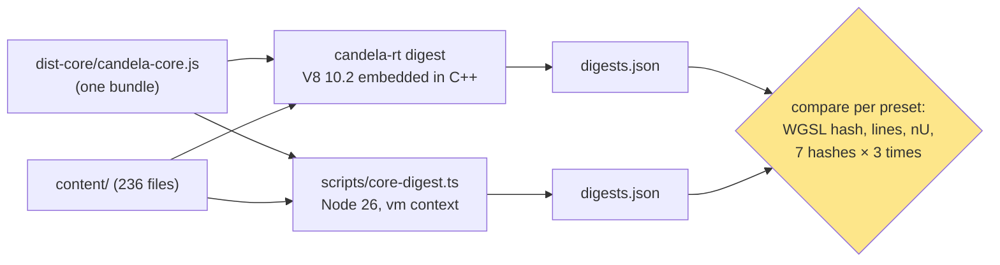

# Candela Render Runtime: Running Candela Scenes in Embedded V8 — A Technical Deep Dive

Candela's scenes are JavaScript programs, and its renderer is a GPU kernel. To render those scenes with NVIDIA OptiX on the DGX Spark, the program that drives the GPU must also be able to run the scenes' JavaScript, including the code that runs on every frame. This report describes the first milestone of that program, `candela-rt`: a C++ executable that embeds Google's V8 JavaScript engine, loads Candela's engine as a single bundled script, and builds every one of Candela's 105 example scenes. It also describes how the project proves that the embedded engine and the browser engine produce exactly the same scene data, the bug that made the first attempt hang, and the change that made Candela's builds deterministic.

The report assumes no prior knowledge of Candela, V8 or JavaScript engine embedding. It continues [[PROJECT REPORT - Candela on the DGX Spark - From a JavaScript Scene API to OptiX Ray Tracing - A Technical Deep Dive]], which covers path tracing, OptiX and the measurements that motivated this work.

> [!summary]
> - **The engine runs natively.** `candela-rt` embeds V8 10.2 from Ubuntu's `libnode` package. The whole TypeScript engine, bundled into one 321 KiB script, builds all 105 presets inside it in 6.6 seconds.
> - **The output is identical across engines.** For every preset, the generated GPU program and every data buffer the engine writes at three moments in time hash to the same values in V8 10.2 embedded in C++ and in Node 26: 105 of 105.
> - **Builds are deterministic.** Scene code now sees a seeded `Math.random`. Before the change one preset produced different data on every build, in any engine.
> - **The refactor has a gate.** A golden test records those hashes for all presets. Every later step of the planned engine split must leave them unchanged.

## Why this project exists

The previous milestone established two facts. NVIDIA's ray-tracing hardware traces Candela's scene geometry about sixteen times faster than Candela's WebGPU kernel on an ambient-occlusion workload. And Candela is structured like a compiler: a *front end* runs the user's scene program and produces data, and a *back end* turns that data into a GPU program and GPU buffers. The design that followed (`design-doc/02` in ticket CANDELA-002) adds a second back end for OptiX. It hosts the front end in a native process, so that rendering on the Spark needs neither a browser nor Node.

The front end cannot be reduced to a data file and shipped to C++, because parts of a scene keep running after it is built. Four kinds of scene code run later:

| Callback | When it runs | Example preset |
| --- | --- | --- |
| `export const animation = t => poses` | Every frame, and once per motion-blur sample | K-09, the sewing machine |
| `.behavior((self, { t, dt }) => …)` | Every tick; it keeps state and integrates over `dt` | W-01, a bouncing ball |
| A derived param such as `P.gloss.map(g => 1 - g)` | Whenever the source slider moves | B-02 |
| A static param such as a scene choice | On change, by re-running the whole scene file | K-09's `scene` menu |

The design therefore puts a JavaScript engine inside the native renderer. The whole TypeScript engine runs in it, not only the scene file: the scene API is a JavaScript DSL whose material closures are traced with proxies and whose diagnostics read JavaScript stack traces. Porting that API to C++ would mean writing the language twice. C++ is reserved for what is specific to OptiX and heavy on data.

## Current project status

- `native/rt/` builds `candela-rt` with V8 embedded (commit `bb12bf3`). Its one command so far, `candela-rt digest`, builds presets and prints hashes of what they produce.
- `src/engine/core.ts` and `scripts/bundle-core.ts` produce the engine bundle `dist-core/candela-core.js`.
- `src/engine/digest.ts`, `scripts/core-digest.ts` and `tests/golden-pack.test.ts` implement the equality checks (commits `bb12bf3`, `9cf9c6e`).
- Scene code's `Math.random` is seeded per build (commit `19f016a`).
- Not started: the engine split into front end and targets, the OptiX target, rendering in `candela-rt`, the live workbench. The ticket diary records each step (steps 11 and 12 for this milestone).

## Part 1. What it means to embed a JavaScript engine

### V8 as a library

V8 is the JavaScript engine of Chrome and Node. Both are programs that *embed* it: V8 itself is a C++ library that compiles and runs JavaScript, and the program around it decides what that JavaScript can see and do. A browser gives scripts `document` and `fetch`; Node gives them `require` and the file system. An embedding program can give them anything, or almost nothing.

The pieces of the V8 API that `candela-rt` uses, in the order a program meets them:

| Concept | What it is | Where candela-rt uses it |
| --- | --- | --- |
| Platform | Process-wide services: background threads for the compiler and the garbage collector. | Initialised once in `JsRuntime::initProcess`. |
| `v8::Isolate` | An independent JavaScript heap with its own garbage collector. Values never move between isolates, and only one thread may use an isolate at a time. A memory ceiling is set per isolate. | One per runtime, with a 4 GiB heap limit. |
| `v8::Context` | A global object (`globalThis`) with the ECMAScript built-ins, inside an isolate. The embedder decides what else the global object holds. | One per runtime, holding only `console`, `performance`, `atob` and `btoa`. |
| `Local<T>` and `HandleScope` | Handles through which C++ refers to JavaScript values. A handle is valid while its scope is alive, so the garbage collector knows what C++ is still using. | Everywhere values cross. |
| `Script::Compile` and `Run` | Compile source text and run it in a context. | Loading the engine bundle. |
| Function callbacks | C++ functions that JavaScript can call. | `console.log`, `performance.now`, `atob`. |
| Microtasks | The queue of promise continuations. An embedder that calls an `async` function must run the queue until the returned promise settles. | `JsRuntime::settle`. |
| Backing stores | The memory behind an `ArrayBuffer`. C++ can read a `Float32Array`'s numbers directly, without copying. | `JsRuntime::view<T>`, for the GPU buffers to come. |

The global object's contents are the sandbox. Scene files are user code, and the in-browser agent writes scene code too. In `candela-rt`'s context there is no `require`, no `fetch` and no file system object, so a scene file cannot touch the machine. It can only build a scene.

### Where V8 comes from on the Spark

V8 is large, and building it from source requires Google's own build tools and a long compile. Ubuntu packages Node 18 as a shared library, `libnode.so.109`, with V8's headers in `/usr/include/node`. That V8 is version 10.2, older than the 14.6 in the installed Node 26, but sufficient: the engine bundle targets ES2020.

Two checks were needed before using it. First, the library must export V8's C++ API, not only Node's. It does: `nm -D` lists `v8::platform::NewDefaultPlatform`, `v8::Isolate::New`, `v8::Context::New`, `v8::Isolate::PerformMicrotaskCheckpoint` and `v8::Context::AllowCodeGenerationFromStrings`. Second, the headers must be compiled with the same memory-layout options as the library, or objects are misread at run time. V8 has two such options, pointer compression and 31-bit small integers. Node records how it was built in `/usr/include/node/config.gypi`:

```text
'v8_enable_pointer_compression': 0,
'v8_enable_31bit_smis_on_64bit_arch': 0,
```

Both are off, which matches the headers' defaults, so `candela-rt` needs no special preprocessor definitions. Its CMake file finds the header directory and links `libnode`; nothing else is required.

### What the engine needs from its host

Candela's engine was written for the browser, so the first question was which browser features it depends on. The answer comes from reading `src/engine/candela.ts`, where scene files are executed. The relevant lines (`runFiles`) rewrite `import` and `export` into function calls, then create each module like this:

```js
fn = new Function('__req', '__exports', '__def', 'console', 'Math', ...SCOPE_NAMES,
  '"use strict";\nreturn (async () => {\n' + body + '\n})();\n//# sourceURL=' + path);
await fn(resolve, exportsObj, defaultOf, consoleShim, sceneMath, ...apiValues);
```

Three requirements follow. The context must allow creating functions from strings, which V8 can forbid per context. Every module body is an `async` function, so the host must drive promises. And the module sees the Candela API as function parameters, not globals, so the global object can stay almost empty. Searching the engine and the presets for other browser features found exactly three: `console`, `performance.now()` for build timings, and `atob`, which the sewing-machine preset uses to decode its base64 mesh data. No timers, no `fetch`, no DOM.

### The engine bundle

`src/engine/core.ts` is the entry point for everything that should run outside the browser: `build`, the catalogue loader, and the digest functions described below. `scripts/bundle-core.ts` passes it to esbuild:

```ts
await esbuild.build({
  entryPoints: ['src/engine/core.ts'], bundle: true,
  format: 'iife', globalName: 'Candela',     // one script that defines globalThis.Candela
  platform: 'neutral', target: 'es2020',     // no Node or browser built-ins; syntax V8 10.2 accepts
  outfile: 'dist-core/candela-core.js',
});
```

The result is a single 321 KiB script assembled from 18 source files. Its SHA-256 is written beside it; in the live workbench, browser and server compare that hash to make sure they run the same engine.

## Part 2. The runtime

### Creating the isolate and its global object

`native/rt/src/js_runtime.cpp` wraps the API in a class, `crt::JsRuntime`. The constructor creates the isolate with a heap limit, sets the microtask policy (explained below), and builds the global object from nothing:

```cpp
v8::Isolate::CreateParams cp;
cp.array_buffer_allocator = v8::ArrayBuffer::Allocator::NewDefaultAllocator();
cp.constraints.ConfigureDefaultsFromHeapSize(0, heapLimitBytes);
iso_ = v8::Isolate::New(cp);
iso_->SetMicrotasksPolicy(v8::MicrotasksPolicy::kExplicit);
...
auto ctx = v8::Context::New(iso_, nullptr, global);
ctx->AllowCodeGenerationFromStrings(true);            // build() creates modules with new Function
auto console = v8::Object::New(iso_);
for (const char* level : {"log", "info", "warn", "error", "debug"})
  console->Set(ctx, str(level), fn(hostConsole, holder(level))).Check();
g->Set(ctx, str("console"), console).Check();
g->Set(ctx, str("performance"), perf).Check();      // performance.now → std::chrono::steady_clock
g->Set(ctx, str("atob"), fn(hostAtob, holder("atob"))).Check();
```

Each host function receives a small *holder* object whose internal fields carry a pointer to the `JsRuntime` and, for `console`, the log level. That lets one C++ callback serve all five `console` methods and forward the text to whatever sink the program installs.

### Waiting for a promise from C++

`Candela.digestCatalog(...)` is an `async` function, so calling it returns a promise immediately. The work happens in promise continuations, which V8 keeps in its microtask queue. `JsRuntime::settle` runs that queue, and any platform tasks, until the promise is no longer pending:

```cpp
v8::Local<v8::Value> JsRuntime::settle(v8::Local<v8::Value> v) {
  if (!v->IsPromise()) return v;
  auto p = v.As<v8::Promise>();
  while (p->State() == v8::Promise::kPending) {
    iso_->PerformMicrotaskCheckpoint();
    while (v8::platform::PumpMessageLoop(gPlatform.get(), iso_)) {}
  }
  if (p->State() == v8::Promise::kRejected) throw JsError(stackOf(p->Result()));
  return p->Result();
}
```

The isolate's microtask policy is `kExplicit`. Under V8's default policy, `kAuto`, V8 runs microtasks on its own whenever the JavaScript call depth returns to zero. A host that drives promises itself wants a single place where that happens, and `kExplicit` gives it one.

### Reading numbers without copying them

The OptiX back end will receive its buffers (object records, light records, uniforms) as `Float32Array`s created in JavaScript. A typed array is a view onto an `ArrayBuffer`, whose bytes live in a *backing store* that C++ can address directly:

```cpp
template <class T> std::span<const T> view(v8::Local<v8::Value> v) const {
  auto a = v.As<v8::ArrayBufferView>();
  auto* base = static_cast<const uint8_t*>(a->Buffer()->GetBackingStore()->Data());
  return {reinterpret_cast<const T*>(base + a->ByteOffset()), a->ByteLength() / sizeof(T)};
}
```

The span stays valid while the array is alive, which C++ guarantees by keeping a handle to it. On the GB10, whose CPU and GPU share one memory, this is the first step towards handing frame data to the GPU without any copy.

## Part 3. Proving the two engines agree

### Why equality matters

In the planned live workbench, the browser and `candela-rt` each build the scene from the same inputs: the files, the param values and the seed. The browser needs its own build for the editor's diagnostics, the param panel and the WebGPU preview. `candela-rt` needs its own to render with OptiX and to run the callbacks on its own clock. That arrangement is only correct if the same inputs produce the same scene in both engines. Floating-point arithmetic in JavaScript is IEEE 754 double precision everywhere, so equality is expected. But expectation is not proof, and a single preset that draws random numbers during its build is enough to break it.

### What is compared

`src/engine/digest.ts` computes hashes of everything the compiler produces for one preset. It is part of the bundle, so both engines run identical hashing code and only the engine underneath differs:

- the generated WGSL program (`compiled.shared`), its line count, and the number of uniform rows;
- at times 0, 0.37 and 1.5 seconds, every buffer `pack` writes: `U` (uniforms), `O` (object records), `LI` (lights), `BV` (the top-level BVH), `SDs` and `SDd` (the scene data's static head and dynamic tail), plus pack's metadata, such as the object order and the sun direction.

`pack` is called the way the viewport calls it. A helper, `packEnv`, reproduces `Viewport.repack` from `src/engine/viewport.ts`: poses from the scene's `animation(t)`, the seed, and, for scenes whose camera has motion blur, one set of poses for each sample across the shutter. Without that, the multi-sample code path in `pack` would go untested.

The hash itself is plain JavaScript, two independent 32-bit lanes over the buffer's 32-bit words, because the embedded context has no `crypto` module:

```ts
for (let i = 0; i < words; i++) {
  let k = Math.imul(u32[i], 0xcc9e2d51); k = (k << 15) | (k >>> 17); k = Math.imul(k, 0x1b873593);
  h1 ^= k; h1 = (h1 << 13) | (h1 >>> 19); h1 = (Math.imul(h1, 5) + 0xe6546b64) | 0;
  h2 = Math.imul(h2 ^ u32[i], 0x01000193);
}
```

The Node side of the check, `scripts/core-digest.ts`, loads the same bundle into a fresh `node:vm` context that contains only the four globals `candela-rt` provides. A missing global therefore fails in Node too, instead of being masked by Node's larger environment.



### The first result: one preset that is never the same twice

```text
$ ./build/rt/candela-rt digest --json digest-v8.json
V8 10.2.154.26-node.28; bundle dist-core/candela-core.js loaded in 15.3 ms; content: 236 files, 1.9 MiB
105/105 presets built
$ npx tsx scripts/core-digest.ts --compare digest-v8.json
compare with digest-v8.json: 104/105 identical; differ: D-02 (t=0 O)
$ npx tsx scripts/core-digest.ts --compare digest-node1.json        # Node against Node
compare with digest-node1.json: 104/105 identical; differ: D-02 (t=0 O)
```

Every preset builds in the embedded engine. For 104 of them, the program and every buffer at every time are identical between V8 10.2 in C++ and V8 14.6 in Node 26. The exception, D-02, differs in its object records, and it differs just as much between two runs of the same Node. The cause is in the preset itself:

```js
const jitter = scene.group(g => { for (let i = 0; i < 5; i++)
  g.add(shape.sphere(0.15).at((i - 2) * 0.4, 0.15 + Math.random() * 0.3, 0) … ); });
```

D-02 is a teaching preset about diagnostics. It calls `Math.random()` inside a group's build lambda on purpose, to show warning W501. Its sphere heights are different on every build.

## Part 4. Deterministic builds

### The rule Candela already had

Candela's documentation lists determinism as an invariant. `content/docs/08-invariants.md` says "Build lambdas are deterministic", enforced by "`Math.random` interception" and reported as W501. A group lambda receives its own seeded generator, `(g, { rng }) => …`, which `makeRng(1)` restarts from the same seed in every group. The engine enforced the rule by temporarily replacing the global `Math.random` while a lambda ran and warning on the first call. The warning text told the user the consequence: "the scene hash will change on every run (no caching, no reproducible renders)".

That consequence is precisely what the live workbench cannot accept, so the design (decision D8) makes every build reproducible: scene code sees a `Math.random` seeded at the start of the build.

### The mechanism

Scene modules already receive the Candela API as function parameters. `Math` became one more parameter:

```ts
let rngState = 0;
export function seedSceneRandom(seed: number) { rngState = (seed ^ 0x9e3779b9) >>> 0; }
function sceneRandom() {                       // mulberry32
  noteSceneRandom();                           // W501 if called inside a build lambda
  rngState = (rngState + 0x6d2b79f5) >>> 0;
  let t = rngState;
  t = Math.imul(t ^ (t >>> 15), t | 1);
  t ^= t + Math.imul(t ^ (t >>> 7), t | 61);
  return ((t ^ (t >>> 14)) >>> 0) / 4294967296;
}
const sceneMath = Object.create(Math, { random: { value: sceneRandom, enumerable: false } });
```

`Object.create(Math, …)` makes an object whose prototype is the real `Math`. `sceneMath.sin`, `sceneMath.PI` and the rest resolve to the originals; only `random` is replaced. `build(files, { seed })` resets the state before running the files. The default seed is 0.

The binding lives in the module's scope, so every function the scene defines closes over it. That includes top-level code and build lambdas, and also the callbacks that run later (`animation`, behaviours, derived params). Their random numbers come from the same stream, continuing from where the build left off.

### Keeping the warning

The old detection patched the global `Math.random`, and scene code no longer calls the global. The lambda wrapper now sets a flag, and `noteSceneRandom()` warns when it is set. The seeded function calls it, and so does the patched global, which engine code still reaches. The warning's text had to change, because its claim is no longer true:

```text
before  W501  Math.random() called inside a build lambda: the scene hash will change on every run
              (no caching, no reproducible renders)
after   W501  Math.random() called inside a build lambda: its values depend on every earlier Math.random()
              call in the build, so edits elsewhere change this part of the scene
```

The new text states the remaining problem accurately. The stream is shared by the whole build, so inserting a `Math.random()` call earlier in the file shifts every later value. The lambda's own `rng` does not have that problem, so the hint to use it stays. D-02's notes and the W501 example in `content/docs/40-design-examples.md` were updated to match.

### The result

```text
D-02  seed 0: O 805fc8807a5ece63    W501 … at scene.js:13
D-02  seed 0: O 805fc8807a5ece63    W501 … at scene.js:13
D-02  seed 7: O ebb08ba50c825763    W501 … at scene.js:13
$ npm run test:golden                       → golden pack: 105/105 identical in 8.0 s
$ candela-rt digest + core-digest --compare  → 105/105 identical
```

The same seed now gives the same scene, a different seed a different one, and the warning still points at the right line. Every preset is identical between the embedded engine and Node.

## Part 5. The golden gate

The next phase of the design splits Candela's `compile()` and `pack()` functions. One half becomes target-neutral lowering; the other becomes a WebGPU *target* beside the future OptiX target. Clock, behaviours and poses move out of the browser's application code into an engine class that `candela-rt` can use. None of that may change what the browser renders.

`tests/golden-pack.test.ts` turns that requirement into a test. It records, for all 105 presets, the same digests the cross-engine check uses (the WGSL and every `pack` buffer at three times, with the viewport's exact `env`), in `tests/golden/pack-digests.json`. A run takes 8 seconds. The baseline was committed before any engine file changed (commit `9cf9c6e`). The only re-recording since then was D-02's, deliberately, when its output became deterministic. From here on, a refactoring step is finished when `npm run test:golden` reports 105/105.

## Measurements

| Measurement | Embedded V8 10.2 (C++) | Node 26, `vm` context | Node 26, main context (tsx) |
| --- | --- | --- | --- |
| Load the 321 KiB bundle | 15 ms | – | – |
| Build + compile, all 105 presets | 6.6 s | 149.8 s | about 8 s (golden run, includes hashing) |
| B-01 / K-01 / K-09 build + compile | 84 / 338 / 487 ms | 1,382 / 2,465 / 3,109 ms | 76 / 219 / 576 ms |
| K-09 per frame (`animation` + `pack`) | 0.155 ms | 0.506 ms | 0.20 ms |

Two rows need explanation. Node's `vm` contexts are about twenty times slower than its main context here. The likely cause is that a `vm` context's global object is backed by interceptors, which slow every global lookup; the cause was not profiled. That affects only the Node half of the check, which takes two and a half minutes for that reason; `candela-rt` is unaffected. And per-frame cost is under a third of a millisecond for every preset except a few. The exception is X-02, a stress test with 10,000 objects, at 85 ms per frame: `pack` rebuilds the top-level BVH over all objects on every call. The OptiX back end needs no such BVH, because OptiX builds its own instance acceleration structure, so this cost disappears from the OptiX path rather than needing a faster implementation.

## Failure modes encountered

- **A hang that was not V8's.** The first full run produced no output and was killed after ten minutes. Each preset run on its own under `gdb` worked, with hashes equal to Node's, but two presets in one run spun at 100% CPU. Attaching `gdb` to the running process failed, because the kernel's Yama setting (`/proc/sys/kernel/yama/ptrace_scope` = 1) only allows a debugger to trace its own children. Running the program as `gdb`'s child and sending `SIGINT` to the program, not to `gdb`, stopped it and produced the backtrace: `std::string::find(',')` in `main.cpp:70`. The code that turned `--ids B-01,K-01` into a JSON array replaced every `,` with `","`, a string that itself contains a comma, so the loop never ended. A single id has no comma, which is why single presets worked. Splitting with `std::getline` fixed it.
- **A plausible fix for the wrong cause.** Before the backtrace, the suspected cause was the promise loop, and the microtask policy was changed to `kExplicit`. It was not the cause, but it is the right policy for a host that drives promises itself, so it stayed, with a comment saying why.
- **A slow reference.** The Node `vm` context's twenty-fold slowdown first looked like a problem with the bundle. Comparing with the main context located it in `vm`.

## Open questions

- Is V8 10.2 from `libnode` sufficient for the life of the project, or will a self-built current V8 be needed? `JsRuntime` keeps the dependency in one class.
- The expression evaluator still uses the global `Math.random` for the `rand` operation (`src/engine/fx.ts:444`). No preset's digest changed because of it, but it is a remaining source of nondeterminism.
- Scene code shares one random stream per build. Should each module get its own stream, keyed by its path, so that adding a `lib/` file does not shift `scene.js`'s values?

## Near-term next steps

- Move the clock, behaviours and poses into an engine `SceneSession` class, gated by the golden test, with W-01, K-09 and B-02 exercising behaviours, animation and derived params.
- Split `compile` and `pack` into lowering and a WebGPU target; the browser keeps working, byte for byte.
- Add the CUDA dialect to the code generator and translate the kernel; compile every preset's program with NVRTC.

## Important project docs and code

- Design: `ttmp/2026/11/21/CANDELA-002--…/design-doc/02-candela-as-a-compiler-with-backends-the-v8-and-optix-render-runtime.md`
- Diary: `ttmp/2026/11/21/CANDELA-002--…/log/01-diary.md`, steps 11 and 12; evidence in `various/13-phase0-v8-embedding.txt`
- Runtime: `native/rt/src/js_runtime.{h,cpp}`, `native/rt/src/main.cpp`, `native/rt/CMakeLists.txt`
- Bundle and checks: `src/engine/core.ts`, `scripts/bundle-core.ts`, `src/engine/digest.ts`, `scripts/core-digest.ts`, `tests/golden-pack.test.ts`
- Determinism: `src/engine/candela.ts` (`sceneMath`, `seedSceneRandom`), `src/engine/scene.ts` (`noteSceneRandom`, `withBuildLambda`)

```sh
npm run bundle:core
cmake -G Ninja -S native/rt -B build/rt && ninja -C build/rt
./build/rt/candela-rt digest --json /tmp/v8.json
npx tsx scripts/core-digest.ts --compare /tmp/v8.json      # 105/105 identical
npm run test:golden                                        # 105/105 identical
```

## Related notes

- [[PROJECT REPORT - Candela on the DGX Spark - From a JavaScript Scene API to OptiX Ray Tracing - A Technical Deep Dive]]
- [[ARTICLE - PicoCalc Candela Compiler Lab - From a Typed scene description to pixels on the PicoCalc]]

## Project working rule

Prove sameness before speed. The engine moves into a new host only after the host has been shown to produce, byte for byte, what the browser produces for every preset. Every refactoring step after this one is finished only when the golden test still reports 105 of 105.
