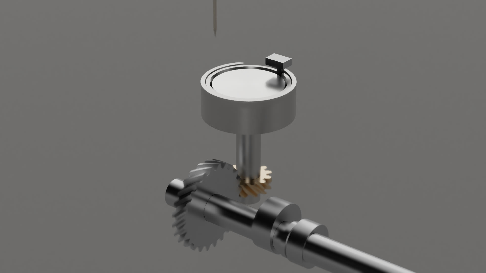
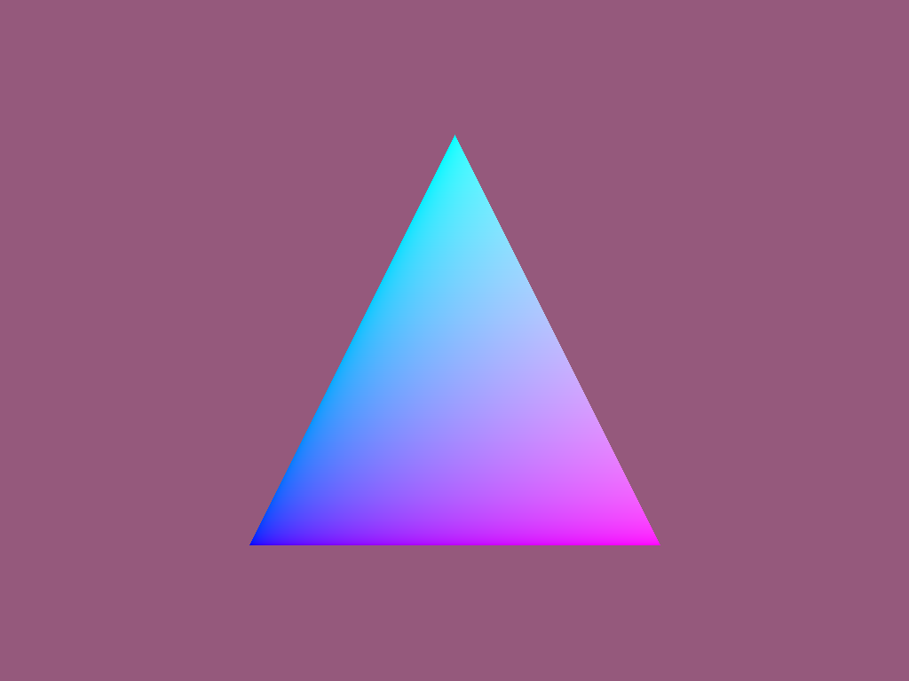
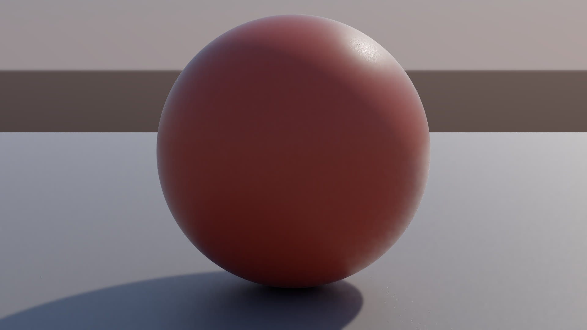
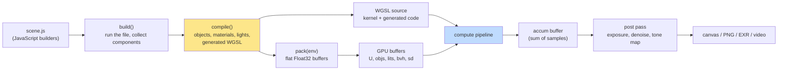
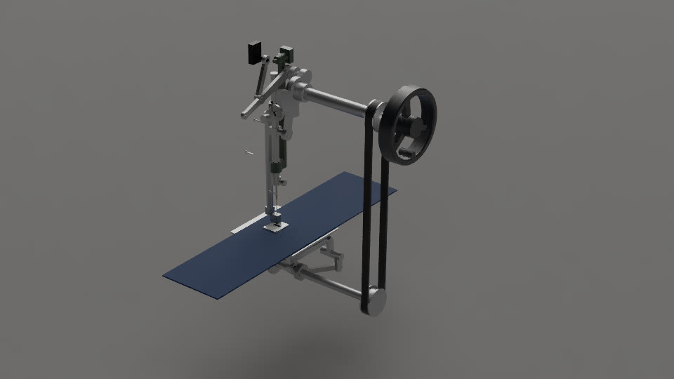
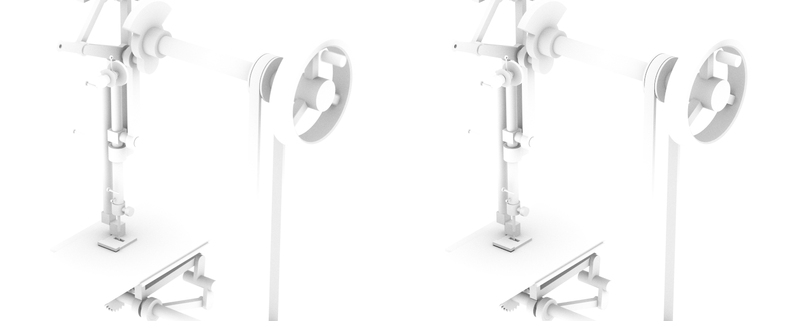
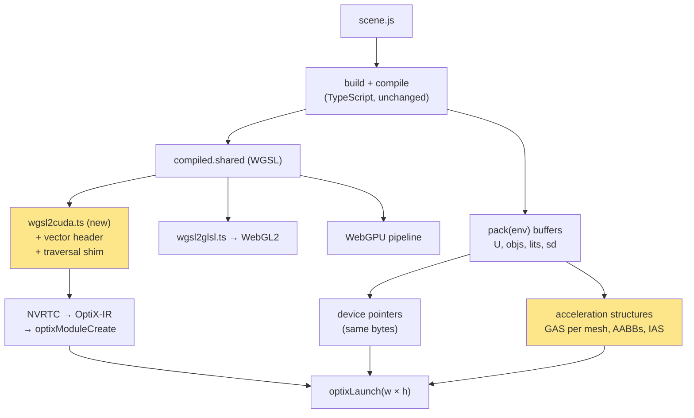
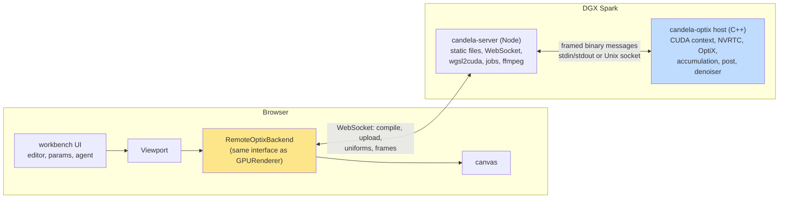

# Candela on the DGX Spark: From a JavaScript Scene API to OptiX Ray Tracing — A Technical Deep Dive

Candela is a physically based renderer whose scenes are written as JavaScript. A scene file describes shapes, materials, lights and a camera with a builder API; a compiler turns that description into a GPU program and a set of data buffers; a path tracer running on the GPU turns those into an image. Until this project, Candela ran only inside a web browser, on WebGPU or WebGL2, and in the environment it came from, on a software rasteriser with no GPU at all. This report follows the work of moving it onto an NVIDIA DGX Spark: first giving the browser the real GPU, then measuring where the time goes, then building a small OptiX program that traces Candela's own scene data on the GPU's ray-tracing hardware, and finally designing how the whole JavaScript API can be compiled down to OptiX and driven from a live workbench.

The report is written for a reader who knows how to program but is new to rendering, new to GPU programming and new to this codebase. Every concept is introduced before it is used, and every number comes from a measurement made on the machine.

> [!summary]
> - **The browser on the real GPU.** Headless Chromium reaches the Spark's GB10 GPU once it is launched with the right binary and flags. Rendering is 18–51× faster than the software rasteriser Candela used before; one 1080p lockstitch animation stitch at 64 samples per pixel takes 3.9 minutes (`scripts/render-preset.ts`, `tools/lockstitch/render.ts`).
> - **Where the time goes.** Candela traverses its geometry in shader code, so the GPU's ray-tracing cores sit idle. Scenes made of meshes are bound by that traversal.
> - **What OptiX buys.** A spike that loads Candela's packed scene into OptiX and runs Candela's ambient-occlusion estimator traces 1,721 full-frame samples per second at 1080p, against 105 for the WebGPU kernel, with images that agree to 0.1 grey levels on average.
> - **How the JavaScript API reaches OptiX.** The front end stays as it is. A second code target translates the generated WGSL to CUDA, replaces exactly one function (`traceAll`) with `optixTrace`, and reads the same packed buffers. A live workbench gets a third viewport backend that talks to a render server on the Spark.



*The rotary hook of the lockstitch sewing-machine scene (preset K-09), rendered by the existing WebGPU kernel on the GB10 at 1920×1080 and 64 samples per pixel in 4.0 seconds.*

## Why this project exists

Candela's scenes include a sewing-machine head converted from CAD data: 27 parts, 23,701 triangles, animated by a kinematic rig. Its renderer, `tools/lockstitch/render.js`, rendered each scene through a headless browser using SwiftShader, a CPU implementation of the GPU APIs. On a machine with no GPU that is the only option, and it is slow: on this machine, at 640×360, the software path manages 1.8 samples per second on a mesh scene.

The DGX Spark has a Blackwell-generation GPU with dedicated ray-tracing hardware, a hardware video encoder and 128 GB of memory shared between CPU and GPU. The project's question is how much of that hardware Candela can use, and in what order the work should be done. An earlier plan, written without access to the machine, proposed three steps: run the existing browser renderer on the real GPU; run the same WebGPU code natively in Node without a browser; and write a second backend on NVIDIA OptiX. This report checks that plan against measurements, completes the first step, prototypes the third, and designs how the third step turns into a live, interactive workbench.

## Current project status

- The repository `/home/manuel/code/wesen/2026-11-21--pbr-spark` is a standalone TypeScript port of the Candela workspace (ticket CANDELA-001). The GPU work lives in ticket CANDELA-002 under `ttmp/2026/11/21/CANDELA-002--…/`, with an intern guide, a detailed diary (eight steps) and every measurement in `various/`.
- **Step 1 is implemented.** `scripts/render-preset.ts` renders any preset headless on the GPU through the workbench's own render queue; `tools/lockstitch/render.ts` replaces the old `render.js`. Commit `95e8550`.
- **Step 3 has a working spike.** `scripts/scene-package.ts` exports a scene; `native/optix/` builds `candela-optix-ao`, which traces it with OptiX. Commit `412a4e1`.
- **Step 2 (a native Dawn runner) is not started.** Its prerequisites are verified: the `webgpu` npm package reaches the GPU from Node, and ffmpeg's NVENC encoders work.
- The compiler target for OptiX and the live workbench described below are designs, not code.

## Part 1. Foundations

### How a path tracer computes an image

An image is a grid of pixels, and the colour of a pixel is the light that arrives at the camera through that pixel. A *path tracer* estimates that light by simulation. It starts a ray at the camera, passing through a random point inside the pixel, and finds the first surface the ray hits. The surface's material is described by a *BSDF* (bidirectional scattering distribution function), which states how much light arriving from one direction leaves in another. The path tracer asks the BSDF for a random outgoing direction, follows the ray in that direction to the next surface, and repeats. When the path hits a light, or leaves the scene into the sky, the light it carries is added to the pixel, weighted by everything the path bounced off on the way.

One such random path is a *sample*. A single sample is a noisy estimate; the average of many samples converges to the correct colour, and the remaining error falls with the square root of the sample count, so four times as many samples halve the noise. Renderers therefore talk about *samples per pixel* (spp). Throughout this report, throughput is measured in *full-frame samples per second*: how many times per second the renderer adds one sample to every pixel of the image. At 1080p one full-frame sample is 2,073,600 paths.

Candela's path tracer uses the standard techniques that make the estimate converge faster:

- **Next-event estimation (NEE).** At every bounce the path tracer also picks a point on a light and sends a *shadow ray* towards it. If nothing blocks it, that light's contribution is added directly. Paths no longer need to hit small lights by chance.
- **Multiple importance sampling (MIS).** Light can reach a pixel both through NEE and through the BSDF's own random direction. MIS weights the two estimates so that each is used where it has less noise and neither is counted twice.
- **Russian roulette.** After a few bounces a path is terminated at random, with a probability that depends on how much light it can still carry; surviving paths are weighted up to keep the average correct.

The expensive operation in all of this is the question "what is the first surface along this ray?". Testing a ray against each of 23,701 triangles would be far too slow, so renderers organise geometry in a *bounding volume hierarchy* (BVH): a tree whose nodes are axis-aligned boxes, each containing the boxes of its children, with triangles or whole objects at the leaves. A ray only descends into boxes it intersects, which reduces the work from linear in the number of primitives to roughly logarithmic. Building good trees uses the *surface area heuristic* (SAH), which chooses splits that minimise the expected cost of a random ray.

### What a GPU program is

A GPU runs the same function on thousands of threads at once. In a path tracer, each thread computes one pixel. On the web, the API for this is *WebGPU*: the program is written in *WGSL* (WebGPU Shading Language), compiled by the browser, and launched as a *compute dispatch* over a grid of threads (in Candela, workgroups of 8×8 threads covering the image). The program reads and writes *storage buffers*, flat arrays of numbers that the host (the JavaScript side) fills before the dispatch. WebGL2, the older web API, has no compute shaders; Candela runs its kernel there as a fragment shader that writes floating-point textures, after translating WGSL to GLSL.

A compute shader can implement a BVH traversal itself, with a stack and a loop, and Candela's does. That works on any GPU, but it uses the general-purpose cores for a task that modern NVIDIA GPUs have dedicated hardware for.

### Hardware ray tracing and OptiX

Since the Turing generation, NVIDIA GPUs contain *RT cores*: fixed-function units that traverse a BVH and intersect rays with triangles without running shader instructions. RT cores are only reachable through ray-tracing APIs (OptiX, Vulkan ray tracing, DirectX Raytracing), not through compute shaders, so a WebGPU program cannot use them.

*OptiX* is NVIDIA's CUDA-based ray-tracing API. Its programming model has a small number of parts, and the rest of this report uses all of them:

| OptiX concept | What it is |
| --- | --- |
| Geometry acceleration structure (GAS) | A BVH over the triangles of one mesh, built by the driver and traversed by the RT cores. |
| Instance acceleration structure (IAS) | A BVH over *instances*: each instance points at a GAS and carries a 3×4 object-to-world transform. One mesh can appear many times with different transforms. |
| Ray-generation program (raygen) | The function launched once per pixel; it creates rays and calls `optixTrace`. |
| Closest-hit program | Runs once for the nearest intersection a ray found; typically records what was hit. |
| Miss program | Runs when a ray hits nothing. |
| Intersection program | Runs for custom (non-triangle) primitives, whose BVH leaves are axis-aligned boxes; it computes the actual hit, such as a ray–sphere intersection. |
| Any-hit program | Runs for every candidate hit, used for alpha cut-outs and clipping. |
| Payload | A few 32-bit registers passed into `optixTrace` and written by the hit and miss programs; this is how results come back. |
| Shader binding table (SBT) | A table of records that tells OptiX which program runs for which geometry and ray type. |
| Pipeline | The linked set of programs, compiled from CUDA to OptiX-IR or PTX by `nvcc` ahead of time or by NVRTC at run time. |

The core loop of an OptiX renderer is short. The raygen program computes a camera ray and calls `optixTrace(handle, origin, direction, tmin, tmax, …, payload…)`. The RT cores walk the IAS and GAS, the closest-hit or miss program fills the payload, and control returns to raygen with the answer.

### The machine

The DGX Spark's GPU is the GB10, compute capability 12.1 (`sm_121`). Its 128 GB of LPDDR5x memory is shared by the CPU and GPU, so there is no separate video memory. The system runs CUDA 13.0 and driver 580.178.04. The driver contains the OptiX runtime; the OptiX SDK, which contains only headers and samples, is a separate download. One detail cost an iteration: the driver's OptiX runtime is version 9.0.2 with ABI (interface) version 110. The current SDK, 9.1.0, compiles programs for ABI 118, and its sample builds but fails at `optixInit()` with `OPTIX_ERROR_UNSUPPORTED_ABI_VERSION`. SDK 9.0.0 (ABI 105) works, and its `optixTriangle` sample renders correctly for `sm_121`.



*The OptiX SDK 9.0.0 `optixTriangle` sample on the GB10: the first OptiX program to run on this machine.*

## Part 2. How Candela turns JavaScript into pixels

### A scene file

The simplest preset, `B-01 Hello sphere`, is the whole of `content/presets/B-01-hello-sphere.js`:

```js
import { scene, shape, material, light, camera, units as u } from 'candela';

export default scene()
  .add(shape.sphere(1).at(0, 1, 0)
    .material(material.pbr().baseColor('#c8553d').roughness(0.4)))
  .add(shape.plane(30)
    .material(material.pbr().baseColor(0.18)))            // an 18 % grey card
  .light(light.daylight({ elevation: u.deg(40), turbidity: 3 }))
  .camera(camera.thinLens().at(0, 1.6, 6).lookAt(0, 0.9, 0));
```

Every call returns a builder, an immutable description of a component, so a scene file is a JavaScript program whose result is a data structure, not an image. Values that the user can adjust are *params*: `param.float(2).range(0.25, 8)` creates a slider, `param.choice([...])` a menu. Material properties can also be *field expressions*, small graphs of operations (noise, mixing, arithmetic over position and time) that become shader code.



*B-01 at 1080p and 64 samples per pixel on the GB10: 2.0 seconds including PNG encoding.*

### The pipeline



Each stage has one job, and the boundaries between them are what make a second backend possible.

- **`build(files)`** (`src/engine/candela.ts`) runs the scene file in a sandbox against the Candela API and returns the scene's components, its optional `animation(t)` function, and diagnostics.
- **`compile(scene, engine)`** (`src/engine/compile.ts`) lowers components to a list of objects (each with a shape type, a material index, a transform recipe), a list of lights and a list of materials, and *generates WGSL*: one function per material, per signed-distance field, per density field, concatenated with the hand-written kernel from `src/engine/kernel.ts` (about 1,500 lines). The result, `compiled.shared`, is 1,811 lines of WGSL for the gear scene K-01 and 2,078 for the lockstitch scene K-09.
- **`compiled.pack({ time, poses })`** evaluates every transform and param at one moment in time and writes flat `Float32Array`s. It runs again whenever a param moves or the clock ticks; `compile` runs again only when the *structure* changes.
- **The viewport** (`src/engine/viewport.ts`) uploads the buffers, dispatches the kernel once per frame, counts samples, meters exposure automatically and runs the post pass that displays the image.

The distinction between *static* and *dynamic* params follows from this split. A dynamic param, such as a roughness slider, gets a slot in the uniform buffer (rows from 32 upwards); moving it re-runs `pack` and restarts accumulation, with no recompilation. A static param, such as a scene choice, changes which components exist, so it re-runs `build` and `compile`.

### The buffers the GPU reads

`pack` produces buffers whose layouts the kernel reads by index. Every buffer is an array of `vec4f` rows.

| Buffer | Binding | Contents |
| --- | --- | --- |
| `U` (uniforms) | 0 | Row 0 `[width, height, frameIndex, samplesPerDispatch]`; rows 1–4 the camera (origin and lens radius, right vector scaled by the horizontal field of view, up vector, forward vector); integrator settings; counts; param values from row 32. |
| `objs` | 1 | Six rows per object: `[type, material, light, flags]`, the world-to-object 3×4 matrix (three rows), shape parameters, `[random id, original index, motion block, bound]`. |
| `lits` | 2 | Six rows per light. |
| `bvh` | 3 | Two rows per top-level BVH node, over objects. |
| `sd` (scene data) | 4 | A static head (each mesh's own BVH and its triangles at 112 bytes each, face tables, environment-map tables) and a dynamic tail (media, motion poses). |
| `accum`, `aovA`, `aovN` | 5–7 | Outputs: the running sum of samples, and albedo and normal images for the denoiser. |

For K-09 the static head is 19.0 MiB, of which 16 MiB are the environment-map sampling tables for a 1024×512 HDR image. Shape types are numbered: sphere 0, plane 1, rect 2, disk 3, box 4, cylinder 5, and so on up to signed-distance fields 11, heightfields 12 and meshes 13.

### The kernel and the one function that traverses

The kernel is organised as a call tree. For each pixel, `renderPixel` loops over the samples of this dispatch, generates a camera ray (`cameraRay`), and calls `tracePath`, which bounces, samples lights and evaluates materials. All geometric queries go through two functions, `traceScene` (closest hit) and `occluded` (any hit within a distance), and both call one function, `traceAll`:

```wgsl
struct TraceR { t: f32, obj: i32, }
fn traceAll(ro: vec3f, rd: vec3f, tmax: f32, shadow: bool) -> TraceR {
  var r: TraceR; r.t = tmax; r.obj = -1;
  // unbounded objects (infinite planes) are tested one by one
  for (var i: i32 = nB; i < nObj; i++) { ... let t: f32 = hitObj(i, ro, rd, r.t); if (t < r.t) { r.t = t; r.obj = i; } }
  // bounded objects: walk the top-level BVH with an explicit stack of 40 entries
  loop { ... if (!hitAABB(ro, inv, a.xyz, b.xyz, r.t)) { continue; } ... hitObj(oi, ro, rd, r.t) ... }
  return r;
}
fn traceScene(ro: vec3f, rd: vec3f, tmax: f32) -> Hit {
  let r: TraceR = traceAll(ro, rd, tmax, false);
  if (r.obj < 0) { return noHit(); }
  return finishHit(r.obj, ro, rd, r.t);
}
```

`hitObj(i, ro, rd, tmax)` transforms the world ray into object `i`'s local frame (applying motion-blur poses when the object moves) and dispatches on the shape type: analytic formulas for spheres, boxes and cylinders, ray marching for signed-distance fields, and for meshes `hitMesh`, a second BVH walk over the mesh's own tree followed by Möller–Trumbore ray–triangle tests. When a mesh triangle is hit, `hitMesh` stores the triangle index and barycentric coordinates in two private globals, `gTri` and `gBary`, which `finishHit` later reads to interpolate the shading normal and texture coordinates.

This structure is the most important fact for everything that follows. Traversal is concentrated in `traceAll` and the functions it calls. Everything outside it (cameras, materials, lights, media, spectral rendering, post-processing) only consumes `(t, obj)` plus `gTri`/`gBary`.

### Backends are interchangeable behind one interface

`src/engine/render.ts` contains two backends with the same methods, and the viewport only talks to that interface:

| Method | Purpose |
| --- | --- |
| `compile(compiled, dispSrc)` | Build the trace pipeline from `compiled.shared` and the display pipeline. |
| `resize(w, h)` | Reallocate the accumulation and AOV buffers. |
| `upload(packed)`, `uploadSD(packed)`, `setUniforms(U)` | Copy `pack`'s buffers to the GPU. |
| `trace()` | Dispatch one batch of samples. |
| `busy()` | Back-pressure: true while two dispatches are in flight. |
| `display(D, denoise)` | Run the post pass (exposure, optional à-trous denoise, tone map) into the canvas. |
| `readAccum()`, `readBuf(name)`, `readRGBA8()` | Read results back for files and exposure metering. |
| `idle()`, `saveAccum()`, `restoreAccum()`, `dispose()` | Synchronisation and lifecycle. |

The WebGL2 backend gets its shader from the same WGSL through `src/engine/wgsl2glsl.ts`, a 59-line translator that works because the kernel and the code generator are written in a strict subset of WGSL: typed declarations, one struct member per line, `select(f, t, c)` with scalar conditions, no pointers, no `switch`. The OptiX design below adds a third backend and a third translation target along exactly these lines.

## Part 3. Measurements on the GB10

### Step 1: giving the browser the GPU

Two problems kept Candela's headless renders off the GPU. Playwright's "new headless" mode (the full Chromium binary) reports no GPU adapter on this machine; the separate *headless shell* binary does, when launched with `--use-angle=vulkan --enable-features=Vulkan --enable-unsafe-webgpu --ignore-gpu-blocklist`. And WebGPU needs a secure context, so the test page must be served from `localhost`, not opened as `about:blank`. With both fixed, the WebGL2 renderer string and the WebGPU adapter report the NVIDIA GB10.

Throughput of the unmodified renderer, in full-frame samples per second:

| Scene | Size | WebGPU | WebGL2 | SwiftShader (CPU) |
| --- | --- | --- | --- | --- |
| B-01 sphere | 640×360 | 190 | 386 | 3.7 |
| B-01 sphere | 1920×1080 | 94.5 | 92.3 | – |
| M-07 (materials) | 640×360 | 136 | 151 | – |
| M-07 (materials) | 1920×1080 | 23.8 | 22.4 | – |
| K-01 gears, 12,024 triangles | 640×360 | 32.2 | 21.4 | 1.8 |
| K-01 gears | 1920×1080 | 4.5 | 3.2 | – |
| K-09 lockstitch, 23,701 triangles | 640×360 | 65.7 | – | – |
| K-09 lockstitch | 1920×1080 | 12.4 | – | – |

Two patterns explain these numbers. At small sizes, the simple scene is limited by per-sample overhead: the render loop in `src/engine/output.ts` dispatches one sample and waits for the GPU to go idle before the next, so the sphere at 640×360 gains little from a faster GPU. At large sizes and with meshes, the limit is the traversal in `traceAll` and `hitMesh`, which runs on the general-purpose cores. The GPU is 18–51× faster than SwiftShader, which settles step 1's value, and the mesh numbers show where step 3 has to act.

`scripts/render-preset.ts` turns this into a tool. It serves the built workbench on localhost, launches the headless shell with the GPU flags, loads a preset by its id, applies params through the param handles (a static param triggers a rebuild, and the script waits for it), and submits the job to the workbench's own render queue, so seeding, exposure locking, sequences and the PNG, EXR and WebCodecs video writers are the ones the UI uses. Files come back to Node in 3 MiB base64 chunks through `page.exposeFunction`. The script refuses to render on a software adapter unless asked. `tools/lockstitch/render.ts` uses it to render the seven sewing-machine scenes in one browser session, setting the K-09 params `scene`, `stitch` and `orbit` where the old tool patched the scene's source text.

```sh
npm run build
npx tsx tools/lockstitch/render.ts --scenes 7 --size 1920x1080 --spp 64 --fps 24 --stitch 2
# S-07 Whole head: S-07-whole-head.mp4 · 23701 tris, 30 materials · render 230.5 s
```

One stitch is 48 frames; 48 × 64 samples in 230.5 seconds is 13.3 full-frame samples per second.



*K-09, scene S-07 (the whole head), 960×540 at 32 samples per pixel: 2.0 seconds.*

### Video and native WebGPU

The browser offers only software H.264 and VP9 encoders through WebCodecs; NVIDIA's hardware encoder (NVENC) is not exposed. Ubuntu's arm64 `ffmpeg` 6.1.1 does include `h264_nvenc`, `hevc_nvenc` and `av1_nvenc`, and the GB10 encodes 96 frames of 4K HEVC Main 10 or 10-bit AV1 in 2.2–3.5 seconds. The `webgpu` npm package (Google's Dawn implementation of WebGPU, as a Node addon) runs on this arm64 machine and reports the GB10 with a maximum buffer size of 1 TiB. Both are inputs to step 2, which has not been started.

### A limit that is not where the plan put it

The earlier plan named WebGPU's default of eight storage buffers as a constraint for large scenes. The code requests raised limits but caps them itself: `GPURenderer.create` asks for at most 10 storage buffers and at most 1 GiB per buffer and binding. The cap that matters is the second one: all scene data lives in one `sd` binding, so a scene's triangles, at 112 bytes each, must fit in 1 GiB minus the environment tables, about 9 million triangles. CUDA has no such binding limit; an OptiX backend addresses the GB10's whole memory with plain device pointers.

## Part 4. The OptiX spike

### What the spike measures and why

The question behind step 3 is how much faster Candela gets when traversal moves to the RT cores. A complete OptiX backend is a large piece of work, so the spike isolates the part that changes. It uses Candela's *ambient occlusion* (AO) integrator, which the WGSL kernel already contains (`traceAOV` mode 4): for each sample, one jittered camera ray, and where it hits, one ray in a random cosine-weighted direction around the surface normal, limited to a radius. The pixel value is the fraction of those rays that escape. AO is almost pure traversal, with negligible shading, so comparing the WebGPU kernel and an OptiX program on the same AO workload measures traversal speed directly.

For the comparison to mean anything, both renderers must trace the same geometry, from the same camera, at the same moment of the animation, with the same estimator. The spike therefore takes its data from Candela's own pipeline rather than re-exporting the CAD model.

### The scene package

`scripts/scene-package.ts` builds a preset in Node (the engine runs unchanged outside the browser), evaluates its `animation(t)` poses, runs `pack`, and writes a *version-0 scene package* to `~/data/pbr-spark/packages/<id>/`:

```text
scene.json     { format: "candela-scene-package", version: 0, time,
                 camera:    { width, height, U1, U2, U3, U4 },        // the kernel's camera rows
                 meshes:    [{ name, triangles, offset }],             // offset in triangles into geometry.bin
                 instances: [{ mesh, transform[12], object, ty, mat }],
                 skipped:   { <shape type>: count } }
geometry.bin   float32, 9 per triangle (three positions in object space), all meshes back to back
```

Three details make the package faithful. First, the instance transforms are computed from the packed object records: `pack` writes each object's *world-to-object* matrix, and the exporter inverts it with the engine's own `inv34`. Candela's matrices are 3×4 row-major, which is exactly the layout of `OptixInstance::transform`, so they are copied without reordering. Second, the camera is `cameraUniforms(...)`, the same four rows the kernel reads. Third, planes, rectangles and boxes are flat-faced, so the exporter writes them as exact triangles; without them the comparison would differ in the backdrop.

```sh
npx tsx scripts/scene-package.ts K-09
# K-09 t=0: 36 meshes, 36 instances, 23715 triangles, skipped {} → ~/data/pbr-spark/packages/K-09
```

### The OptiX program

`native/optix/` contains three source files. `src/params.h` declares the launch parameters shared by host and device: the accumulation buffer, image size, the four camera vectors, the AO radius and the IAS handle. `src/ao.cu` holds the device programs, compiled by `nvcc -optix-ir -arch=sm_121` into an OptiX-IR file at build time. `src/main.cpp` is the host.

The raygen program reproduces the WGSL estimator line by line: the same pixel jitter and normalised-device-coordinate formula, a geometric normal flipped to face the incoming ray, the same `4·EPS` offset (`EPS = 0.0002`, from `kernel.ts`), and a cosine-weighted direction built as in the kernel's `cosHemi`:

```cuda
optixTrace(params.handle, params.eye, dir, 0.f, 1e16f, 0.f, OptixVisibilityMask(255), OPTIX_RAY_FLAG_NONE,
           RAY_CAMERA, RAY_TYPES, RAY_CAMERA, p0, p1, p2, p3);          // payload: t, normal.xyz
const float t = __uint_as_float(p0);
if (t < 0.f) continue;                                                 // AO of a miss is 0
...
unsigned vis = 0;
optixTrace(params.handle, P + Ng * (EPS * 4.f), d, 0.f, params.aoRadius, 0.f, OptixVisibilityMask(255),
           OPTIX_RAY_FLAG_TERMINATE_ON_FIRST_HIT | OPTIX_RAY_FLAG_DISABLE_CLOSESTHIT | OPTIX_RAY_FLAG_DISABLE_ANYHIT,
           RAY_SHADOW, RAY_TYPES, RAY_SHADOW, vis);                     // the shadow miss program sets vis = 1
ao += (float)vis;
```

The occlusion ray uses three flags that only make sense with hardware traversal. `TERMINATE_ON_FIRST_HIT` stops at any blocker instead of searching for the nearest; `DISABLE_CLOSESTHIT` and `DISABLE_ANYHIT` mean no program runs on a hit at all, so the only code that runs for a blocked ray is the traversal hardware. The closest-hit program for camera rays reads the hit triangle's vertices with `optixGetTriangleVertexData` (which requires building the GAS with `OPTIX_BUILD_FLAG_ALLOW_RANDOM_VERTEX_ACCESS`) and transforms the normal to world space with `optixTransformNormalFromObjectToWorldSpace`.

The host follows the standard sequence: create a device context; build one compacted GAS per mesh with `PREFER_FAST_TRACE`; build an IAS over the 36 instances; load the OptiX-IR module; create program groups for raygen, two miss programs and one hit group; link the pipeline with stack sizes computed by `optixUtilComputeStackSizes`; fill a shader binding table with one raygen record, two miss records and two hit records (one per ray type); then launch, 16 samples per launch, timed with CUDA events. It writes the mean AO as an uncompressed floating-point EXR.

### Results

```text
device NVIDIA GB10 (sm_121), OptiX 9.0.0
scene K-09 t=0: 36 meshes, 36 instances, 23715 triangles; GAS 671.0 KiB, IAS 7.2 KiB, built in 22.6 ms
1920x1080, 1024 spp (16 per launch), AO radius 0.05: 594.9 ms → 1721.2 full-frame spp/s, 3569 Msamples/s, 7138 Mrays/s
coverage 1.0000, mean AO over hits 0.9894
```

The WebGPU kernel, run through `render-preset.ts` with the engine replaced by `engine.offline().integrator(integrator.ao({ radius: 0.05 }))` and the time fixed at 0, reaches 104.7 full-frame samples per second, with a mean AO of 0.9894. Converting both images to 8-bit with the same gamma, the mean absolute difference is 0.10 grey levels, the 99th percentile is 3, and 0.016% of pixels differ by more than 16 levels (Monte Carlo noise along edges).

| Renderer | Full-frame samples/s at 1080p | Ratio |
| --- | --- | --- |
| WebGPU kernel, AO | 105 | 1× |
| OptiX on RT cores, AO | 1,721 | 16.4× |
| WebGPU kernel, full path tracer (for reference) | 13.2 | – |



*The same crop of K-09's AO image: WebGPU kernel (left), OptiX spike (right), both at 1024 samples per pixel.*

Two caveats bound what this proves. AO is the most favourable workload for hardware traversal, because it spends almost no time shading. The full path tracer evaluates materials, samples lights and walks media at every bounce, and that work does not get faster on RT cores, so its speed-up will be smaller than 16×. How much smaller is the first thing a full backend will measure. Second, the WebGPU number includes the per-sample dispatch-and-wait of Candela's render loop; batching (step 2) would raise it somewhat. The GAS figures carry a further consequence: building every mesh's acceleration structure takes 23 ms and the IAS is 7 KiB, so an animated scene can rebuild its instance tree every frame at negligible cost.

## Part 5. Compiling the JavaScript API down to OptiX

### The decision: keep the front end, add a target

There are three ways to make Candela scenes run on OptiX. One is to write a new compiler from the scene components straight to CUDA. Another is to reimplement the compiler in C++. The third is to keep everything up to and including `compile` and `pack`, and add a second *code target* that turns the WGSL Candela already generates into CUDA. The third is the right one, for reasons that follow from Part 2.

The JavaScript API, the builders, the param system, field expressions and the material code generator are the largest and most carefully tested parts of Candela, and none of them know about GPUs; they produce a WGSL string and a set of flat buffers. The kernel that consumes those is written in a deliberately restricted WGSL subset, which is already being translated mechanically to GLSL for WebGL2. And all geometric queries funnel through `traceAll`. So the OptiX backend needs three things: a WGSL-to-CUDA translator, a replacement for `traceAll` built on `optixTrace`, and a host that uploads `pack`'s buffers unchanged. Everything a scene author writes keeps its meaning, and any feature added to the WGSL kernel later reaches OptiX through the same translator.



### What changes and what does not

| Kernel part | On OptiX |
| --- | --- |
| Camera, `renderPixel`, `tracePath` (bounces, NEE, MIS, Russian roulette) | Translated; `renderPixel` is called from the raygen program. |
| Materials, generated field and SDF code, lights, environment map, media, spectral rendering | Translated unchanged. |
| `traceAll` (top-level BVH walk) and `hitMesh` (mesh BVH walk) | Replaced by `optixTrace` and the hit programs. |
| `hitObj` for analytic shapes (spheres, boxes, SDFs, heightfields) | Translated, and called from an intersection program. |
| `finishHit` (normals, UVs, material ids) | Translated unchanged; reads `gTri`/`gBary` set from the hit. |
| Buffer accessors `U(i)`, `objF(i)`, `litF(i)`, `sdF(i)` | Read from device pointers in the launch parameters. |
| The `bvh` buffer | Unused; OptiX builds its own structures. |
| Post pass (exposure, tone map, à-trous denoise) | Translated, or replaced by the OptiX AI denoiser. |

### Translating WGSL to CUDA

The translator follows the design of `wgsl2glsl.ts`: line-oriented rewriting that relies on the kernel's restricted subset, plus a header that gives CUDA the types and functions WGSL has built in. A small kernel function shows the shape of the transformation. In WGSL:

```wgsl
fn cosHemi(u: vec2f) -> vec3f {
  let r: f32 = sqrt(u.x);
  let ph: f32 = TAU * u.y;
  return vec3f(r * cos(ph), r * sin(ph), sqrt(max(0.0, 1.0 - u.x)));
}
```

After translation:

```cuda
__device__ vec3f cosHemi(vec2f u) {
  const float r = sqrt(u.x);
  const float ph = TAU * u.y;
  return vec3f(r * cos(ph), r * sin(ph), sqrt(max(0.0f, 1.0f - u.x)));
}
```

The header defines `vec2f`, `vec3f`, `vec4f` and their integer and unsigned variants as small structs with constructors and arithmetic operators, so constructor calls such as `vec3f(...)` and expressions such as `r * cos(ph)` survive unchanged. CUDA's device math library already overloads `sqrt`, `cos` and `max` for `float`, and the header adds the vector forms and WGSL built-ins such as `dot`, `cross`, `normalize`, `mix`, `fract`, `clamp` and `select`. The OptiX SDK's `sutil/vec_math.h` is a model for this header. The rewriting rules are few:

| WGSL | CUDA |
| --- | --- |
| `fn f(a: T) -> R {` | `__device__ R f(T a) {` |
| `let x: T = e;` / `var x: T = e;` | `const T x = e;` / `T x = e;` |
| `1.0`, `0.5` | `1.0f`, `0.5f` (otherwise CUDA computes in double precision) |
| `select(f, t, c)` | `((c) ? (t) : (f))` |
| `loop { … }` | `for (;;) { … }` |
| `array<f32, 40>` | `float[40]` |
| `v.xyz`, `v.xy` (swizzles of two or more components) | `v.xyz()`, `v.xy()` (accessor methods in the header) |
| `i32(x)`, `f32(x)`, `u32(x)` on scalars | `(int)(x)`, `(float)(x)`, `(unsigned)(x)`; vector conversions through header functions |
| `bitcast<u32>(x)` | `__float_as_uint(x)` |

One WGSL feature has no direct CUDA equivalent. The kernel keeps per-thread state in `var<private>` globals: the random-number state `rngS`, the current time `gTime`, the wavelength and its index for spectral rendering, and `gTri` and `gBary`. A CUDA `__device__` global is shared by all threads, so a literal translation would be wrong. The translator instead wraps the whole module in a struct:

```cuda
struct Kernel {
  unsigned rngS = 1u; float gTime = 0.f; float gLam = 550.f; float gTau = 0.5f;
  int gTri = -1; vec2f gBary = vec2f(0.f, 0.f);
  __device__ vec3f cosHemi(vec2f u) { ... }       // every kernel function becomes a member
  __device__ PixOut renderPixel(vec2f px, unsigned frameIx) { ... }
  ...
};
extern "C" __global__ void __raygen__candela() {
  Kernel k;                                        // one instance per thread, in registers and local memory
  const PixOut o = k.renderPixel(pixel, params.frame);
  accumulate(o);
}
```

Member functions read and write the former globals as members, so no function signature changes. The one `var<private>` that is a read-only table, the 256-entry `ETAB` table of precomputed GGX values (generated by `ggxTableWGSL`), becomes `__constant__` memory instead.

### The traversal shim

`traceAll` is the only function written by hand for OptiX. Its contract is unchanged: given a ray, a maximum distance and whether it is a shadow ray, return the nearest hit distance and the packed index of the object hit, and leave `gTri`/`gBary` set for meshes.

```cuda
// design sketch: helper names (nB, nObj, glows, MASK_*, unpackBary) are illustrative
__device__ TraceR Kernel::traceAll(vec3f ro, vec3f rd, float tmax, bool shadow) {
  TraceR r{tmax, -1};
  // unbounded objects (infinite planes) stay a short loop, as in WGSL: they have no finite box
  for (int i = nB(); i < nObj(); i++) {
    if (shadow && glows(i)) continue;
    const float t = hitObj(i, ro, rd, r.t);
    if (t < r.t) { r.t = t; r.obj = i; }
  }
  unsigned p0 = __float_as_uint(r.t), p1 = (unsigned)-1, p2 = 0, p3 = 0, p4 = __float_as_uint(gTime);
  optixTrace(params.ias, ro, rd, 0.f, r.t, 0.f,
             shadow ? MASK_CASTS_SHADOW : MASK_ALL,
             shadow ? OPTIX_RAY_FLAG_TERMINATE_ON_FIRST_HIT : OPTIX_RAY_FLAG_NONE,
             0, 1, 0, p0, p1, p2, p3, p4);
  if ((int)p1 >= 0) { r.t = __uint_as_float(p0); r.obj = (int)p1; gTri = (int)p2; gBary = unpackBary(p3); }
  return r;
}
```

The scene's objects map onto OptiX geometry in two groups.

- **Meshes** become triangle GASes, one per mesh definition, and instances in the IAS whose transform is the inverse of the packed world-to-object matrix (as in the spike) and whose `instanceId` is the object's packed index. The closest-hit program writes `optixGetInstanceId()`, `optixGetPrimitiveIndex()` and the barycentrics into the payload. The triangles must be uploaded in the *same order* as the kernel's per-mesh triangle records in `sd`, because `finishHit` uses `gTri` to index those records for normals and UVs. `blasOf` (`src/engine/mesh.ts`) reorders triangles while building its BVH, so the GAS has to be built from the reordered records, not from the scene file's original order. The spike exported the original order, which is correct for AO but not for shading.
- **Analytic objects** (spheres, boxes, cylinders, SDFs, heightfields) become *custom primitives*: one axis-aligned box per object, in world space, taken from the boxes `pack` already computes for its own BVH (including swept boxes for objects under motion blur). Their intersection program calls the translated `hitObj(i, worldOrigin, worldDirection, tmax)`. Because `hitObj` does its own world-to-object transform from the packed record, these primitives need no OptiX instance transform, and motion-blurred analytic objects work without OptiX motion structures.

Two kernel flags map onto OptiX features. Objects marked as glowing (flag bit 0) are skipped by shadow rays in `traceAll`; on OptiX they are left out of the `MASK_CASTS_SHADOW` visibility bit, so the RT cores skip them. And the intersection program runs in a separate program context that cannot see the raygen thread's `Kernel` instance, so the state it needs, the current time for motion and SDFs that vary in time, travels in a payload register (`p4` above) and seeds a temporary `Kernel` inside the intersection program.

Moving meshes are the remaining case. `pack` stores up to K rigid poses per moving object for motion blur. The first version rebuilds the IAS for each frame's poses, which the spike shows is cheap, and samples motion blur only for analytic objects; OptiX's SRT motion transforms, which interpolate instance transforms inside the traversal, are a later phase.

### Compiling at run time

A static param change or an edit to the scene file produces new WGSL. The translated CUDA is compiled on the Spark by NVRTC, NVIDIA's run-time compiler library, to OptiX-IR, and loaded with `optixModuleCreate`. Two caches keep this off the interactive path in the common case: the host keeps modules keyed by a hash of the CUDA source, and the OptiX runtime keeps its own on-disk cache (the `optixTriangle` sample's log shows it at `/var/tmp/OptixCache_<user>/optix7cache.db`). A dynamic param change never recompiles; it re-runs `pack` and uploads a few kilobytes. The compile time of a full 2,000-line kernel has not been measured. If it is long, the workbench keeps showing the WebGPU preview until the OptiX module is ready.

## Part 6. A live workbench on OptiX

### Architecture

The workbench's user interface, the code editor, the param panel and the agent all run in the browser, and they all drive rendering through the viewport and its backend interface. A live OptiX workbench therefore needs a third backend whose methods forward to the GPU on the Spark, and a server to forward to. The browser itself can run on any machine that can reach the Spark.



The server is a Node process for two reasons. It can import the TypeScript engine directly (the translator, `scene-package.ts`, and the build for server-side jobs), and it already has what step 1 needed (serving `dist/`). The OptiX host is a separate C++ process rather than a Node native addon: a CUDA or OptiX error can leave the process unusable, and with a process boundary the server restarts the host and the browser falls back to WebGPU for the moment, instead of losing the session.

### The remote backend

The remote backend implements the same methods as the WebGPU backend, so the viewport, the render queue, params, camera navigation and the agent keep working without changes.

| Method | What `RemoteOptixBackend` does |
| --- | --- |
| `compile(compiled, dispSrc)` | Sends `compiled.shared`, the post source and the uniform size; resolves when the host reports the module ready (or a compile error with the translated line). |
| `resize(w, h)` | Sends the new size; the host reallocates accumulation and AOV buffers. |
| `uploadSD(packed)` | Sends the static scene-data head once per compile, keyed by its hash (19 MiB for K-09), and the dynamic tail when it changes. The host builds the GASes from it. |
| `upload(packed)` | Sends the object and light records (36 objects are 3.4 KiB); the host refits or rebuilds the IAS and the analytic AABBs. |
| `setUniforms(U)` | Sends the uniform rows: about 40 rows plus one per param, under 2 KiB. |
| `trace()`, `busy()` | Grant the host permission to keep accumulating; `busy()` reflects frames in flight. |
| `display(D, denoise)` | Draws the most recent frame the server delivered. |
| `readAccum()`, `readBuf()`, `readRGBA8()` | Request the float accumulation buffer (for EXR) or the latest display image (for exposure metering). |
| `idle()` | A round-trip acknowledgement. |

The WebGPU backend's rhythm, one dispatch per animation frame, does not carry over well across a network: a round trip per sample would waste most of the GPU's time. The host therefore owns the progressive loop. After any change it resets its accumulation buffer and launches batches sized to take about 20 ms each, and it reports the sample count with every frame it sends. The viewport takes its sample counter from those reports instead of counting dispatches. For the render queue's exact-count renders, the backend sends "accumulate exactly N samples" and waits for completion, which also removes the per-sample wait that limits the WebGPU path.

### Getting frames to the browser

The host runs the post pass itself (translated from `POST`, or with the OptiX denoiser) and produces display-ready 8-bit images. A 1080p frame is 8.3 MB uncompressed; as JPEG it is a few hundred kilobytes, so ten frames per second over a local network is a few megabytes per second. That is the first version. Because the GB10's memory is shared with the CPU, the frame does not need a copy across a PCIe bus before encoding. A second version can stream the frames as H.264 or HEVC from NVENC and decode them in the browser with WebCodecs' `VideoDecoder`, which lowers bandwidth for remote use at the cost of compression artifacts while the image is still converging. Exposure metering, which today reads the displayed pixels back from the GPU, uses the latest delivered frame or a luminance figure the host computes alongside it.

The OptiX AI denoiser is the largest quality improvement for interactive use. It takes the noisy colour image together with an albedo image and a normal image, which the kernel already writes (`aovA`, `aovN`) for its own à-trous filter, and produces a clean image from a few samples per pixel.

### Final renders

A still or animation rendered from the workbench should not round-trip every frame through the browser. The server runs such jobs itself: it builds the scene in Node, packs each frame's poses, asks the host for N samples per frame, writes EXR files with the float buffer, and pipes 8-bit or 10-bit frames into `ffmpeg -c:v hevc_nvenc`. The browser shows progress and the delivered files. This is the step-2 runner's job description, implemented on the OptiX host instead of Dawn.

## Implementation sequence

Each phase ends with a check that compares images, not only timings.

1. **Translator.** `src/engine/wgsl2cuda.ts` and the vector header. Exit check: the WGSL of every preset translates and compiles with `nvcc -arch=sm_121`, run as a script over the catalogue in the style of `scripts/validate.ts`.
2. **Offline OptiX renderer.** Scene package version 1: `pack`'s buffers verbatim, the translated CUDA, mesh triangles in kernel order, analytic AABBs. The host's raygen program calls `renderPixel`. Exit check: for every preset, a still rendered by OptiX matches the WebGPU kernel's still in mean and per-pixel difference at high sample counts, and Candela's furnace test (`src/engine/test.ts`) passes. This phase also measures the real path-tracing speed-up.
3. **Server and remote backend.** `candela-server`, the WebSocket protocol, `RemoteOptixBackend`, host-owned progressive accumulation, JPEG frames. Exit check: editing a param in the workbench updates the OptiX image interactively, and switching between WebGPU and OptiX shows the same image.
4. **Production features.** The OptiX denoiser, server-side jobs with EXR and NVENC, SRT motion transforms for moving meshes, and shader execution reordering (`optixTraverse`, `optixReorder`, `optixInvoke`), which regroups threads by the material they are about to evaluate.

## Failure modes encountered

- **The wrong browser binary.** Playwright's full Chromium binary (`channel: 'chromium'`, the "new headless" mode the old lockstitch tool used) has no GPU on this machine; the headless shell with ANGLE-on-Vulkan flags does.
- **`navigator.gpu` missing.** WebGPU is only exposed in secure contexts; a probe page opened as `about:blank` had none. Serving it from `localhost` fixed it.
- **OptiX SDK newer than the driver.** SDK 9.1.0 compiles for ABI 118; the driver's runtime accepts up to 110. The sample built and then failed in `optixInit()`. `strings /usr/lib/aarch64-linux-gnu/libnvoptix.so.1` shows the runtime's version and ABI.
- **The SDK samples' windowing library.** The bundled GLFW refused to configure without the Xinerama development headers; `-DGLFW_BUILD_X11=OFF -DGLFW_BUILD_WAYLAND=OFF` builds the samples for file output only.
- **A black AO image.** K-09 fixes its exposure at EV 9.6, which scales radiance by 1.07×10⁻³, so AO values near 1 render as black. The EXR header records the factor, and the comparison script divides it out.
- **Renders at an unintended time.** The workbench's clock runs while the page loads, so a still rendered without an explicit time showed the machine in a different pose from the package exported at t = 0. `render-preset.ts` now renders stills at the preset's start time unless told otherwise.
- **Coarse timing.** Polling a job every two seconds made short renders look two to three times slower than they were; the script now reads the render queue's own job duration.
- **Imports in the wrong place.** Overriding a scene's engine by appending an `import` statement to the scene file fails (`Cannot use import statement outside a module`); the import has to be prepended.

## Open questions

- How large is the OptiX speed-up for the full path tracer, which shades at every bounce? AO gives 16×; phase 2 answers this.
- How long does NVRTC plus `optixModuleCreate` take for a 2,000-line translated kernel, and is that acceptable after a static param change?
- Which translation cases need care beyond the table above: vector-valued `select`, integer overflow, and the spectral code path have not been exercised.
- Is step 2 (the Dawn runner) still worth doing, given that the OptiX host can run server-side jobs? It would remain useful as a fallback renderer that does not depend on an NVIDIA SDK.
- How should the render server be exposed: localhost only, the local network, or behind authentication?

## Near-term next steps

- Write `wgsl2cuda.ts` and the header, and compile every preset's translated kernel with `nvcc`.
- Extend the scene package to version 1 (buffers verbatim, kernel-order triangles, analytic AABBs) and render B-01 and K-09 through `renderPixel` on OptiX.
- Measure the path-tracing speed-up and the NVRTC compile time; decide on the order of steps 2 and 3 from those two numbers.

## Important project docs and code

- Intern guide: `ttmp/2026/11/21/CANDELA-002--…/design-doc/01-candela-on-the-dgx-spark-intern-guide-to-the-renderer-and-the-gpu-plan.md`
- Diary: `ttmp/2026/11/21/CANDELA-002--…/log/01-diary.md`; measurements in `various/00`–`11`
- Step 1: `scripts/render-preset.ts`, `tools/lockstitch/render.ts`
- Spike: `scripts/scene-package.ts`, `native/optix/src/{params.h,ao.cu,main.cpp}`, `native/optix/README.md`
- Engine: `src/engine/compile.ts` (`compile`, `pack`), `src/engine/kernel.ts` (`traceAll`, `hitObj`, `hitMesh`, `finishHit`), `src/engine/render.ts` (backends), `src/engine/wgsl2glsl.ts`, `src/engine/viewport.ts`, `src/engine/output.ts`

## Related notes

- [[ARTICLE - PicoCalc Candela Compiler Lab - From a Typed scene description to pixels on the PicoCalc]]
- [[PROJECT REPORT - Inkling 2 Mini on one DGX Spark - llama.cpp, NVFP4 Experts and a Swiss Chat Interface - A Technical Deep Dive]]

## Project working rule

A faster renderer only counts if it draws the same picture. Every speed figure in this project is paired with an image comparison against the WebGPU kernel on the same scene, camera, time and estimator, and the OptiX backend is built by replacing one seam at a time, `traceAll` first, so that a mismatch always points to the part that changed.
