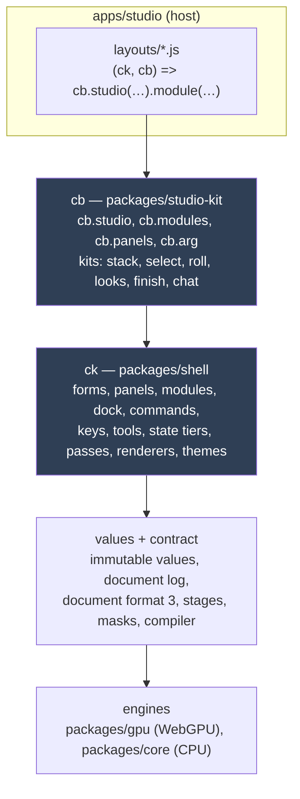
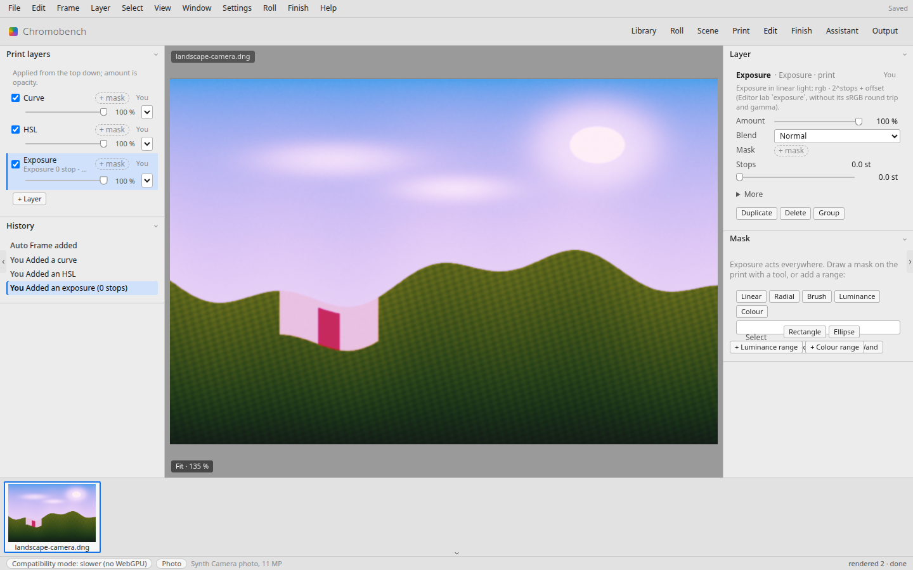
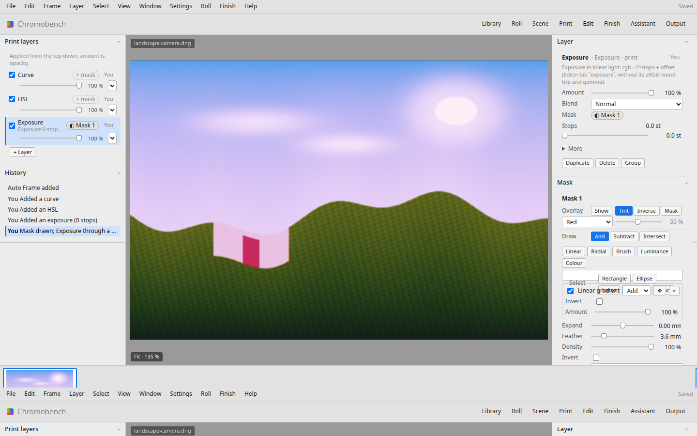
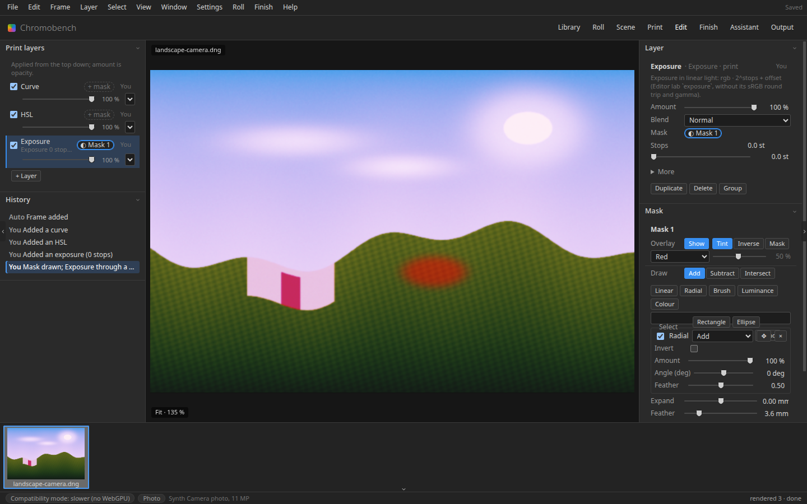
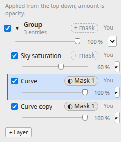
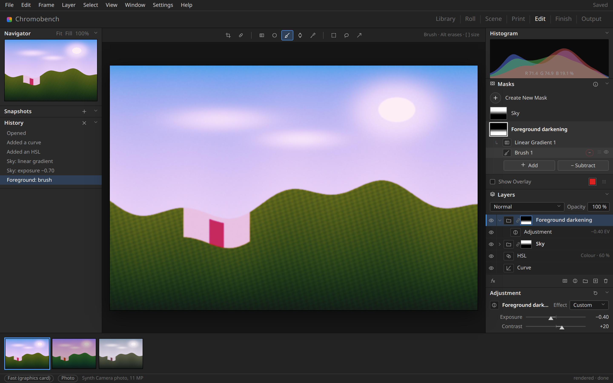
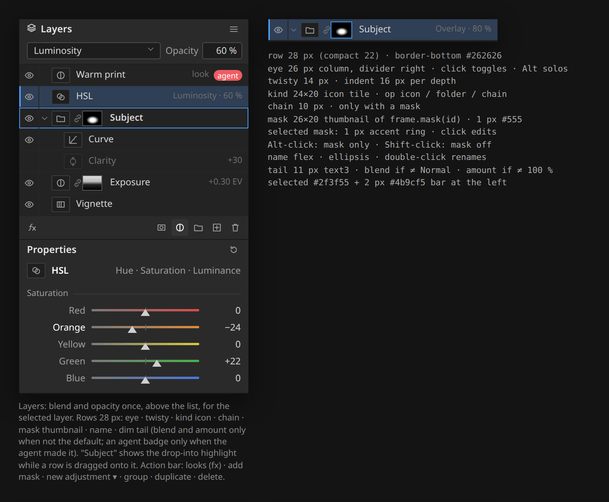
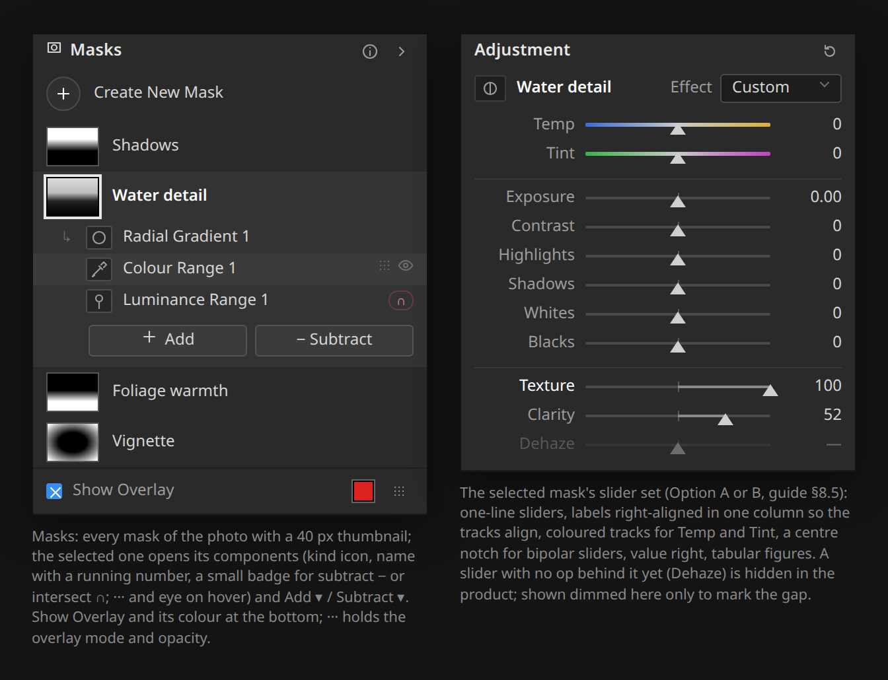
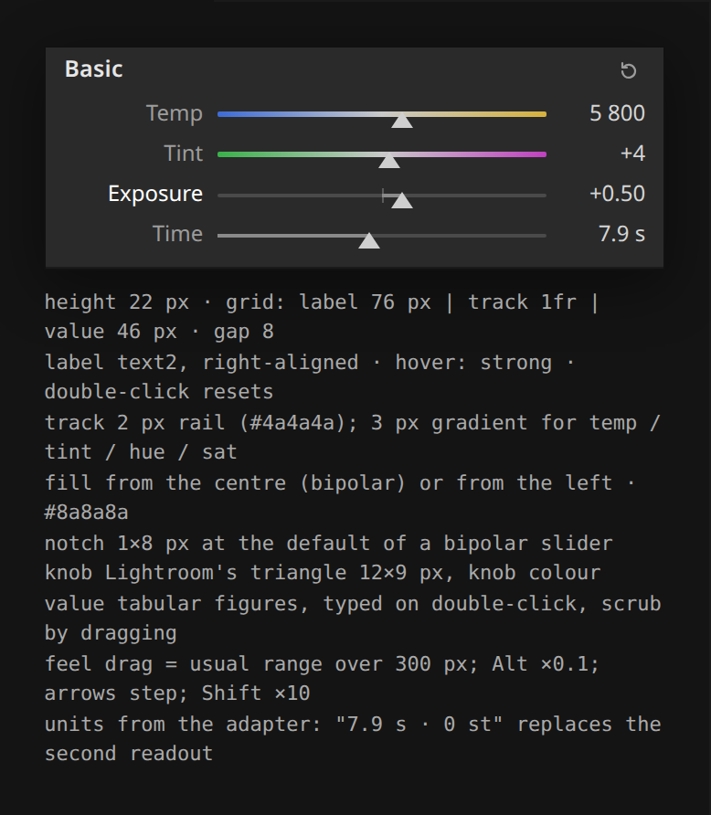
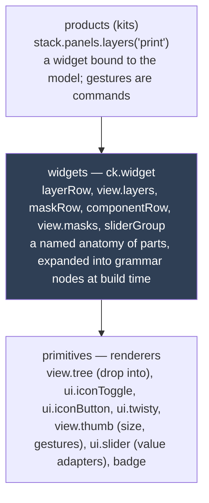

# Chromobench: Panels That Look Like Lightroom and Photoshop, Built Inside a UI DSL

Chromobench is a browser darkroom: it prints colour-negative scans and camera RAW files through a physical model of film and paper, and around that darkroom it offers the digital tools of Lightroom and Photoshop (curves, levels, HSL, colour grading, blend modes, groups, masks). Its interface is not a tree of hand-written components. It is a program written in two JavaScript DSLs, `ck` (the toolkit) and `cb` (the studio's vocabulary), which an agent can also write. Ticket CHB-050 started from the owner's verdict that every function exists but the panels are hard to use, and asked what it would take to make the layers, masks and develop panels look and behave like the Photoshop and Lightroom panels the photographer already knows, without giving up the DSL. This report explains how the studio's UI is built, measures what is wrong with the panels today, traces each problem to its cause in the code, reports two persona usability sessions, and describes the design that came out of it: specialised widgets expressed inside the grammar, a smaller base language after a cut with no backwards compatibility, and tests rewritten against roles instead of class names.

> [!summary]
> - The panels look incoherent because the controls are not part of the language. The grammar frames the screen (34 `ck.dock.column`, 54 `ck.column` calls in production code), but the kits draw their own controls: 50 native `<input>` and 21 native `<select>` elements, against 4 calls of the toolkit's own slider. Three slider implementations coexist.
> - The layers panel repeats the selected layer's controls in every row (a slider and a 20-option blend dropdown per row, 50–58 px rows), and the mask panel shows only the selected layer's mask, where Lightroom lists every mask of the photo. A CSS class collision makes the mask tools overlap.
> - The design keeps the DSL's principles (fluent immutable builders, lambdas at declared binding times, an IR the passes and the agent can read, commands as the direct mutation path, fragments, diagnostics at the call site) and adds one form, `ck.widget`: a named anatomy of parts that expands into grammar nodes, so a layer row is something a layout can customise part by part and an agent can read.
> - With no backwards compatibility, the plan deletes the opaque renderers, about 25 unused toolkit forms (to be confirmed) and the UI items that confused the persona sessions, and rewrites 27 test files that hold 355 class-name locators onto roles, labels and screenshot baselines.

## 1. The problem the ticket starts from

The studio is built for one photographer who works in Lightroom Classic and Negative Lab Pro. He knows where things are in Lightroom's Develop module: the histogram at the top right, the Basic panel under it, the filmstrip at the bottom, and since Lightroom 11 a Masks panel that lists every mask of the photo with a thumbnail, its components indented under it, and Add and Subtract buttons. He knows Photoshop's Layers panel less well, but its conventions are general: dense rows with an eye icon, a thumbnail, a mask thumbnail and a name; the blend mode and opacity once above the list; a row of small icon buttons below it.

The owner's assessment was that chromobench already implements the functions behind all of these panels. CHB-037 unified the editing model: every stage of the pipeline (scan, scene, film, darkroom, print) holds a stack of layers and groups, every entry can use a mask from a library on the document, masks are lists of components combined by add, subtract or intersect, and every change is a step of one history. The question was therefore not what to compute but how to present it, and how to present it with the UI DSL rather than around it.

The three reference images the owner supplied fix the target precisely:

| Reference | What it shows |
|---|---|
| Photoshop Layers panel | rows of eye · thumbnail · name · lock; blend and opacity above; an icon bar below; Properties under the list |
| Lightroom Masks panel | masks with mask thumbnails; components indented with icons; Add and Subtract; Show Overlay with a colour swatch |
| Lightroom Masks and Develop | the masks panel next to the selected mask's slider column: Temp and Tint with coloured tracks, Exposure to Dehaze, one line per slider |

## 2. How the studio's interface is built

### 2.1 Two DSLs and a host

The studio's code is organised in layers that each depend only on the ones below them. The engines compute pixels; the contract defines the document and compiles it into a node graph; the values package provides immutable values and the document log; `ck` is the UI language; `cb` is the studio's vocabulary written in `ck`; layouts are short JavaScript programs that receive `ck` and `cb` and build a whole studio.



The Classic layout (`packages/studio-kit/layouts/classic.js`) is 40 lines. It calls `cb.studio('Chromobench').theme('craftkit')`, installs the kits it needs, adds the menus, and places modules: Library, Roll, Scene, Print, Edit, Finish, Assistant, Output. Each module is a value with regions (`left`, `right`, `bottom`, `center`, `toolbar`), and each side region is a dock column of panels. The Edit module, which shows the print stage's digital layers, is built by the stack kit:

```js
ck.module('edit', { label: 'Edit', key: 'Mod+Alt+E', stages: ['print'] })
  .left(ck.dock.column({ width: 260 }, layers('print', { title: 'Print layers' }), cb.panels.history()))
  .center(viewer('edit'))
  .right(ck.dock.column({ width: 300 }, params(), masks()))
  .bottom(ck.dock.column({ width: 124 }, cb.views.strip()));
```

### 2.2 The rules of `ck`

`ck` is a TypeScript port of an earlier JavaScript toolkit called CraftKit, whose name survives as the default theme. Its README states the rules the language follows, and they matter for everything below because the redesign had to respect them.

Every value `ck` builds is immutable. A chain method returns a new value and leaves its receiver unchanged, so `ck.shell('Studio').theme('craftkit')` produces a second shell value with the theme set. Chain methods are modifiers, and modifiers are values: a modifier can be built once and applied to many nodes, composed with `then`, or chosen at build time with `ck.mod.when(bool, m)`.

Every option of every form declares when it is read. The declaration lives in `packages/shell/src/ir/slots.ts`:

| Binding time | Read when | Example |
|---|---|---|
| β build | once, while the program builds | a slider's `min` and `max` |
| τ traced | as a lambda of state, re-run when what it read changes | a label that shows the current value |
| bind | a τ lambda naming one state path, two-way | `bind: s => s.prefs.gray` |
| θ per item | with the real item when a row is drawn | `row: (r) => …` |
| ƒ helper | a pure function of the form's own value | `format: v => v.toFixed(1)` |
| ρ runtime | as a handler, with the runtime context | `run: ctx => …` or a command id |

A lambda passed to a β option is a build error (CK-B140), reported at the layout's line. An unknown chain method is CK-X120, thrown at the call site with "did you mean" suggestions. Fragments (`ck.fragment(target, { methods, props, slots, when })`) add methods and options to a form, and a kit can carry fragments into every build that installs it.

State has three tiers in one store. The document tier is the document log: every write is an undoable, labelled step. The view tier (`ui`, `prefs`, `workspace`) is written directly and never undone. The preview tier holds drafts: a slider drag previews on every move and commits one step on release. Commands are the only way the UI changes the document; a key, a menu item, a button, the command palette and the agent's `wb.run(id, …)` all run the same command.

The DOM half of `ck` registers one renderer per form name. A renderer receives the node and a mount context, builds elements, subscribes pieces of DOM to slices of state with `m.cell(read, write, { equals })`, and runs commands with `m.rt.runCommand(id, …)`.

### 2.3 What the agent sees

The same language is the agent's interface. The agent runs JavaScript in a QuickJS sandbox with a workbench object: `wb.commands()`, `wb.run(id, …)` (the same command a key runs, under the photographer's approval mode), `wb.state(selector)`, `wb.screen().explain()` (the mounted layout with live values), and `wb.layouts.build(src)`, which builds a layout written in the sandbox, runs the passes on it, and proposes it in a dialog. Two paths therefore exist side by side: the IR path, where the agent describes a new arrangement as a value, and the direct path, where it runs commands that mutate the document now. A widget the IR cannot see is invisible on both paths except as an opaque name.

## 3. What the panels look like today

### 3.1 The layers panel

The Edit module with three layers (Curve, HSL, Exposure) in the default light grey:



Each row is two lines tall. The first line holds a native checkbox for visibility, the name, a dashed "+ mask" pill and a "You" chip that names who made the layer. The second line holds a full-width opacity slider and a blend-mode dropdown with 20 options. Three rows take 160 pixels; Photoshop shows about ten rows in the same height. The blend mode and opacity are the selected layer's properties in Photoshop, shown once above the list. Here they are repeated for every row, and the 20 options of each dropdown appear in the page text once per row.

The selected layer's settings are drawn in a different column, at the right of the picture, so the eye crosses the image for every change. The Layer panel there opens with a sentence from the operation's documentation ("Exposure in linear light: rgb · 2^stops + offset (Editor lab `exposure`, without its sRGB round trip and gamma).") and repeats each slider's value twice ("Stops 0.0 st" above the track, "0.0 st" beside it).

### 3.2 The mask panel

After drawing a linear gradient mask, the Mask panel below the Layer panel shows the mask's overlay controls, a Draw mode (Add, Subtract, Intersect), mask tool buttons, a second row of selection tools, and then the components. Two rows of buttons overlap:



The same screen in dark grey 2, with a radial mask and the red overlay on. The overlay works as Lightroom's does; the overlap is still there:



The panel shows only the selected layer's mask. With no layer selected it shows nothing. Lightroom's model is the reverse: the Masks panel lists every mask of the photo, and selecting a mask selects what it adjusts.

## 4. The causes, in the code

### 4.1 The stack kit hand-rolls its list and its rows

All layers, layer-settings and mask panels in every layout come from one kit, `cb.kits.stack` (`packages/studio-kit/kits/stack/src/`). Its renderer for a stage's stack, `layers` in `dom.ts`, builds a `<div role="listbox">`, keeps a map from entry id to row view, reorders DOM nodes itself, and wires keyboard navigation and HTML5 drag and drop by hand. The row is drawn by `drawRow`, which ends with:

```ts
el.append(
  h('div', { class: 'cb-stack-line' }, on, tw, text, chips),                       // checkbox, twisty, name, chips
  h('div', { class: 'cb-stack-line is-controls' }, amount, blend, ...linkCmds),     // slider and <select> per row
);
```

The toolkit already has a virtualised, keyed, selectable list and tree with keyboard navigation, multi-selection, context menus and drag and drop (`packages/shell/src/dom/forms/collection.ts`), a Lightroom-style slider (`dom/forms/basic.ts`, described in its own comment as "Lightroom's slider. label · track · value; drag, click, scrub the value, double-click to reset"), a thumbnail form that renders any image handle through a thumbnail cache, and the Photoshop icon set (`eye`, `lock`, `chain`, `fx`, `mask`, `adj`, `folder`, `trash` in `ir/icons.ts`). The stack kit uses none of them for its rows.

### 4.2 Three sliders

Three widgets draw numeric controls:

| Widget | Package | Drawing |
|---|---|---|
| `ck.ui.slider` | shell | custom rail, knob and fill; one line |
| `renderArg` (`cb.arg(path)`) | studio kit | native range input, a typed field and a second readout |
| `numberControl` | stack kit | native range input and a typed field |

The two studio-kit widgets exist for a reason: they bind to arguments of a frame's document with units (stops, seconds on a log scale, printer seconds, typed relative entries such as `+1/3 st`), while the shell's slider binds to a store path. The consequence is that panels built by different kits look different, and that the values the photographer reads are formatted in two places.

### 4.3 A class collision

The overlap in the mask panel has a one-line cause. The selection kit wraps its tool row in an element with the class `cb-select`:

```ts
// packages/studio-kit/kits/select/src/dom.ts
return h('div', { class: 'cb-select' }, h('div', { class: 'cb-stack-num' }, label, row), wand);
```

`cb-select` is also the class of the studio's dropdowns, and the stylesheet fixes its height:

```css
/* packages/studio-kit/src/dom/studio-kit.css:45 */
.cb-select, .cb-panel select { flex: 1; width: 100%; height: 22px; … }
```

The wrapper is held at 22 pixels and its five buttons and label spill over the rows above and below. The bug is small, but it shows the general weakness: kit DOM styled by ad-hoc classes has no structure that a build could check.

### 4.4 Measuring what the language is used for

A script in the ticket (`scripts/05-dsl-usage-audit.sh`) counts every `ck.*` and `cb.*` call in the studio, its kits, the layouts, the host and the agent DSL, outside tests. The counts explain the incoherence better than any single screenshot:

| Call | Production uses |
|---|---|
| `ck.column` | 54 |
| `ck.dock.column` | 34 |
| `ck.ui.button` | 31 |
| `ck.panel.define` | 20 |
| `ck.text` | 17 |
| `ck.row` | 16 |
| `ck.ui.slider` | 4 |
| `ck.ui.select` | 1 |
| `ck.ui.checkbox` | 1 |
| native `<input>` created in kit renderers | 50 |
| native `<select>` created in kit renderers | 21 |

The grammar is used to frame the screen. The controls, which are most of what the photographer touches, are kit-private DOM: invisible to the IR, to `explain`, to the passes, to the agent, and to the theme's control styles. About 25 of the toolkit's forms (`stepper`, `number`, `color`, `tabs`, `kbd`, `stat`, `hud`, `html`, `glyph`, `statusline` and others) have no production use at all. The script counts literal calls only, so code that destructures `const { ui } = ck` is missed; the list is a list of candidates.

## 5. Two persona sessions

### 5.1 Method

A persona session is a usability test in which an agent plays a defined user, drives the real application in a browser, and reports in that user's voice. The ticket ran two sessions with the `pi` coding agent on the model `lunaroute/deepseek-4.1-flash`, each with the Playwright MCP browser tools, against the development server and synthetic test files (a generated colour-negative scan, a roll of four negatives and a generated camera DNG; no private photographs). Each session received a common brief (rules, setup, outputs) and a persona brief with seven tasks, and had to write a diary in the investigation format (numbered steps with *What I did*, *What didn't work*, *What was tricky*, …), save every screenshot, and write an experience report with a findings table and its top ten changes. The two sessions ran one after the other because the Playwright MCP server uses one fixed Chrome profile.

### 5.2 Manfred, twelve years of Lightroom Classic

The first persona produced twenty findings. His summary was: "If I had to choose only three: Develop workspace, Basic panel, histogram. Without those the program does not speak my language." Checking each claim against the code separated three kinds of finding:

| Finding | Status after checking |
|---|---|
| The Exposure layer's Stops slider runs from 0 to 6, so a mask cannot darken the sky. | A real bug. The operation's contract range is [−6, 6] with a usual range of [−3, 3]; the panel's track starts at 0 (visible in the screenshot of §3.1: the knob sits at the far left for 0.0). |
| Ctrl+Z undid edits of another photo and switched to it. | A consequence of the documented design: one history with one cursor over all open frames. A decision for the owner, not a defect. |
| Ctrl+O did nothing. | Not confirmed: the key is bound (`cb.ts:146`); the automated Chrome probably takes Ctrl+O itself. |
| No histogram; no Basic panel; the mask components below a block of tools; overlapping and clipped controls; masks owned by layers; prose and two-line sliders. | Confirmed, and each maps to a section of the design. |

A Basic panel is the one finding that the presentation layer cannot fully answer, because the catalogue has no operation with Lightroom's Basic sliders (exposure, contrast, highlights, shadows, whites, blacks, texture, clarity, dehaze). The print stage offers `clarity`, `curve`, `exposure`, `grade`, `hsl`, `levels`, `mixer`, `sharpen`, `vibrance` and `vignette`.

### 5.3 Sabine, a Photoshop retoucher

The second persona measured what the first described. Her close-up of today's layer rows:



A row is 58.75 pixels tall, its name gets 93 of the column's 239 pixels, and the blend dropdown in each row computes to 18 by 22 pixels, so it shows a chevron and no text. Dragging the lower half of a row scrubs its opacity slider instead of moving the row, because that half is a slider. Checking her 32 findings against the code produced one confirmed defect and one correction:

| Finding | Status after checking |
|---|---|
| Ctrl+J duplicates a layer, but the copy shares its mask ("also used by Curve copy"). | A real defect. `duplicateEntry` in the stack kit's model renames the entry's own ids and keeps its `mask` reference, so both entries point at one library mask. Photoshop copies the mask. |
| The mask panel's Linear, Radial and Brush buttons do nothing. | Partly true. The buttons arm a tool, and a drag on the picture then draws the component; nothing on the screen says so. The design moves the tools to a strip above the picture that names the active tool and its gesture. |
| Creating or inverting a mask covers the photo in an opaque red wash. | True while a mask tool is active: the overlay shows itself whenever a mask tool is the current tool. |
| No eye icon, no thumbnails, no Alt-click solo, no multi-selection, no context menu, a flat ten-item add menu without icons. | Confirmed in `drawRow` and `addMenu`. |

Her verdict on the look was precise: three different right edges for values in three panels (176, 265 and 240 pixels), a 6-pixel content inset under a 10-pixel header inset, no row separators, chips at about 2.3:1 contrast, panel titles at the same weight as row text, and the accent blue used for checkboxes, selection and focus alike. In her words, "a pro app can be minimal, but nothing in it may be a mystery."

The two personas, run independently, asked for the same five things, which were already the design: a dark interface, a dense row with icons and thumbnails, the selected item's controls in one place, a photo-level list of masks with Add and Subtract, and no prose in panels. They added four requirements the design did not have: an Exposure slider that can darken, a duplicate that copies the mask, an overlay that stays off unless the photographer turns it on or is drawing, and a grouped "New Adjustment" menu with icons.

## 6. The target

The target was drawn as a static HTML page using the theme's dark grey 2 tokens and the toolkit's own icon paths, so that everything it shows can be built from what the toolkit already has. The Edit module: Navigator, Snapshots and History at the left; a tool strip above the picture; Histogram, Masks, Layers and the selected entry's Adjustment panel at the right.



The Layers panel shows the selected entry's blend mode and opacity once, above the list. Rows are 28 pixels: an eye column, a twisty, a kind icon in a tile (a folder for groups, the operation's icon for layers), a chain and a mask thumbnail when the entry has a mask, the name, and a dim tail that appears only when the blend or amount differs from the default. An agent badge appears only when the agent made or changed the entry. The action bar under the list holds the verbs; Properties sits directly under it.



The Masks panel lists every mask of the photo with a 40-pixel thumbnail. The selected mask opens its components, each with a kind icon, a running number, a badge for subtract or intersect, and hover actions, followed by Add and Subtract. Show Overlay and its colour sit at the bottom. The selected mask's sliders form one column with right-aligned labels, coloured tracks for Temp and Tint, and a centre notch for bipolar sliders.





The mapping to the model needs no new editing logic. A mask row is a mask of the document's library that at least one entry on the stage uses. Its thumbnail is the coverage of its first user, which the studio can already render: `frameRef(f, 'committed').mask(entryId)` names exactly that image, and the render bridge evaluates it for the mask overlay. Selecting a mask runs `layer.select` on that user. Add and Subtract set the combine mode of the next component and arm the tool. The eye runs `layer.toggle`; the action bar runs `mask.new`, `layer.add`, `layer.group`, `layer.duplicate` and `layer.delete`. Two commands are new: `layer.solo` (Alt-click on the eye) and `mask.enable` (Shift-click on the mask thumbnail).

For Lightroom's per-mask slider set, the design gives two options. Option A adds a `basic` operation to the contract, the CPU reference engine, the GPU engine and the conformance suite; a Lightroom mask is then one masked `basic` layer. Option B makes "Create New Mask" produce a group with the mask, and the panel for such a group shows a fixed list of sliders, each bound to an argument of a child layer the slider creates on first use (Exposure to `exposure.stops`, Clarity to `clarity`, Vibrance to `vibrance`). Option B ships without engine work and hides the sliders that have no operation behind them; when Option A lands, the same panel binds to one layer.

## 7. Specialised widgets inside the grammar

### 7.1 The principles and where `ck` already meets them

The owner gave the principles by which the API was built: a fluent builder around a core grammar of composable components; lambdas run at build time or at runtime depending on the component; an IR or DAG, or direct mutations for runtime use such as an agent interacting with the environment; plain JavaScript, with no parser or interpreter of its own; parameters (sliders) defined in the JavaScript; proxy objects that diagnose misuse; fragments that extend individual components. Each of these exists in `ck`:

| Principle | Mechanism |
|---|---|
| fluent builder, immutable | chain methods are modifiers returning new values |
| core grammar | containers, leaves, controls, collections, panels, modules |
| lambdas at build and run time | binding times β, τ, bind, θ, ƒ, ρ per option |
| IR / DAG | frozen nodes, checked by passes, printed by `explain` |
| direct mutations | commands, transactions on the document log, view-state writes, `wb.run` |
| diagnostics on misuse | CK-X120 with suggestions, CK-B140, thrown at the call site |
| fragments | `ck.fragment`, `ck.extend`, kit fragments |

The gap is narrower than the screenshots suggest. A specialised widget such as the layer row is one IR node whose anatomy exists only inside an imperative renderer. The only customisation the stack kit offers is a θ lambda that replaces the whole row, which is how the darkroom's Enlarger panel adds its time and aperture controls. Nothing in the IR says what a row consists of. An agent reading `wb.screen().explain()` sees `stack.row` and nothing inside it; a layout cannot change one part; a pass cannot check the look.

### 7.2 Three levels

The design separates three levels and keeps them in one grammar:



A primitive is a renderer, and a new primitive is justified only by a gesture or drawing the grammar cannot express: the eye toggle with Alt-click solo, the thumbnail with modifier clicks, the tree that accepts a drop into a group, the slider that scrubs, drags finely with Alt and resets on a double-click of its label. About ten are needed.

A widget is declared once with its parts and expands into grammar nodes when it is built. Its parts are therefore real IR nodes that `explain`, the passes and the agent can read:

```ts
const layerRow = ck.widget('layerRow', {
  parts: {
    eye:    { time: 'θ', default: (r) => ck.ui.iconToggle({ icon: 'eye', on: r.on, run: r.toggle, alt: r.solo }) },
    twisty: { time: 'θ', default: (r) => (r.group ? ck.ui.twisty({ open: r.open, run: r.collapse }) : ck.spacer({ w: 14 })) },
    kind:   { time: 'θ', default: (r) => ck.icon(r.icon, { tile: true }) },
    mask:   { time: 'θ', default: (r) => (r.mask ? ck.view.thumb(r.mask, { size: [26, 20], gestures: r.maskGestures }) : null) },
    name:   { time: 'θ', default: (r) => ck.text(r.name, { grow: true, ellipsis: true, rename: r.rename }) },
    tail:   { time: 'θ', default: (r) => ck.text(r.tail, { dim: true, small: true }) },
  },
  slots: { density: slot.build() },
  layout: (parts, o) => ck.row({ class: 'ck-w-layerRow', density: o.density }, ...parts),
});
```

From the anatomy, `ck.widget` generates the part modifiers `.part(name, nodeOrLambda)`, `.hide(name)`, `.wrap(name, fn)`, `.before(name, …)`, `.after(name, …)` and `.order([...])`. A misspelt part name throws at the layout's line with the nearest names, as CK-X120 does for methods. A layout can then customise at each binding time:

```js
// β: choose the anatomy once for this layout
const rows = stack.row.density('compact').hide('chain');

// θ: a part as a function of the row (the darkroom's burn and dodge times)
const darkroomRow = stack.row.part('tail', (r) => (r.op === 'burn' || r.op === 'dodge' ? ck.text(r.seconds, { dim: true }) : null));

// τ: a part that follows state (a badge while the agent's proposal is pending)
const withProposal = stack.row.wrap('name', (node, r) =>
  ck.when((s) => cb.sel.pending(s, r.id), ck.row(node, ck.badge('proposal', { tone: 'pending' })), node));
```

The agent keeps both of its paths. It can write a layout with the same calls, which the passes check before it is proposed, or it can run commands now. Because the parts are in the IR, `wb.screen().explain()` can print a row as `layerRow#curve › eye(on) kind(curve) mask(—) name("Curve")`, and the agent can tell which command a click on the mask thumbnail runs.

### 7.3 Coherence that a build can check

Flexibility lets a layout put anything anywhere. Coherence needs rules that are checked rather than remembered. The design uses three mechanisms that already exist as kinds of value in `ck`. Recipes are named modifiers (`layerRow.photoshop`, `slider.lightroom`), so a variant means the same thing everywhere and a theme can redefine it. Part tokens move every size into the theme (`rowH` 28, `thumbW` 26, `thumbH` 20, `iconBtn` 22, `sliderH` 22, `labelW` 76). A coherence pass reports, at the layout's line, a control inside a list row (the per-row slider of today), two control families for one kind of value in one panel, a part size off the token grid, and a paragraph of prose in a panel body. A lint rule refuses native `<input>` and `<select>` elements in kit renderers. The pass warns rather than refuses, so an author can break a rule deliberately and `explain` shows where.

## 8. A clean cut

The owner decided that nothing needs to stay compatible. The studio has done this before: CHB-037 cleared saved edits once instead of migrating them. The decision changes the plan from adding widgets next to the old renderers to replacing them, and it turns the audit of §4.4 into a deletion list.

After the cut the language has four closed levels. The grammar (`row`, `column`, `grid`, `section`, `scroll`, `panel`, `module`, `dock.column`, `dock.tabs`, `text`, `icon`, `badge`, `match`, `when`, `view.tree`, `view.grid`, `view.thumb`, `viewport`, menus, commands, keys, tools, kits, fragments, passes) is the only way to make DOM. The primitives (`button`, `iconButton`, `iconToggle`, `twisty`, `select`, `checkbox`, `segmented`, `slider`, a text field, `curve`, `wheel`) are the only controls. The widgets are named anatomies of both. The products are widgets bound to the model. Removed are the forms the owner confirms unused, the stack kit's `numberControl` and hand-rolled list, `renderArg`'s DOM (`cb.arg` becomes a value adapter for the one slider), the whole-row `row` option, and the per-layer mask panel.

The cut also removes UI items, each for a stated reason: the per-row slider and dropdown (repetition and height), the "You" chip on every row (noise; the agent badge stays), the explanatory sentences in panel bodies (moved to tooltips), the "+ mask" pill (one place to add a mask), the Draw segmented control (replaced by Lightroom's Add and Subtract under the components), the tool buttons inside the mask panel (moved to the viewer's tool strip, which also removes the overlap), two sliders both called "Feather" (renamed "Edge softness" for a component and "Feather" in millimetres for the mask), a "Reads: the darkroom.H cut" selector in developer vocabulary, the second readout on sliders, and the light grey default.

Tests are rewritten rather than migrated. Today 27 test files hold 355 locators on class names such as `.cb-stack-row`. The new suite has three levels matching the language: headless IR tests (a widget expands to the expected grammar nodes; part modifiers, recipes and fragments produce the expected IR; diagnostics fire at the call site), one browser spec per primitive for its gestures and roles, and end-to-end product tests that address the UI only through roles and labels (`getByRole('treeitem', { name: 'Curve' })`). A lint rule refuses class-name selectors in specs. Screenshot baselines of each panel in dark grey 2 keep the look from drifting. Specs of removed behaviour are deleted; tests of the model and the commands stay, because they test what the UI calls, which does not change.

## 9. Implementation plan

| Phase | Content |
|---|---|
| 1. The base language | delete confirmed-unused forms; `ck.widget`, recipes, the coherence pass; primitives; slider value adapters; tree drop-into; thumbnail sizes and gestures; density tokens; grey 2 default; lint rules as errors |
| 2. The stack kit on widgets | delete the opaque renderers; Layers, Properties and Masks products; action bar, context menus, multi-selection, `layer.solo`, `mask.enable`; the tool strip; the Enlarger as part customisations; rewritten specs and baselines |
| 3. Every other panel on primitives | `cb.arg` as an adapter; the remaining native controls removed; the remaining specs rewritten |
| 4. Adjustments, modules and layouts | Option B; the Edit and Scene arrangement; the owner's decisions on layouts and modules |
| 5. The `basic` operation | a separate engine ticket (Option A) |

## 10. Open questions

- Which of the about 25 unused toolkit forms can go: some serve the toolkit's own chrome (the status line, dock tabs).
- Whether undo should stay one history over all photos or act on the shown photo, as Lightroom's does.
- Which of the eight layouts stay, whether Finish remains a module or becomes tools of Edit, and whether Scene and Edit become one module with a stage switch.
- Triangle knobs (Lightroom Classic) or round knobs (Photoshop, the cloud Lightroom).

## 11. Important files

- `/home/manuel/code/wesen/chromobench/ttmp/2026/11/20/CHB-050--panels-that-look-and-work-like-lightroom-and-photoshop-layers-and-masks-panels-develop-sliders-docking-in-the-ui-dsl/design-doc/01-lightroom-and-photoshop-class-panels-in-ck-and-cb-analysis-design-and-implementation-guide.md` — the guide this report summarises.
- `…/CHB-050…/design/mockups/target.html` — the mockups; `…/scripts/02-shoot-mockups.mjs` renders them.
- `…/CHB-050…/sessions/` — the persona briefs, diaries, reports and screenshots.
- `…/CHB-050…/scripts/05-dsl-usage-audit.sh` and `various/05-dsl-usage-audit.txt` — the usage audit.
- `packages/shell/README.md` — the language's rules; `packages/shell/src/ir/slots.ts` — binding times; `packages/shell/src/build/fragments.ts` — fragments.
- `packages/shell/src/dom/forms/{basic,collection,container}.ts` — slider, list and tree, panel.
- `packages/studio-kit/kits/stack/src/{kit,dom,commands,model}.ts` — the stack kit.
- `packages/studio-kit/src/dom/arg.ts` — `cb.arg`; `packages/studio-kit/src/handles.ts` — image handles, including `mask(entry)`.

## Related notes

- [[PROJ - Chromobench Usability Cosplay and Real-GPU Measurement - Technical Project Report]]
- [[PROJECT REPORT - Chromobench - The First Run on a Real GPU - Texture Filtering, Parity Tolerances and What the Test Suite Never Measured - A Technical Deep Dive]]
