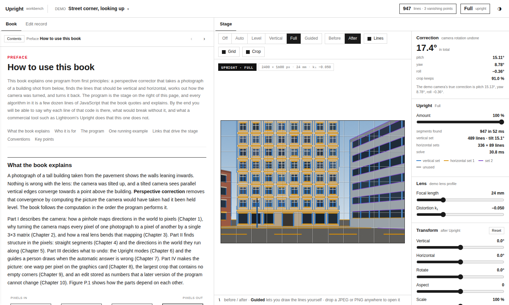
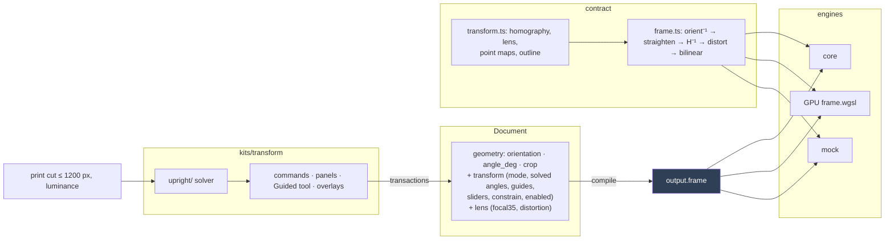
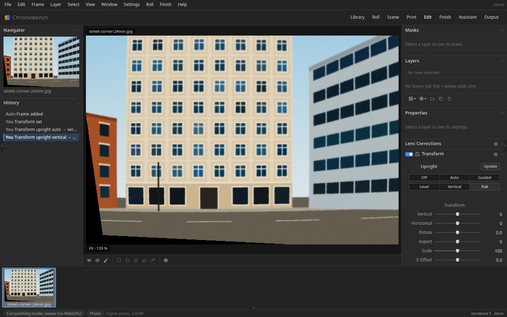
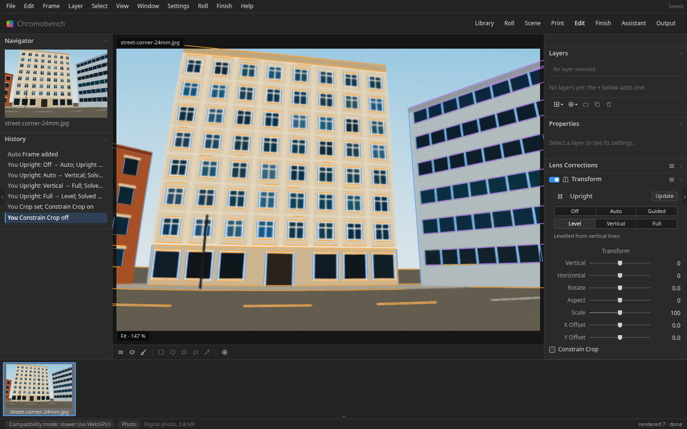
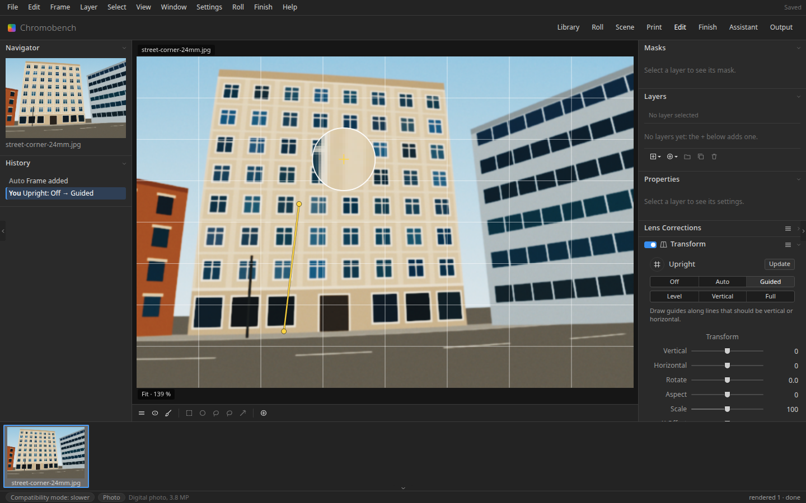
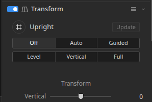
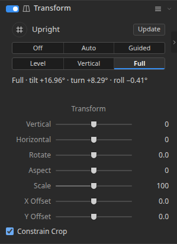

# Chromobench: Upright and Transform — Perspective Correction from Vanishing Directions, One Resample in Three Engines, and a Lightroom Panel in a UI DSL

Chromobench is a browser darkroom that prints colour-negative scans and camera RAW files through a physical model of film and paper, and offers Lightroom's and Photoshop's digital tools around it. Ticket CHB-051 added perspective correction. Its source was a standalone "Upright workbench": a small JavaScript program with a line detector, a vanishing-direction solver, the six Upright modes of Lightroom, a warp and a crop search, written up as a short book. The owner asked for its algorithms inside chromobench, with a panel that looks like Lightroom's Transform panel, built with the studio's JavaScript UI language rather than around it. This report explains the geometry the feature rests on, how it was fitted into a document model that already had a crop and a straighten, why the warp happens inside the existing output node of three rendering engines, how every tool that touches the picture learned to map its points through the new geometry, how the panel was expressed in the UI DSL, and what seven persona usability sessions found afterwards.

> [!summary]
> - **One matrix undoes a camera's tilt.** Converging verticals are a property of the camera's rotation, not of the building. A rotation `R` of the camera moves every pixel by the homography `K R K⁻¹`. Upright finds `R` from the vanishing directions of the picture's line segments and stores the solved angles in the document, so an edit never drifts when the detector improves.
> - **The warp is part of the existing frame node.** `output.frame` already resampled once for orientation, straighten and crop. It now also applies the inverse homography and the lens model in the same resample, in the CPU reference engine, the GPU engine and the mock, with a conformance case that holds them to the same answer. Identity values emit no new arguments, so old documents and their hashes are unchanged.
> - **Every tool maps points through the geometry.** A shared module converts between shown pixels and document pixels. Wrapping the mask and selection tool tables once (`inDocPx`) also fixed an old bug where a gradient drawn under a crop landed offset by the crop's origin.
> - **The panel is Lightroom's, in the DSL.** Two segmented rows bound to one value adapter make the 3 × 2 Upright grid; sliders preview the whole geometry so a constrained crop follows the drag. The synthetic street corner, whose camera was tilted 15.13° and turned 8.78°, solves to 14.95° and 8.84° once the lens is set. Seven persona sessions then found that the panel never showed those numbers; it now does.

## 1. The problem the ticket starts from

Photographs of buildings taken from the street look up. The camera's optical axis points above the horizon, so the building's vertical edges, which are parallel in the world, converge toward a point above the frame. Lightroom's Transform panel corrects this. Its Upright section offers six modes: Off, Auto (a balanced default), Guided (from lines the photographer draws), Level (rotation only), Vertical (verticals made parallel) and Full (verticals and the facade). Seven sliders below adjust by hand: Vertical, Horizontal, Rotate, Aspect, Scale, X Offset and Y Offset. A Constrain Crop checkbox keeps the crop inside the corrected picture. The owner supplied a screenshot of that panel as the target.

The workbench arrived as a zip archive. It contained a browser page with the panel's controls, a `core.js` of about 600 lines with the algorithms, a test file with expected results, a synthetic demo image rendered from a known camera, and ten short chapters explaining the geometry. Chromobench had none of this. Its document geometry held an orientation, a straighten angle and a crop; its tools assumed that a point on the screen maps to the document by scaling and translation.

The ticket therefore had four parts: port the solver, extend the document and the three engines with a warp, make every tool that reads pointer positions understand the warp, and build the panel. A fifth followed from the owner's standing practice: seven agents playing different users then tried the result.

## 2. The geometry

This section states the model the rest of the report depends on. Each formula is the one the code implements.

### 2.1 Pixels are directions

A pinhole camera with its principal point at the image centre `(cx, cy) = (W/2, H/2)` and a focal length of `f` pixels maps a direction `d = (X, Y, Z)` in camera coordinates (x right, y down, z forward) to the pixel `p ~ K d`, with

```
K = [ f  0  cx ]
    [ 0  f  cy ]
    [ 0  0  1  ]
```

Conversely a pixel `p` is the direction `K⁻¹ p`, up to scale. The workbench derives `f` from a 35 mm-equivalent focal length measured on the diagonal: `f = focal35 · hypot(W, H) / 43.2666`, where 43.27 mm is the diagonal of a 36 × 24 mm frame. The half-diagonal `rn = hypot(W, H) / 2` is the unit of the lens model.

### 2.2 A camera rotation is a homography

If the camera turns by a rotation `R` about its centre, every direction `d` becomes `R d`, and the pixel `p` of the original photograph moves to

```
p' ~ K R K⁻¹ p
```

This 3 × 3 matrix is a homography. It maps lines to lines and does not depend on the depth of anything in the scene. That independence is why perspective correction is possible from a single photograph: the convergence of the verticals is the camera's tilt, and undoing it is one matrix applied to every pixel. Rotations are stored as three angles in the workbench's convention, `R = Rz(roll) · Rx(pitch) · Ry(yaw)`: pitch is the tilt up or down, yaw the turn left or right, roll the rotation about the lens axis.

### 2.3 The lens bends lines

A real lens bows straight lines near the frame's edges. The workbench uses one radial term in half-diagonal units, `r_d = r_u (1 + k1 r_u²)`, with `r_u` the undistorted and `r_d` the captured radius. The inverse has no closed form; it is computed by Newton's method on `r + k1 r³ − r_d = 0`. Lines must be detected in undistorted coordinates, otherwise a bowed edge is not a line. Chromobench exposes the term as Lightroom's Distortion slider through `k1 = −0.0012 · distortion`, so positive Distortion corrects barrel distortion (`k1 < 0`).

### 2.4 From segments to vanishing directions

The detector is in the style of LSD (von Gioi et al.). It computes a gradient at every pixel, visits pixels from the strongest gradient down, grows regions over neighbours whose level-line angle stays within 22.5° of the region's mean, fits a rectangle to each region and accepts it as a segment if the rectangle is well filled (density 0.7, or 0.4 for rectangles at most 4 pixels wide, because an anti-aliased edge fills a thin rectangle only half). A long region that fails the density test, typically an edge the lens bent, is split into chunks and each chunk is tested again.

A segment with endpoints `a` and `b` and the camera centre span a plane, the segment's interpretation plane, with unit normal

```
n = normalize( (K⁻¹ a) × (K⁻¹ b) )
```

All segments of world-parallel lines, for example every vertical edge of a building, have interpretation planes that contain one common direction `v`, the vanishing direction. So `n · v = 0` for every one of them, and two segments give a hypothesis `v = n₁ × n₂`. The solver runs RANSAC over pairs of near-vertical segments with a seeded random generator (`mulberry32(1234567)`), so the answer is identical on every run. Each hypothesis is scored by MSAC: a segment whose angular error `e` is below 2° contributes `len · (1 − (e/2°)²)`. The best hypothesis is refined by least squares: the `v` that minimises `Σ len · (n · v)²` is the eigenvector of `Σ len · n nᵀ` with the smallest eigenvalue, computed with a Jacobi iteration. Up to two horizontal sets (two facades) are found the same way, constrained to be perpendicular to `v`.

### 2.5 Modes, guides and the crop

Each Upright mode turns the analysis into a rotation. Level rotates about the lens axis only. Vertical applies the smallest rotation that takes `v` onto the image's y axis. Full builds the frame whose rows are `(h, v, h × v)`, making the verticals parallel and the chosen facade frontal, and refuses facades more than 40° oblique. Auto always levels, corrects verticals unless the view is steep (above 30° it only levels; between 20° and 30° it keeps 20 % of the convergence), and squares a facade only within 12°. Guided builds the same normals from the lines the photographer draws, so two vertical guides fix `v` and horizontal guides fix `h` in the plane perpendicular to `v`.

The full mapping from undistorted source pixels to the output frame is

```
Hr = K · R · K⁻¹                      R = Rmanual · Rupright
Tc = translate(c − Hr(c))             keep the image centre where it was
S  = scale about c by (s·√r, s/√r)    s = Scale/100, r = 2^(Aspect/100)
To = translate(xOffset, yOffset)
H  = To · S · Tc · Hr
```

`Rmanual` comes from the sliders, with 0.3° of rotation per unit of Vertical or Horizontal. Rendering uses inverse mapping: each output pixel `p` reads the source at `distort(H⁻¹ p)`, so the lens correction and the perspective are one resample and the picture is filtered once. Constrain Crop is the largest axis-aligned rectangle of the photo's aspect inside the corrected outline, found by a binary search on the half-height at a grid of centres followed by a pattern search.

### 2.6 Edits are data

The workbench's record stores the solved angles, not only the mode. If a document said only "Upright: Auto", a later and better detector would silently change every old edit. With the angles stored, a picture never changes unless the photographer presses Update. Chromobench kept this rule.



## 3. What chromobench had

Chromobench's document geometry was `{ orientation, angle_deg, crop }`. A compiler turns the document into a graph of operations per pipeline stage. The last node of the display cut is `output.frame`, which applies orientation, straighten and crop with one bilinear resample, and every engine implements it: the CPU reference engine in double precision (on a 640-pixel working image when no GPU is present), the WebGPU engine in WGSL, and a mock engine for tests. A conformance suite holds the engines to the same semantics.

The UI is a program in two JavaScript DSLs: `ck`, the toolkit (panels, rows, sliders, segmented controls, commands, keys, tools, overlays), and `cb`, the studio's vocabulary built on it. Builders are immutable and fluent; values that depend on state are lambdas the runtime re-evaluates; the result is an inspectable intermediate representation that build passes check and that an agent can read. Controls bind to state through value adapters, `ck.value({ read, path, write, set, tx, name })`: `read` gives the shown value, `write` the previewed state while a slider is dragged, `set` what a typed value or a key press runs. All document writes go through commands, which are the single place where invariants are kept.

## 4. The design



Six decisions shaped the implementation:

1. The transform and the lens are fields of the document geometry, and their absence means identity.
2. `output.frame` performs the warp in the same resample as the crop and the straighten, in every engine. Masks pass through the same node, so a mask overlay stays registered with the corrected picture.
3. The contract package owns the mathematics the engines need (homography, lens, sampling order, point maps). The solver, which only the host needs, lives in a new kit.
4. The document stores solved angles; Update re-detects and re-solves.
5. Every tool maps its points through the geometry.
6. The panel is Lightroom's, written with `ck` builder calls and no new renderer.

## 5. The document and the contract

The geometry gained two optional fields:

```ts
interface Transform {
  enabled: boolean;                  // the panel's eye
  upright: 'off' | 'auto' | 'guided' | 'level' | 'vertical' | 'full';
  solved: { pitch: number; yaw: number; roll: number };   // degrees, what Upright found
  guides: readonly Guide[];          // { type: 'v' | 'h', from, to } in captured source px
  vertical: number; horizontal: number; rotate: number;   // the manual sliders
  aspect: number; scale: number; x: number; y: number;
  constrain: boolean;                // Constrain Crop
}
interface Lens { focal35: number; distortion: number }   // neutral: 28 mm, 0
```

Guides are stored in captured source pixels, the coordinates of the original file, so that changing the lens later does not move them. The schema validator needed a new rule kind for this: an `OptionalRule` under which a partial object is valid, each present field is checked, and an unknown field gets a "did you mean" suggestion. Three walkers over the schema (the documentation generator and two studio walkers) recursed into the new rule's documentation text and overflowed the stack until they learned to unwrap it.

The compiler emits the new arguments of `output.frame` (`upright` as a vector of three angles, `vertical`, `horizontal`, `rotate`, `aspect`, `scale`, `offset_x`, `offset_y`, `focal35`, `distortion`) only when the transform is not the identity. This keeps the graph and the content hashes of existing documents unchanged. The first engine test after the change still failed: a node's arguments carry the operation's defaults, so the engine saw a 28 mm focal length and concluded there was a transform. `argsTransform` now returns `null` for identity values whatever their source.

The rotation that the homography uses composes the manual sliders after the solve:

```ts
export function rotationOf(t: Transform): number[] {
  const up = rotationFrom(t.solved.pitch * RAD, t.solved.yaw * RAD, t.solved.roll * RAD);
  const man = rotationFrom(-DEG_PER_UNIT * t.vertical * RAD, -DEG_PER_UNIT * t.horizontal * RAD, t.rotate * RAD);
  return mul3(man, up);
}
```

The sampling order, shared by every engine, extends the existing chain by two steps:

```
output pixel (i, j) of the oriented crop
  └─ unorient                                   → (u, v) in the crop
  └─ straighten: c + R(θ)(u − w/2, v − h/2)     → p in transformed-frame px
  └─ q = H⁻¹ p   (homogeneous; w ≤ 0 → empty)    → undistorted source px    (new)
  └─ s = distort(q, k1)                          → captured source px       (new)
  └─ bilinear at s; outside the frame → 0
```

With an identity transform the two new steps are skipped and the output is bit-identical to what it was before. The same chain, run as point maps in both directions, became `shownToSource` and `sourceToShown` in `frame.ts`.

## 6. Three engines, one answer

The reference engine passes a map function into `straighten`, which applies it after the rotation. The mock engine does the same. The GPU engine needed more care. A crop normally lets the engine read only the source region it needs; with a homography, the source footprint of a rectangle is a general quadrilateral, so `transformFootprint` marks the frame as needing the full source. The uniform block grew to 144 bytes: three rows of `H⁻¹` (with a flag in an unused lane) and the lens parameters `(cx, cy, rn, k1)`. The WGSL kernel applies the inverse warp and the lens in the same loop as the straighten.

The conformance case "output.frame transform semantics" checks the core and mock engines against each other on a transformed frame. The GPU path was checked by hand on SwiftShader, Chrome's software WebGPU, which produced the same picture as the reference engine. The test environment has no hardware GPU, so the browser spec runs on the reference engine. One reason was practical: on SwiftShader a transformed frame renders its full 2400 × 1600 footprint and took 10.4 seconds, against 133 milliseconds on the reference engine's 640-pixel working image.

## 7. One map for every tool

A tool event carries the pointer position in shown-picture pixels. Before CHB-051 the mask tools treated those as document pixels after a scale, which was correct only while there was no crop. A new module, `src/model/space.ts`, answers the question "where in the document is this point of the picture?" for any frame:

```ts
toDoc(state, frame, X, Y): [number, number] | null       // shown px → captured source px
toPicture(state, frame, x, y): [number, number] | null   // captured source px → shown px
```

It needs the frame's source size, which an overlay sees only through state, so the studio records `ui.frameSize[frame]` when a frame is added. Rather than edit every handler of the stack kit's mask tools and the select kit's selection tools, the tool tables are wrapped once by `inDocPx`, which converts `e.x, e.y` to document pixels and keeps the shown point as `e.px, e.py`. Their overlays draw through `docScreen`, the same map in the other direction. A unit test drew a linear gradient on a cropped frame and checked where it landed: before the change it was offset by the crop's origin, after it lands where it was drawn.

## 8. The solver kit

The workbench's algorithms were ported into `kits/transform/src/upright/` as typed modules: `linalg.ts`, `segments.ts` (the detector), `vanishing.ts` (normals, RANSAC, refinement), `modes.ts` (the six modes and guided), `crop.ts` (polygon clipping and the inscribed rectangle), and `solve.ts`, which returns `{ solved, notes, analysis, usedH, fail }` with angles rounded to two decimals. Seven tests from the workbench's `test_core.js` came along; two needed changes. The homography test built a 24 mm camera while the warp defaulted to 28 mm. The detector test drew hard aliased edges, which the density test rejects; it now renders the test image four times supersampled.

The detector reads the picture from the studio's print cut, the image before any geometry, at most 1200 pixels wide, as luminance scaled by `255 · cbrt(Y)` to approximate perceptual lightness. Segments are mapped back to source pixels and cached per frame and per document hash, so a lens change re-solves from the cached lines without detecting again.

The result on the synthetic street corner shows how much the camera model matters:

| Lens set in the panel | Solved pitch | yaw | roll |
|---|---|---|---|
| default (28 mm, no distortion) | 16.96° | 8.29° | −0.41° |
| the shooting lens (24 mm, Distortion 42) | 14.95° | 8.84° | −0.35° |
| truth | 15.13° | 8.78° | −0.36° |

The focal length is the camera's `K`. With the wrong one, the interpretation-plane normals are computed from the wrong directions and the solve is off by almost two degrees of pitch. The browser spec sets the lens first, as a person must, and asserts the angles within half a degree.

Constrain Crop had one subtlety the workbench did not: chromobench's crop can be straightened, so the inscribed rectangle is searched in the straighten's turned frame. `constrainCrop` distinguishes three answers: a rectangle, `null` for "the whole frame fits", and `undefined` for "nothing fits".

## 9. The panel, in the DSL

The panel is one builder file. Its header carries Lightroom's eye as a panel switch bound to `transform.enabled`. The Upright row holds the Guided tool toggle, the title and an Update button. The six modes are two segmented rows of three bound to one value adapter, which reads the document's mode and runs `transform.mode` when clicked:

```ts
const mode = ck.value({
  read: (s) => { const d = docIn(s); return d ? transformOf(d.geometry).upright : 'off'; },
  set: (ctx, v) => void ctx.run('transform.mode', v),
  name: 'docs.<frame>.geometry.transform.upright',
});
const modeRow = (modes) => u.segmented({ options: modes.map((m) => ({ value: m, label: MODE_WORDS[m], tip: MODE_TIPS[m] })), bind: mode, small: true, class: 'cb-tf-modes' });
// … modeRow(['off', 'auto', 'guided']), modeRow(['level', 'vertical', 'full'])
```

Each slider binds an adapter over the whole geometry rather than over its own field. While the slider is dragged, `write` returns a new geometry from `withTransform`, which recomputes the constrained crop, so the crop follows the drag in the preview. A typed value or an arrow key runs `transform.set` and passes the slider's transaction options through `set(ctx, v, label, extra)`. The first version dropped those options, and three arrow presses made three history steps; passing them lets the runtime coalesce consecutive presses into one.

```ts
bind: ck.value({
  read: (s) => transformOf(docIn(s).geometry)[field],
  path: geoPath,                                            // docs.<frame>.geometry
  write: (v, s) => withTransform(docIn(s).geometry, { [field]: v }, W, H),
  set: (ctx, v, _label, extra) => void ctx.run('transform.set', field, v, extra),
  tx: { coalesce: `geometry.transform.${field}` },
})
```

The Guided Upright tool (Shift+T) draws a guide with a drag, typed vertical or horizontal by its direction on screen. It moves a guide's end when the drag starts on a knob, selects a guide when the click lands on its line, and snaps an end onto a detected segment within 8 screen pixels unless Alt is held. While an end moves, a loupe shows the rendered picture around it, magnified four times with nearest-neighbour sampling, in a round window with a crosshair. Overlays draw a grid while the tool is armed, the detected lines coloured by the set the solve used, and the guides.







The panels appear in two places: Edit's right column, with Lens Corrections, and Finish, under Crop & straighten.

## 10. Bugs found while building

| Symptom | Cause | Fix |
|---|---|---|
| Crop, Straighten, Rotate, Reset Crop, Swap and Crop Aspect would delete a transform | The finish kit's `normalise` and three helpers rebuilt the geometry from orientation, angle and crop only | They spread the old geometry first; a test runs every crop command on a transformed frame |
| Fix Crop never ran | Its `enabled` read a size map that only the crop tool fills | It falls back to `ui.frameSize` |
| The panel header's accessible name was "Turn this panel on or off Transform transform-edit panel menu" | The header's `role=button` took its children's labels; the menu used the panel id | The header is named by the title; the switch has `role=switch` and is "Turn Transform on or off"; the menu is "Transform panel menu" |
| The Guided toggle was an empty circle | A `ck.ui.toggle` draws no icon in its off state unless `off` names one | `off: 'guided'` |
| History read "Solved pitch 0 → 2.82" for a guide | The history rows described raw field changes | Transform steps lead with the command's words when they change several fields |
| A browser test drew guides on the Navigator | The Navigator is a viewer too, and the locator took the first | The spec takes the largest visible viewer |

The first of these predated the transform: any future field of the geometry would have been lost the same way. Any helper that writes a `Geometry` literal is a place that drops fields it does not know about.

## 11. Seven personas

After the merge, seven agents played seven users against a dev server of main, one session after another, each with a task list, the Playwright browser tools and synthetic files only. They were an architecture photographer who knows Upright, a real-estate photographer who needs speed, a Photoshop retoucher, a travel hobbyist who has never used Lightroom, a keyboard and screen-reader user, a visual designer and a forensic-imaging analyst who needs reproducible numbers. Each kept a diary, wrote a report of 355 to 575 lines and saved 24 to 43 screenshots. Of 45 tasks, 26 were done, 16 partly and 3 failed.

Every report raised the same complaint: after Upright, the seven sliders read zero and nothing on the panel says what was corrected. The answer was a line under the mode buttons, `Full · tilt +16.96° · turn +8.29° · roll −0.41°`, and not to write the solve into the sliders. The sliders are manual adjustments composed on top of the solve, and writing the solve into them would make Update or a lens change overwrite the photographer's own values. Other fixes made Guided wait for two guides, put the Guided tool down when another mode is chosen or the transform is switched off, bound the Delete key that the kit had declared but never registered, and made a selected segment bold with an accent rule throughout the shell.





Two reports did not reproduce, and the method for checking them, together with the path from each finding to a change in the API, is the subject of a separate playbook ([[ARTICLE - Playbook - Persona Sessions with Agents - Improving Software and APIs from Usability Reports]]).

## 12. Testing

- Unit tests: 3700 passed across the repository, including 7 for the solver, 9 for the transform kit (sliders, Constrain Crop, the eye, Guided through the tool, Auto on the mock, a mask under a crop, Fix Crop, crop commands keeping the transform, the persona fixes and the solved line) and 10 for the contract's transform module.
- Conformance: the transform semantics case on core and mock.
- Browser: the full suite passed 86 of 86 before the persona fixes; after them, the six affected spec files passed 18 of 18. `e2e/studio-transform.spec.ts` opens the synthetic street corner, sets the lens, applies Full, asserts the solved angles within 0.5° of the truth and the solved line on screen, checks that every corner of the constrained crop reads the source inside the frame, toggles the eye, draws two guides by dragging, and checks that three arrow presses on Vertical make one history step. It addresses the UI by role and label only; a lint ratchet counts class-name selectors in specs and refuses any increase.

## 13. Current status and next steps

The feature is merged on main. Upright's six modes, the sliders, Lens Corrections, Constrain Crop, Fix Crop, Guided with a loupe and the overlays work in the Edit and Finish modules and on all three engines. The intern guide in the ticket has sixteen sections, including the persona findings left open.

The next changes, in order of value:

1. **Seed the focal length from EXIF.** The table in §8 shows a 1.8° pitch error from the default lens. The decoder should read the 35 mm-equivalent focal length and the panel should say whether the value came from the file or is assumed.
2. **Hold the view while the Guided tool is armed.** The fit zoom changes as the corrected outline changes, which moves the target under the pointer between guides.
3. **Copy, paste and sync the transform.** Paste the mode, the sliders and Constrain Crop, then re-solve on each target; the solved angles belong to the source photo's camera and should not be pasted.
4. **Scope Tab to the canvas** so that it moves focus inside panels, and announce the command palette's highlighted row.
5. **A fine drag on sliders** with Shift.

Open questions: whether Level should weight horizontal lines near the horizon (one persona expected a horizon to be levelled, and on this picture the verticals dominate); and a report that the Edit view showed an uncorrected picture after a trip to Finish, which a pixel-hash probe could not reproduce.

## 14. Important files

| File | Role |
|---|---|
| `packages/contract/src/document.ts` | `Transform`, `Lens`, `Guide`, neutral values, `transformOf`, `lensOf` |
| `packages/contract/src/transform.ts` | camera, lens, `rotationOf`, `homography`, warp and unwarp, outline, `frameArgs`, `argsTransform` |
| `packages/contract/src/frame.ts` | `straighten(…, map)`, `shownToSource`, `sourceToShown` |
| `packages/contract/src/schema.ts` | `OptionalRule` |
| `packages/core/src/print/geometry.ts`, `packages/gpu/src/frame.ts`, `packages/gpu/kernels/frame.wgsl` | the warp in the engines |
| `packages/conformance/src/semantics.ts` | the transform semantics case |
| `packages/studio-kit/kits/transform/src/upright/` | the solver |
| `packages/studio-kit/kits/transform/src/{analyse,model,commands,panels,tools,overlays,kit}.ts` | the kit |
| `packages/studio-kit/src/model/space.ts`, `kits/stack/src/commands.ts` (`inDocPx`) | points through the geometry |
| `packages/studio-kit/kits/finish/src/{context,state,panels}.ts` | crop commands that keep the transform; Fix Crop |
| `e2e/studio-transform.spec.ts`, `packages/studio-kit/test/transform/` | tests |
| `ttmp/2026/11/21/CHB-051--…/design-doc/01-…guide.md`, `reference/01-diary.md`, `sessions/` | the guide, the diary, the persona sessions |

## Related notes

- [[PROJECT REPORT - Chromobench - Panels That Look Like Lightroom and Photoshop, Built Inside a UI DSL - A Technical Deep Dive]]
- [[PROJ - Chromobench Usability Cosplay and Real-GPU Measurement - Technical Project Report]]
- [[PROJECT REPORT - Chromobench - The First Run on a Real GPU - Texture Filtering, Parity Tolerances and What the Test Suite Never Measured - A Technical Deep Dive]]
- [[ARTICLE - Playbook - Persona Sessions with Agents - Improving Software and APIs from Usability Reports]]
