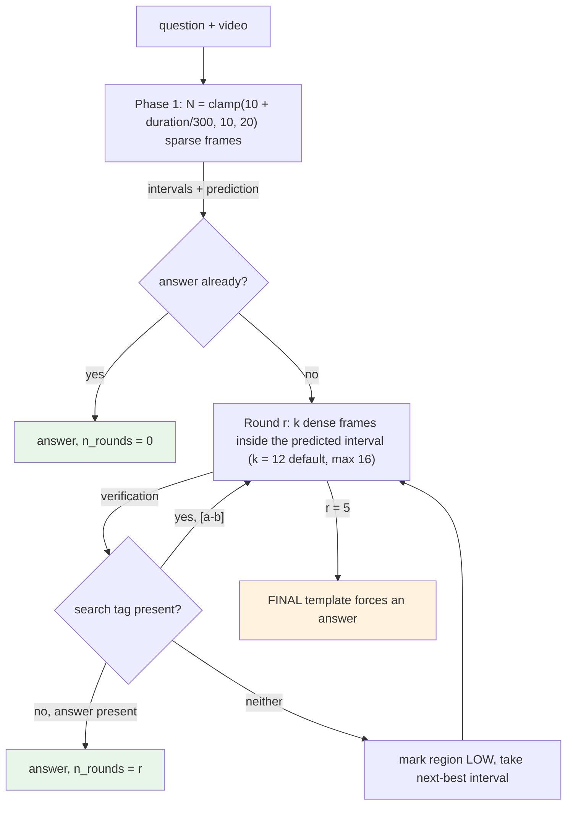
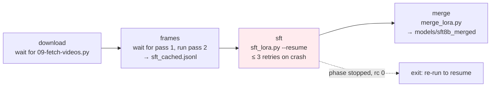
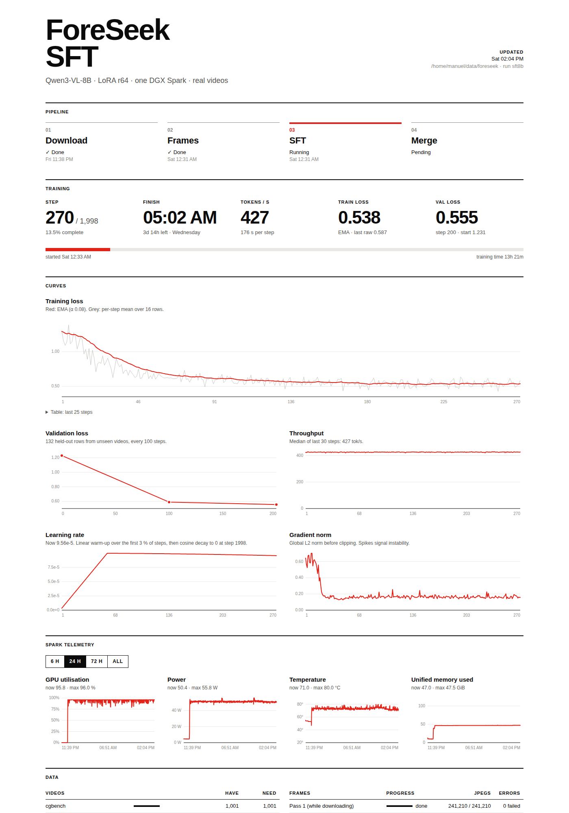

# ForeSeek on one DGX Spark: LoRA SFT and GSPO for Long-Video Search — A Technical Deep Dive

**ForeSeek** (arXiv 2611.26024) trains a vision-language model to answer multiple-choice questions about long videos by searching them. The model looks at a few sparse frames, writes down where it expects the evidence to be, looks densely at that interval, checks whether the expectation held, and either answers or searches again. The released recipe trains Qwen3-VL-8B in two stages, supervised fine-tuning (SFT) on teacher trajectories followed by reinforcement learning with GSPO, with every parameter trainable, on eight NVIDIA H20 GPUs.

This project, ticket **VU-001**, ports that recipe to one NVIDIA DGX Spark: a single GB10 GPU with 128 GB of memory shared between CPU and GPU. It replaces full fine-tuning with LoRA adapters, replaces on-the-fly video decoding with a JPEG frame cache, and replaces the authors' patched fork of the verl RL framework with a port to unpatched upstream verl. The report explains the method, the port, the memory and time budget measured on the hardware, the data pipeline that fetched 374 GB of source video, and the resumable multi-day SFT run that was in progress when the report was written (2026-11-21, step 270 of 1,998).

The report is organised in dependency order. Sections 2 and 3 define the task and the training method. Sections 4 to 6 describe the port: the episode, the verl adapter and the frame cache. Section 7 covers the memory budget and the eight attempts it took to fit one full-size RL step. Section 8 covers time. Sections 9 to 11 describe the real-data pipeline, the SFT trainer and the dashboard. The last sections give the current status, the limits, and what comes next.

> [!summary]
> - **A search agent trained in two stages.** Each question becomes one *trajectory* of up to six independent model *calls*: a Phase-1 call over 10–20 sparse frames, then up to five rounds over 4–16 dense frames. SFT imitates 8,165 teacher trajectories (32,101 calls). GSPO then rewards correct answers with a small penalty for more than three rounds.
> - **The port runs on unpatched verl.** The search logic lives in a verl-independent `ForeSeekEpisode`; a 141-line adapter implements verl's current `AgentLoopBase`. Upstream verl now natively turns one trajectory into several training samples that share one advantage, which ForeSeek had to patch in.
> - **Unified memory is the binding constraint, and verl's defaults ignore it.** The first full-size 8B GSPO step was OOM-killed seven times, by seven different consumers. With all fixes, one step of 4 prompts × 8 trajectories takes 29.3 minutes at a 103.5 GiB peak. Training passes, not generation, take most of the time.
> - **SFT is running unattended for four days.** All 4,249 referenced videos were fetched selectively from 1.5 TB of archives, 241,210 frames were extracted, and the 8B LoRA SFT runs at about 427 tokens/s and 175 s per step with resumable checkpoints and a held-out validation loss (1.231 → 0.555 by step 200). A Swiss-style web dashboard tracks it.

## 1. What exists, and where

| Item | Location |
|---|---|
| Repository | `/home/manuel/code/wesen/2026-11-20--video-understanding` |
| Python package and tools | `foreseek_spark/` (package `foreseek_spark/foreseek_spark/`, tools `foreseek_spark/tools/`) |
| One-Spark GSPO launcher | `foreseek_spark/launch/run_gspo_1spark.sh` |
| Training image | `foreseek_spark/docker/Dockerfile` (image `foreseek-spark:dev`) |
| Ticket workspace | `2026/11/20/VU-001--single-spark-lora-sft-gspo-training-for-agentic-video-understanding-foreseek-recipe/` |
| Guide 1: method, port, memory and time (1,326 lines) | `design-doc/01-foreseek-on-one-dgx-spark-analysis-design-and-implementation-guide.md` |
| Guide 2: real-data SFT pipeline and dashboard (781 lines) | `design-doc/02-real-data-sft-pipeline-on-one-spark-videos-frames-resumable-trainer-and-progress-dashboard.md` |
| Implementation diary (10 steps) | `working-note/01-diary.md` |
| Scripts 01–12 (sources, stats, toy data, microbenchmark, monitor, fetcher, pipeline, dashboard) | `scripts/` |
| Telemetry evidence for every 8B attempt | `various/monitor/` |
| Videos, frames, outputs, logs | `~/data/foreseek/` (outside the repo by rule) |

The project's own code is small: about 1,800 lines of Python in the package and tools, a 178-line launcher, a 248-line video fetcher, a 108-line pipeline script and a 650-line dashboard. ForeSeek's prompt templates, reward and parsing helpers are vendored unchanged under `foreseek_spark/foreseek_spark/vendor/` with attribution headers (MIT licence). The upstream dependencies are pinned in `scripts/01-fetch-sources.sh`: ForeSeek a218131, verl 453954b (`0.10.0.dev`), FrameThinker 3c917f3, spark-vllm-docker e3808fc, Qwen3-VL 9658872.

| Module | Non-blank lines | Responsibility |
|---|---:|---|
| `foreseek_spark/episode.py` | 272 | ForeSeek's search loop, independent of verl |
| `tools/sft_lora.py` | 266 | resumable LoRA SFT trainer |
| `tools/extract_frames.py` | 201 | ffmpeg frame pre-extraction (SFT exact, RL grid) |
| `foreseek_spark/frame_cache.py` | 197 | JPEG cache with exact, nearest and on-miss lookup |
| `foreseek_spark/agent_loop.py` | 141 | verl `AgentLoopBase` adapter |
| `tools/eval_episodes.py` | 120 | episodes against an OpenAI-compatible endpoint |
| `tools/prepare_rl_data.py` | 78 | RL subset selection and video filtering |
| `foreseek_spark/sft_data.py` | 66 | SFT row → Qwen chat messages |
| `tools/merge_lora.py` | 31 | merge adapter into bf16 weights |

## 2. The task and the ForeSeek method

The task is long-video multiple-choice question answering. The model receives a video of a few minutes to over an hour and a question such as *"In the video, at the 11th second, what animal appears on the screen? A. Jaguar … G. Cheetah"*, and must answer with a letter. The difficulty is length. Qwen3-VL spends hundreds of tokens per frame, so a 30-minute video sampled at one frame per second would cost over a million tokens. The model cannot look at everything, so the question becomes which frames to look at.

ForeSeek answers this with an explicit search protocol. The model's output is parsed by regular expressions, so the protocol is a set of tags:

| Tag | Emitted in | Meaning |
|---|---|---|
| `<intervals>[a-b] relevance=HIGH\|MEDIUM\|LOW\|ELIMINATED …</intervals>` | Phase 1, optionally later | the *belief map*: a relevance label for each interval |
| `<prediction>I predict X at [a-b] because …</prediction>` | Phase 1 and continuing rounds | what the model expects to see, and where |
| `<verification>Expected / Actual / Result</verification>` | every round | whether the prediction was confirmed, partially confirmed or not found |
| `<search>[a-b] frames=k</search>` | continuing rounds | the next interval; `k` is clamped to 4–16 |
| `<answer>X</answer>` | the final call | a letter from A to H |

Two terms are used precisely in the rest of this report. A **call** is one request to the model: a system prompt and a user message with frames and text, followed by the model's response. A **trajectory** is one complete search for one question: a Phase-1 call followed by up to five round calls. The calls of a trajectory are independent contexts. Round 3 does not see the frames of rounds 1 and 2; it sees a short text summary of them in the search-history part of its prompt. This decision runs through the whole system. In SFT, each call is one training example, which is why 8,165 questions produce 32,101 rows (3.93 calls per question). In RL, one trajectory produces several training samples that share one reward.



A failed prediction is information. The interval is marked `ELIMINATED` in the belief map and the search moves on. ForeSeek reports accuracy comparable to much larger search agents while using 22–31 frames per question.

**The reward** is defined in `Code/v9k2_reward.py` and in the paper's Eq. 4–5:

```text
R(τ) = correct(τ) · T(n)          correct ∈ {0, 1}, n = rounds after Phase 1 (an answer in Phase 1 counts as n = 1)
T(n) = 1.0                for n ≤ 3
     = 1 − 0.1 · (n − 3)  for n = 4, 5      → T = 1, 1, 1, 0.9, 0.8
```

The code computes four further terms (`clue_iou`, `narrowing`, `consistency`, `verify_q`) whose weights default to zero; they are logged as diagnostics. The docstring of `compute_trajectory_reward` claims that three rounds already cost 0.1. The code and the paper both say it does not, and the project's unit test `test_reward_late_time_tax` pins the code's behaviour.

## 3. The training method: SFT, then GSPO

### 3.1 Why two stages

SFT maximises the probability of a teacher's response tokens given the prompt. A strong teacher model produced 8,165 search trajectories; the student imitates them call by call. SFT teaches the tag format and the habit of searching. It is a precondition for RL: a policy that cannot emit a parseable `<search>` tag produces trajectories that all fail the same way, and identical rewards carry no learning signal.

RL then lets the student search on its own and rewards it for correct answers. It teaches what imitation cannot: searching accurately and stopping early when the evidence is in hand.

### 3.2 Group-relative advantages and GSPO

For each question, the RL loop samples a group of G = 8 trajectories from the current policy and scores each with the reward above. The advantage of trajectory *i* is its reward relative to its siblings:

```text
Â_i = (R_i − mean(R_group)) / std(R_group)
```

There is no learned value network; a trajectory is good if it beat the other seven. If all eight get the same reward, the standard deviation is zero and the question contributes nothing. This is why ForeSeek filtered its RL questions by pass@8: it sampled the SFT model eight times per question and kept only questions answered correctly in 1 to 6 of 8 attempts, leaving 4,663 of 10,021 candidates.

PPO and GRPO clip each token's probability ratio `r_t = π_θ(y_t) / π_old(y_t)` separately. **GSPO** (arXiv 2507.18071) clips one ratio per response, the geometric mean of the token ratios:

```text
s_i(θ) = exp( (1/|y_i|) · Σ_t log r_{i,t} )
loss   = − mean_i  min( s_i · Â_i ,  clip(s_i, 1 − ε_low, 1 + ε_high) · Â_i )   +  0.02 · KL(π_θ ‖ π_SFT)
```

Because `s_i` averages hundreds of token log-ratios, it stays very close to 1, so the clip range has to be tiny: ForeSeek uses ε_low = 1e-3 and ε_high = 1.5e-3. With PPO's usual 0.2 the clip would never trigger. The KL term anchors the policy to the SFT model. The launcher comment in ForeSeek records why it is there: without it, the policy drifted after about 250 steps and evaluation accuracy fell below the SFT model's.

### 3.3 What ForeSeek used, and what this port uses

| | ForeSeek | This port |
|---|---|---|
| Hardware | 8 × H20, full-parameter | 1 × GB10 (DGX Spark), LoRA r = 64, α = 32 |
| SFT framework, learning rate | LLaMA-Factory, 2e-6 | own trainer `sft_lora.py`, 1e-4 |
| RL framework | patched verl fork (`main_ppo_sync`) | upstream verl 453954b (`main_ppo`, V1 trainer) |
| RL batch | 8 prompts × n = 8 | 4 prompts × n = 8 (8 × 8 does not fit) |
| RL loss | GSPO, clip 1e-3 / 1.5e-3, KL 0.02, lr 1e-6 | same loss settings |
| Frames | decoded per call with OpenCV | pre-extracted JPEG cache, 720 px max side |
| Trainable parameters (8B) | 8.8B | 174,587,904 |

LoRA freezes each large weight matrix `W` and learns a low-rank update `W' = W + (α/r)·B·A`. Gradients and AdamW state exist only for `A` and `B`. For Qwen3-VL-8B with r = 64 on the language model's attention and MLP projections, that is 175M trainable parameters. A full fine-tune would need about 140 GB for fp32 master weights, gradients and the two Adam moments, more than the whole Spark has. LoRA is therefore not an optimisation here. It is the only way the recipe runs at all.

## 4. The port: an episode that does not know about verl

ForeSeek's training loop, `V9K2AgentLoop.run` (`Code/v9k2_agent_loop.py:289-574`), interleaves three concerns: the search logic, frame decoding with OpenCV, and verl's tokenisation API. The port separates them. `foreseek_spark/episode.py` is a line-by-line port of the search logic, with two changes: frames come from a `FrameCache`, and the model call is injected as a coroutine.

```python
ModelCall = Callable[[list[dict], list[PIL.Image]], Awaitable[tuple[str, Any] | None]]
#             messages,   images            ->  (decoded_text, payload)   or None on failure

ep  = ForeSeekEpisode(frame_cache, EpisodeConfig(max_rounds=5, max_round_frames=16,
                                                 phase1_resize=0.8, round_max_side=576, round_resize=0.8))
res = await ep.run(extra_info, call)
res.payloads            # one payload per call, in order
res.final_answer, res.n_rounds, res.trajectory_regions, res.verifications
res.reward()            # ForeSeek's compute_trajectory_reward
```

Because the episode does not depend on verl, three different callers use it unchanged: the verl adapter during RL, `tools/eval_episodes.py` against any OpenAI-compatible endpoint, and the unit tests with a scripted fake model. The test `test_episode_scripted` runs one complete search on a 120 s synthetic clip:

| Call | Frames | Model output (abridged) | Effect |
|---|---|---|---|
| Phase 1 | 10 over [0, 120] | `<intervals>[30s-60s] relevance=HIGH…</intervals><prediction>… at [30s-60s] …</prediction>` | region = [30, 60] |
| Round 1 | 12 inside [30, 60] | `<verification>…partially confirmed</verification><search>[40s-50s] frames=8</search>` | region = [40, 50], k = 8 |
| Round 2 | 8 inside [40, 50] | `<verification>…confirmed</verification><answer>B</answer>` | stop, n_rounds = 2 |

The ground truth is B, so the reward is 1 × T(2) = 1.0.

## 5. The verl adapter, and what upstream verl now does natively

The pasted plan that started the ticket assumed ForeSeek's launcher only needed adapting to one GPU. Reading both code bases showed otherwise. ForeSeek calls `python3 -m verl.trainer.main_ppo_sync`, which does not exist upstream, and its agent loop calls `AgentLoopBase.apply_chat_template`, which upstream removed. Tokenisation now goes through the *Continuous Token* builder (`verl/utils/tokenizer/continuous_token.py`), which resolves to `QwenVLContinuousTokenBuilder` for Qwen3-VL. ForeSeek's loop would fail with an `AttributeError` on its first call.

The adapter, `foreseek_spark/agent_loop.py`, is registered as `@register("foreseek_spark")` and implements one call the way verl's reference `single_turn_agent_loop.py` does:

```python
prompt_ids = await self.ct_build_initial_tokens(messages, images=images, mm_inputs_out={})
out = await self.server_manager.generate(request_id=uuid4().hex, prompt_ids=prompt_ids,
                                         sampling_params=sampling_params, image_data=images, ...)
merge, response_mask, logprobs = await self.ct_merge_assistant_token(prompt_ids, out.token_ids, [], ...)
payload = AgentLoopOutput(prompt_ids=..., response_ids=..., response_mask=..., multi_modal_data={"images": images})
```

A trajectory returns a *list* of outputs, one per call, with the reward attached to the last:

```python
res = await self.episode.run(extra_info, call)
outputs = res.payloads
outputs[-1].reward_score = res.reward()
outputs[-1].extra_fields["reward_extra_info"] = res.reward_extra_info()
return [o.model_copy(update={"num_turns": res.n_rounds}) for o in outputs]
```

The `model_copy` is required. `AgentLoopOutput.as_dict()` dumps with `exclude_unset=True`, so a plain attribute assignment is silently dropped.

The important finding is what happens next. This was the feature ForeSeek patched into its fork, and upstream now has it:

1. `AgentLoopWorkerTQ._agent_loop_postprocess` (`verl/trainer/ppo/v1/agent_loop_tq.py:156`) accepts `AgentLoopOutput | list[AgentLoopOutput]`. It copies the final reward to the earlier outputs and stores each output in the TransferQueue under the key `{uid}_{session}_{i}`: question, which of the eight samples, call index.
2. `compute_advantage_for_multi_trajectories` (`verl/trainer/ppo/v1/utils.py:149`) computes the group mean and standard deviation **from the final output of each session only**, then copies the advantage to the session's other calls.
3. Each call is then an ordinary training row with its own prompt, images and response. The GSPO ratio is computed per call; all calls of a trajectory share one advantage.

Step 2 matters for correctness. If the eight trajectories were simply flattened into calls, a five-round trajectory would count five times in the group statistics and a one-round trajectory once. With session-level statistics, a group with rewards `[1, 0, 0.9, 0, 1, 0, 0, 0.8]` has mean 0.4625 and unbiased standard deviation 0.498. Session 0 (reward 1, three calls) gets  ≈ +1.08 on all three calls, and session 1 (reward 0, six calls) gets  ≈ −0.93 on all six, regardless of how many calls each made.

The KL reference costs no memory. With `lora_rank > 0`, verl sets `ref_in_actor = True` (`trainer_base.py:258`) and computes reference log-probabilities with the same actor, adapter disabled. That equals the SFT model only if the SFT model has no adapter. The project therefore **merges the SFT adapter into the base weights** before RL, and RL trains a fresh, zero-initialised LoRA on top. At step 0 the policy and the reference are both exactly the SFT model, as in ForeSeek.

## 6. Frames: a cache instead of a decoder

Decoding H.264 on the CPU during rollout stalls the GPU, and the Spark has 20 Arm cores. The project decodes once, ahead of time, into a JPEG cache:

```text
~/data/foreseek/frame_cache/<video_key>/t<milliseconds, 9 digits>.jpg      (max side 720 px)
~/data/foreseek/frame_cache/<video_key>/meta.json
```

`FrameCache.get(video, t)` returns the exact frame if present, otherwise the nearest cached frame within 1.0 s, otherwise decodes it with ffmpeg and stores it by atomic rename. The three outcomes are counted, and the counts appear in the reward trace (for example `{"exact": 20, "nearest": 44, "decoded": 0}`).

SFT and RL need different extraction strategies, and the data formats explain why:

- **SFT timestamps are known exactly.** Every released SFT image name encodes its timestamp, for example `round1_01_623.56s.jpg`. All 241,210 distinct (video, timestamp) pairs parse, so `extract_frames.py sft` can regenerate exactly the frames the teacher saw, then rewrite the JSONL to point at the cache.
- **RL timestamps are chosen by the policy.** A round's interval comes from the model's own `<search>[a-b]` output, so it cannot be known in advance. `extract_frames.py rl` makes one ffmpeg `fps=` pass per video to build a dense grid, plus the exact Phase-1 probe timestamps. Round frames are then nearest-frame hits.

The 720 px cap matches the size of the Phase-1 frames in ForeSeek's SFT builder (`max_side=720`). The agent loop applies ForeSeek's training-time shrink in memory: ×0.8 for Phase 1, and a 576 px cap followed by ×0.8 for rounds.

**A prompt-format mismatch in the released data.** The released SFT prompts present images as `<image>` followed by the file path as text, which is the LLaMA-Factory convention. The RL loop and the inference agent present them as `Frame i at [mm:ss]:` followed by the image. ForeSeek's SFT therefore trained on a different prompt layout from the one the model later sees in RL. `sft_data.row_to_messages` rewrites SFT prompts into the RL layout by default (`--label-mode frame`); `--label-mode raw` reproduces ForeSeek exactly. Both carry the same information, because the file path contains the timestamp; only the first matches what the policy will see.

## 7. Memory: seven consumers, one 95 % line

### 7.1 The hardware

The DGX Spark's GB10 has 121.69 GiB of usable *unified* memory: CPU and GPU allocate from one pool. Two consequences shape everything in this section. First, anything a framework "offloads to CPU" stays in the same pool. Second, `nvidia-smi` reports memory used as `N/A`; memory pressure has to be read from `/proc/meminfo` (`MemAvailable`) and per-process CUDA usage from `nvidia-smi --query-compute-apps=used_memory`. Ray's memory monitor kills workers when the node crosses 95 % usage, and it ranks processes by resident set size, which does not include CUDA allocations. Its "top memory users" list was therefore wrong in every kill report (for example, "WorkerDict 0.18 GB" for a process holding 36 GB).

The project measured the GPU before estimating anything (`scripts/04-gb10-microbench.py`): bf16 matmul at 84.1 TFLOP/s (4096³) and 96.6 TFLOP/s (8192³), and about 242 GB/s of memory bandwidth for both device copy and GEMV weight streaming. That is 89 % of the 273 GB/s specification and implies at most 13.8 decode steps per second for an 8B bf16 model, not the 17 the plan assumed.

A 1 Hz monitor (`scripts/06-gpu-monitor.sh`) writes one CSV row per sample: utilisation, temperature, power, SM clock, P-state, clock-event reasons, `MemTotal`, `MemAvailable`, per-app CUDA MiB and SW power-capping microseconds. Every attempt below was run under it, and the cause of each kill was read off the timeline at the moment of the kill.

### 7.2 Eight attempts at one full-size 8B GSPO step

The target was one step of 8B GSPO at ForeSeek's shape: 8 prompts × 8 trajectories, up to 5 rounds, on toy data with real prompts and synthetic 1280×720 clips. Each attempt fixed the consumer the timeline showed at the kill and changed one or two variables.

| # | Killed at | Consumer | Fix |
|---|---|---|---|
| 1 | load, 115.75 GB | verl loads the trainable actor in fp32 by default (`transformer_impl.py:275`): 8.94B × 4 B = 36 GB | `actor.fsdp_config.model_dtype=bf16` |
| 2 | rollout start, 116.97 GB | Ray's object store defaults to about 30 % of RAM, which is GPU memory here | cap at 8 GiB (`object_store_memory`) |
| 3 | vLLM start-up, 115.83 GB | 8 agent-loop + 8 reward + 8 dataloader processes; vLLM profiling with a maximum-size dummy image (about 16k visual tokens) | 2/1/2 workers, `gpu_memory_utilization` 0.30; `max_pixels = 768²`, `limit_images = 24` |
| 4 | — (start-up passed, 95.5 GiB) | | |
| 5 | old log-prob, 115.85 GB | `rollout.layered_summon=True` silently forces vLLM sleep level 1, which *offloads* weights to CPU — the same pool | `layered_summon=False` → sleep level 2 discards them |
| 6 | ref log-prob, 115.33 GB | LoRA *adapter* mode (`lora.merge=False`) also forces sleep level 1 (`engine_workers.py:855`); `VLLM::Worker` held 18 GB | `model.lora.merge=True`: merge and push full weights each step |
| 7 | end of `_update_actor`, 115.80 GB | the rollout batch in host memory: fp32 `pixel_values` are 66.4 MB per 15-frame call, about 240 calls per step, several copies; CUDA jumped 62 → 84 GB in the last micro-batch | `TRAIN_BATCH_SIZE=4` |
| 8 | **completed**, peak 103.5 GiB | | |

Three lessons generalise beyond this project:

- **"Offload to CPU" is a no-op on unified memory, and frameworks choose it silently.** Two independent configuration paths in verl force vLLM's sleep level 1, and neither says so in the main config. Level 2, which discards vLLM's weights between rollouts, is the only level that frees memory here; verl re-syncs the weights every step anyway.
- **Start-up profiling allocates for the worst case the processor permits, not the worst case the data contains.** Qwen3-VL's default `max_pixels` allows images far larger than any 720 px frame. Capping it changed no real input and removed the start-up spike.
- **Kill reports that rank by RSS mislead on unified memory.** Only the 1 Hz timeline with per-app CUDA memory separated seven different causes that produced the same Ray error message.

The resulting memory budget at batch 4 × 8:

| Consumer | Size |
|---|---|
| actor weights (frozen, bf16) | 17.5 GB |
| LoRA parameters + AdamW state | about 3 GB |
| vLLM weights during rollout (discarded at sleep level 2) | 17.5 GB |
| vLLM KV cache (`0.30 × 121.7` minus weights) | about 15 GiB |
| activations at ≤ 10,240 tokens per micro-batch, gradient checkpointing | up to about 15 GB |
| rollout batch in host memory (fp32 pixels, token tensors, copies) | about 25 GB at batch 4, about 57 GB at batch 8 |
| **measured peak** | **103.5 / 121.7 GiB** |

## 8. Time: training dominates, not generation

The pasted plan expected rollouts to take most of the time. On the Spark the opposite holds. The completed attempt 8 recorded verl's own phase timings:

| Phase | Seconds | What it is |
|---|---:|---|
| `gen` | 237 | vLLM generation: 32 trajectories, 119 calls |
| `old_log_prob` | 257 | actor forward over every call |
| `ref` | 200 | the same forward with the adapter disabled |
| `update_actor` | 883 | forward, recompute and backward (GSPO + KL) |
| `update_weights` | 111 | merge LoRA and push 17.5 GB to vLLM |
| `save_checkpoint` | 65 | |
| **step** | **1,757 (29.3 min)** | 319,538 tokens, 182 tok/s |

Generation is 13 % of the step. Each call sample needs three forward-equivalents on the trainer side, there is no flash-attention build for `sm_121` (so no remove-padding), and the trainer reaches about 23 effective TFLOP/s, a quarter of the matmul peak. Telemetry during the step: GPU 96 % busy, power 40 W mean and 86 W maximum, 79 °C maximum, SM clock holding at about 2.37 GHz (never the 3.0 GHz maximum), 10 s of software power capping in 29 minutes. The GB10 does not throttle; it runs at a fixed sustained clock.

Per prompt, a step costs about 7.3 minutes. That figure turns into whole-run estimates:

| Run | Steps | Time on one Spark |
|---|---|---|
| SFT, 1 epoch, 32,101 rows (measured 427 tok/s) | 1,998 | about 4.2 days |
| GSPO, 1k-prompt subset, 1 epoch | 250 at batch 4 | about 5 days |
| GSPO, all 4,663 prompts, 1 epoch | 1,166 at batch 4 | about 3.5–4 weeks |

The conclusion recorded in the ticket: SFT, baseline evaluation and a short GSPO run of 200–300 prompts are practical on the Spark. The full RL run belongs on rented 8 × H100/H200 hardware, with the Spark used to debug the configuration first. The paper itself reports no wall-clock time or GPU-hours, only 8 × H20, full-parameter, one epoch per stage with early stopping.

The levers, in order of expected gain: drop the `old_log_prob` pass (with one mini-batch per step the update is on-policy, so rollout log-probs could replace it, after checking `actor/old_logprobs_mismatch_count`); make the trainer faster per token (flash-attention for `sm_121`, fused cross-entropy over the 151,936-token vocabulary, `torch.compile`); cut visual tokens by resolution rather than by frame count.

## 9. The real data: 4,249 videos out of 1.5 TB

ForeSeek's Hugging Face dataset ships the JSON and parquet files but not the media. The README says so explicitly. The videos come from five public datasets, two of them gated behind a terms-of-use click. `scripts/02-dataset-stats.py` established exactly which videos are referenced:

| Family | Videos needed | Source format |
|---|---:|---|
| CG-Bench | 1,001 | 69 zip files on Hugging Face (gated) |
| LongVideoBench | 1,319 | one tar split into parts (gated) |
| LLaVA-Video-178K academic | 1,259 | `.tar.gz` archives, `2_3_m` bucket |
| LLaVA-Video-178K YouTube | 457 | `.tar.gz` archives, `2_3_m` bucket |
| Video-Holmes | 213 | one zip |
| **total** | **4,249** | 374 GB on disk |

Downloading the full archives would have meant about 1.5 TB. `scripts/09-fetch-videos.py` fetches only the referenced members, with a strategy chosen by archive format:

- **Zip files are seekable.** A zip's central directory sits at the end of the file and lists every member with its offset. `HTTPRangeFile` implements a file-like object over HTTP Range requests, so Python's `zipfile` reads the central directory with a few small requests and then reads only the needed members. The 69 CG-Bench central directories were read in about 15 s; Video-Holmes needed 1.7 GB out of a 4.3 GB zip.
- **Tar and tar.gz are stream-only.** There is no index, so `fetch_streamed_tar` streams each archive once and writes only the members whose names are in the needed set. LongVideoBench's split parts are concatenated into one stream by `ConcatStream` before `tarfile` reads them.

Every write goes to `<name>.part` and is renamed on completion, so an interrupted fetch never leaves a truncated `.mp4`. Two failure modes from this step are worth recording. A gated file returns HTTP 403 with an HTML body; the first version passed that body to `zipfile` and failed with `BadZipFile`, so the fetcher now exits with an explicit message on 401 or 403. And an access probe against `README.md` returned 206 and suggested access was granted. README files are not gated, so the probe was meaningless; access has to be tested with a Range request on a large archive.

All data lives under `~/data/foreseek/` (videos, frame cache, outputs, logs, models). This became a global rule for coding agents on the machine, recorded in `~/.claude/CLAUDE.md` and symlinked as the Codex and Pi `AGENTS.md`: datasets, weights, checkpoints and training outputs go to `~/data/<project>/`, never into a repository, ticket, `/tmp` or scratch directory.

Frame extraction for SFT then ran in two passes. Pass 1 started while CG-Bench was still downloading; `extract_exact` checks each video when its job runs, not when it is queued, so it picked up most late arrivals. Pass 2 completed the rest and wrote `sft_cached.jsonl`. Result: 241,210 frames, 0 failures, 32,101 of 32,101 rows with complete frames, about 12 GB at about 53 KB per JPEG, extracted at 48–58 frames/s.

## 10. A trainer built for a four-day run

### 10.1 What a step is

`tools/sft_lora.py` loads Qwen3-VL-8B in bf16 with SDPA attention and non-reentrant gradient checkpointing, freezes everything, and attaches LoRA only to modules matching `.*language_model.*\.(q|k|v|o|gate|up|down)_proj$`. The vision tower stays frozen and un-adapted. For each row it renders the chat template twice, with and without the assistant turn; the length of the prefix gives the label mask, so the loss is cross-entropy over the assistant tokens only. Rows longer than `--max-len` (16,384 tokens) are skipped and counted, never truncated, because a truncated answer would teach a broken tag format.

The batch size is one row; gradients accumulate over 16 rows, so one optimizer step sees 16 calls, about 75,000 tokens. The schedule is linear warm-up over the first 3 % of steps to 1e-4, then cosine decay to zero at the last step; gradients are clipped at norm 1.0.

### 10.2 Resume, validation and stopping

A run that takes four days will be interrupted, so the trainer was made resumable before the run started. The design rests on one invariant: **the visiting order is a pure function of the seed and the dataset size.** A resumed run recomputes the same order and skips the positions already consumed, so the only state to save is a small set of counters.

```python
st = {"step", "pos", "micro", "skipped", "tok_count", "elapsed_prev"}   # saved with the model state

def save_ckpt():
    write  ckpt/stepNNNNNN.tmp/trainer_state.pt   # LoRA state dict, AdamW, LR scheduler, st, torch RNG
    rename stepNNNNNN.tmp -> stepNNNNNN
    atomically repoint ckpt/latest -> stepNNNNNN   # symlink swap
    delete all but the newest 2 checkpoints
```

Checkpoints are written every 25 steps, about 75 minutes. The subtle part is a signal arriving in the middle of gradient accumulation. If the trainer saved `pos` at that moment, a resumed run would skip the rows already accumulated without ever applying their gradients. The trainer therefore snapshots `st` at every optimizer-step boundary. On SIGTERM or SIGINT it restores that snapshot, discards the partial gradients, checkpoints, writes `"phase": "stopped"` to `status.json` and exits 0. `docker stop -t 120 fs-sft8b` is therefore a clean stop.

Validation holds out **whole videos**, not rows. `split_by_video` picks 64 videos with a separate random stream and moves all of their rows (132 rows) to the validation set, so validation never sees a frame from a training video. Validation runs at step 0, every 100 steps and at the end, and takes about 500 s.

The trainer writes typed JSON lines to `train_log.jsonl`:

```json
{"type": "train", "step": 270, "total_steps": 1998, "loss": 0.5866, "lr": 9.556e-05, "grad_norm": 0.1575,
 "skipped": 0, "pos": 4320, "step_s": 182.6, "step_tokens": 77918, "tok_per_s": 426.8, "mem_gb": 33.9, ...}
{"type": "val", "step": 200, "val_loss": 0.5554, "val_rows": 132, "seconds": 498.3, ...}
{"type": "ckpt", "step": 250, "path": ".../ckpt/step000250"}
```

The resume path was tested on the 2B model and toy data before the real run: stopped at step 3, resumed, and steps 4 to 6 continued the learning-rate schedule exactly, with validation loss falling 1.231 → 0.974 → 0.926.

### 10.3 The pipeline around it

`scripts/11-sft-pipeline.sh` chains four idempotent stages and appends an event per transition to `logs/pipeline.jsonl`:



Each stage checks for its own output first (`extract_sft_pass2.done`, `"phase": "done"` in `status.json`, `config.json` of the merged model), so the whole script can simply be re-run after a reboot. Containers run as the invoking user (`-u $(id -u):$(id -g) -e HOME=/tmp`), because an early toy run left root-owned files in the data directory that blocked the next run.

## 11. The dashboard

The run is watched through a read-only web page: `scripts/12-dashboard.py`, a standard-library `ThreadingHTTPServer`, serves one static page and one endpoint, `GET /api/status?range=6h|24h|72h|all`, which aggregates everything the pipeline writes: pipeline events, frame-extraction progress parsed from log lines, `status.json`, the training log, video counts against the needed-videos manifest, disk usage and running containers. It binds localhost and the machine's Tailscale address on port 8765.

Two details keep a page left open for days cheap. The GPU CSV grows by 17,280 rows a day, so `GpuSeries` reads it incrementally from a remembered byte offset, never from the top, finds the requested time range by binary search, and downsamples to at most 720 points (mean for utilisation and power, maximum for temperature and memory, so peaks survive). Expensive values (`du` of the frame cache, `docker ps`) sit behind a TTL cache.

The page uses a Swiss display style: Helvetica, a 12-column grid, black ink, a single red accent, 2 px section rules, and large tabular numerals for the headline figures (step, finish time, tokens/s, training-loss EMA, validation loss). Charts are hand-written SVG, one series each, with a crosshair tooltip. The finish estimate is `remaining_steps × median(step_s over the last 30 steps) + ceil(remaining/100) × last validation seconds`.



*The dashboard at step 270, 13 h 21 min into the run. Training loss has flattened at about 0.54 after the format-learning drop; gradient norm settled at about 0.16 by step 25; throughput holds at 427 tok/s; unified memory sits at 47 GiB.*

## 12. Status at the time of writing

As of 2026-11-21 14:05 EST the SFT run is at step 270 of 1,998 with no skipped rows, no restarts and an estimated finish on Wednesday 2026-11-25 around 05:00 EST.

| Step | Training loss (10-step mean) | Validation loss | Learning rate |
|---:|---:|---:|---:|
| 0 | — | 1.2306 | 0 |
| 1–10 | 1.185 | | warm-up |
| 51–60 | 0.652 | | 1.0e-4 (peak) |
| 91–100 | 0.616 | 0.5898 | 9.9e-5 |
| 191–200 | 0.538 | 0.5554 | 9.8e-5 |
| 261–270 | about 0.54 | | 9.6e-5 |

Reading these numbers requires knowing what the loss covers. It is mean cross-entropy over the assistant tokens only. The drop from 1.2 to about 0.6 within 60 steps is mostly format learning: tag names, interval syntax and the JSON-like fields are almost deterministic once learned, and their contribution falls towards zero. What remains is dominated by free-form reasoning text inside `<prediction>` and `<verification>`, which has many valid phrasings and cannot approach zero. Validation loss tracks training loss closely on unseen videos, so there is no sign of memorisation, which is the expected behaviour for a single epoch. The learning rate is still near its peak; most of the cosine decay happens in the last quarter of the run.

Per-step resources on real data match the toy measurements: 160–185 s per step, 424–429 tok/s, peak allocation 33.9 GB, GPU 96 % busy at about 50 W and 70 °C.

**Nothing about task accuracy is known yet.** A low SFT loss says the model reproduces the teacher's text distribution; it does not say the model searches well. That is measured after the merge.

## 13. Limits and open questions

- **The full RL run does not fit the Spark's calendar.** At 7.3 minutes per prompt, one epoch over 4,663 prompts is about a month of continuous running. The Spark is the place to debug the configuration and run a few hundred prompts; the full run needs 8 data-centre GPUs.
- **The trainer is slow per token.** 23 effective TFLOP/s is a quarter of the measured matmul peak. Batch size 1 with variable-size images and SDPA without remove-padding is the likely limit.
- **Precision trade-off.** `model_dtype=bf16` makes the LoRA parameters and their AdamW state bf16 as well. That is common for LoRA, but it is a variable to revisit if RL stalls.
- **Unexplained memory jump.** The last micro-batch of `_update_actor` added 22 GB of CUDA allocations at batch 8. Batch 4 avoids it, but the cause is not known.
- **The label-mode decision is unconfirmed.** Training on the RL prompt layout instead of ForeSeek's raw SFT layout is argued, not measured. A small SFT in each mode compared on format validity would settle it.
- **Resolution deviation.** ForeSeek's RL read Phase-1 frames at source resolution × 0.8; the cache caps at 720 px, so videos above 720p give fewer visual tokens than ForeSeek's RL saw.
- **vLLM–FSDP log-prob mismatch.** The 2B smoke step reported `old_logprobs_mismatch_count: 1098`. It must be understood before rollout log-probs replace the `old_log_prob` pass.

## 14. Near-term next steps

1. When `sft done` appears, confirm the merged model at `~/data/foreseek/models/sft8b_merged`.
2. Run `tools/eval_episodes.py` against the merged model served by vLLM: format-validity rate, mean rounds and pass@8 on held-out RL questions, compared with the base model.
3. Extract the RL frame grid for a 200–300-prompt subset and run a short GSPO test from the merged weights at batch 4 × 8, watching reward mean, round counts and KL.
4. Decide, from those numbers, whether to rent 8 GPUs for the full RL run.

## Key points

- ForeSeek's search splits one question into up to six independent calls; SFT trains on calls, RL assigns one reward and one advantage per trajectory, and upstream verl now computes that advantage at the session level natively.
- Separating the search logic from the framework (`ForeSeekEpisode` with an injected model call) made the port testable without a GPU and reusable for evaluation.
- On unified memory, every "offload to CPU" path is a trap, profiling allocates for the processor's limits rather than the data's, and only a per-second timeline with per-app CUDA memory identifies the real consumer.
- On one GB10, an 8B GSPO step spends 13 % of its time generating and the rest in training passes; the full RL run is a month, SFT is four days.
- A multi-day run needs a deterministic data order, atomic checkpoints, signal handling that respects gradient accumulation, held-out validation by video, and a status surface someone can glance at.

## Evidence and sources

- Diary, Steps 1–10: `working-note/01-diary.md` in the ticket workspace. Steps 7 and 8 hold the exact OOM messages; Step 10 the first real SFT measurements.
- Telemetry per attempt: `various/monitor/gspo8b-1step-*` and `sft8b-*-summary.txt`.
- Microbenchmark: `various/gb10-microbench.json`. Dataset statistics: `various/dataset-stats.txt`.
- Papers in `sources/papers/`: ForeSeek (2611.26024), FrameThinker (2509.24304), GSPO (2507.18071).
- Commits `ae9353f` (episode and adapter port) through `5376db5` (dashboard learning-rate and gradient-norm charts), 14 project commits on 2026-11-20 and 2026-11-21.
- Live run: `~/data/foreseek/outputs/sft8b/train_log.jsonl`, `~/data/foreseek/logs/pipeline.jsonl`, dashboard on port 8765.

## Related notes

- [[PROJ - Video Laboratory - Reproducible Experiments from Pixels to Model Evidence]]
- [[ARTICLE - Timestamped Video Search - From Verified Pixels to Frozen Evaluation]]
- [[ARTICLE - Temporal Video Models - Causality Weak Supervision and Observation Memory]]
