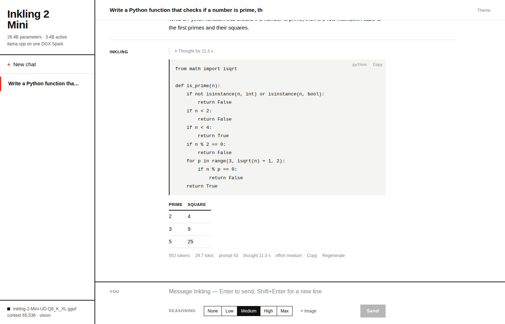
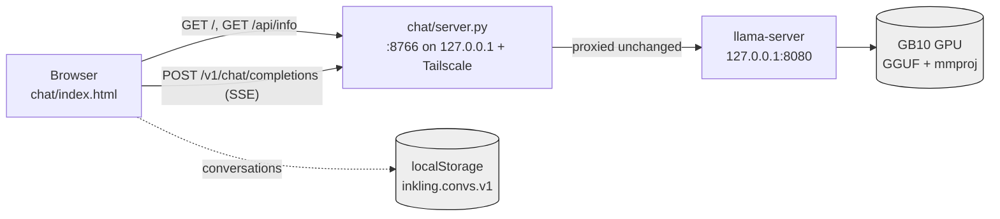
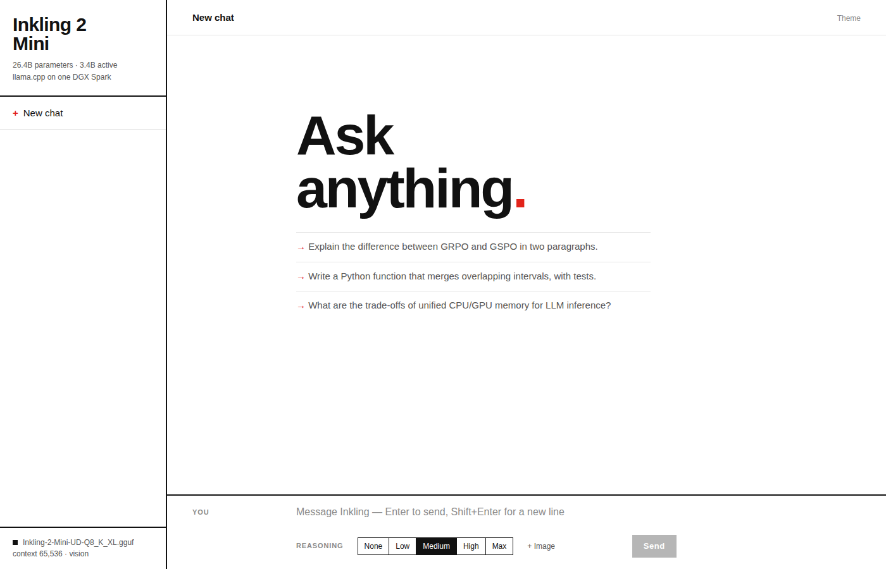
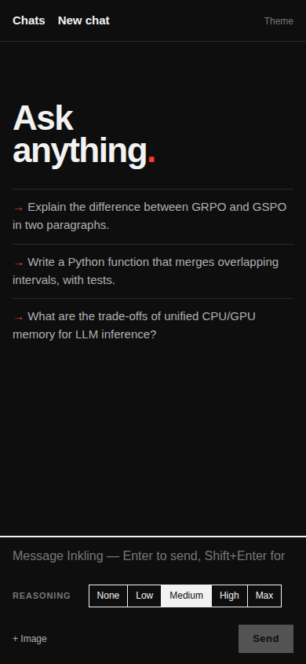

# Inkling 2 Mini on one DGX Spark: llama.cpp, NVFP4 Experts and a Swiss Chat Interface — A Technical Deep Dive

Thinking Machines released Inkling 2 Mini on 2026-11-20. One day later, this project runs it locally on an NVIDIA DGX Spark: a mainline llama.cpp build for the GB10 GPU serves the model, and a single-file chat page streams its answers, with its reasoning in a separate, collapsible panel. This report explains the model's architecture in enough detail to predict its speed, why llama.cpp and not vLLM was the runtime that worked on day one, what the downloaded GGUF file actually contains, how the chat interface is built, and what the measured 31 tokens per second means relative to the hardware's limit.

> [!summary]
> - **What runs.** Inkling 2 Mini (26.4B parameters, 3.4B active, text and images) on llama.cpp commit `afe77e1`, built for `sm_121a`, at 31.3 tokens/s generation and 813 tokens/s prompt processing (512-token prompt), using about 37 GB of the Spark's 121 GiB of unified memory.
> - **What it costs per token.** One generated token reads about 5.9 GB of weights, because twelve of the 24 layers run three times. At the Spark's 273 GB/s that bounds generation at about 46 tokens/s; the measured rate is 68 % of that bound.
> - **Where the bytes go.** Half of every token's traffic is BF16 attention and router weights, not the NVFP4 experts. That is the main lever for making it faster.
> - **The interface.** A stdlib Python proxy plus a 455-line HTML file: Swiss typographic layout, streamed reasoning, effort control, image input, conversations in `localStorage`.



## Why this project exists

The DGX Spark has spent the previous days training an 8B video model (see [[PROJECT REPORT - ForeSeek on one DGX Spark - LoRA SFT and GSPO for Long-Video Search - A Technical Deep Dive]]). With that run paused at step 326, the GPU was free, and a new open-weights model had appeared whose model card lists "1x NVIDIA DGX Spark" as a supported configuration. The goal was practical: have the model running on the Spark, reachable from a browser like a hosted chat assistant, and learn what speed this hardware gets on this architecture.

Two constraints shaped the work. The model was one day old, so every runtime's support for it was either brand new or absent. And the Spark is not a typical GPU server: its GPU is GB10 (compute capability 12.1, not the 10.0 of datacenter Blackwell), and its memory is 128 GB of LPDDR5x shared between CPU and GPU, with about 273 GB/s of bandwidth. Bandwidth, not compute, decides generation speed on this machine, so most of the analysis below is about bytes.

## Current project status

- The repository `/home/manuel/code/wesen/2026-11-21--inkling-small` holds the build, serve, start and stop scripts, the chat server and the chat page. Its commits so far are `033fa88` (scripts and interface) and `e21536a` (benchmark notes); it has no remote yet.
- llama-server listens on `127.0.0.1:8080`; the chat page is served on `127.0.0.1:8766` and on the machine's Tailscale address, port 8766.
- Text generation, streamed reasoning, the reasoning-effort setting and image input are verified end to end, and speed is measured with and without 16k tokens of prior context.
- The official NVFP4/MXFP8 safetensors are downloaded to `~/data/inkling/models/Inkling-2-Mini/` but not yet served by anything.

## The model

### Mixture of experts with looped layers

Inkling 2 Mini is a mixture-of-experts (MoE) transformer. In an MoE layer, the feed-forward block is replaced by many smaller feed-forward networks, the *experts*, and a small linear *router* that picks a few of them for each token. Inkling 2 Mini has 128 experts per layer and uses 8 per token. A token therefore touches only a fraction of the parameters, which is why the model has 26.4B parameters in total but 3.4B active.

The unusual part is the *loop*. The model stores 24 layers, but layers 6 through 17 are run three times in sequence, with the same weights each time. A token's path through the network is:

```text
layers 0..5          once     ->  6 layer passes
layers 6..17         3 times  -> 36 layer passes   (same weights, re-read each time)
layers 18..23        once     ->  6 layer passes
                                 ---------------
                                 48 layer passes per token
```

Each pass through the looped region is not quite identical. Small per-layer "loop controller" matrices (rank 64, tensors named `loop_q_ctrl_*`, `loop_k_ctrl_*`, `loop_v_ctrl_*`, `loop_ffn_ctrl_*`) modulate the queries, keys, values and feed-forward input depending on which pass is running. The model card's figure of 5.4B "weight activations" per token, against 3.4B active parameters, is this loop counted in: the looped parameters are used three times.

### The numbers that matter for speed

The GGUF metadata gives the shapes:

| Property | Value |
|---|---|
| Hidden size | 2304 |
| Attention | 24 query heads, 8 key/value heads, head size 128 |
| Attention pattern | sliding window of 1024 tokens in 5 of every 6 layers; every 6th layer attends globally |
| Experts | 128 per layer, 8 active, each with a 1152-wide hidden layer |
| Vocabulary | 201,024 (padded) |
| Context | 1,048,576 tokens |
| Loop | layers 6–17, 3 passes, controller rank 64 |
| Extras | short causal convolutions on keys, values and layer outputs; a learned relative-position bias; logit soft-capping at 30 |

Two properties follow from this. First, the KV cache is small for the context length, because five of six layers only ever keep the last 1024 tokens. That is how a 1M-token context is possible at all, and why a 64k context costs this server only a few GB. Second, per-token work is dominated by reading weights, and the loop multiplies that reading for half the layers.

## Choosing a runtime

On 2026-11-21 three runtimes were candidates. The decision came down to which one had the `inkling2_loop` architecture and could execute it on `sm_121`:

| Runtime | State on 2026-11-21 | Outcome |
|---|---|---|
| vLLM | The installed Spark images (a community `spark-vllm` build from 2026-11-19 and NVIDIA's `vllm:26.10` container) predate the architecture | Would need a fresh source build of an unreleased version |
| SGLang | Day-0 support, but its kernels target SM103 (GB300) | Not usable on GB10 without porting work |
| llama.cpp | Mainline support since ggml-org/llama.cpp#32694, with a correctness fix in #32704 merged on 2026-11-21 | Chosen |

The fix in #32704 matters more than its size suggests. NVFP4 stores each expert's weights in 4-bit blocks with per-block scales and one additional scale per expert (the `ffn_gate_up_exps.scale` and `ffn_down_exps.scale` tensors, 128 values each). The first implementation applied the per-expert scales on the first pass through a looped layer but not on the second and third. The output was fluent-looking gibberish, with a perplexity of about 130 instead of 7.65. A build from before that merge would have run, produced text and been wrong, which is the most expensive kind of failure. The build here is at `afe77e1`, which contains both changes.

## What the GGUF file contains

The served file is `Mainline_Support/Inkling-2-Mini-UD-Q8_K_XL.gguf` from `unsloth/Inkling-2-Mini-GGUF`. Unsloth publishes two layouts in that repository: files at the root use their own tensor layout, and the files under `Mainline_Support/`, with the odd extension `.gguf_file`, use the layout mainline llama.cpp expects. The start script renames the extension to `.gguf`.

The name suggests 8-bit quantisation. The tensor table says otherwise. Reading it with the `gguf-py` package shipped inside the llama.cpp checkout (the PyPI release 0.17.1 does not know quantisation type 40, NVFP4, and fails on load) gives:

| Tensor group | Type | Size |
|---|---|---|
| Experts of layers 0–19 (40 tensors) | NVFP4, the model's native format | 11.47 GB |
| Experts of layers 20–23 (8 tensors) | BF16 (MXFP8 in the original checkpoint, widened) | 8.15 GB |
| Attention, router, loop controllers, convolutions of all 24 layers | BF16 | 1.44 GB |
| Token embedding and output projection | BF16, 0.93 GB each | 1.85 GB |
| Norms, scales, biases | F32 | 0.03 GB |

In other words, this file is the original checkpoint with nothing below its native precision: the NVFP4 experts are passed through unchanged, and everything that was MXFP8 or higher is stored as BF16. That makes it a good reference file, numerically the closest thing to the original that llama.cpp can run. It is not the fastest file possible, as the next section shows.

## Building llama.cpp for GB10

`scripts/01-build-llama.sh` clones llama.cpp into `vendor/llama.cpp` (git-ignored) and builds four targets:

```bash
cmake -S vendor/llama.cpp -B vendor/llama.cpp/build -DCMAKE_BUILD_TYPE=Release \
      -DGGML_CUDA=ON -DCMAKE_CUDA_ARCHITECTURES=121a-real -DLLAMA_CURL=OFF -DBUILD_SHARED_LIBS=OFF
cmake --build vendor/llama.cpp/build -j "$(nproc)" \
      --target llama-server llama-cli llama-mtmd-cli llama-bench
```

The architecture string is the one non-default choice. `121` is GB10's compute capability. The `a` suffix compiles for the architecture-specific feature set, which on Blackwell includes the FP4 tensor-core matrix-multiply instructions; without it, CUDA builds for the portable subset and the NVFP4 kernels fall back to slower paths. `-real` emits machine code only, with no PTX for future GPUs, because the binary will never leave this machine. The build takes about ten minutes on the Spark's 20 ARM cores, most of it in the flash-attention template instances.

## Serving the model

`scripts/02-serve-model.sh` runs:

```bash
llama-server --model $MODEL --mmproj $MMPROJ --alias inkling-2-mini --jinja \
  --n-gpu-layers 999 --flash-attn on --ctx-size 65536 --parallel 1 \
  --temp 1.0 --top-p 1.0 --top-k 0 --min-p 0.0 \
  --host 127.0.0.1 --port 8080 --metrics
```

Every layer goes to the GPU (`--n-gpu-layers 999`); on unified memory this costs no copy, it only decides which processor runs the layer. `--mmproj` loads the 0.64 GB vision projector, which turns an image into tokens the language model reads. The sampling values are the model card's: plain sampling at temperature 1.0 with every truncation turned off. `--jinja` makes llama-server execute the chat template embedded in the GGUF instead of a built-in approximation.

### The chat template and reasoning

The template wraps messages in role tokens (`<|message_user|>`, `<|message_model|>`, `<|message_system|>`) and, inside a model turn, separates a thinking section (`<|content_thinking|>`) from the answer (`<|content_text|>`). Because llama-server knows this template's thinking markers, it splits the streamed output into two fields of the OpenAI-style delta: `reasoning_content` for the thinking and `content` for the answer. The client does not have to parse tags.

The template also accepts a `reasoning_effort` argument, which it maps to a number and writes into a system message as "Thinking effort level: X":

| `reasoning_effort` | none | minimal | low | medium | high (default) | xhigh / max |
|---|---|---|---|---|---|---|
| level | 0.0 | 0.1 | 0.2 | 0.7 | 0.9 | 0.99 |

The client passes it per request in `chat_template_kwargs`. Effort is a soft instruction, not a switch: asked "What is 17*23? Answer briefly." at effort `none`, the model still wrote a one-line thought (92 characters) before answering `391`. At `high` the thought was 111 characters. On harder prompts the difference is large; on trivial ones the model compresses its reasoning either way.

## The chat interface

### Architecture



The page talks to its own origin only. `chat/server.py` serves the page, answers `/api/info` with the backend's health, model file, context size and modalities (from llama-server's `/health` and `/props`), and forwards everything under `/v1/` to llama-server. That proxy exists for two reasons: the page and the API share an origin, so there is no CORS configuration, and llama-server can stay bound to loopback while the page is reachable over Tailscale. Neither the proxy nor llama-server has authentication, which is why it binds only to loopback and the Tailscale interface and never to a public address.

### Streaming through a proxy

A naive proxy breaks streaming. Python's `http.client` buffers, and if the proxy copied llama-server's `Content-Length` or `Transfer-Encoding` headers through, the browser would either wait for the whole body or misparse it. The proxy drops hop-by-hop headers, then re-chunks the body itself:

```python
while True:
    chunk = r.read1(65536)          # returns as soon as any bytes are available
    if not chunk:
        break
    self.wfile.write(b"%x\r\n%s\r\n" % (len(chunk), chunk))
    self.wfile.flush()
self.wfile.write(b"0\r\n\r\n")
```

`read1` is the important call: unlike `read(n)`, it does not wait for `n` bytes. Each server-sent event therefore reaches the browser as soon as llama-server writes it. When the user presses Stop, the browser aborts the fetch, the proxy's write raises `BrokenPipeError`, and the `finally` block closes the upstream connection, which makes llama-server cancel the generation.

### The page

The page is one HTML file of 455 lines with inline CSS and JavaScript, no build step and no external requests. Its generation loop reads the SSE stream line by line and sorts each delta into the right field:

```javascript
const d = j.choices?.[0]?.delta || {};
if (d.reasoning_content) msg.reasoning += d.reasoning_content;
if (d.content) { if (tThinkEnd == null) tThinkEnd = performance.now(); msg.content += d.content; }
if (j.timings) Object.assign(msg.stats, { tokens: j.timings.predicted_n,
                                          tps: j.timings.predicted_per_second,
                                          prompt_tokens: j.timings.prompt_n });
paint();   // at most one re-render per animation frame
```

The time of the first answer token marks the end of thinking, which gives the "Thought for 11.3 s" label. The `timings` object that llama-server attaches to the final event gives the token count and speed printed under each answer. Rendering is throttled to one `requestAnimationFrame` per frame, so 30 tokens per second never cause 30 full re-renders per second, and the view only follows the stream when the user is already near the bottom.

Markdown is rendered by a small escape-first renderer: the text is HTML-escaped before any markup is recognised, so model output can never inject HTML. It handles headings, lists, tables, block quotes, fenced code (with a language label and a Copy button), inline code, emphasis and links. Images can be attached by button, paste or drag-and-drop; they are sent as data URLs in OpenAI `image_url` content parts, and the attach button is disabled when `/api/info` reports that the server has no vision projector.

One rendering bug surfaced in the first screenshot test. The thinking panel is a `<details>` element, open while the model thinks. To keep a panel the user opened open across re-renders, the page records which panels are open before replacing the HTML. That bookkeeping also recorded the panel that was open only because it was live, so it stayed open after the answer began. The fix excludes live panels from the record, so the reasoning collapses to "+ Thought for N s" as soon as the answer starts, and stays where the user put it after that.

### Swiss layout

The design follows the International Typographic Style: Helvetica (with Arial and system fallbacks), black on white, one red accent (`#e2231a`), 2 px rules as the only structure, a fixed label column and a measure capped at 72 characters. Each turn is a two-column grid with a small uppercase label ("YOU", "INKLING") on the left and the text on the right. Red appears only where something is active: the selected conversation's edge, the live "Thinking…" label, the blinking cursor, the Stop button, the period of "Ask anything." Dark mode is defined as a separate set of colour tokens rather than an inversion, and a Theme toggle overrides the system preference. On a phone the sidebar becomes a top bar and the label column disappears.





## Measurements

`llama-bench` with flash attention, every layer on the GPU, three repetitions each, while the server was idle:

| Test | Tokens/s |
|---|---|
| Prompt processing, 512 tokens | 813 ± 8 |
| Prompt processing, 4096 tokens | 567 ± 6 |
| Generation, 128 tokens | 31.34 ± 0.02 |
| Prompt processing, 512 tokens, after 16,384 tokens of context | 304 ± 31 |
| Prompt processing, 4096 tokens, after 16,384 tokens of context | 305 ± 3 |
| Generation, 128 tokens, after 16,384 tokens of context | 28.20 ± 0.07 |

The chat page reports the same generation speed in practice: 29.7–29.9 tokens/s for answers of 40 to 500 tokens, slightly lower than the benchmark because each request also pays for sampling and HTTP framing. An image prompt of 843 tokens was processed in about 2 seconds, and the model read the screenshot of its own chat page correctly ("Ask anything.", red period). With the 64k context and the vision projector loaded, the machine's memory use was about 37 GB.

### What the bandwidth allows

During generation, each new token requires reading every weight the token uses, once, from memory. With the tensor sizes above, the bytes per token are:

| Component | Passes | Bytes per pass | Total |
|---|---|---|---|
| Attention, router, loop controllers (BF16) | 48 | 60 MB | 2.88 GB |
| 8 NVFP4 experts (7.96M parameters each, 4.5 bits) | 44 | 36 MB | 1.58 GB |
| 8 BF16 experts, layers 20–23 | 4 | 127 MB | 0.51 GB |
| Output projection (BF16) | 1 | 926 MB | 0.93 GB |
| **Total** | | | **≈ 5.9 GB** |

The token embedding is a single row lookup and does not count. At 273 GB/s, 5.9 GB per token bounds generation at about 46 tokens/s. The measured 31.3 tokens/s is 68 % of that bound, which is a normal efficiency for a batch-1 MoE decode with many small kernels: 48 layer passes, each with a router, a top-8 selection, two expert matrix products and several small convolutions and norms.

The table shows where speed would come from. The experts, the part that was carefully quantised to NVFP4, are only 27 % of the traffic. The BF16 attention and router weights are 49 %, and they are read 48 times per token because of the loop. The output projection over a 201k vocabulary is another 16 %.

Prompt processing behaves differently. A batch of prompt tokens shares each weight read, so it is limited by compute and kernel efficiency instead of bandwidth. 813 tokens/s is low for a model with 3.4B active parameters. The likely reasons are the 48 layer passes and that the NVFP4 MoE path in llama.cpp is one day old, but this has not been profiled.

### Long contexts

With 16,384 tokens already in the cache, generation slows by only 10 % (31.3 to 28.2 tokens/s), while prompt processing roughly halves (813 to 304 tokens/s). This is the sliding-window design at work. During generation, the twenty layers with a 1024-token window read the same amount of KV cache whatever the context length; only the four global layers read all 16k keys and values, and that read is small next to the 5.9 GB of weights. During prompt processing, every new token attends to the whole cache in the global layers, so attention cost there grows with depth and becomes a large share of the work.

## Failure modes encountered

- **The model that does not exist.** The request named "Inkling Mini". There is no model by that name. `tbmod/Inkling-mini-bf16` exists on Hugging Face but is a deliberately broken test fixture. The intended model is Inkling 2 Mini.
- **A root-owned Hugging Face lock directory.** The first download failed with `PermissionError` on `~/.cache/huggingface/hub/.locks/models--thinkingmachines--Inkling-2-Mini`, because containers running as root had created parts of the cache earlier. The repair was structural: the cache moved to `~/data/huggingface`, `~/.cache/huggingface` became a symlink to it, and the global agent instructions now require containers that write into `~/data` to run as the invoking user.
- **`hf download` ignoring `--include`.** Passing file names after `--include` made the CLI treat them as explicit file names and ignore the flag with a warning. Positional file names are the correct form.
- **`pkill -f` matching itself.** A `pkill -f "hf download unsloth/..."` matched the shell that ran it and killed the session's own command. The stop script writes its patterns with a bracketed character, such as `chat/server[.]py`, which matches the target process but not the literal command line containing the pattern.
- **An outdated `gguf` package.** PyPI's `gguf` 0.17.1 raises `ValueError: 40 is not a valid GGMLQuantizationType` on this file; the copy in `vendor/llama.cpp/gguf-py` reads it.

## Open questions

- How much faster does generation get with the dense BF16 tensors in Q8_0? The byte table predicts about 4.5 GB per token and a bound near 60 tokens/s. The `ggml-org/Inkling-2-Mini-GGUF` repository offers Q8_0 (27.8 GB, larger because its experts are 8-bit) and IQ4_NL (17.6 GB) files, neither of which matches this split exactly.
- The official checkpoint includes `mtp.safetensors`, a 636 MB multi-token-prediction head. llama.cpp does not use it. Speculative decoding with it, in a runtime that supports it, could raise generation speed without changing the weights.
- Does a source-built vLLM with the native NVFP4/MXFP8 weights beat llama.cpp on this machine, especially for prompt processing and concurrent requests?
- Generation at 128k tokens of context and beyond has not been measured; the 16k result predicts a slow, roughly linear decline.

## Near-term next steps

- Benchmark the alternative GGUF quantisations against the byte-table prediction.
- Pin `LLAMA_REF=afe77e1` in the README so a rebuild reproduces this result.
- Add a remote for the repository.

## Project working rule

Before optimising, count the bytes. On the Spark, generation speed is memory bandwidth divided by bytes per token, and the byte count depends on what the file actually contains and how often each tensor is read, not on the quantisation name in the file name.
