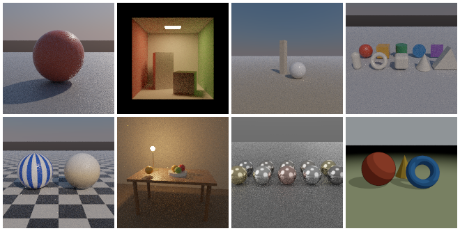
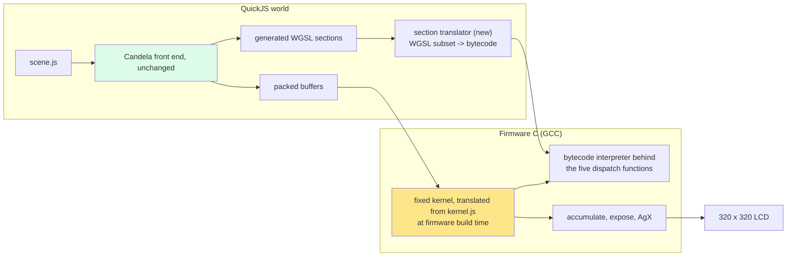

# PicoCalc Candela: What a Physically Based Path Tracer Costs on a 360 MHz Handheld — A Technical Deep Dive

Candela is a physically based path tracer whose scenes are JavaScript programs. It runs in browsers on WebGPU and WebGL2, and two earlier projects moved it onto an NVIDIA DGX Spark ([[PROJECT REPORT - Candela on the DGX Spark - From a JavaScript Scene API to OptiX Ray Tracing - A Technical Deep Dive]]) and into embedded V8 ([[PROJECT REPORT - Candela Render Runtime - Running Candela Scenes in Embedded V8 - A Technical Deep Dive]]). This report asks the opposite question: what would it take to run Candela programs on the PicoCalc, a handheld whose ESP32-P4 has two 360 MHz RISC-V cores, a single-precision FPU, no GPU, and JavaScript worlds limited to a megabyte of heap?

The work was research and design, not implementation. It ran Candela's own generated GPU program, translated to C++, on the ESP32-P4's instruction set and counted every instruction; compared five numeric models on fragments of Candela's kernel; ran Candela's unmodified front end in the firmware's QuickJS build; and turned the measurements into a design and five follow-up tickets. Every number below comes from a script in the ticket and was produced on a host; none comes from the device, which was busy with other benchmarks. Where a number is an estimate, the assumption behind it is stated.

> [!summary]
> - **Candela's kernel, counted.** Translated mechanically from WGSL to C++ and compiled with the ESP32-P4's GCC, Candela's own path tracer costs **6,100-11,300 RV32 instructions per camera sample** on ordinary presets. On outdoor scenes 40% of that is newlib's `sinf`/`cosf`/`expf`; a sine-based noise hash makes one preset ten times more expensive than the rest.
> - **f32 on the FPU, decisively.** On three kernel fragments, f32 costs 14-49 instructions per call. Fixed point that Typed's `i32` can express gets the answers wrong; 64-bit fixed point is 9-50x slower and still overflows; soft float is 90-130x slower; a bytecode interpreter is 7-20x slower.
> - **Candela's front end runs in QuickJS.** All 105 presets build in the firmware's QuickJS with WGSL and diagnostics identical to Node's. Once one constant table is memoised (it is 99% of a simple build, two minutes or more on the device otherwise), the simplest scene builds in an estimated 70-120 ms on the device.
> - **The design.** Keep Candela's front end unchanged in a QuickJS world; translate its fixed kernel to C when the firmware is built; translate each scene's generated code to a register bytecode on the device; render 160 x 160 progressively at an estimated **28,500-41,000 samples per second per core** for the simplest scene.

## Why this project exists

The PicoCalc firmware runs JavaScript programs ("worlds") in QuickJS and compiles a typed JavaScript subset ("Typed") to RISC-V machine code on the device. A Typed integer ray tracer already draws a 160 x 160 frame of spheres with hard shadows in 16.26 ms, and an earlier ticket built Candela-inspired material graphs in Typed (`ttmp/2026/11/20/PICOCALC-CANDELA--...`). Neither runs Candela itself: that ticket's materials were a 303-cell Q8 graph and its scenes were two fixtures. The request that started this work was direct: "make it possible to run candela programs on the esp32p4 / subset of the JS API", with subagents allowed as long as each keeps a diary and the work is split into tickets with design documents.

The design questions were the brief's: which part of Candela's API is realistic, at what resolution and sample rate; which numeric model (an f32 type in Typed, fixed point in Typed's `i32`, or an interpreter for Candela's IR in C); where each stage runs; and what is reused versus rewritten.

## Current project status

- Ticket `PICOCALC-CANDELA-P4` in `/home/manuel/code/wesen/2026-10-20--ds-js-os/ttmp/2026/11/21/PICOCALC-CANDELA-P4--run-a-subset-of-candela-on-the-esp32-p4/` holds the analysis, the design, two diaries, 14 scripts and their outputs.
- Follow-up tickets with design stubs exist for the implementation: `PICOCALC-CANDELA-CPU-KERNEL`, `PICOCALC-CANDELA-SECTIONS`, `PICOCALC-CANDELA-WORLD`, `PICOCALC-CANDELA-FIRST-LIGHT` and `PICOCALC-TYPED-F32`.
- Nothing has run on the device yet. The first device measurement (cycles per sample) is the acceptance test of the CPU-KERNEL ticket.
- Input: the Candela archive `~/Downloads/candela-workspace(1).zip`, SHA-256 `873b2dd4bb9c32cac08751baf9fa6960ee4377306a04b2e118a8969dd940df5d`; copies were kept out of the repository.

## Project shape

| Path (under the ticket) | What it is |
|---|---|
| `analysis/01-how-candela-turns-a-scene-program-into-pixels.md` | Candela end to end, the preset census, the measured cost model |
| `design-doc/01-a-candela-subset-for-the-esp32-p4.md` | The decisions with their evidence, the subset, the rendering policy, the ticket split |
| `reference/01-investigation-diary.md` | Main diary: what was tried, what failed, exact commands |
| `reference/02-quickjs-front-end-diary.md` | The QuickJS subagent's diary |
| `scripts/01-census.mjs`, `02-tiers.mjs` | Build all 105 presets in Node and sort them by the kernel they need |
| `scripts/03-export-scene.mjs` .. `08-tonemap-png.py` | Export a preset, translate its WGSL to C++, build for host and RV32, count, compare |
| `scripts/06-rv32imfc-count.c` | A counting RV32I+M+F+C interpreter with per-function profiles |
| `scripts/09-numeric-bench.c`, `10-numeric-bench.sh`, `11-libm-cost.c` | Five numeric models on three kernel fragments; newlib per-call costs |
| `scripts/12`-`14` | Profile grouping, entry-call counts, the cycle model |
| `scripts/quickjs/` | A host runner for the firmware's vendored QuickJS and a driver for Candela |

## Implementation details

### Candela in one page

A Candela scene file is ordinary JavaScript that calls a builder API and default-exports the result:

```js
export default scene()
  .add(shape.sphere(1).at(0, 1, 0)
    .material(material.pbr().baseColor('#c8553d').roughness(0.4)))
  .add(shape.plane(30).material(material.pbr().baseColor(0.18)))
  .light(light.daylight({ elevation: u.deg(40), turbidity: 3 }))
  .camera(camera.thinLens().at(0, 1.6, 6).lookAt(0, 0.9, 0));
```

That value is a tree of frozen component records. Four functions turn it into pixels: `build` runs the module and collects diagnostics; `compile` (`src/compile.js`) lowers the tree to objects, lights and materials and generates WGSL for everything that is code; `pack` evaluates transforms and parameters into flat `Float32Array`s; and a fixed WGSL path tracer consumes the program and buffers on the GPU. Functions a scene passes to Candela run in one of three stages: at build time (structure), at trace time (symbolically, against proxies, producing a typed expression DAG that becomes shader code), or at run time on the host (animations, behaviors, parameter maps). The run stage is why a port needs a JavaScript engine next to the kernel.

Materials are where Candela is clever. `material.pbr()` is defined in Candela's own BSDF algebra as a `mix` of a dielectric coat `layer`ed over Lambert and a Schlick conductor; `compile.js` `genSurface` lowers the algebra to *stochastic selection*, so each shading point evaluates exactly one lobe. B-01's sphere material, as generated, chooses between a reflect-only GGX coat and a Lambert lobe with the Fresnel probability:

```wgsl
let f0_1: f32 = fresnelDielectric(clamp(dot(wo, h.N), 0.0, 1.0), ((1.0 + sqrt(clamp(m1, 0.0, 0.99))) / (1.0 - sqrt(clamp(m1, 0.0, 0.99)))));
if (u < f0_1) {
  u = u / max(f0_1, 1e-6);
  L.kind = 3; L.ior = ...; L.c0 = vec3f(1.0, 1.0, 1.0); L.ax = max(0.4 * 0.4, 0.0005); L.ay = L.ax; L.N = h.N; L.flags = 2;
} else {
  u = (u - f0_1) / max(1.0 - f0_1, 1e-6);
  L.kind = 1; L.c0 = vec3f(0.57758044, 0.0908417112, 0.0466650863); L.N = h.N;
}
```

Per camera sample, the kernel generates a thin-lens ray, then loops up to five bounces: find the nearest hit (`traceAll`: unbounded objects, then a BVH with a 40-entry stack; `hitObj` solves quadrics analytically and sphere-traces rounded shapes and SDFs), evaluate the material, add emission, sample one light with a shadow ray and weight it by multiple importance sampling, sample the lobe for the next direction, and apply Russian roulette from depth 2. Escaped rays evaluate the sky: a Preetham model with exponentials per direction.

### Running Candela's own kernel on RV32

Estimating operations per sample by reading the kernel would measure the reader. Instead the project ran Candela's generated program. `scripts/04-wgsl2cpp.mjs` translates the assembled WGSL to C++: declarations, prototypes for all 116 functions, struct parameters as `const&`, a generated vector prologue with only the swizzles used, an `f` suffix on every float literal, all inside a `cdl` namespace. A harness binds the packed buffers to the kernel's accessors exactly as Candela's WebGPU backend binds them to storage buffers, and calls `renderPixel` per pixel. The same C++ builds natively, giving a reference image, and with `riscv32-esp-elf-g++` 14.2 for `rv32imafc/ilp32f`, the multilib the PicoCalc firmware links.

The repository's emulator only executes RV32IM, so the project wrote `scripts/06-rv32imfc-count.c`, an interpreter for RV32I, M, F and compressed instructions that counts by class and attributes instructions to functions from the ELF symbol table. Counts subtract a baseline build without the pixel loop.

The translated kernel renders the presets recognisably (host renders, 64 samples per pixel, 160 x 160, simple tone curve):



*Top: hello sphere, Cornell box, sun and sky, primitives. Bottom: patterns, a lamp-lit table with fbm wood, measured metals, the custom toon integrator.*

RV32 and host frames agree in mean luminance within 0.7% on all ten presets measured; the deterministic toon preset agrees within 1% on every pixel. Two GPU idioms broke the first runs and are worth remembering for any CPU port of WGSL:

- **Eager `select`.** WGSL's `select(f, t, c)` evaluates both arguments. Candela computes `hdriPdf(rd)` even without an HDRI, which divides by zero in `hdriTexel`; a GPU returns garbage silently, x86 raises `SIGFPE`. The translator turns `select` into a conditional except where an argument draws a random number, which keeps the random stream intact.
- **Sine hashes.** `fract(sin(dot(p, k)) * 43758.5453)` is cheap on a GPU. newlib computes `sinf` of a large argument exactly, with Payne-Hanek reduction: 1,961 instructions per call. Five octaves of fbm call it 120 times.

### What a sample costs

| Preset | What it exercises | RV32 instructions per sample, -O3 |
|---|---|---:|
| E-02 toon | custom integrator, one bounce | 3,503 |
| A-01 mix | BSDF `mix` with a uniform and a stripe field | 6,173 |
| L-03 sun and sky | box, sphere, plane, dynamic sun | 6,136 |
| B-01 hello sphere | sphere, plane, pbr, sun and Preetham sky | 7,100 |
| M-04 glass | refracting dielectrics | 7,374 |
| F-01 patterns | checker, stripe and ramp fields | 7,892 |
| M-02 metals | eleven measured conductors, studio environment | 8,378 |
| R-01 Cornell box | seven rects and boxes, one area light | 9,354 |
| G-01 primitives | quadrics and five sphere-traced shapes | 10,289 |
| W-02 table | fbm wood, a point light | 78,624 |

Grouping B-01's profile by kernel part at -O2: libm sine and cosine 27% (cosine-weighted hemisphere sampling calls `cosf`/`sinf` of angles up to 2 pi, about 111 instructions each through `__ieee754_rem_pio2f`), traversal and intersection 23%, `expf` for the sky 16%, the inlined path loop and camera 11%, sky evaluation 9%, materials 4.5%, light sampling 4%. In the Cornell box, traversal is 67%. About 46% of instructions are floating-point; there are 70-110 `fdiv.s` and 15-28 `fsqrt.s` per sample.

A CPU-specific prologue (polynomial `sin`/`cos`/`exp`, a `floor` through `fcvt` because RV32F has no rounding instruction and newlib's `floorf` is a 25-instruction call) cuts B-01 by 24% and W-02 by 81%, to 14,967 instructions per sample. After that, the Preetham `perez` function is B-01's largest single function, which makes a direction-indexed sky table the next lever.

### Numeric models

`scripts/09-numeric-bench.c` implements three fragments of Candela's kernel (the sphere test from `hitObj`, the GGX term from `evalLobe`, `safeNorm`) five ways and runs each on 2,000 inputs:

| Fragment | f32 | soft float | Q16.16, 64-bit | Q16.16, 32-bit | bytecode VM |
|---|---:|---:|---:|---:|---:|
| sphere test | 23 | 2,121 | 215 | 95, 153/481 hit/miss wrong | 338 |
| GGX term | 49 | 6,277 | 2,439, p99 error 16x | 848, median error 77% | 958 |
| `safeNorm` | 14 | 1,793 | 799 | 427, median error 38% | 99 |

*RV32 instructions per call; f32, soft float and VM agree with double precision to about 1e-7.*

The 32-bit fixed point Typed can express today must pre-shift operands before multiplying, which discards exactly the low bits that decide whether a grazing ray hits. The 64-bit variant computes the sphere test but needs operations Typed lacks and still overflows on GGX, whose distribution term peaks at 1/(pi alpha^2), 1.3e6 at Candela's minimum roughness, against Q16.16's ceiling of 32,767. The scene data settles it independently: the census found the sun's radiance at 1.83e9 next to reflectances of 0.03 in the same buffers.

### The front end in QuickJS

A subagent built a host runner around the firmware's vendored QuickJS (2026-06-04 with the firmware's patches), in 64-bit and 32-bit, with a counting allocator, the firmware's interrupt-step counter and a C-stack high-water mark. Its findings:

- All 105 presets build. The generated WGSL is byte-identical to Node's for every preset, and the 28 diagnostics match in code and location. The only shim is an `atob` global for one preset's base64 mesh data.
- `ggxTableWGSL()` recomputes a constant 256-entry GGX albedo table by Monte Carlo on every compile: 26.7 million QuickJS steps, 3.7 s of CPU in the 32-bit host build, more than 99% of B-01's build. With a memo (WGSL unchanged), B-01 builds in 2.0 ms, R-01 in 3.2 ms, W-02 in 6.5-6.8 ms; the median over all 105 presets is 4.2 ms. B-01's `pack` takes 0.11-0.34 ms.
- Loading Candela's 15 modules (329 KB of source) takes 16 ms, almost all of it compiling source, and leaves 1.37 MB of heap in 32-bit QuickJS: loading fails under a world's default 1 MB limit and succeeds at 2 MB. B-01's build peaks at 1.65 MB.
- Every preset but one fits the world's 56 KB C stack in 32-bit QuickJS; S-04 needs 69 KB because `fx.js`'s code generator recurses once per expression level.
- QuickJS ignores `//# sourceURL=`, so Candela's `callSite()` cannot find user frames in a bundled build: diagnostics would lose user line numbers unless the host compiles scene files with a name.
- Some scene files are expensive in themselves: M-12 runs a Monte Carlo furnace test in its scene code (14.7 s in host QuickJS), X-02 rebuilds a 10,001-object BVH in every `pack` (2.4-2.9 s).

Two scale factors turn host times into device estimates. The nucleus calibrates QuickJS on the device at 133 ms for a 100,000-iteration loop and 31 ms for `fib(20)`; the 32-bit host build runs them 44 and 33 times faster. A System world measured on both (4.70 ms on the host's 64-bit build, 287.9 ms on the P4) gives about 61 against the 64-bit build, consistent with the 64-bit calibration loop. By these factors B-01's build takes about 67-120 ms on the device, its `pack` 4-15 ms, the module load 0.5-1.0 s (avoidable with bytecode, which the firmware already uses for its prelude), and the GGX table at least two minutes. All of these factors come from integer-heavy code; Candela's front end computes in doubles, which the P4 emulates in software, so they are lower bounds.

### The design

Candela already separates a front end from a target, and both earlier ports kept the front end and replaced the target. On the PicoCalc the split falls along a seam that `compile.js` itself draws:

```js
const shared = head + PRELUDE + SPECTRAL + ggxTableWGSL() + sdfCode + hfCode + densCode + CORE + metalAt + matCode + PATH;
```

`PRELUDE`, `SPECTRAL`, `CORE` and `PATH` are the same for every scene. `sdfCode`, `hfCode`, `densCode` and `matCode` are generated per scene and are reached only through `sdUser`, `heightAt`, `densityOf`, `evalMaterial` and `customKernel`.



Why an interpreter for generated code is acceptable comes from one measurement: instrumenting the translated kernel shows `evalMaterial` called 0.8-1.7 times per camera sample. At about 22 RV32 instructions per bytecode instruction, a simple material costs a few percent of a sample and a field-driven one about 10%, as long as heavy operations (`fresnelDielectric`, noise, fbm) are calls into compiled kernel code. After constant folding, B-01's material becomes:

```text
  DOT      f1, v1, v0          ; dot(wo, N)
  CLAMP01  f1, f1
  CALL     f2, fresnelDielectric(f1, 1.5)
  CHOOSE   f0, f2, else=L1     ; stochastic selection, u rescaled
  LOBE     kind=3 flags=2 ior=1.5 c0=(1,1,1) ax=ay=0.16
  RET
L1:
  LOBE     kind=1 c0=(0.5776,0.0908,0.0467)
  RET
```

User SDFs are the exception: sphere tracing calls them up to 220 times per ray, so they are the first candidate for native code, which is where an f32 type in Typed would eventually pay. The fixed kernel itself gains nothing from on-device compilation and loses a factor of two to GCC (the Typed integer ray tracer runs at 2.11x GCC -O3's time).

The first subset is tier T0 of the census: 28 presets that need only analytic shapes, Lambert, GGX conductor and coat lobes, point, spot, area and sun lights, simple environments and the Preetham sky. Tier T1 (29 more) adds fixed kernel features to verify; T2 (38 more) needs the bytecode path; T3 (meshes, HDRIs, 10,001 spheres) is out of scope.

### From instructions to time

Instruction counts become cycles under stated assumptions (`scripts/14-cycle-model.py`): 1.13 cycles per integer, memory and branch instruction (measured for GCC's integer ray tracer on this board), 10-30 cycles per `fdiv.s`/`fsqrt.s`, and 1-2 cycles per other FP instruction. For B-01 at -O3 that is 8,800-12,600 cycles per sample.

| Rendered size | One pass, B-01 (estimate) | 16 passes |
|---|---:|---:|
| 80 x 80 | 0.16-0.22 s | 2.5-3.6 s |
| 160 x 160 | 0.63-0.90 s | 10-14 s |
| 320 x 320 | 2.5-3.6 s | 40-57 s |

The policy: render 160 x 160 progressively, one sample per pixel per pass, scale by two to the 320 x 320 screen, and drop to 80 x 80 while the camera or a slider moves. Candela's à-trous denoiser, as written, costs about ten samples' worth per pixel (three `exp` and one `pow` per tap, 100 taps), so it runs once when accumulation pauses.

## Important project docs

- `/home/manuel/code/wesen/2026-10-20--ds-js-os/ttmp/2026/11/21/PICOCALC-CANDELA-P4--run-a-subset-of-candela-on-the-esp32-p4/analysis/01-how-candela-turns-a-scene-program-into-pixels.md`
- `/home/manuel/code/wesen/2026-10-20--ds-js-os/ttmp/2026/11/21/PICOCALC-CANDELA-P4--run-a-subset-of-candela-on-the-esp32-p4/design-doc/01-a-candela-subset-for-the-esp32-p4.md`
- `/home/manuel/code/wesen/2026-10-20--ds-js-os/ttmp/2026/11/21/PICOCALC-CANDELA-P4--run-a-subset-of-candela-on-the-esp32-p4/reference/01-investigation-diary.md`
- Follow-up design stubs: `ttmp/2026/11/21/PICOCALC-CANDELA-{CPU-KERNEL,SECTIONS,WORLD,FIRST-LIGHT}--*/design-doc/01-design-stub.md` and `ttmp/2026/11/21/PICOCALC-TYPED-F32--*/design-doc/01-design-stub.md`
- Commits in the code repository: `1b33fe6` (ticket, census, tiers), `370014c` (kernel counts, numeric models, analysis), `51dc641` (design, follow-up tickets), `0c00b3b` (final front-end numbers in the design), `cede036` (the QuickJS study's scripts, results and diary).

## Open questions

- **Cycles per instruction on the device.** Every time figure is an instruction count times an assumed CPI. Divider latency, FP stalls and instruction-cache behaviour of a 42-55 KB kernel are unknown until the CPU-KERNEL ticket measures them.
- **Front-end speed on soft-float.** The host-to-device factors (33-61) were measured on integer-heavy code; Candela's builds compute in doubles.
- **Interpreter overhead on SDF scenes**, and whether native code for them comes from Typed f32 or from a direct emitter.
- **Dual-core rendering.** The firmware's painter service avoids the second core because contention can push UI draws past their deadlines.
- **Stack depth.** `fx.js`'s code generator recurses per expression level; one preset needs 69 KB of C stack in 32-bit QuickJS against the world's 56 KB.

## Near-term next steps

1. CPU-KERNEL: make the translator a firmware build step, add the CPU math and sky table, and measure B-01's cycles per sample on the device.
2. SECTIONS: the on-device translator and C interpreter, with a host agreement test over all presets.
3. WORLD: Candela's modules as QuickJS bytecode in a world with raised limits; device build and pack times.
4. FIRST-LIGHT: B-01 and R-01 on the PicoCalc's screen, compared with host goldens.

## Project working rule

Measure Candela's own code, not a re-implementation of it: translate what Candela generates, count it, and compare it with a host build of the same translation before believing any number. Keep the Candela front end unchanged, so the PicoCalc port stays in step with Candela the way the DGX Spark and V8 ports did.

## Related notes

- [[PROJECT REPORT - Candela on the DGX Spark - From a JavaScript Scene API to OptiX Ray Tracing - A Technical Deep Dive]]
- [[PROJECT REPORT - Candela Render Runtime - Running Candela Scenes in Embedded V8 - A Technical Deep Dive]]
- [[PROJECT REPORT - PicoCalc Compiler - Closing the Typed Ray Tracer's Gap to C - From 5.8x to 2.1x in Measured Steps - A Technical Deep Dive]]
- [[ARTICLE - PicoCalc Typed Ray Tracer Lab - A complete ray tracer in Typed]]
